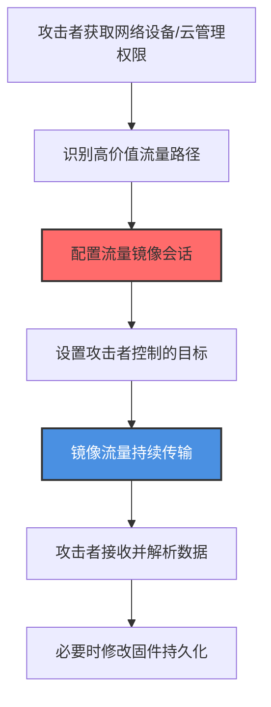
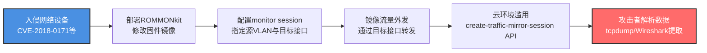

# 流量复制 (T1020.001)

## 一句话通俗理解

> **像在快递分拣中心偷偷装了一条传送带，把所有经过的包裹都复制一份送到自己仓库——不用动手去偷，让网络自己把数据送上门**

## 30秒速查卡

| 维度 | 你需要知道的 |
|------|-------------|
| 这是什么？ | 攻击者滥用网络设备或云平台原生的流量镜像功能（SPAN、RSPAN、AWS Traffic Mirroring、GCP Packet Mirroring、Azure vTAP），将目标流量复制到攻击者控制的目的地，实现自动化数据窃取 |
| 为什么危险？ | 流量镜像在网络设备底层完成，绕过主机EDR和操作系统级监控；云环境的镜像会话通过API即可建立，难以被传统安全工具发现 |
| 谁需要关心？ | 网络运维团队、云安全管理员、SOC分析师、关键基础设施运营者 |
| 你的第一步防御 | 监控所有网络设备和云平台上的镜像会话配置变更，建立"已批准镜像会话"白名单 |
| 如果只做一件事 | 在所有路由器/交换机上启用配置变更审计，对 `monitor session`、`mirror port` 命令触发实时告警 |

## 难度等级

⭐⭐⭐ 高级 - 需要深入的网络设备和云平台管理权限，以及对基础设施配置的理解

## 前置知识检查

**读这个文件需要什么？**

- [ ] 网络交换机基础（SPAN/RSPAN/VSPAN概念）
- [ ] 云平台网络虚拟化（AWS VPC、GCP VPC、Azure VNet）
- [ ] 网络设备操作系统（Cisco IOS、Juniper Junos）
- [ ] 云API权限模型（IAM角色、策略继承）

## 技术描述

**流量复制**（T1020.001）是 **自动化渗漏**（T1020）的一个具体子技术，属于 **渗漏** 阶段的攻击技术。

简单来说，就像在快递分拣中心秘密安装了一条传送带，把所有经过的包裹都复制一份送到自己仓库——不用动手去偷，让网络自己把数据送上门。

### 具体怎么理解？

攻击者利用网络设备或云平台原生支持的流量镜像功能，将网络流量自动复制到攻击者控制的目的地。流量镜像本身是合法的网络运维功能，用于网络分析、故障排查和安全监控，但攻击者滥用此功能实现隐蔽、自动化的数据渗漏。

与父技术 T1020 相比，T1020.001 的核心差异在于：**不需要在主机上部署任何渗漏脚本，而是利用网络基础设施自身的镜像能力**。这种"基础设施即渗漏工具"的方式让攻击者完全绕过主机层面的检测。

### 为什么有效？

这种技术之所以有效，是因为：

1. **绕过主机检测**：流量复制在网络设备的数据平面完成，主机EDR、Sysmon等端点监控工具完全看不到
2. **合法功能掩护**：流量镜像是网络设备的原生功能，配置变更可能被误认为是运维操作
3. **大规模自动化**：一次配置即可持续镜像所有流量，无需为每台主机单独部署渗漏工具
4. **云环境友好**：AWS Traffic Mirroring、GCP Packet Mirroring、Azure vTAP 等云原生功能可通过API快速配置

**过渡段：** 不要以为数据渗出就是'在主机上跑脚本上传文件'——攻击者可能在网络设备上动了一行配置，整个子网的流量就自动复制到攻击者的服务器了。

### 攻击者如何滥用？

1. **网络设备层**：通过 `ROMMONkit`（T1542.004）或 `Patch System Image`（T1601.001）修改路由器固件，植入持久化的流量镜像配置
2. **云平台层**：滥用云管理API创建未授权的Traffic Mirroring会话，将目标VPC流量镜像到攻击者控制的EC2实例
3. **结合其他技术**：常与 `Network Sniffing`（T1040）、`Input Capture`（T1056）、`Adversary-in-the-Middle`（T1557）配合使用

## 真实攻击流程



**步骤详解：**

1. **获取管理权限** - 攻击者通过网络设备漏洞、凭证窃取或供应链攻击获得网络设备或云管理控制台的访问权限
2. **识别高价值流量** - 分析网络拓扑，确定承载敏感数据的核心链路（如数据库访问层、管理VLAN、跨可用区通信）
3. **配置镜像会话** - 在Cisco设备上执行 `monitor session 1 source vlan 100` 和 `monitor session 1 destination interface Fa0/24`；在AWS上调用 `create-traffic-mirror-session` API
4. **设置攻击者目标** - 镜像目的地是攻击者控制的EC2实例、妥协的内部服务器或外部IP
5. **流量持续传输** - 镜像会话持续运行，所有匹配源VLAN/接口的流量自动复制到目标
6. **数据接收与解析** - 攻击者在接收端使用tcpdump、Wireshark或自定义解析工具提取敏感数据（明文协议、HTTP Cookie、SMB文件传输等）
7. **固件持久化** - 通过ROMMONkit修改固件，使镜像配置在设备重启后仍然存在，且不显示在常规配置检查中

## 攻击流程



**关键步骤说明：**

1. **网络设备入侵** - 攻击者利用Cisco Smart Install协议漏洞（CVE-2018-0171）、默认凭证或SNMP社区字符串弱配置获取交换机特权访问
2. **固件级持久化** - 使用ROMMONkit替换设备ROMMON引导加载器，绕过完整性校验。Patch System Image技术修改IOS镜像，植入隐蔽的镜像配置代码
3. **配置镜像会话** - 在Cisco IOS上执行 `monitor session 1 source vlan 100 both` 和 `monitor session 1 destination interface Fa0/24`；Juniper设备使用 `forwarding-options port-mirroring` 配置
4. **流量外发** - 镜像流量通过目标接口转发到攻击者控制的嗅探服务器，可使用GRE隧道封装跨网络传输
5. **云环境API滥用** - 在AWS上调用 `ec2 create-traffic-mirror-target` 创建镜像目标，再调用 `create-traffic-mirror-session` 建立镜像会话；GCP使用 `gcloud compute packet-mirroring create`
6. **数据解析** - 攻击者接收镜像流量后，使用协议解析工具提取明文凭证、HTTP会话Cookie、SMB文件内容等敏感信息

## 真实案例

### 案例1：俄罗斯国家黑客攻击美国网络基础设施（TA18-106A，2018年）

- **时间**: 2015-2018年
- **目标**: 美国政府、关键基础设施网络设备
- **攻击组织**: 俄罗斯国家支持的APT组织（Fancy Bear/Sofacy）
- **手法**: 攻击者利用Cisco Smart Install协议漏洞（CVE-2018-0171）和SNMP弱配置入侵美国关键基础设施的网络设备。一旦获得设备访问权限，攻击者通过ROMMONkit修改路由器固件，植入隐蔽的流量镜像配置。镜像流量通过GRE隧道转发到攻击者控制的海外服务器，持续收集网络中传输的敏感数据，包括政府通信、关键基础设施运营数据等。这次攻击的隐蔽性极高，因为配置不显示在常规 `show running-config` 输出中。
- **影响**: 大量美国政府通信和关键基础设施运营数据被持续窃取
- **参考链接**: [US-CERT Alert TA18-106A](https://www.us-cert.gov/ncas/alerts/TA18-106A)

### 案例2：Volt Typhoon攻击美国关键基础设施（2023-2024年）

- **时间**: 2023年中-2024年初
- **目标**: 美国关岛和本土的关键基础设施（电力、水务、交通）
- **攻击组织**: Volt Typhoon（中华人民共和国支持的APT组织）
- **手法**: 攻击者通过SOHO路由器和其他边缘网络设备建立跳板网络，随后入侵目标组织的核心网络设备。攻击者配置未授权的SPAN会话，将承载OT（运营技术）流量的VLAN镜像到攻击者控制的内部中转服务器。镜像流量包含SCADA协议通信（Modbus、DNP3、IEC 60870-5-104），让攻击者能够持续监控关键基础设施运营状态、收集控制指令，为后续破坏性行动做准备。CISA、NSA、FBI联合发布的公告中明确指出攻击者" living off the land "使用了原生网络设备功能。
- **影响**: 美国关键基础设施运营数据长期泄露，潜在影响国家安全
- **参考链接**: [CISA AA24-038A - Volt Typhoon](https://www.cisa.gov/news-events/cybersecurity-advisories/aa24-038a)

### 案例3：AWS Traffic Mirroring滥用攻击云环境（2021-2023年）

- **时间**: 2021-2023年
- **目标**: 多个使用AWS云服务的企业组织
- **攻击组织**: 多个未具名的财务驱动型攻击组织
- **手法**: 攻击者通过窃取的AWS IAM凭证或过度权限的角色，调用 `ec2 create-traffic-mirror-target` 和 `create-traffic-mirror-session` API建立未授权的流量镜像会话。攻击者将目标VPC中承载敏感业务通信的子网流量镜像到攻击者控制的EC2实例（通常使用预付费的临时实例）。镜像流量包含RDS数据库连接、内部API调用、S3访问请求等，攻击者从中提取数据库查询结果、API Token和S3对象URL，进而访问更多云资源。由于Traffic Mirroring是AWS原生功能，配置变更不会触发大多数云安全工具的告警。
- **影响**: 多个企业的云上数据库和API通信被持续监控，导致客户数据泄露
- **参考链接**: [AWS Traffic Mirroring Documentation](https://docs.aws.amazon.com/vpc/latest/mirroring/traffic-mirroring-how-it-works.html)

### 案例4：Cisco警告针对遗留网络设备的攻击（2020年）

- **时间**: 2019-2020年
- **目标**: 使用遗留Cisco设备的全球企业
- **攻击组织**: 多个未具名的攻击组织
- **手法**: Cisco Talos研究团队发现多个攻击活动针对运行过时IOS版本的网络设备。攻击者利用已知的SNMP弱凭证和Smart Install漏洞获得设备访问权，随后通过Patch System Image技术修改IOS镜像，植入流量镜像代码。被修改的固件在设备启动时自动配置SPAN会话，将所有VLAN流量镜像到攻击者控制的接口。这种固件级修改极其隐蔽，常规 `show version` 和 `show running-config` 命令无法检测。Cisco发布的报告指出，攻击者主要针对中小企业和教育机构的网络设备，因为这些组织通常缺乏专业的网络设备监控能力。
- **影响**: 多个组织的网络通信被持续监控
- **参考链接**: [Cisco Community - Attackers Continue to Target Legacy Devices](https://community.cisco.com/t5/security-blogs/attackers-continue-to-target-legacy-devices/ba-p/4169954)

## 红队视角

> ⚠️ **免责声明**：以下内容仅用于合法的安全测试、渗透测试和教育目的。未经授权对他人系统进行测试是违法行为。

### 实战技巧

1. **优先攻击边缘设备**：SOHO路由器、VPN网关等边缘设备通常安全配置薄弱，是获取网络设备管理权限的理想入口
2. **利用云平台权限继承**：在AWS环境中，寻找具有 `ec2:CreateTrafficMirrorSession` 权限的IAM角色，通过角色继承获得镜像能力
3. **固件级持久化**：使用ROMMONkit或Patch System Image技术，让镜像配置在设备重启后仍然存在，且不显示在常规配置检查中
4. **结合合法监控工具**：将镜像目标设置为已存在的网络监控服务器（如SolarWinds、PRTG），将恶意镜像流量混入合法监控流量

### 常用工具

| 工具名称 | 用途 | 平台 | 链接 |
|----------|------|------|------|
| ROMMONkit | 路由器固件持久化 | Cisco | [MITRE ATT&CK - T1542.004](https://attack.mitre.org/techniques/T1542/004/) |
| Cisco IOS配置命令 | 配置SPAN会话 | Cisco | 系统内置 |
| AWS CLI | 云平台流量镜像 | AWS | [AWS CLI](https://aws.amazon.com/cli/) |
| tcpdump | 流量捕获与解析 | Linux | 系统内置 |
| Wireshark | 协议分析与数据提取 | 全平台 | [Wireshark](https://www.wireshark.org/) |
| Mimikatz + 镜像流量 | 从镜像流量中提取凭证 | Windows | [Mimikatz](https://github.com/gentilkiwi/mimikatz) |

### 注意事项

- 网络设备配置变更可能触发NMS（网络管理系统）告警，需要选择维护窗口操作
- 云环境的Traffic Mirroring会话有数量限制，攻击者需要精心选择镜像目标
- 镜像流量可能显著增加网络负载，过大的镜像流量会触发性能监控告警

## 蓝队视角

### 检测要点

1. **网络设备配置变更**
   - 日志来源：网络设备Syslog、TACACS+/RADIUS认证日志
   - 关注字段：命令行内容、用户身份、变更时间
   - 异常特征：非维护时段的 `monitor session`、`mirror`、`port-mirroring` 命令执行

2. **云平台API调用**
   - 日志来源：AWS CloudTrail、GCP Audit Logs、Azure Activity Log
   - 关注字段：API事件名称、调用者身份、目标资源
   - 异常特征：`CreateTrafficMirrorSession`、`CreateTrafficMirrorTarget` API的非预期调用

3. **固件完整性**
   - 日志来源：网络设备启动日志、固件哈希校验
   - 关注字段：固件版本、引导加载器哈希、配置文件哈希
   - 异常特征：固件版本与官方发布不一致、ROMMON区域被修改

### 监控建议

- 部署网络设备配置基线监控，定期对比运行配置与基线配置
- 在云环境中启用CloudTrail/Audit Log的全量API日志记录，对镜像相关API设置实时告警
- 建立网络设备固件完整性校验机制，定期验证ROMMON和IOS镜像的哈希值
- 监控网络设备接口利用率异常增长，可能是镜像流量导致的副作用

## 避坑指南

检测最大盲点：网络设备配置变更不等于运维操作——攻击者最擅长伪装成合法的运维行为。

常见误区：
1. **依赖 `show running-config` 检测**：固件级修改的镜像配置不会显示在运行配置中
2. **忽视云平台API审计**：Traffic Mirroring API调用常被误认为是合法的运维操作
3. **只关注出站流量**：镜像流量可能是"内部到内部"的流量复制，不经过传统出口检测
4. **忽略固件完整性**：90%的组织从未校验过网络设备的固件哈希

## 检测建议

### 网络层检测

**检测方法：** 监控网络设备镜像会话配置和云平台镜像API调用。

**Cisco设备检测命令：**
```bash
# 检查所有活动的SPAN会话
show monitor session all

# 检查RSPAN会话
show monitor session remote

# 检查接口镜像配置
show interfaces | include Monitor
```

**AWS CloudTrail检测查询：**
```bash
# 使用AWS CLI查询最近的Traffic Mirroring API调用
aws cloudtrail lookup-events \
    --lookup-attributes AttributeKey=EventName,AttributeValue=CreateTrafficMirrorSession \
    --start-time 2026-07-01T00:00:00Z \
    --end-time 2026-07-20T23:59:59Z

# 查询镜像目标创建事件
aws cloudtrail lookup-events \
    --lookup-attributes AttributeKey=EventName,AttributeValue=CreateTrafficMirrorTarget
```

### 主机层检测

**检测方法：** 监控网络设备固件完整性和配置文件哈希。

**Sigma规则示例：**
```yaml
title: 检测未授权的Cisco SPAN会话配置
status: experimental
description: 检测网络设备上的monitor session命令执行，可能是流量复制渗漏
logsource:
    product: cisco
    service: ios
detection:
    selection:
        EventID: "config_change"
        CommandLine|contains:
            - 'monitor session'
            - 'mirror port'
            - 'port-mirroring'
    filter_allowed:
        User|in: ['netadmin', 'netops']
        TimeWindow|contains: 'maintenance_window'
    condition: selection and not filter_allowed
level: high
tags:
    - attack.t1020.001
    - attack.t1020
```

### 应用层检测

**检测方法：** 监控云平台管理API调用，关联镜像会话与目标实例。

**AWS GuardDuty发现类型：**
- `UnauthorizedAccess:IAMUser/TrafficMirroring`
- `Trojan:EC2/MaliciousTrafficMirroring`

**Azure Sentinel检测查询：**
```kusto
AzureActivity
| where OperationNameValue in ('Create Traffic Mirror Session', 'Create Traffic Mirror Target')
| where ActivityStatusValue == 'Success'
| project TimeGenerated, Caller, ResourceGroup, ResourceId
| join kind=leftanti (
    // 已批准的镜像会话白名单
    _GetWatchlist('ApprovedTrafficMirroringSessions')
    | project ResourceId
) on ResourceId
```

## 缓解措施

### 优先级1：关键措施

**措施名称：** 实施网络设备配置基线与变更监控

**具体实施步骤：**
1. 建立所有网络设备的配置基线，定期对比运行配置与基线
2. 部署TACACS+或RADIUS集中认证，所有设备管理操作使用个人账户
3. 启用网络设备Syslog全量日志，发送到SIEM进行集中分析
4. 对 `monitor session`、`mirror` 等关键命令配置实时告警

**配置示例：**
```
# Cisco设备：启用配置变更日志
logging host 10.1.1.10
logging trap informational
archive
 log config
  logging enable
  notify syslog contenttype plaintext
  hidekeys
!
# 配置TACACS+认证
aaa new-model
tacacs server TAC-SERVER
 address ipv4 10.1.1.20
 key 7 EncryptedKey
!
aaa authentication login default group tacacs+ local
aaa authorization exec default group tacacs+ local
```

### 优先级2：重要措施

**措施名称：** 云平台镜像会话白名单管控

**具体实施步骤：**
1. 在AWS组织中创建SCP策略，禁止未授权账户使用Traffic Mirroring API
2. 建立镜像会话白名单，定期审计现有会话
3. 部署AWS Config规则检测未授权的镜像会话创建
4. 对所有云管理API启用多因素认证

**AWS SCP策略示例：**
```json
{
  "Version": "2012-10-17",
  "Statement": [
    {
      "Sid": "DenyUnauthorizedTrafficMirroring",
      "Effect": "Deny",
      "Action": [
        "ec2:CreateTrafficMirrorSession",
        "ec2:CreateTrafficMirrorTarget",
        "ec2:CreateTrafficMirrorFilter"
      ],
      "Resource": "*",
      "Condition": {
        "StringNotEquals": {
          "aws:PrincipalTag/NetworkOpsApproved": "true"
        }
      }
    }
  ]
}
```

### 优先级3：建议措施

**措施名称：** 固件完整性校验与网络隔离

**具体实施步骤：**
1. 建立网络设备固件哈希基线，定期校验ROMMON和IOS镜像完整性
2. 将网络设备管理平面与数据平面物理或逻辑隔离
3. 部署网络行为分析（NBA）工具，检测异常的内部流量模式
4. 对关键网络设备启用Secure Boot功能

### MITRE ATT&CK 缓解措施映射

| 缓解措施ID | 缓解措施名称 | 适用性 | 说明 |
|------------|-------------|--------|------|
| M1057 | 数据丢失防护（DLP） | 适用 | 监控镜像流量中的敏感数据 |
| M1041 | 加密敏感信息 | 适用 | 加密所有网络通信，使镜像流量无法解析 |
| M1018 | 用户账户管理 | 适用 | 限制云平台镜像API的IAM权限 |
| M1042 | 禁用或移除功能 | 部分适用 | 在不需要时禁用网络设备SPAN功能 |
| M1031 | 网络流量过滤 | 部分适用 | 限制镜像会话的目标地址范围 |

## 动手实验

> ⚠️ **重要提示**：所有实验必须在隔离的实验室环境中进行，禁止对未授权的真实系统进行测试。

### 实验环境准备

**推荐靶场/实验平台：**

| 平台名称 | 类型 | 难度 | 链接 |
|----------|------|------|------|
| AWS Free Tier | 云环境 | 中级 | [AWS Free Tier](https://aws.amazon.com/free/) |
| GNS3 | 网络仿真 | 高级 | [GNS3](https://www.gns3.com/) |
| EVE-NG | 网络仿真 | 高级 | [EVE-NG](https://www.eve-ng.net/) |

**所需工具：**
- AWS账户（用于云环境实验）
- Cisco IOS镜像（用于网络设备实验）
- Wireshark（用于流量分析）

### 实验1：AWS Traffic Mirroring配置与检测（中级）

**实验目标：** 理解AWS Traffic Mirroring的工作原理并配置检测规则。

**实验步骤：**
1. 在AWS VPC中创建两个EC2实例（源实例和目标实例）
2. 创建Traffic Mirror Target指向目标实例
3. 创建Traffic Mirror Filter匹配所有TCP流量
4. 创建Traffic Mirror Session将源实例流量镜像到目标实例
5. 在目标实例上使用tcpdump捕获镜像流量
6. 在CloudTrail中查询 `CreateTrafficMirrorSession` 事件
7. 编写CloudWatch告警规则，对未授权的镜像API调用告警

**预期结果：** 能够在目标实例上看到源实例的所有网络流量，CloudTrail中记录所有API调用。

### 实验2：Cisco SPAN会话配置（中级）

**实验目标：** 在Cisco设备上配置SPAN会话并理解检测方法。

**实验步骤：**
1. 在GNS3或EVE-NG中搭建包含1台交换机和2台主机的拓扑
2. 在交换机上配置SPAN会话：
   ```
   configure terminal
   monitor session 1 source interface Fa0/1 both
   monitor session 1 destination interface Fa0/2
   end
   ```
3. 在Fa0/2连接的主机上使用Wireshark捕获流量
4. 验证能够看到Fa0/1主机的所有通信
5. 启用设备Syslog，观察 `monitor session` 命令的日志记录
6. 编写简单的检测规则，识别非预期的SPAN会话配置

**预期结果：** SPAN会话成功镜像流量，Syslog记录所有配置变更，能够通过日志分析检测SPAN配置。

### 实验3：固件完整性校验（高级）

**实验目标：** 理解固件级持久化的检测方法。

**实验步骤：**
1. 在测试设备上记录原始IOS镜像的哈希值
2. 模拟固件修改（在受控环境中）
3. 使用 `verify` 命令校验IOS镜像完整性
4. 检查ROMMON区域的完整性
5. 编写自动化脚本定期校验固件哈希

**预期结果：** 能够通过哈希校验检测固件修改，理解固件级持久化的隐蔽性。

## 术语解释

| 术语 | 英文原名 | 通俗解释 |
|------|----------|----------|
| 流量镜像 | Traffic Mirroring | 网络设备原生功能，将指定接口的流量复制到另一接口，用于网络分析 |
| SPAN | Switched Port Analyzer | 交换机端口分析器，Cisco对流量镜像的称呼，像在网络中安装一个"窃听器" |
| RSPAN | Remote SPAN | 远程SPAN，将镜像流量通过专用VLAN传输到远端设备 |
| vTAP | virtual Traffic Access Point | 虚拟流量访问点，云环境中的流量镜像功能 |
| ROMMONkit | ROMMON kit | 修改Cisco路由器ROMMON引导加载器的恶意软件，用于固件级持久化 |
| IaaS | Infrastructure as a Service | 基础设施即服务，云服务商提供的虚拟计算资源 |
| TACACS+ | Terminal Access Controller Access-Control System Plus | 网络设备集中认证协议，用于管理设备管理权限 |

## 被引用情况

以下父技术文档引用了本子技术：

- [T1020 - 自动化渗漏](../T1020-Automated-Exfiltration.md)

## 参考资料

### 📚 官方文档（深入了解）

- [MITRE ATT&CK - Traffic Duplication (T1020.001)](https://attack.mitre.org/techniques/T1020/001/)
- [MITRE ATT&CK - Automated Exfiltration (T1020)](https://attack.mitre.org/techniques/T1020/)
- [MITRE ATT&CK - ROMMONkit (T1542.004)](https://attack.mitre.org/techniques/T1542/004/)
- [MITRE ATT&CK - Patch System Image (T1601.001)](https://attack.mitre.org/techniques/T1601/001/)

### 📰 安全报告（真实攻击）

- [US-CERT Alert TA18-106A - Russian State-Sponsored Cyber Actors Targeting Network Infrastructure Devices](https://www.us-cert.gov/ncas/alerts/TA18-106A) - 俄罗斯APT攻击网络设备案例
- [CISA AA24-038A - Volt Typhoon](https://www.cisa.gov/news-events/cybersecurity-advisories/aa24-038a) - Volt Typhoon攻击美国关键基础设施
- [Cisco Community - Attackers Continue to Target Legacy Devices](https://community.cisco.com/t5/security-blogs/attackers-continue-to-target-legacy-devices/ba-p/4169954) - Cisco Talos关于遗留设备攻击的报告

### 🔧 工具与资源（动手试试）

- [AWS Traffic Mirroring Documentation](https://docs.aws.amazon.com/vpc/latest/mirroring/traffic-mirroring-how-it-works.html) - AWS流量镜像官方文档
- [GCP Packet Mirroring](https://cloud.google.com/vpc/docs/packet-mirroring) - GCP数据包镜像文档
- [Azure Virtual Network TAP](https://docs.microsoft.com/en-us/azure/virtual-network/virtual-network-tap-overview) - Azure虚拟网络TAP文档
- [Cisco IOS SPAN Configuration Guide](https://www.cisco.com/c/en/us/td/docs/routers/crs/software/crs_r5-1/interfaces/configuration/guide/hc51xcrsbook/hc51span.html) - Cisco SPAN配置指南
- [Juniper Port Mirroring](https://www.juniper.net/documentation/en_US/junos/topics/concept/port-mirroring-ex-series.html) - Juniper端口镜像文档

### 📚 学习资料（深入了解）

- [MITRE ATT&CK 知识库](https://attack.mitre.org/resources/) - ATT&CK 官方资源中心
- [NSA Network Infrastructure Security Guide](https://www.nsa.gov/Press-Room/News-Highlights/Article/Article/3215760/nsa-releases-cybersecurity-advisory-on-protecting-against-russian-state-sponsored/) - NSA网络基础设施安全指南
