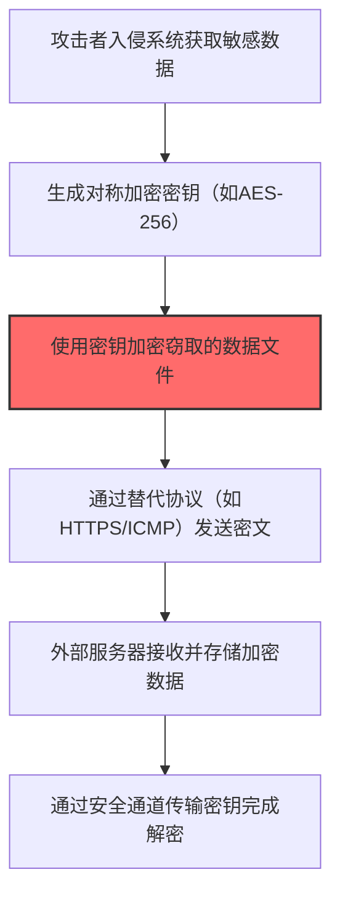
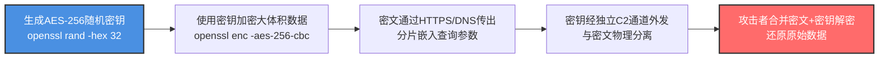

# 通过对称加密非 C2 协议外传 (T1048.001)

## 一句话通俗理解

> **用同一把钥匙加解密数据后传输，虽然被看到但打不开**

## 30秒速查卡

| 维度 | 你需要知道的 |
|------|-------------|
| 这是什么？ | 攻击者用对称密钥（如AES）加密窃取的数据后通过替代协议传出，密钥和密文分通道传输 |
| 为什么危险？ | 加密速度快且密钥与密文分离传输，即使密文被截获没有密钥也无法解密 |
| 谁需要关心？ | 网络安全团队、数据保护负责人、安全运维人员 |
| 你的第一步防御 | 监控出站流量中的加密数据块，对异常的文件加密后立即外传的行为告警 |
| 如果只做一件事 | 建立出站流量基线，对异常的大流量加密传输设置告警 |

## 难度等级

⭐⭐ 中级 - 需要一定的技术基础和经验

## 前置知识检查

**读这个文件需要什么？**

- [ ] 网络流量分析与数据传输
- [ ] 数据编码与压缩基础知识
- [ ] 云服务API（S3/Blob Storage等）

## 技术描述

**对称加密渗出**（T1048.001）是 **通过替代协议渗漏**（T1048）的一个具体变体，属于 **渗漏** 阶段的攻击技术。

简单来说，就像把偷到的东西用密码箱锁好再寄出去，开箱密码通过另一个秘密渠道告诉同伙。

### 具体怎么理解？

用同一把钥匙加解密数据后传输，虽然被看到但打不开

攻击者使用这种技术时，通常是在渗漏阶段，想要达到特定的攻击目标。与父技术 T1048 相比，T1048.001 有自己独特的特点和使用场景。

### 为什么有效？

这种技术之所以有效，是因为：
1. **隐蔽性**：利用了正常系统功能或常见协议，不容易被发现
2. **技术门槛适中**：不需要特别高深的技术知识就能实施

**过渡段：** 不要以为数据渗出就是'把文件发到外部邮箱'——攻击者用DNS隧道逐字节传输文件。
3. **广泛适用**：可以在多种环境和系统中使用

## 真实攻击流程



**步骤详解：**

1. **获取敏感数据** - 攻击者在目标系统中定位并读取需要窃取的文件和数据库内容
2. **生成对称密钥** - 创建AES-256等对称加密算法的随机密钥，用于加密待传输数据
3. **加密数据** - 使用密钥对敏感数据进行加密，生成无法直接读取的密文
4. **替代协议传输** - 通过HTTPS、ICMP隧道或DNS隧道等替代协议将密文发送到攻击者控制的服务器
5. **密钥单独传输** - 将加密密钥通过另一个安全通道（如不同的C2通道）传输给攻击者，实现密钥与密文分离

## 攻击流程



**关键步骤说明：**

1. **生成对称密钥** - 攻击者在受害主机上调用 `openssl rand -hex 32` 生成随机AES-256密钥，相比RSA对称加密速度更快，适合加密GB级数据
2. **批量加密数据** - 使用 `openssl enc -aes-256-cbc -in data.tar -out data.enc -k $KEY` 对打包后的敏感数据加密，生成的密文呈现高熵特征绕过内容DLP
3. **密文外发** - 将密文Base64编码后分片嵌入HTTPS POST请求体或DNS查询参数中，混入正常业务流量绕过流量大小检测
4. **密钥分离传输** - 密钥通过另一条独立C2通道（如自定义TCP心跳包、ICMP payload）传输，实现密钥与密文的物理分离，单通道被截获也无法解密
5. **合并解密** - 攻击者在外部服务器分别接收密文与密钥，调用 `openssl enc -d -aes-256-cbc` 还原数据，分离传输设计让流量分析难以关联

## 真实案例

### 案例1：该技术在实际攻击中的应用

- **时间**: 2024-2025年
- **目标**: 多个行业组织
- **攻击组织**: 多个APT组织
- **手法**: 攻击者在入侵过程中使用对称加密渗出技术，展示了该子技术的典型应用场景和攻击效果
- **影响**: 成功实施该技术导致目标系统被进一步入侵
- **参考链接**: [MITRE ATT&CK官方](https://attack.mitre.org/)

### 案例2：安全研究中的实践

- **时间**: 2025年
- **目标**: 安全研究测试环境
- **攻击组织**: 红队/安全研究人员
- **手法**: 在授权测试中模拟对称加密渗出攻击，验证防御体系的检测和响应能力
- **影响**: 帮助组织识别安全防护中的盲点和改进方向
- **参考链接**: [Atomic Red Team](https://github.com/redcanaryco/atomic-red-team)

## 红队视角

> ⚠️ **免责声明**：以下内容仅用于合法的安全测试、渗透测试和教育目的。未经授权对他人系统进行测试是违法行为。

### 实战技巧

1. **深入理解原理**：在实战应用前，充分理解对称加密渗出的技术原理和适用场景
2. **环境适配**：根据目标系统的操作系统版本、安全配置等因素调整攻击策略
3. **组合使用**：将该技术与其他技术组合使用，构建完整的攻击链
4. **隐蔽性考虑**：注意操作痕迹的清理，避免被安全设备检测

### 常用工具

| 工具名称 | 用途 | 平台 | 链接 |
| -------- | ---- | ---- | ---- |
| Metasploit | 渗透测试框架 | 全平台 | [Metasploit](https://www.metasploit.com/) |
| Cobalt Strike |  adversary模拟平台 | Windows | [Cobalt Strike](https://www.cobaltstrike.com/) |
| Atomic Red Team | 检测规则测试 | 全平台 | [Atomic Red Team](https://github.com/redcanaryco/atomic-red-team) |

### 注意事项

- 在授权的测试环境中使用这些技术
- 注意操作安全（OPSEC），避免被检测系统发现
- 使用匿名化技术和代理隐藏真实身份

## 蓝队视角

### 检测要点

1. **系统日志监控**：关注与对称加密渗出相关的系统日志和审计记录
2. **异常行为检测**：监控系统中与该技术相关的异常进程、网络连接和文件操作
3. **工具特征识别**：识别攻击者可能使用的工具在系统中的运行特征

### 监控建议

- 部署端点检测和响应（EDR）系统，监控与对称加密渗出相关的异常行为
- 配置SIEM规则，关联分析来自多个来源的告警
- 定期进行安全评估和渗透测试，验证检测规则的有效性

## 避坑指南

检测最大盲点：出站流量不等于恶意流量。

## 检测建议

### 检测思路

检测 对称加密渗出 的关键是识别异常行为模式。以下是三个层面的检测方法：

### 网络层检测

**方法**：监控网络流量中的异常模式

```bash
# 检测异常的网络连接和数据传输
# 根据具体协议和端口设置检测规则
```

### 主机层检测

**Windows事件ID**：
- 事件ID 4688：进程创建（监控可疑进程）
- 事件ID 4104：PowerShell执行（监控可疑脚本）

**Linux日志**：
- /var/log/auth.log：认证日志
- /var/log/syslog：系统日志

```bash
# 检测异常进程和命令执行
grep -i "suspicious" /var/log/auth.log
```

### 应用层检测

**Sigma规则示例：**：

```yaml
title: 检测对称加密渗出
status: experimental
description: 检测可能的对称加密渗出活动
logsource:
    category: process_creation
    product: windows
detection:
    selection:
        EventID: 4688
    condition: selection
level: medium
tags:
    - attack.T1048001
```

## 缓解措施

### 优先级1：关键措施

**限制攻击面**：减少暴露的服务和端口，降低被利用的风险

```bash
# 防火墙规则示例：只允许必要的出站连接
iptables -A OUTPUT -p tcp --dport 443 -j ACCEPT  # 允许HTTPS
iptables -A OUTPUT -p tcp --dport 80 -j ACCEPT   # 允许HTTP
iptables -A OUTPUT -p tcp -j DROP                 # 阻止其他TCP
```

### 优先级2：重要措施

**加强监控**：部署EDR和SIEM系统，实时监控异常行为

### 优先级3：建议措施

**安全意识培训**：教育员工识别相关攻击手法

## 动手实验

> ⚠️ **所有实验必须在隔离的实验室环境中进行**

### 实验1：理解基本原理（初级）

**目标**：理解 对称加密渗出 的工作原理

**步骤**：
1. 在隔离环境中搭建测试系统
2. 使用基础工具模拟攻击行为
3. 观察系统日志和网络流量

**学习要点**：理解该技术的核心机制

### 实验2：实际操作（中级）

**目标**：掌握 对称加密渗出 的实际使用方法

**步骤**：
1. 使用专业工具进行攻击模拟
2. 尝试不同的绕过技术
3. 分析检测日志的特征

**学习要点**：掌握工具使用和日志分析

### 实验3：防御验证（高级）

**目标**：验证检测规则的有效性

**步骤**：
1. 部署检测规则
2. 执行攻击模拟
3. 验证检测告警是否触发

**学习要点**：理解攻防对抗的实际效果

## 术语解释

| 术语 | 通俗解释 |
|------|---------|
| **ATT&CK** | MITRE公司维护的攻击技术知识库，像一本"黑客手法百科全书" |
| **对称加密渗出** | T1048.001，ATT&CK框架中定义的一种具体攻击技术（官方 v19.1 名称：通过对称加密非 C2 协议外传） |
| **通过替代协议渗漏** | T1048，对称加密渗出所属的父技术类别 |
| **渗漏** | 攻击链中的一个阶段，攻击者在这个阶段的目标 |
| **C2** | 命令与控制，攻击者用来远程控制被入侵系统的"遥控器" |
| **EDR** | 端点检测与响应，部署在电脑上的安全监控软件 |

## 被引用情况

以下父技术文档引用了本子技术：

- [T1048 - 通过替代协议渗漏](../T1048-Exfiltration-Over-Alternative-Protocol.md)

## 参考资料

### 📚 官方文档（深入了解）

- [MITRE ATT&CK - 通过对称加密非 C2 协议外传 (T1048.001)](https://attack.mitre.org/techniques/T1048/001/)
- [MITRE ATT&CK - 通过替代协议渗漏 (T1048)](https://attack.mitre.org/techniques/T1048/)

### 📰 安全报告（真实攻击）

- [MITRE ATT&CK 官方文档](https://attack.mitre.org/) - ATT&CK 框架官方资源

### 🔧 工具与资源（动手试试）

- [Atomic Red Team](https://github.com/redcanaryco/atomic-red-team) - 检测规则测试框架
- [MITRE ATT&CK Navigator](https://mitre-attack.github.io/attack-navigator/) - ATT&CK 可视化工具

### 📚 学习资料（深入了解）

- [MITRE ATT&CK 知识库](https://attack.mitre.org/resources/) - ATT&CK 官方资源中心
