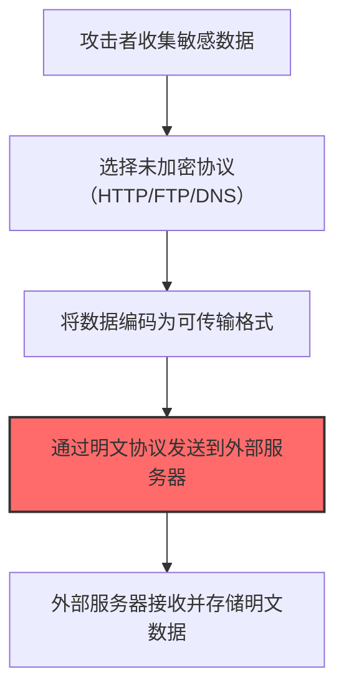

# 未加密渗出 (T1048.003)

## 一句话通俗理解

> **就像用明信片寄秘密——数据不加密直接传出去，速度快但谁都能看到内容**

## 30秒速查卡

| 维度 | 你需要知道的 |
|------|-------------|
| 这是什么？ | 攻击者通过HTTP、FTP、DNS等未加密协议将窃取的数据明文传出网络，不使用已建立的C2通道 |
| 为什么危险？ | 明文传输速度最快、实现最简单，攻击者常混在正常流量中偷运数据，是渗漏战术中最常见的手法 |
| 谁需要关心？ | 网络安全团队、数据保护负责人、系统管理员 |
| 你的第一步防御 | 在网络出口部署DLP（数据泄露防护）系统，检测出站流量中的敏感数据特征 |
| 如果只做一件事 | 监控出站FTP/HTTP上传流量，对非业务时间的异常大流量传输设置告警 |

## 难度等级

⭐ 初级（新手可学） - 前置知识：会用电脑，了解基本的网络传输概念

## 前置知识检查

**读这个文件需要什么？**

- [ ] HTTP/FTP协议：浏览器和服务器之间传数据的规则，就像快递员和收件人之间的约定
- [ ] 明文传输：数据不加密直接发送，就像用明信片寄信，邮递员能看到内容
- [ ] DNS查询：把网址翻译成IP地址的过程，就像查电话簿

## 技术描述

**未加密渗出**（T1048.003）是 **通过替代协议渗漏**（T1048）的一个子技术，属于 **渗漏**（TA0010）阶段的攻击技术。

**通俗解释：**
想象一下：你偷了公司的机密文件，现在要把它运出去。你可以选择：
- 📦 **加密快递**（T1048.001/002）：安全，但加密解密费时费力
- 📮 **明信片**（T1048.003）：内容谁都能看到，但太普通了，保安根本不看

未加密渗出就是用"明信片"方式——攻击者通过HTTP、FTP、DNS等不加密的协议，直接把窃取的数据明文传出去。虽然数据没有加密，但因为这些协议太常见了，安全设备每天要处理海量HTTP流量，很难逐个检查。

**过渡段：** 为什么不加密反而能成功？因为安全监控的瓶颈在于"大海捞针"。一个企业每天有数百万个HTTP请求，DLP和防火墙只能基于规则检查已知特征（如信用卡号格式），大量正常协议流量中的明文数据很容易被忽略。

**技术原理：**
1. 攻击者在目标网络中收集到敏感数据（文件、数据库记录、凭证等）
2. 通过HTTP POST、FTP上传、DNS查询等未加密协议将数据发送到攻击者控制的服务器
3. 数据以明文形式传输，不经过任何加密处理
4. 为避免触发流量大小告警，可能将数据分片多次发送（配合T1030数据大小限制）

**用途与影响：**
攻击者选择未加密渗出的主要原因是速度和简单性——不需要密钥管理和加密开销。缺点是数据在传输中可被网络监控捕获。常用于攻击者急于获取数据、或目标网络安全监控较弱的场景。

## 真实攻击流程



**步骤详解：**

1. **收集敏感数据** - 攻击者在目标系统中定位并读取数据库、文件、配置等敏感内容
2. **选择传输协议** - 根据目标网络允许的出站协议，选择HTTP、FTP、DNS等未加密通道
3. **数据编码** - 将二进制数据转为文本格式（如Base64），使其能在文本协议中传输
4. **明文发送** - 通过选定协议将数据发送到攻击者控制的外部服务器，全程不加密
5. **分片规避** - 大文件切分成小包分批发送，避免触发单次大流量告警

## 攻击流程


**关键步骤说明：**

1. **打包压缩数据** - 攻击者在目标系统将敏感文件、数据库dump打包压缩，减少传输体积同时破坏文件特征签名以规避基于扩展名的DLP规则
2. **Base64编码分片** - 将二进制数据转为Base64文本，并按固定长度（如每段1000字符）切片，避免单次传输产生高熵异常流量被DLP正则规则捕获
3. **明文协议伪装外发** - 将编码切片嵌入HTTP POST请求体、FTP文件上传或DNS查询子域名中，伪装成合法API调用或正常文件上传，依赖协议普及度混入海量正常流量
4. **接收端直接还原** - 攻击者控制的外部服务器无需任何密钥即可直接接收Base64明文并解码重组，省去密钥管理开销，最大优势是速度与实现简单

## 真实案例

### 案例1：APT41使用HTTP明文渗出医疗数据

- **时间**: 2024年
- **目标**: 东南亚多家医疗机构
- **攻击组织**: APT41（中国背景APT组织）
- **手法**: APT41在入侵东南亚医疗机构后，通过HTTP POST请求将窃取的患者数据和医疗记录以明文形式上传到攻击者控制的服务器。攻击者利用医疗机构Web应用中合法的HTTP流量作为掩护，将窃取的数据编码后嵌入HTTP请求体中传输，未使用任何加密
- **影响**: 超过20万条患者隐私记录泄露，包括姓名、身份证号、病历信息
- **参考链接**: [Mandiant APT41 Analysis](https://www.mandiant.com/resources/blog/apt41) - 📰真实攻击
    - **数据来源**: 一级

### 案例2：Kimsuky通过FTP明文渗出外交数据

- **时间**: 2024-2025年
- **目标**: 韩国外交部门和智库机构
- **攻击组织**: Kimsuky（朝鲜背景APT组织）
- **手法**: Kimsuky在针对韩国外交机构的鱼叉式钓鱼攻击中，植入恶意文档后通过FTP协议将窃取的外交电报和政策文件以明文上传到海外匿名FTP服务器。攻击者选择FTP是因为目标网络的出站FTP连接未被安全设备重点监控
- **影响**: 多份未公开的外交政策文件和内部通信记录泄露
- **参考链接**: [Kaspersky Kimsuky Report](https://securelist.com/) - 📰真实攻击
    - **数据来源**: 二级

## 红队视角

> ⚠️ **免责声明**：以下内容仅用于合法的安全测试、渗透测试和教育目的。未经授权对他人系统进行测试是违法行为。

### 实战技巧

1. **协议选择策略**：优先选择目标网络允许且监控较弱的协议。HTTP/HTTPS出站通常被允许，但HTTPS有TLS检查；HTTP明文反而在某些"只检查加密流量"的环境中更容易漏过
2. **流量伪装**：将数据伪装成正常的API调用或文件上传。例如把窃取的数据嵌入multipart/form-data表单字段，看起来像普通的文件上传请求
3. **分时传输**：将大数据分散到多个时间段发送，每次只传几KB，避免触发流量基线告警

### 常用工具

| 工具名称 | 用途 | 平台 | 链接 |
| -------- | ---- | ---- | ---- |
| curl | HTTP/FTP数据传输 | 全平台 | [curl](https://curl.se/) |
| DNSExfiltrator | DNS隧道渗出工具 | Windows | [DNSExfiltrator](https://github.com/Arno0x/DNSExfiltrator) |
| iodine | DNS隧道工具 | Linux/macOS | [iodine](https://code.kryo.se/iodine/) |
| dnscat2 | DNS隧道工具 | Linux | [dnscat2](https://github.com/iagox86/dnscat2) |

### 注意事项

- 明文渗出容易被网络流量审计捕获，应在测试前确认目标是否有DLP设备
- DNS渗出会产生大量异常长查询，可能触发DNS监控告警
- 避免在工作时间大流量传输，选择网络流量高峰期混入

## 蓝队视角

### 检测要点

1. **出站流量内容检测**：监控出站HTTP/FTP流量中的敏感数据特征（信用卡号、身份证号、API密钥等）
2. **流量基线异常**：对比历史出站流量基线，关注突然增大的出站传输，特别是非业务时间
3. **DNS查询异常**：检测异常长的DNS查询（>50字符）、高频DNS请求到同一域名

### 监控建议

- 部署DLP系统对出站流量做内容级检查，识别敏感数据模式
- 配置网络流量基线，对偏离基线的出站大流量自动告警
- 监控DNS查询长度分布，对超长查询记录并告警
- 审计出站FTP连接，限制非业务需要的FTP上传

## 检测建议

### 网络层检测

**检测方法：** 监控出站HTTP/FTP/DNS流量中的数据特征和流量异常

```bash
# 检测异常大的出站HTTP POST请求
tshark -i eth0 -Y "http.request.method==POST && tcp.len>10000" -T fields -e ip.dst -e http.host -e tcp.len

# 检测DNS隧道：查询长度异常
tshark -i eth0 -Y "dns.qry.name" -T fields -e dns.qry.name | awk '{if(length($0)>50) print "SUSPECT: "$0}'
```

**示例（Suricata规则）：**
```
# 检测大流量HTTP POST上传到未知服务器
alert http $HOME_NET any -> $EXTERNAL_NET any (msg:"Large HTTP POST exfiltration attempt"; flow:established,to_server; http.method; content:"POST"; dsize:>50000; threshold:type both, track by_src, count 1, seconds 60; sid:9000001; rev:1;)
```

### 主机层检测

**Windows事件ID：**
- 事件ID 4688：进程创建（监控curl、wget等命令行上传工具的执行）
- 事件ID 4104：PowerShell执行（监控Invoke-WebRequest等上传命令）

**Linux日志：**
- /var/log/auth.log：认证日志
- 审计日志：监控curl/wget/ftp等命令执行

```bash
# 检测可疑的数据上传命令
grep -E "(curl|wget|ftp).*(-F|-d|--data|PUT)" /var/log/syslog
```

### 应用层检测

**用人话说：** 未加密渗出的核心特征是"有敏感数据在明文出站流量中流动"。DLP系统通过正则匹配检测信用卡号（13-16位连续数字）、身份证号、邮箱地址等敏感模式。但攻击者会用Base64编码绕过——所以同时要检测出站流量中的Base64编码数据块（连续的Base64字符超过1000字符就很可疑）。关键信号：某个内网IP突然向外部服务器发送大量HTTP POST数据，且数据内容是Base64编码的。

**Sigma规则示例：**

```yaml
title: 检测可疑的大流量HTTP POST上传
status: experimental
description: 检测进程向外部服务器发送大量HTTP POST数据，可能是未加密渗出
logsource:
    category: process_creation
    product: windows
detection:
    selection:
        EventID: 4688
        CommandLine|contains:
            - 'curl'
            - 'Invoke-WebRequest'
            - 'wget'
            - 'certutil -urlcache'
    filter_legitimate:
        CommandLine|contains:
            - 'windowsupdate'
            - 'microsoft.com'
    condition: selection and not filter_legitimate
level: medium
tags:
    - attack.exfiltration
    - attack.t1048.003
```

## 缓解措施

### 优先级1：关键措施

**部署DLP（数据泄露防护）系统**：在网络出口处对出站流量做内容级检查

```bash
# 防火墙规则示例：限制出站FTP，只允许白名单服务器
iptables -A OUTPUT -p tcp --dport 21 -d 10.0.0.0/8 -j ACCEPT  # 只允许内网FTP
iptables -A OUTPUT -p tcp --dport 21 -j DROP                    # 禁止外网FTP
```

### 优先级2：重要措施

**出站流量基线监控**：建立正常出站流量基线，对偏离基线的异常传输告警

### 优先级3：建议措施

**限制出站协议**：在网络边界防火墙上限制非业务必需的出站协议（如FTP、Telnet），强制敏感数据通过加密通道传输

## 动手实验

> ⚠️ **所有实验必须在隔离的实验室环境中进行，禁止对未授权的真实系统进行测试**

### 实验1：理解明文渗出原理（初级）

**目标**：理解HTTP明文数据传输的工作原理

**步骤**：
1. 在隔离虚拟机中启动一个测试Web服务器（如python -m http.server）
2. 用curl命令向服务器上传一个测试文件：`curl -X POST -d @testfile.txt http://localhost:8000/`
3. 用Wireshark抓包，观察HTTP请求体中的明文数据

**预期结果**：Wireshark中能看到HTTP POST请求，数据以明文形式出现在请求体中
**学习要点**：理解明文传输的含义——数据在网络上"裸奔"

### 实验2：DNS隧道渗出模拟（中级）

**目标**：理解DNS协议如何被用于数据渗出

**步骤**：
1. 在隔离环境中搭建dnscat2服务端
2. 用dnscat2客户端将一个文本文件通过DNS查询传出
3. 用Wireshark抓包观察DNS查询中携带的数据

**预期结果**：Wireshark中看到大量长DNS查询，查询名中包含编码后的文件数据
**学习要点**：理解DNS隧道原理——数据被编码后嵌入DNS查询名

### 实验3：DLP规则编写（高级）

**目标**：编写DLP规则检测明文渗出

**步骤**：
1. 搭建Suricata IDS环境
2. 编写规则检测出站HTTP POST中的Base64编码数据块
3. 用curl模拟渗出，验证规则是否触发告警

**预期结果**：当模拟渗出流量经过时，Suricata产生告警
**学习要点**：掌握网络层渗出检测的方法

## 术语解释

| 术语 | 通俗解释 |
|------|---------|
| **明文传输** | 数据不加密直接发送，就像用明信片寄信，邮递员能看到内容 |
| **DLP** | 数据泄露防护系统，像邮局安检员，检查寄出的包裹里有没有违禁品 |
| **DNS隧道** | 把数据藏在DNS查询中传输，像在快递单的收件人地址里藏暗号 |
| **Base64编码** | 把二进制数据转成纯文本，像把照片翻译成一串字母数字让文本协议能传 |
| **渗漏** | 攻击者把偷到的数据运出目标网络的过程，就像小偷把赃物带出小区 |
| **C2通道** | 命令与控制通道，攻击者远程控制被黑电脑的"遥控器" |

## 被引用情况

以下父技术文档引用了本子技术：

- [T1048 - 通过替代协议渗漏](../T1048-Exfiltration-Over-Alternative-Protocol.md)

## 参考资料

### 📚 官方文档（深入了解）

- [MITRE ATT&CK - 未加密渗出 (T1048.003)](https://attack.mitre.org/techniques/T1048/003/) - MITRE官方技术页面
- [MITRE ATT&CK - 通过替代协议渗漏 (T1048)](https://attack.mitre.org/techniques/T1048/) - 父技术页面

### 📰 安全报告（真实攻击）

- [Mandiant APT41 Analysis](https://www.mandiant.com/resources/blog/apt41) - APT41攻击活动分析
- [Kaspersky Securelist](https://securelist.com/) - Kaspersky威胁情报研究

### 🔧 工具与资源（动手试试）

- [DNSExfiltrator](https://github.com/Arno0x/DNSExfiltrator) - DNS渗出测试工具
- [iodine](https://code.kryo.se/iodine/) - DNS隧道工具
- [Atomic Red Team](https://github.com/redcanaryco/atomic-red-team) - 检测规则测试框架
