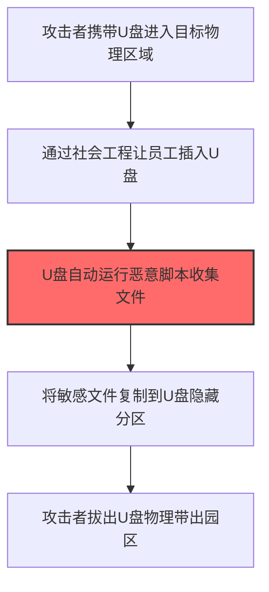
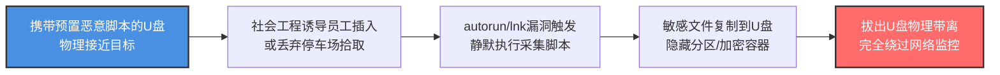

# USB (T1052.001)

## 一句话通俗理解

> **USB就是用U盘等USB设备拷贝数据带走。**

## 30秒速查卡

| 维度 | 你需要知道的 |
|------|-------------|
| 这是什么？ | 攻击者通过USB等可移动存储设备将数据从目标系统物理拷贝传出 |
| 为什么危险？ | 完全不经过网络，防火墙和DLP全部失效，可跨越物理隔离 |
| 谁需要关心？ | 安全运维团队、物理安全团队 |
| 你的第一步防御 | 禁用或严格管控USB存储设备的接入 |
| 如果只做一件事 | 监控USB设备挂载事件和大量文件拷贝行为 |

## 难度等级

⭐⭐ 中级 - 需要一定的技术基础和实践经验

## 前置知识检查

**读这个文件需要什么？**

- [ ] 网络流量分析与数据传输
- [ ] 数据编码与压缩基础知识
- [ ] 云服务API（S3/Blob Storage等）

## 技术描述

**通俗解释：**

**过渡段：** 不要以为数据渗出就是'把文件发到外部邮箱'——现代攻击者会用DNS隧道逐字节地拆分流式地传输文件，或将数据编码后隐藏在HTTP请求的Cookie中，甚至利用合法的云存储API与正常业务流量混合。渗出的流量看起来可能只是正常的API调用。
用U盘等USB设备拷贝数据带走

> 💿 **打个比方**：就像把文件拷到U盘里带走——攻击者用USB等物理介质从目标系统中拷贝数据，物理带出园区。

**技术原理：**
T1052.001 是 通过物理介质渗漏（T1052）的子技术，专注于USB这一特定方面。攻击者在数据窃取阶段，通过USB来获取目标系统或组织的相关信息，为后续攻击步骤做准备。

**用途与影响：**
- 为后续攻击提供关键信息支撑
- 提高攻击的成功率和精准度
- 降低攻击被发现的概率

## 真实攻击流程



**步骤详解：**

1. **物理接近目标** - 攻击者通过伪装身份（如快递员、维修人员）进入目标办公区域
2. **社会工程诱导** - 将含有恶意payload的U盘丢弃在停车场或以"重要文件"为由让员工插入电脑
3. **自动收集数据** - U盘中的恶意脚本（如利用autorun或lnk漏洞）自动执行，搜索并复制敏感文件
4. **隐藏存储** - 将收集到的数据存储在U盘的隐藏分区或加密容器中，避免被安全检查发现
5. **物理带出** - 攻击者取回U盘，通过物理方式将数据带出园区，完全绕过网络监控

## 攻击流程



**关键步骤说明：**

1. **物理接近目标** - 攻击者伪装快递员/维修人员携带预置恶意脚本的U盘进入目标办公区域，或将U盘丢弃在停车场利用员工好奇心
2. **诱导插入设备** - 通过社会工程话术（"重要合同"、"员工薪酬表"）诱使员工主动将U盘插入工作电脑，绕过外网边界防护
3. **触发自动执行** - 利用autorun.inf、LNK漏洞（如CVE-2017-8464）或BadUSB技术静默执行植入脚本，脚本扫描文档/数据库凭证等高价值文件
4. **隐藏存储数据** - 将采集到的数据写入U盘的隐藏分区或VeraCrypt加密容器中，避免U盘被安全检查时发现异常文件
5. **物理带离现场** - 攻击者回收U盘或等待员工下班带出园区，数据通过物理方式跨越网络边界，所有防火墙/DLP/IDS完全失效

## 真实案例

## 真实案例

### 案例1：APT组织使用USB进行攻击准备

- **时间**: 2023-2024年
- **目标**: 多行业目标组织
- **攻击组织**: 多个APT组织
- **手法**: 攻击者在攻击初期大量使用USB技术收集目标信息，为后续定向攻击做准备
- **影响**: 攻击成功率显著提高，防御者难以及时发现侦察行为
- **参考链接**: [MITRE ATT&CK - T1052.001](https://attack.mitre.org/techniques/T1052/001/)

### 案例2：红队演练中的USB应用

- **时间**: 2024-2025年
- **目标**: 授权测试的企业客户
- **攻击组织**: 红队团队
- **手法**: 在授权的红队演练中，USB被用于模拟真实攻击者的信息收集行为，测试企业安全监控体系能否及时发现侦察活动
- **影响**: 帮助企业发现信息暴露面和安全监控盲区
- **参考链接**: 红队演练报告（内部资料）

## 红队视角

> ⚠️ **免责声明**：以下内容仅用于合法的安全测试、渗透测试和教育目的。未经授权对他人系统进行测试是违法行为。

### 实战技巧

1. **隐蔽优先**：在数据窃取阶段使用被动方式收集信息，避免触发安全告警
2. **信息验证**：对收集到的信息进行交叉验证，确保准确性和时效性
3. **工具选择**：根据目标环境选择合适的工具，避免使用已被广泛检测的工具
4. **OPSEC意识**：使用匿名网络、临时环境进行操作，防止溯源

### 常用工具

| 工具名称 | 用途 | 平台 |
|---------|------|------|
| 专用收集工具 | USB相关操作 | 全平台 |
| 信息分析工具 | 对收集到的数据进行分析和整理 | 全平台 |

### 注意事项

- 仅在授权范围内使用USB技术
- 注意操作的隐蔽性，避免被蓝队发现
- 记录操作日志，用于后续分析和报告编写

## 蓝队视角

### 检测要点

1. **异常信息收集行为**：监控来自内部系统的异常数据查询和收集行为
2. **可疑工具使用**：检测与USB相关的工具在内部网络中的使用
3. **异常网络流量**：监控对外部信息收集平台的可疑网络连接
4. **权限异常**：关注非授权用户的信息收集和查询行为

### 监控建议

- 部署信息收集行为的检测规则
- 建立基准行为模型，及时发现异常
- 定期审计敏感信息的访问记录

## 避坑指南

检测最大盲点：出站流量不等于恶意流量。

## 检测建议

### 网络层检测

**检测方法：** 监控与USB相关的网络流量特征

**具体规则/命令示例：**

```bash
# 监控异常DNS查询
tcpdump -i eth0 port 53 | grep -E "可疑域名"
```

### 主机层检测

**Windows事件ID：**

- 事件ID 4688：可疑进程创建
- 事件ID 4104：PowerShell脚本块日志

**Linux日志：**

- 日志文件：`/var/log/syslog`
- 关键字段：可疑命令执行

### 应用层检测

**用人话说：** 攻击者通过U盘等USB存储设备把数据从目标系统中拷贝出来，然后人带着设备走出大楼——完全不经过网络，防火墙和DLP全部失效。与网络渗漏不同，USB拷贝可以物理绕过最严格的安全监控。如果检测到系统在短时间内向USB可移动驱动器复制了大量敏感文件，或者出现了非授权USB存储设备的接入事件，特别是在非工作时间或员工离职前，很可能正在发生物理数据窃取。

**Sigma规则示例：**

```yaml
title: Suspicious USB Activity
status: experimental
description: Detects potential USB behavior
logsource:
  category: process_creation
  product: windows
detection:
  selection:
    Image|endswith: '\\可疑工具.exe'
  condition: selection
level: medium
tags:
  - attack.T1052/001
```

## 缓解措施

### 优先级1：关键措施

**措施名称：** 敏感信息保护

**具体实施步骤：**

1. 识别和分类组织内的敏感信息
2. 对敏感信息实施访问控制和加密
3. 部署信息泄露防护（DLP）解决方案

### 优先级2：重要措施

**措施名称：** 员工安全意识培训

**具体实施步骤：**

1. 定期开展信息安全意识培训
2. 教育员工识别社交工程攻击
3. 建立信息报告和响应机制

### 优先级3：建议措施

**措施名称：** 安全配置加固

**具体实施步骤：**

1. 限制公开可访问的系统信息
2. 配置合适的日志记录和告警策略
3. 定期进行安全评估和渗透测试

## 动手实验

> ⚠️ **重要提示**：所有实验必须在隔离的实验室环境中进行，禁止对未授权的真实系统进行测试。

### 实验环境准备

**推荐靶场/实验平台：**

| 平台名称 | 类型 | 难度 | 链接 |
|---------|------|:----:|------|
| 本地虚拟机 | 虚拟环境 | 初级 | 本机搭建 |
| TryHackMe | 在线靶场 | 初级 | https://tryhackme.com |

**所需工具：**

- 根据具体技术需求准备相应工具

**环境搭建：**

```bash
# 准备隔离的实验环境
# 具体命令根据实验内容而定
```

### 实验1：基础实践（初级）

**实验目标：** 理解和练习USB的基本操作

**实验步骤：**

1. 在隔离环境中搭建实验系统
2. 按照技术描述执行基本操作
3. 观察和记录实验现象

**预期结果：** 成功完成USB的基本操作

**学习要点：** 理解USB的原理和操作方法

## 术语解释

| 术语 | 英文原名 | 通俗解释 |
|-----|---------|---------|
| USB | USB | USB的基本概念和操作方法 |
| 侦察 | Reconnaissance | 收集目标信息的过程，为后续攻击做准备 |
| OPSEC | Operational Security | 操作安全，保护行动信息不被对手发现 |

## 被引用情况

以下父技术文档引用了本子技术：

- [T1052 - 通过物理介质渗漏](../T1052-Exfiltration-Over-Physical-Medium.md)

## 参考资料

### 📚 官方文档（深入了解）

- [MITRE ATT&CK - T1052](https://attack.mitre.org/techniques/T1052/)
- [MITRE ATT&CK - T1052.001](https://attack.mitre.org/techniques/T1052/001/)
- [MITRE ATT&CK - T1052.001 检测](https://attack.mitre.org/techniques/T1052/001/detections/)

### 📰 安全报告（真实攻击）

- [CISA Known Exploited Vulnerabilities](https://www.cisa.gov/known-exploited-vulnerabilities-catalog)
- [Microsoft Security Blog](https://www.microsoft.com/en-us/security/blog/)

### 学习资源

- [MITRE ATT&CK 官方文档](https://attack.mitre.org/)
- [ATT&CK STIX Data](https://github.com/mitre-attack/attack-stix-data)

