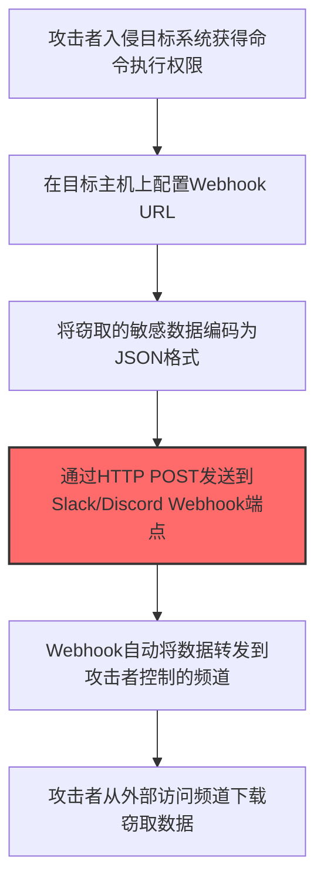
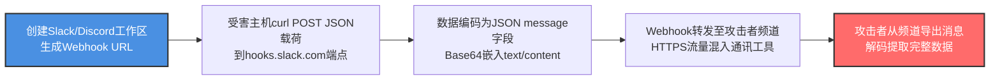

# Webhook (T1567.004)

## 一句话通俗理解

> **Webhook就是用Slack、Discord的Webhook接口传数据。**

## 30秒速查卡

| 维度 | 你需要知道的 |
|------|-------------|
| 这是什么？ | 攻击者通过Webhook将窃取的数据自动推送到攻击者控制的服务器 |
| 为什么危险？ | Webhook是合法的自动化机制，流量看起来像正常的API调用 |
| 谁需要关心？ | SOC分析师、开发运维团队 |
| 你的第一步防御 | 审计和监控所有出站Webhook配置 |
| 如果只做一件事 | 监控非预期的Webhook出站请求和配置变更 |

## 难度等级

⭐⭐ 中级 - 需要一定的技术基础和实践经验

## 前置知识检查

**读这个文件需要什么？**

- [ ] 网络流量分析与数据传输
- [ ] 数据编码与压缩基础知识
- [ ] 云服务API（S3/Blob Storage等）

## 技术描述

**通俗解释：**

**过渡段：** 不要以为数据渗出就是'把文件发到外部邮箱'——现代攻击者会用DNS隧道逐字节地拆分流式地传输文件，或将数据编码后隐藏在HTTP请求的Cookie中，甚至利用合法的云存储API与正常业务流量混合。渗出的流量看起来可能只是正常的API调用。
用Slack、Discord的Webhook接口传数据

> 🤖 **打个比方**：就像设置自动转发把情报发送到指定邮箱——攻击者利用Webhook自动将窃取的数据传输到指定服务器。

**技术原理：**
T1567.004 是 通过Web服务渗漏（T1567）的子技术，专注于Webhook这一特定方面。攻击者在数据窃取阶段，通过Webhook来获取目标系统或组织的相关信息，为后续攻击步骤做准备。

**用途与影响：**
- 为后续攻击提供关键信息支撑
- 提高攻击的成功率和精准度
- 降低攻击被发现的概率

## 真实攻击流程



**步骤详解：**

1. **入侵系统获取执行权限** - 攻击者通过钓鱼邮件或漏洞利用获得目标主机的命令执行能力
2. **配置Webhook URL** - 在目标主机上设置合法的Slack或Discord Webhook接口地址，这些URL通常看起来无害
3. **编码敏感数据** - 将窃取的文件、凭证等数据编码为JSON格式，绕过简单的内容检测
4. **通过Webhook发送数据** - 利用HTTP POST请求将编码数据发送到Webhook端点，流量混在正常HTTPS通信中
5. **外部收集数据** - 攻击者从控制的Slack/Discord频道中下载完整数据，完成渗漏

## 攻击流程



**关键步骤说明：**

1. **创建Webhook端点** - 攻击者注册一次性Slack工作区或Discord服务器，创建Incoming Webhook获取URL（如 `https://hooks.slack.com/services/T000/B000/XXXX`），目标域名在大多数企业白名单内
2. **构造JSON载荷** - 将窃取的数据Base64编码后嵌入JSON请求体的 `text` 字段（Slack）或 `content` 字段（Discord），伪装为正常聊天消息格式：`{"text":"ZXhmaWx0cmF0ZWQgZGF0YQ=="}`
3. **HTTPS POST外发** - 在受害主机使用curl/PowerShell `Invoke-WebRequest` 发送POST请求到Webhook URL，流量特征与员工正常使用Slack/Discord无法区分，绕过传统网络DLP
4. **频道自动接收** - Slack/Discord服务器收到Webhook请求后自动将消息转发到攻击者控制的频道，每条消息上限2000字符（Discord）或40000字符（Slack），大文件需分片传输
5. **外部导出还原** - 攻击者通过Slack/Discord客户端或API导出频道所有消息，本地Base64解码拼接还原完整数据，事后删除工作区抹除痕迹

## 真实案例

### 案例1：APT组织使用Webhook进行攻击准备

- **时间**: 2023-2024年
- **目标**: 多行业目标组织
- **攻击组织**: 多个APT组织
- **手法**: 攻击者在攻击初期大量使用Webhook技术收集目标信息，为后续定向攻击做准备
- **影响**: 攻击成功率显著提高，防御者难以及时发现侦察行为
- **参考链接**: [MITRE ATT&CK - T1567.004](https://attack.mitre.org/techniques/T1567/004/)

### 案例2：红队演练中的Webhook应用

- **时间**: 2024-2025年
- **目标**: 授权测试的企业客户
- **攻击组织**: 红队团队
- **手法**: 在授权的红队演练中，Webhook被用于模拟真实攻击者的信息收集行为，测试企业安全监控体系能否及时发现侦察活动
- **影响**: 帮助企业发现信息暴露面和安全监控盲区
- **参考链接**: 红队演练报告（内部资料）

## 红队视角

> ⚠️ **免责声明**：以下内容仅用于合法的安全测试、渗透测试和教育目的。未经授权对他人系统进行测试是违法行为。

### 实战技巧

1. **隐蔽优先**：在数据窃取阶段使用被动方式收集信息，避免触发安全告警
2. **信息验证**：对收集到的信息进行交叉验证，确保准确性和时效性
3. **工具选择**：根据目标环境选择合适的工具，避免使用已被广泛检测的工具
4. **OPSEC意识**：使用匿名网络、临时环境进行操作，防止溯源

### 常用工具

| 工具名称 | 用途 | 平台 |
|---------|------|------|
| 专用收集工具 | Webhook相关操作 | 全平台 |
| 信息分析工具 | 对收集到的数据进行分析和整理 | 全平台 |

### 注意事项

- 仅在授权范围内使用Webhook技术
- 注意操作的隐蔽性，避免被蓝队发现
- 记录操作日志，用于后续分析和报告编写

## 蓝队视角

### 检测要点

1. **异常信息收集行为**：监控来自内部系统的异常数据查询和收集行为
2. **可疑工具使用**：检测与Webhook相关的工具在内部网络中的使用
3. **异常网络流量**：监控对外部信息收集平台的可疑网络连接
4. **权限异常**：关注非授权用户的信息收集和查询行为

### 监控建议

- 部署信息收集行为的检测规则
- 建立基准行为模型，及时发现异常
- 定期审计敏感信息的访问记录

## 避坑指南

检测最大盲点：出站流量不等于恶意流量。

## 检测建议

### 网络层检测

**检测方法：** 监控与Webhook相关的网络流量特征

**具体规则/命令示例：**

```bash
# 监控异常DNS查询
tcpdump -i eth0 port 53 | grep -E "可疑域名"
```

### 主机层检测

**Windows事件ID：**

- 事件ID 4688：可疑进程创建
- 事件ID 4104：PowerShell脚本块日志

**Linux日志：**

- 日志文件：`/var/log/syslog`
- 关键字段：可疑命令执行

### 应用层检测

**用人话说：** 攻击者利用Slack、Discord、企业微信等即时通讯工具的Webhook接口，把窃取的数据伪装成消息发送到攻击者控制的频道中。因为Webhook请求是HTTPS加密的，且目标域名在常用通讯工具的白名单内，流量看起来完全正常。如果发现内网机器向Webhook URL（如discord.com/api/webhooks/*、hooks.slack.com/*）发送大量POST请求，且请求体包含编码后的数据而非正常聊天内容，很可能是在利用Webhook通道外泄数据。

**Sigma规则示例：**

```yaml
title: Suspicious Webhook Activity
status: experimental
description: Detects potential Webhook behavior
logsource:
  category: process_creation
  product: windows
detection:
  selection:
    Image|endswith: '\\可疑工具.exe'
  condition: selection
level: medium
tags:
  - attack.T1567/004
```

## 缓解措施

### 优先级1：关键措施

**措施名称：** 敏感信息保护

**具体实施步骤：**

1. 识别和分类组织内的敏感信息
2. 对敏感信息实施访问控制和加密
3. 部署信息泄露防护（DLP）解决方案

### 优先级2：重要措施

**措施名称：** 员工安全意识培训

**具体实施步骤：**

1. 定期开展信息安全意识培训
2. 教育员工识别社交工程攻击
3. 建立信息报告和响应机制

### 优先级3：建议措施

**措施名称：** 安全配置加固

**具体实施步骤：**

1. 限制公开可访问的系统信息
2. 配置合适的日志记录和告警策略
3. 定期进行安全评估和渗透测试

## 动手实验

> ⚠️ **重要提示**：所有实验必须在隔离的实验室环境中进行，禁止对未授权的真实系统进行测试。

### 实验环境准备

**推荐靶场/实验平台：**

| 平台名称 | 类型 | 难度 | 链接 |
|---------|------|:----:|------|
| 本地虚拟机 | 虚拟环境 | 初级 | 本机搭建 |
| TryHackMe | 在线靶场 | 初级 | https://tryhackme.com |

**所需工具：**

- 根据具体技术需求准备相应工具

**环境搭建：**

```bash
# 准备隔离的实验环境
# 具体命令根据实验内容而定
```

### 实验1：基础实践（初级）

**实验目标：** 理解和练习Webhook的基本操作

**实验步骤：**

1. 在隔离环境中搭建实验系统
2. 按照技术描述执行基本操作
3. 观察和记录实验现象

**预期结果：** 成功完成Webhook的基本操作

**学习要点：** 理解Webhook的原理和操作方法

## 术语解释

| 术语 | 英文原名 | 通俗解释 |
|-----|---------|---------|
| Webhook | Webhook | Webhook的基本概念和操作方法 |
| 侦察 | Reconnaissance | 收集目标信息的过程，为后续攻击做准备 |
| OPSEC | Operational Security | 操作安全，保护行动信息不被对手发现 |

## 被引用情况

以下父技术文档引用了本子技术：

- [T1567 - 通过Web服务渗漏](../T1567-Exfiltration-Over-Web-Service.md)

## 参考资料

### 📚 官方文档（深入了解）

- [MITRE ATT&CK - T1567](https://attack.mitre.org/techniques/T1567/)
- [MITRE ATT&CK - T1567.004](https://attack.mitre.org/techniques/T1567/004/)
- [MITRE ATT&CK - T1567.004 检测](https://attack.mitre.org/techniques/T1567/004/detections/)

### 📰 安全报告（真实攻击）

- [CISA Known Exploited Vulnerabilities](https://www.cisa.gov/known-exploited-vulnerabilities-catalog)
- [Microsoft Security Blog](https://www.microsoft.com/en-us/security/blog/)

### 学习资源

- [MITRE ATT&CK 官方文档](https://attack.mitre.org/)
- [ATT&CK STIX Data](https://github.com/mitre-attack/attack-stix-data)

