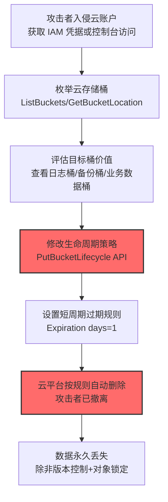

# 生命周期触发删除 (T1485.001)

## 一句话通俗理解

> **攻击者改一下云存储桶的"过期自动删除"规则——一天之后，你的所有云端数据就自动消失了**

## 30秒速查卡

| 维度 | 你需要知道的 |
|------|-------------|
| 这是什么？ | 攻击者修改云存储桶（S3/Blob/GCS）的生命周期策略，让桶内全部对象在短期内自动删除 |
| 为什么危险？ | 利用云原生合规功能作恶——一次 API 调用就能让 PB 级数据 24 小时内消失，且操作看起来完全合法 |
| 谁需要关心？ | 云安全运维团队、云成本管理团队、SOC/IR 团队 |
| 你的第一步防御 | 用 IAM/SCP 严格限制 `PutLifecycleConfiguration` 权限，只授予运维服务账号 |
| 如果只做一件事 | 在 CloudTrail/Activity Log 上对生命周期策略变更 API 设置实时告警 |

## 难度等级

⭐⭐ 中级 - 需要云平台 IAM 与存储服务的基础知识

## 前置知识检查

**读这个文件需要什么？**

- [ ] 云存储基础（S3/Blob/GCS 桶与对象概念）
- [ ] 云 IAM 权限模型（最小权限、策略继承、SCP）
- [ ] 生命周期策略语义（Expiration、Transition、AbortIncompleteMultipartUpload）
- [ ] 云审计日志（AWS CloudTrail、Azure Activity Log、GCP Audit Logs）

## 技术描述

**生命周期触发删除**（T1485.001）是 **数据销毁**（T1485）的一个子技术，由 MITRE ATT&CK v19.1 引入（创建于 2024-09-25，最新版本 1.1）。该技术专指云存储场景下，攻击者通过修改云存储桶的生命周期策略（Lifecycle Policy），自动化地、批量地销毁桶内全部对象。

> 🪣 **打个比方**：云存储桶就像一个超大的仓库，里面堆满了货箱（对象）。仓库管理员本来设定了一个"3 年后自动把过期货箱清掉"的规则。攻击者偷偷潜入管理室，把规则改成"1 天后所有货箱自动清掉"——第二天仓库就空了。攻击者甚至不用自己动手搬货，云平台会"合规地"帮他把数据全部销毁。

### 具体怎么理解？

云存储服务（AWS S3、Azure Blob Storage、Google Cloud Storage）原生提供生命周期管理功能，让用户可以按规则自动迁移、归档或删除对象。典型用途是降低成本：把 30 天未访问的对象从热存储迁到冷存储，把 365 天前的日志删除等。

如果威胁行为者获得了修改这些策略的权限，他们可以：

1. **修改全局过期规则**——将所有对象的过期时间设为 1 天甚至当天
2. **删除前缀规则**——针对特定前缀（如 `logs/`、`backups/`）设置短周期过期
3. **中断分段上传清理**——通过 `AbortIncompleteMultipartUpload` 加速清理正在进行的大文件
4. **结合版本控制销毁历史版本**——通过 `NoncurrentVersionExpiration` 删除所有非当前版本

### 为什么有效？

这种技术之所以有效，是因为：

1. **云原生 API 调用**——攻击者使用合法云 API，不触发任何"恶意代码"特征
2. **延迟破坏**——策略修改后，云平台按计划执行删除，攻击者可立即撤离
3. **难以追溯恢复**——一旦对象按生命周期过期删除，云平台不会保留副本（除非启用了版本控制+对象锁定）
4. **可同时用于数据销毁与日志反取证**——攻击者既可用于破坏业务数据，也可用于销毁 CloudTrail 日志桶以掩盖入侵痕迹（MITRE ATT&CK 官方引用的 Stratus Red Team 案例就是此用法）

**过渡段：** 与父技术 T1485（数据销毁）使用 dd/shred 等擦除器覆盖磁盘扇区不同，T1485.001 完全不触碰底层磁盘——攻击者只需调用一个 API，云平台自身就会"合规地"删除数据。这使得该技术不需要在受害者系统上部署任何恶意二进制，常规 EDR/AV 完全无法检测。

## 真实攻击流程



**步骤详解：**

1. **获取云账户访问** - 攻击者通过钓鱼、凭证泄露、SSRF 漏洞获取 AWS Access Key、Azure Service Principal 或 GCP Service Account Key
2. **枚举存储桶** - 调用 `ListBuckets`、`GetBucketLocation`、`GetBucketLogging` 识别高价值目标（如 CloudTrail 日志桶、备份桶、业务数据桶）
3. **评估桶配置** - 检查是否启用版本控制、对象锁定（Object Lock）、是否有保留策略（Retention Policy）
4. **修改生命周期策略** - 调用 `PutBucketLifecycle` 或 `PutLifecycleConfiguration`，将桶内全部对象的 `Expiration` 设置为 `Days: 1`
5. **云平台执行删除** - 云平台按新策略在 24 小时内删除全部对象，攻击者无需再干预
6. **数据永久丢失** - 若桶未启用对象锁定或版本控制，对象被删除后无法恢复

## 攻击流程


**关键步骤说明：**

1. **获取云账户凭据** - 攻击者通过 SSRF 漏洞读取 IMDS 元数据中的 IAM 临时凭据，或从泄露的 .aws/credentials 文件、Git 仓库、误配置的环境变量中获取长期 Access Key
2. **枚举与定位** - 使用 `aws s3api list-buckets` 列出全部桶，再 `get-bucket-logging`、`get-bucket-versioning` 筛选未启用版本控制的高价值目标
3. **修改生命周期策略** - 提交 JSON 策略，将全部对象前缀 `Prefix: ""` 的过期天数设为 1 天：`{"Rules":[{"ID":"cleanup","Status":"Enabled","Filter":{"Prefix":""},"Expiration":{"Days":1}}]}`
4. **云平台执行删除** - AWS S3、Azure Blob、GCS 在生命周期规则下一次扫描就会标记对象过期，由后台 GC 进程批量删除
5. **数据销毁完成** - 攻击者已退出，但数据 24 小时内全无。即使后续发现异常，云审计日志只能定位到"哪个 IAM 身份修改了策略"，无法找回数据

## 真实案例

### 案例1：Halcyon RISE Team 披露的 AWS S3 勒索场景 (2025)

- **时间**: 2025年1月
- **目标**: 使用 AWS 原生服务的受害者 S3 存储桶
- **攻击组织**: Halcyon RISE Team 调研披露的云勒索攻击模式
- **手法**: 攻击者获取 AWS 账户访问权限后，滥用 AWS 原生功能对 S3 桶实施勒索。除了使用 SSE-C 客户端加密勒索外，研究人员明确指出攻击者可通过 `PutLifecycleConfiguration` API 修改生命周期规则，让桶内对象在 1 天后自动过期删除，从而逼迫受害者支付赎金。这是一种"零恶意软件"的勒索方式——攻击者完全使用 AWS 合法 API 完成破坏。
- **影响**: 受害者 S3 桶内 PB 级业务数据按生命周期规则自动删除，云平台审计日志记录了合法 API 调用，传统安全设备完全无感
- **参考链接**: [Halcyon - Abusing AWS Native Services: Ransomware Encrypting S3 Buckets with SSE-C](https://www.halcyon.ai/blog/abusing-aws-native-services-ransomware-encrypting-s3-buckets-with-sse-c)

### 案例2：Palo Alto Prisma Cloud 披露的云勒索攻击向量 (2023)

- **时间**: 2023年11月
- **目标**: 云环境中存储敏感数据的 S3 桶
- **攻击组织**: Palo Alto Networks Unit 42 研究团队披露的攻击模式
- **手法**: 研究人员 Ofir Balassiano 和 Ofir Shaty 在分析云勒索攻击向量时明确指出，拥有 `PutLifecycleConfiguration` 权限的攻击者可通过 `PutBucketLifecycle` API 调用对 S3 桶应用"1 天后删除全部对象"的生命周期策略。该攻击手法与 T1657（金融盗窃）组合形成勒索链：先破坏数据可用性，再索要赎金。攻击者还可能将此技术用于存储 CloudTrail 日志的桶，以实现 T1070（痕迹清除）。
- **影响**: 攻击向量被列入云勒索主流攻击模式，引发云服务商和租户加强 IAM 权限治理
- **参考链接**: [Palo Alto - Ransomware in the Cloud: Breaking Down the Attack Vectors](https://www.paloaltonetworks.com/blog/prisma-cloud/ransomware-data-protection-cloud/)

### 案例3：Stratus Red Team - CloudTrail 日志桶生命周期反取证 (2024)

- **时间**: 2024年（持续维护）
- **目标**: AWS CloudTrail 日志存储桶
- **攻击组织**: Stratus Red Team（安全研究/红队检测规则库）
- **手法**: Stratus Red Team 在其攻击技术库中维护了 "AWS.defense-evasion.cloudtrail-lifecycle-rule" 技术，专门演示攻击者如何通过对 CloudTrail 日志桶应用生命周期规则来销毁审计日志。攻击者获取 IAM 权限后，对 CloudTrail 日志桶设置短周期过期规则，使日志在 1 天内自动删除，从而掩盖入侵痕迹。这是 T1485.001 与 T1070（痕迹清除）战术的典型组合应用。
- **影响**: 该技术已被多个 APT 组织和勒索团伙用于反取证，导致 IR 团队无法追溯攻击链
- **参考链接**: [Stratus Red Team - CloudTrail Logs Impairment Through S3 Lifecycle Rule](https://stratus-red-team.cloud/attack-techniques/AWS/aws.defense-evasion.cloudtrail-lifecycle-rule/)

## 红队视角

> ⚠️ **免责声明**：以下内容仅用于合法的安全测试、渗透测试和教育目的。未经授权对他人系统进行测试是违法行为。

### 实战技巧

1. **优先攻击日志桶**
   云审计日志桶（CloudTrail/Activity Log）通常由运维账号管理，但其生命周期策略变更权限往往过于宽松。先破坏日志再实施其他破坏，可显著降低被追溯的风险。

2. **结合对象版本控制绕过**
   若目标桶启用了版本控制，单纯修改 `Expiration` 只删除当前版本。需同时设置 `NoncurrentVersionExpiration` 才能彻底销毁历史版本。但若目标桶启用了 Object Lock（合规模式），生命周期规则无法删除锁定对象——此时需切换策略。

3. **延迟触发降低告警相关性**
   将过期天数设为 7 天而非 1 天，让策略变更与实际数据消失在时间上拉开距离，降低 SOC 关联告警的概率。攻击者可在 7 天内撤离并完成其他操作。

4. **滥用 AbortIncompleteMultipartUpload**
   对正在上传的大文件（如备份、日志归档），设置 `DaysAfterInitiation: 1` 的 `AbortIncompleteMultipartUpload` 规则，可在不触发"对象删除"事件的情况下中断并清理上传中的数据。

### 常用工具

| 工具名称 | 用途 | 平台 | 链接 |
|----------|------|------|------|
| AWS CLI | 修改 S3 生命周期策略 | 跨平台 | https://aws.amazon.com/cli/ |
| Stratus Red Team | 模拟 CloudTrail 日志桶生命周期攻击 | 跨平台 | https://stratus-red-team.cloud/ |
| Pacu | AWS 后渗透框架 | 跨平台 | https://github.com/RhinoSecurityLabs/pacu |
| CloudGoat | AWS 渔叉训练环境 | 跨平台 | https://github.com/RhinoSecurityLabs/cloudgoat |

### 注意事项

- 测试仅限授权的云账户和隔离的实验桶
- 部分云服务商对生命周期规则有冷却期（如 AWS S3 24 小时才生效），需提前规划
- 修改生命周期策略会立即触发 CloudTrail/Activity Log 告警，OPSEC 上需配合日志桶反取证
- 严格遵守云服务商 AUP（可接受使用政策）

## 蓝队视角

### 检测要点

1. **云 API 调用监控**
   - 日志来源：AWS CloudTrail、Azure Activity Log、GCP Cloud Audit Logs
   - 关注字段：`eventName=PutBucketLifecycle`、`PutLifecycleConfiguration`、`Microsoft.Storage/storageAccounts/blobServices/write`、`storage.buckets.update`
   - 异常特征：非运维账号、非工作时间、未授权 IP 调用生命周期 API

2. **策略内容审计**
   - 日志来源：CloudTrail requestParameters 字段
   - 关注字段：`Expiration.Days <= 7`、`NoncurrentVersionExpiration.NoncurrentDays <= 1`、`AbortIncompleteMultipartUpload.DaysAfterInitiation <= 1`
   - 异常特征：策略中新出现短周期过期规则，或对全前缀（`Prefix: ""`）设置短周期

3. **桶配置变更监控**
   - 日志来源：AWS Config Rules、Azure Policy、GCP Security Command Center
   - 关注字段：生命周期策略从无到有、从长周期到短周期、从局部前缀到全前缀
   - 异常特征：策略变更与已知运维窗口不符

### 监控建议

- 在 CloudTrail 上对 `PutBucketLifecycle*` API 设置 EventBridge 实时告警
- 部署 AWS Config Rule `s3-lifecycle-policy-check`，检测生命周期策略是否符合基线
- 对审计日志桶（CloudTrail/Activity Log 桶）启用 Object Lock 合规模式，禁止任何删除
- 实施 AWS SCP（Service Control Policy），在组织级别禁止非运维账号调用 `PutLifecycleConfiguration`

## 避坑指南

防御者最痛苦教训：**审计日志桶未启用 Object Lock**。一旦攻击者获得修改日志桶生命周期策略的权限，所有审计日志可在 24 小时内消失，IR 团队失去追溯能力。

3-2-1 备份策略在云环境的延伸：
- **3** 份数据副本——主桶 + 跨区域复制桶 + 离线归档（如 AWS Backup + Glacier Deep Archive）
- **2** 种存储介质——对象存储 + 磁带/冷归档
- **1** 份离线副本——不可被云账户 IAM 触达的备份（如另一账户 + Object Lock）

## 检测建议

### 云 API 层检测

**检测方法：** 监控生命周期策略修改 API

**Sigma规则示例（AWS CloudTrail）：**
```yaml
title: AWS S3 生命周期策略短周期过期检测
status: experimental
description: 检测 AWS S3 桶生命周期策略被修改为短周期过期，可能是 T1485.001 攻击
logsource:
    product: aws
    service: cloudtrail
detection:
    selection_api:
        eventName:
            - PutBucketLifecycle
            - PutBucketLifecycleConfiguration
    selection_short_expiry:
        requestParameters|contains:
            - '"Days":1'
            - '"Days":2'
            - '"Days":3'
            - '"Days":7'
    condition: selection_api and selection_short_expiry
level: high
tags:
    - attack.t1485
    - attack.t1485.001
    - attack.impact
```

### 主机层检测

**检测方法：** 监控云 CLI 工具异常调用

**具体命令示例：**
```bash
# 检查 CloudTrail 日志中的生命周期策略变更
aws logs filter-log-events \
    --log-group-name CloudTrail \
    --filter-pattern '{($.eventName="PutBucketLifecycle") || ($.eventName="PutBucketLifecycleConfiguration")}' \
    --start-time $(date -d '7 days ago' +%s)000

# 列出当前所有桶的生命周期策略
aws s3api list-buckets --query 'Buckets[].Name' --output text | tr '\t' '\n' | \
    while read bucket; do
        echo "=== $bucket ==="
        aws s3api get-bucket-lifecycle-configuration --bucket "$bucket" 2>/dev/null
    done
```

### 配置层检测

**AWS Config Rule 检测：**
```yaml
rule_name: s3-lifecycle-policy-check
description: 检查 S3 桶生命周期策略是否包含短周期过期规则
scope:
    resource_types:
        - AWS::S3::Bucket
input_parameters:
    maxExpirationDays: '30'
```

## 缓解措施

### 优先级1：关键措施

**措施名称：** 严格限制生命周期策略变更权限

**具体实施步骤：**
1. 在 IAM 策略中对 `PutLifecycleConfiguration`、`PutBucketLifecycle` API 实施 Deny 规则，仅授权运维服务账号
2. 部署 AWS SCP（Service Control Policy）在组织级别禁止非运维账号修改生命周期策略
3. 对审计日志桶启用 Object Lock 合规模式（Compliance Mode），设置不可变保留期 ≥ 365 天

### 优先级2：重要措施

**措施名称：** 多副本不可变备份

**具体实施步骤：**
1. 对关键桶启用跨区域复制（CRR），将副本存储在另一账户
2. 副本桶启用 Object Lock 和版本控制，禁止任何删除操作
3. 定期使用 AWS Backup 或 Azure Backup 创建独立的、不可变的备份副本

### 优先级3：建议措施

**措施名称：** 实时监控与告警

**具体实施步骤：**
1. 在 CloudTrail/Activity Log 上对生命周期 API 设置 EventBridge 实时告警
2. 部署 AWS Config Rule 检测生命周期策略偏离基线
3. 对所有云账户实施 CIS Benchmark 合规基线检查

### MITRE ATT&CK 缓解措施映射

| 缓解措施ID | 缓解措施名称 | 适用性 | 说明 |
|------------|-------------|--------|------|
| M1053 | Data Backup | 适用 | 不可变离线备份 |
| M1018 | User Account Management | 适用 | 限制 PutLifecycleConfiguration 权限 |

## 动手实验

> ⚠️ **重要提示**：所有实验必须在隔离的实验室云账户中进行，禁止对生产环境进行测试。实验数据销毁后无法恢复，请提前创建快照。

### 实验环境准备

**推荐实验平台：**

| 平台名称 | 类型 | 难度 | 链接 |
|----------|------|:----:|------|
| AWS Free Tier | 云实验 | 中级 | https://aws.amazon.com/free/ |
| Stratus Red Team | 攻击模拟 | 中级 | https://stratus-red-team.cloud/ |
| CloudGoat | AWS 渔叉训练 | 中级 | https://github.com/RhinoSecurityLabs/cloudgoat |

**所需工具：**
- AWS CLI v2
- 一个隔离的 AWS 实验账户
- 测试 S3 桶（不含生产数据）

### 实验1：理解生命周期策略（初级）

**实验目标：** 理解 S3 生命周期策略的语义和效果

**实验步骤：**
1. 创建测试桶：`aws s3api create-bucket --bucket my-test-bucket-12345 --region us-east-1`
2. 上传几个测试对象：`echo "test data" | aws s3 cp - s3://my-test-bucket-12345/test1.txt`
3. 查看当前生命周期策略：`aws s3api get-bucket-lifecycle-configuration --bucket my-test-bucket-12345`
4. 设置短周期过期策略：`aws s3api put-bucket-lifecycle-configuration --bucket my-test-bucket-12345 --lifecycle-configuration file://lifecycle.json`
5. 在 CloudTrail 中观察 API 调用记录

**预期结果：** 桶内对象按策略自动过期删除，CloudTrail 记录 PutBucketLifecycleConfiguration 调用

**学习要点：** 理解生命周期策略的语义、生效时间和审计痕迹

### 实验2：使用 Stratus Red Team 模拟攻击（中级）

**实验目标：** 演练 T1485.001 在反取证场景中的攻击链

**实验步骤：**
1. 安装 Stratus Red Team：`sh -c "$(curl -fsSL https://stratus-red-team.cloud/install.sh)"`
2. 预热攻击技术：`stratus warmup aws.defense-evasion.cloudtrail-lifecycle-rule`
3. 执行攻击：`stratus detonate aws.defense-evasion.cloudtrail-lifecycle-rule`
4. 在 CloudTrail 中查找 PutBucketLifecycle 调用记录
5. 验证检测规则是否触发
6. 清理：`stratus cleanup aws.defense-evasion.cloudtrail-lifecycle-rule`

**预期结果：** CloudTrail 日志桶被设置短周期过期规则，检测规则触发告警

**学习要点：** 掌握攻击模拟工具的使用，验证检测规则覆盖度

## 术语解释

| 术语 | 英文原名 | 通俗解释 |
|------|----------|----------|
| 生命周期策略 | Lifecycle Policy | 云存储桶的"自动清理规则"，可按时间自动迁移或删除对象 |
| 过期 | Expiration | 生命周期策略的一种动作，对象到达指定天数后自动删除 |
| 非当前版本过期 | NoncurrentVersionExpiration | 删除非当前版本的对象历史版本，配合版本控制使用 |
| 对象锁定 | Object Lock | AWS S3 的一种不可变存储功能，可禁止任何用户（含 root）删除对象 |
| 合规模式 | Compliance Mode | Object Lock 的强保留模式，连 root 用户也无法删除或缩短保留期 |
| 跨区域复制 | Cross-Region Replication (CRR) | 自动将对象异步复制到另一区域的桶，用于容灾 |
| 服务控制策略 | Service Control Policy (SCP) | AWS Organizations 的组织级权限策略，可限制成员账户的 IAM 权限上限 |
| CloudTrail | AWS CloudTrail | AWS 的云审计日志服务，记录账户内所有 API 调用 |
| IaaS | Infrastructure as a Service | 基础设施即服务，云服务商提供虚拟机、存储、网络等基础设施 |
| 反取证 | Anti-Forensics | 攻击者用于掩盖入侵痕迹的技术，如删除日志、混淆时间戳 |

## 被引用情况

以下父技术文档引用了本子技术：

- [T1485 - 数据销毁](../T1485-Data-Destruction.md)

## 参考资料

### 📚 官方文档（深入了解）

- [MITRE ATT&CK - Lifecycle-Triggered Deletion (T1485.001)](https://attack.mitre.org/techniques/T1485/001/)
- [MITRE ATT&CK - Data Destruction (T1485)](https://attack.mitre.org/techniques/T1485/)
- [AWS - Managing the lifecycle of objects](https://docs.aws.amazon.com/AmazonS3/latest/userguide/object-lifecycle-mgmt.html)
- [Google Cloud - Object Lifecycle Management](https://cloud.google.com/storage/docs/lifecycle)
- [Azure - Configure a lifecycle management policy](https://learn.microsoft.com/en-us/azure/storage/blobs/lifecycle-management-policy-configure?tabs=azure-portal)

### 📰 安全报告（真实攻击）

- [Halcyon - Abusing AWS Native Services: Ransomware Encrypting S3 Buckets with SSE-C](https://www.halcyon.ai/blog/abusing-aws-native-services-ransomware-encrypting-s3-buckets-with-sse-c)
- [Palo Alto - Ransomware in the Cloud: Breaking Down the Attack Vectors](https://www.paloaltonetworks.com/blog/prisma-cloud/ransomware-data-protection-cloud/)
- [Stratus Red Team - CloudTrail Logs Impairment Through S3 Lifecycle Rule](https://stratus-red-team.cloud/attack-techniques/AWS/aws.defense-evasion.cloudtrail-lifecycle-rule/)

### 🔧 工具与资源（动手试试）

- [Stratus Red Team](https://stratus-red-team.cloud/) - 云攻击技术模拟框架
- [Pacu](https://github.com/RhinoSecurityLabs/pacu) - AWS 后渗透框架
- [CloudGoat](https://github.com/RhinoSecurityLabs/cloudgoat) - AWS 渔叉训练环境
- [AWS Config Rules](https://docs.aws.amazon.com/config/latest/developerguide/managed-rules-by-aws-config.html) - AWS 配置合规规则库

### 📚 学习资料（深入了解）

- [MITRE ATT&CK Detection Strategy DET0041](https://attack.mitre.org/detectionstrategies/DET0041/) - 检测策略官方说明
- [CISA - Cloud Security Best Practices](https://www.cisa.gov/sites/default/files/publications/Cloud_Security_Technical_Reference_Guide.pdf) - 云安全最佳实践
- [AWS Security Best Practices](https://aws.amazon.com/architecture/security-identity-compliance/) - AWS 安全架构中心
