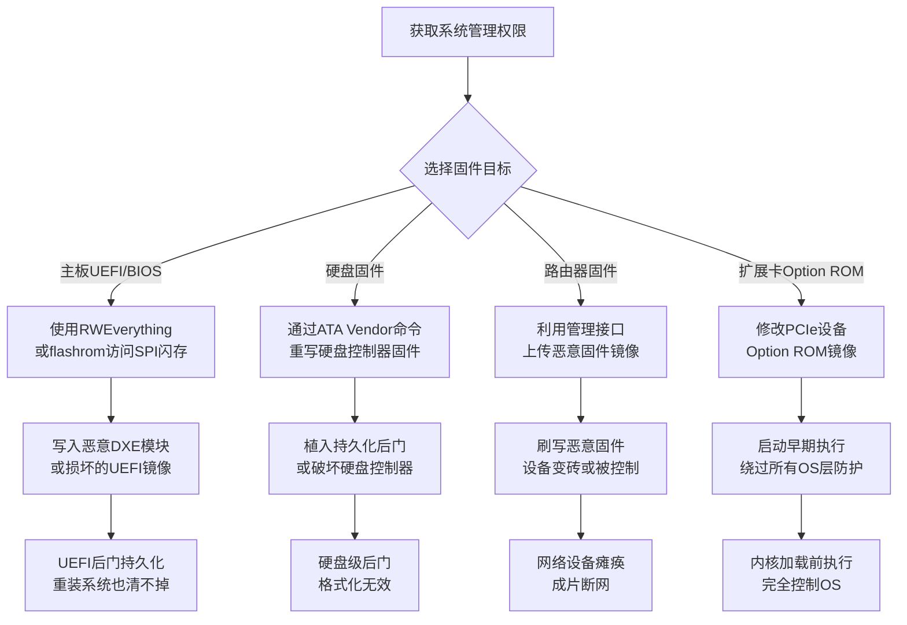

# 固件破坏 (T1495)

## 一句话通俗理解

**攻击者直接把恶意代码写进了电脑的"出厂灵魂"——主板的BIOS/UEFI、硬盘的固件、路由器的系统——让你重装系统、换硬盘都救不回来，设备彻底变砖。**

## 30秒速查卡

| 维度 | 你需要知道的 |
|------|-------------|
| 这是什么？ | 覆写或篡改设备固件（BIOS/UEFI、硬盘固件、路由器固件等），让设备永久失效或植入底层后门 |
| 为什么危险？ | 固件位于操作系统之下，重装系统、换硬盘都清不掉；破坏后设备直接报废，企业只能整批更换硬件 |
| 谁需要关心？ | 终端安全团队、固件工程师、数据中心运维、工控安全工程师 |
| 你的第一步防御 | 启用UEFI Secure Flash和硬件信任根（TPM/RTM），监控SPI闪存访问和fwupd/UEFI更新触发 |
| 如果只做一件事 | 在关键服务器上启用BIOS写保护 jumper，并监控所有RWEverything、fwupd、flashrom等工具的执行 |

## 难度等级

- ⭐⭐⭐ 高级（需要深入的硬件和固件知识）

## 前置知识检查

**读这个文件需要什么？**

- [ ] 计算机启动流程（BIOS/UEFI → Bootloader → OS）
- [ ] 固件存储介质（SPI Flash、EEPROM、NAND）
- [ ] 硬件信任根（TPM、Intel Boot Guard、AMD PSP）

## 技术描述

固件破坏（T1495）是MITRE ATT&CK框架中影响战术的一种技术。攻击者覆盖或篡改系统固件，导致设备无法启动、永久失效，或者在固件层植入持久后门。

**通俗解释：**

**过渡段：** 不要误解影响战术只是"删文件"或"加密数据"——固件破坏是更深层、更隐蔽的破坏方式。普通攻击者只能破坏软件层（操作系统、应用、文件），重启或重装就能恢复；而固件破坏者直接攻入硬件的"出厂灵魂"，让设备在最底层就叛变或罢工。这类攻击的影响半径最大：单台设备变砖只是起点，更可怕的是固件后门可以跨越重装、换盘、网络隔离而长期存在。
电脑启动时，最先运行的不是Windows或Linux，而是主板上一块叫SPI闪存的芯片里的BIOS/UEFI固件。固件负责初始化CPU、内存、硬盘，然后把控制权交给操作系统。如果攻击者把这块芯片里的内容改掉——要么写入垃圾数据让主板启动不了，要么写入恶意代码让电脑一开机就被控制——那么无论你重装系统多少次、换多少块硬盘都没用，因为"叛徒"就在主板本身里。除了主板，硬盘、显卡、网卡、路由器都有自己的固件，都可能成为攻击目标。

**技术原理：**

1. **UEFI/BIOS SPI闪存覆写**：攻击者使用RWEverything、flashrom等工具直接访问SPI闪存芯片，写入损坏的或恶意的UEFI镜像。LoJax等UEFI bootkit会在SPI闪存中植入恶意DXE模块，每次开机自动加载
2. **硬盘固件修改**：硬盘自身的控制器固件（如西部数据、希捷、东芝等品牌）可被重写。Equation Group的nertfret模块曾把持久化代码植入硬盘固件，即使格式化硬盘也无法清除
3. **PCIe Option ROM攻击**：显卡、网卡、RAID卡等扩展卡的Option ROM在系统启动早期被BIOS加载执行，攻击者篡改Option ROM可实现在操作系统加载前的代码执行
4. **路由器/交换机固件破坏**：VPNFilter等恶意软件可以覆写思科、Linksys、Netgear等品牌路由器的固件，使其变成砖头或植入持久后门
5. **嵌入式设备固件破坏**：卫星调制解调器、工控设备、IoT设备的固件被覆写后，设备永久报废，2022年AcidRain攻击Viasat卫星调制解调器就是典型案例

**用途与影响：**
固件破坏是影响战术中最具破坏性、最难恢复的技术之一。一旦固件被破坏，常规的恢复手段（重装系统、恢复备份、更换硬盘）都无效，只能更换硬件或使用专用编程器重新烧录固件。在国家级网络战中，固件破坏被用于战略瘫痪——攻击者通过一次攻击让成千上万台设备同时变砖，受害国需要数月才能恢复通信基础设施。在间谍行动中，固件层后门则提供了"不可清除"的持久化能力。

## 攻击流程



**步骤详解：**

1. **获取系统级权限**
   - 通俗描述：先要拿到目标系统的最高权限，才能访问底层硬件
   - 技术细节：通过提权漏洞获取SYSTEM/root权限，还需要内核驱动访问权限才能直接操作硬件端口
   - 常用工具：Mimikatz、漏洞利用框架、内核驱动加载器

2. **绕过固件写保护**
   - 通俗描述：现代主板有BIOS写保护机制，攻击者需要先关闭它
   - 技术细节：通过修改SPI闪存的状态寄存器（清除SRP位）、关闭Intel Boot Guard、修改UEFI变量中的写保护标志，或直接通过硬件接口（CH341A编程器）物理写入
   - 常用工具：RWEverything、flashrom、CHIPSEC、CH341A编程器

3. **覆写或篡改固件镜像**
   - 通俗描述：把恶意代码或损坏数据写入固件芯片
   - 技术细节：将恶意的UEFI DXE驱动注入到SPI闪存的固件卷中，或直接覆写整个固件镜像使其变成无意义数据
   - 常用工具：UEFITool、flashrom、自定义SPI写入工具

4. **持久化或破坏生效**
   - 通俗描述：被改写的固件在下次开机时生效
   - 技术细节：恶意UEFI模块在DXE阶段执行，可以修改OS加载过程、注入内核驱动、或直接拒绝启动让设备变砖
   - 常用工具：UEFI后门框架（如LoJax的NtfsRemote）

## 真实案例

### 案例1：LoJax - 首个实战UEFI Rootkit（2018）

- **时间**: 2017-2018年
- **目标**: 巴尔干半岛及中欧国家政府机构
- **攻击组织**: APT28（Fancy Bear / STRONTIUM）
- **手法**: APT28使用ESET命名为LoJax的UEFI rootkit，通过RWEverything工具直接访问受害电脑的SPI闪存芯片，将一个名为NtfsRemote的恶意UEFI模块写入主板固件。该模块在每次开机时自动加载，将木马REtrospect写入Windows系统目录，即使重装操作系统、更换硬盘，只要主板还在，恶意代码就会持续重新部署。ESET确认至少在数个政府机构的电脑中发现了被篡改的UEFI固件。
- **影响**: 首个被公开披露的实战型UEFI rootkit，标志着国家级攻击者已将固件层作为持久化战场
- **参考链接**: [ESET - LoJax First UEFI Rootkit Found in the Wild](https://www.welivesecurity.com/2018/09/27/lojax-first-uefi-rootkit-found-wild-courtesy-sednit-group/)

### 案例2：Equation Group - 硬盘固件持久化（2015披露）

- **时间**: 2001-2015年持续运作（Kaspersky披露时已活跃14年以上）
- **目标**: 全球30多个国家的外交、政府、军事、能源、电信机构
- **攻击组织**: Equation Group（被卡巴斯基归因为国家级APT，后被广泛认为与NSA相关）
- **手法**: Equation Group开发了一套名为nertfret、squirrel、molecuels的硬盘固件植入工具，能重写西部数据、希捷、迈拓、东芝、三星等多家厂商硬盘的控制器固件。被感染的硬盘在每次开机时由固件层加载恶意代码到内存，形成操作系统完全不可见的持久化。即使格式化硬盘、重装系统，固件层的恶意代码仍然存在。Kaspersky报告指出该组织至少从2001年起就开始使用此技术，是已知最早的固件层持久化攻击。
- **影响**: 揭示了固件层持久化的可能性，迫使安全行业重新审视硬件层威胁
- **参考链接**: [Kaspersky - Equation Group: The Crown Creator of Cyber-Espionage](https://securelist.com/equation-group-the-crown-creator-of-cyber-espionage/69231/)

### 案例3：VPNFilter - 路由器固件破坏（2018）

- **时间**: 2018年5月
- **目标**: 全球50万台SOHO路由器和NAS设备（主要在乌克兰）
- **攻击组织**: Sandworm Team（APT44 / UAC-0113）
- **手法**: VPNFilter是一个多阶段恶意软件框架，感染Linksys、Netgear、TP-Link、华硕等多家厂商的路由器。第三阶段插件中包含名为"kill"的固件破坏模块，可以覆写路由器的闪存并重启，使设备永久变砖——即使重置出厂设置也无法恢复。FBI在2018年5月接管了VPNFilter的C2域名ToKnowAll.com以阻止其进一步扩散。Cisco Talos分析认为，VPNFilter的固件破坏模块针对乌克兰路由器比例异常高，可能是为切断乌克兰通信基础设施做准备。
- **影响**: 50万台设备被感染，乌克兰遭受针对性破坏，迫使全球路由器厂商紧急发布固件更新
- **参考链接**: [Cisco Talos - VPNFilter Malware Analysis](https://blog.talosintelligence.com/2018/05/vpnfilter.html)

### 案例4：AcidRain - 卫星调制解调器固件擦除（2022）

- **时间**: 2022年2月24日（俄乌冲突爆发当天）
- **目标**: Viasat KA-SAT卫星网络覆盖的欧洲数万台调制解调器
- **攻击组织**: 与Sandworm相关（美国及欧盟多国政府正式归因）
- **手法**: AcidRain恶意软件专门针对Viasat KA-SAT卫星调制解调器的嵌入式Linux系统，利用设备固件中的命令执行漏洞获取root权限，然后覆写闪存中的固件镜像和bootloader，最后重启设备使其永久变砖。攻击造成德国风电场远程监控系统瘫痪、乌克兰多个军事单位通信中断、欧洲数千客户断网。SentinelLabs分析显示，AcidRain代码结构与VPNFilter相似，但专门针对MIPS架构的嵌入式设备优化。
- **影响**: 乌克兰及周边国家约3万台调制解调器永久报废，德国5800台风力发电机通信中断，是已知最大规模的固件擦除攻击之一
- **参考链接**: [SentinelOne - AcidRain Modem Wiper](https://www.sentinelone.com/labs/acidrain-a-modem-wiper-rains-down-on-europe/)

## 红队视角

> ⚠️ **免责声明**：以下内容仅用于合法的安全测试、渗透测试和教育目的。未经授权对他人系统进行测试是违法行为。

### 实战技巧

1. **SPI闪存读取与写入（合法测试）**：
   在授权测试中，使用CH341A编程器物理连接主板SPI闪存芯片（SOIC8封装），先用`flashrom --read backup.bin`备份原始固件，然后用`flashrom --write malicious.bin`写入测试镜像。这是测试固件防护最直接的方法，但需要物理接触。

2. **UEFI模拟环境测试**：
   使用QEMU的OVMF固件搭建UEFI测试环境，无需物理硬件即可测试UEFI驱动加载和持久化机制。编写一个简单的UEFI DXE驱动，观察其在启动过程中的执行时机和权限级别。

3. **CHIPSEC固件安全评估**：
   Intel开源的CHIPSEC工具可以评估UEFI固件安全配置，包括SPI闪存保护、Boot Guard状态、SMI处理程序漏洞等。运行`chipsec_main.py -m chipsec.modules.common.spi_lock`检查SPI闪存是否已锁定。

### 常用工具

| 工具名称 | 用途 | 平台 | 链接 |
|----------|------|------|------|
| flashrom | SPI闪存读写 | Linux/Windows | https://www.flashrom.org/ |
| RWEverything | 直接硬件访问（PCIe、SPI、内存） | Windows | http://rweverything.com/ |
| CHIPSEC | 固件安全评估框架 | Linux/Windows | https://github.com/chipsec/chipsec |
| UEFITool | UEFI镜像查看与编辑 | 跨平台 | https://github.com/LongSoft/UEFITool |
| CH341A编程器 | 物理SPI闪存读写 | 独立硬件 | 通用硬件工具 |
| fwupd | Linux固件更新守护进程（用于检测） | Linux | https://fwupd.org/ |

### 注意事项

- 在物理硬件上测试固件修改有变砖风险，必须先备份原始固件镜像
- UEFI Secure Boot和Intel Boot Guard会阻止未签名固件加载，测试前需确认目标设备的信任链
- 路由器固件测试应使用隔离网络，避免影响生产网络设备

## 蓝队视角

### 检测要点

1. **SPI闪存异常访问**
   - 日志来源：Sysmon Event ID 10（ProcessAccess，访问\Device\PhysicalMemory）、Event ID 1（进程创建）
   - 关注字段：RWEverything、flashrom、CHIPSEC等工具的执行
   - 异常特征：非计划内的固件操作工具执行，特别是来自非管理员账户或异常时段

2. **UEFI固件完整性变更**
   - 日志来源：Windows Event Log Microsoft-Windows-Kernel-PWP（PlatformWorkerProvider）
   - 关注字段：UEFI变量变更、Secure Boot状态变更
   - 异常特征：UEFI Secure Boot被禁用、Boot Guard状态变更、固件版本回退

3. **fwupd异常固件更新**
   - 日志来源：Linux journald（fwupd.service）、fwupdmgr历史
   - 关注字段：固件版本号、更新源、更新发起进程
   - 异常特征：非计划内的fwupd执行、来自非官方源的固件LVFS签名

4. **网络设备固件变更**
   - 日志来源：路由器/交换机syslog（Cisco IOS "show version" 周期审计、SNMP trap）
   - 关注字段：固件版本、配置寄存器值、闪存写入事件
   - 异常特征：固件版本与基线不符、配置寄存器被改为0x2102以外的值、非授权TFTP/SCP固件传输

### 监控建议

- 在关键服务器上启用BIOS写保护物理jumper，并定期审计jumper状态
- 部署CHIPSEC进行固件基线采集，定期比对SPI闪存hash
- 监控所有RWEverything、flashrom、CHIPSEC、fwupdmgr进程的执行
- 在Linux服务器上配置fwupd审计策略，限制只有特定服务账户能触发固件更新
- 路由器/交换机启用配置变更告警，将固件版本纳入CMDB定期审计
- 对UEFI变量和Secure Boot状态变更配置SIEM告警

## 避坑指南

组织中最危险的盲区：认为"重装系统就能解决问题"。固件层的攻击完全不受操作系统重装影响，设备本身已经成为叛徒。安全团队必须将固件纳入完整性基线管理范围，而不是只关注操作系统和应用程序。

另一个常见误区是"UEFI Secure Boot开就够了"。Secure Boot只保护启动链上的签名验证，不能阻止拥有管理员权限的攻击者直接通过SPI接口写入固件——后者需要的是SPI闪存写保护jumper和硬件信任根（Intel Boot Guard / AMD PSP）。

## 检测建议

### 主机层检测

**检测方法：** 监控固件操作工具的执行和UEFI固件完整性的变化。

**具体命令示例：**
```powershell
# 监控Windows上常见的固件操作工具执行
Get-WinEvent -FilterHashtable @{
    LogName='Microsoft-Windows-Sysmon/Operational'
    ID=1
} -MaxEvents 1000 |
    Where-Object { $_.Message -match 'RWEverything|RW-Everything|flashrom|chipsec|fwupdmgr' } |
    Format-Table TimeCreated, Id, Message -Wrap

# 检查UEFI Secure Boot状态变更
Confirm-SecureBootUEFI
Get-ItemProperty -Path 'HKLM:\SYSTEM\CurrentControlSet\Control\SecureBoot\State' -ErrorAction SilentlyContinue
```

```bash
# Linux上监控fwupd执行历史
journalctl -u fwupd.service --since "7 days ago" | grep -iE "update|install|downgrade"

# 检查UEFI变量变化（需要efivarfs已挂载）
sudo mount -t efivarfs efivarfs /sys/firmware/efi/efivars 2>/dev/null
ls -la /sys/firmware/efi/efivars/ | awk '{print $5, $9}' | sort -k2

# 使用CHIPSEC检查SPI闪存保护状态
sudo python chipsec_main.py -m chipsec.modules.common.spi_lock
```

### 网络层检测

**检测方法：** 监控异常的固件下载流量和固件更新服务器异常访问。

**具体规则示例：**
```
# 检测TFTP固件下载流量（路由器固件刷写常用）
tshark -r capture.pcap -Y "tftp.opcode == 1" -T fields \
    -e ip.src -e ip.dst -e tftp.source_file | sort | uniq -c | sort -rn

# 检测异常大固件镜像传输（可能为恶意固件投递）
zeek -C -r capture.pcap http.log | awk '$10 > 10000000' | \
    grep -iE "firmware|bios|uefi|\.bin|\.img|\.fd" | head -20
```

### 应用层检测

**Sigma规则示例：**
```yaml
title: 检测固件操作工具执行
status: experimental
description: 检测可能用于固件篡改的工具执行，包括UEFI/BIOS写入工具
logsource:
    category: process_creation
    product: windows
detection:
    selection_tools:
        Image|endswith:
            - '\RWEverything.exe'
            - '\RW-Everything.exe'
            - '\flashrom.exe'
            - '\chipsec_main.exe'
            - '\chipsec_util.exe'
            - '\UEFITool.exe'
    selection_commands:
        CommandLine|contains:
            - 'flashrom --write'
            - 'fwupdmgr install'
            - 'efibootmgr -c'
    condition: selection_tools or selection_commands
level: high
tags:
    - attack.t1495
    - attack.impact
    - attack.persistence
```

## 缓解措施

### 优先级1：关键措施

**措施名称：** 启用硬件信任根和固件写保护

**具体实施步骤：**
1. 在采购标准中强制要求支持Intel Boot Guard或AMD PSP的服务器和终端设备
2. 启用UEFI Secure Boot，并配置自定义Platform Key限制只信任厂商固件
3. 在关键服务器上启用主板BIOS写保护物理jumper，部署后由运维人员物理锁定
4. 启用SPI闪存的状态寄存器写保护（SRP/SRP0位），防止软件层未授权写入

**配置示例：**
```bash
# 使用CHIPSEC锁定SPI闪存（部署阶段执行）
sudo python chipsec_main.py -m chipsec.modules.common.spi_lock
sudo python chipsec_util.py spi lock
```

### 优先级2：重要措施

**措施名称：** 固件完整性基线与定期审计

**具体实施步骤：**
1. 使用CHIPSEC对所有关键设备采集固件镜像hash基线
2. 每季度对关键服务器执行一次固件hash比对，发现变更立即调查
3. 部署fwupd + LVFS（Linux Vendor Firmware Service）作为唯一合法固件更新通道
4. 对网络设备启用Cisco IOS Resilient Configuration或同等特性，保护运行镜像和启动配置

### 优先级3：建议措施

**措施名称：** 固件供应链管理与应急响应

**具体实施步骤：**
1. 建立固件版本基线CMDB，跟踪所有设备的固件版本和更新历史
2. 制定固件层攻击的应急响应流程，包括物理编程器重新烧录的预备方案
3. 与硬件厂商建立固件安全漏洞通报渠道，及时获取安全更新
4. 关键岗位备份设备：万一主设备变砖，可立即替换以维持业务连续性

### MITRE ATT&CK 缓解措施映射

| 缓解措施ID | 缓解措施名称 | 适用性 | 说明 |
|------------|-------------|--------|------|
| M1041 | 加密敏感信息 | 部分适用 | UEFI Secure Boot签名机制确保只加载可信固件 |
| M1046 | 启动配置 | 强适用 | 配置BIOS/UEFI启动安全（Secure Boot、Boot Guard） |
| M1051 | 更新软件 | 强适用 | 及时安装厂商固件安全补丁 |
| M1047 | 审计 | 适用 | 定期审计固件版本与基线一致性 |
| M1035 | 数据备份 | 部分适用 | 备份UEFI配置和固件镜像，便于恢复 |
| M1029 | 远程数据存储 | 部分适用 | 集中管理网络设备配置和固件镜像 |

## 动手实验

> ⚠️ **重要提示**：所有实验必须在隔离的实验室环境中进行，禁止对未授权的真实系统进行测试。固件操作有变砖风险，必须使用专用测试设备。

### 实验环境准备

**推荐靶场/实验平台：**

| 平台名称 | 类型 | 难度 | 链接 |
|----------|------|------|------|
| QEMU + OVMF UEFI模拟 | 虚拟机 | 中级 | https://github.com/tianocore/tianocore.github.io/wiki/OVMF |
| CHIPSEC测试平台 | 硬件评估 | 高级 | https://github.com/chipsec/chipsec |
| Flashrom + CH341A编程器 | 物理实验 | 高级 | https://www.flashrom.org/Flashrom/0.9.2/1.0 |

**所需工具：**
- QEMU 7.0+：UEFI模拟环境
- OVMF固件镜像：UEFI参考实现
- CHIPSEC：固件安全评估框架
- 一台可牺牲的旧主板：物理SPI闪存操作实验

### 实验1：UEFI固件镜像分析与模块识别（中级）

**实验目标：** 学习使用UEFITool分析UEFI固件镜像的内部结构，识别DXE模块。

**实验步骤：**
1. 从主板厂商官网下载一份BIOS更新镜像，或使用QEMU自带的OVMF固件
2. 使用UEFITool打开镜像，浏览固件卷层次结构
3. 找到所有DXE驱动模块，记录每个模块的GUID和名称
4. 提取一个DXE模块，使用hexdump查看其PE头结构
5. 比对修改前后的固件hash，理解固件完整性的变化

**预期结果：** 能在UEFITool中识别UEFI固件镜像的层次结构，提取出DXE模块。

**学习要点：** 理解UEFI固件的内部组织，知道攻击者将恶意DXE模块注入到固件的什么位置。

### 实验2：CHIPSEC固件安全评估（高级）

**实验目标：** 使用CHIPSEC评估一台测试机的固件安全配置，识别防护弱点。

**实验步骤：**
1. 在测试机上用Live USB启动Linux
2. 安装CHIPSEC：`git clone https://github.com/chipsec/chipsec && cd chipsec && python setup.py install`
3. 运行完整评估：`sudo python chipsec_main.py`
4. 重点关注以下模块的结果：
   - `common.spi_lock` - SPI闪存是否锁定
   - `common.secureboot` - Secure Boot是否启用
   - `common.bootguard` - Boot Guard是否启用
5. 记录每个模块的状态，识别防护弱点

**预期结果：** 生成一份完整的固件安全评估报告，知道目标设备的固件防护状态。

**学习要点：** 学会使用CHIPSEC评估固件安全，理解SPI锁、Secure Boot、Boot Guard等防护机制的作用。

## 术语解释

| 术语 | 英文原名 | 通俗解释 |
|------|----------|----------|
| 固件 | Firmware | 写在硬件芯片里的"出厂软件"，介于硬件和操作系统之间。相当于设备的"灵魂" |
| BIOS | Basic Input/Output System | 老式主板的固件，负责开机自检和启动加载。已被UEFI逐步取代 |
| UEFI | Unified Extensible Firmware Interface | BIOS的现代继任者，主板固件的新标准。功能更强、支持图形界面和网络 |
| SPI闪存 | SPI Flash | 主板上存储UEFI/BIOS固件的芯片。相当于主板的"灵魂容器" |
| DXE驱动 | Driver eXecution Environment | UEFI启动中期的驱动模块，攻击者常将其作为注入恶意代码的位置 |
| Option ROM | Option ROM | 扩展卡（显卡、网卡、RAID卡）上的固件，开机时由BIOS加载执行 |
| Boot Guard | Intel Boot Guard | Intel的硬件信任根机制，CPU在启动时验证UEFI固件签名，防止未授权固件运行 |
| TPM | Trusted Platform Module | 可信平台模块，主板上的安全芯片，提供密钥存储和启动度量 |
| Secure Boot | Secure Boot | UEFI的安全启动机制，只加载签名过的操作系统和驱动 |
| SPI写保护 | SPI Write Protect | SPI闪存的硬件写保护机制，通过jumper或状态寄存器锁定，防止未授权写入 |
| 变砖 | Bricking | 设备因固件损坏或被破坏而永久无法启动，像砖头一样无用 |
| CH341A | CH341A Programmer | 廉价USB转SPI编程器，常用于物理读写SPI闪存芯片 |
| fwupd | Firmware Update Daemon | Linux系统的固件更新守护进程，通过LVFS分发厂商固件更新 |

## 参考资料

### 📚 官方文档（深入了解）

- [MITRE ATT&CK - T1495 Firmware Corruption](https://attack.mitre.org/techniques/T1495/)
- [MITRE ATT&CK - Impact Tactic TA0040](https://attack.mitre.org/tactics/TA0040/)
- [NIST SP 800-147B - BIOS Protection Guidelines for Servers](https://csrc.nist.gov/publications/detail/sp/800-147b/final)

### 📰 安全报告（真实攻击）

- [ESET - LoJax: First UEFI Rootkit Found in the Wild](https://www.welivesecurity.com/2018/09/27/lojax-first-uefi-rootkit-found-wild-courtesy-sednit-group/) - APT28的UEFI rootkit分析
- [Kaspersky - Equation Group: The Crown Creator of Cyber-Espionage](https://securelist.com/equation-group-the-crown-creator-of-cyber-espionage/69231/) - 硬盘固件持久化首度披露
- [Cisco Talos - VPNFilter Malware Analysis](https://blog.talosintelligence.com/2018/05/vpnfilter.html) - 路由器固件破坏攻击分析
- [SentinelOne - AcidRain: A Modem Wiper Rains Down on Europe](https://www.sentinelone.com/labs/acidrain-a-modem-wiper-rains-down-on-europe/) - Viasat卫星调制解调器固件擦除攻击
- [CISA Advisory - AcidRain VPNFilter](https://www.cisa.gov/news-events/cybersecurity-advisories/aa22-110a) - 美国CISA对相关固件破坏攻击的官方通报

### 🔧 工具与资源（动手试试）

- [CHIPSEC - 固件安全评估框架](https://github.com/chipsec/chipsec)
- [flashrom - SPI闪存读写工具](https://www.flashrom.org/)
- [UEFITool - UEFI镜像编辑工具](https://github.com/LongSoft/UEFITool)
- [fwupd - Linux固件更新守护进程](https://fwupd.org/)
- [EDK II - UEFI参考实现源码](https://github.com/tianocore/edk2)

### 📚 学习资料（深入了解）

- [UEFI Specification - UEFI官方规范](https://uefi.org/specifications)
- [Intel Boot Guard Architecture](https://www.intel.com/content/www/us/en/developer/articles/technical/intel-txt-software-development-guide.html) - Intel硬件信任根白皮书
- [NIST SP 800-147 - BIOS Protection Guidelines](https://csrc.nist.gov/publications/detail/sp/800-147/final) - NIST BIOS保护指南
- [Binary Defense - UEFI Rootkits Deep Dive](https://www.binarydefense.com/) - UEFI rootkit技术深度分析
