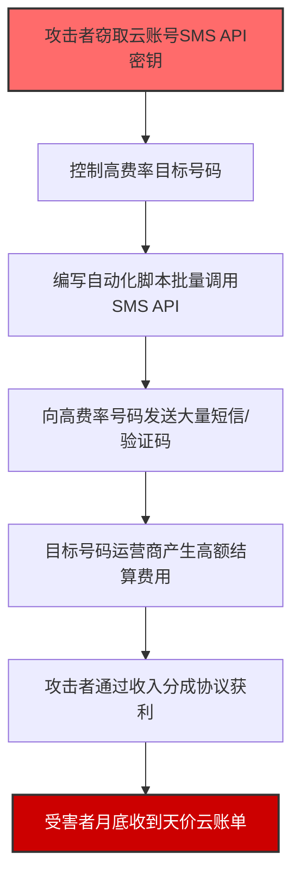
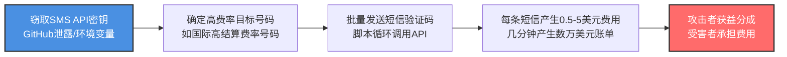

# 短信轰炸 (T1496.003)

## 一句话通俗理解

> **攻击者利用你的云账号发送大量付费短信，让你月底收到天价短信账单。**

## 30秒速查卡

| 维度 | 你需要知道的 |
|------|-------------|
| 这是什么？ | SMS Pumping（短信轰炸）利用受害者的SMS API发送大量付费短信，产生巨额费用 |
| 为什么危险？ | 短信发送费用累积极快，几分钟内可能产生数万美元的云账单 |
| 谁需要关心？ | 云成本管理团队、DevOps运维、使用SMS通知服务的SaaS企业 |
| 你的第一步防御 | 设置SMS API的日发送量上限和费用告警阈值 |
| 如果只做一件事 | 为所有SMS API密钥绑定IAM权限，最小化可发送短信的服务账户权限 |

## 难度等级

⭐⭐ 中级 - 需要一定的云服务和API知识

## 前置知识检查

**读这个文件需要什么？**

- [ ] 了解SMS网关和短信发送原理
- [ ] 了解云服务API认证机制（API Key / IAM）

## 技术描述

**短信轰炸**（SMS Pumping，T1496.003）是 **资源劫持**（T1496）的一个具体变体，属于 **影响** 阶段的攻击技术。

> 💸 **打个比方**：就像有人偷了你的快递账号，用你的账号寄了几百个到付包裹——账单全是你的，包裹是别人的。

### 具体怎么理解？

攻击者利用盗取的云账户SMS API凭证，调用短信发送接口向高费率目的地号码发送大量短信。短信发送本身可能看起来是正常的业务操作，但攻击者通过控制目标号码从中获利（例如通过号码拥有者与运营商之间的收入分成协议）。

### 为什么有效？

这种技术之所以有效，是因为：
1. **利用正常功能**：SMS API本是合法的业务功能，难以区分正常使用和滥用
2. **成本隐匿**：短信费用在月底账单中才显现，发现时已产生巨额费用
3. **操作简单**：只需要有效的API密钥即可通过简单脚本批量发送
4. **价值变现**：攻击者可通过短信分成协议获利，形成完整的经济链条

## 真实攻击流程

**步骤详解：**

1. **窃取凭证** - 攻击者通过凭证窃取、代码仓库泄露、环境变量泄露等方式获得云服务SMS API密钥
2. **控制目标号码** - 攻击者事前控制一组高费率号码，这些号码通常位于特定国家或地区，运营商结算费率极高（可达每条短信数美元）
3. **自动化轰炸** - 编写Python或脚本，循环调用SMS API发送接口，向每个高费率号码发送大量短信
4. **产生费用** - 短时间内发送数十万条短信，云账户欠费迅速累积到数万甚至数十万美元
5. **获利套现** - 攻击者与目标号码所在运营商有收入分成协议，每收到一条短信即可分得部分费用
6. **账单冲击** - 受害者在月底收到巨额云账单才发现已被滥用

## 攻击流程

**关键步骤说明：**

1. **凭证获取** - 攻击者通过各类手段获得云服务SMS API凭证：GitHub代码仓库泄露（.env文件）、SSRF漏洞获取云元数据API令牌、已被攻陷的CI/CD管道凭证、社会工程学钓鱼获取管理员凭证
2. **高费率号码选择** - 特定国家号码（如部分非洲、太平洋岛国号码）的国际短信结算费率极高（每条可达2-5美元），攻击者选中这些号码作为目标
3. **自动化发送** - 使用简单脚本（Python + boto3 SDK / curl REST API）循环调用SMS发送接口，攻击者通常会在短时间内密集发送，在防御响应前最大化收益
4. **变现模式** - 攻击者与目标号码运营商内部人员合谋，或利用运营商之间的结算欺诈漏洞，将虚假短信流量转化为实际收入

## 真实案例

### 案例1：云SMS API滥用欺诈

- **时间**: 2024年
- **目标**: 多家使用SMS通知服务的SaaS公司
- **手法**: 攻击者通过泄露的CI/CD环境变量获取AWS Pinpoint和Twilio API密钥，在数小时内向高费率国际号码发送了超过50万条SMS消息，单张云账单超过10万美元
- **影响**: 受害公司被迫临时关闭SMS服务，与云服务商协商减免部分账单费用，增加了IAM密钥轮换和费用告警机制

### 案例2：验证码短信轰炸

- **时间**: 2025年
- **目标**: 大型互联网平台
- **手法**: 攻击者利用平台注册页面无频率限制的漏洞，通过代理IP大量提交手机号注册请求，平台自动向目标号码发送验证码短信。攻击者控制高费率号码接码，每条验证码产生0.5-2美元费用
- **影响**: 平台单日短信费用激增至数十万美元，紧急上线了注册频率限制和CAPTCHA验证

## 关联视图

### 与攻击链其他部分的关系

| 阶段 | 关联 |
|------|------|
| 资源开发 | 攻击者需要开发或购买自动化短信发送脚本 |
| 初始访问 | 通过凭证窃取获得SMS API访问权限 |
| 执行 | 通过脚本或自动化工具执行短信发送 |

### 与其他技术的关联

- T1110（暴力破解）：攻击者可能结合短信轰炸进行MFA疲劳攻击
- T1528（窃取云服务账户凭证）：获取SMS API密钥的常见途径
- T1496（资源劫持）：该技术的父技术，提供了整体的资源劫持框架

## 检测与监控

### 关键检测点

| 检测源 | 检测内容 |
|--------|----------|
| 云API日志 | 单账户每小时SMS API调用次数是否超过基线值 |
| 费用告警 | 云服务每日费用是否超过预设阈值（建议设置$100-1000告警） |
| SMS发送日志 | 是否有大量短信发送至同一号码或同一地区 |
| API速率 | 单API密钥在短时间内调用频率是否异常增长 |
| 接收方模式 | 是否有大量短信发送至非业务关系的高费率国际号码 |

### 检测规则示例

**CloudTrail / 云审计日志规则：**
- 对SMS API（SendSMS / SendMessage / PublishSMS）的调用量在短时间内增长10倍以上
- 调用来源IP不在公司允许的地理位置范围内
- SMS发送目标号码为已知高费率国家代码（如+68x、+24x等）
- 单个IAM用户或API Key在非营业时间产生大量SMS API调用

## 缓解措施

| 缓解ID | 措施 | 说明 |
|--------|------|------|
| M1030 | 网络隔离 | 限制SMS API的调用来源IP范围，仅允许业务服务器IP |
| M1026 | 权限管理 | 使用最小权限原则，为SMS API分配专有IAM角色，禁止使用根用户密钥 |
| M1032 | 多因素认证 | SMS API密钥定期轮换，使用临时凭证（STS）替代长期密钥 |
| M1017 | 用户培训 | 教育开发人员不要在代码仓库中提交包含API密钥的.env文件 |

### 推荐配置

1. **设置费用告警**：在云服务控制台中配置预算告警（如月费用超过$500时触发告警）
2. **发送量限额**：为SMS API配置日发送量上限（如每日不超过10,000条）
3. **目标号码白名单**：仅在业务需要时允许发送至特定国家代码，禁止向非业务区域发送
4. **API Key定期轮换**：SMS API密钥每90天强制轮换一次

## 攻击检测关联

### Blue Team 检测参考

- **主要检测**: 通过云费用管理控制台监控异常费用增长，设置实时费用告警
- **辅助检测**: 监控SMS API调用日志中的接收号码模式、发送频率、来源IP异常
- **关联分析**: 结合IAM使用日志，发现API密钥异常使用行为

### 数据源

| 数据源 | 说明 |
|--------|------|
| 云费用API | 实时监控云账户费用异常 |
| 云审计日志 | 记录每次SMS API调用详情 |
| SMS发送日志 | 记录每条短信的接收号码、时间、状态 |
| IAM使用日志 | 记录API密钥的调用来源和频率 |

## 在攻击链中的位置

该技术属于 **影响** 阶段（TA0040），位于攻击链的末端。攻击者通常在完成凭证窃取、权限维持后执行此操作，目的是通过资源滥用造成经济损失。

### 前置条件
- 获取有效的SMS API密钥或访问令牌
- 控制高费率回收号码

### 后续影响
- 云账户欠费导致业务服务中断
- 云服务商可能因欺诈行为封禁账户
- 财务损失和品牌声誉损害

## 防御建议

### 快速自查清单

- [ ] 是否设置了SMS API调用量上限？
- [ ] 是否配置了云费用告警（建议阈值$500）？
- [ ] 是否限制了SMS API的调用来源IP？
- [ ] SMS API密钥是否使用最小权限IAM角色？
- [ ] 是否定期轮换SMS API密钥（90天周期）？
- [ ] 代码仓库是否扫描过硬编码的API密钥？

### 攻击面分析

| 攻击面 | 风险等级 | 说明 |
|--------|---------|------|
| 公开的代码仓库 | 🔴 高 | GitHub等平台泄露的.env文件包含SMS API密钥 |
| 未限速的API接口 | 🔴 高 | 注册/登录接口无频率限制导致验证码滥用 |
| 弱IAM权限 | 🟡 中 | API密钥绑定了超出需要的SMS权限 |
| 无费用告警 | 🟡 中 | 没有设置费用预算告警，账单膨胀后才被发现 |

## 参考资料

### 官方文档

- [MITRE ATT&CK - SMS Pumping (T1496.003)](https://attack.mitre.org/techniques/T1496/003/)
- [MITRE ATT&CK - Resource Hijacking (T1496)](https://attack.mitre.org/techniques/T1496/)
- [MITRE ATT&CK Enterprise Matrix v19](https://attack.mitre.org/matrices/enterprise/)

### 安全报告

- [OWASP SMS Abuse Prevention](https://cheatsheetseries.owasp.org/cheatsheets/Abuse_Case_Cheat_Sheet.html) - OWASP短信滥用防护指南
- [AWS SMS Best Practices](https://docs.aws.amazon.com/sns/latest/dg/sns-sms-best-practices.html) - AWS SMS服务最佳实践

### 相关文章

- AWS Security Blog: "How to protect your AWS account from SMS pumping attacks"
- Twilio: "Preventing SMS Pumping and API Abuse" - Twilio SMS滥用防护指南
- Cloudflare Blog: "The anatomy of an SMS pumping attack" - 短信轰炸攻击剖析
