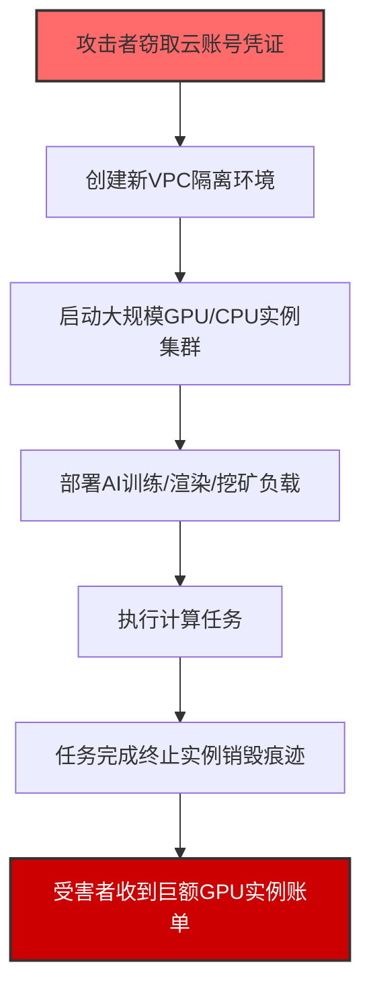
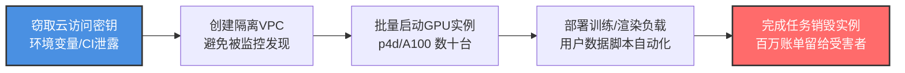

# 云服务劫持 (T1496.004)

## 一句话通俗理解

> **攻击者用你的云账号跑AI训练、电影渲染——算力你出，成果归他。**

## 30秒速查卡

| 维度 | 你需要知道的 |
|------|-------------|
| 这是什么？ | 攻击者利用盗取的云凭证启动大规模计算资源（GPU实例、批量计算集群）进行自己的计算任务 |
| 为什么危险？ | GPU实例费用极高（如A100实例每小时可达$30-50），短时间内产生巨额费用 |
| 谁需要关心？ | 云成本管理团队、DevOps、使用云GPU/高性能计算的企业 |
| 你的第一步防御 | 为云账号启用费用预算告警，设置资源配额上限 |
| 如果只做一件事 | 对生产和开发环境使用独立的云账号，严格分离权限 |

## 难度等级

⭐⭐ 中级 - 需要一定的云服务和API知识

## 前置知识检查

**读这个文件需要什么？**

- [ ] 了解云服务基本概念（EC2/GCE实例、IAM、VPC）
- [ ] 了解GPU计算和批处理作业

## 技术描述

**云服务劫持**（Cloud Service Hijacking，T1496.004）是 **资源劫持**（T1496）的一个具体变体，属于 **影响** 阶段的攻击技术。

> ☁️ **打个比方**：就像有人偷了你的车去跑滴滴赚钱——油钱你出（云账单），收入归他。

### 具体怎么理解？

攻击者利用盗取的云服务凭据，在受害者的云账户中启动大规模计算资源（GPU实例、弹性计算集群、批处理作业队列），用于执行自己的计算密集型任务，如AI模型训练、3D渲染、科学计算或加密货币挖矿。所有这些计算资源产生的费用全部计入受害者账户。

### 为什么有效？

这种技术之所以有效，是因为：
1. **资源丰富**：云平台提供几乎无限制的计算资源，攻击者可启动数百个GPU实例
2. **成本转嫁**：所有费用由受害者承担，攻击者零成本获得海量算力
3. **操作隐蔽**：攻击者可能选择在夜间或周末启动实例，避开实时监控
4. **应用广泛**：GPU算力可用于AI训练、挖矿、渲染等多种盈利场景

## 真实攻击流程

**步骤详解：**

1. **窃取凭证** - 攻击者通过泄露的云访问密钥、IAM角色临时凭证或已攻陷的CI/CD管道获得云账号访问权限
2. **创建隔离环境** - 在受害者的云账户中创建新的VPC、安全组和子网，确保活动不被已有的监控发现
3. **启动计算集群** - 使用EC2 RunInstances / GCE instances.insert等API批量启动GPU实例（如p4d/p5实例或A100/GPU实例），数量可达数十到数百个
4. **部署工作负载** - 通过用户数据脚本或自动化配置工具（CloudFormation/Terraform）部署恶意计算负载
5. **执行计算任务** - 利用云算力执行盈利性计算任务，如AI模型分布式训练、好莱坞级3D渲染、密码哈希破解
6. **销毁痕迹** - 任务完成后终止所有实例并删除日志，API调用历史仍留存于CloudTrail中
7. **账单冲击** - 数小时的高密度GPU实例运行即可产生数万至数十万美元的费用

## 攻击流程

**关键步骤说明：**

1. **凭证获取** - 攻击途径包括：GitHub代码仓库泄露的AWS_ACCESS_KEY_ID/AWS_SECRET_ACCESS_KEY，SSRF漏洞获取的云元数据服务临时凭证（http://169.254.169.254/latest/meta-data/iam/security-credentials/），被攻陷的CI/CD平台（Jenkins/GitHub Actions）环境变量中的云凭证，员工终端被植入窃密木马获取的AWS CLI配置文件
2. **环境隔离** - 攻击者使用CreateVPC或新建项目的方式创建独立的网络环境，避开受害者已有的监控和告警规则。部分攻击者还会修改CloudTrail日志的过滤规则
3. **实例选择** - 攻击者偏好启动按需GPU实例（非竞价实例），因为按需实例配额更高，可一次性启动更多资源。目标实例类型包括AWS p4d.24xlarge（每个$32.77/小时）、GCE a2-highgpu-8g（每个约$20/小时）、Azure ND40rs_v2等
4. **负载类型** - AI模型训练（Stable Diffusion、LLM微调）、影视渲染（Blender/Arnold渲染农场）、密码哈希破解（Hashcat配合GPU加速）、加密货币挖矿（门罗币的RandomX算法）等

## 真实案例

### 案例1：云GPU实例挖矿集群

- **时间**: 2023-2024年
- **目标**: 多家云服务用户
- **手法**: 攻击者利用泄露的AWS访问密钥在受害者的东京区域启动了超过100个p3.2xlarge GPU实例用于加密货币挖矿。实例运行了约12小时后被云服务商的异常检测系统发现
- **影响**: 受害者的AWS账单增加了约$50,000。云服务商在检测到挖矿行为后自动冻结了受害者的账户

### 案例2：AI模型训练劫持

- **时间**: 2025年
- **目标**: 某AI创业公司
- **手法**: 攻击者通过泄露的CI/CD管道环境变量获得GCP服务账号密钥，创建了新的GCP项目并启动了32个A100 GPU实例进行自己的LLM微调训练。训练任务运行了约8小时
- **影响**: 云账单增加了约$25,000。公司事后发现其GCP服务账号具有过高的权限（Project Editor角色），被迅速降级

## 关联视图

### 与攻击链其他部分的关系

| 阶段 | 关联 |
|------|------|
| 初始访问 | 通过凭证窃取（T1528）获得云访问凭证 |
| 持久化 | 攻击者可能创建新的IAM用户或角色作为后门 |
| 防御规避 | 创建独立的VPC/项目逃避检测 |

### 与其他技术的关联

- T1528（窃取云服务账户凭证）：获取云凭证的主要途径
- T1078（合法账户）：使用泄露的合法云账户进行攻击
- T1496（资源劫持）：该技术的父技术
- T1562（削弱防御）：攻击者可能先禁用CloudTrail等审计服务

## 检测与监控

### 关键检测点

| 检测源 | 检测内容 |
|--------|----------|
| 云计费API | 单日费用是否超过基线值5倍以上，特别是GPU实例费用 |
| CloudTrail日志 | 批量启动GPU实例的API调用（RunInstances/instances.insert） |
| 资源配额 | 是否有违反资源配额限制的API调用 |
| 实例模式 | 短时间内启动大量同类型GPU实例，且非工作时间启动 |
| VPC创建 | 是否有突然创建新VPC或项目的动作 |

### 检测规则示例

**CloudTrail异常检测规则：**
- 30分钟内启动超过5个GPU实例（p3/p4/p5/g4ad/a100等类型）
- 从非办公IP地址启动大量计算资源
- 新创建的VPC中启动GPU实例（先建网络后建实例的模式）
- IAM角色/用户首次使用的区域启动GPU实例

## 缓解措施

| 缓解ID | 措施 | 说明 |
|--------|------|------|
| M1030 | 网络隔离 | 限制API调用仅允许来自办公网络或堡垒机的IP |
| M1026 | 权限管理 | 使用最小权限策略，禁止不必要的ec2:RunInstances权限 |
| M1032 | 多因素认证 | 为云账号启用MFA，使用临时STS凭证替代长期密钥 |
| M1017 | 用户培训 | 教育开发人员不要在代码中硬编码云凭证 |
| M1022 | 限制API调用 | 使用SCP策略限制特定区域和实例类型的启动权限 |

### 推荐配置

1. **费用预算告警**：设置月度预算告警（如$1000告警阈值），并配置实时费用通知
2. **资源配额限制**：为每个IAM用户设置EC2实例配额上限，防止大规模启动
3. **SCP策略**：使用服务控制策略（SCP）限制非生产账号启动GPU实例
4. **CloudTrail监控**：启用CloudTrail并配置基于API调用的实时告警规则

## 攻击检测关联

### Blue Team 检测参考

- **主要检测**: 云费用告警系统在费用异常增长时的即时通知
- **辅助检测**: 分析CloudTrail中批量启动GPU实例的模式
- **关联分析**: 结合IAM Access Advisor判断凭证是否被用于非预期服务

### 数据源

| 数据源 | 说明 |
|--------|------|
| 云费用API（Cost Explorer） | 实时监控账户费用异常，按实例类型和区域分解 |
| CloudTrail / 审计日志 | 记录所有API调用，包括实例启动和网络创建 |
| GuardDuty / 安全中心 | 云服务商的安全检测服务，可检测异常API行为 |
| 配置变更追踪 | 监控VPC、安全组、IAM策略等关键资源的变更 |

## 在攻击链中的位置

该技术属于 **影响** 阶段（TA0040），位于攻击链的末端。攻击者在完成初始访问和凭证窃取后，利用云服务的弹性计算能力进行大规模资源滥用。

### 前置条件
- 获取有效的云服务访问凭证（Access Key / IAM角色）
- 该凭证具有启动计算资源的权限（ec2:RunInstances）

### 后续影响
- 巨额云服务账单（数万至数十万美元）
- 云服务商因可疑活动暂停账号
- 业务服务因预算超支被中断

## 防御建议

### 快速自查清单

- [ ] 是否设置了云费用预算告警？
- [ ] 是否限制了每个IAM用户的实例配额上限？
- [ ] 是否对敏感API操作（RunInstances）设置了MFA保护？
- [ ] 代码仓库中是否还有硬编码的云凭证？
- [ ] 是否在CI/CD中使用临时凭证而非长期Access Key？
- [ ] 是否定期审核IAM权限（最小权限原则）？

### 攻击面分析

| 攻击面 | 风险等级 | 说明 |
|--------|---------|------|
| 公开的云凭证泄露 | 🔴 高 | GitHub等平台泄露的云访问密钥 |
| 过度权限的IAM角色 | 🔴 高 | 开发/CI角色绑定了AdministratorAccess等全权限策略 |
| 未设置费用告警 | 🟡 中 | 没有费用预算和实时通知 |
| 无区域限制策略 | 🟡 中 | 允许在非业务区域启动资源 |

## 参考资料

### 官方文档

- [MITRE ATT&CK - Cloud Service Hijacking (T1496.004)](https://attack.mitre.org/techniques/T1496/004/)
- [MITRE ATT&CK - Resource Hijacking (T1496)](https://attack.mitre.org/techniques/T1496/)
- [MITRE ATT&CK Enterprise Matrix v19](https://attack.mitre.org/matrices/enterprise/)

### 安全报告

- [AWS Security Hub - Resource Hijacking Detection](https://docs.aws.amazon.com/securityhub/latest/userguide/securityhub-standards-reference.html)
- [GCP Cloud Armor - Abuse Detection](https://cloud.google.com/armor/docs/abuse-detection)

### 相关文章

- AWS Security Blog: "How to detect and automatically respond to resource hijacking"
- Datadog Security Labs: "Detecting Cloud Resource Hijacking with CloudTrail"
- Sysdig 2025 Cloud Threat Report: "The Rise of Cloud Resource Hijacking for AI Compute"
