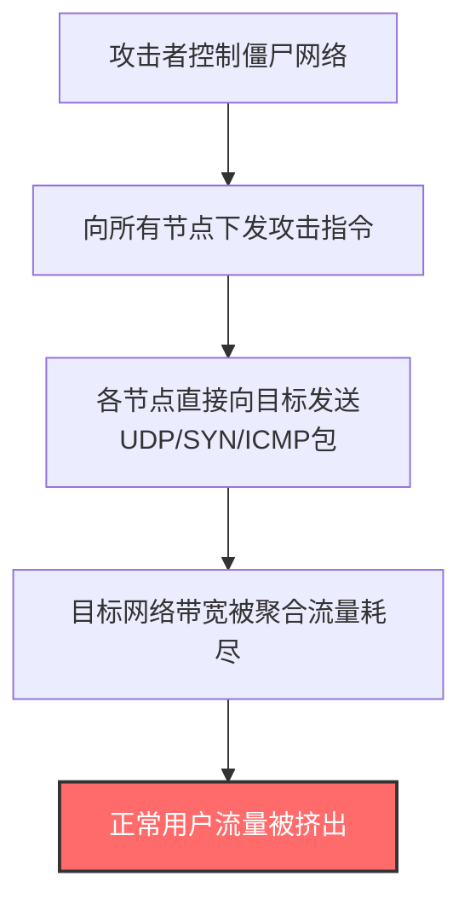
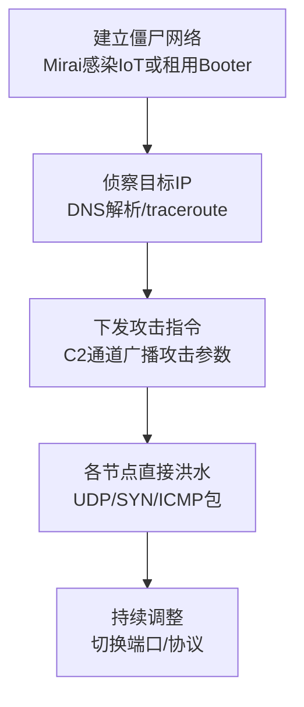

# 直接网络洪水 (T1498.001)

## 一句话通俗理解

攻击者直接用大量"攻击节点"向目标疯狂发送数据包，硬塞满目标的网络管道——就像同时派一万个人挤进你家门口的小路，正常客人根本进不来。

## 30秒速查卡

| 维度 | 你需要知道的 |
|------|-------------|
| 这是什么？ | 攻击者直接从受控节点向目标发送海量UDP/TCP/ICMP数据包，耗尽目标带宽 |
| 为什么危险？ | 直接压垮网络入口，业务连续性中断；攻击源明确但数量庞大难以逐一封禁 |
| 与父技术关系 | 是 [T1498 网络拒绝服务](../T1498-Network-Denial-of-Service.md) 的两个子技术之一 |
| 与反射放大区别 | 不借助第三方反射器，攻击流量=发送流量（无放大）；但源IP可见可追溯 |
| 你的第一步防御 | 在ISP/CDN层部署流量清洗，配置BGP Flow Spec自动黑洞化攻击流量 |

## 难度等级

⭐⭐ 中级（需要一定基础）

## 前置知识检查

**读这个文件需要什么？**

- [ ] TCP三次握手与SYN/ACK机制
- [ ] UDP无连接特性与ICMP协议
- [ ] NetFlow/IPFIX流量分析基础
- [ ] 僵尸网络（[T1496 资源劫持](../T1496-Resource-Hijacking.md)）概念

## 技术描述

直接网络洪水（Direct Network Flood，T1498.001）是 T1498 的子技术之一。攻击者直接从自己控制的系统（或僵尸网络节点）向目标发送海量网络流量，通过耗尽目标网络连接的带宽容量造成拒绝服务。与 [T1498.002 反射放大](./T1498.002-Reflection-Amplification.md) 不同，直接洪水不借助第三方服务器作为反射器，攻击者发送的流量等于到达目标的流量（无放大效应）。

**通俗解释：**

想象有一群人想堵死你家门口的路。一种办法是雇一群人直接冲到你家门口（直接洪水），另一种办法是冒充你家地址在网上订一万份外卖，让外卖员涌到你家（反射放大）。T1498.001 就是前者——攻击者直接控制大量"攻击节点"，每个节点都向目标疯狂发送数据包，硬塞满目标的网络管道。

**技术原理：**

1. **带宽压制**：当攻击者聚合的带宽超过目标网络连接的容量时，正常流量被挤出
2. **协议选择**：
   - **UDP Flood**：无连接，发送效率高，源IP可伪造（但反射效果不如UDP）
   - **SYN Flood**：利用TCP握手缺陷，发SYN不完成ACK，耗尽目标半开连接表
   - **ICMP Flood**：发送大量Echo Request（Ping），简单但易被防火墙过滤
3. **僵尸网络协同**：单一节点带宽有限，需要大量节点同时攻击才能压垮目标
4. **源IP可见**：与反射放大不同，直接洪水的源IP是攻击节点的真实IP（除非伪造UDP源IP），更易追溯但更难完全封禁（节点数量庞大）

**与反射放大的对比：**

| 维度 | 直接洪水 (T1498.001) | 反射放大 (T1498.002) |
|------|---------------------|---------------------|
| 流量来源 | 攻击者直接发送 | 第三方反射器返回 |
| 放大倍数 | 1:1（无放大） | 50x ~ 51200x |
| 源IP可见 | 攻击节点真实IP（UDP可伪造） | 反射器IP（攻击者隐藏） |
| 所需节点数 | 多（需聚合带宽） | 少（靠放大） |
| 检测难度 | 较易（源IP可见） | 较难（流量来自合法服务） |

## 真实攻击流程



**步骤详解：**

1. **僵尸网络控制**：攻击者通过Mirai等恶意软件感染IoT设备，或租用Booter服务，建立直接攻击节点池
2. **指令下发**：通过C2通道向所有节点下发攻击参数（目标IP、端口、协议、持续时间）
3. **直接发送**：各节点使用hping3、nping等工具，直接向目标IP发送海量数据包
4. **带宽耗尽**：聚合流量超过目标带宽容量，正常流量被挤出
5. **持续压制**：根据防御反应动态调整攻击参数

## 攻击流程

### 典型攻击流程

```
建立僵尸网络 --> 侦察目标IP --> 下发攻击指令 --> 各节点直接洪水 --> 持续调整
```



**步骤详解：**

1. **建立僵尸网络**
   - 通俗描述：攻击者先准备好"攻击大军"
   - 技术细节：通过Mirai变种感染IoT设备（摄像头、DVR、路由器），利用弱口令爆破（admin/admin）；或租用Stresser/Booter平台；或滥用云账号启动大量实例
   - 常用工具：Mirai、Bashlite、Gafgyt、Qbot、Stresser服务

2. **侦察目标IP**
   - 通俗描述：搞清楚打哪里
   - 技术细节：DNS解析目标域名获取IP、traceroute分析ISP路径、识别CDN配置（若用CDN需先暴露源站IP）
   - 常用工具：dig、nslookup、traceroute、BGP looking glass

3. **下发攻击指令**
   - 通俗描述：告诉所有"攻击节点"同时开火
   - 技术细节：通过C2服务器（IRC、HTTP、P2P协议）向僵尸网络广播攻击参数：目标IP、端口、协议、包大小、持续时间
   - 常用工具：自定义C2脚本、Mirai控制面板

4. **各节点直接洪水**
   - 通俗描述：所有节点同时向目标发送海量数据包
   - 技术细节：每个节点使用hping3/nping发送UDP/SYN/ICMP包，伪造源IP（UDP）或保留真实IP（SYN）。聚合流量需超过目标带宽
   - 常用工具：hping3、nping、定制DDoS载荷

5. **持续调整**
   - 通俗描述：根据防御反应切换战术
   - 技术细节：监测目标响应（rtt、丢包），动态切换攻击端口、协议、包大小，混合多向量攻击绕过清洗
   - 常用工具：DDoS即服务平台自带的自动化调度

## 真实案例

### 案例1：Dyn Mirai 僵尸网络攻击 (2016)

- **时间**: 2016年10月21日
- **目标**: Dyn DNS（提供DNS解析服务给Twitter、Spotify、Netflix、Reddit、GitHub等）
- **攻击组织**: Anonymous和New World Hackers声称负责（未完全证实）
- **手法**: 攻击者使用Mirai僵尸网络感染了数十万台IoT设备（摄像头、DVR、路由器），通过弱口令爆破（如admin/admin）控制设备。僵尸网络向Dyn的DNS基础设施发起大规模DNS查询洪水和直接UDP洪水，峰值达1.2 Tbps。攻击分三波，每波针对不同的Dyn基础设施组件。这是典型的直接网络洪水攻击——每个IoT节点直接向Dyn发送流量。
- **影响**: 美东地区大规模互联网服务中断，Twitter、Spotify、Netflix、PayPal等数十个主流网站数小时无法访问
- **参考链接**: [Dyn DDoS Analysis - Dyn Blog](https://dyn.com/blog/dyn-analysis-summary-of-friday-october-21-attack/)

### 案例2：俄乌冲突中的DDoS攻击 (2022-至今)

- **时间**: 2022年2月-至今
- **目标**: 乌克兰政府网站、银行；俄罗斯政府机构和银行
- **攻击组织**: 双方支持者（Anonymous、Killnet等）
- **手法**: 俄乌战争爆发后，双方支持者发动了大规模直接网络DDoS攻击。乌克兰政府网站的DDoS攻击峰值超过1Tbps，由志愿者使用LOIC/HOIC等工具直接发起洪水。Killnet组织对俄罗斯政府、国有银行和新闻媒体网站发动持续DDoS攻击。部分攻击使用僵尸网络（Mirai变种），部分由志愿者手动使用LOIC/HOIC等工具发起直接洪水。
- **影响**: 双方关键信息服务多次中断，网络战争成为常规冲突的延伸
- **参考链接**: [CISA Ukraine DDoS Alert](https://www.cisa.gov/news-events/analysis-reports/ar22-099a)

### 案例3：Spotify 2014 DDoS 攻击

- **时间**: 2014年3月
- **目标**: Spotify流媒体音乐服务
- **攻击组织**: 未公开归因
- **手法**: 攻击者使用直接UDP洪水对Spotify的服务器发起攻击。攻击者利用大量被劫持的服务器作为攻击节点，直接向Spotify基础设施发送海量UDP包。由于Spotify当时未充分部署Anycast CDN，源站直接暴露，攻击导致服务在多个地区中断数小时。
- **影响**: Spotify在欧洲和北美部分地区服务中断数小时
- **参考链接**: [Spotify Status Archive](https://news.spotify.com/)

## 红队视角

> ⚠️ **免责声明**：以下内容仅用于合法的安全测试、渗透测试和教育目的。未经授权对他人系统进行测试是违法行为。

### 实战技巧

1. **混合协议攻击**
   单一协议（纯UDP或纯SYN）易被清洗，建议组合UDP + SYN + ICMP，让防御者难以同时应对多种协议特征。

2. **随机化源端口与目标端口**
   固定端口易被防火墙规则封禁。使用`--rand-source`和随机目标端口，模拟合法流量分布，绕过简单规则。

3. **脉冲式攻击**
   持续高流量易被CDN识别并启动Anycast引流。采用脉冲式攻击（高流量5秒+低流量10秒循环），可绕过自动化清洗阈值。

4. **利用高带宽云实例**
   滥用云服务商免费层或试用账号启动多个高带宽实例作为攻击节点。注意：违反云服务商AUP，账号会被封禁，且云服务商有DDoS检测机制。

### 常用工具

| 工具名称 | 用途 | 平台 | 链接 |
|----------|------|------|------|
| hping3 | TCP/UDP/ICMP洪水测试 | Linux | https://www.kali.org/tools/hping3/ |
| nping | 网络包生成与洪水测试 | 跨平台 | https://nmap.org/nping/ |
| LOIC | 低轨道离子炮（志愿者DDoS） | Windows | 历史参考 |
| HOIC | 高轨道离子炮（多向量攻击） | 跨平台 | 历史参考 |
| goldeneye | Layer 7 DoS工具 | Python | https://github.com/jseidl/GoldenEye |

### 注意事项

- 直接洪水测试必须明确授权，且通知ISP
- 测试流量不能溢出到第三方网络
- 注意法律边界：美国《计算机欺诈和滥用法》(CFAA)、中国《刑法》285条都明确禁止未授权DoS
- 在云环境中测试需先与服务商确认，避免账号被封

## 蓝队视角

### 检测要点

1. **入站流量突增**
   - 日志来源：NetFlow、sFlow、IPFIX、CDN日志
   - 关注字段：bps（比特/秒）、pps（包/秒）、协议分布
   - 异常特征：短时间内入站流量突增到基线5倍以上；单一协议（UDP/ICMP）占比异常

2. **SYN flood特征**
   - 日志来源：防火墙、负载均衡器
   - 关注字段：TCP SYN包数量、半开连接数
   - 异常特征：SYN包与完成握手比例超过10:1（正常<3:1）

3. **源IP分布异常**
   - 日志来源：NetFlow、防火墙日志
   - 关注字段：源IP地理分布、ASN分布
   - 异常特征：短时间内出现大量不同源IP访问同一目标（典型僵尸网络特征）

### 监控建议

- 建立入站流量基线，按95th percentile设置告警阈值（建议基线的200%）
- 监控协议分布异常（UDP占比突增、ICMP占比突增）
- 部署BGP Flow Spec路由，自动将攻击流量黑洞化
- 与ISP签订DDoS scrubbing服务SLA，确保紧急时能快速引流清洗

## 避坑指南

防御者最痛苦教训：等到被打才知道源站IP暴露在公网。CDN不是万能的——攻击者只要找到源站真实IP，CDN防护就形同虚设。

**常见误区：**

1. **以为有CDN就高枕无忧**：源站IP泄露（通过历史DNS、SSL证书指纹、子域名扫描）后CDN防护被绕过，攻击者直接洪水源站
2. **只防UDP不防SYN**：SYN flood流量小但能压垮连接表，单纯限速UDP无效
3. **忽略僵尸网络特征**：直接洪水的源IP可见，应主动与ISP合作溯源和封禁攻击节点
4. **应急联系人失效**：DDoS事件常发生在凌晨，ISP/CDN联系人没及时响应造成损失扩大

## 检测建议

### 网络层检测

**检测方法：** 监控NetFlow中的流量异常突增与协议分布异常

**Suricata规则示例：**
```
# 检测UDP flood（短时间内大量UDP包到同一目标）
alert udp $EXTERNAL_NET any -> $HOME_NET any (msg:"Potential UDP Flood - High Rate"; detection_filter:track by_dst, count 1000, seconds 10; sid:1002101; rev:1;)

# 检测SYN flood（大量SYN无后续ACK）
alert tcp $EXTERNAL_NET any -> $HOME_NET any (msg:"Potential SYN Flood - Direct Network Flood"; flags:S; detection_filter:track by_dst, count 500, seconds 10; sid:1002102; rev:1;)

# 检测ICMP flood（大量Echo Request）
alert icmp $EXTERNAL_NET any -> $HOME_NET any (msg:"Potential ICMP Flood"; itype:8; detection_filter:track by_dst, count 200, seconds 10; sid:1002103; rev:1;)
```

### 主机层检测

**检测方法：** 监控主机出站流量异常（可能是僵尸网络节点参与直接洪水攻击）

**Linux审计：**
```bash
# 检测异常出站流量（按目标IP聚合）
ss -tn state established | awk '{print $5}' | cut -d: -f1 | sort | uniq -c | sort -rn | head -20

# 检测hping3/nping进程
ps aux | grep -E 'hping|nping|loic|hoic'

# 监控网络接口流量
sar -n DEV 1 5

# 检测SYN cookies触发（说明遭受SYN flood）
cat /proc/sys/net/ipv4/tcp_syncookies
netstat -s | grep -i syn
```

### Sigma规则示例

```yaml
title: 检测直接DDoS工具进程创建
status: experimental
description: 检测常见直接DDoS攻击工具的进程创建行为
logsource:
    category: process_creation
    product: linux
detection:
    selection_process:
        Image|endswith:
            - '/hping3'
            - '/nping'
            - '/loic'
            - '/hoic'
            - '/goldeneye'
    selection_args:
        CommandLine|contains:
            - '--flood'
            - '--rand-source'
            - '-S -P'
    condition: selection_process or selection_args
level: high
tags:
    - attack.t1498
    - attack.t1498.001
    - attack.impact
```

## 缓解措施

### 优先级1：关键措施

**措施名称：** 接入专业DDoS防护服务

**具体实施步骤：**
1. 接入CDN/Anycast DDoS防护服务（Cloudflare、Akamai、AWS Shield Advanced）
2. 隐藏源站真实IP，所有流量通过CDN回源
3. 与ISP签订DDoS Scrubbing SLA，确保紧急时可路由切换至清洗中心
4. 配置BGP Flow Spec或RTBH能力，自动响应大流量攻击

### 优先级2：重要措施

**措施名称：** 主机层加固

**具体实施步骤：**
1. 启用SYN cookies防御SYN flood：`echo 1 > /proc/sys/net/ipv4/tcp_syncookies`
2. 配置iptables限速规则：`iptables -A INPUT -p udp --dport 80 -m limit --limit 100/s -j ACCEPT`
3. 关闭不必要的ICMP响应：`iptables -A INPUT -p icmp --icmp-type echo-request -j DROP`
4. 优化内核参数（增加连接队列、减少SYN+ACK重试）

### 优先级3：建议措施

**措施名称：** 应急响应准备

**具体实施步骤：**
1. 制定DDoS应急响应剧本，明确ISP/CDN联系人、升级流程
2. 定期进行DDoS演练，测试监控告警和应急流程有效性
3. 监控公网上Mirai等僵尸网络活动情报，提前预警
4. 与ISP合作部署源端验证（uRPF），防止IP欺骗

### MITRE ATT&CK 缓解措施映射

| 缓解措施ID | 缓解措施名称 | 适用性 | 说明 |
|------------|-------------|--------|------|
| M1037 | Filter Network Traffic | 适用 | 在ISP/CDN层进行流量过滤，清洗攻击流量 |
| M1031 | Network Intrusion Prevention | 适用 | IDS/IPS识别并阻断已知DDoS工具流量 |
| M1020 | Router Access Control | 部分适用 | 配置uRPF防止IP欺骗 |
| M1030 | Network Segmentation | 部分适用 | 隔离关键服务减少攻击面 |

## 动手实验

> ⚠️ **重要提示**：所有实验必须在隔离的实验室环境中进行，禁止对未授权的真实系统进行测试。DDoS测试流量不可溢出到公网。

### 实验环境准备

**推荐靶场/实验平台：**

| 平台名称 | 类型 | 难度 | 链接 |
|----------|------|:----:|------|
| TryHackMe - DDoS Defense | 在线靶场 | 中级 | https://tryhackme.com/ |
| Let's Defend - DDoS Incident | 在线平台 | 中级 | https://letsdefend.io/ |

**所需工具：**
- 两台Linux VM（一台作为攻击者，一台作为目标）
- hping3、nping（攻击模拟）
- tcpdump、Wireshark（流量分析）

**环境搭建：**
```bash
# 安装攻击工具（攻击者VM）
sudo apt install hping3 nmap nping

# 安装流量监控（目标VM）
sudo apt install tcpdump

# 在目标VM上启动Web服务用于测试
python3 -m http.server 80
```

### 实验1：UDP Flood 模拟与检测（初级）

**实验目标：** 理解UDP flood的流量特征与检测方法

**实验步骤：**
1. 在目标VM启动tcpdump抓包：`sudo tcpdump -i eth0 -nn udp -w udp_flood.pcap`
2. 在攻击者VM执行模拟UDP flood：`sudo hping3 --flood --rand-source -p 80 <target_ip>`
3. 持续10秒后停止（注意：不要长时间运行）
4. 用Wireshark分析pcap，统计每秒包数（pps）、源IP分布、协议分布
5. 在目标VM查看连接状态：`ss -s`

**预期结果：** 短时间内收到大量UDP包，源IP随机化，目标端口固定

**学习要点：** 理解UDP flood的流量特征，掌握用NetFlow/Suricata识别此类攻击

### 实验2：SYN Flood 模拟与检测（中级）

**实验目标：** 理解SYN flood的连接表耗尽机制

**实验步骤：**
1. 在目标VM启动tcpdump抓包：`sudo tcpdump -i eth0 -nn 'tcp[tcpflags] & tcp-syn != 0' -w syn_flood.pcap`
2. 在攻击者VM执行SYN flood：`sudo hping3 -S --flood --rand-source -p 80 <target_ip>`
3. 持续10秒后停止
4. 在目标VM查看半开连接数：`netstat -an | grep SYN_RECV | wc -l`
5. 启用SYN cookies：`echo 1 > /proc/sys/net/ipv4/tcp_syncookies`，重复实验观察效果

**预期结果：** 未启用SYN cookies时半开连接数激增；启用后正常连接仍可建立

**学习要点：** 理解SYN flood机制和SYN cookies防御原理

### 实验3：多协议混合洪水测试（高级）

**实验目标：** 验证多协议混合攻击的检测与缓解

**实验步骤：**
1. 在目标VM部署Suricata IDS，加载上述检测规则
2. 配置iptables限速规则和SYN cookies
3. 攻击者VM同时发起UDP + SYN + ICMP混合洪水：
   - 终端1：`sudo hping3 --flood --rand-source -2 -p 80 <target_ip>` (UDP)
   - 终端2：`sudo hping3 -S --flood --rand-source -p 80 <target_ip>` (SYN)
   - 终端3：`sudo hping3 --flood --rand-source -1 <target_ip>` (ICMP)
4. 观察Suricata告警、iptables计数器、Web服务可用性
5. 测试Web服务在攻击下是否保持可用

**预期结果：** Suricata触发多条告警；缓解措施生效后Web服务在攻击下仍能响应正常请求

**学习要点：** 掌握多协议混合攻击的检测与Linux主机层缓解配置

## 术语解释

| 术语 | 英文原名 | 通俗解释 |
|------|----------|----------|
| 直接网络洪水 | Direct Network Flood | 攻击者直接向目标发送海量流量，无第三方反射 |
| UDP洪水 | UDP Flood | 用大量UDP包冲击目标，无连接、效率高 |
| SYN洪水 | SYN Flood | 利用TCP握手缺陷，发SYN不完成ACK，耗尽连接表 |
| ICMP洪水 | ICMP Flood | 发送大量Ping请求，简单但易被过滤 |
| 半开连接 | Half-open Connection | TCP握手未完成的连接状态（SYN_RECV） |
| SYN cookies | SYN Cookies | 服务器不保存半开连接状态，用加密cookie验证客户端 |
| 僵尸网络 | Botnet | 被黑客远程控制的大量设备网络 |
| BGP Flow Spec | BGP Flow Specification | 通过BGP下发流量过滤规则，在ISP边缘阻断攻击 |
| uRPF | Unicast Reverse Path Forwarding | 反向路径转发，防止IP欺骗 |

## 被引用情况

本子技术作为直接网络洪水攻击的核心技术，被以下文档引用：

- [T1498 网络拒绝服务](../T1498-Network-Denial-of-Service.md) - 父技术
- [T1498.002 反射放大](./T1498.002-Reflection-Amplification.md) - 兄弟子技术
- [T1496 资源劫持](../T1496-Resource-Hijacking.md) - 僵尸网络是直接洪水的常见基础设施

## 参考资料

### 📚 官方文档（深入了解）

- [MITRE ATT&CK - Direct Network Flood (T1498.001)](https://attack.mitre.org/techniques/T1498/001/)
- [MITRE ATT&CK - Network Denial of Service (T1498)](https://attack.mitre.org/techniques/T1498/)
- [MITRE ATT&CK - Impact Tactic (TA0040)](https://attack.mitre.org/tactics/TA0040/)

### 📰 安全报告（真实攻击）

- [Dyn Mirai DDoS Analysis - Dyn](https://dyn.com/blog/dyn-analysis-summary-of-friday-october-21-attack/)
- [CISA Ukraine DDoS Alert](https://www.cisa.gov/news-events/analysis-reports/ar22-099a)
- [Cloudflare DDoS Trends Report](https://radar.cloudflare.com/)

### 🔧 工具与资源（动手试试）

- [hping3](https://www.kali.org/tools/hping3/) - 网络包生成工具
- [nping](https://nmap.org/nping/) - Nmap项目网络包工具
- [Cloudflare DDoS Learning](https://www.cloudflare.com/learning/ddos/what-is-a-ddos-attack/) - DDoS知识库
- [CISA DDoS Guide](https://www.cisa.gov/news-events/news/understanding-and-responding-distributed-denial-service-attacks) - CISA DDoS响应指南

### 📚 学习资料（深入了解）

- [Cloudflare Learning - DDoS](https://www.cloudflare.com/learning/ddos/what-is-a-ddos-attack/) - DDoS原理详解
- [AWS Shield Documentation](https://docs.aws.amazon.com/waf/latest/shield/) - 云原生DDoS防护
- [Akamai State of the Internet Security](https://www.akamai.com/state-of-the-internet) - 全球DDoS趋势报告
