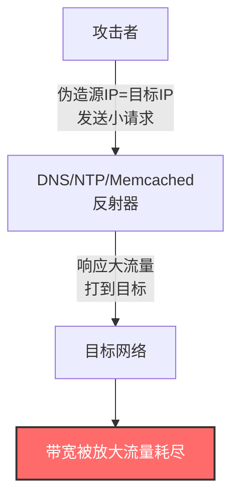
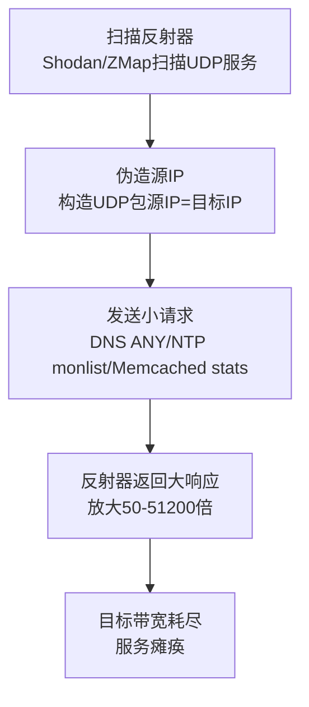

# 反射放大 (T1498.002)

## 一句话通俗理解

攻击者冒充你的地址向第三方服务器发"小请求"，让服务器把"大响应"打到你身上——就像以你的名字给一万家餐厅订外卖，所有外卖都送到你家门口把路堵死。

## 30秒速查卡

| 维度 | 你需要知道的 |
|------|-------------|
| 这是什么？ | 攻击者伪造源IP为目标IP，向第三方服务器（DNS/NTP/Memcached）发请求，让响应流量打到目标 |
| 为什么危险？ | 用小请求撬动大流量（最大放大51200倍），攻击者隐藏在反射器背后难以追溯 |
| 与父技术关系 | 是 [T1498 网络拒绝服务](../T1498-Network-Denial-of-Service.md) 的两个子技术之一 |
| 与直接洪水区别 | 不直接攻击目标，借助第三方反射器；流量可被放大几十到几万倍 |
| 你的第一步防御 | 关闭/限制UDP服务（DNS/NTP/Memcached）的公网暴露，配置uRPF防止IP欺骗 |

## 难度等级

⭐⭐⭐ 中高级（需要较深基础）

## 前置知识检查

**读这个文件需要什么？**

- [ ] UDP协议无连接特性（无握手，源IP可伪造）
- [ ] DNS/NTP/Memcached/SSDP协议工作原理
- [ ] IP欺骗（IP Spoofing）原理
- [ ] [T1498.001 直接网络洪水](./T1498.001-Direct-Network-Flood.md) 对比基础

## 技术描述

反射放大（Reflection Amplification，T1498.002）是 T1498 的子技术之一。攻击者伪造源IP地址为目标IP，向第三方服务器（反射器）发送小请求，反射器将大响应发送到目标，从而用小流量撬动大流量攻击目标。攻击者利用无连接协议（UDP）的可伪造源IP特性，并选择响应远大于请求的协议（如Memcached放大51200倍），实现以小博大的拒绝服务攻击。

**通俗解释：**

想象你想堵死邻居家门口的路，但自己又不想露面。一种办法是直接雇人冲过去（[T1498.001 直接洪水](./T1498.001-Direct-Network-Flood.md)）；另一种办法是冒充邻居的名字给一万家餐厅订外卖，所有外卖员都会涌到邻居家门口把路堵死——这就是反射放大。攻击者不直接攻击目标，而是冒充目标的地址向第三方服务器（如DNS、NTP、Memcached）发送"小请求"，第三方服务器把"大响应"全打到目标身上。攻击者隐藏在第三方背后，追踪极其困难。

**技术原理：**

1. **IP欺骗前提**：UDP是无连接协议，无握手验证，攻击者可伪造源IP。反射放大攻击必须建立在IP欺骗基础上
2. **反射器选择**：选择公网暴露的UDP服务作为反射器，常见包括：
   - **DNS**（端口53）：查询ANY记录，放大50-100倍
   - **NTP**（端口123）：monlist命令，放大556倍
   - **Memcached**（端口11211）：stats命令，放大51200倍（最大）
   - **SSDP**（端口1900）：UPnP SEARCH，放大30倍
   - **CLDAP**（端口389）：NetBIOS查询，放大50-70倍
3. **放大倍数**：响应流量/请求流量。Memcached最大可达51200倍（1字节请求→51200字节响应）
4. **双重获益**：
   - **反射**：攻击者隐藏在反射器背后，目标看到的是反射器IP
   - **放大**：用小请求撬动大流量，攻击者只需低带宽即可发起Tbps级攻击

**反射器选择对比表：**

| 协议 | 端口 | 放大倍数 | 反射器数量（公开） | 风险等级 |
|------|------|----------|-------------------|---------|
| Memcached | 11211 | 51200x | 较少（但影响巨大） | 🔴 极高 |
| NTP | 123 | 556x | 数十万 | 🔴 极高 |
| DNS | 53 | 50-100x | 数百万 | 🟠 高 |
| CLDAP | 389 | 50-70x | 数十万 | 🟠 高 |
| SSDP | 1900 | 30x | 数百万 | 🟡 中 |
| Chargen | 19 | 200x | 较少（已基本修复） | 🟢 低 |

## 真实攻击流程



**步骤详解：**

1. **反射器侦察**：扫描公网暴露的UDP服务（Shodan、ZMap扫描），建立反射器列表
2. **IP欺骗**：攻击者构造UDP包，源IP设为目标IP，目的IP为反射器IP
3. **小请求发送**：向反射器发送精心构造的小请求（如DNS ANY查询、NTP monlist）
4. **反射放大**：反射器收到请求后，将大响应发送到"源IP"（即目标）
5. **目标瘫痪**：聚合的放大流量压垮目标带宽

## 攻击流程

### 典型攻击流程

```
扫描反射器 --> 伪造源IP --> 发送小请求 --> 反射器返回大响应 --> 目标带宽耗尽
```



**步骤详解：**

1. **扫描反射器**
   - 通俗描述：找到公网上可被利用的"帮凶服务器"
   - 技术细节：使用ZMap Masscan扫描特定UDP端口（53/123/11211/1900），通过Shodan/Censys查询暴露服务，验证反射器是否响应大请求
   - 常用工具：ZMap、Masscan、Shodan、Censys、Nmap

2. **伪造源IP**
   - 通俗描述：把"寄件人"地址写成目标地址
   - 技术细节：使用raw socket构造UDP包，源IP字段设为目标IP，目的IP为反射器IP。要求攻击者所在网络未部署uRPF反向路径验证
   - 常用工具：Scapy、hping3（--spoof参数）、定制脚本

3. **发送小请求**
   - 通俗描述：以目标名义向反射器发"小请求"
   - 技术细节：
     - DNS：发送ANY查询（响应包含所有记录）
     - NTP：发送monlist命令（响应包含最近600个监控主机）
     - Memcached：发送stats命令（响应包含完整统计信息）
   - 常用工具：dig、ntpdc、memcached客户端、Scapy

4. **反射器返回大响应**
   - 通俗描述：反射器把"大响应"全打到目标
   - 技术细节：反射器根据请求构造响应，响应包的目的IP为"源IP"（即目标）。响应大小取决于协议与命令

5. **目标带宽耗尽**
   - 通俗描述：放大流量压垮目标带宽
   - 技术细节：聚合多个反射器的放大流量，超过目标网络带宽容量，正常流量被挤出

## 真实案例

### 案例1：GitHub Memcached 反射放大攻击 (2018)

- **时间**: 2018年2月28日
- **目标**: GitHub.com（全球最大代码托管平台）
- **攻击组织**: 未公开归因
- **手法**: 攻击者利用错误配置的Memcached服务器（UDP 11211端口）发起反射放大攻击。攻击者伪造GitHub的IP地址向Memcached服务器发送小请求（约15字节），服务器返回最大51,200倍放大的响应流量（约750KB）。攻击峰值达到1.35 Tbps，是当时记录的最大DDoS攻击。GitHub依靠Akamai Prolexic DDoS防护服务在8分钟内完成缓解。攻击发生后，Memcached开发者禁用了UDP支持（默认）。
- **影响**: GitHub服务中断约10分钟，但得益于CDN防护，未造成长时间瘫痪
- **参考链接**: [GitHub DDoS Incident - GitHub Blog](https://github.blog/2018-03-01-ddos-incident-report/)

### 案例2：SpamHaus NTP 反射放大攻击 (2013)

- **时间**: 2013年3月
- **目标**: SpamHaus（反垃圾邮件组织，维护SpamHaus DNSBL）
- **攻击组织**: CyberBunker（被SpamHaus列入黑名单的托管商）关联
- **手法**: 攻击者利用NTP服务器的monlist命令发起反射放大攻击。攻击者伪造SpamHaus的IP地址向公网暴露的NTP服务器发送monlist请求，每台NTP服务器返回包含最近600个监控主机的响应，放大倍数约556倍。攻击峰值达到300 Gbps，是当时记录的最大DDoS攻击。Cloudflare通过Anycast网络分散流量并提供防护。
- **影响**: SpamHaus网站和邮件服务中断；Cloudflare CDN受影响但未瘫痪
- **参考链接**: [Cloudflare SpamHaus DDoS Analysis](https://blog.cloudflare.com/the-ddos-that-almost-broke-the-internet/)

### 案例3：Dyn DNS 反射攻击 (2016)

- **时间**: 2016年10月21日
- **目标**: Dyn DNS（提供DNS解析服务给Twitter、Spotify、Netflix、Reddit、GitHub等）
- **攻击组织**: Anonymous和New World Hackers声称负责
- **手法**: 虽然Dyn攻击主要使用Mirai僵尸网络直接洪水，但也混合了DNS反射放大。攻击者伪造Dyn的IP地址向公网DNS服务器发送ANY查询，DNS服务器返回包含所有记录的大响应（放大50-100倍）。攻击峰值达1.2 Tbps，混合了直接洪水和反射放大。攻击分三波，每波针对不同的Dyn基础设施组件。
- **影响**: 美东地区大规模互联网服务中断，Twitter、Spotify、Netflix、PayPal等数十个主流网站数小时无法访问
- **参考链接**: [Dyn DDoS Analysis - Dyn Blog](https://dyn.com/blog/dyn-analysis-summary-of-friday-october-21-attack/)

## 红队视角

> ⚠️ **免责声明**：以下内容仅用于合法的安全测试、渗透测试和教育目的。未经授权对他人系统进行测试是违法行为。

### 实战技巧

1. **混合多协议反射**
   单一协议（纯DNS）易被清洗（封禁源端口53），建议组合DNS + NTP + Memcached + CLDAP，让防御者难以同时应对多种反射端口。

2. **选择高放大倍数反射器**
   优先利用Memcached（51200x），即使反射器数量少也能产生巨大流量。其次是NTP monlist（556x）。

3. **利用CDN递归DNS**
   某些CDN递归DNS服务器会缓存ANY查询响应，可作为高效反射器。注意：这违反DNS最佳实践，且越来越多的递归DNS禁用了ANY查询。

4. **避开清洗阈值**
   单一反射端口流量易被BGP Flow Spec识别。使用多端口混合反射，使每个端口的流量都低于清洗阈值，但聚合流量足够压垮目标。

### 常用工具

| 工具名称 | 用途 | 平台 | 链接 |
|----------|------|------|------|
| Scapy | 构造伪造UDP包 | 跨平台 | https://scapy.net/ |
| hping3 | 网络包生成与伪造 | Linux | https://www.kali.org/tools/hping3/ |
| dig | DNS查询测试 | 跨平台 | https://kb.isc.org/ |
| ntpdc | NTP monlist测试 | 跨平台 | https://docs.ntpsec.org/ |
| ZMap | 高速UDP扫描 | Linux | https://zmap.io/ |

### 注意事项

- 反射放大测试必须明确授权，且通知ISP和反射器所属服务商
- 测试流量不能影响第三方反射器（即使是测试也会消耗其资源）
- 注意法律边界：美国《计算机欺诈和滥用法》(CFAA)、中国《刑法》285条都明确禁止未授权DoS
- 利用他人服务器作为反射器本身可能构成"未授权访问"

## 蓝队视角

### 检测要点

1. **反射端口流量异常**
   - 日志来源：NetFlow、IDS/IPS、防火墙
   - 关注字段：源端口53(DNS)/123(NTP)/11211(Memcached)/1900(SSDP)的入站UDP流量
   - 异常特征：来自这些端口的UDP响应流量异常增加（说明被反射攻击）

2. **出站请求与入站响应比例异常**
   - 日志来源：NetFlow、DNS服务器日志
   - 关注字段：DNS ANY查询数量、响应字节数
   - 异常特征：DNS服务器收到大量ANY查询（可能是被用作反射器）；目标收到大量来自53端口的UDP响应但未发送DNS查询

3. **IP欺骗检测**
   - 日志来源：ISP NetFlow、BGP Flow Spec
   - 关注字段：源IP与ASN归属地不一致
   - 异常特征：ISP部署uRPF后，伪造源IP的包被丢弃并记录

### 监控建议

- 监控DNS/NTP/Memcached等UDP协议的入站/出站比例异常
- 部署BGP Flow Spec路由，自动将反射端口异常流量黑洞化
- 与ISP合作部署源端验证（uRPF），从源头防止IP欺骗
- 监控公网上错误配置的反射器（DNS/NTP/Memcached），主动报告给提供商

## 避坑指南

防御者最痛苦教训：以为关掉自己的服务器就安全了——其实危险在于公网上别人的错误配置服务器被用来打你。

**常见误区：**

1. **只关注自身服务器配置**：反射攻击的反射器是公网上的第三方服务器，你无法控制其配置，必须依靠CDN/ISP层防护
2. **忽略UDP服务暴露**：自己的DNS/NTP/Memcached若暴露公网且配置错误，会被用作反射器攻击他人（你可能被反控）
3. **以为封禁反射端口就够**：攻击者可使用非标准端口或混合多协议反射，单纯封禁53/123不够
4. **未与ISP合作**：反射放大攻击流量巨大，单靠主机层防御无效，必须依靠ISP层的BGP Flow Spec和Scrubbing

## 检测建议

### 网络层检测

**检测方法：** 监控反射端口的入站UDP流量异常

**Suricata规则示例：**
```
# 检测DNS反射放大（源端口53的入站UDP异常）
alert udp $EXTERNAL_NET 53 -> $HOME_NET any (msg:"Potential DNS Reflection Attack"; dsize:>500; detection_filter:track by_dst, count 200, seconds 30; sid:1002201; rev:1;)

# 检测NTP反射放大（源端口123的入站UDP异常）
alert udp $EXTERNAL_NET 123 -> $HOME_NET any (msg:"Potential NTP Reflection Attack"; dsize:>200; detection_filter:track by_dst, count 100, seconds 30; sid:1002202; rev:1;)

# 检测Memcached反射放大（源端口11211的入站UDP异常）
alert udp $EXTERNAL_NET 11211 -> $HOME_NET any (msg:"Potential Memcached Reflection Attack"; dsize:>1000; detection_filter:track by_dst, count 50, seconds 30; sid:1002203; rev:1;)

# 检测SSDP反射放大（源端口1900的入站UDP异常）
alert udp $EXTERNAL_NET 1900 -> $HOME_NET any (msg:"Potential SSDP Reflection Attack"; detection_filter:track by_dst, count 100, seconds 30; sid:1002204; rev:1;)
```

### 主机层检测

**检测方法：** 监控自身服务器是否被用作反射器

**DNS服务器检测：**
```bash
# 检测大量DNS ANY查询（说明被用作DNS反射器）
grep "ANY" /var/log/named/query.log | awk '{print $1}' | sort | uniq -c | sort -rn | head

# 监控DNS响应字节数异常
dnstop eth0
```

**NTP服务器检测：**
```bash
# 检测NTP monlist请求（说明被用作NTP反射器）
tcpdump -nn 'udp port 123' | grep -i monlist

# 检查NTP配置是否禁用monlist
grep -i "monlist\|restrict" /etc/ntp.conf
```

**Memcached服务器检测：**
```bash
# 检测Memcached UDP端口是否暴露
ss -uln | grep 11211

# 确认Memcached监听地址（应仅127.0.0.1）
ps aux | grep memcached
```

### Sigma规则示例

```yaml
title: 检测DNS反射放大攻击特征
status: experimental
description: 检测DNS服务器收到大量ANY查询的特征，可能是被用作DNS反射器
logsource:
    category: dns
detection:
    selection_any:
        query_type: "ANY"
    filter_authorized:
        src_ip|cidr:
            - "10.0.0.0/8"
            - "192.168.0.0/16"
    condition: selection_any and not filter_authorized
level: medium
tags:
    - attack.t1498
    - attack.t1498.002
    - attack.impact
```

## 缓解措施

### 优先级1：关键措施

**措施名称：** 接入专业DDoS防护服务

**具体实施步骤：**
1. 接入CDN/Anycast DDoS防护服务（Cloudflare、Akamai、AWS Shield Advanced）
2. 隐藏源站真实IP，所有流量通过CDN回源
3. 与ISP签订DDoS Scrubbing SLA，确保紧急时可路由切换至清洗中心
4. 配置BGP Flow Spec，针对反射端口（53/123/11211/1900）自动黑洞化异常流量

### 优先级2：重要措施

**措施名称：** 反射器配置加固（防止自己被利用）

**具体实施步骤：**
1. DNS服务器：禁用ANY查询（响应策略zone），限制递归查询源
2. NTP服务器：禁用monlist命令（`disable monitor`），升级到NTP 4.2.7+
3. Memcached：禁用UDP监听（默认已禁用），仅监听127.0.0.1
4. SSDP/UPnP：关闭公网暴露，仅在内网使用

### 优先级3：建议措施

**措施名称：** 全网协同防御

**具体实施步骤：**
1. 与ISP合作部署源端验证（uRPF），从源头防止IP欺骗（反射放大前提）
2. 监控公网上错误配置的反射器，主动报告给服务商（Shadowserver Foundation）
3. 参与DDoS清理社区（如NCA DDoS Clearing House），共享攻击情报
4. 制定DDoS应急响应剧本，明确ISP/CDN联系人、升级流程

### MITRE ATT&CK 缓解措施映射

| 缓解措施ID | 缓解措施名称 | 适用性 | 说明 |
|------------|-------------|--------|------|
| M1037 | Filter Network Traffic | 适用 | 在ISP/CDN层过滤反射端口流量 |
| M1031 | Network Intrusion Prevention | 适用 | IDS/IPS识别反射流量特征 |
| M1020 | Router Access Control | 关键 | 配置uRPF防止IP欺骗（反射前提） |
| M1030 | Network Segmentation | 适用 | 关闭不必要的UDP服务公网暴露 |

## 动手实验

> ⚠️ **重要提示**：所有实验必须在隔离的实验室环境中进行，禁止对未授权的真实系统进行测试。绝不能利用公网真实服务器作为反射器。

### 实验环境准备

**推荐靶场/实验平台：**

| 平台名称 | 类型 | 难度 | 链接 |
|----------|------|:----:|------|
| TryHackMe - DDoS Defense | 在线靶场 | 中级 | https://tryhackme.com/ |
| Let's Defend - DDoS Incident | 在线平台 | 中级 | https://letsdefend.io/ |

**所需工具：**
- 三台Linux VM（攻击者、目标、反射器）
- Scapy、hping3（攻击模拟）
- dnsmasq、ntpd、memcached（反射器服务）
- tcpdump、Wireshark（流量分析）

**环境搭建：**
```bash
# 攻击者VM：安装Scapy和hping3
sudo apt install python3-scapy hping3

# 反射器VM：部署DNS服务（故意配置为响应ANY查询）
sudo apt install dnsmasq
echo "local=/test.lab/192.168.1.10" >> /etc/dnsmasq.conf
sudo systemctl restart dnsmasq

# 目标VM：启动抓包
sudo tcpdump -i eth0 -nn 'udp port 53' -w dns_reflection.pcap
```

### 实验1：DNS反射放大模拟（中级）

**实验目标：** 理解DNS反射放大原理与放大倍数计算

**实验步骤：**
1. 在反射器VM部署dnsmasq，配置响应ANY查询
2. 在攻击者VM用Scapy伪造源IP为目标IP，向反射器发DNS ANY查询：
   ```python
   from scapy.all import *
   # 伪造源IP为目标IP
   pkt = IP(src="<target_ip>", dst="<reflector_ip>")/UDP(sport=53, dport=53)/DNS(qd=DNSQR(qname="test.lab", qtype="ANY"))
   send(pkt, count=100, inter=0.01)
   ```
3. 在目标VM抓包，统计入站DNS响应流量
4. 对比攻击者发送流量 vs 目标接收流量，计算放大倍数
5. 用Wireshark分析响应包结构

**预期结果：** 目标收到的DNS响应流量大于攻击者发送的请求流量

**学习要点：** 理解DNS反射放大原理，掌握放大倍数计算方法

### 实验2：NTP monlist反射放大模拟（中级）

**实验目标：** 理解NTP monlist的高放大倍数

**实验步骤：**
1. 在反射器VM部署ntpd（旧版本支持monlist）：
   ```bash
   sudo apt install ntp
   # 配置允许monlist（旧版本默认允许）
   ```
2. 在目标VM启动抓包：`sudo tcpdump -i eth0 -nn 'udp port 123' -w ntp_reflection.pcap`
3. 攻击者VM用Scapy伪造源IP，发送NTP monlist请求：
   ```python
   from scapy.all import *
   # NTP monlist请求包（特殊构造）
   pkt = IP(src="<target_ip>", dst="<reflector_ip>")/UDP(sport=123, dport=123)/Raw(load="\x17\x00\x03\x2a" + "\x00" * 4)
   send(pkt, count=50, inter=0.1)
   ```
4. 在目标VM统计NTP响应流量
5. 计算放大倍数（理论556倍）

**预期结果：** NTP响应流量显著大于请求流量（接近556倍放大）

**学习要点：** 理解NTP monlist放大原理，掌握检测方法

### 实验3：反射器加固与检测（高级）

**实验目标：** 验证反射器加固措施的有效性

**实验步骤：**
1. 在反射器VM加固DNS（禁用ANY查询）：
   ```bash
   # 在dnsmasq.conf中禁用ANY查询
   echo "log-queries=extra" >> /etc/dnsmasq.conf
   ```
2. 在反射器VM加固NTP（禁用monlist）：
   ```bash
   echo "disable monitor" >> /etc/ntp.conf
   sudo systemctl restart ntp
   ```
3. 重复实验1和实验2，观察加固后是否还能被用作反射器
4. 部署Suricata IDS，加载反射检测规则，模拟攻击并观察告警
5. 测试BGP Flow Spec（如有ISP支持）阻断反射端口的效果

**预期结果：** 加固后反射器不再返回大响应；Suricata正确触发反射攻击告警

**学习要点：** 掌握反射器加固配置和检测规则部署

## 术语解释

| 术语 | 英文原名 | 通俗解释 |
|------|----------|----------|
| 反射攻击 | Reflection Attack | 用假IP骗第三方服务器把响应打到目标身上，像"借刀杀人" |
| 放大攻击 | Amplification Attack | 用小请求撬动大响应，像"杠杆原理"——Memcached放大51200倍 |
| IP欺骗 | IP Spoofing | 伪造源IP地址，让追踪变难，也是反射攻击的前提 |
| 反射器 | Reflector | 被攻击者利用的第三方UDP服务器（DNS/NTP/Memcached） |
| 放大倍数 | Amplification Factor | 响应流量/请求流量的比值，DNS约50-100x，NTP 556x，Memcached 51200x |
| uRPF | Unicast Reverse Path Forwarding | 反向路径转发，路由器验证源IP真实性，防止IP欺骗 |
| monlist | NTP Monitor List | NTP服务的监控命令，返回最近600个监控主机，是NTP反射的关键 |
| ANY查询 | DNS ANY Query | DNS查询类型，返回所有记录，响应大，是DNS反射的关键 |
| BGP Flow Spec | BGP Flow Specification | 通过BGP下发流量过滤规则，在ISP边缘阻断攻击 |

## 被引用情况

本子技术作为反射放大攻击的核心技术，被以下文档引用：

- [T1498 网络拒绝服务](../T1498-Network-Denial-of-Service.md) - 父技术
- [T1498.001 直接网络洪水](./T1498.001-Direct-Network-Flood.md) - 兄弟子技术
- [T1496 资源劫持](../T1496-Resource-Hijacking.md) - 僵尸网络可用于扫描反射器

## 参考资料

### 📚 官方文档（深入了解）

- [MITRE ATT&CK - Reflection Amplification (T1498.002)](https://attack.mitre.org/techniques/T1498/002/)
- [MITRE ATT&CK - Network Denial of Service (T1498)](https://attack.mitre.org/techniques/T1498/)
- [MITRE ATT&CK - Impact Tactic (TA0040)](https://attack.mitre.org/tactics/TA0040/)

### 📰 安全报告（真实攻击）

- [GitHub 1.35 Tbps Memcached DDoS - GitHub Blog](https://github.blog/2018-03-01-ddos-incident-report/)
- [Cloudflare SpamHaus DDoS Analysis](https://blog.cloudflare.com/the-ddos-that-almost-broke-the-internet/)
- [Cloudflare Memcrashed - Memcached Amplification](https://blog.cloudflare.com/memcrashed-major-amplification-attacks-from-port-11211/)
- [Cloudflare Reflections on Reflection Attacks](https://blog.cloudflare.com/reflections-on-reflections/)
- [Dyn DDoS Analysis - Dyn](https://dyn.com/blog/dyn-analysis-summary-of-friday-october-21-attack/)

### 🔧 工具与资源（动手试试）

- [Scapy](https://scapy.net/) - Python网络包构造工具
- [hping3](https://www.kali.org/tools/hping3/) - 网络包生成工具
- [ZMap](https://zmap.io/) - 高速互联网扫描器
- [Shadowserver Foundation](https://www.shadowserver.org/) - 反射器扫描与报告服务
- [CISA DDoS Guide](https://www.cisa.gov/news-events/news/understanding-and-responding-distributed-denial-service-attacks) - CISA DDoS响应指南

### 📚 学习资料（深入了解）

- [Cloudflare Learning - DDoS](https://www.cloudflare.com/learning/ddos/what-is-a-ddos-attack/) - DDoS原理详解
- [US-CERT UDP Amplification Attacks](https://www.cisa.gov/news-events/alerts/2014/01/17/udp-based-amplification-attacks) - US-CERT警告
- [Akamai State of the Internet Security](https://www.akamai.com/state-of-the-internet) - 全球DDoS趋势报告
- [OARC DDoS Mitigation Workshop](https://www.dns-oarc.net/) - DNS运维与DDoS防护
