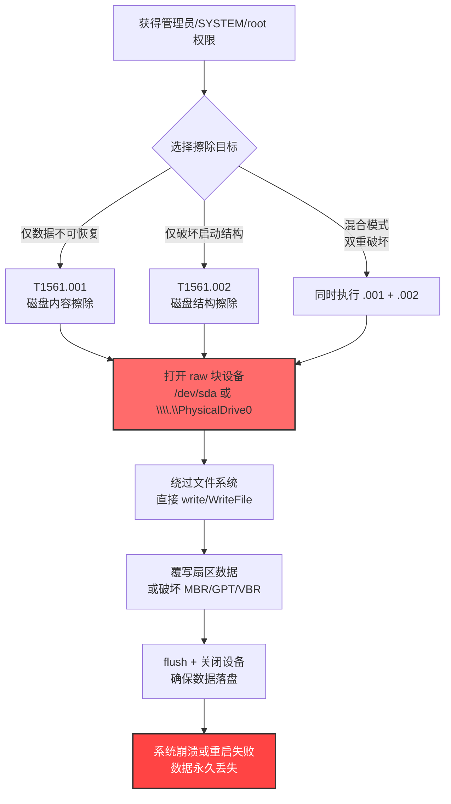
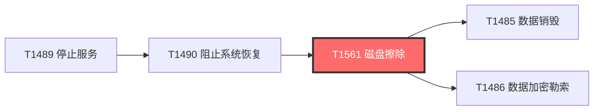

# 磁盘擦除 (T1561)

## 一句话通俗理解

**攻击者不是删你的文件，而是直接把整块硬盘"刷成白纸"——擦掉文件内容或毁掉分区表，让所有数据和系统一起归零。**

## 30秒速查卡

| 维度 | 你需要知道的 |
|------|-------------|
| 这是什么？ | 直接对磁盘扇区或磁盘结构（MBR/GPT/分区表）进行原语级覆写，让数据不可恢复 |
| 为什么危险？ | 不同于文件级删除（T1485），磁盘擦除针对底层存储介质，破坏范围是整个磁盘/分区，包括系统本身、引导区、备份和卷影副本 |
| 谁需要关心？ | 系统管理员、安全运维、SOC分析师、灾备恢复团队 |
| 你的第一步防御 | 监控对 raw/block device（`\\.\PhysicalDrive*`、`/dev/sd*`）的写入与 `dd`/`IOCTL_DISK_SET_DRIVE_LAYOUT_EX` 等 ioctl 调用 |
| 如果只做一件事 | 监控非系统进程对 raw 磁盘设备的打开和写入，并对分区表/MBR 文件完整性做基线告警 |

## 难度等级

⭐⭐⭐ 高级（需要熟悉存储栈、文件系统与内核 API）

## 前置知识检查

**读这个文件需要什么？**

- [ ] 磁盘与文件系统基础（MBR、GPT、分区表、扇区、簇）
- [ ] 操作系统权限模型（Administrator/SYSTEM、root、CAP_SYS_RAWIO）
- [ ] Linux 设备文件与 Windows 设备命名（`/dev/sda`、`\\.\PhysicalDrive0`）
- [ ] 内核 ioctl 调用与文件系统驱动基础

## 技术描述

磁盘擦除（T1561）是 MITRE ATT&CK 框架中**影响**战术（TA0040）的一种破坏性技术。攻击者通过直接访问原始磁盘设备，绕过文件系统层对数据进行覆写或破坏磁盘结构，造成数据不可恢复和系统无法启动。

**通俗解释：**

**过渡段：** 不要把"擦除磁盘"和"删文件"混为一谈。删文件（T1485 数据销毁）只是把目录项标记为可用，扇区上的原始数据仍在；而 T1561 是直接对底层块设备发命令，把扇区内容物理覆写为 0、随机字节或垃圾数据，或者破坏分区表/引导记录，让整块磁盘在硬件层面"失忆"。这是国家级 APT 与破坏性勒索软件（如伪装成勒索的 wiper）的标配。

想象有人闯入你的办公室，他不是撕掉桌上的纸（删文件），而是把整个文件柜连同里面的所有抽屉一起搬到焚化炉烧掉——连目录标签都不留。这种破坏的恢复成本极高，往往需要专业的数据恢复服务，且大多数情况下数据永久丢失。

**技术原理：**

1. **打开原始磁盘设备**：在 Windows 上通过 `CreateFile(L"\\\\.\\PhysicalDrive0", GENERIC_WRITE, ...)` 打开物理磁盘；在 Linux 上以 root 权限打开 `/dev/sda` 等块设备
2. **直接写入扇区**：使用 `WriteFile` / `write()` 系统调用绕过文件系统，直接覆写扇区数据，可全盘覆写 0x00、随机数据或特定 pattern
3. **调用破坏性 ioctl**：Windows 上使用 `IOCTL_DISK_SET_DRIVE_LAYOUT_EX` 修改分区表，`FSCTL_DISMOUNT_VOLUME` 强制卸载卷；Linux 上使用 `BLKRRPART` 重读分区表
4. **破坏磁盘结构**：覆写 MBR（第 0 扇区，512 字节）、GPT 头部、分区表条目、引导扇区（VBR）、文件系统元数据（MFT/$Bitmap/superblock/inode 表）
5. **同步与持久化破坏**：调用 `FlushFileBuffers` / `fsync` 确保数据落盘，部分 wiper 还会向固件层写入恶意代码（如 AcidRain 针对调制解调器固件）

**两个子技术的区别：**

| 子技术 | 目标 | 破坏范围 | 恢复难度 |
|--------|------|----------|----------|
| T1561.001 磁盘内容擦除 | 数据扇区 | 文件内容不可恢复 | 极高，需专业介质恢复 |
| T1561.002 磁盘结构擦除 | MBR/GPT/分区表/VBR | 系统无法启动、分区不可识别 | 中等，可用数据恢复软件重建结构 |

**用途与影响：**

T1561 通常出现在攻击链的收尾阶段，目标是制造最大破坏、瘫痪目标组织运营。常见场景包括：
- 地缘政治冲突中的战略破坏（如俄乌冲突中的 HermeticWiper、AcidRain）
- 伪装成勒索软件实施不可逆破坏（如 NotPetya、WhisperGate）
- 反取证与掩盖攻击痕迹（擦除日志所在扇区）
- 针对关键基础设施的瘫痪性攻击（卫星通信、能源、交通）

由于破坏发生在块设备层，传统的文件系统审计、防病毒和 EDR 往往无能为力——擦除器一旦开始执行，几分钟内就能让整台机器变成砖头。Mandiant 2024 年报告显示，俄乌冲突期间 wiper 攻击数量增长超过 400%，T1561 已成为国家级网络战的首选武器。

## 攻击流程



**步骤详解：**

1. **获得磁盘访问权限**
   - 通俗描述：拿到能直接读写磁盘的最高权限
   - 技术细节：Windows 需 Administrator/SYSTEM 并启用 `SeBackupPrivilege`/`SeRestorePrivilege`/`SeManageVolumePrivilege`；Linux 需要 root 或 `CAP_SYS_RAWIO` capability
   - 常用工具：Mimikatz（提权）、PsExec、Cobalt Strike、sharpcs

2. **打开原始磁盘设备**
   - 通俗描述：直接对接物理硬盘，绕过文件系统
   - 技术细节：Windows 使用 `CreateFile` 打开 `\\.\PhysicalDrive0`；Linux 以 `O_RDWR | O_DIRECT` 打开 `/dev/sda`，避开 OS page cache
   - 常用工具：dd、dcfldd、shred（Linux）；自定义 C/C++ 二进制（Windows）

3. **选择擦除策略**
   - 通俗描述：决定是擦内容、擦结构还是全擦
   - 技术细节：
     - 内容擦除（.001）：定位文件数据扇区并覆写
     - 结构擦除（.002）：覆写 MBR 第 0 扇区、GPT 头、分区表
     - 全盘擦除：从 0 扇区开始顺序覆写到磁盘末尾
   - 常用工具：自定义擦除器、NotPetya 的 wiper 模块

4. **执行扇区覆写**
   - 通俗描述：把扇区上的数据用 0x00 或随机字节覆盖
   - 技术细节：使用大缓冲区（如 1MB）批量写入提高速度，HermeticWiper 单次写入 1MB 块；NotPetya 使用 `AES-128-CBC` 加密后再覆写 MBR，造成"伪勒索"假象
   - 常用工具：HermeticWiper、CaddyWiper、AcidRain、WhisperGate

5. **强制落盘并破坏恢复路径**
   - 通俗描述：让数据真的写到磁盘上，同时毁掉所有能恢复数据的后路
   - 技术细节：调用 `FlushFileBuffers`/`fsync`；同时执行 `vssadmin delete shadows /all /quiet` 删除卷影副本；调用 `FSCTL_DISMOUNT_VOLUME` 强制卸载卷
   - 常用工具：vssadmin、bcdedit、wbadmin

## 真实案例

### 案例1：Sandworm Team - NotPetya 伪装勒索实则擦除（2017）

- **时间**：2017 年 6 月
- **目标**：乌克兰金融、能源、政府机构（随后蔓延至全球）
- **攻击组织**：Sandworm Team（GRU Unit 74455）
- **手法**：NotPetya 通过 M.E.Doc 软件更新供应链进入乌克兰系统，获得 SYSTEM 权限后使用自定义 wiper 模块。该 wiper 先用 `AES-128-CBC` 加密 MBR 和 MFT（伪装成勒索软件），再覆写原始扇区并删除 `C:\Windows\Boot\` 启动文件。受害者支付的比特币赎金根本无法解密——私钥被攻击者销毁，本质是不可逆擦除。NotPetya 在 60 分钟内瘫痪了马士基、默克、联邦快递等多家跨国公司，造成的总损失估计超过 100 亿美元。
- **影响**：全球超过 12000 台机器被擦除，马士基单一家公司损失 3 亿美元，是史上最昂贵的网络攻击之一
- **参考链接**：[MITRE ATT&CK - NotPetya](https://attack.mitre.org/software/S0368/)

### 案例2：Sandworm Team - AcidRain 针对卫星通信（2022）

- **时间**：2022 年 2 月 24 日（俄乌冲突爆发当天）
- **目标**：Viasat KA-SAT 卫星网络（乌克兰及欧洲数万终端）
- **攻击组织**：Sandworm Team
- **手法**：AcidRain 是针对 Viasat 调制解调器嵌入式 Linux 系统的 wiper。攻击者通过漏洞获取调制解调器管理权限后，运行 AcidRain 二进制。它先卸载所有内核模块（断掉系统恢复路径），然后递归遍历 `/dev/` 下所有块设备文件，对每个设备依次执行擦除：先用 `ioctl(fd, BLKGETSIZE64, &size)` 获取设备大小，再用大量 0xFF 数据从开头覆写到结尾。最后调制解调器固件被毁，硬件需要物理返厂重新烧录。
- **影响**：乌克兰数千个卫星通信终端瘫痪，影响了乌克兰军方通信；德国 5800 台风力发电机因此失去远程控制能力持续数周
- **参考链接**：[Mandiant - AcidRain Analysis](https://www.mandiant.com/resources/blog/acidrain-rainfall-russia-ukraine)

### 案例3：UNC2452 - HermeticWiper 攻击乌克兰（2022）

- **时间**：2022 年 2 月 23 日
- **目标**：乌克兰金融机构、政府机构
- **攻击组织**：UNC2452（疑似 Sandworm Team 关联组织）
- **手法**：HermeticWiper 通过组策略分发到目标网络所有机器。它先调用 `FSCTL_DISMOUNT_VOLUME` 强制卸载所有非系统卷，然后使用 `DeviceIoControl` 配合 `IOCTL_DISK_GET_DRIVE_LAYOUT_EX` 枚举磁盘分区，定位每个分区的起始扇区，最后用自定义 1MB 缓冲区批量覆写分区内的关键数据结构（MFT、$Bitmap、文件系统元数据）。整个过程在 5-10 分钟内完成，破坏的是文件系统底层结构而非文件内容本身，文件数据扇区并未被覆写，但分区表已不可识别，系统无法启动。
- **影响**：乌克兰多家银行和政府机构系统瘫痪，业务中断持续数日
- **参考链接**：[ESET - HermeticWiper Analysis](https://www.welivesecurity.com/2022/03/01/isaacwiper-hermeticwizard-wiper-malware-ukraine/)

### 案例4：Lazarus Group - Sony Pictures 攻击（2014）

- **时间**：2014 年 11 月
- **目标**：Sony Pictures Entertainment
- **攻击组织**：Lazarus Group（HIDDEN COBRA）
- **手法**：攻击者入侵 Sony 网络后部署了自定义 wiper（被称为 Destover）。该 wiper 先删除主引导记录（MBR），覆写分区表，然后遍历所有固定磁盘，将每个文件内容覆写为随机字节。破坏完成后显示骷髅头画面并要求系统重启。攻击者还同时窃取了 100TB 的内部数据并泄露到互联网，形成"擦除+渗漏"双重打击。这是已知最早将擦除攻击与数据渗漏结合的标志性事件。
- **影响**：Sony 大量内部数据被毁，6 部未上映电影提前泄露，公司运营瘫痪数周，估计损失 1 亿美元以上
- **参考链接**：[FBI - Sony Pictures Investigation](https://www.fbi.gov/news/pressrel/press-releases/fbi-attributes-sony-attack-to-north-korea)

### 案例5：APT33/Elfin - Shamoon 攻击沙特阿美（2012, 2016, 2017）

- **时间**：2012 年 8 月（及 2016、2017 年变种）
- **目标**：Saudi Aramco（沙特阿美石油公司）及多家沙特机构
- **攻击组织**：APT33（Elfin，疑似伊朗背景）
- **手法**：Shamoon 通过钓鱼邮件进入 Saudi Aramco 内网，在获取管理员权限后部署 wiper 模块。该模块遍历网络中所有 Windows 机器，使用 `\\.\PhysicalDrive0` 直接覆写 MBR 和分区表，文件内容则被替换为燃烧的美国国旗图片。2016 年的 Shamoon 2.0 变种则改为覆写 MFT（主文件表）而非 MBR，破坏更精准、恢复更困难。Shamoon 攻击共影响了 Aramco 30000 台工作站，公司花了 5 个月才完全恢复。
- **影响**：30000 台工作站被擦除，全球最大石油公司业务中断 2 周
- **参考链接**：[MITRE ATT&CK - Shamoon](https://attack.mitre.org/software/S0142/)

## 红队视角

> ⚠️ **免责声明**：以下内容仅用于合法的安全测试、渗透测试和教育目的。未经授权对他人系统进行测试是违法行为。

### 实战技巧

1. **Linux 全盘擦除最小化命令**：
   在测试虚拟机上，使用 root 权限执行 `dd if=/dev/urandom of=/dev/sda bs=1M conv=fdatasync` 即可在数分钟内擦除整块磁盘。`conv=fdatasync` 确保数据真正落盘而非停留在 page cache。若要多次覆写以对抗磁力显微镜恢复，可使用 `shred -v -n 3 -z /dev/sda`。

2. **Windows raw disk 写入代码骨架**：
   ```cpp
   HANDLE hDisk = CreateFileW(L"\\\\.\\PhysicalDrive0",
       GENERIC_WRITE, FILE_SHARE_READ|FILE_SHARE_WRITE,
       NULL, OPEN_EXISTING, 0, NULL);
   char buf[1<<20] = {0};  // 1MB 缓冲区
   LARGE_INTEGER offset = {0};
   SetFilePointerEx(hDisk, offset, NULL, FILE_BEGIN);
   for (DWORD i = 0; i < 100000; i++) {  // 覆写约 100GB
       DWORD written;
       WriteFile(hDisk, buf, sizeof(buf), &written, NULL);
       FlushFileBuffers(hDisk);  // 每次写入后强制落盘
   }
   CloseHandle(hDisk);
   ```

3. **同时破坏 MBR 与分区表**：
   要实现 .002 的效果，只需覆写磁盘第 0 扇区（512 字节）的 MBR 和分区表条目。但实际 wiper 通常会覆写前 1-10MB，以确保 GPT 备份头和分区元数据也被破坏。

4. **隐藏擦除器代码**：
   现代 wiper 通常使用 AES/RC4 加密自身代码以躲避 AV 检测，运行时解密并直接调用 `NtDeviceIoControlFile` 等 native API 而非 Win32 API，避免被 EDR 的 user-mode hook 拦截。

### 常用工具

| 工具名称 | 用途 | 平台 | 链接 |
|----------|------|------|------|
| dd / shred | Linux 块设备擦除 | Linux | 系统内置 |
| diskpart | Windows 磁盘管理（clean） | Windows | 系统内置 |
| BCWipe | 商业擦除工具 | Windows/Linux | https://www.jetico.com/ |
| Forensic Eraser | 红队擦除模拟 | Linux | https://github.com/ |
| Volatility | 内存取证分析擦除器 | 跨平台 | https://www.volatilityfoundation.org/ |

### 注意事项

- 擦除操作**不可逆**，实验必须在隔离虚拟机中执行，且需对磁盘做快照
- 物理磁盘被擦除后，虚拟机快照也无效（因为操作发生在块设备层）
- 部分固态硬盘（SSD）有磨损均衡算法，dd 写入的数据可能不会真正覆写原扇区
- 现代 EDR 会拦截对 `\\.\PhysicalDrive0` 的非授权访问，红队需考虑 native API 调用

## 蓝队视角

### 检测要点

1. **raw 磁盘设备访问**
   - 日志来源：Sysmon Event ID 10（ProcessAccess）、Event ID 9（RawAccessRead）、Event ID 11（FileCreate）
   - 关注字段：进程对 `\\.\PhysicalDrive*`、`/dev/sd*`、`/dev/nvme*` 的访问
   - 异常特征：非系统、非备份工具（如 Veeam、Macrium）的进程访问 raw 设备

2. **可疑 ioctl 调用**
   - 日志来源：Windows ETW（`Microsoft-Windows-Kernel-Disk`）、Linux auditd（`openat` + `write`）
   - 关注字段：`IOCTL_DISK_SET_DRIVE_LAYOUT_EX`、`FSCTL_DISMOUNT_VOLUME`、`BLKRRPART`
   - 异常特征：非 diskmgmt、diskpart 进程发起的分区修改 ioctl

3. **分区表/MBR 文件完整性**
   - 日志来源：自定义完整性监控（如 AIDE、Tripwire 对 MBR 扇区做基线哈希）
   - 关注字段：第 0 扇区哈希值变化
   - 异常特征：非计划内的 MBR/GPT 哈希变更

### 监控建议

- 部署 Sysmon 配置规则监控对 `\\.\PhysicalDrive*` 设备的访问，将其配置为 Event ID 9（RawAccessRead）告警
- 在 Linux 上配置 auditd 规则：`auditctl -w /dev/sda -p wa -k raw_disk_access`
- 使用文件完整性监控（FIM）工具对 MBR、GPT 头部扇区做哈希基线
- 监控 `vssadmin delete shadows`、`bcdedit /set {default} recoveryenabled No` 命令执行（擦除器常伴随删除恢复路径）
- 启用 Windows 事件 ID 4663（对象访问）对 `\\.\PhysicalDrive*` 的写入审计
- 部署 EDR 的行为规则：检测任何非系统进程尝试写入 raw 磁盘设备的行为

## 避坑指南

组织中最危险盲区：**认为有备份就能抵御擦除攻击**。

现代擦除器在执行擦除前会先做以下"灭口"操作：
1. 删除所有卷影副本（`vssadmin delete shadows /all`）
2. 清空备份目录（包括 Windows Server Backup、Veeam 仓库、Commvault）
3. 通过横向移动同时擦除备份服务器
4. 修改 BCDEdit 禁用恢复模式（`bcdedit /set {default} recoveryenabled No`）
5. 摧毁 Active Directory 中的备份服务账户凭证

因此**离线备份**（air-gapped 或 immutable backup）是抵御擦除攻击的唯一可靠手段。

## 检测建议

### 网络层检测

**检测方法：** 监控擦除器部署阶段产生的网络流量（如 PsExec、WMI 横向分发），以及擦除开始后服务突然停止通信的特征。

**具体规则/命令示例：**
```bash
# 检测 PsExec 风格的批量横向分发（擦除器部署前奏）
zeek -C -r capture.pcap conn.log | \
  awk '$4=="SMB" || $4=="CIFS"' | \
  awk '{print $3, $5}' | sort | uniq -c | sort -rn | head -20

# 检测短时间内大量主机的 RDP/SMB 连接同时断开（擦除器同时执行的副作用）
tshark -r capture.pcap -Y "tcp.flags.reset==1" -T fields \
  -e ip.src -e ip.dst | sort | uniq -c | sort -rn | head -20
```

### 主机层检测

**检测方法：** 监控 raw 磁盘访问、可疑 ioctl 调用、卷影副本删除。

**Windows事件ID：**
- Sysmon Event ID 9（RawAccessRead）：进程读取 raw 磁盘设备
- Sysmon Event ID 10（ProcessAccess）：进程对其他进程的内存访问
- Sysmon Event ID 1（ProcessCreation）：监控 `dd.exe`、`shred`、`vssadmin delete shadows` 等命令
- Windows Security Event ID 4663（对象访问）：对磁盘设备的写入审计

**具体命令示例：**
```powershell
# 检查 Sysmon 中所有访问 raw 磁盘的进程
Get-WinEvent -LogName "Microsoft-Windows-Sysmon/Operational" -FilterXPath \
  "*[System[EventID=9]]" -MaxEvents 100 | \
  Format-Table TimeCreated, @{l="Process";e={$_.Properties[3].Value}}, \
  @{l="Device";e={$_.Properties[5].Value}} -Wrap

# 检测可疑的 vssadmin/bcdedit 调用（擦除器常伴随行为）
Get-WinEvent -FilterHashtable @{LogName='Microsoft-Windows-Sysmon/Operational';ID=1} | \
  Where-Object {$_.Message -match "vssadmin delete shadows|bcdedit.*recoveryenabled"} | \
  Format-Table TimeCreated, Message -Wrap
```

**Linux auditd 规则示例：**
```bash
# 监控 raw 块设备访问
auditctl -w /dev/sda -p wa -k raw_disk_access
auditctl -w /dev/nvme0n1 -p wa -k raw_disk_access

# 查询访问记录
ausearch -k raw_disk_access | tail -20
```

### 应用层检测

**Sigma规则示例：**
```yaml
title: 检测原始磁盘设备访问
status: experimental
description: 检测非系统进程对 \\.\PhysicalDrive* 设备的访问，可能是擦除器
logsource:
    category: process_creation
    product: windows
detection:
    selection_dd:
        CommandLine|contains:
            - 'dd if='
            - 'dd.exe'
    selection_vssadmin:
        CommandLine|contains|all:
            - 'vssadmin'
            - 'delete'
            - 'shadows'
    selection_bcdedit:
        CommandLine|contains|all:
            - 'bcdedit'
            - 'recoveryenabled'
            - 'No'
    condition: selection_dd or selection_vssadmin or selection_bcdedit
level: high
tags:
    - attack.t1561
    - attack.t1561.001
    - attack.t1561.002
    - attack.impact
```

## 缓解措施

### 优先级1：关键措施

**措施名称：** 实施 3-2-1 备份策略及离线/不可变备份

**具体实施步骤：**
1. 实施 3-2-1 备份策略：3 份数据、2 种介质、1 份离线
2. 至少有一份备份为 air-gapped（完全离线）或 immutable（不可变）备份
3. 使用支持 WORM（Write Once Read Many）的存储介质，如 AWS S3 Object Lock、Azure Immutable Blob
4. 定期测试备份恢复流程，确保擦除事件后能在 SLA 内恢复

**配置示例：**
```powershell
# 启用 Windows Server Backup 的不可变快照
wbadmin start backup -backupTarget:\\BackupServer\Share$ -include:C: -vssFull -quiet

# 配置 VSS 卷影副本保护（不能完全抵御擦除，但增加一层缓冲）
vssadmin add shadowstorage /for=C: /on=D: /maxsize=10%
```

### 优先级2：重要措施

**措施名称：** 限制对原始磁盘设备的访问

**具体实施步骤：**
1. 通过组策略限制 `SeManageVolumePrivilege`、`SeBackupPrivilege` 仅授予必要的系统服务账户
2. 部署 Application Control（如 Windows Defender Application Control）阻止非白名单进程访问 raw 设备
3. 启用 Windows Defender Exploit Guard 的"受控文件夹访问"功能
4. 在 Linux 上使用 SELinux/AppArmor 限制非 root 进程对 `/dev/sd*` 的访问

### 优先级3：建议措施

**措施名称：** 监控与早期告警

**具体实施步骤：**
1. 部署 Sysmon 规则监控 Event ID 9（RawAccessRead）告警
2. 对 MBR/GPT 扇区建立哈希基线，定期校验完整性
3. 配置 EDR 的行为规则，对短时间内批量删除卷影副本的行为告警
4. 实施 SOC 监控规则：检测 `vssadmin delete shadows /all`、`bcdedit /set recoveryenabled No`、`diskpart clean` 等高危命令组合

### MITRE ATT&CK 缓解措施映射

| 缓解措施ID | 缓解措施名称 | 适用性 | 说明 |
|------------|-------------|--------|------|
| M1053 | 数据备份 | 适用 | 实施离线/不可变备份是抵御擦除的最有效手段 |
| M1047 | 审计 | 适用 | 审计对原始磁盘设备的访问 |
| M1018 | 用户账户管理 | 适用 | 限制管理员/SYSTEM 权限授予范围 |
| M1026 | 权限私有化 | 部分适用 | 通过 SELinux/AppArmor 限制对块设备的访问 |
| M1025 | 权限升级保护 | 部分适用 | 防止攻击者获得访问 raw 设备所需的特权 |

## 动手实验

> ⚠️ **重要提示**：所有实验必须在隔离的虚拟机环境中进行，禁止对生产系统或真实磁盘执行擦除命令。建议先对虚拟机做快照。

### 实验环境准备

**推荐靶场/实验平台：**

| 平台名称 | 类型 | 难度 | 链接 |
|----------|------|------|------|
| Cyber Defenders - Wiper Hunting | 数字取证靶场 | 高级 | https://cyberdefenders.org/ |
| TryHackMe - Threat Intel | 虚拟靶场 | 中级 | https://tryhackme.com/ |
| Malware Traffic Analysis | PCAP 样本 | 中级 | https://www.malware-traffic-analysis.net/ |

**所需工具：**
- VirtualBox/VMware（虚拟机）
- Linux Live CD（如 Kali、Tsurugi Linux）
- Volatility（内存取证分析）
- FTK Imager / Autopsy（磁盘取证）

### 实验1：Linux dd 擦除效果观察（中级）

**实验目标：** 理解 `dd` 命令对磁盘的破坏效果，以及为什么擦除不可恢复。

**实验步骤：**
1. 创建一个 100MB 的虚拟磁盘：`dd if=/dev/zero of=testdisk.img bs=1M count=100`
2. 格式化为 ext4：`mkfs.ext4 testdisk.img`
3. 挂载并写入测试文件：`mount testdisk.img /mnt && echo "Hello" > /mnt/test.txt`
4. 卸载：`umount /mnt`
5. 使用 hexdump 查看磁盘前 512 字节：`hexdump -C testdisk.img | head -32`
6. 执行擦除：`dd if=/dev/urandom of=testdisk.img bs=1M conv=fdatasync`
7. 再次 hexdump 查看磁盘内容
8. 尝试用 extundelete 或 testdisk 恢复文件

**预期结果：** 擦除后所有扇区变为随机字节，文件系统结构完全消失，恢复工具无法识别任何文件。

**学习要点：** 理解"覆写"与"删除"的区别，以及为什么 T1561 的擦除是不可恢复的。

### 实验2：模拟 HermeticWiper 行为（高级）

**实验目标：** 理解 wiper 破坏分区表的工作机制。

**实验步骤：**
1. 创建带分区的虚拟磁盘并写入数据
2. 使用 Python 脚本仅覆写磁盘前 1MB（模拟 .002 破坏 MBR/GPT）
3. 尝试用 testdisk 重建分区表，观察文件数据扇区是否完好
4. 再使用脚本覆写整个磁盘（模拟 .001 全盘擦除）
5. 再次尝试恢复，对比两种破坏的恢复可能性

**预期结果：** 仅破坏分区表时，文件数据扇区可能仍在，专业工具可重建分区；全盘擦除后数据彻底丢失。

**学习要点：** 理解 .001 与 .002 两个子技术的差异和恢复难度。

## 术语解释

| 术语 | 英文原名 | 通俗解释 |
|------|----------|----------|
| MBR | Master Boot Record | 主引导记录，磁盘第 0 扇区，包含引导代码和分区表。相当于磁盘的"目录封面" |
| GPT | GUID Partition Table | GUID 分区表，MBR 的现代替代方案。使用 64 位 LBA 寻址，支持超过 2TB 磁盘 |
| VBR | Volume Boot Record | 卷引导记录，每个分区第一个扇区，包含该卷的引导代码和文件系统参数 |
| MFT | Master File Table | 主文件表，NTFS 文件系统的核心数据结构，记录所有文件的元数据 |
| 原始设备 | Raw Device | 不经过文件系统直接访问的块设备。Linux 下是 `/dev/sda`，Windows 下是 `\\.\PhysicalDrive0` |
| 块设备 | Block Device | 以固定大小"块"为单位进行随机访问的存储设备，如硬盘、SSD |
| 扇区 | Sector | 磁盘最小的物理寻址单位，传统大小 512 字节，现代磁盘常为 4KB |
| ioctl | I/O Control | I/O 控制调用，用户态进程与内核驱动通信的系统调用接口 |
| Wiper | Wiper | 擦除器，专门设计用于不可逆破坏数据的恶意软件 |
| 卷影副本 | Volume Shadow Copy | Windows 的快照功能，可用于恢复文件，是擦除器的首要目标 |
| 离线备份 | Air-gapped Backup | 完全与生产网络隔离的备份副本，擦除器无法触及 |
| 不可变备份 | Immutable Backup | 写入后不可修改/删除的备份，使用 WORM 介质实现 |

## 关联视图

### 与相关 ATT&CK 技术的关系

| 关系类型 | 相关技术 | 关系说明 |
|----------|----------|----------|
| 同类（更细粒度） | T1561.001 磁盘内容擦除 | 父技术的子技术，针对数据扇区 |
| 同类（更细粒度） | T1561.002 磁盘结构擦除 | 父技术的子技术，针对分区表/MBR |
| 区别 | T1485 数据销毁 | T1485 是文件级破坏，T1561 是磁盘级破坏 |
| 区别 | T1486 数据加密勒索 | T1486 加密后保留数据可恢复性以勒索赎金；T1561 是不可逆破坏 |
| 区别 | T1490 阻止系统恢复 | T1490 专攻 VSS 和恢复机制；T1561 直接破坏磁盘本身 |
| 协同 | T1210 横向移动 | 擦除器常通过横向移动同时感染多台机器 |
| 协同 | T1059 命令与脚本解释器 | 擦除器常通过 PowerShell/Bash 脚本分发 |
| 反取证 | T1070 指示器移除 | T1561 通过擦除日志扇区实现反取证 |

### 战术内位置



T1561 在影响战术中属于"硬破坏"类别——与 T1485/T1486 不同，T1561 直接针对存储介质本身，破坏发生在文件系统之下，传统数据恢复工具无法应对。

## 数据源

### ATT&CK 官方推荐数据源

| 数据源 | 数据源ID | 用途 |
|--------|----------|------|
| 命令执行 | DS0017 | 监控 `dd`、`shred`、`diskpart clean` 等擦除命令 |
| 驱动器创建 | DS0016 | 监控新卷/分区的创建与销毁 |
| 文件访问 | DS0022 | 监控对 raw 设备文件的访问 |
| 进程创建 | DS0009 | 监控可疑擦除器进程的创建 |
| 进程OS API调用 | DS0009 | 监控 `CreateFile`、`DeviceIoControl`、`open()`/`write()` 等系统调用 |
| Windows 注册表 | DS0024 | 监控与备份、恢复相关的注册表项修改 |

### 各平台日志源

| 平台 | 日志源 | 事件示例 |
|------|--------|----------|
| Windows | Sysmon | Event ID 9 (RawAccessRead)、1 (ProcessCreation) |
| Windows | Security | Event ID 4663 (Object Access)、4656 (Handle Request) |
| Windows | ETW | Microsoft-Windows-Kernel-Disk、Microsoft-Windows-VssApi |
| Linux | auditd | openat/write 对 /dev/sd* 的访问 |
| Linux | journald | dmesg 中的块设备错误 |
| Linux | syslog | 内核块设备警告 |

## 在攻击链中的位置

### 攻击链全景图

```mermaid
graph LR
    A["侦察<br/>TA0043"] --> B["资源开发<br/>TA0042"]
    B --> C["初始访问<br/>TA0001"]
    C --> D["执行<br/>TA0002"]
    D --> E["持久化<br/>TA0003"]
    E --> F["权限提升<br/>TA0004"]
    F --> G["隐蔽<br/>TA0005"]
    G --> H["防御削弱<br/>TA0112"]
    H --> I["凭证访问<br/>TA0006"]
    I --> J["发现<br/>TA0007"]
    J --> K["横向移动<br/>TA0008"]
    K --> L["收集<br/>TA0009"]
    L --> M["命令与控制<br/>TA0011"]
    M --> N["渗漏<br/>TA0010"]
    N --> O["影响<br/>TA0040"]

    style O fill:#ff6b6b,stroke:#333,stroke-width:3px,color:#fff
```



### 当前战术的角色

T1561 位于攻击链最末端的"影响"战术中。攻击者在完成所有侦察、入侵、横向移动和数据窃取后，最后执行擦除操作。擦除的目的一般有三：
1. **战略破坏**：瘫痪目标组织运营（如 AcidRain 瘫痪乌克兰卫星通信）
2. **掩盖痕迹**：擦除日志和数据，使取证调查无据可查
3. **勒索伪装**：伪装成勒索软件以制造混乱，但实际不可恢复（如 NotPetya）

### 前置战术

- **横向移动（TA0008）**：擦除器需要在网络中扩散到所有目标机器，常用 PsExec、WMI、SMB
- **防御削弱（TA0112）**：擦除前需关闭 EDR/AV，避免擦除器被拦截
- **权限提升（TA0004）**：擦除操作需要 Administrator/SYSTEM/root 权限
- **渗漏（TA0010）**：现代 wiper 通常先窃取数据再擦除，形成双重打击

### 后续战术

- **无**：T1561 是攻击链终点，擦除器执行后攻击者通常清除痕迹退出

## 攻击面与攻击场景

### 主要攻击面

| 攻击面 | 受影响资产 | 危害程度 | 典型场景 |
|--------|----------|----------|----------|
| Windows 工作站/服务器 | 域内 Windows 机器 | 极高 | HermeticWiper、NotPetya 等通过组策略分发 |
| Linux 服务器 | Web/DB 服务器 | 极高 | 通过 SSH 横向移动后擦除 |
| 嵌入式 Linux 设备 | 路由器、调制解调器、IoT | 极高 | AcidRain 针对卫星调制解调器 |
| macOS 终端 | 设计/开发工作站 | 中等 | 较少被针对，但技术上可行 |
| 容器宿主机 | Docker/K8s 节点 | 极高 | 攻破宿主机后擦除 containerd 数据 |

### 典型攻击场景

#### 场景1：国家级网络战中的擦除攻击

**背景：** 地缘冲突爆发，攻击者需在战争初期瘫痪目标国家关键基础设施。

**攻击路径：**
1. 通过供应链攻击（软件更新、外包服务商）渗透目标网络
2. 横向移动到关键服务器和域控
3. 部署擦除器到所有机器（通过 PsExec/组策略）
4. 在协调时间点同时执行擦除，造成最大破坏

**关键特征：** 攻击前数月即已潜伏，擦除执行时间往往与军事行动同步

#### 场景2：勒索软件伪擦除

**背景：** 攻击者实际目的是制造混乱而非获利，伪装成勒索软件增加混淆。

**攻击路径：**
1. 入侵后窃取敏感数据
2. 部署"加密"勒索软件，实际为擦除器
3. 显示勒索信息要求支付加密货币
4. 受害者支付后无法解密——擦除器根本没保存解密密钥

**关键特征：** "加密"过程异常快速、没有提供解密测试功能、C2 服务器从未传输密钥

#### 场景3：反取证擦除

**背景：** APT 组织在长期潜伏后被发现，需要在撤离前销毁所有痕迹。

**攻击路径：**
1. 检测到调查人员活动（如 SOC 启动应急响应）
2. 立即触发擦除器，针对日志所在扇区和关键文件
3. 擦除后立即断网退出
4. 留下误导信息（如嫁祸给其他组织）

**关键特征：** 擦除范围有限（仅日志和特定目录），不破坏整个系统

## 检测建议（综合）

### 黄金检测规则

| 规则名称 | 触发条件 | 数据源 | 严重级别 |
|----------|----------|--------|----------|
| Raw Disk 写入告警 | 非系统进程对 `\\.\PhysicalDrive*` 执行 WriteFile | Sysmon EID 9 + ETW | 高危 |
| 卷影批量删除 | 5 分钟内 `vssadmin delete shadows` 执行超过 3 次 | Sysmon EID 1 | 高危 |
| 恢复模式禁用 | `bcdedit /set recoveryenabled No` 在非装机阶段执行 | Sysmon EID 1 | 高危 |
| Linux raw device 写入 | 非 root 系统进程对 `/dev/sd*` 执行 write | auditd | 高危 |
| 分区表哈希变更 | MBR/GPT 扇区哈希与基线不一致 | FIM 工具 | 严重 |
| 短时间批量主机失联 | 5 分钟内 10+ 主机 SMB 连接断开 | 网络流量监控 | 严重 |

### SOC 监控清单

- [ ] 监控所有 raw disk 设备的读写访问
- [ ] 监控 `dd`、`shred`、`diskpart`、`vssadmin` 命令执行
- [ ] 监控 `bcdedit` 修改启动配置
- [ ] 监控 `IOCTL_DISK_SET_DRIVE_LAYOUT_EX` ioctl 调用
- [ ] 监控分区表/MBR 完整性
- [ ] 监控 backup 服务异常停止
- [ ] 监控短时间内大量主机网络断连
- [ ] 监控 Linux auditd 中对 `/dev/sd*` 的访问

## 参考资料

### 📚 官方文档（深入了解）

- [MITRE ATT&CK - T1561 Disk Wipe](https://attack.mitre.org/techniques/T1561/)
- [MITRE ATT&CK - T1561.001 Disk Content Wipe](https://attack.mitre.org/techniques/T1561/001/)
- [MITRE ATT&CK - T1561.002 Disk Structure Wipe](https://attack.mitre.org/techniques/T1561/002/)
- [MITRE ATT&CK - Impact Tactic TA0040](https://attack.mitre.org/tactics/TA0040/)

### 📰 安全报告（真实攻击）

- [Mandiant - AcidRain 分析报告](https://www.mandiant.com/resources/blog/acidrain-rainfall-russia-ukraine) - Viasat 卫星擦除攻击深度分析
- [ESET - HermeticWiper 分析](https://www.welivesecurity.com/2022/03/01/isaacwiper-hermeticwizard-wiper-malware-ukraine/) - 乌克兰擦除攻击系列报告
- [Cisco Talos - NotPetya 技术分析](https://blog.talosintelligence.com/2017/06/worldwide-ransomware-variant.html) - NotPetya 伪勒索擦除器
- [Symantec - Shamoon 攻击报告](https://www.symantec.com/security-center/writeup/2017-111415-3147-99) - 沙特阿美擦除攻击
- [CISA - Shamoon 2 Advisory](https://www.cisa.gov/news-events/cybersecurity-advisories/icsa-17-300-01) - 擦除器防御指南
- [Microsoft - WhisperGate 分析](https://www.microsoft.com/en-us/security/blog/2022/01/15/destructive-malware-targeting-ukrainian-organizations/) - 2022 乌克兰擦除攻击系列

### 🔧 工具与资源（动手试试）

- [Sysmon - 系统活动监控](https://learn.microsoft.com/en-us/sysinternals/downloads/sysmon) - Windows 系统监控
- [Volatility - 内存取证](https://www.volatilityfoundation.org/) - 擦除器内存分析
- [Autopsy - 磁盘取证](https://www.autopsy.com/) - 擦除后磁盘恢复分析
- [TestDisk - 分区恢复](https://www.cgsecurity.org/wiki/TestDisk) - 擦除后分区表恢复
- [auditd - Linux 审计](https://linux.die.net/man/8/auditd) - Linux 块设备访问监控

### 📚 学习资料（深入了解）

- [NIST SP 800-34 - 应急恢复指南](https://csrc.nist.gov/publications/detail/sp/800-34/rev-1/final) - 容灾与备份
- [CISA - 不可变备份最佳实践](https://www.cisa.gov/) - 抵御擦除的备份策略
- [SANS - 数字取证与事件响应](https://www.sans.org/curriculum/digital-forensics) - DFIR 培训资料
- [MITRE - D3FEND 知识库](https://d3fend.mitre.org/) - 防御对策知识库
