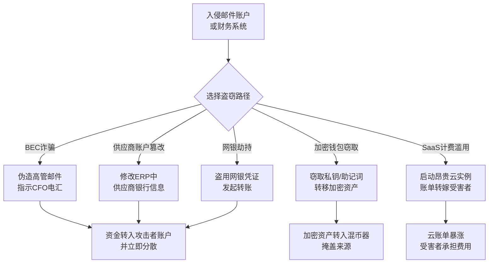

# 金融盗窃 (T1657)

## 一句话通俗理解

**攻击者直接从你的账户、支付系统或电子钱包里偷钱——不像勒索软件那样要赎金，而是悄悄把钱转走。**

## 30秒速查卡

| 维度 | 你需要知道的 |
|------|-------------|
| 这是什么？ | 攻击者通过BEC诈骗、篡改支付流程、劫持银行凭证或盗取加密钱包直接窃取资金 |
| 为什么危险？ | 资金一旦转账完成往往难以追回，企业单笔损失可达数千万美元 |
| 谁需要关心？ | 财务团队、CFO、反欺诈团队、SaaS账单管理员、加密资产托管方 |
| 你的第一步防御 | 对所有大额转账和支付配置变更强制双人审批+带外（电话）确认 |
| 如果只做一件事 | 监控支付API和银行账户的异常交易模式（金额、时间、收款方变更） |

## 难度等级

⭐⭐ 中级（需要一定基础）

## 前置知识检查

**读这个文件需要什么？**

- [ ] 企业支付流程（电汇/ACH/SEPA/SWIFT）
- [ ] SaaS订阅与计费模型
- [ ] 加密货币钱包与私钥管理
- [ ] BEC（Business Email Compromise，商业邮件妥协）攻击基本概念

## 技术描述

金融盗窃（T1657）是MITRE ATT&CK框架中影响战术（Impact，TA0040）的一种技术。攻击者通过各种手段直接窃取受害者的资金、加密货币或其他金融资产。区别于T1486（数据加密勒索）的是，金融盗窃不需要"赎金谈判"——钱直接被转走。

**通俗解释：**

**过渡段：** 不要误以为影响战术只是'加密文件'或'销毁数据'——在金融盗窃中，攻击者根本不碰你的文件，他们直接碰你的钱。BEC诈骗让CFO把千万美元汇到诈骗犯账户；SWIFT劫持让央行一夜蒸发数千万美元；加密钱包私钥泄露让持有者资产瞬间归零。FBI 2024年IC3报告显示，仅BEC一种手法就造成美国企业55亿美元损失，超过勒索软件赎金总额。

**技术原理：**

1. **BEC商业邮件妥协**：攻击者入侵或伪造企业高管邮箱，向财务部门发送伪造的电汇指令，收款方为攻击者控制的账户
2. **支付系统篡改**：攻击者入侵ERP/财务系统，修改供应商银行账户信息，让正常付款流入攻击者账户
3. **银行凭证盗用**：攻击者窃取企业网银凭证（多通过钓鱼+MFA绕过），直接发起转账
4. **加密货币钱包窃取**：攻击者通过钓鱼、恶意软件、私钥泄露等手段获取加密钱包私钥或助记词（Seed Phrase），转移资产
5. **SaaS计费滥用**：攻击者入侵云账户，启动昂贵实例或修改账单配置，将成本转嫁给受害者
6. **应用内购欺诈**：恶意应用通过欺骗用户或滥用系统机制发起未授权的支付

**用途与影响：**
金融盗窃是直接经济动机驱动的攻击，受害者损失通常立即兑现且难以追回。跨境电汇通常在24小时内就被分散到数十个账户并提取现金，加密货币转账一旦确认6个区块就不可逆。2025年FBI IC3报告显示，全球BEC累计损失已超240亿美元，加密货币盗窃总价值超过150亿美元。

**在攻击链中的位置：**
金融盗窃位于攻击链的终点，与勒索软件并列于影响战术。攻击者通常先通过T1566（钓鱼）获取邮件凭证，潜伏侦察（T1087）数周识别付款时机，再执行金融盗窃。与勒索软件不同，金融盗窃是"安静的偷窃"，攻击者会尽量延长潜伏期，避免触发告警影响转账成功率。

## 攻击流程

### 典型攻击流程

```
获取财务/邮件系统访问 --> 伪造付款指令或篡改账户 --> 发起转账 --> 资金转移分散 --> 受害者发现损失
```



**步骤详解：**

1. **获取财务系统或邮件访问权限**
   - 通俗描述：攻击者先攻入企业的邮件系统或财务软件
   - 技术细节：通过钓鱼获取员工邮箱凭证（T1566）、暴力破解OWA凭据（T1110）、利用OAuth令牌劫持（T1528）等
   - 常用工具：Phishing kit、EvilProxy、MODI

2. **侦察付款流程与供应商关系**
   - 通俗描述：摸清企业给谁付钱、什么时候付、付多少
   - 技术细节：长期潜伏邮箱阅读往来邮件，识别例行付款、合同到期、收购并购等高价值时机
   - 常用工具：邮件规则自动转发、AutoDiscover抓取

3. **伪造付款指令或篡改账户**
   - 通俗描述：发一封"看起来像CEO"的邮件让CFO转账，或偷偷改掉供应商的银行账号
   - 技术细节：使用相似域名（如 `acme-corp.com` vs `acme-corp.co`）、修改ERP中的IBAN/BIC字段、注入邮件规则隐藏回复
   - 常用工具：Typosquatting、Lookalike domain registration

4. **发起转账与资金分散**
   - 通俗描述：钱到账后立即拆分到几十个账户，让追踪变难
   - 技术细节：通过"钱骡"（Money Mule）网络层层转账，加密货币则使用混币器（如Tornado Cash）
   - 常用工具：Money mule network、Tornado Cash、ChipMixer

5. **资金提取与洗白**
   - 通俗描述：把分散的钱变成现金或加密资产取出
   - 技术细节：通过预付卡、加密货币ATM、地下兑换服务等转换为难以追踪的形式

## 真实案例

### 案例1：孟加拉央行SWIFT劫持（2016）

- **时间**: 2016年2月
- **目标**: 孟加拉国央行（Bangladesh Bank）
- **攻击组织**: Lazarus Group（朝鲜背景，归属由美国FBI确认）
- **手法**: 攻击者通过钓鱼邮件入侵孟加拉央行员工电脑，横向移动到SWIFT终端服务器。他们安装了恶意软件修改SWIFT Alliance Access软件的日志和交易记录，并发起35笔总价值9.51亿美元的转账指令到菲律宾和斯里兰卡的账户。攻击者同时篡改了NFS打印日志以掩盖痕迹。最终由于拼写错误（"Shalika Foundation" 误拼为 "Shalika Fandation"）触发德意志银行警觉，多数转账被拦截，但仍有8100万美元成功转移并基本无法追回。
- **影响**: 8100万美元被成功盗取，孟加拉央行声誉严重受损，全球SWIFT系统安全信任度下降
- **参考链接**: [FBI - Bangladesh Bank Heist](https://www.fbi.gov/news/stories/bangladesh-bank-heist)

### 案例2：Google与Facebook BEC诈骗（2013-2015）

- **时间**: 2013-2015年
- **目标**: Google、Facebook
- **攻击组织**: 立陶宛籍 Evaldas Rimasauskas（个人作案，已被US DOJ起诉定罪）
- **手法**: 攻击者注册了与台湾电子代工巨头 Quanta Computer（广达电脑）相似名称的空壳公司"Quanta Computer LLC"在拉脱维亚。然后以伪造的发票和合同向Google与Facebook财务部门发起BEC攻击，邮件伪装成来自广达电脑，索要"应收账款"。由于Google和Facebook确实与广达有真实业务往来，财务人员未加核实就进行了电汇。攻击者通过拉脱维亚、塞浦路斯、匈牙利等地的银行账户层层转移资金。
- **影响**: 两家公司合计被骗1.21亿美元（Google 4900万、Facebook 7200万），Rimasauskas被捕后部分资金追回
- **参考链接**: [US DOJ - Evaldas Rimasauskas Case](https://www.justice.gov/usao-sdny/pr/lithuanian-man-sentenced-over-five-years-prison-wiring-over-49-million)

### 案例3：Ronin Network加密货币盗窃（2022）

- **时间**: 2022年3月
- **目标**: Axie Infinity 游戏的 Ronin Network 区块链侧链
- **攻击组织**: Lazarus Group（朝鲜背景，归属由FBI确认）
- **手法**: 攻击者通过社会工程学攻击Sky Mavis（Ronin开发方）员工，获得其工程师的工作笔记本访问权。该笔记本持有Ronin验证节点的9个私钥中的5个（满足多签阈值4/9的攻击条件）。攻击者在2021年11月潜伏期间已获得访问，2022年3月23日一次性发起两笔交易，从Ronin桥合约中提取了173,600 ETH和2550万USDC，按当时价格约6.2亿美元。资金随后被转移至攻击者控制的以太坊地址，并通过Tornado Cash混币器分散。
- **影响**: 加密货币历史上最大单次盗窃案之一，损失约6.2亿美元
- **参考链接**: [FBI - Lazarus Group Attribution for Ronin Theft](https://www.fbi.gov/news/press-releases/press-releases/fbi-names-lazarus-group-cyber-actors-as-responsible-for-620-million-ethereum-cryptocurrency-theft)

### 案例4：Toyota集团BEC诈骗（2019）

- **时间**: 2019年8月
- **目标**: Toyota Boshoku Corporation（丰田纺织）
- **攻击组织**: 未公开归因
- **手法**: 攻击者通过钓鱼获得丰田纺织欧洲子公司财务人员的邮箱凭证，长期潜伏阅读业务邮件。在识别出与某供应商的例行付款时机后，攻击者使用伪造的供应商邮件和修改后的银行账号向财务人员发送"账户变更通知"，要求将下一笔4750万美元的付款转入新的香港账户。由于付款金额符合例行付款的预期范围，财务人员未通过电话带外确认就执行了电汇。
- **影响**: 单笔损失4750万美元，丰田纺织公开披露事件
- **参考链接**: [SecurityWeek - Toyota Supplier BEC](https://www.securityweek.com/toyota-parts-supplier-discloses-37m-loss-cyberattack/)

### 案例5：Joker恶意应用内购欺诈（2019-2025）

- **时间**: 2019-2025年（持续变种）
- **目标**: Android应用商店用户
- **攻击组织**: 未公开归因（持续变种由不同开发者投放）
- **手法**: Joker恶意软件家族持续绕过Google Play审核上架伪装成系统工具、壁纸、QR扫描等无害应用。应用安装后，攻击者暗中订阅高价的WAP短信服务或调用Android Billing API发起应用内购买，利用用户已登录的Google账户自动完成支付。Joker通过混淆代码、动态加载、最小权限请求等手段反复绕过Google Play Protect检测，2019-2025年间被Google累计下架超过1700个变种。
- **影响**: 全球数百万用户被自动订阅付费服务，单用户损失从几美元到数百美元不等
- **参考链接**: [Zscaler - Joker Malware Analysis](https://www.zscaler.com/blogs/security-research/joker-billing-trojan-returns-google-play)

## 红队视角

> ⚠️ **免责声明**：以下内容仅用于合法的安全测试、渗透测试和教育目的。未经授权对他人系统进行测试或实施金融盗窃是严重犯罪行为。

### 实战技巧

1. **BEC邮件伪造检测演练**：在客户授权的红队演练中，注册相似域名（如客户域名加 `-group` 后缀）并配置SPF/DKIM，测试财务人员是否识别。这是评估BEC防御有效性的合规手段。

2. **支付变更流程压力测试**：模拟供应商邮件要求变更银行账号，观察财务团队是否执行带外电话确认。多数组织在压力测试中暴露"邮件即可变更"的脆弱流程。

3. **加密钱包热存储风险评估**：审查客户的热钱包私钥存储位置（HSM、KMS、明文文件）、签名节点多签阈值、运维人员访问审计，识别可被社工攻破的单点。

### 常用工具

| 工具名称 | 用途 | 平台 | 链接 |
|----------|------|------|------|
| EvilProxy | 反向代理钓鱼绕过MFA（仅研究参考） | 跨平台 | 商业服务 |
| Modlishka | 反向代理钓鱼框架 | 跨平台 | https://github.com/drk1wi/Modlishka |
| DNSTwist | 相似域名监控（防御侧） | 跨平台 | https://github.com/elceef/dnstwist |
| Etherscan | 加密货币链上追踪 | 跨平台 | https://etherscan.io/ |

### 注意事项

- 金融盗窃是刑事犯罪，红队演练中只做"是否能完成攻击动作"的验证，绝不实际转账
- 涉及真实资金流的测试必须使用沙箱账户、测试支付网关、零余额测试钱包
- 测试邮件伪造时使用客户预先批准的内部域名，避免误伤第三方

## 蓝队视角

### 检测要点

1. **异常电汇交易**
   - 数据源：核心业务系统、网银日志、ERP付款模块（应用日志/审计日志）
   - 关注字段：金额阈值、收款方新增账户、首次往来收款方、非工作时间转账
   - 异常特征：金额接近审批阈值上限、收款账户在过去90天内从未出现、与历史付款模式偏差

2. **支付配置变更**
   - 数据源：ERP审计日志（SAP SM20、Oracle EBS审计）、IAM变更日志
   - 关注字段：供应商银行账号字段修改、付款审批规则变更、电汇限额上调
   - 异常特征：变更发生在非工作时间、变更后48小时内发生付款、变更操作者与付款发起人为同一账户

3. **邮箱可疑行为**
   - 数据源：Exchange/Microsoft 365审计日志、Gmail Admin Audit
   - 关注字段：邮件规则创建（自动转发到外部域名、删除特定主题邮件）、收件箱规则隐藏特定会话
   - 异常特征：财务/高管邮箱出现可疑收件箱规则、登录IP跳变、IMAP/POP同步到未知客户端

4. **加密钱包活动**
   - 数据源：HSM签名日志、KMS API调用日志、链上监控
   - 关注字段：私钥访问、签名次数突增、提现到非白名单地址
   - 异常特征：单次签名金额超阈值、向新地址大额转账、连续多笔拆分转账

5. **SaaS计费异常**
   - 数据源：AWS Cost Explorer、Azure Cost Management、GCP Billing
   - 关注字段：实例类型变化、新区域启动、Reserved Instance取消
   - 异常特征：非工作时间启动GPU实例、单日账单较30日均值增长超200%

### 监控建议

- 对所有超过预设阈值的电汇强制多因素审批（MFA + 带外电话回拨）
- 部署BEC防御网关，监控相似域名注册（DNSTwist类工具）和高管身份冒充
- 在ERP/财务系统中，供应商银行账号变更后48小时内禁止付款，并触发独立审计
- 对加密钱包实施白名单提现地址，提现到非白名单地址需多签+延迟24小时
- 设置云账单告警：日账单超30日均值150%时立即通知财务与安全团队
- 监控Microsoft 365 / Google Workspace的邮件规则创建事件（统一审计日志 Operation=New-InboxRule）

## 避坑指南

组织中最危险的盲区：把金融盗窃当作"业务风险"而非"网络安全事件"。

许多组织将BEC诈骗、网银劫持归到"财务部门的事故"，安全团队不参与调查。但攻击入口几乎都是IT/邮件系统被入侵，没有安全团队的根因分析，攻击者会持续潜伏并实施下一轮盗窃。强烈建议建立财务-安全联合响应流程：任何超1万美元的非计划电汇事件都必须触发安全事件响应。

## 检测建议

### 网络层检测

**检测方法：** 监控异常的支付API调用、跨境转账流量、加密钱包与混币器之间的交互。

**具体规则/命令示例：**

```bash
# 检测对支付网关API的异常调用频率（以Stripe API为例）
zeek -C -r capture.pcap http.log | grep -E "api\.stripe\.com|api\.paypal\.com" | \
  awk '{print $3, $9}' | sort | uniq -c | sort -rn | head -20

# 监控与已知混币器/Tornado Cash合约的网络交互
tshark -r capture.pcap -Y "tls.handshake.extensions_server_name contains \"tornado\"" \
  -T fields -e ip.src -e ip.dst | sort | uniq -c | sort -rn

# 检测对SWIFT Alliance Access服务器的异常连接
tshark -r capture.pcap -Y "tcp.port == 1521 or tcp.port == 18004" \
  -T fields -e ip.src -e ip.dst -e frame.time | sort
```

### 主机层检测

**检测方法：** 监控财务工作站、ERP终端、加密钱包签名节点的可疑进程和邮件规则变更。

**Windows事件ID：**
- 事件ID 4624（登录成功）：关注财务系统登录类型3/10
- 事件ID 4688（进程创建）：关注邮件客户端外的可疑子进程
- 事件ID 4720/4724（账户操作）：关注权限调整

**具体命令示例：**

```powershell
# 检测财务工作站上可疑的邮件规则创建
Get-WinEvent -FilterHashtable @{LogName='Security';ID=4688} -MaxEvents 1000 | 
  Where-Object {$_.Message -match "outlook|olk|exchange"} | 
  Format-Table TimeCreated, Message -Wrap

# 检测Exchange邮箱规则创建（重点关注外部转发规则）
Get-Mailbox -ResultSize Unlimited | ForEach-Object {
  Get-InboxRule -Mailbox $_.UserPrincipalName | 
    Where-Object {$_.RedirectTo -ne $null -or $_.ForwardTo -ne $null} |
    Select-Object MailboxOwnerId, Name, RedirectTo, ForwardTo
}
```

### 应用层检测

**Sigma规则示例：**

```yaml
title: 检测可疑Outlook收件箱规则创建
status: experimental
description: 检测可能用于隐藏BEC攻击回复邮件的可疑Outlook规则
logsource:
    product: windows
    category: outlook
detection:
    selection:
        Operation:
            - New-InboxRule
            - Set-InboxRule
    suspicious_fields:
        RuleContent|contains:
            - "delete"
            - "forward"
        RedirectTo|contains:
            - "gmail"
            - "yahoo"
            - "hotmail"
            - "163"
            - "qq.com"
    condition: selection and suspicious_fields
level: high
tags:
    - attack.t1657
    - attack.t1566
```

**应用层API监控示例（伪代码）：**

```python
# 监控企业ERP中供应商银行账号变更
def audit_supplier_bank_change(change_event):
    if change_event.field == "supplier_iban":
        # 1. 检查变更前后是否相差多个国家
        old_country = change_event.old_value[:2]  # IBAN前两位为国家代码
        new_country = change_event.new_value[:2]
        if old_country != new_country:
            alert("跨国家银行账号变更", severity="high")
        
        # 2. 检查变更后48小时内是否发生付款
        schedule_check(lambda: has_payment_to(change_event.supplier_id, within_hours=48))
        
        # 3. 检查变更操作者是否与近期付款发起人为同一用户
        if change_event.user_id == recent_payment_initiator(change_event.supplier_id):
            alert("银行账号变更与付款发起人为同一人", severity="critical")
```

### 攻击检测关联

通过MITRE ATT&CK技术ID关联，金融盗窃常与以下技术共现：

| 关联技术ID | 名称 | 关联场景 |
|-----------|------|---------|
| T1566 | 钓鱼 | 获取财务人员邮箱凭证 |
| T1528 | 窃取应用访问令牌 | 劫持OAuth令牌访问SaaS财务系统 |
| T1110 | 暴力破解 | 网银凭证爆破 |
| T1556 | 修改认证流程 | 篡改MFA绕过支付审批 |
| T1078 | 有效账户 | 使用被盗财务账户登录 |

## 缓解措施

### 优先级1：关键措施

**措施名称：** 强制双因素+带外确认的大额支付流程

**具体实施步骤：**
1. 设置电汇阈值（如单笔超过10万美元、当日累计超过50万美元）
2. 超阈值付款必须经CFO电话语音确认（带外通道，不使用邮件/即时通讯）
3. 供应商银行账号变更必须由供应商书面盖章+电话联系供应商历史联系人核实
4. 关键支付审批强制硬件令牌MFA（YubiKey/FIDO2），不依赖短信OTP

**配置示例：**

```yaml
# 支付审批规则示例
payment_policy:
  thresholds:
    single_transfer_usd: 100000
    daily_cumulative_usd: 500000
  
  triggers:
    - condition: amount > single_transfer_usd
      required: 
        - dual_approval
        - voice_callback_to_cfo
        - hardware_mfa
    - condition: supplier.bank_account_changed_within_days(48)
      required:
        - dual_approval
        - independent_verification_of_supplier
```

### 优先级2：重要措施

**措施名称：** BEC防御与邮件身份强化

**具体实施步骤：**
1. 强制启用DMARC（`p=reject`）、SPF、DKIM三件套
2. 对高管邮箱启用Microsoft 365 / Google Workspace的"邮件标记外部发件人"标签
3. 部署BEC检测网关（如Proofpoint、Abnormal Security、Mimecast），识别相似域名和身份冒充
4. 培训财务人员：任何涉及付款的邮件都不通过邮件内链接验证，必须独立登录系统核实

### 优先级3：建议措施

**措施名称：** 加密资产与SaaS账单管控

**具体实施步骤：**
1. 加密钱包采用HSM存储私钥，多签阈值≥3/5，关键操作需多人离线签字
2. 热钱包余额限制为业务日上限的120%，超出部分自动转冷钱包
3. 提现地址白名单，新地址加入需24小时延迟+多签
4. 云账单设置每日告警阈值（日账单>30日均值150%）
5. 关闭云账户的"自动批准账单支付"，改为月度人工审批

### MITRE ATT&CK 缓解措施映射

| 缓解措施ID | 缓解措施名称 | 适用性 | 说明 |
|------------|-------------|--------|------|
| M1031 | 网络隔离 | 部分适用 | 财务工作站与互联网隔离，限制支付API访问 |
| M1032 | 多因素认证 | 适用 | 关键财务系统强制硬件MFA |
| M1017 | 用户培训 | 适用 | 财务人员BEC识别和带外确认培训 |
| M1018 | 用户账户管理 | 适用 | 财务邮箱最小权限、定期审计邮件规则 |
| M1047 | 审计 | 适用 | ERP和支付系统操作审计 |
| M1057 | 数据损失预防 | 部分适用 | 监控财务邮件外发 |

## 动手实验

> ⚠️ **重要提示**：所有实验必须在隔离的实验室环境中进行，禁止对真实支付系统或他人邮箱进行测试。

### 实验环境准备

**推荐靶场/实验平台：**

| 平台名称 | 类型 | 难度 | 链接 |
|----------|------|------|------|
| APWG BEC案例库 | 案例分析 | 初级 | https://apwg.org/trendsreports/ |
| 区块链浏览器 | 链上追踪 | 中级 | https://etherscan.io/ |
| Odoo社区版 | ERP测试 | 中级 | https://www.odoo.com/page/editions |

**所需工具：**
- 测试ERP环境（开源Odoo社区版）
- 测试用Outlook账户
- 测试以太坊钱包（私钥不存放真实资产）

### 实验1：BEC邮件识别与防御分析（中级）

**实验目标：** 学习BEC攻击邮件的特征和识别要点。

**实验步骤：**
1. 收集APWG公开的BEC样本邮件（脱敏数据集）
2. 分析邮件头中的SPF/DKIM/DMARC结果，识别相似域名
3. 对比真实供应商邮件与BEC邮件的语言风格、紧迫感特征
4. 设计企业内部的BEC防御检查清单

**预期结果：** 能够独立识别BEC邮件的5个关键特征（发件域名相似、紧迫付款要求、收款账户变更、回避带外确认、伪造历史邮件引用）。

**学习要点：** 理解为什么BEC成功率远高于传统钓鱼——攻击者利用的是"业务流程的信任"，而非技术漏洞。

### 实验2：加密货币盗窃链上追踪（高级）

**实验目标：** 追踪公开的加密货币盗窃案资金流向，理解攻击者的洗钱路径。

**实验步骤：**
1. 在Etherscan上访问Ronin Network攻击案公开地址（0x098B716B8Aaf21512996dC57EB0615e2383E2f96）
2. 追踪前10笔转出交易，识别资金如何被分散
3. 查找资金是否经过Tornado Cash合约（地址：0x12D66f87A04A9E220743712cE6d9bB1B5616B8Fc）
4. 绘制资金流向图，估算追回可能性

**预期结果：** 完成一份资金流向追踪报告，识别至少3个关键洗钱步骤。

**学习要点：** 理解为什么加密货币盗窃资金极难追回——混币器、跨链桥、去中心化交易所构成多层匿名化路径。

## 术语解释

| 术语 | 英文原名 | 通俗解释 |
|------|----------|----------|
| BEC | Business Email Compromise | 商业邮件妥协攻击，通过伪造或劫持企业邮箱诱导财务转账 |
| SWIFT | Society for Worldwide Interbank Financial Telecommunication | 全球银行间金融通信网络，跨境电汇的核心基础设施 |
| 电汇 | Wire Transfer | 银行间的电子资金转账，跨境电汇通常不可逆 |
| IBAN | International Bank Account Number | 国际银行账号格式，前两位为国家代码 |
| 收款方变更 | Payee Redirection | 修改供应商收款银行账号，是BEC诈骗的核心动作 |
| 带外确认 | Out-of-band Verification | 通过独立通信渠道（如电话）验证指令，避免邮件链被劫持 |
| 钱骡 | Money Mule | 替攻击者代收转账并提取现金的人，通常被不知情招募或金钱诱惑 |
| 混币器 | Cryptocurrency Mixer | 加密货币混币服务，通过混合多用户资金打断链上追溯 |
| 助记词 | Seed Phrase | 加密钱包的12/24个单词备份，谁拿到谁就能控制钱包所有资产 |
| 多签钱包 | Multi-signature Wallet | 需要多个私钥共同签名才能转账的加密钱包，提高资产安全性 |
| WAP计费 | WAP Billing | 移动运营商的短信/网络计费通道，被恶意App滥用进行扣费欺诈 |
| 热钱包 | Hot Wallet | 联网状态的加密货币钱包，方便交易但风险较高 |

## 参考资料

### 📚 官方文档（深入了解）

- [MITRE ATT&CK - T1657 Financial Theft](https://attack.mitre.org/techniques/T1657/)
- [MITRE ATT&CK - Impact 战术 TA0040](https://attack.mitre.org/tactics/TA0040/)
- [MITRE ATT&CK - T1486 Data Encrypted for Impact](https://attack.mitre.org/techniques/T1486/)（与金融盗窃对比）

### 📰 安全报告（真实攻击）

- [FBI IC3 2024 Annual Report](https://www.ic3.gov/Media/PDF/AnnualReport/2024_IC3Report.pdf) - 美国FBI互联网犯罪投诉中心年度报告，BEC损失统计权威来源
- [FBI - DPRK Lazarus Ronin Network Attribution](https://www.fbi.gov/news/press-releases/press-releases/fbi-names-lazarus-group-cyber-actors-as-responsible-for-620-million-ethereum-cryptocurrency-theft) - FBI对Ronin Network盗窃案的官方归因
- [CISA Alert AA22-108A - DPRK Cryptocurrency Theft](https://www.cisa.gov/news-events/cybersecurity-advisories/aa22-108a) - CISA关于朝鲜加密货币盗窃的咨询
- [US DOJ - Evaldas Rimasauskas BEC Conviction](https://www.justice.gov/usao-sdny/pr/lithuanian-man-sentenced-over-five-years-prison-wiring-over-49-million) - Google/Facebook BEC诈骗案判决书

### 🔧 工具与资源（动手试试）

- [Etherscan - 以太坊区块链浏览器](https://etherscan.io/) - 加密货币盗窃链上追踪
- [Chainalysis Crypto Crime Report](https://www.chainalysis.com/reports/) - 加密货币犯罪年度报告
- [DNSTwist - 相似域名检测](https://github.com/elceef/dnstwist) - BEC防御相似域名监控
- [Proofpoint BEC Defense Guide](https://www.proofpoint.com/us/threat-reference/bec) - BEC防御企业级指南

### 📚 学习资料（深入了解）

- [NIST SP 800-61 - 计算机安全事件处理指南](https://csrc.nist.gov/publications/detail/sp/800-61/rev-2/final) - 金融盗窃事件响应流程
- [SWIFT CSP - Customer Security Programme](https://www.swift.com/myswift/customer-security-programme-csp) - SWIFT客户安全计划
- [Anti-Phishing Working Group - BEC Reports](https://apwg.org/trendsreports/) - 全球BEC攻击趋势报告
