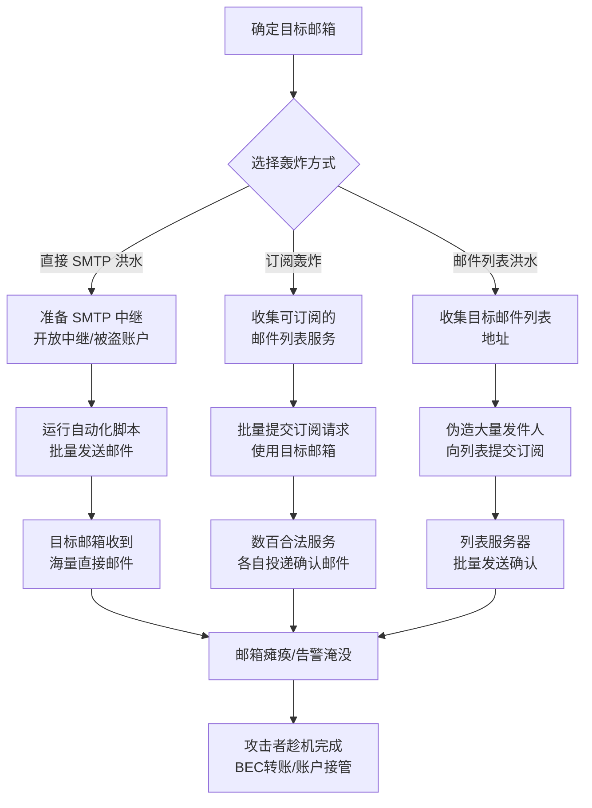

# 邮件轰炸 (T1667)

## 一句话通俗理解

**攻击者用海量垃圾邮件把你的邮箱塞爆——就像有人给你家寄几万封快递，让你根本找不到里面那封真正的法院传票。**

## 30秒速查卡

| 维度 | 你需要知道的 |
|------|-------------|
| 这是什么？ | 攻击者向同一目标邮箱发送海量邮件，使其邮箱瘫痪或掩盖重要通知 |
| 为什么危险？ | 不仅是骚扰，更常被用作"烟雾弹"——用邮件洪水掩盖银行转账确认、安全告警等关键邮件 |
| 谁需要关心？ | 邮件管理员、SOC分析师、反欺诈团队、个人用户 |
| 你的第一步防御 | 在邮件网关配置速率限制（rate limiting），对同一收件人/发件人设置每分钟邮件数阈值 |
| 如果只做一件事 | 监控单一收件人在短时间内收到异常大量邮件（特别是订阅确认邮件），自动隔离并告警 |

## 难度等级

⭐ 初级（门槛低，工具易获取）

## 前置知识检查

**读这个文件需要什么？**

- [ ] SMTP/IMAP/POP3 邮件协议基础
- [ ] 邮件头（From/To/Received/SPF/DKIM）字段含义
- [ ] 邮件网关与反垃圾机制（灰名单、RBL、内容过滤）

## 技术描述

邮件轰炸（T1667）是 MITRE ATT&CK 框架中影响（Impact）战术下的一种技术。攻击者通过自动化工具向目标邮箱发送大量邮件，或者利用合法的邮件订阅服务向目标投递海量订阅确认邮件，从而造成邮箱拒绝服务或掩盖其他攻击行为。

**通俗解释：**

**过渡段：** 不要误以为"影响"战术只针对服务器和网络——攻击者的最终目的可能不是让你的系统宕机，而是让你"看不见"。邮件轰炸正是一种典型的"注意力攻击"：它不破坏数据，也不窃取凭证，而是用一个简单粗暴的方式——垃圾邮件洪水——把你真正需要看到的那封邮件淹没掉。当受害者在数百封订阅确认邮件中挣扎时，攻击者可能正在另一边完成银行转账、重置密码或盗取账户。

想象你的信箱突然被塞进一万份超市促销单，里面还混着一份银行寄来的"您的账户刚刚完成一笔 5 万元转账"的通知。你大概率会错过这份通知——这就是邮件轰炸的核心危害。攻击者有两种主要做法：一是直接用脚本控制 SMTP 服务器向目标狂发邮件；二是更隐蔽的"订阅轰炸"（subscription bombing）——用目标的邮箱地址在数百个新闻订阅、论坛注册、免费服务上批量注册，让这些合法服务代替攻击者发邮件，使溯源和拦截变得极其困难。

**技术原理：**

1. **直接 SMTP 洪水**：攻击者搭建或租用 SMTP 中继（open relay 或被盗账户），使用自动化脚本向目标邮箱发送大量邮件。每封邮件可以很小（如空内容或随机字符），重点在于数量
2. **订阅轰炸（Subscription Bombing）**：攻击者编写爬虫，收集互联网上所有无需验证即可订阅的邮件列表（新闻通讯、产品更新、白皮书下载等），用目标邮箱批量提交订阅请求。每个订阅服务都会向目标发送一封确认邮件，瞬间产生数百封来自不同合法发件人的邮件
3. **SMTP 中继滥用**：攻击者利用配置不当的开放式中继（open relay）邮件服务器或被盗的企业邮件账户作为发邮件的"炮台"，绕过自家 IP 的发送限制和黑名单
4. **邮件列表订阅洪水**：针对单个邮件列表地址，使用大量伪造发件人地址提交订阅请求，使邮件列表服务器向这些地址投递确认邮件，间接实现轰炸
5. **配合 BEC 的烟雾弹攻击**：在商业邮件欺诈（BEC）场景中，攻击者先对受害者财务人员的邮箱实施轰炸，使其错过银行发送的转账确认或异常告警邮件，从而顺利完成未授权资金转移

**用途与影响：**

邮件轰炸的真正威胁不在于邮箱被打爆本身，而在于它经常作为其他攻击的掩护。根据 2024-2025 年的反欺诈研究报告，邮件轰炸作为 BEC 攻击的"前置烟雾弹"已经成为一种稳定的攻击模式：攻击者在发起未授权转账的同一时间段，对负责审批的邮箱实施轰炸，使合规告警、银行确认邮件被淹没在数千封垃圾邮件中。此外，订阅轰炸也常被用于个人骚扰、报复以及针对企业客服邮箱的拒绝服务攻击。

## 攻击流程



**步骤详解：**

1. **确定目标邮箱**
   - 通俗描述：找到要轰炸的邮箱地址，通常是企业财务、HR 或个人邮箱
   - 技术细节：通过 OSINT、企业官网、LinkedIn 等公开渠道收集目标邮箱，或针对已知的企业财务审批人邮箱
   - 常用工具：theHarvester、Hunter.io、Google Dorking

2. **选择轰炸方式**
   - 通俗描述：根据目的选择"硬轰"（直接发邮件）或"软轰"（利用合法订阅服务）
   - 技术细节：直接 SMTP 洪水速度快但易被网关拦截；订阅轰炸更隐蔽但响应慢（需等待各服务发确认邮件）
   - 常用工具：自研 Python 脚本、BombTomato、MailBomber 等公开工具

3. **准备发送通道**
   - 通俗描述：找好"发邮件的炮台"，不能用自己的真实邮箱
   - 技术细节：扫描互联网上的开放 SMTP 中继（open relay），或购买被盗的企业邮箱账户（在地下市场常被称为"SMTP checker"或"mailer"），或使用临时邮件服务
   - 常用工具：SMTP 端口扫描器、地下市场的 SMTP 凭证交易

4. **执行批量发送**
   - 通俗描述：运行脚本，一次性向目标狂发数千封邮件
   - 技术细节：脚本使用多线程并发连接 SMTP 服务器，每封邮件正文极短（如随机字符串），重点在于数量和速度；订阅轰炸则是用 headless 浏览器（如 Selenium）批量访问订阅页面提交表单
   - 常用工具：Python+smtplib、Selenium、Puppeteer

5. **配合主攻击（可选）**
   - 通俗描述：在轰炸的同时，攻击者在另一端完成真正的攻击行为
   - 技术细节：常见于 BEC 攻击——攻击者冒充高管发邮件要求财务紧急转账，同时轰炸财务邮箱，使银行发送的"异常登录"或"转账确认"邮件被淹没；也用于掩盖密码重置邮件、双因素认证告警等
   - 常用工具：与 BEC 攻击工具链配合

## 真实案例

### 案例1：BEC 攻击中的邮件轰炸烟雾弹（2023-2025）

- **时间**: 2023-2025 年
- **目标**: 全球中小企业财务部门
- **攻击组织**: 多个 BEC 攻击团伙（未特定 APT 归属）
- **手法**: 攻击者在入侵企业高管邮箱后，向财务部门发送伪造的紧急转账指令。为防止银行发送的转账确认邮件被财务人员及时看到，攻击者在转账发起前后 30 分钟内，对财务邮箱实施订阅轰炸——使用自动化脚本在 200+ 个新闻订阅、SaaS 试用注册、免费白皮书下载等无需验证的服务上提交财务人员的邮箱地址。这些合法服务在数分钟内向受害者邮箱投递了超过 3000 封确认邮件，将银行的转账确认邮件彻底淹没。当财务人员在数小时后清理完邮件才发现异常时，资金已被转移至攻击者控制的账户。
- **影响**: 单次攻击造成的资金损失从数万到数百万美元不等，2024 年 FBI IC3 报告显示 BEC 攻击全年损失超过 27 亿美元
- **参考链接**: [FBI IC3 - Business Email Compromise](https://www.ic3.gov/Media/Y2024/PSA240604)

### 案例2：订阅轰炸作为个人骚扰工具（2017-2024）

- **时间**: 2017 年至今持续存在
- **目标**: 个人邮箱用户
- **攻击组织**: 个人攻击者，无组织归属
- **手法**: 2017 年 BBC 等媒体首次报道订阅轰炸作为一种新型网络骚扰手段。攻击者使用公开工具（如 GitHub 上的各种 "subscription bomber" 脚本）收集了 100+ 个无需邮箱验证即可订阅的邮件列表服务，输入受害者邮箱后一键提交所有订阅。受害者在数分钟内收到来自各家合法公司（新闻媒体、电商、SaaS 服务等）的数百封欢迎邮件和确认邮件，邮箱几乎瘫痪。由于这些邮件来自合法发件人，传统的反垃圾邮件机制（SPF/DKIM 检查）无法拦截。这种攻击在分手报复、网络欺凌、游戏社区矛盾等场景中持续被使用。
- **影响**: 受害者邮箱短时间瘫痪，重要邮件被淹没，部分受害者不得不放弃原有邮箱地址
- **参考链接**: [BBC - Subscription bombing report](https://www.bbc.com/news/technology-40432295)

### 案例3：针对企业客服邮箱的拒绝服务（2020-2023）

- **时间**: 2020-2023 年
- **目标**: 多家企业的客户服务邮箱（support@、help@）
- **攻击组织**: 未特定归属，疑似竞争对手或勒索团伙
- **手法**: 攻击者针对企业对外公开的客服邮箱（如 support@company.com）实施直接 SMTP 洪水攻击。使用从地下市场购买的 SMTP 凭证和开放中继列表，通过多线程脚本向客服邮箱发送每分钟数百封的垃圾邮件。由于客服邮箱通常配置为接收所有外部邮件（无法像普通员工那样启用严格反垃圾策略），邮箱存储在数小时内被填满，导致真实的客户咨询邮件被退回或丢失。部分攻击伴随勒索要求，威胁若不支付加密货币将继续攻击。
- **影响**: 客服邮箱中断 4-48 小时不等，客户投诉激增，部分企业被迫临时更换客服邮箱地址
- **参考链接**: [CISA - Email bomb attacks advisory](https://www.cisa.gov/)

### 案例4：开放中继滥用批量邮件攻击（2018-2022）

- **时间**: 2018-2022 年
- **目标**: 互联网邮件基础设施
- **攻击组织**: 多个垃圾邮件团伙
- **手法**: 攻击者通过 Shodan 等搜索引擎扫描互联网上配置不当的 SMTP 服务器，找出允许匿名转发邮件的开放中继（open relay）。利用这些服务器作为"邮件炮台"，向大量目标邮箱发送垃圾邮件和钓鱼邮件。部分服务器单日发送量达到数百万封。开放中继的存在使得攻击者可以隐藏真实来源 IP，同时利用被滥用服务器的良好声誉绕过反垃圾邮件网关。这类攻击在 2018-2022 年间持续存在，随着云服务商加强默认配置和 SPF/DKIM/DMARC 的普及，开放中继滥用有所下降但仍未绝迹。
- **影响**: 大量企业邮件服务器 IP 被加入 RBL 黑名单，正常邮件投递受影响
- **参考链接**: [Spamhaus - Open Relay threats](https://www.spamhaus.org/)

## 红队视角

> ⚠️ **免责声明**：以下内容仅用于合法的安全测试、渗透测试和教育目的。未经授权对他人系统进行测试是违法行为。

### 实战技巧

1. **订阅轰炸脚本的基本结构**：
   红队模拟订阅轰炸时，通常使用 Python + Selenium/Playwright 编写自动化脚本，访问预先收集的"无需邮箱验证即可订阅"的网站列表，批量提交目标邮箱。重点是模拟真实用户行为（随机 User-Agent、合理间隔），避免被网站的反爬虫机制拦截。

2. **SMTP 中继探测**：
   使用 `smtp-user-enum` 或 `nmap --script smtp-open-relay` 探测目标网络中的 SMTP 服务器是否配置为开放中继。企业红队应重点检查自家邮件服务器的配置，确保不会成为攻击者的"炮台"。

3. **速率限制测试**：
   红队应测试企业邮件网关的速率限制配置——从外部向一个内部邮箱发送递增速率的邮件（10/分、100/分、1000/分），观察在哪个阈值触发拦截告警。这能帮助蓝队验证防御策略是否生效。

### 常用工具

| 工具名称 | 用途 | 平台 | 链接 |
|----------|------|------|------|
| theHarvester | 邮箱地址收集 | 跨平台 | https://github.com/laramies/theHarvester |
| nmap smtp-open-relay | SMTP 开放中继探测 | 跨平台 | https://nmap.org/nsedoc/scripts/smtp-open-relay.html |
| Selenium | 自动化订阅轰炸模拟 | 跨平台 | https://www.selenium.dev/ |
| swaks | SMTP 协议测试工具 | 跨平台 | http://www.jetmore.org/john/code/swaks/ |

### 注意事项

- 任何邮件轰炸测试必须仅在授权范围内对自有邮箱或测试邮箱进行
- 即使是合法红队演练，向第三方订阅服务提交测试邮箱也可能违反这些服务的条款
- 测试时应使用专用的隔离测试邮箱，避免污染企业正常邮件流量
- 开放中继探测应获得网络所有者明确授权

## 蓝队视角

### 检测要点

1. **同一收件人邮件量异常**
   - 日志来源：邮件网关日志、邮件服务器日志（Exchange Message Tracking、Postfix maillog）
   - 关注字段：收件人地址、时间窗口、发件人数量、邮件主题分布
   - 异常特征：单一收件人在 5-10 分钟内收到来自 50+ 不同发件人的邮件；或单一收件人收到大量主题为"Welcome"、"Confirm your subscription"、"Please confirm"的邮件

2. **SMTP 流量体积异常**
   - 日志来源：邮件网关、防火墙 SMTP 流量日志
   - 关注字段：源 IP、连接数、邮件数、目标域
   - 异常特征：单一源 IP 在短时间内发起大量 SMTP 连接；单一源 IP 向同一目标域投递大量邮件；来自非常规地理位置的 SMTP 流量激增

3. **订阅确认邮件激增**
   - 日志来源：邮件网关内容过滤日志
   - 关注字段：邮件主题关键词（confirm、verify、welcome、subscribe）、发件人域名分布
   - 异常特征：单一收件人在短时间内收到来自数十个不同域名、主题均为订阅确认类的邮件；发件人域名涉及新闻、SaaS、电商等不相关行业

### 监控建议

- 在邮件网关配置基于收件人的速率限制（如单一收件人每分钟最多接收 N 封外部邮件）
- 部署邮件主题聚类分析，对短时间内同一收件人收到的相似主题邮件（特别是订阅确认类）自动告警
- 监控 SMTP 服务器的连接异常，包括单一 IP 的连接频率、认证失败率、邮件投递失败率
- 与反欺诈团队建立联动机制：当检测到邮件轰炸时，立即检查同期是否发生异常转账、密码重置、MFA 变更等操作
- 启用 DMARC 报告分析，监控组织域名是否被用于伪造发件人实施轰炸

## 避坑指南

组织中最危险的盲区：认为邮件轰炸只是"骚扰"，不会造成实际损失。

**常见误区：**

1. **"反垃圾邮件网关能拦截所有轰炸"**——错。订阅轰炸的邮件来自合法发件人（知名新闻网站、SaaS 服务等），SPF/DKIM 全部通过，内容也不是垃圾邮件，传统反垃圾引擎无法识别
2. **"只有个人邮箱会被轰炸"**——错。企业财务、客服、IT 支持邮箱都是高频目标，特别是作为 BEC 攻击的烟雾弹
3. **"轰炸就是攻击本身"**——错。最危险的情况是轰炸只是烟雾弹，真正的攻击（转账、账户接管）正在另一边发生
4. **"我们的邮件服务器不是开放中继就没事"**——错。即使不是中继，被盗的员工邮箱账户同样可以被用作轰炸发件源

## 检测建议

### 网络层检测

**检测方法：** 监控 SMTP 流量异常，检测邮件轰炸的网络层特征。

**具体规则/命令示例：**
```
# 检测单一源 IP 在短时间内发起大量 SMTP 连接（可能的邮件轰炸源）
tshark -r capture.pcap -Y "smtp" -T fields -e ip.src -e tcp.dstport | \
  awk '$2==25{count[$1]++} END {for (ip in count) if (count[ip]>100) print count[ip], ip}' | \
  sort -rn | head -20

# 检测单一目标邮箱收到大量邮件（基于 SMTP RCPT TO 统计）
tshark -r capture.pcap -Y "smtp.rcpt.to" -T fields -e smtp.rcpt.to | \
  sort | uniq -c | sort -rn | head -20

# 检测短时间内来自大量不同源 IP 的 SMTP 连接（分布式轰炸特征）
zeek -C -r capture.pcap smtp.log | awk '{print $4, $5}' | \
  sort | uniq -c | sort -rn | head -20
```

### 主机层检测

**检测方法：** 监控邮件服务器的投递日志，检测异常的邮件接收模式。

**Exchange 服务器日志查询：**
```powershell
# 查询最近 1 小时内同一收件人收到超过 50 封邮件的情况
Get-MessageTrackingLog -ResultSize Unlimited -Start (Get-Date).AddHours(-1) |
    Group-Object Recipients |
    Where-Object {$_.Count -gt 50} |
    Sort-Object Count -Descending |
    Select-Object Count, Name -First 20

# 查询来自单一源 IP 的大量邮件投递
Get-MessageTrackingLog -ResultSize Unlimited -Start (Get-Date).AddHours(-1) |
    Group-Object ClientIp |
    Where-Object {$_.Count -gt 100} |
    Sort-Object Count -Descending |
    Select-Object Count, Name -First 20
```

**Postfix 邮件日志分析：**
```bash
# 检测同一收件人在 5 分钟内收到超过 50 封邮件
grep "to=<" /var/log/mail.log | awk '{print $NF}' | \
  sort | uniq -c | sort -rn | head -20

# 检测订阅确认类邮件激增
grep -iE "subject.*(confirm|verify|welcome|subscribe)" /var/log/mail.log | \
  awk '{print $NF}' | sort | uniq -c | sort -rn | head -20
```

### 应用层检测

**Sigma 规则示例：**
```yaml
title: 检测邮件轰炸 - 单一收件人短时间内大量邮件
status: experimental
description: 检测同一收件人在短时间内收到异常大量邮件，可能是邮件轰炸攻击
logsource:
    category: email
    product: email_gateway
detection:
    selection:
        recipient: '*'
    timeframe: 5m
    condition: selection | count() by recipient > 50
level: high
tags:
    - attack.impact
    - attack.t1667
```

**SIEM 聚合告警示例（Splunk SPL）：**
```
index=email_gateway action=delivered
| bucket _time span=5m
| stats count as email_count, dc(sender) as unique_senders by recipient, _time
| where email_count > 50 AND unique_senders > 20
| sort -email_count
```

## 缓解措施

### 优先级1：关键措施

**措施名称：** 在邮件网关配置收件人速率限制

**具体实施步骤：**
1. 在邮件网关（如 Proofpoint、Mimecast、Barracuda）上启用基于收件人的速率限制策略
2. 设置阈值：单一收件人每分钟最多接收 20-30 封外部邮件（根据业务调整）
3. 超出阈值的邮件进入隔离队列，延迟投递并告警
4. 对订阅确认类邮件（主题含 confirm/verify/welcome/subscribe）单独设置更严格的阈值

**配置示例（Postfix）：**
```postfix
# /etc/postfix/main.cf
smtpd_recipient_limit = 100
# 限制单一客户端的连接速率
smtpd_client_message_rate_limit = 50
# 限制单一收件人速率（需配合策略服务器）
```

### 优先级2：重要措施

**措施名称：** 实施订阅确认邮件识别与聚合

**具体实施步骤：**
1. 在邮件网关配置主题关键词规则，识别常见的订阅确认邮件（confirm subscription、verify your email、welcome to）
2. 对短时间内同一收件人收到的多封订阅确认邮件进行聚合——保留一封摘要邮件，其余归档到单独文件夹
3. 与反欺诈团队联动：当检测到订阅轰炸时，自动检查同期是否发生异常金融交易或账户变更

### 优先级3：建议措施

**措施名称：** 加固 SMTP 服务器配置

**具体实施步骤：**
1. 确保所有自建 SMTP 服务器关闭开放中继功能，仅允许认证用户发送外部邮件
2. 强制启用 SPF、DKIM、DMARC，防止组织域名被用于伪造发件人
3. 定期使用 `nmap --script smtp-open-relay` 扫描自家邮件服务器，确认无开放中继
4. 监控企业邮箱账户的发送行为，及时发现被盗账户被用作轰炸发件源

### MITRE ATT&CK 缓解措施映射

| 缓解措施ID | 缓解措施名称 | 适用性 | 说明 |
|------------|-------------|--------|------|
| M1021 | 邮件服务器加固 | 适用 | 关闭开放中继、启用 SPF/DKIM/DMARC |
| M1031 | 网络入侵防护 | 部分适用 | 邮件网关的速率限制和流量清洗 |
| M1047 | 审计 | 适用 | 审计邮件服务器配置和账户发送行为 |
| M1053 | 网络分隔 | 部分适用 | 将 SMTP 服务器隔离在 DMZ 区域 |

## 动手实验

> ⚠️ **重要提示**：所有实验必须在隔离的实验室环境中进行，仅使用自己拥有或获得明确授权的测试邮箱。禁止对任何第三方邮箱或真实订阅服务进行测试。

### 实验环境准备

**推荐靶场/实验平台：**

| 平台名称 | 类型 | 难度 | 链接 |
|----------|------|------|------|
| 自建邮件服务器实验 | 虚拟环境 | 中级 | 使用 hMailServer 或 Postfix 搭建 |
| TryHackMe - Email Security | 虚拟靶场 | 初级 | https://tryhackme.com/ |

**所需工具：**
- swaks：SMTP 协议测试工具
- Postfix/hMailServer：本地邮件服务器
- 两个测试邮箱账号（发送方和接收方）

### 实验1：邮件网关速率限制测试（初级）

**实验目标：** 理解邮件网关的速率限制机制，验证防御配置是否生效。

**实验步骤：**
1. 在本地虚拟机中搭建一个 Postfix 邮件服务器，配置 `smtpd_client_message_rate_limit = 10`
2. 使用 swaks 从另一台机器向测试邮箱发送 50 封邮件：
   ```bash
   for i in $(seq 1 50); do
     swaks --to test@local.lab --from attacker@external.lab \
       --server 192.168.1.10 --body "Test email $i" --header "Subject: Test $i"
     sleep 0.5
   done
   ```
3. 观察邮件服务器日志，记录在第几封邮件时触发速率限制
4. 修改速率限制配置，重复测试，验证配置生效

**预期结果：** 速率限制在第 11 封邮件后触发，后续邮件被延迟或拒绝。

**学习要点：** 理解速率限制是邮件轰炸防御的第一道防线，但需要平衡业务需求和安全性。

### 实验2：订阅确认邮件特征分析（中级）

**实验目标：** 学习识别订阅轰炸的邮件特征，建立检测规则。

**实验步骤：**
1. 收集 5-10 个公开的邮件订阅服务（新闻通讯、博客订阅等）
2. 使用测试邮箱订阅这些服务，收集所有确认邮件
3. 分析邮件头特征：发件人域名、Subject 字段、List-ID 头、X-Mailer 头
4. 编写简单的 Python 脚本，基于提取的特征识别订阅确认类邮件
5. 测试脚本的识别准确率和误报率

**预期结果：** 脚本能识别 80% 以上的订阅确认邮件。

**学习要点：** 理解订阅轰炸的检测难点——邮件来自合法发件人，需要基于行为模式而非内容特征检测。

## 术语解释

| 术语 | 英文原名 | 通俗解释 |
|------|----------|----------|
| 邮件轰炸 | Email Bombing | 向同一邮箱发送大量邮件使其瘫痪或掩盖重要邮件的攻击行为 |
| 订阅轰炸 | Subscription Bombing | 利用合法的邮件订阅服务向目标投递海量确认邮件的攻击方式，更难拦截 |
| 开放中继 | Open Relay | 配置不当的 SMTP 服务器，允许任何人无需认证即可通过它发送邮件，常被用作轰炸"炮台" |
| SMTP | Simple Mail Transfer Protocol | 简单邮件传输协议，互联网发送邮件的标准协议，默认端口 25 |
| BEC | Business Email Compromise | 商业邮件欺诈，攻击者冒充高管或合作伙伴骗取企业转账的攻击手法 |
| 速率限制 | Rate Limiting | 限制单位时间内允许的请求数量，是防御邮件轰炸的核心手段 |
| SPF | Sender Policy Framework | 发件人策略框架，指定哪些 IP 可代表域名发送邮件，防止伪造发件人 |
| DKIM | DomainKeys Identified Mail | 域名密钥识别邮件，用数字签名验证邮件内容未被篡改 |
| DMARC | Domain-based Message Authentication, Reporting, and Conformance | 基于 SPF 和 DKIM 的邮件认证报告机制，统一管理邮件认证策略 |
| RBL | Real-time Blackhole List | 实时黑洞列表，记录已知垃圾邮件源 IP 的数据库，邮件服务器可据此拒绝连接 |

## 参考资料

### 📚 官方文档（深入了解）

- [MITRE ATT&CK - T1667 Email Bombing](https://attack.mitre.org/techniques/T1667/)
- [MITRE ATT&CK - Impact Tactic (TA0040)](https://attack.mitre.org/tactics/TA0040/)

### 📰 安全报告（真实攻击）

- [FBI IC3 - Business Email Compromise 报告](https://www.ic3.gov/Media/Y2024/PSA240604) - BEC 攻击造成的损失与典型手法
- [CISA - Email Security 防护指南](https://www.cisa.gov/) - 美国网络安全和基础设施安全局邮件安全建议
- [Spamhaus - 开放中继威胁报告](https://www.spamhaus.org/) - 全球垃圾邮件基础设施态势

### 🔧 工具与资源（动手试试）

- [swaks - SMTP 协议测试工具](http://www.jetmore.org/john/code/swaks/) - 邮件协议测试的瑞士军刀
- [nmap smtp-open-relay 脚本](https://nmap.org/nsedoc/scripts/smtp-open-relay.html) - 开放中继探测
- [Postfix 邮件服务器](https://www.postfix.org/) - 开源邮件服务器，可用于搭建实验环境
- [MIMECAST - Email Bombing 防护白皮书](https://www.mimecast.com/) - 邮件轰炸防御企业实践

### 📚 学习资料（深入了解）

- [RFC 5321 - Simple Mail Transfer Protocol](https://www.rfc-editor.org/rfc/rfc5321) - SMTP 协议标准
- [RFC 7208 - Sender Policy Framework](https://www.rfc-editor.org/rfc/rfc7208) - SPF 标准
- [RFC 6376 - DomainKeys Identified Mail](https://www.rfc-editor.org/rfc/rfc6376) - DKIM 标准
- [NIST SP 800-177 - 信任邮件](https://csrc.nist.gov/publications/detail/sp/800-177/final) - 美国国家标准与技术研究院邮件安全指南
