# ATT&CK & ATLAS 知识库

> 基于 MITRE ATT&CK® Enterprise 与 MITRE ATLAS® 双矩阵的中文对抗威胁知识库。**ATT&CK Enterprise 部分**覆盖全部 **15 个战术（Tactics）**、**258 个技术（Techniques）** 和 **622 个子技术**（880 篇文档，锚定 v20）；**MITRE ATLAS 部分**（AI/ML 对抗威胁矩阵：16 战术 / 120 技术 / 88 子技术 / 73 案例研究，锚定 2026.09）已全部完成。所有文档提供通俗理解、技术原理、真实案例、红蓝队视角、检测建议和动手实验。

> **⚠️ 免责声明**
>
> 本知识库仅供网络安全教育、研究及防御目的使用。所有内容基于 MITRE ATT&CK® 与 MITRE ATLAS® 框架的公开信息整理，旨在帮助安全从业人员了解攻击技术、提升防御能力。
>
> **禁止**将本知识库中的任何技术、方法用于未经授权的非法活动。任何利用本知识库内容进行的违法行为，均由行为人自行承担全部法律责任。
>
> 作者及贡献者不对因使用本知识库内容而产生的任何直接或间接损失承担责任。使用者应遵守所在地相关法律法规，合法合规地使用本知识库。

---

## 知识库概览

本知识库收录两大对抗威胁矩阵的中文文档：

- **MITRE ATT&CK® Enterprise**——传统网络攻击的行为知识库：攻击者如何踩点、进门、提权、横移、偷数据、毁系统；
- **MITRE ATLAS®**——AI/ML 对抗威胁矩阵：攻击者如何对 AI 系统投毒、注入提示词、滥用智能体工具、窃取模型与训练数据。

### ATT&CK Enterprise 攻击链全景图

下图展示了 ATT&CK 框架中全部 15 个战术在典型攻击链中的推进顺序：

```mermaid
graph LR
    A["01 侦察<br/>TA0043"] --> B["02 资源开发<br/>TA0042"]
    B --> C["03 初始访问<br/>TA0001"]
    C --> D["04 执行<br/>TA0002"]
    D --> E["05 持久化<br/>TA0003"]
    E --> F["06 权限提升<br/>TA0004"]
    F --> G["07 隐蔽<br/>TA0005"]
    G --> H["08 防御削弱<br/>TA0112"]
    H --> I["09 凭证访问<br/>TA0006"]
    I --> J["10 发现<br/>TA0007"]
    J --> K["11 横向移动<br/>TA0008"]
    K --> L["12 收集<br/>TA0009"]
    L --> M["13 命令与控制<br/>TA0011"]
    M --> N["14 渗漏<br/>TA0010"]
    N --> O["15 影响<br/>TA0040"]

    style A fill:#ff6b6b,stroke:#333,stroke-width:2px,color:#fff
    style B fill:#ff6b6b,stroke:#333,stroke-width:2px,color:#fff
    style C fill:#ff6b6b,stroke:#333,stroke-width:2px,color:#fff
    style D fill:#ff6b6b,stroke:#333,stroke-width:2px,color:#fff
    style E fill:#ff6b6b,stroke:#333,stroke-width:2px,color:#fff
    style F fill:#ff6b6b,stroke:#333,stroke-width:2px,color:#fff
    style G fill:#ff6b6b,stroke:#333,stroke-width:2px,color:#fff
    style H fill:#ff6b6b,stroke:#333,stroke-width:2px,color:#fff
    style I fill:#ff6b6b,stroke:#333,stroke-width:2px,color:#fff
    style J fill:#ff6b6b,stroke:#333,stroke-width:2px,color:#fff
    style K fill:#ff6b6b,stroke:#333,stroke-width:2px,color:#fff
    style L fill:#ff6b6b,stroke:#333,stroke-width:2px,color:#fff
    style M fill:#ff6b6b,stroke:#333,stroke-width:2px,color:#fff
    style N fill:#ff6b6b,stroke:#333,stroke-width:2px,color:#fff
    style O fill:#ff6b6b,stroke:#333,stroke-width:2px,color:#fff
```

### ATLAS 攻击链全景图

ATLAS 矩阵按官方顺序编号 16 个战术，覆盖对 AI/ML 系统的完整攻击生命周期（从侦察 AI 攻击面到影响外部世界）：

```mermaid
graph LR
    A["01 侦察<br/>AML.TA0002"] --> B["02 资源开发<br/>AML.TA0003"]
    B --> C["03 AI 攻击适配<br/>AML.TA0001"]
    C --> D["04 初始访问<br/>AML.TA0004"]
    D --> E["05 AI 模型访问<br/>AML.TA0000"]
    E --> F["06 执行<br/>AML.TA0005"]
    F --> G["07 持久化<br/>AML.TA0006"]
    G --> H["08 权限提升<br/>AML.TA0012"]
    H --> I["09 防御规避<br/>AML.TA0007"]
    I --> J["10 凭证访问<br/>AML.TA0013"]
    J --> K["11 发现<br/>AML.TA0008"]
    K --> L["12 横向移动<br/>AML.TA0015"]
    L --> M["13 收集<br/>AML.TA0009"]
    M --> N["14 命令与控制<br/>AML.TA0014"]
    N --> O["15 数据渗漏<br/>AML.TA0010"]
    O --> P["16 影响<br/>AML.TA0011"]

    style A fill:#7c6af0,stroke:#333,stroke-width:2px,color:#fff
    style B fill:#7c6af0,stroke:#333,stroke-width:2px,color:#fff
    style C fill:#7c6af0,stroke:#333,stroke-width:2px,color:#fff
    style D fill:#7c6af0,stroke:#333,stroke-width:2px,color:#fff
    style E fill:#7c6af0,stroke:#333,stroke-width:2px,color:#fff
    style F fill:#7c6af0,stroke:#333,stroke-width:2px,color:#fff
    style G fill:#7c6af0,stroke:#333,stroke-width:2px,color:#fff
    style H fill:#7c6af0,stroke:#333,stroke-width:2px,color:#fff
    style I fill:#7c6af0,stroke:#333,stroke-width:2px,color:#fff
    style J fill:#7c6af0,stroke:#333,stroke-width:2px,color:#fff
    style K fill:#7c6af0,stroke:#333,stroke-width:2px,color:#fff
    style L fill:#7c6af0,stroke:#333,stroke-width:2px,color:#fff
    style M fill:#7c6af0,stroke:#333,stroke-width:2px,color:#fff
    style N fill:#7c6af0,stroke:#333,stroke-width:2px,color:#fff
    style O fill:#7c6af0,stroke:#333,stroke-width:2px,color:#fff
    style P fill:#7c6af0,stroke:#333,stroke-width:2px,color:#fff
```

### 统计总览

| 指标 | ATT&CK Enterprise v20 | MITRE ATLAS 2026.09 |
|------|:---------------:|:---------------:|
| 战术（Tactics） | 15 | 16 |
| 主技术（Techniques） | 258 | 120 |
| 子技术（Sub-techniques） | 622 | 88 |
| 案例研究 | — | 73 |
| 技术文档总数 | 880 | 281 |
| 完成度 | 100% ✅ | 100% ✅ |

---

## 战术速览

### ATT&CK Enterprise（15 战术）

| 序号 | 战术名称 | TA ID | 技术数 | 子技术数 | 目录 |
|:---:|---------|:-----:|:------:|:--------:|------|
| 01 | 侦察 | TA0043 | 12 | 34 | [`01-Reconnaissance`](./enterprise/01-Reconnaissance/) |
| 02 | 资源开发 | TA0042 | 9 | 42 | [`02-Resource-Development`](./enterprise/02-Resource-Development/) |
| 03 | 初始访问 | TA0001 | 11 | 11 | [`03-Initial-Access`](./enterprise/03-Initial-Access/) |
| 04 | 执行 | TA0002 | 22 | 44 | [`04-Execution`](./enterprise/04-Execution/) |
| 05 | 持久化 | TA0003 | 22 | 91 | [`05-Persistence`](./enterprise/05-Persistence/) |
| 06 | 权限提升 | TA0004 | 13 | 83 | [`06-Privilege-Escalation`](./enterprise/06-Privilege-Escalation/) |
| 07 | 隐蔽 | TA0005 | 31 | 120 | [`07-Stealth`](./enterprise/07-Stealth/) |
| 08 | 防御削弱 | TA0112 | 18 | 39 | [`08-Defense-Impairment`](./enterprise/08-Defense-Impairment/) |
| 09 | 凭证访问 | TA0006 | 18 | 50 | [`09-Credential-Access`](./enterprise/09-Credential-Access/) |
| 10 | 发现 | TA0007 | 34 | 15 | [`10-Discovery`](./enterprise/10-Discovery/) |
| 11 | 横向移动 | TA0008 | 9 | 14 | [`11-Lateral-Movement`](./enterprise/11-Lateral-Movement/) |
| 12 | 收集 | TA0009 | 17 | 24 | [`12-Collection`](./enterprise/12-Collection/) |
| 13 | 命令与控制 | TA0011 | 17 | 27 | [`13-Command-and-Control`](./enterprise/13-Command-and-Control/) |
| 14 | 渗漏 | TA0010 | 10 | 10 | [`14-Exfiltration`](./enterprise/14-Exfiltration/) |
| 15 | 影响 | TA0040 | 15 | 18 | [`15-Impact`](./enterprise/15-Impact/) |

> **总计**：258 个主技术 + 622 个子技术 = 880 篇技术文档。注：T1659（内容注入）官方双归属初始访问/命令与控制，文档收录于初始访问战术。

### MITRE ATLAS（16 战术）

| 序号 | 战术名称 | TA ID | 技术数 | 子技术数 | 目录 |
|:---:|---------|:-----:|:------:|:--------:|------|
| 01 | 侦察 | AML.TA0002 | 9 | 9 | [`01-Reconnaissance`](./atlas/01-Reconnaissance/) |
| 02 | 资源开发 | AML.TA0003 | 9 | 20 | [`02-Resource-Development`](./atlas/02-Resource-Development/) |
| 03 | AI 攻击适配 | AML.TA0001 | 11 | 14 | [`03-AI-Attack-Adaptation`](./atlas/03-AI-Attack-Adaptation/) |
| 04 | 初始访问 | AML.TA0004 | 10 | 8 | [`04-Initial-Access`](./atlas/04-Initial-Access/) |
| 05 | AI 模型访问 | AML.TA0000 | 4 | 0 | [`05-AI-Model-Access`](./atlas/05-AI-Model-Access/) |
| 06 | 执行 | AML.TA0005 | 6 | 7 | [`06-Execution`](./atlas/06-Execution/) |
| 07 | 持久化 | AML.TA0006 | 9 | 5 | [`07-Persistence`](./atlas/07-Persistence/) |
| 08 | 权限提升 | AML.TA0012 | 2 | 0 | [`08-Privilege-Escalation`](./atlas/08-Privilege-Escalation/) |
| 09 | 防御规避 | AML.TA0007 | 15 | 1 | [`09-Defense-Evasion`](./atlas/09-Defense-Evasion/) |
| 10 | 凭证访问 | AML.TA0013 | 7 | 0 | [`10-Credential-Access`](./atlas/10-Credential-Access/) |
| 11 | 发现 | AML.TA0008 | 10 | 7 | [`11-Discovery`](./atlas/11-Discovery/) |
| 12 | 横向移动 | AML.TA0015 | 2 | 2 | [`12-Lateral-Movement`](./atlas/12-Lateral-Movement/) |
| 13 | 收集 | AML.TA0009 | 6 | 2 | [`13-Collection`](./atlas/13-Collection/) |
| 14 | 命令与控制 | AML.TA0014 | 5 | 0 | [`14-Command-and-Control`](./atlas/14-Command-and-Control/) |
| 15 | 数据渗漏 | AML.TA0010 | 6 | 3 | [`15-Exfiltration`](./atlas/15-Exfiltration/) |
| 16 | 影响 | AML.TA0011 | 9 | 10 | [`16-Impact`](./atlas/16-Impact/) |

> **总计**：120 个主技术 + 88 个子技术 + 73 个案例研究。ATLAS 战术编号按官方矩阵顺序（非 TA 号顺序）。

### ATLAS 案例研究

📖 **[73 篇案例研究](./atlas/case-studies/)**——全部来自 MITRE ATLAS 官方案例库的真实攻击事件与安全研究（从微软 Tay 被教坏到首个野外恶意 MCP 后门），每篇含事件经过、运用的 ATLAS 技术映射与参考链接。

---

## 推荐学习路径

### ATT&CK Enterprise

**基础篇（适合入门）**
1. **侦察** → **资源开发** → **初始访问** → **执行**：理解攻击者如何"踩点、准备、进门、动手"
2. **影响**：最直观易懂——勒索软件、DDoS都是新闻常见概念

**进阶篇（需要一定基础）**
3. **持久化** → **权限提升**：理解攻击者如何在系统里"安家"和"升官"
4. **发现** → **横向移动**：理解攻击者如何"摸清环境、跳来跳去"

**高级篇（需要深入技术理解）**
5. **隐蔽** → **防御削弱**：理解攻击者如何"隐身、关掉保安"
6. **凭证访问** → **收集**：理解攻击者如何"偷钥匙、拿数据"
7. **命令与控制** → **渗漏**：理解攻击者如何"遥控、运赃"

### MITRE ATLAS（AI/ML 对抗威胁）

1. **入门**：浏览各 ATLAS 战术 README 的"一句话理解"与案例研究选读——先建立"AI 系统会被怎么打"的全景认知
2. **进阶**：提示词注入攻击链——[LLM 提示词注入 (AML.T0051)](./atlas/06-Execution/AML.T0051-LLM-Prompt-Injection.md) → [LLM 数据泄露 (AML.T0057)](./atlas/15-Exfiltration/AML.T0057-LLM-Data-Leakage.md) → [LLM 响应渲染 (AML.T0077)](./atlas/15-Exfiltration/AML.T0077-LLM-Response-Rendering.md)
3. **高级**：智能体攻击链——[AI 智能体工具投毒 (AML.T0110)](./atlas/07-Persistence/AML.T0110-AI-Agent-Tool-Poisoning.md) → [间接注入](./atlas/06-Execution/AML.T0051-LLM-Prompt-Injection.md) → [智能体工具调用渗漏 (AML.T0086)](./atlas/15-Exfiltration/AML.T0086-Exfiltration-via-AI-Agent-Tool-Invocation.md) 与 [数据破坏 (AML.T0101)](./atlas/16-Impact/AML.T0101-Data-Destruction-via-AI-Agent-Tool-Invocation.md)

---

## 文章结构规范

每篇技术文档按统一结构组织：

| 章节 | 内容 |
|------|------|
| **一句话通俗理解** | 一个生活化类比，秒懂技术本质 |
| **难度等级** | ⭐~⭐⭐⭐（ATLAS 文档采用官方 maturity 三级映射：Feasible=⭐ / Demonstrated=⭐⭐ / Realized=⭐⭐⭐） |
| **技术描述** | 通俗解释 + 技术原理 + 用途影响 |
| **子技术列表** | 全部子技术的中文说明 |
| **攻击流程** | 典型攻击步骤 + Mermaid流程图 |
| **真实案例** | 2-4个历史攻击事件（包含APT组织、手法、影响、参考链接） |
| **红队视角** | 实战技巧 + 常用工具 + 注意事项 |
| **蓝队视角** | 检测要点 + 监控建议 |
| **检测建议** | 网络层/主机层/应用层检测 + Sigma规则示例 |
| **缓解措施** | 优先级分级（关键/重要/建议）+ MITRE缓解映射 |
| **动手实验** | 实验环境准备 + 分级实验步骤 |
| **术语解释** | 关键术语中英文对照 + 通俗解释 |
| **参考资料** | 官方文档 + 安全报告 + 工具链接 |

> ATLAS 文档在此规范上增加两个特有板块：**「关联 ATT&CK 技术」**（官方 ATT&CK-reference 映射与对照表）与案例研究板块（标注直接命中/父级家族）。子技术难度为官方独立评定，非继承父技术。

---

## 数据来源

- [MITRE ATT&CK® Enterprise Matrix v20](https://attack.mitre.org/matrices/enterprise/)
- [MITRE ATT&CK STIX Data](https://github.com/mitre-attack/attack-stix-data)
- [MITRE ATLAS](https://atlas.mitre.org/)（AI/ML 对抗威胁矩阵）
- [MITRE ATLAS Data](https://github.com/mitre-atlas/atlas-data)（Apache 2.0）
- 互联网公开威胁情报、安全研究报告、APT 分析报告

---

> **版本**: ATT&CK Enterprise v20 | ATLAS 2026.09 | **文档总数**: 1,161 篇（Enterprise 880 + ATLAS 281）| **更新**: 2026-10-24
