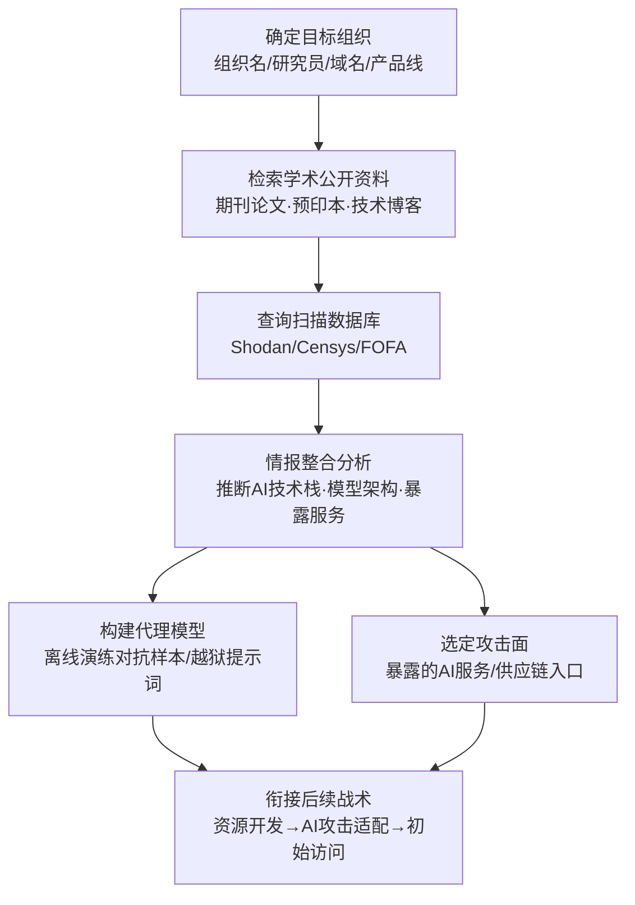

# 搜索开放技术数据库 (AML.T0000)

## 一句话通俗理解

> 攻击者动手前不需要踩你的门——你的研究人员在论文里写了什么架构、博客里晒了什么框架、Shodan 上挂着什么暴露的 AI 服务，这些公开信息正在替攻击者免费画你家 AI 系统的完整图纸。

## 难度等级

⭐⭐⭐ **Realized（已实现）**

官方成熟度评定为 Realized——该技术已在真实攻击中被实际使用：Unit 42 观测到的威胁行为者将 FOFA 等扫描数据库接入自主智能体执行侦察；Zenity 与 GreyNoise 记录了针对互联网暴露 LLM 后端的大规模扫描活动。实施门槛几乎为零：一台能上网的电脑加一个浏览器就够，查论文、读博客、搜 Shodan 与正常的研究调研毫无区别。真正的"难度"不在执行，而在**情报整合**——从海量公开材料中拼出目标 AI 技术栈的准确画像（模型架构、训练数据来源、部署形态、暴露接口），并把它转化为可用的攻击能力（如构建代理模型）。

## 技术描述

### 通俗解释

传统 ATT&CK 的"搜索开放技术数据库"（T1596）查的是目标的网络户口本——DNS 记录、WHOIS 注册信息、SSL 证书；ATLAS 版查的是目标的**AI 研究档案**：你的员工发过什么论文、公司博客写过什么技术方案、哪个 AI 服务暴露在公网上。

为什么这很危险？因为组织（尤其是科技公司）习惯把"开源模型架构 + 专有数据训练"的成果投入生产，而论文为了可复现性往往**详述方法的全部细节**——架构、训练技巧、甚至超参数。攻击者拿到这些信息后，可以训练出一个行为高度近似的**代理模型**（Create Proxy AI Model，AML.T0005），在离线环境里反复演练对抗样本和越狱提示词，优化好了再打真实目标。此外，攻击者还可以按作者单位检索，专门收集**受害组织雇用的研究人员**发表的论文，精准掌握该组织正在攻关的 AI 方向。

### 技术原理

依据官方描述，攻击者通过检索公开可得的研究与技术文档，了解受害组织**如何以及在哪里使用 AI**，进而识别攻击目标或定制更有效的攻击。四大公开情报源（对应四个子技术）可分作两类：前三者产出**研究情报**（组织怎么用 AI），最后一者产出**资产情报**（AI 服务开在哪）：

1. **期刊与会议论文集**（AML.T0000.000）——顶级 AI 会议与期刊的大量论文来自商业实验室；为保证可复现性，论文通常详述一种方法的全部方面，攻击者可据此直接复现；
2. **预印本仓库**（AML.T0000.001）——arXiv 等平台上的最新学术研究未经同行评审即公开，还包含研究笔记与技术报告，能为攻击者提供受害者组织研究人员**正在做什么**的相对实时的视图；
3. **技术博客**（AML.T0000.002）——学术实验室与公司研发部门的博客常展示 AI 的应用实践，相比论文包含更多落地细节：底层技术与框架、API 访问方式与使用场景；
4. **扫描数据库**（AML.T0000.003）——Shodan、Censys 等服务持续扫描互联网并发布活跃 IP、主机名、开放端口与服务 banner，攻击者查询这些数据**无需与目标系统发生任何直接交互**。

**四大情报源的信息价值对照：**

| 情报源 | 典型泄露内容 | 对攻击者的独特价值 |
|--------|-------------|------------------|
| 期刊与会议论文集 | 模型架构、训练方法、评估指标 | 完整方法论，可直接复现 |
| 预印本仓库 | 尚未发表的最新研究、研究笔记 | 时效性最强，反映组织当前研究方向 |
| 技术博客 | 生产环境框架选型、API 用法、工程实践 | 最接近真实部署形态的细节 |
| 扫描数据库 | 暴露的 AI 服务端点、端口、服务 banner | 直接给出可访问的攻击入口 |

**与主动扫描（AML.T0006）的关键区别**：本技术（尤其是 .003 子技术）依赖第三方扫描数据，攻击者全程不与受害系统交互——目标侧不会出现任何扫描日志。扫描数据库的情报还可为后续**主动扫描**（确认服务可达性、探测配置错误）与**利用面向公众的应用**（AML.T0049）提供候选目标清单。

**平台覆盖**：Enterprise——攻击者在传统环境即可执行，但情报用途直指 AI 系统。

**从公开论文到代理模型：攻击能力是怎么长出来的**

官方描述把"组织常用开源模型架构 + 专有数据训练后投入生产"列为关键前提。这条路径之所以致命，在于它把三个公开事实串成了攻击链：

1. **架构是公开的**——多数生产系统基于开源模型架构（Transformer 系、开源视觉骨干等），架构本身不是秘密；
2. **方法是公开的**——论文为保证可复现性详述训练与评估方法，攻击者据此可以搭出结构等价的模型；
3. **行为是可近似的**——在相似架构上训练的模型，对同一对抗样本、越狱提示词的响应模式往往高度相似。

于是攻击者可以：读论文 → 复现架构 → 用自己的数据训练**代理模型** → 在代理模型上离线迭代攻击（生成对抗样本、试探越狱提示词）→ 将奏效的攻击迁移到真实目标。整个迭代过程发生在攻击者自己的机器上，目标侧**一次交互都没有**，也就没有任何日志可供检测。案例1（URLNet 代理模型）与案例2（GPT-2 复现）正是这条路径的两个端点：前者证明"按论文复现 → 离线绕过"可行，后者证明"仅凭技术描述就足以复现完整能力"。

这也解释了为什么技术博客（.002）在实战中往往比论文更"值钱"：论文写的是方法，博客写的是**落地**——用了什么框架、API 怎么调、推理服务跑在哪里，这些恰是攻击者定位攻击面时最缺的那块拼图。

### 用途影响

- **锁定攻击目标**：确定哪些组织在用 AI、用了什么模型、部署在哪里——侦察产出直接决定攻击路径；
- **量身定制攻击**：掌握底层架构后构建代理模型，在离线环境演练对抗样本、越狱提示词，攻击成熟度远超"盲打"；
- **零痕迹被动侦察**：除查询扫描数据库外，学术检索与博客阅读完全合法且不可检测，是攻击者最安全的信息收集窗口；
- **衔接攻击链下游**：产出直接服务于资源开发（获取公开 AI 制品、构建代理模型）、AI 攻击适配与初始访问（暴露的 AI 服务）。

## 子技术列表

**该技术共有 4 个子技术：**

| 子技术ID | 中文名称 | 说明 |
|----------|----------|------|
| [AML.T0000.000](AML.T0000/AML.T0000.000-Journals-and-Conference-Proceedings.md) | 期刊与会议论文集 | 顶级 AI 会议与期刊的大量论文来自商业实验室。部分期刊与会议开放获取，其余需付费或会员。论文为保证可复现性往往详述方法的全部方面，攻击者可利用这些信息直接实现论文所述方法。官方成熟度为 Feasible（可行）。 |
| [AML.T0000.001](AML.T0000/AML.T0000.001-Pre-Print-Repositories.md) | 预印本仓库 | arXiv 等预印本平台收录未经同行评审的最新学术论文，还包含研究笔记与技术报告等通常不正式发表的材料，同时也是已录用论文的集中发布地。检索预印本仓库让攻击者相对实时地掌握受害组织研究人员正在做什么。官方成熟度为 Demonstrated（已演示）。 |
| [AML.T0000.002](AML.T0000/AML.T0000.002-Technical-Blogs.md) | 技术博客 | 学术实验室与公司研发部门常开设博客展示 AI 的应用，研究员个人也频繁以博文记录工作。相比论文与预印本，博客材料包含更多实战细节：底层技术与框架、API 访问方式与使用场景，帮助攻击者理解组织内部如何使用 AI 及其方案细节。官方成熟度为 Feasible（可行）。 |
| [AML.T0000.003](AML.T0000/AML.T0000.003-Scan-Databases.md) | 扫描数据库 | 攻击者检索 Shodan、Censys 等公开互联网扫描服务，识别受害组织暴露的 AI 基础设施——活跃 IP、主机名、开放端口与服务 banner，全程不与目标直接交互。所得情报可用于锁定后续主动扫描与初始访问的候选目标。官方成熟度为 Realized（已实现）。 |

> 注：以上 4 个子技术的独立文档尚未编写，表中 ID 暂为纯文本，文档落地后转换为链接。

## 攻击流程

### 典型攻击流程



**步骤详解：**

1. **确定目标与检索入口**
   - 通俗描述：确定要摸底的组织，列出关键词清单。
   - 技术细节：收集目标组织名称、域名、产品线、已知研究员姓名；建立"组织名 / 作者单位 / 技术关键词"三组检索词。

2. **检索学术与工程公开资料**
   - 通俗描述：翻论文、查预印本、读技术博客。
   - 技术细节：按作者单位在学术检索平台检索目标雇员发表物，梳理模型架构与研究方向；在 arXiv 追踪最新预印本掌握研究动向；检索公司工程博客获取框架选型、API 形态等落地细节。

3. **查询扫描数据库**
   - 通俗描述：在 Shodan 上查目标暴露了哪些 AI 服务。
   - 技术细节：以目标域名/IP 段/组织名为条件检索互联网扫描数据库，识别暴露的 LLM 推理服务、模型 API 端点、智能体控制接口；全程不触碰目标系统。

4. **情报整合分析**
   - 通俗描述：把散落的碎片拼成完整图纸。
   - 技术细节：交叉比对论文、博客与扫描结果，推断目标的生产架构（开源架构 + 专有数据微调？自研模型？）、部署形态（云端/本地/边缘）与暴露面。

5. **转化为攻击能力**
   - 通俗描述：把图纸变成武器。
   - 技术细节：依据底层架构训练行为近似的代理模型，离线迭代对抗样本或越狱提示词；或直接以暴露的 AI 服务为跳板，规划主动扫描与初始访问。

**与后续战术的衔接：**

- **资源开发**：依据侦察结果获取目标使用的公开 AI 制品（模型、数据集），构建代理 AI 模型
- **AI 攻击适配**：将通用攻击方法适配到侦察确认的具体模型与数据管线
- **初始访问**：对扫描数据库锁定的暴露 AI 服务发动攻击（如利用面向公众的应用）

> 关键差异：传统侦察的产出是"目标网络长什么样"，本技术的产出是"目标的 AI 系统长什么样、怎么打它最有效"——攻击者在动手前就完成了攻击的离线彩排。

## 真实案例

> 以下精选 4 个代表性案例（官方数据共关联 10 个案例研究），全部源自 MITRE ATLAS 案例库。

### 案例1：依据公开论文构建代理模型绕过恶意流量检测（AML.CS0000，AML.T0000.001）

- **时间**: 2018年前后
- **攻击者**: Palo Alto Networks Security AI 研究团队（安全验证研究）
- **手法**: 团队测试一个用于检测恶意软件 C&C HTTP 流量的深度学习模型。依据 Le 等人公开发表的 URLNet 论文（arXiv:1802.03162），构建了一个与生产模型使用相似数据集训练、性能相当的复现模型，随后对复现模型迭代构造对抗样本——生成、查询、调整，循环往复直到成功绕过。
- **影响**: 证明"公开论文 → 代理模型 → 攻击迁移"的完整链路可行，正是本技术最经典的攻击范式
- **参考链接**: [URLNet 论文 (arXiv:1802.03162)](https://arxiv.org/abs/1802.03162)

### 案例2：GPT-2 模型复现（AML.CS0007，AML.T0000）

- **时间**: 2019年
- **攻击者**: Brown University 研究人员
- **手法**: OpenAI 以滥用风险为由对 GPT-2 采取分阶段发布：先放出较小的弱化版本与方法技术描述，扣留完整训练模型。Brown University 团队仅凭已发布的技术描述等信息，在官方放出完整模型之前成功复现了该模型。
- **影响**: 即使是最谨慎的分级发布策略，公开的技术描述依然足以让第三方复现完整能力——"少发权重"挡不住"论文里全写了"
- **参考链接**: [Wired 报道](https://www.wired.com/story/dangerous-ai-open-source/)、[OpenGPT-2 复现博文](https://blog.usejournal.com/opengpt-2-we-replicated-gpt-2-because-you-can-too-45e34e6d36dc)

### 案例3：Shodan 暴露的 ClawdBot 控制接口（AML.CS0048，AML.T0000.003）

- **时间**: 2025年前后
- **攻击者**: 安全研究人员
- **手法**: 研究者通过 Shodan 定位到互联网上数百个暴露的 ClawdBot（现更名 OpenClaw，可运行于自有设备的个人 AI 助手）控制接口。借助暴露的配置文件可获取各类已连接应用的凭证；还能通过聊天界面提示 ClawdBot 调用其技能，最终获得宿主环境的 root 权限。
- **影响**: 一次 Shodan 检索即定位数百个暴露 AI 助手控制面，侦察结果直接转化为凭证访问与执行
- **参考链接**: [Shodan 检索结果](https://www.shodan.io/search?query=Clawdbot+Control)、[研究者披露](https://x.com/theonejvo/status/2015401219746128322)

### 案例4：威胁行为者将扫描数据库接入自主智能体（AML.CS0070，AML.T0000 / AML.T0000.003）

- **时间**: 2026年5月（Unit 42 披露）
- **攻击者**: 中文语系威胁行为者（knaithe / KnYuan）
- **手法**: 该行为者将 Hermes Agent 配置为以 DeepSeek 为推理引擎，为其集成终端访问、Telegram 遥控与红队技能系统，并接入暴露 FOFA 检索、查询翻译与 Nuclei 扫描生成能力的 MCP 服务器——把扫描数据库查询直接编排进自主攻击流程，无需人工逐步执行侦察。
- **影响**: 真实威胁行为者将本技术自动化、智能化，侦察不再有"人工节奏"可循
- **参考链接**: [Unit 42 分析报告](https://unit42.paloaltonetworks.com/autonomous-ai-cyber-attack-campaign/)

## 红队视角

> ⚠️ **免责声明**：以下内容仅用于合法授权的安全测试与教育目的。未经授权对他人系统进行测试是违法行为。

### 实战技巧

1. **组织 AI 画像检索**
   以目标组织名为检索条件，在学术检索平台按作者单位梳理目标雇员发表物；在 arXiv 追踪最新预印本；检索目标公司工程博客。产出"模型架构清单 + 研究方向时间线 + 框架选型"三份情报，评估哪些架构细节可用于构建代理模型。

2. **扫描数据库检索语法**
   在 Shodan/Censys/FOFA 中组合组织名、域名、IP 段与 AI 服务特征 banner（如常见本地推理服务、智能体控制接口的响应特征）检索暴露资产；对结果按端口与服务聚类，输出暴露面清单。

3. **情报交叉验证**
   将论文中描述的架构与博客中的工程细节、扫描发现的暴露端点交叉比对，标注置信度——单一来源的情报可能过时或失真，交叉验证后才是可用的攻击面评估。

4. **量化"公开情报暴露面"**
   红队交付物不应是"能搜到"的截图堆砌，而是量化报告：可复现的架构细节有几处、暴露端点有几个、代理模型可达到的相似度估计——让组织理解公开信息转化为攻击能力的真实距离。

### 常用工具

| 工具名称 | 用途 | 平台 |
|----------|------|------|
| Google Scholar / DBLP | 按作者单位检索学术发表物 | 跨平台 |
| arXiv | 预印本检索与追踪 | 跨平台 |
| Shodan / Censys / FOFA | 互联网扫描数据库检索 | 跨平台 |
| theHarvester | 组织公开情报聚合 | 跨平台 |

### 注意事项

- **被动优先**：任务全程不与目标系统交互——一旦对目标发起主动探测即越界进入主动扫描（AML.T0006）范畴，需另行授权
- **合规红线**：检索公开资料合法，但将检索产出的暴露端点用于验证必须限定在授权资产范围内
- 报告聚焦"组织公开了什么可被利用的信息"，而非证明攻击可行

## 蓝队视角

### 检测要点

1. **被动检索不可检测（接受现实）**
   - 学术检索与博客阅读不产生任何目标侧日志；扫描数据库查询发生在第三方平台
   - 结论：本技术的主体活动无法在网络层检测，防御重心必须前移到"减少可泄露的信息"与"监控第三方数据源"

2. **间接信号监控**
   - 日志来源：互联网扫描数据库条目、证书透明度日志、外部攻击面管理（EASM）平台
   - 关注字段：自家资产在 Shodan/Censys 中的条目变化、新增暴露端口与服务 banner
   - 异常特征：组织资产新出现 AI 服务特征 banner（本地推理服务、智能体控制接口）——攻击者能搜到的前提是它被扫描数据库收录了

3. **下游行为检测**
   - 日志来源：Web/API 访问日志、EDR 遥测
   - 异常特征：本技术本身无流量，但其产出的下游——针对暴露 AI 端点的低速探测、异常批量 API 访问——是可检测的（详见检测建议）

### 监控建议

- **攻击者视角自查**：定期用 Shodan 检索自己组织的域名与 IP 段，比攻击者更早发现暴露的 AI 服务
- **公开信息盘点**：建立论文/博客/演讲的对外发布评审流程，发布前评估架构细节的敏感度（对应缓解措施 AML.M0000）
- **部署 AI 蜜罐**：在外网放置与真实资产混布的诱饵 AI 服务——合法用户没有理由访问它们，任何交互都是高置信度侦察信号（对应缓解措施 AML.M0039）

## 检测建议

### 网络层检测

**检测方法：** 本技术纯被动、无目标侧流量，网络层仅能检测其下游行为。

- 短时间内对 AI 端点集合的顺序探测（扫描数据库情报的主动验证特征）
- 对本地推理服务/智能体控制接口的异常低速枚举请求
- 已知扫描器特征（User-Agent、探测路径序列）对 AI 服务的访问

### 主机层检测

**检测方法：** 不适用——本技术不接触目标主机。主机层检测价值在于暴露服务自身的访问审计（谁在调用 AI 端点、调用频率与模式）。

### 应用层检测（AI 遥测）

**检测方法：** 利用 AI 蜜罐与暴露面监控捕获侦察信号。

- AI 蜜罐（诱饵 LLM 服务/智能体接口）的**任何**交互都值得告警——授权用户与工作流没有理由触碰它们
- 暴露的 AI 端点收到非预期来源的探测性请求（模型列表查询、能力探测类 prompt）
- 蜜罐捕获的攻击者源信息、工具指纹与提示词模式可反哺全环境检测规则

**程序化检测思路（无需 EDR 侧改造）：**

在攻击面管理流程中增加两个定时任务：① 以组织域名/IP 段为条件自动检索扫描数据库 API，新出现 AI 服务特征 banner 即告警（比攻击者先发现自己的暴露面）；② 对外网诱饵 AI 服务配置"零流量预期"告警——任何请求（哪怕是一次模型列表枚举）直接触发高优先级事件。两者组合即可用极低成本覆盖本技术从信息收集到攻击验证的完整链路。

### Sigma 规则思路示例

```yaml
title: AI 蜜罐服务遭到访问（侦察/发现活动高置信信号）
status: experimental
description: 检测对外暴露的诱饵 AI 服务收到任何访问请求，
    合法用户与工作流没有理由与蜜罐资源交互（AML.T0000 / AML.M0039）
logsource:
    category: proxy
    product: firewall
detection:
    selection:
        url|contains:
            - 'honeypot-llm.'
            - 'canary-agent.'
            - 'decoy-model.'
    condition: selection
    timeframe: 5m
level: high
tags:
    - attack.t1596
    - atlas.aml_t0000
```

## 缓解措施

### 优先级1：关键措施

**AML.M0000 限制公开技术信息发布（Limit Public Release of Information）**

限制对外发布组织产品或服务中 AI 技术栈的技术信息。攻击者可利用 AI 使用方式的技术情报实施目标锁定与攻击定制。落地要点：建立论文/博客/演讲的发布前评审流程，评估模型架构、训练方法等细节的敏感度；同时限制可能**间接推断**技术细节的组织信息公开——物理位置、研究员姓名、部门结构（由此可推断 AI 技术、模型架构或数据集）。

### 优先级2：重要措施

**AML.M0039 AI 蜜罐（AI Honeypots）**

部署受监控的诱饵 AI 服务、智能体、凭证或其他资源——外观与真实资产无异，但不承担任何真实业务功能。合法用户与工作流没有理由接触它们，因此任何交互都是侦察或发现活动的高置信度信号。AI 蜜罐已被证明能捕获大规模侦察活动与威胁行为者情报；诱饵与真实资产混布可同时暴露广撒网式与定向式侦察；捕获的源信息、工具、提示词与手法可反哺检测规则，虚假但逼真的目标还能消耗攻击者的精力。

### MITRE ATLAS 缓解措施映射

| 缓解措施ID | 缓解措施名称 | 优先级 | 类别 | 生命周期阶段 |
|------------|-------------|:------:|------|-------------|
| AML.M0000 | 限制公开技术信息发布 | 关键 | Policy | 业务与数据理解 |
| AML.M0039 | AI 蜜罐 | 重要 | Technical - AI / Technical - Cyber | 部署 · 监控维护 |

> 优先级为本库基于缓解措施特性给出的落地建议：M0000 解决"公开渠道还剩多少可利用情报"（治本，收缩泄露面），M0039 解决"有人来踩点时能不能发现"（治标，捕获侦察行为）。被动侦察不可检测的现实决定了双管齐下的必要性。

## 关联 ATT&CK 技术

- [搜索开放技术数据库 (T1596)](../../enterprise/01-Reconnaissance/T1596-Search-Open-Technical-Databases.md) — 同名经典技术，查询 DNS/WHOIS/证书等公开技术数据库
- [扫描数据库 (T1596.005)](../../enterprise/01-Reconnaissance/T1596/T1596.005-Scan-Databases.md) — T1596 子技术，与本技术 AML.T0000.003 直接对应

**ATLAS 版 vs 传统 ATT&CK 版：**

| 维度 | 传统 T1596 | ATLAS AML.T0000 |
|------|-----------|-----------------|
| 检索对象 | DNS/被动DNS、WHOIS、数字证书、CDN | 学术论文、预印本、技术博客、扫描数据库 |
| 情报性质 | 网络**基础设施**情报（域名、IP、证书） | AI **架构与研究**情报（模型、框架、研究方向） |
| 独有情报源 | WHOIS、证书透明度日志 | 期刊/会议论文集、arXiv 预印本、工程博客 |
| 情报用途 | 映射互联网暴露面、规划入侵 | 构建代理模型、定制对抗样本/越狱攻击 |
| 共同点 | 扫描数据库（Shodan/Censys）——两者共享的子技术，T1596.005 ↔ AML.T0000.003 | |

一句话总结：T1596 查的是"目标在网络上的户口"，AML.T0000 查的是"目标在 AI 上的底牌"——攻击者从查你的域名，升级到按作者单位翻你研究员的论文。

## 动手实验

> ⚠️ **重要提示**：所有实验仅使用公开资源与自有资产，不对任何第三方系统发起主动探测。涉及目标资产的检索须事先获得授权。

### 实验环境准备

| 环境组件 | 用途 | 获取方式 |
|----------|------|----------|
| 浏览器 + 互联网 | 公开学术检索与博客调研 | — |
| Shodan / Censys 免费账号 | 扫描数据库检索实验 | 官网注册 |
| Python 3.10+ | arXiv API 检索脚本 | 官方安装包 |

### 实验1（初级）：评估自己组织的公开情报暴露面

**实验目标：** 以攻击者视角盘点自己（或授权客户）组织的公开 AI 情报（对应 AML.M0000）。

**实验步骤：**
1. 以组织名为条件在学术检索平台按作者单位检索，列出近三年 AI 相关发表物
2. 逐篇标记其中泄露的架构细节：模型架构、训练数据来源、部署形态
3. 在组织官网与工程博客中检索 AI 产品技术描述，标记框架与 API 细节
4. 输出一份"公开情报暴露面清单"：每条信息 + 可被如何利用

**预期结果：** 直观理解"公开即情报"——多数组织会低估这份清单的长度。

### 实验2（中级）：扫描数据库自查

**实验目标：** 掌握用扫描数据库发现自己组织暴露资产的方法。

**实验步骤：**
1. 注册 Shodan 免费账号，以自己组织的域名/授权 IP 段为条件检索
2. 分析结果中的端口、服务与 banner，标记任何具备 AI 服务特征的条目
3. 将发现的每条暴露资产与资产台账比对，确认是否为已知登记的资产
4. 思考：扫描数据库何时会收录这些条目？如何让"发现"比攻击者更早？

**预期结果：** 掌握攻击者视角的暴露面自查流程，形成定期巡检基线。

### 实验3（高级）：体验"论文 → 复现"零门槛

**实验目标：** 理解公开论文支撑代理模型构建的完整链路（对应案例1思路）。

**实验步骤：**
1. 在 arXiv 选择一篇附带公开数据集与开源实现的分类论文（如恶意 URL 检测类）
2. 依据论文描述复现模型训练，达到论文报告的性能区间
3. 对复现模型发起白盒对抗样本（如文本扰动的 URL 变体），观察置信度变化
4. 对照案例1思考：若这是目标的生产检测模型，攻击者已完成了一次离线彩排

**预期结果：** 亲手验证"公开方法论 = 攻击者的免费训练教材"，为组织的论文发布评审提供依据。

## 术语解释

| 术语 | 英文原名 | 通俗解释 |
|------|----------|----------|
| 代理模型 | Proxy Model | 攻击者依据侦察所得架构训练的"高仿模型"，行为与目标模型近似，用于离线演练攻击而不惊动目标 |
| 预印本 | Pre-print | 未经同行评审即发布的论文草稿，时效性强于正式发表，arXiv 是最大的预印本平台 |
| arXiv | arXiv | 全球最大的学术预印本仓库，AI 领域论文的默认首发地 |
| 同行评审 | Peer Review | 正式期刊/会议发表前的专家审核流程——预印本跳过了这一步，发布更早、更"生猛" |
| 开放获取 | Open Access | 无付费墙、任何人可免费阅读的发表模式；部分期刊与会议采用，其余需付费或会员 |
| 扫描数据库 | Scan Database | 持续扫描互联网并发布活跃 IP、端口、服务 banner 的平台（Shodan、Censys、FOFA） |
| Banner | Service Banner | 服务在端口上对外宣告自身身份的信息——攻击者借此识别"这是一台暴露的 LLM 推理服务" |
| FOFA | FOFA | 国产网络空间测绘搜索引擎，与 Shodan/Censys 同类的扫描数据库，支持以中文语法检索暴露资产 |
| OSINT | Open Source Intelligence | 开源情报——从公开渠道系统收集分析目标信息的技艺 |
| 攻击面管理 | EASM (External Attack Surface Management) | 持续盘点组织互联网暴露资产的防御实践，核心动作之一就是"像攻击者一样搜索自己" |
| 蜜罐 | Honeypot | 伪装成真实资产的诱饵——没有合法用途，任何交互都是恶意信号 |

## 参考资料

### 📚 官方文档

- [MITRE ATLAS - Search Open Technical Databases (AML.T0000)](https://atlas.mitre.org/techniques/AML.T0000/) - 官方技术页面
- [MITRE ATLAS 矩阵](https://atlas.mitre.org/matrices/ATLAS/)
- [MITRE ATLAS Data (GitHub)](https://github.com/mitre-atlas/atlas-data)

### 📰 案例报告（真实攻击与安全研究）

- [URLNet: Learning a URL representation with deep learning for malicious URL detection](https://arxiv.org/abs/1802.03162) - 案例1：依据公开论文构建代理模型的原始论文
- [Wired: OpenAI Said Its Code Was Risky. Two Grads Re-Created It Anyway](https://www.wired.com/story/dangerous-ai-open-source/) - 案例2：GPT-2 复现事件报道
- [Shodan: ClawdBot Control 检索](https://www.shodan.io/search?query=Clawdbot+Control) - 案例3：暴露 AI 助手控制接口的实时检索结果
- [Unit 42: Chinese-Speaking Threat Actor Harnesses AI Models for Autonomous Cyberattacks](https://unit42.paloaltonetworks.com/autonomous-ai-cyber-attack-campaign/) - 案例4：威胁行为者将扫描数据库接入自主智能体
- [Zenity: Scanning for AI - Live Campaigns Mapping the Internet's Exposed LLM Backends](https://labs.zenity.io/post/scanning-for-ai-live-campaigns-mapping-the-internet-s-exposed-llm-backends) - 针对暴露 LLM 后端的扫描活动分析
- [GreyNoise: Threat Actors Actively Targeting LLMs](https://www.greynoise.io/blog/threat-actors-actively-targeting-llms) - 威胁行为者针对 LLM 的侦察活动

### 🔧 工具与资源

- [Shodan](https://www.shodan.io/) - 互联网设备与服务搜索引擎
- [Censys](https://search.censys.io/) - 互联网资产检索平台
- [arXiv](https://arxiv.org/) - 学术预印本仓库
- [Google Scholar](https://scholar.google.com/) - 学术文献检索

### 🔗 关联阅读

- [T1596 搜索开放技术数据库](../../enterprise/01-Reconnaissance/T1596-Search-Open-Technical-Databases.md) - 传统同名技术，查询 DNS/WHOIS/证书等基础设施情报
- [T1596.005 扫描数据库](../../enterprise/01-Reconnaissance/T1596/T1596.005-Scan-Databases.md) - 与 AML.T0000.003 直接对应的 ATT&CK 子技术
- [侦察战术 (AML.TA0002)](./README.md) - 本技术所属战术的概览页

---

> **版本**: ATLAS 2026.09 | **更新**: 2026-10-22 | **模板**: ATLAS 技术文档 v1.0
