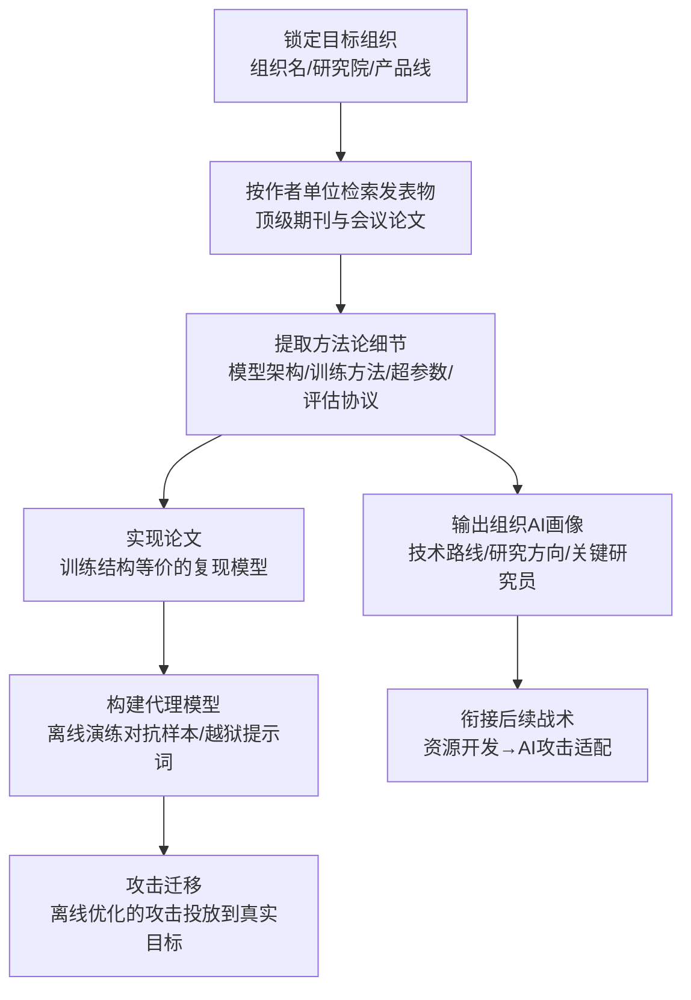

# 期刊与会议论文集 (AML.T0000.000)

> 属于 [搜索开放技术数据库 (AML.T0000)](../AML.T0000-Search-Open-Technical-Databases.md)

## 一句话通俗理解

> 你家研究员在顶级会议和期刊上发的论文，是一份写给全世界看的"技术图纸"——为了让同行能复现，架构、训练方法、评估细节写得清清楚楚。攻击者不认识你家任何一个人，但只要按作者单位把论文翻一遍，就能照着图纸在你家门口搭出一台"高仿机型"，先在高仿机上把攻击演练到万无一失，再来打你的真机器。

## 难度等级

⭐ **Feasible（可行）**

官方成熟度评定为 Feasible——概念已被验证可行，但尚无以本子技术为锚点的公开攻击案例。实施门槛结构性地偏低：检索与阅读论文只需要一台能上网的电脑，与正常的研究调研毫无区别；真正的"难度"集中在下游——把论文方法**复现**出来需要相应的工程能力与算力（训练一个结构等价的模型），以及弥合"论文方法"与"目标真实生产系统"之间的信息差（生产模型通常在公开架构之上叠加了专有数据与工程改造）。换句话说：读懂图纸零门槛，仿造机器有门槛，而这道门槛对有备而来的攻击者正在持续降低。

## 技术描述

### 通俗解释

如果说父技术 [搜索开放技术数据库 (AML.T0000)](../AML.T0000-Search-Open-Technical-Databases.md) 是翻遍目标的"AI 研究档案"，本子技术翻的是档案里最正式、最完整的一层：**经过同行评审的期刊与会议论文**。与传统 ATT&CK 侦察查 DNS 记录、WHOIS 注册信息不同，这里查的是"目标组织的研究员在 NeurIPS、ICML、ICLR、CVPR、ACL 这类顶级 venue 上发表过什么"。

为什么这很危险？因为学术发表有一条铁律叫**可复现性**——一篇合格的论文要让同行能照着做出来，于是模型架构、训练流程、数据处理、评估协议，甚至关键超参数，都白纸黑字写在公开文献里。攻击者拿到这套完整方法论后，可以直接**把论文实现出来**：训练一个结构等价的模型充当代理模型（Create Proxy AI Model，AML.T0005），在离线环境里反复演练对抗样本和越狱提示词，优化好了再迁移到真实目标。

### 技术原理

依据官方描述，本子技术的攻击面建立在三个公开事实之上：

1. **顶级发表物大量来自商业实验室**——被顶级 AI 会议与期刊录用的论文中，相当比例出自企业研究院（而非纯学术机构），论文作者单位本身就是受害组织的"技术路线公示牌"；
2. **获取渠道畅通**——部分期刊与会议是开放获取（Open Access），任何人免费可读；其余付费墙或会员制也拦不住攻击者（机构订阅、作者自存档、预印本镜像等途径众多）；
3. **论文为可复现性详述方法的全部方面**——攻击者可据此直接实现论文（implement the paper），得到结构等价、行为近似的模型复制品。

**典型的情报提取路径：**

| 检索维度 | 检索动作 | 产出情报 |
|---------|---------|---------|
| 按作者单位 | 在学术检索平台以目标组织名为过滤条件 | 组织全部 AI 相关发表物清单、核心研究员名单 |
| 按研究方向 | 聚类论文主题（检测、生成、推荐、安全……） | 组织正在攻关的 AI 方向与时间线 |
| 按技术细节 | 逐篇提取架构、训练方法、数据规模、评估指标 | 可复现的方法论、代理模型的构建配方 |

**与姊妹子技术的分工：**

| 情报源 | 子技术 | 特点 |
|--------|--------|------|
| 期刊与会议论文集 | AML.T0000.000（本技术） | 同行评审、版本稳定、方法论最完整 |
| 预印本仓库 | AML.T0000.001 | 未经评审但时效最快，反映组织**当前**研究方向 |
| 技术博客 | AML.T0000.002 | 工程落地细节最多：框架选型、API 形态 |
| 扫描数据库 | AML.T0000.003 | 直接给出可访问的暴露资产，与前三者性质不同 |

对攻击者而言，期刊与会议论文集是"深而稳"的一层：单篇论文信息密度高、方法完整可直接复现；缺点是发表周期长，反映的是组织一两年前的技术积累——因此实战中常与预印本（追踪当下）和技术博客（了解落地）配合使用。

**平台覆盖**：Enterprise——攻击者在传统环境即可执行，但情报用途直指 AI 系统。

### 用途影响

- **直接复现论文**：依据论文详述的方法训练结构等价模型，这是构建代理模型最扎实的情报基础；
- **推断组织 AI 技术路线**：按作者单位追踪发表物，可以拼出组织在哪些 AI 方向有深度积累、采用了哪些公开架构——组织常以"开源架构 + 专有数据训练"投入生产，论文恰好公开了架构那一半；
- **定制攻击素材**：掌握模型架构后，对抗样本、越狱提示词、投毒策略都可以先在复现模型上离线迭代；
- **零痕迹被动侦察**：阅读公开论文完全合法、不可检测，攻击者最安全的信息收集窗口。

## 攻击流程

### 典型攻击流程



**步骤详解：**

1. **锁定目标组织**
   - 通俗描述：确定要摸底的对象。
   - 技术细节：收集目标组织名称及其研究院、实验室的正式署名（大厂论文常以"公司名 + 研究院"署名，需枚举全部署名变体），建立作者单位检索词表。

2. **按作者单位检索发表物**
   - 通俗描述：翻目标员工发的论文。
   - 技术细节：在学术检索平台以作者单位为条件过滤近三五年的 AI 相关论文；利用程序化委员（PC member）、通讯作者等信息识别核心研究员；产出发表物清单。

3. **提取方法论细节**
   - 通俗描述：从论文里抠出"图纸"。
   - 技术细节：逐篇提取模型架构（骨干网络、层数、注意力配置）、训练方法（损失函数、优化器、学习率策略）、数据处理流程、评估指标与数据集规模——这些正是复现所需的全部要素。

4. **实现论文**
   - 通俗描述：照着图纸造一台高仿机。
   - 技术细节：依据论文描述（常辅以作者放出的开源代码与预印本补充材料）训练结构等价的模型，在公开数据集上校验性能是否落在论文报告区间，确认复现质量。

5. **转化为攻击能力**
   - 通俗描述：在高仿机上彩排攻击。
   - 技术细节：以复现模型为代理模型，离线迭代对抗样本或越狱提示词；将奏效的攻击迁移到目标真实生产系统（相似架构上训练的模型，对同类攻击的响应模式往往高度相似）。

**与后续战术的衔接：**

- **资源开发**：论文情报是构建代理 AI 模型（AML.T0005）的输入，也是获取目标所用公开 AI 制品的线索
- **AI 攻击适配**：将通用攻击方法适配到侦察确认的具体架构与数据管线
- **初始访问**：组织 AI 画像帮助攻击者选择最有价值的突破口

> 关键差异：传统侦察的产出是"目标网络长什么样"，本子技术的产出是"目标 AI 系统用什么方法造出来的、怎么造一台等价机"——攻击者在动手前就完成了攻击的离线彩排，且全程零交互、零痕迹。

## 真实案例

> 官方案例库中暂无直接以本子技术（AML.T0000.000）为锚点的案例，以下 3 个案例的官方锚点为父技术 AML.T0000 及其姊妹子技术，但攻击路径——"依据公开学术文献复现方法 → 构建复现模型 → 验证攻击"——与本子技术描述的场景高度一致，均源自 MITRE ATLAS 案例库。

### 案例1：依据 IJCNN 会议论文复现 DGA 检测并绕过（AML.CS0001，锚点 AML.T0000）

- **时间**: 2019年前后
- **攻击者**: Palo Alto Networks Security AI 研究团队（安全验证研究）
- **手法**: 团队依据公开发表的字符级 DGA 检测论文（2018 年国际神经网络联合会议 IJCNN，正是典型的会议论文集发表物）掌握检测方法后，使用一种通用域名变异技术成功绕过基于卷积神经网络的僵尸网络 DGA 检测器——该变异手法可规避业界绝大多数基于机器学习的 DGA 检测模块。
- **影响**: 证明依据公开论文即可复现安全厂商的检测能力并针对性构造绕过——"论文把检测方法写多清楚，攻击者就把绕过做多精准"
- **参考链接**: [字符级 DGA 检测论文（IJCNN 2018）](http://faculty.washington.edu/mdecock/papers/byu2018a.pdf)、[Degas 源码](https://github.com/matthoffman/degas)

### 案例2：GPT-2 模型复现——仅凭技术描述重建完整能力（AML.CS0007，锚点 AML.T0000）

- **时间**: 2019年
- **攻击者**: Brown University 研究人员
- **手法**: OpenAI 以滥用风险为由对 GPT-2 采取分阶段发布：先放出较小的弱化版本与方法技术描述，扣留完整训练模型。Brown University 团队仅凭已发布的技术描述等信息，在官方放出完整模型之前成功复现了该模型。
- **影响**: 即使是最谨慎的分级发布策略，公开的技术描述依然足以让第三方复现完整能力——"少发权重"挡不住"文章里全写了"
- **参考链接**: [Wired 报道](https://www.wired.com/story/dangerous-ai-open-source/)、[OpenGPT-2 复现博文](https://blog.usejournal.com/opengpt-2-we-replicated-gpt-2-because-you-can-too-45e34e6d36dc)

### 案例3：依据公开论文构建代理模型绕过恶意流量检测（AML.CS0000，锚点 AML.T0000.001）

- **时间**: 2018年前后
- **攻击者**: Palo Alto Networks Security AI 研究团队（安全验证研究）
- **手法**: 团队依据 Le 等人公开发表的 URLNet 论文构建了一个与生产模型使用相似数据集训练、性能相当的复现模型，随后对复现模型迭代构造对抗样本——生成、查询、调整，循环往复直到成功绕过恶意软件 C&C HTTP 流量检测。
- **影响**: 完整演示"公开论文 → 代理模型 → 离线绕过"的经典链路；其官方锚点为姊妹子技术预印本仓库（AML.T0000.001），但"照论文复现"的攻击逻辑与本子技术完全同源
- **参考链接**: [URLNet 论文 (arXiv:1802.03162)](https://arxiv.org/abs/1802.03162)

## 红队视角

> ⚠️ **免责声明**：以下内容仅用于合法授权的安全测试与教育目的。未经授权对他人系统进行测试是违法行为。

### 实战技巧

1. **组织学术画像检索**
   以目标组织名及研究院署名变体为条件，在学术检索平台按作者单位梳理近三五年发表物；按主题聚类输出"技术路线时间线"，标注哪些论文与目标产品线直接相关（从论文致谢、数据集来源可交叉印证）。

2. **可复现性评估**
   对高价值论文逐篇评估复现可行性：是否公开架构与超参数、是否有作者开源代码、所用数据集是否可得。产出"代理模型配方清单"——每篇论文到一台复现机的距离有多远。

3. **情报交叉验证**
   将论文描述的架构与目标工程博客、招聘启事（岗位技术栈要求是免费情报）、开源仓库交叉比对，推断论文方法是否已投入生产及落地形态——单一论文可能只是探索性工作，多源印证后再定攻击面。

4. **量化"论文情报暴露面"**
   红队交付物应是量化报告：可完整复现的论文有几篇、涉及哪些生产产品线、复现模型的预期相似度——让组织理解"学术发表转化为攻击能力"的真实距离，而非堆砌检索截图。

### 常用工具

| 工具名称 | 用途 | 平台 |
|----------|------|------|
| Google Scholar / DBLP | 按作者单位与 venue 检索发表物 | 跨平台 |
| Semantic Scholar / OpenReview | 结构化论文元数据与评审信息检索 | 跨平台 |
| IEEE Xplore / ACM DL / SpringerLink | 出版商平台全文获取（开放获取部分） | 跨平台 |
| Papers with Code | 论文与官方开源实现的关联检索 | 跨平台 |

### 注意事项

- **被动优先**：任务全程不与目标系统交互——对目标发起任何主动探测即越界进入主动扫描（AML.T0006）范畴，需另行授权
- **合规红线**：检索与阅读公开论文合法；尊重订阅协议与版权，绕过付费墙获取受版权保护全文可能违法
- 报告聚焦"组织公开了多少可复现的技术情报"，而非真的构建攻击

## 蓝队视角

### 检测要点

1. **被动阅读不可检测（接受现实）**
   - 论文一旦公开发表，谁在读、读了几遍、出于什么目的，发布方无从知晓
   - 结论：本子技术的主体活动无法检测，防御重心必须前移到"发布前评审"与"发布面盘点"

2. **间接信号监控**
   - 日志来源：组织自建论文库/知识库访问日志、机构仓库（如 DSpace）与投稿系统日志
   - 关注字段：全文批量下载、非机构 IP 的高频检索、按作者维度的异常聚合访问
   - 异常特征：对组织内部知识库的爬取式访问——攻击者整合组织发表物时的典型行为

3. **下游行为检测**
   - 日志细节：本技术本身无目标侧流量，但其下游（对暴露 AI 端点的探测、针对性对抗样本的试探）是可检测的（详见检测建议）

### 监控建议

- **发布前敏感度评审**：建立论文/演讲/博客的对外发布评审流程，评估架构细节、数据规模、部署形态的敏感度分级（对应缓解措施 AML.M0000）
- **定期"以攻促防"盘点**：每年以攻击者视角盘点一次组织公开学术情报面——可完整复现的论文清单就是攻击者手里的目标清单
- **研究员署名治理**：统一论文署名规范，让"按作者单位检索"既能被合规审计追踪，也便于评估泄露面（完全匿名署名不可行，但要知道自己暴露了什么）

## 检测建议

### 网络层检测

**检测方法：** 本技术纯被动、无目标侧流量，网络层仅能检测其信息整合阶段的边缘行为。

- 对组织自建论文库/机构知识库的高频批量全文下载（爬取式整合发表物）
- 对组织投稿系统、文献管理平台的异常聚合访问
- 针对组织暴露 AI 端点的低速探测（本技术情报的下游验证行为）

### 主机层检测

**检测方法：** 不适用——本技术不接触目标主机。

### 应用层检测（AI 遥测）

**检测方法：** 关注本技术情报在下游攻击中的兑现特征。

- 暴露的 AI 端点收到高度构造化的输入（针对性对抗样本往往结构精细，与随机 fuzz 流量特征不同）
- 对生产模型 API 的异常试探序列（先探测能力边界、再投递构造载荷）
- 机构知识库/文档系统对特定作者全集的顺序抓取

**程序化检测思路（无需 EDR 侧改造）：**

在组织论文库与知识库前端增加两个低成本检查：① 全文下载速率限制与聚合告警——单 IP 短时间内按作者/年度批量拉取全文即触发审查；② 发布面年度审计——自动化盘点"可复现论文清单"（有架构、有超参数、有开源实现三要素齐全者标红），交付给安全团队作为代理模型风险评估的输入。前者覆盖信息整合行为，后者把不可检测的被动侦察转化为可管理的发布治理问题。

### Sigma 规则思路示例

```yaml
title: 机构论文库遭批量全文下载（学术情报聚合特征）
status: experimental
description: 检测单一来源对组织机构知识库的爬取式批量下载，
    可能为攻击者整合目标组织学术发表物的前置行为（AML.T0000.000）
logsource:
    category: proxy
    product: firewall
detection:
    selection:
        url|contains:
            - '/repository/'
            - '/publications/'
            - '/dspace/'
        http_method: 'GET'
        response_status: 200
    condition: selection | count(url) by src_ip > 50 in 5m
level: low
falsepositives:
    - 搜索引擎爬虫与学术索引服务（需白名单）
    - 合法的文献计量分析
tags:
    - attack.t1596
    - atlas.aml_t0000_000
```

## 缓解措施

### 优先级1：关键措施

**AML.M0000 限制公开技术信息发布（Limit Public Release of Information，继承自父技术 AML.T0000）**

限制对外发布组织产品或服务中 AI 技术栈的技术信息。对本子技术而言，落地点是**学术发表治理**：建立论文发表前的敏感度评审流程，评估模型架构、训练技巧、超参数、部署形态等细节的公开必要性——可复现性与安全性天然冲突，组织需要明确"哪些细节服务于同行复现、哪些只是不必要的暴露"；同时限制可间接推断技术细节的组织信息公开（研究员姓名与研究方向、部门结构）。官方缓解描述明确指出：技术知识可被攻击者用于目标锁定与攻击定制。

### 优先级2：建议措施

**AML.M0039 AI 蜜罐（AI Honeypots，继承自父技术 AML.T0000）**

部署受监控的诱饵 AI 服务、智能体、凭证等资源。本子技术的被动阅读虽不可检测，但其情报最终要在真实或疑似资产上"兑现"——蜜罐正是承接这一步的检测面：合法用户与工作流没有理由接触诱饵，任何交互都是高置信度信号；捕获的源信息、工具与手法可反哺全环境检测规则。

### MITRE ATLAS 缓解措施映射

| 缓解措施ID | 缓解措施名称 | 优先级 | 映射来源 | 类别 | 生命周期阶段 |
|------------|-------------|:------:|----------|------|-------------|
| AML.M0000 | 限制公开技术信息发布 | 关键 | 继承自父技术 AML.T0000 | Policy | 业务与数据理解 |
| AML.M0039 | AI 蜜罐 | 建议 | 继承自父技术 AML.T0000 | Technical - AI / Technical - Cyber | 部署 · 监控维护 |

> 说明：ATLAS 官方对本子技术未单独映射缓解措施，以上两项继承自父技术 AML.T0000。两道防线的逻辑：M0000 解决"论文里还剩多少可复现的情报"（治本，收缩发布面），M0039 解决"情报被兑现时能不能发现"（兜底，捕获下游行为）。学术发表无法也不应完全禁止——评审的核心是分级，而非封口。

## 关联 ATT&CK 技术

- [搜索开放技术数据库 (T1596)](../../../enterprise/01-Reconnaissance/T1596-Search-Open-Technical-Databases.md) — 主题对应的经典父技术：查询 DNS/被动 DNS、WHOIS、数字证书等公开技术数据库
- [扫描数据库 (T1596.005)](../../../enterprise/01-Reconnaissance/T1596/T1596.005-Scan-Databases.md) — T1596 子技术，与本技术家族中的姊妹子技术 AML.T0000.003 直接对应（非本子技术的映射）

**说明**：本子技术在 ATLAS 官方数据中没有 ATT&CK 映射（attack_reference 为空）。ATT&CK 的 T1596 子技术列表（DNS/被动 DNS 记录、WHOIS、数字证书、CDN、扫描数据库）中不存在"学术文献"类目——期刊与会议论文集是 AI 时代新增的"开放技术数据库"，传统 ATT&CK 尚未为此建模。主题上最接近的锚点是父技术 T1596。

**T1596 的"技术数据库" vs 本子技术的"学术文献库"：**

| 维度 | 传统 T1596 | 本子技术 AML.T0000.000 |
|------|-----------|----------------------|
| 检索对象 | 域名解析、注册信息、证书、暴露服务 | 期刊与会议论文（模型架构、训练方法） |
| 情报性质 | 网络**基础设施**情报 | AI **方法论**情报 |
| 信息密度 | 零散的结构化记录 | 单篇即可拼出完整技术方案 |
| 攻击用途 | 映射暴露面、规划入侵 | 复现模型、构建代理模型、离线彩排攻击 |

一句话总结：T1596 查的是"目标在网络上的户口"，本子技术翻的是"目标研究员的论文抽屉"——从查域名到按作者单位读文献，情报维度直接升了一个数量级。

## 动手实验

> ⚠️ **重要提示**：所有实验仅使用公开资源与自有数据，不对任何第三方系统发起主动探测。

### 实验环境准备

| 环境组件 | 用途 | 获取方式 |
|----------|------|----------|
| 浏览器 + 互联网 | 公开学术检索 | — |
| Google Scholar / DBLP 账号（免费） | 按作者单位检索发表物 | 官网注册 |
| Python 3.10+ + PyTorch/TensorFlow | 论文复现实验 | 官方安装包 |

### 实验1（初级）：盘点自己组织的"论文情报暴露面"

**实验目标：** 以攻击者视角评估自己（或授权客户）组织的学术发表泄露面（对应 AML.M0000）。

**实验步骤：**
1. 在学术检索平台按自己组织的全部署名变体检索近三年 AI 相关论文
2. 逐篇标记论文中泄露的可复现要素：完整架构、超参数、数据规模、部署细节
3. 交叉核对每篇高暴露论文对应的产品线，评估"照论文造出代理模型"的可行性
4. 输出一份分级的"论文情报暴露面清单"：红（三要素齐全可直接复现）/黄（部分可复现）/绿（仅方向性信息）

**预期结果：** 直观理解"论文即图纸"——多数组织会低估红色清单的长度。

### 实验2（中级）：体验"读论文 → 推断技术路线"

**实验目标：** 掌握从发表物反推组织 AI 能力画像的方法。

**实验步骤：**
1. 选择一家公开论文较多的科技公司研究院作为分析对象（仅公开信息）
2. 按年度聚类其发表物主题，绘制"研究方向时间线"
3. 结合其产品发布与工程博客，推断哪些论文方法已进入生产（多源印证）
4. 思考：如果我是攻击者，哪一年的哪篇论文最值得复现？为什么？

**预期结果：** 产出一页式组织 AI 画像，理解攻击者如何从文献中筛选高价值目标。

### 实验3（高级）：复现一篇论文并观察"信息充分度"

**实验目标：** 亲手验证公开论文的方法论完备性（对应案例2思路）。

**实验步骤：**
1. 在开放获取渠道选择一篇附带公开数据集的分类论文（如 URL/文本分类类）
2. 仅依据论文正文（不看任何开源实现）搭建模型并训练，记录每一步"论文没说清"的信息缺口
3. 对照作者开源实现补齐缺口，比较两次实现的行为差异
4. 反思：论文"没写"的部分攻击者如何补齐（经验默认值、领域惯例、预印本补充材料）——这些缺口恰恰是 M0000 评审时值得保留的部分

**预期结果：** 一份"复现信息缺口清单"，可直接转化为组织的论文发布评审检查项。

## 术语解释

| 术语 | 英文原名 | 通俗解释 |
|------|----------|----------|
| 期刊 | Journal | 定期出版的学术刊物，论文经同行评审后按卷期发表，周期长但版本稳定 |
| 会议论文集 | Conference Proceedings | 学术会议结束后汇编出版的论文集合，AI 领域的顶级成果多首发于会议（NeurIPS、ICML、ICLR、CVPR、ACL 等） |
| 商业实验室 | Commercial Lab | 企业设立的研究院（如大厂 AI Lab），论文作者单位直接暴露组织技术动向 |
| 开放获取 | Open Access | 无付费墙、任何人可免费阅读的发表模式；其余论文需付费或会员，但获取途径众多 |
| 可复现性 | Reproducibility | 学术发表的铁律——论文须写清让同行能照做出来的全部细节，也正是攻击者赖以复现的原因 |
| 同行评审 | Peer Review | 正式发表前的专家审核流程，是期刊/会议论文区别于预印本的质量标志 |
| 代理模型 | Proxy Model | 攻击者依据论文复现的"高仿模型"，行为与目标生产模型近似，用于离线演练攻击 |
| 超参数 | Hyperparameter | 训练前设定的配置项（学习率、层数、批量大小等）——论文常公开，是复现的关键配方 |
| 预印本 | Pre-print | 未经同行评审即发布的论文草稿（姊妹子技术 AML.T0000.001 的检索对象），与正式发表物互补 |
| 机构知识库 | Institutional Repository | 组织自建论文/文档库，常为攻击者批量整合发表物的抓取目标 |
| DBLP | DBLP | 计算机科学文献书目数据库，支持按作者与会议精准检索 |

## 参考资料

### 📚 官方文档

- [MITRE ATLAS - Journals and Conference Proceedings (AML.T0000.000)](https://atlas.mitre.org/techniques/AML.T0000/000/) - 官方技术页面
- [MITRE ATLAS - Search Open Technical Databases (AML.T0000)](https://atlas.mitre.org/techniques/AML.T0000/) - 父技术官方页面
- [MITRE ATLAS 矩阵](https://atlas.mitre.org/matrices/ATLAS/)
- [MITRE ATLAS Data (GitHub)](https://github.com/mitre-atlas/atlas-data)

### 📰 案例报告（真实攻击与安全研究）

- [字符级 DGA 检测论文（IJCNN 2018）](http://faculty.washington.edu/mdecock/papers/byu2018a.pdf) - 案例1：依据会议论文理解并绕过 DGA 检测
- [Wired: OpenAI Said Its Code Was Risky. Two Grads Re-Created It Anyway](https://www.wired.com/story/dangerous-ai-open-source/) - 案例2：GPT-2 复现事件报道
- [OpenGPT-2 复现博文](https://blog.usejournal.com/opengpt-2-we-replicated-gpt-2-because-you-can-too-45e34e6d36dc) - 案例2：复现者第一手叙述
- [URLNet 论文 (arXiv:1802.03162)](https://arxiv.org/abs/1802.03162) - 案例3：依据公开论文构建代理模型的原始论文

### 🔧 工具与资源

- [Google Scholar](https://scholar.google.com/) - 学术文献检索（支持按作者单位过滤）
- [DBLP](https://dblp.org/) - 计算机科学文献书目数据库
- [Semantic Scholar](https://www.semanticscholar.org/) - 结构化论文元数据检索
- [OpenReview](https://openreview.net/) - 部分顶会（ICLR 等）的论文与评审公开平台
- [Papers with Code](https://paperswithcode.com/) - 论文与官方开源实现关联检索

### 🔗 关联阅读

- [搜索开放技术数据库 (AML.T0000)](../AML.T0000-Search-Open-Technical-Databases.md) - 本技术的父技术，四大公开情报源全景
- [T1596 搜索开放技术数据库](../../../enterprise/01-Reconnaissance/T1596-Search-Open-Technical-Databases.md) - 传统主题对应技术，查询 DNS/WHOIS/证书等基础设施情报
- [T1596.005 扫描数据库](../../../enterprise/01-Reconnaissance/T1596/T1596.005-Scan-Databases.md) - 与姊妹子技术 AML.T0000.003 直接对应的 ATT&CK 子技术
- [侦察战术 (AML.TA0002)](../README.md) - 本技术所属战术的概览页

---

> **版本**: ATLAS 2026.09 | **更新**: 2026-10-22 | **模板**: ATLAS 技术文档 v1.0
