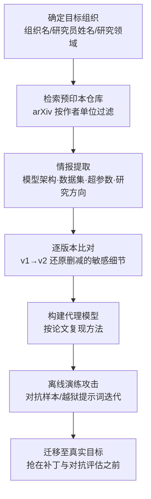

# 预印本仓库 (AML.T0000.001)

> 属于 [搜索开放技术数据库 (AML.T0000)](../AML.T0000-Search-Open-Technical-Databases.md)

## 一句话通俗理解

> 期刊论文是"录播"——同行评审磨掉半年一年才播出；预印本是"直播"——你的研究员今天想到什么，arXiv 上明天就全裸展示。攻击者不需要等正式发表，看直播就能同步复刻你家的 AI 武器，甚至赶在补丁和评审意见出来之前抢跑利用。

## 难度等级

⭐⭐ **Demonstrated（已演示）**

官方成熟度评定为 Demonstrated——该技术已在真实攻击中得到演示：Palo Alto Networks 安全 AI 研究团队仅凭 arXiv 上一篇公开的 URLNet 预印本论文，就构建出与生产模型性能相当的代理模型，并迭代对抗样本直至绕过检测（AML.CS0000）。实施门槛为零：arXiv 全站免费开放、无需注册、按作者单位一搜即得，"攻击动作"与正常文献调研完全无法区分。本子技术的独特之处在于**时效性**——预印本比正式发表早数月至一年以上，攻击者获得的不是历史档案，而是受害者研究人员**正在做什么**的实时直播流，可以在论文被会议录用、方法被打补丁之前完成攻击准备。

## 技术描述

### 通俗解释

如果说父技术 [搜索开放技术数据库 (AML.T0000)](../AML.T0000-Search-Open-Technical-Databases.md) 是翻遍目标的"AI 研究档案"，本子技术翻的是其中**最鲜活的一格**：预印本仓库。arXiv（AI 领域事实上的首发阵地）、SSRN（社会科学）、bioRxiv/medRxiv（生物医学）这类平台收录的是**未经同行评审即公开**的论文草稿——研究者为抢占首发权，往往在投稿的同时甚至之前就把论文挂上网。

对攻击者而言，预印本仓库是一台"实时情报泵"：

| 特性 | 期刊/会议论文集 | 预印本仓库 |
|------|----------------|-----------|
| 时效 | 发表滞后 6-18 个月 | 研究完成后数天即上线 |
| 内容 | 评审后打磨的定稿 | 研究笔记、技术报告、未刊稿 |
| 覆盖 | 仅通过评审的论文 | 大量**从不投期刊**的内部报告 |
| 泄露窗口 | 已知、可评估 | 未知、组织自己都未必盘点过 |

更重要的是"抢跑窗口"：预印本上线到正式发表之间平均隔着数月到一年。这段时间里，论文描述的方法已在目标组织内部走向落地（甚至已上线生产），而防守侧的对抗性评估往往还没开始——攻击者正好利用这个时间差，把"直播里看到的方法"变成"打你家生产系统的弹药"。

### 技术原理

依据官方描述，arXiv 等预印本仓库收录未经同行评审的最新学术论文，还包含研究笔记与技术报告等通常不会正式发表的材料；预印本仓库同时也是已录用论文的集中发布地。攻击者的利用方式可归纳为四条路径：

1. **按作者单位检索受害者发表物**：以目标组织名称为条件在 arXiv 检索（提交元数据中的 affiliations 字段公开可查），即可枚举该组织研究人员正在攻关的方向——无需接触目标任何系统；
2. **复现方法构建代理模型**：论文为保证可复现性详述架构、超参数、训练技巧（部分还附带公开数据集与代码链接），攻击者据此可训练行为近似的代理模型（参见父技术的 Create Proxy AI Model，AML.T0005 思路），离线演练对抗样本；
3. **收割数据集与超参数泄露**：预印本比期刊版更"生猛"——为抢首发，作者常把实验细节（训练数据构成、防御机制参数）写得比定稿更完整，修订版（v1→v2）收敛后才删减的敏感细节，攻击者逐版本对比即可还原；
4. **抢在补丁前利用**：预印本披露的检测方法（如恶意流量分类器）可能已在目标生产环境部署，而相应的对抗性弱点尚未修复——攻击者依据论文直接构造绕过，与防守方的修复工作展开赛跑。

**与兄弟子技术的分工**：期刊与会议论文集（AML.T0000.000）提供经过评审的完整方法论，但时效滞后；技术博客（AML.T0000.002）提供工程落地细节，但发布随意；预印本仓库居于两者之间——**比期刊快、比博客严谨**，是追踪组织研究动向的性价比最高的单一情报源。三大研究情报源常配合使用：预印本锁定方向 → 期刊版补全细节 → 博客验证落地形态。

**平台覆盖**：Enterprise——攻击者在传统环境即可执行检索，情报用途直指 AI 系统。

### 用途影响

- **实时掌握研究方向**：按单位追踪预印本，攻击者获得受害者组织 AI 研究的"进度条"，精准推断哪些方法即将投入生产；
- **低成本构建攻击能力**：论文附带的架构、超参数、数据集让代理模型的构建从"猜测"变成"照抄"，离线攻击演练的成功率大幅提升；
- **抢跑补丁与评审**：利用预印本上线到正式发表之间的时间差，攻击者可在防守方完成对抗性评估前备好攻击载荷；
- **不可检测的被动情报**：检索 arXiv 不产生任何目标侧痕迹，属于攻击者最安全的信息收集窗口。

## 攻击流程

### 典型攻击流程



**步骤详解：**

1. **确定目标与检索条件**
   - 通俗描述：锁定要摸底的组织，准备好搜索词。
   - 技术细节：收集目标组织名称、已知研究员姓名、研究领域关键词；组织名用于 arXiv 提交元数据的 affiliations 过滤，研究员姓名用于 Google Scholar / Semantic Scholar 交叉定位。

2. **检索预印本仓库**
   - 通俗描述：在 arXiv 上按单位翻目标的"研究直播"。
   - 技术细节：在 arXiv（cs.LG / cs.CR / cs.CL 等分类）按作者单位检索，辅以 SSRN、bioRxiv 等平台；对高价值研究员设置新论文订阅（arXiv RSS / API），实现新预印本的自动情报推送。

3. **提取与比对情报**
   - 通俗描述：从论文里抠出能造武器的东西。
   - 技术细节：提取模型架构、训练数据构成、超参数、评估基线与防御机制；对同一论文的 v1/v2/v3 修订版做 diff——被删减的细节往往最敏感（例如初版写明部署形态，定稿删去）。

4. **构建代理模型并演练**
   - 通俗描述：照着论文搭一个"高仿靶子"，在自己家里练攻击。
   - 技术细节：按论文方法与公开数据集训练复现模型，验证性能进入论文报告区间后，在其上迭代对抗样本或越狱提示词——全程发生在攻击者环境，目标侧零交互、零日志。

5. **迁移攻击与抢跑利用**
   - 通俗描述：把练熟的打法搬上真赛场。
   - 技术细节：将奏效的对抗样本迁移至目标生产系统（相似架构上训练的模型对同类扰动往往同样脆弱）；若论文披露的是检测防御类方法，则直接构造绕过，与目标后续的加固修复赛跑。

**与后续战术的衔接：**

- **资源开发**：依据预印本情报获取论文引用的公开数据集与代码仓库，构建代理 AI 模型
- **AI 攻击适配**：将通用对抗方法适配到侦察确认的具体架构与超参数配置
- **初始访问**：研究方向情报帮助攻击者预判目标即将上线的 AI 服务，提前规划攻击入口

> 关键差异：期刊检索拿到的是"定稿快照"，预印本检索拿到的是"进行时直播"——攻击者与你的研究员看到同一篇论文的时间差，从"一年"缩短到"零"。

## 真实案例

> 以下 3 个案例均以公开学术发表物为攻击起点（其中案例1 直接命中本子技术 AML.T0000.001），源自 MITRE ATLAS 案例库。

### 案例1：依据 arXiv 预印本构建代理模型绕过恶意流量检测（AML.CS0000，AML.T0000.001）

- **时间**: 2018年前后
- **攻击者**: Palo Alto Networks Security AI 研究团队（安全验证研究）
- **手法**: 团队测试一个检测恶意软件 C&C HTTP 流量的深度学习模型。依据 Le 等人发布在 arXiv 的 URLNet 论文（arXiv:1802.03162），构建了一个用相似数据集训练、性能相当的复现模型，随后对复现模型迭代构造对抗样本——生成、查询、调整，循环往复直到成功绕过检测。
- **影响**: 完整演示"预印本 → 代理模型 → 对抗绕过"链路，是本子技术最经典的攻击范式——攻击者全程未接触生产模型
- **参考链接**: [URLNet 论文 (arXiv:1802.03162)](https://arxiv.org/abs/1802.03162)

### 案例2：GPT-2 模型复现——公开技术描述即足以复刻完整能力（AML.CS0007，AML.T0000）

- **时间**: 2019年
- **攻击者**: Brown University 研究人员
- **手法**: OpenAI 以滥用风险为由对 GPT-2 采取分级发布：先放出弱化版模型与方法技术描述，扣留完整权重。Brown University 团队仅凭已公开的技术描述，在官方放出完整模型之前成功复现了同等能力。
- **影响**: 即使最谨慎的"扣权重、放论文"策略也挡不住复现——论文里写清楚的方法，就是攻击者的免费训练教材
- **参考链接**: [Wired 报道](https://www.wired.com/story/dangerous-ai-open-source/)、[OpenGPT-2 复现博文](https://blog.usejournal.com/opengpt-2-we-replicated-gpt-2-because-you-can-too-45e34e6d36dc)

### 案例3：机器翻译服务的模仿攻击——arXiv 论文支撑的复制与迁移（AML.CS0005，AML.T0000）

- **时间**: 2020年（EMNLP 2020 发表）
- **攻击者**: UC Berkeley 研究组
- **手法**: 研究者利用 Google Translate、Bing Translator 等公开翻译服务的对外接口，构建出接近生产水准的复制模型；再基于复制模型制作对抗样本，成功迁移到真实生产服务，造成定向词语翻转与句子丢弃。
- **影响**: "依据公开方法复制 → 在复制品上制作武器 → 迁移打真身"的完整链路在真实商业服务上得证
- **参考链接**: [论文 (arXiv:2004.15015)](https://arxiv.org/abs/2004.15015)、[项目页面](https://www.ericswallace.com/imitation)

## 红队视角

> ⚠️ **免责声明**：以下内容仅用于合法授权的安全测试与教育目的。未经授权对他人系统进行测试是违法行为。

### 实战技巧

1. **组织预印本足迹盘点**
   以授权目标组织名为条件，在 arXiv 按作者单位（affiliations）检索全部预印本，输出"研究方向时间线 + 架构细节清单 + 数据集引用清单"三份情报；对高价值论文做 v1→vN 版本 diff，标注修订中删减的敏感细节。

2. **新论文自动情报流水线**
   用 arXiv API 对目标组织与关键研究员设置订阅（配合 Google Scholar 快讯），新预印本上线即自动入库分析——把"看直播"自动化，确保不错过抢跑窗口。

3. **可复现性评估**
   对每篇预印本评估"复现成本"：是否附开源代码、数据集是否公开、超参数是否完整。三项齐备的论文意味着攻击者可在一周内搭出代理模型——这类论文应作为交付报告中的高危项。

4. **量化时间差风险**
   交付物应量化报告：每篇预印本上线至今多久、对应系统是否已投产、组织是否做过对抗性评估——把"公开了什么"翻译成"攻击者现在能打什么"。

### 常用工具

| 工具名称 | 用途 | 平台 |
|----------|------|------|
| arXiv（站点 + API） | 按单位/作者检索与订阅预印本 | 跨平台 |
| Google Scholar / Semantic Scholar | 作者发表物聚合与快讯 | 跨平台 |
| Papers with Code | 论文 ↔ 代码 ↔ 数据集关联检索 | 跨平台 |
| Connected Papers / Semantic Scholar 引用图 | 顺藤摸瓜定位相关研究脉络 | 跨平台 |

### 注意事项

- **全程被动**：任务仅限公开资料检索，不与目标系统发生任何交互——一旦主动探测目标服务即越界
- **聚焦"组织暴露了什么"**：红队报告陈述预印本情报的可利用性即可，不必真的构建代理模型发起攻击
- 检索行为与正常文献调研无异，本身就是不可检测的——这正说明防御重心在发布侧而非检测侧

## 蓝队视角

### 检测要点

1. **接受现实：预印本检索不可检测**
   - arXiv 是完全公开的平台，任何人检索论文不产生目标侧日志，与正常研究活动无法区分
   - 结论：本技术的信息收集阶段无法防御性检测，重心必须前移到**发布治理**与**下游监控**

2. **发布侧监控（知道自家暴露了什么）**
   - 数据来源：arXiv API / Google Scholar 快讯、机构知识库台账
   - 关注对象：本组织人员的新预印本、修订版本（v1→v2）中内容变化、被外部高频引用的"高价值"论文
   - 异常特征：组织自己都未盘点过的预印本出现在检索结果中——发布治理缺位的直接证据

3. **下游行为检测（攻击者用情报时露出的马脚）**
   - 日志来源：Web/API 访问日志、AI 服务遥测、EDR
   - 异常特征：对生产 AI 端点的探测性请求、命中率异常高的对抗性输入（预印本情报支撑的定向攻击往往"一发命中"，缺少普通攻击的试错过程）
   - 详见检测建议

### 监控建议

- **建立预印本台账**：安全团队应与研究管理部门联动，登记每篇对外预印本及其中披露的架构细节，作为暴露面评估的基线（对应缓解措施 AML.M0000）
- **新预印本上线即评估**：论文挂网当天评估"按此文能复现什么"，比攻击者慢的原因从来不是检索，而是没人做这件事
- **部署 AI 蜜罐兜底**：在暴露面放置诱饵 AI 服务，捕获依据公开论文定向而来的侦察与验证行为（对应缓解措施 AML.M0039）

## 检测建议

### 网络层检测

**检测方法：** 本技术纯被动、无目标侧流量，网络层仅能检测其下游利用行为。

- 依据公开方法构造的定向探测请求（缺少盲打试错特征、直接命中特定端点与参数）
- 对生产 AI 端点的对抗性输入模式（异常字符组合、语义扰动样本的批量提交）
- 单一来源对模型 API 的规律性批量访问（代理模型校准阶段的特征）

### 主机层检测

**检测方法：** 不适用——本技术不接触目标主机。主机层价值在于对内部研究资料系统（机构知识库、论文管理平台）的访问审计，防止未公开研究被内部泄露后加速攻击链。

### 应用层检测（AI 遥测）

**检测方法：** 监控生产 AI 服务的输入分布与置信度异常。

- 输入样本置信度分布的突发漂移（代理模型上优化过的对抗样本迁移到生产模型的典型信号）
- 同一来源短时间提交大量语义相近但字符级微调的输入（对抗样本迭代特征）
- AI 蜜罐收到任何访问——依据公开论文"照图施工"的攻击者验证路径常经过暴露端点

**程序化检测思路（无需 EDR 侧改造）：**

在发布治理与 AI 服务监控两端各加一个定时任务：① 用 arXiv API 监控本组织作者单位的新预印本，上线即触发暴露面评估工单（把"知道自家直播了什么"自动化）；② 对生产 AI 端点的输入做置信度漂移检测，滑动窗口内均值骤降即告警（捕获对抗样本迁移攻击的落地瞬间）。两端配合，用极低成本覆盖"情报泄露 → 攻击落地"的完整窗口。

### Sigma 规则思路示例

```yaml
title: 生产 AI 端点遭遇置信度漂移的批量输入（代理模型迁移攻击信号）
status: experimental
description: 检测生产 AI 推理端点短时间收到大量语义相近、
    置信度骤降的输入，可能为依据公开论文优化的对抗样本迁移
    （AML.T0000.001 / AML.M0039）
logsource:
    category: application
    product: ai_inference_gateway
detection:
    selection:
        endpoint|contains:
            - '/v1/completions'
            - '/predict'
            - '/infer'
    condition: selection
    aggregation:
        - count(dst_user_ip) > 50
        - avg(confidence_delta) < -0.3
        - timeframe: 10m
level: high
tags:
    - attack.t1596
    - atlas.aml_t0000_001
```

## 缓解措施

> 本子技术在官方数据中无直接映射的缓解措施，以下继承自父技术 [搜索开放技术数据库 (AML.T0000)](../AML.T0000-Search-Open-Technical-Databases.md) 的缓解映射，按预印本场景的落地优先级排列。

### 优先级1：关键措施

**AML.M0000 限制公开技术信息发布（Limit Public Release of Information）**

限制对外发布组织 AI 技术栈的技术信息——攻击者可利用这些情报实施目标锁定与攻击定制。预印本场景的落地要点：论文投稿前增加安全评审环节，评估架构、数据集、超参数披露的敏感度；考虑预印本与正式发表之间的信息差策略（暂缓披露部署细节，待对抗性评估完成再补充）；同时限制可间接推断技术细节的组织信息公开——研究员姓名、部门结构、物理位置都可能成为 arXiv 检索的入口词。

### 优先级2：重要措施

**AML.M0039 AI 蜜罐（AI Honeypots）**

部署受监控的诱饵 AI 服务——外观与真实资产无异，但不承担真实业务功能。合法用户与工作流没有理由接触它们，因此任何交互都是侦察或验证活动的高置信度信号。对本子技术而言，蜜罐的价值在于**捕获下游**：依据预印本情报定制攻击的行为者，其验证与迁移阶段仍需触碰暴露端点——蜜罐正是在这一步截获他们。

### MITRE ATLAS 缓解措施映射

| 缓解措施ID | 缓解措施名称 | 优先级 | 映射来源 | 生命周期阶段 |
|------------|-------------|:------:|----------|-------------|
| AML.M0000 | 限制公开技术信息发布 | 关键 | 继承自父技术 AML.T0000 | 业务与数据理解 |
| AML.M0039 | AI 蜜罐 | 重要 | 继承自父技术 AML.T0000 | 部署 · 监控维护 |

> 双管齐下的逻辑：预印本检索不可检测、不可阻断，M0000 解决"直播里还剩多少可利用情报"（收缩泄露面，治本），M0039 解决"有人照着直播施工时能不能发现"（捕获下游，治标）。

## 关联 ATT&CK 技术

- [搜索开放技术数据库 (T1596)](../../../enterprise/01-Reconnaissance/T1596-Search-Open-Technical-Databases.md) — 本子技术在 ATLAS 官方数据中的 ATT&CK 参考映射，查询 DNS/WHOIS/证书等公开技术数据库的经典技术

**ATLAS 预印本侦察 vs 传统 T1596：**

| 维度 | 传统 T1596 | ATLAS AML.T0000.001 |
|------|-----------|---------------------|
| 数据库 | WHOIS、被动 DNS、数字证书 | arXiv / SSRN / bioRxiv 等预印本仓库 |
| 检索方式 | 按域名/IP/证书属性查询 | 按作者单位/研究员姓名检索 |
| 情报性质 | 网络**基础设施**情报 | AI **研究方法**情报（架构、数据集、超参数） |
| 情报用途 | 映射暴露面、规划入侵 | 构建代理模型、定向构造对抗样本 |

一句话总结：T1596 查"目标在网上的户口"，AML.T0000.001 看"目标研究员的直播"——攻击者的情报源从网络登记处延伸到了学术首发平台。

## 动手实验

> ⚠️ **重要提示**：所有实验仅使用公开资源，不与任何第三方系统主动交互。评估对象限定为自有组织或已获授权的组织。

### 实验环境准备

| 环境组件 | 用途 | 获取方式 |
|----------|------|----------|
| 浏览器 + 互联网 | arXiv / Google Scholar 检索 | — |
| Python 3.10+ | arXiv API 脚本 | 官方安装包 |
| arXiv API（免费） | 按单位/作者订阅与批量检索 | 无需密钥 |

### 实验1（初级）：盘点自己组织的预印本足迹

**实验目标：** 以攻击者视角盘点自己（或授权客户）组织的预印本暴露面（对应 AML.M0000）。

**实验步骤：**
1. 在 arXiv 高级检索中以组织名为作者单位条件，列出全部预印本
2. 逐篇标记泄露的架构细节：模型架构、数据集、超参数、部署形态
3. 选 3 篇做 v1→vN 版本 diff，找出修订中删减的敏感内容
4. 输出"预印本暴露面清单"：每条信息 + 按论文复现的难度评级

**预期结果：** 多数组织会惊讶于清单的长度——以及其中从未做过安全评审的篇目占比。

### 实验2（中级）：搭建新预印本自动情报流水线

**实验目标：** 掌握攻击者"订阅直播"的自动化手法，同步建立己方的发布监控能力。

**实验步骤：**
1. 用 arXiv API 写一个按作者单位过滤的检索脚本（HTTP GET `export.arxiv.org/api/query`）
2. 定时运行，对新出现的预印本自动提取标题、摘要与分类
3. 以安全团队视角对每篇新论文执行"能复现什么"的快速评估
4. 思考：这套流水线攻击者与防御者各该怎么用？差距在哪里？

**预期结果：** 产出一条可运行的监控流水线，让"新预印本上线 → 暴露面评估"在当天完成。

### 实验3（高级）：复现一篇预印本验证攻击距离

**实验目标：** 亲测"公开方法论 = 攻击者的免费训练教材"（对应案例1思路）。

**实验步骤：**
1. 在 arXiv 选择一篇附带公开数据集与开源实现的分类论文（如恶意 URL 检测类）
2. 依据论文与代码复现模型训练，达到论文报告的性能区间
3. 对复现模型发起白盒对抗样本（文本扰动变体），观察置信度变化直至绕过
4. 对照案例1：若这是目标的生产检测模型，攻击者刚完成一次零接触的离线彩排

**预期结果：** 直观理解预印本可复现性带来的攻击距离，为组织的论文发布评审提供量化依据。

## 术语解释

| 术语 | 英文原名 | 通俗解释 |
|------|----------|----------|
| 预印本 | Pre-print | 未经同行评审即公开的论文草稿，时效强于正式发表——本子技术的核心情报源 |
| 预印本仓库 | Pre-print Repository | 收录预印本的平台：arXiv（AI/物理）、SSRN（社科）、bioRxiv/medRxiv（生物医学） |
| arXiv | arXiv | 全球最大预印本仓库、AI 领域论文的默认首发地，全站免费、元数据（含作者单位）公开可查 |
| 同行评审 | Peer Review | 正式发表前的专家审核——预印本跳过这步，发布更早、细节更"生猛" |
| 作者单位 | Affiliation | 论文作者所属机构信息，arXiv 检索的锚点——组织名即检索词 |
| 代理模型 | Proxy Model | 攻击者依据论文复现的"高仿模型"，用于离线演练攻击而不惊动目标 |
| 可复现性 | Reproducibility | 论文详述全部细节使他人能重建结果的特性——科学美德，也是攻击者的礼物 |
| 版本修订 | Version Revision | arXiv 论文的 v1/v2/v3 迭代——修订中删减的内容常是最敏感的细节 |
| 抢跑窗口 | Head Start Window | 预印本上线到正式发表/修复之间的时间差——攻击者与防守方赛跑的赛道 |
| 对抗样本 | Adversarial Example | 经精细扰动、旨在欺骗 AI 模型的输入——在代理模型上优化后可迁移至真实目标 |
| OSINT | Open Source Intelligence | 开源情报——从公开渠道系统收集分析目标信息的技艺 |

## 参考资料

### 📚 官方文档

- [MITRE ATLAS - Pre-Print Repositories (AML.T0000.001)](https://atlas.mitre.org/techniques/AML.T0000/001/) - 官方技术页面
- [MITRE ATLAS 矩阵](https://atlas.mitre.org/matrices/ATLAS/)
- [MITRE ATLAS Data (GitHub)](https://github.com/mitre-atlas/atlas-data)

### 📰 案例报告（真实攻击与安全研究）

- [URLNet 论文 (arXiv:1802.03162)](https://arxiv.org/abs/1802.03162) - 案例1：依据预印本构建代理模型的原始论文
- [Wired: OpenAI Said Its Code Was Risky. Two Grads Re-Created It Anyway](https://www.wired.com/story/dangerous-ai-open-source/) - 案例2：GPT-2 复现事件报道
- [Imitation Attacks and Defenses for Black-box Machine Translation Systems (arXiv:2004.15015)](https://arxiv.org/abs/2004.15015) - 案例3：机器翻译模仿攻击论文
- [OpenGPT-2 复现博文](https://blog.usejournal.com/opengpt-2-we-replicated-gpt-2-because-you-can-too-45e34e6d36dc) - GPT-2 复现过程的第一手记录

### 🔧 工具与资源

- [arXiv](https://arxiv.org/) - 学术预印本仓库（本子技术主战场）
- [arXiv API](https://info.arxiv.org/help/api/index.html) - 按单位/作者批量检索与订阅的官方接口
- [Google Scholar](https://scholar.google.com/) - 学术文献检索与快讯订阅
- [Papers with Code](https://paperswithcode.com/) - 论文与代码、数据集的关联检索

### 🔗 关联阅读

- [搜索开放技术数据库 (AML.T0000)](../AML.T0000-Search-Open-Technical-Databases.md) - 本技术的父技术，四大公开情报源全景
- [T1596 搜索开放技术数据库](../../../enterprise/01-Reconnaissance/T1596-Search-Open-Technical-Databases.md) - 传统同名技术，查询基础设施情报
- [侦察战术 (AML.TA0002)](../README.md) - 本技术所属战术的概览页

---

> **版本**: ATLAS 2026.09 | **更新**: 2026-10-22 | **模板**: ATLAS 技术文档 v1.0
