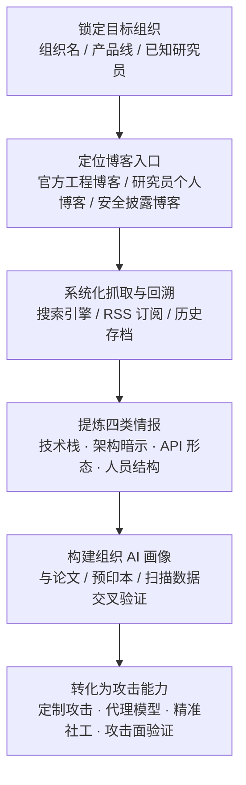

# 技术博客 (AML.T0000.002)

> 属于 [搜索开放技术数据库 (AML.T0000)](../AML.T0000-Search-Open-Technical-Databases.md)

## 一句话通俗理解

> 论文告诉你"我们提出了什么方法"，技术博客告诉你"我们生产环境里到底跑着什么"——工程师随手一篇"我们如何用某框架上线某 AI 服务"，在攻击者眼里就是一份免费的攻击面说明书：技术栈、框架版本、API 形态、甚至团队名单，全都在里面。

## 难度等级

⭐ **Feasible（可行）**

官方成熟度评定为 Feasible——本子技术目前没有直接对应的已观测攻击案例，但可行性毫无悬念：检索与阅读公开博客和正常的技术调研毫无区别，零成本、零门槛、零目标侧痕迹。真正的"难度"不在读，而在**找得全、拼得准**：目标组织的博客入口可能散落在官网、Medium、研究员个人站点与安全社区，需要系统化定位与长期回溯；散落各篇的只言片语（一个框架名、一张架构图、一段 API 示例）还要拼接成完整的技术栈画像，才谈得上转化为攻击能力。相比已获案例支撑的兄弟子技术（预印本仓库、扫描数据库），博客情报的信噪比更低——这是它停留在 Feasible 的原因，而非执行门槛。

**适用平台**（官方数据）：企业环境

## 技术描述

### 通俗解释

如果说父技术 [搜索开放技术数据库 (AML.T0000)](../AML.T0000-Search-Open-Technical-Databases.md) 是翻查目标的"AI 研究档案"，四个子技术各管一类档案柜：期刊与会议论文集（AML.T0000.000）存正式方法论，预印本仓库（AML.T0000.001）存最新草稿，扫描数据库（AML.T0000.003）存暴露资产——本子技术翻的是**技术博客**这本"工程随手记"。

论文为了学术严谨，写的是"怎么想"；博客为了传播分享，写的是"怎么干"：选了什么框架、踩了什么坑、API 长什么样、服务部署在哪、团队里谁负责哪块。攻击者不必读懂数学推导，恰恰只需要这些落地细节——而博客最愿意把这些写出来。

### 技术原理

依据官方描述，学术机构的研究实验室与公司研发部门常开设博客，展示 AI 如何应用于组织特有的问题；研究员个人也频繁以博文记录自己的工作。攻击者可以检索**目标组织或其员工发布的博文**，从中提取以下四类情报：

| 博客类型 | 发布主体 | 典型泄露内容 |
|---------|---------|-------------|
| 公司工程博客 | 目标组织研发部门 | AI 应用实践、框架选型、架构决策、API 用法与使用场景 |
| 研究员个人博客 | 目标组织雇用的研究员 | 在研工作记录、实验细节、内部工具与数据集线索 |
| 安全披露博客 | 第三方安全厂商与研究员 | AI 产品的漏洞分析与绕过细节、事件复盘——攻击者可直接借用现成攻击思路 |
| 事件复盘文章 | 目标组织自身 | AI 安全事件的事后复盘，间接泄露系统架构与防御态势 |

官方特别强调：与论文、预印本相比，博客材料包含更多 AI 系统的**实战细节**（practical aspects）——底层技术与所用框架、可能的 API 访问方式与使用场景。这使博客成为四类公开情报源中最接近真实部署形态的一份：

| 情报维度 | 论文 / 预印本 | 技术博客 |
|---------|-------------|---------|
| 内容焦点 | 方法论：模型、训练、评估 | 落地实践：框架、部署、运维 |
| 泄露粒度 | 架构与算法细节 | 技术栈选型、API 形态、部署形态 |
| 更新节奏 | 研究完成才发表 | 随工程进度持续发布 |
| 对攻击者的独特价值 | 复现方法、构建代理模型 | 定位攻击面、定制攻击路径 |
| 附加泄露 | 作者姓名与研究方向 | 团队结构、内部系统命名、工具链 |

值得注意的是，博客情报往往与论文情报**互相印证**：论文透露"我们提出了 X 架构"，博客透露"X 架构用 Y 框架跑在生产上、API 这样调"——两者拼起来，攻击者不仅知道目标用什么方法，还知道从哪里下手。

### 用途影响

- **定制攻击**：掌握组织内部 AI 使用方式与方案细节，让钓鱼话术、提示词注入、对抗样本都更有针对性；
- **定位攻击面**：博文中出现的 API 形态、端点命名、框架特征，直接提示哪些服务暴露、如何与之交互；
- **构建代理模型**：博客中的架构暗示与论文方法论互补，帮助攻击者训练行为近似的代理模型（Create Proxy AI Model，AML.T0005），在离线环境演练攻击；
- **精准社工**：博文作者就是组织在职研究员，姓名、研究方向、团队结构一应俱全，是高价值钓鱼目标清单；
- **借用现成攻击**：第三方披露博客里的漏洞分析与绕过细节，让攻击者"站在前人肩膀上"攻击同类系统。

## 攻击流程

### 典型攻击流程



**步骤详解：**

1. **锁定目标组织**
   - 通俗描述：确定要摸底的组织，列出关键人名与产品线。
   - 技术细节：收集目标组织名称、域名、产品线与已知研究员姓名；整理"组织名 / 部门名 / 人名 / 技术关键词"四组检索词，人名来自论文作者栏、会议演讲名单与社交媒体。

2. **定位博客入口**
   - 通俗描述：找到目标"在哪里写博客"。
   - 技术细节：定位目标官网工程博客、Medium 等平台的机构账号、研究员个人站点（常附在论文主页或 GitHub 主页）；同时收集安全社区中关于目标产品的第三方披露博客。

3. **系统化抓取与回溯**
   - 通俗描述：不是读一两篇，而是把历史文章全部翻完。
   - 技术细节：用站内检索与搜索引擎 `site:` 语法遍历历史博文；用 RSS 订阅持续跟踪新文章；对已下线的文章查互联网历史存档（Wayback Machine）——下线不等于消失。

4. **提炼四类情报**
   - 通俗描述：从流水账里捞出值钱的东西。
   - 技术细节：标记技术栈与框架（含版本号）、架构暗示（架构图、组件命名）、API 形态与使用场景（端点命名、调用示例）、人员与团队结构（作者署名、致谢名单）。

5. **构建画像并交叉验证**
   - 通俗描述：把博客碎片与论文、扫描数据拼成一张完整图纸。
   - 技术细节：论文提供方法论、博客提供部署细节、扫描数据库（AML.T0000.003）提供暴露面——三者交叉比对，输出组织 AI 技术栈画像与候选攻击面清单。

6. **转化为攻击能力**
   - 通俗描述：让图纸变成武器。
   - 技术细节：按画像定制攻击（提示词注入、对抗样本、钓鱼话术）；依据架构暗示构建代理模型离线演练；对画像中确认的端点形态发起主动验证——后者已进入主动扫描（AML.T0006）范畴，需另行授权。

**与后续战术的衔接：**

- **资源开发**：依据画像获取目标使用的公开 AI 制品、构建代理模型
- **AI 攻击适配**：将通用攻击方法适配到目标的具体模型与框架
- **收集受害者身份信息（AML.T0087）**：博文作者名单直接喂给身份收集
- **初始访问**：对画像确认的暴露 AI 服务与入口发动攻击

> 关键差异：读博客与正常技术调研在目标侧毫无分别——本子技术全程不触碰目标系统，是攻击链上最安全的一段"阅读"。

## 真实案例

> 官方案例库中暂无直接以 AML.T0000.002 为目标的案例研究；以下 3 个案例均被官方关联至父技术 AML.T0000，从不同侧面展示"公开技术资料如何转化为攻击能力"，其中博客正是这条链路上最常见的披露与传播载体。

### 案例1：GPT-2 模型复现——公开技术描述支撑完整能力复现（AML.CS0007）

- **时间**: 2019年
- **攻击者**: Brown University 研究人员
- **手法**: OpenAI 以滥用风险为由对 GPT-2 采取分阶段发布：先放出较小版本与方法技术描述，扣留完整训练模型。Brown University 团队仅凭已发布的公开技术描述，在官方放出完整模型前成功复现；复现过程本身又以技术博客（Medium 长文）完整公开，任何人都能照做。
- **影响**: 证明"分级发布"挡不住公开技术描述——技术描述经公开渠道传播，复现教程也发在博客上，公开材料足以支撑完整 AI 能力的复制
- **参考链接**: [Wired 报道](https://www.wired.com/story/dangerous-ai-open-source/)、[OpenGPT-2 复现博文](https://blog.usejournal.com/opengpt-2-we-replicated-gpt-2-because-you-can-too-45e34e6d36dc)

### 案例2：Cylance AI 恶意软件检测绕过——披露博客即攻击教程（AML.CS0003）

- **时间**: 2019年
- **攻击者**: Skylight Cyber 研究人员
- **手法**: 研究人员分析 Cylance 的 AI 恶意软件检测器后，构造出一个通用绕过串——追加到恶意文件末尾即可逃过检测；绕过串本身与原理分析以技术博客《Cylance, I Kill You!》完整公开。
- **影响**: 安全披露博客是双刃剑——它帮助防御者改进产品，也把现成的绕过手法交到每一位读者（包括攻击者）手里；对攻击者而言，读博客比自己做研究便宜得多
- **参考链接**: [Skylight 披露博文](https://skylightcyber.com/2019/07/18/cylance-i-kill-you/)

### 案例3：DGA 检测规避——公开资料支撑的检测器稳健性测试（AML.CS0001）

- **时间**: 2018年前后
- **攻击者**: Palo Alto Networks Security AI 研究团队（安全验证研究）
- **手法**: 团队基于公开研究资料（论文与厂商公开材料），用一种通用域名变异技术绕过基于 CNN 的僵尸网络 DGA 检测器；该技术可规避多数 ML 驱动的 DGA 检测模块，可用于在任何检测器部署上线前测试其稳健性。
- **影响**: 安全行业习惯在论文与博客中介绍自家 AI 检测能力——这些公开材料同时是攻击者的"检测器说明书"
- **参考链接**: [DGA 检测论文](http://faculty.washington.edu/mdecock/papers/byu2018a.pdf)、[Degas 源码](https://github.com/matthoffman/degas)

## 红队视角

> ⚠️ **免责声明**：以下内容仅用于合法授权的安全测试与教育目的。未经授权对他人系统进行测试是违法行为。

### 实战技巧

1. **组织博客资产盘点**
   以目标组织名为条件，定位官网工程博客、Medium 机构账号与研究员个人站点；用 `site:` 语法加站内检索遍历历史博文，输出"博客资产清单"——入口 URL、更新频率、作者名单、主题分布。

2. **技术栈画像提取**
   通读历史博文，按时间线标记：框架与组件名（含版本号）、架构图与组件命名、API 端点与调用示例、内部系统代号。产出"组织 AI 技术栈画像"：哪些模型在用、跑在什么框架上、API 长什么样。

3. **多源交叉验证**
   将博客细节与论文（方法论）、预印本（研究方向）、扫描数据库（暴露面）交叉比对，标注每条情报的置信度——博客可能过时或刻意脱敏，单一来源不构成攻击面结论。

4. **量化博客泄露面**
   交付物不是"能搜到"的截图堆砌，而是量化报告：可定位的端点特征有几处、可复现的架构细节有几处、可画像的人员有几名——让组织理解自家博客离攻击面清单有多近。

### 常用工具

| 工具名称 | 用途 | 平台 |
|----------|------|------|
| Google / Bing `site:` 检索 | 定位与遍历目标博客 | 跨平台 |
| Google Alerts / RSS 阅读器 | 新博文持续跟踪 | 跨平台 |
| Wayback Machine | 回溯已下线的博文 | 跨平台 |
| Google Scholar / DBLP | 博客作者与论文作者交叉定位 | 跨平台 |

### 注意事项

- **被动优先**：全程只读公开网页，不与目标系统交互；对画像中端点的任何主动验证已进入主动扫描（AML.T0006）范畴，需另行授权
- **合规红线**：阅读公开博客合法，但把博主个人信息汇编成"钓鱼目标清单"用于真实攻击违法
- 报告聚焦"组织博客公开了多少可被利用的信息"，而非证明攻击可行

## 蓝队视角

### 检测要点

1. **被动阅读不可检测（接受现实）**
   - 博客是公开网页，攻击者的阅读不产生任何目标侧日志
   - 结论：本子技术主体活动无法检测，防御重心必须前移到"发布前收敛"与"发布后监控"

2. **间接信号监控**
   - 日志来源：对外博客与文档站的访问分析、反向链接监测
   - 异常特征：异常地域或异常组织对历史博文的批量回溯抓取（情报收集特征）、安全研究社区对自家 AI 产品披露文章的异常关注

3. **下游行为检测**
   - 日志来源：Web/API 访问日志、代理与 WAF 日志
   - 异常特征：对博客中"顺嘴提到"的内部端点、系统代号的探测请求——博客情报的主动验证特征（详见检测建议）

### 监控建议

- **发布评审前置**：建立技术博客对外发布评审流程，架构图、端点命名、版本号过审后才能发布（对应缓解措施 AML.M0000）
- **Canary 泄露监控**：在对外博文中植入虚构但逼真的端点/路径（仅安全团队知晓），任何对它的访问都是"有人把博客当攻击面清单"的高置信信号
- **作者画像自查**：定期以自家研究员姓名检索，评估个人博客与社交媒体泄露的组织信息

## 检测建议

### 网络层检测

**检测方法：** 本技术纯被动、无目标侧流量，网络层只能检测其下游行为。

- 对博客中披露过的端点/路径的探测性访问（尤其是从未对外宣传的内部系统代号）
- Canary 端点（仅存在于博文中的虚构路径）收到任何请求
- 对组织 API 网关的低速枚举请求中出现博客示例代码特征（示例 User-Agent、示例参数）

### 主机层检测

**检测方法：** 不适用——本技术不接触目标主机。主机层的价值在于暴露服务自身的访问审计（谁在调用 AI 端点、调用模式是否异常）。

### 应用层检测（AI 遥测）

**检测方法：** 利用泄露面监控与蜜标捕获侦察信号。

- 博客 Canary 端点的任何访问直接触发高优先级事件——合法用户与爬虫没有理由请求它
- 暴露的 AI 端点收到与博客示例代码特征一致的批量请求（照抄博客示例的攻击者）
- AI 蜜罐（诱饵 LLM 服务/智能体接口）的交互告警——博客侦察的下一步常是暴露面验证

**程序化检测思路（无需 EDR 侧改造）：**

在对外发布流程中预埋 Canary：安全团队与博客编辑约定若干虚构端点/路径（如不存在的内部 API 版本号），仅出现在博文中并登记台账；在代理/WAF 侧对台账路径配置"零流量预期"告警——任何请求（哪怕一次）直接触发高优先级事件。配合定期博客泄露面自查，即可低成本覆盖"博客披露 → 情报收集 → 攻击面验证"链路的可检测部分。

### Sigma 规则思路示例

```yaml
title: 博客 Canary 端点遭到访问（技术博客情报侦察验证信号）
status: experimental
description: 检测仅在对外技术博文中"虚构披露"的端点/路径收到访问请求，
    合法用户与爬虫没有理由请求这些地址（AML.T0000.002）
logsource:
    category: proxy
    product: firewall
detection:
    selection:
        url|contains:
            - 'canary-model-api.'
            - '/api/internal/model-status'
            - 'blog-decoy-endpoint.'
    condition: selection
    timeframe: 5m
level: high
tags:
    - attack.t1596
    - atlas.aml_t0000_002
```

## 缓解措施

> 说明：ATLAS 官方未对本子技术直接映射缓解措施；以下两项继承自父技术 AML.T0000，对本子技术同样适用。

### 优先级1：关键措施

**AML.M0000 限制公开技术信息发布（Limit Public Release of Information）**

限制对外发布组织产品或服务中 AI 技术栈的技术信息。针对博客场景的落地要点：建立博文发布前评审流程，重点审查架构图、端点命名、框架与版本号、内部系统代号；同时限制可能间接推断技术细节的组织信息——研究员姓名、部门结构、物理位置。评审不是"不许写"，而是分级：方法论可以写，部署细节少写。

### 优先级2：重要措施

**AML.M0039 AI 蜜罐（AI Honeypots）**

部署受监控的诱饵 AI 服务与资源——外观与真实资产无异，但不承担任何真实业务功能。合法用户与工作流没有理由接触它们，因此任何交互都是侦察或验证活动的高置信信号。对本子技术而言，蜜罐的价值在于捕获"博客侦察的下一步"：攻击者把博客情报当攻击面清单逐一验证时，诱饵端点会先被踩到。

### MITRE ATLAS 缓解措施映射

| 缓解措施ID | 缓解措施名称 | 优先级 | 映射来源 | 生命周期阶段 |
|------------|-------------|:------:|----------|-------------|
| AML.M0000 | 限制公开技术信息发布 | 关键 | 继承自父技术 AML.T0000 | 业务与数据理解 |
| AML.M0039 | AI 蜜罐 | 重要 | 继承自父技术 AML.T0000 | 部署 · 监控维护 |

> 两道防线的分工：M0000 解决"博客还向外泄露多少可利用情报"（治本，发布前收敛），M0039 加 Canary 解决"有人拿博客情报踩点时能不能发现"（治标，发布后监控）。

## 关联 ATT&CK 技术

- [搜索开放技术数据库 (T1596)](../../../enterprise/01-Reconnaissance/T1596-Search-Open-Technical-Databases.md) — 本子技术的官方 ATT&CK-reference 映射，查询 DNS/WHOIS/证书等公开技术数据库的同名经典技术
- [搜索受害者拥有的网站 (T1594)](../../../enterprise/01-Reconnaissance/T1594-Search-Victim-Owned-Websites.md) — 主题强关联：技术博客本质上是"受害者拥有并运营的网站"，T1594 是传统侧的对应入口

**T1596 传统版 vs AML.T0000.002 博客版：**

| 维度 | 传统 T1596 | ATLAS AML.T0000.002 |
|------|-----------|---------------------|
| 检索对象 | DNS、WHOIS、数字证书等结构化数据库 | 组织工程博客、研究员个人博客、安全披露博客 |
| 情报性质 | 网络**基础设施**情报 | AI **技术栈与部署**情报 |
| 获取方式 | 查询数据库 API | 阅读、抓取、回溯公开网页 |
| 情报用途 | 映射暴露面、规划入侵 | 定制 AI 攻击、构建代理模型、精准社工 |
| 共同点 | 全程被动、不触碰目标系统，目标侧零日志零痕迹 | |

一句话总结：T1596 查的是"目标在网络上的户口"，AML.T0000.002 读的是"目标工程师写的日记"——攻击者从翻你的域名记录，升级到逐篇精读你的技术博客。

## 动手实验

> ⚠️ **重要提示**：所有实验仅使用公开资源与自有/授权资产，不对任何第三方系统发起主动探测。

### 实验环境准备

| 环境组件 | 用途 | 获取方式 |
|----------|------|----------|
| 浏览器 + 互联网 | 公开博客调研 | — |
| RSS 阅读器 / Google Alerts | 新博文持续跟踪 | 官网注册 |
| 自有博客或内部 Wiki（测试环境） | Canary 发布实验 | 自建 |

### 实验1（初级）：评估自己组织的博客情报暴露面

**实验目标：** 以攻击者视角盘点自己（或授权客户）组织的对外博客（对应 AML.M0000）。

**实验步骤：**
1. 定位组织全部对外博客入口：官网工程博客、Medium 账号、可公开检索的研究员个人博客
2. 逐篇标记泄露内容：框架与版本、架构图、端点命名、内部系统代号、作者与团队信息
3. 按"可直接定位攻击面 / 可推断架构 / 可用于社工"三级分类
4. 输出"博客情报泄露清单"：每条信息 + 可被如何利用

**预期结果：** 直观理解"博客即攻击面说明书"——多数组织会低估这份清单的长度。

### 实验2（中级）：从博客到技术栈画像

**实验目标：** 掌握多源情报拼接方法（仅研究公开资料）。

**实验步骤：**
1. 选一家工程博客更新频繁的大型科技公司，通读其 AI 相关博文
2. 按时间线提取：技术栈选型、架构暗示、API 形态、团队结构
3. 将博客结论与该公司的论文、公开演讲交叉验证，标注置信度
4. 思考：若我是攻击者，这份画像里哪条情报最值钱？哪篇博文最不该发？

**预期结果：** 产出一份结构化的组织 AI 技术栈画像，理解博客与论文情报如何互补。

### 实验3（高级）：Canary 泄露监控闭环

**实验目标：** 验证"发布后监控"防线（对应检测建议中的 Canary 思路）。

**实验步骤：**
1. 在测试环境博客/Wiki 发布一篇含虚构端点（如 `/api/internal/model-status`）的技术文章，端点登记台账
2. 在代理/WAF 侧对该端点配置零流量告警
3. 模拟"攻击者"：按文章找到端点并发起请求
4. 验证告警是否触发、时效与误报情况，思考如何推广到真实发布流程

**预期结果：** 跑通"虚构披露 → 台账登记 → 访问告警"的最小闭环，为组织博客发布流程加装传感器。

## 术语解释

| 术语 | 英文原名 | 通俗解释 |
|------|----------|----------|
| 工程博客 | Engineering Blog | 公司研发部门对外分享技术实践的官方博客，常无意间泄露生产环境细节 |
| 预印本仓库 | Pre-print Repository | arXiv 等未经同行评审的论文首发平台，本子技术的兄弟情报源 |
| 框架选型 | Framework Choice | 组织决定采用哪个 AI 框架（TensorFlow/PyTorch 等）——博客最爱写、攻击者最爱读的细节之一 |
| API 形态 | API Shape | 接口的端点命名、参数与调用方式——照着博客示例就能与目标服务"对话" |
| 架构暗示 | Architecture Hint | 博文中的架构图、组件命名等碎片，拼起来即可还原系统全貌 |
| 披露博客 | Disclosure Blog | 安全研究员公开漏洞分析与绕过细节的博文——攻击者的"免费攻击教程" |
| 代理模型 | Proxy Model | 攻击者依据侦察情报训练的高仿模型，用于离线演练攻击而不惊动目标 |
| 被动侦察 | Passive Reconnaissance | 不与目标系统交互的信息收集——读博客、查存档都属于此类，目标侧零痕迹 |
| 历史存档 | Web Archive | Wayback Machine 等服务保存的网页快照——删掉的博客依然可能被翻出来 |
| 蜜标 | Canary Token | 安全团队故意埋下的虚构标记（端点、路径、代号），被触碰即说明有人在利用泄露情报 |
| OSINT | Open Source Intelligence | 开源情报——从公开渠道系统收集分析目标信息的技艺 |

## 参考资料

### 📚 官方文档

- [MITRE ATLAS - Technical Blogs (AML.T0000.002)](https://atlas.mitre.org/techniques/AML.T0000/002/) - 官方技术页面
- [MITRE ATLAS 矩阵](https://atlas.mitre.org/matrices/ATLAS/)
- [MITRE ATLAS Data (GitHub)](https://github.com/mitre-atlas/atlas-data)

### 📰 案例报告（真实攻击与安全研究）

- [Wired: OpenAI Said Its Code Was Risky. Two Grads Re-Created It Anyway](https://www.wired.com/story/dangerous-ai-open-source/) - 案例1：GPT-2 复现事件报道
- [OpenGPT-2: We Replicated GPT-2 Because You Can Too](https://blog.usejournal.com/opengpt-2-we-replicated-gpt-2-because-you-can-too-45e34e6d36dc) - 案例1：复现过程的技术博客原文
- [Skylight Cyber: Cylance, I Kill You!](https://skylightcyber.com/2019/07/18/cylance-i-kill-you/) - 案例2：AI 恶意软件检测绕过披露博文
- [Character level based detection of DGA domain names](http://faculty.washington.edu/mdecock/papers/byu2018a.pdf) - 案例3：DGA 检测原始论文

### 🔧 工具与资源

- [Google Alerts](https://www.google.com/alerts) - 关键词订阅，新博文即时跟踪
- [Wayback Machine](https://web.archive.org/) - 互联网历史存档，回溯已下线博文
- [Feedly](https://feedly.com/) - RSS 阅读器，博客持续监控

### 🔗 关联阅读

- [搜索开放技术数据库 (AML.T0000)](../AML.T0000-Search-Open-Technical-Databases.md) - 本技术的父技术，四大公开情报源全景
- [T1596 搜索开放技术数据库](../../../enterprise/01-Reconnaissance/T1596-Search-Open-Technical-Databases.md) - 官方映射的 ATT&CK 同名经典技术
- [T1594 搜索受害者拥有的网站](../../../enterprise/01-Reconnaissance/T1594-Search-Victim-Owned-Websites.md) - 主题强关联的传统侦察技术
- [侦察战术 (AML.TA0002)](../README.md) - 本技术所属战术的概览页

---

> **版本**: ATLAS 2026.09 | **更新**: 2026-10-22 | **模板**: ATLAS 技术文档 v1.0
