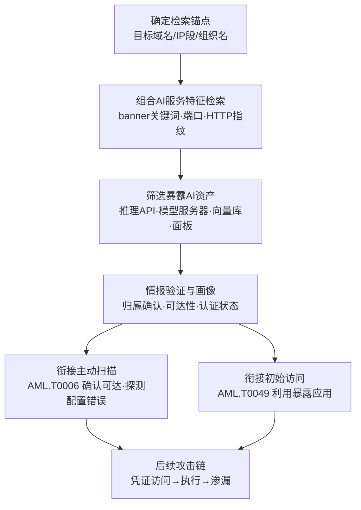

# 扫描数据库 (AML.T0000.003)

> 属于 [搜索开放技术数据库 (AML.T0000)](../AML.T0000-Search-Open-Technical-Databases.md)

## 一句话通俗理解

> Shodan、Censys 这些平台每天都在替全世界"拍你家门口的照片"并归档成册——攻击者翻相册就能看到你家哪个 AI 服务没锁门（开放推理 API、模型服务器、向量数据库、管理面板），全程不需要亲自走到你家门口踩点，你家监控连一张人脸都拍不到。

## 难度等级

⭐⭐⭐ **Realized（已实现）**

官方成熟度评定为 Realized——该技术已在真实攻击中被实际使用：安全研究人员仅凭一次 Shodan 检索就定位了互联网上数百个暴露的 ClawdBot AI 助手控制接口（AML.CS0048）；真实威胁行为者更将 FOFA 检索能力通过 MCP 服务器接入自主攻击智能体，让"查扫描数据库"变成机器自动执行的攻击步骤（AML.CS0070）。实施门槛几乎为零：一个浏览器加免费账号即可开始，检索行为本身完全合法。真正的"难度"在于**指纹知识的积累**——知道哪种 banner 对应哪种 AI 服务、哪种端口组合暗示哪类部署失误，才能从亿万条扫描记录中捞出真正值钱的暴露 AI 资产。

## 技术描述

### 通俗解释

父技术 [搜索开放技术数据库 (AML.T0000)](../AML.T0000-Search-Open-Technical-Databases.md) 的另外三个子技术（期刊论文 AML.T0000.000、预印本 AML.T0000.001、技术博客 AML.T0000.002）挖的都是**研究情报**——组织"怎么用 AI"；本子技术挖的是**资产情报**——组织的 AI 服务"开在哪、锁没锁"。

原理很朴素：Shodan、Censys、FOFA 这类互联网测绘服务 7×24 小时扫描全网，记录每个 IP 的开放端口、服务 banner（服务在端口上自我宣告的身份信息），并对所有人开放检索。你的运维把一个 Ollama 推理服务或向量数据库控制台错误暴露到公网，几天内就会被收录进这些数据库——此后的任何时候，攻击者都能查询到它，而你的防火墙日志里**一条记录都不会有**，因为查询发生在第三方平台上。

### 技术原理

依据官方描述，攻击者检索公开互联网扫描服务以识别受害组织暴露的 AI 基础设施。这些服务持续扫描互联网并发布活跃 IP 地址、主机名、开放端口与服务 banner，攻击者**无需与目标直接交互**即可完成查询。与传统 T1596.005 查"暴露的摄像头、数据库、工控设备"不同，ATLAS 视角下攻击者的检索目标聚焦于 AI 时代的暴露面：

| 暴露面类型 | 典型代表 | 攻击者眼中的价值 |
|-----------|---------|----------------|
| 开放推理 API | Ollama（11434）、vLLM/LocalAI 等OpenAI 兼容端点、Open WebUI | 免费算力盗用、未授权模型调用、越狱演练场 |
| 模型服务器 | Triton、TensorFlow Serving、TorchServe 管理接口 | 模型窃取、服务篡改、内网横向跳板 |
| 向量数据库 | Milvus（19530）、Qdrant（6333）、Weaviate（8080） | RAG 语料库整体拖库——投毒与情报金矿 |
| LLM 应用构建平台 | Langflow、n8n、Dify 等可视化编排工具控制台 | 流程篡改、凭证窃取、提示词注入直达生产 |
| AI 管理面板 | Ray Dashboard（8265）、Jupyter（8888）、MLflow（5000） | 任务劫持、代码执行、训练数据访问 |
| AI 网关/代理 | one-api 等 OpenAI 兼容 API 网关 | 上游密钥聚合点——攻陷即接管全部模型调用 |
| 智能体控制接口 | ClawdBot/OpenClaw 等个人 AI 助手控制面 | 已连接应用的凭证聚合点（见案例1） |

**检索方式**：以目标域名、IP 段、组织名为锚点组合 AI 服务特征（banner 关键词、端口号、HTTP 响应指纹）进行检索；更高效的方式是反向操作——全网检索某类 AI 服务的全部暴露实例，再从中筛出属于目标组织（或干脆不值得筛选、广撒网直接打）的条目。Zenity 与 GreyNoise 的观测均证实，针对暴露 LLM 后端的大规模扫描活动已是进行时。

**收录时机与历史痕迹**：一个服务暴露到公网后，通常数天内即被扫描数据库收录；更重要的是，这些平台**保留历史记录**——即使服务后来下线，历史条目仍可检索。这意味着"暴露过"会在相册里留下永久档案：一次临时的调试部署、一段短暂的网络策略失误，都可能成为攻击者反复回访的线索（回访验证即衔接主动扫描）。

**在攻击链中的位置**：官方描述明确指出，本技术产出的情报可支撑两类后续行动：

1. **衔接主动扫描（AML.T0006）**——确认服务仍可达、探测配置错误或未授权端点（本技术零交互，主动扫描有交互）；
2. **衔接初始访问**——为利用面向公众的应用（AML.T0049）提供候选目标清单，甚至直接发现无需利用漏洞、门本身就没锁的服务（缺失认证的暴露 AI 服务）。

**与主动扫描的关键区别**：本技术完全依赖第三方扫描数据，攻击者与受害系统之间**零交互**——目标侧不产生任何扫描日志、不触发任何告警。这是它成为攻击者最爱的原因：侦察成本为零、暴露风险为零、情报唾手可得。

**平台覆盖**：Enterprise——攻击者在传统环境即可执行，但情报用途直指 AI 系统。

### 用途影响

- **直接获取可访问的攻击入口**：与论文情报需二次转化（构建代理模型）不同，扫描数据库给出的是"现在就能连"的 IP:端口；
- **构建目标组织的 AI 资产清单**：暴露的推理服务、向量库、编排平台共同勾勒出组织的 AI 部署形态与技术选型；
- **零痕迹侦察**：查询发生在第三方平台，目标组织完全无感知；
- **支撑自动化攻击**：扫描数据库均提供 API，检索能力可被直接编排进自主攻击智能体（见案例2）。

## 攻击流程

### 典型攻击流程



**步骤详解：**

1. **确定检索锚点**
   - 通俗描述：确定从哪个角度查目标。
   - 技术细节：收集目标组织域名、已知 IP 段、子公司资产；或反向操作——先全网检索某类 AI 服务的全部暴露实例再筛选归属。

2. **组合 AI 服务特征检索**
   - 通俗描述：用"暗号"翻扫描数据库的相册。
   - 技术细节：在 Shodan/Censys/FOFA 中组合组织锚点与 AI 服务指纹——banner 关键词（如本地推理服务的自宣告文本、模型列表接口的 JSON 响应特征）、特征端口号（11434、19530、8265 等）、HTTP 响应头与页面标题。

3. **筛选暴露 AI 资产**
   - 通俗描述：把真目标从亿万条记录里捞出来。
   - 技术细节：按服务类型聚类检索结果，逐条确认归属（反查域名、ASN、组织信息），标注每条资产的服务类型、版本、暴露时长。

4. **情报验证与画像**
   - 通俗描述：给每扇没锁的门贴标签。
   - 技术细节：交叉验证扫描记录的时效性（历史数据中服务可能已下线）；依据 banner 推断认证状态与版本漏洞；结合其他公开情报完善组织的 AI 技术栈画像。

5. **转化为攻击行动**
   - 通俗描述：从翻相册升级到上门。
   - 技术细节：将候选目标清单交给主动扫描（AML.T0006）验证可达性与配置错误，或直接对缺失认证的服务、存在已知漏洞的版本实施初始访问（AML.T0049）。

**与后续战术的衔接：**

- **主动扫描**：本技术的产出是"静态照片"，服务是否仍可达需主动确认——这一步才产生目标侧日志
- **初始访问**：暴露清单直接决定入口选择——没锁门的直接进，锁坏了的利用漏洞
- **凭证访问/执行**：智能体控制接口、编排平台控制台类资产（如案例1）往往聚合了大量已连接应用的凭证

> 关键差异：传统侦察链是"扫描→发现→再扫描"，本技术的链路是"第三方替你扫→你只管查"——侦察环节被外包给了公开服务，目标侧防御者面对的是一段完全不可见的攻击准备期。

## 真实案例

> 以下 2 个案例全部直接命中本子技术（官方数据中共 2 个案例研究以 AML.T0000.003 为目标），均源自 MITRE ATLAS 案例库。

### 案例1：Shodan 暴露的 ClawdBot 控制接口——一次检索、数百个入口（AML.CS0048）

- **时间**: 2025年前后
- **攻击者**: 安全研究人员
- **手法**: 研究者通过 Shodan 检索定位到互联网上数百个暴露的 ClawdBot（现更名 OpenClaw，运行于用户自有设备的个人 AI 助手）控制接口。暴露的配置文件中包含各类已连接应用的凭证；研究者还能通过聊天界面向 ClawdBot 下达提示词、调用其技能，最终获得宿主环境的 root 权限。
- **影响**: 一次 Shodan 检索即定位数百个暴露 AI 助手控制面，且控制面天然聚合了受害者全部已连接应用的凭证——侦察结果直接转化为凭证访问与代码执行
- **参考链接**: [Shodan 检索结果](https://www.shodan.io/search?query=Clawdbot+Control)、[研究者披露（X）](https://x.com/theonejvo/status/2015401219746128322)、[OpenClaw 项目](https://github.com/openclaw/openclaw)

### 案例2：威胁行为者将 FOFA 检索接入自主攻击智能体（AML.CS0070）

- **时间**: 2026年5月（Unit 42 披露）
- **攻击者**: 中文语系威胁行为者（knaithe / KnYuan）
- **手法**: 该行为者将 Hermes Agent 配置为以 DeepSeek 为推理引擎，集成终端访问、Telegram 遥控与红队技能系统，并接入暴露 FOFA 检索、查询翻译与 Nuclei 扫描生成能力的 MCP 服务器——"查扫描数据库找暴露的 Langflow/n8n 实例"被直接编排为智能体的自动化攻击步骤，无需人工逐步执行。
- **影响**: 扫描数据库检索从"人肉查相册"进化为"机器自动查+自动打"，侦察与攻击之间的时间间隔被压缩到分钟级
- **参考链接**: [Unit 42 分析报告](https://unit42.paloaltonetworks.com/autonomous-ai-cyber-attack-campaign/)

## 红队视角

> ⚠️ **免责声明**：以下内容仅用于合法授权的安全测试与教育目的。未经授权对他人系统进行测试是违法行为。

### 实战技巧

1. **AI 资产暴露面盘点**
   以授权客户的域名/IP 段为锚点，在 Shodan/Censys/FOFA 中检索全部暴露条目，重点标记具备 AI 服务特征的条目：开放推理端口、模型服务管理接口、向量数据库、LLM 编排平台、训练面板。产出按"服务类型 × 认证状态 × 暴露时长"分类的暴露面清单。

2. **AI 服务指纹库建设**
   维护一份常见 AI 服务的检索指纹表（banner 关键词、特征端口、模型列表接口响应特征），红队评估时直接套用。指纹越全，暴露面盘点越接近攻击者的真实视野——多数组织的资产台账里根本没有"AI 服务"这个分类。

3. **检索语法组合训练**
   练习将组织锚点（域名、证书、ASN）与 AI 特征组合成高效检索式：先锚点后特征（定向评估），先特征后锚点（评估某类技术的全网暴露规模）。同一资产在 Shodan、Censys、FOFA 中的收录时点与字段不同，三家交叉才完整。

4. **量化"扫描数据库暴露面"**
   红队交付物应是量化报告：暴露 AI 资产数、缺失认证数、可回溯暴露时长、每条资产可直达的攻击后果（拖库/盗用算力/凭证聚合），让组织理解自己在他人的"相册"里是什么样子。

### 常用工具

| 工具名称 | 用途 | 平台 |
|----------|------|------|
| Shodan | 互联网设备与服务搜索引擎，支持 banner 检索 | 跨平台 |
| Censys Search | 互联网资产检索，证书与主机数据见长 | 跨平台 |
| FOFA | 网络空间测绘，中文语法，国内资产覆盖全 | 跨平台 |
| ZoomEye | 网络空间测绘搜索引擎 | 跨平台 |

### 注意事项

- **零交互红线**：仅查询扫描数据库不触碰目标；一旦对发现的端点发起主动验证请求，即越界进入主动扫描（AML.T0006）范畴，需另行授权
- **数据时效**：扫描数据库的记录存在滞后——报告需标注数据采集时间，避免把已下线服务写成现存风险
- 报告聚焦"组织在攻击者相册里暴露了什么"，而非利用暴露资产实施攻击

## 蓝队视角

### 检测要点

1. **检索行为本身不可检测（接受现实）**
   - 攻击者的全部查询发生在 Shodan/Censys/FOFA 的服务器上，目标侧零流量、零日志
   - 结论：本技术的主体活动无法检测，防御重心必须前移到"让自己不出现在相册里"与"发现被拍进了相册"

2. **攻击面数据源监控**
   - 数据来源：扫描数据库 API、证书透明度日志、EASM 平台
   - 关注字段：自家资产在扫描数据库中的条目、banner 变化、新增暴露端口
   - 异常特征：组织 IP 段新出现 AI 服务特征 banner——攻击者能查到的前提是它已被收录；防御者要比攻击者更早查到自己

3. **下游行为检测**
   - 数据来源：Web/API 访问日志、EDR 遥测
   - 异常特征：本技术零流量，但其产出的下游——对暴露 AI 端点的低速探测、模型列表枚举（/v1/models 类请求）、异常批量 API 调用——是可检测的

### 监控建议

- **攻击者视角自查**：定期以组织域名/IP 段检索 Shodan/Censys/FOFA，比对资产台账，任何"台账外"的 AI 服务条目立即处置——这是唯一能"追平"攻击者视野的低成本手段
- **上线前暴露面门禁**：AI 服务（推理端点、向量库、编排平台、训练面板）上线流程中强制增加"是否可达公网、是否强制认证"检查项
- **暴露历史审计**：检索扫描数据库中自家 IP 段的历史条目，确认"曾经暴露过"的服务是否已彻底下线，并评估暴露窗口内可能已泄露的凭证与数据
- **部署 AI 蜜罐**：在外网放置与真实资产混布的诱饵 AI 服务——授权用户没有理由访问它们，任何交互都是高置信度侦察信号（对应缓解措施 AML.M0039）

## 检测建议

### 网络层检测

**检测方法：** 本技术纯被动、无目标侧流量，网络层仅能检测其下游行为。

- 对暴露 AI 端点集合的顺序探测（扫描数据库情报被主动验证的特征）
- 模型列表枚举请求（OpenAI 兼容端点的 /v1/models 高频访问）
- 已知扫描器特征（User-Agent、探测路径序列）对推理服务/向量库端口的访问

### 主机层检测

**检测方法：** 不适用——本技术不接触目标主机。主机层检测价值在于暴露 AI 服务自身的访问审计：谁在调用推理 API、调用频率、来源分布，建立基线后识别枚举型访问模式。

### 应用层检测（AI 遥测）

**检测方法：** 利用 AI 蜜罐与暴露面监控捕获侦察信号。

- AI 蜜罐（诱饵推理服务/智能体接口/向量库）的**任何**交互都值得告警——合法流量为零
- 真实暴露端点收到非预期来源的探测性请求（能力探测 prompt、模型枚举、配置文件读取）
- 蜜罐捕获的攻击者源信息、检索指纹与工具特征可反哺全环境检测规则

**程序化检测思路（无需 EDR 侧改造）：**

在攻击面管理流程中增加两个定时任务：① 调用扫描数据库 API 以组织域名/IP 段为条件周期检索，新出现 AI 服务特征 banner 即告警（比攻击者先发现自己被拍进相册）；② 对外网诱饵 AI 服务配置"零流量预期"告警——任何请求直接触发高优先级事件。两者组合即可用极低成本覆盖"暴露面产生→被攻击者利用"的完整窗口期。

### Sigma 规则思路示例

```yaml
title: AI 蜜罐服务遭到访问（扫描数据库侦察的高置信下游信号）
status: experimental
description: 检测对外暴露的诱饵 AI 服务收到任何访问请求，
    合法用户与工作流没有理由与蜜罐资源交互（AML.T0000.003 / AML.M0039）
logsource:
    category: proxy
    product: firewall
detection:
    selection:
        url|contains:
            - 'honeypot-llm.'
            - 'canary-agent.'
            - 'decoy-vector-db.'
    condition: selection
    timeframe: 5m
level: high
tags:
    - attack.t1596
    - attack.t1596.005
    - atlas.aml_t0000_003
```

## 缓解措施

### 优先级1：关键措施

**收敛 AI 资产暴露面（通用网络卫生，本技术最直接的釜底抽薪）**

扫描数据库只能检索到"暴露在公网上"的服务——不暴露，相册里就没有你。落地要点：AI 基础设施（推理端点、向量数据库、编排平台、训练面板、智能体控制接口）默认不出公网，经反向代理 + 强制认证 + IP 白名单暴露；上线前执行暴露面检查项；定期以攻击者视角检索自家资产。绝大多数案例中的暴露（如案例1）源于部署时的默认配置失误，而非复杂漏洞。

### 优先级2：重要措施

**AML.M0039 AI 蜜罐（AI Honeypots）——本子技术唯一直接映射的官方缓解措施**

部署受监控的诱饵 AI 服务、智能体、凭证或其他资源——外观与真实资产无异，但不承担任何真实业务功能。合法用户与工作流没有理由接触它们，因此任何交互都是侦察或发现活动的高置信度信号。官方缓解描述明确引用的观测证据（GreyNoise、Zenity）表明：AI 蜜罐已捕获针对暴露 LLM 后端的大规模扫描活动——攻击者按相册找目标的打法，恰好会撞上混布在真实资产旁的诱饵。捕获的源信息、工具与手法可反哺检测规则，虚假目标还能消耗攻击者的精力。

### MITRE ATLAS 缓解措施映射

| 缓解措施ID | 缓解措施名称 | 优先级 | 映射来源 | 生命周期阶段 |
|------------|-------------|:------:|----------|-------------|
| AML.M0039 | AI 蜜罐 | 重要 | **直接映射** | 部署 · 监控维护 |
| AML.M0000 | 限制公开技术信息发布 | 建议 | 继承自父技术 AML.T0000 | 业务与数据理解 |

> 说明：ATLAS 官方对本子技术直接映射的缓解措施仅有 AML.M0039；AML.M0000 为父技术缓解措施，对扫描数据库场景的作用有限（banner 是被动采集的，限制发布挡不住扫描收录），故列为建议级。两道防线的逻辑：收敛暴露面解决"相册里有没有你"，蜜罐解决"有人按相册找上门时能不能发现"。

## 关联 ATT&CK 技术

- [扫描数据库 (T1596.005)](../../../enterprise/01-Reconnaissance/T1596/T1596.005-Scan-Databases.md) — 与本子技术一一对应的 ATT&CK 经典子技术
- [搜索开放技术数据库 (T1596)](../../../enterprise/01-Reconnaissance/T1596-Search-Open-Technical-Databases.md) — 对应的父技术，即 AML.T0000 的同名经典技术

**传统 T1596.005 vs ATLAS AML.T0000.003：**

| 维度 | 传统 T1596.005 | ATLAS AML.T0000.003 |
|------|---------------|---------------------|
| 检索平台 | Shodan、Censys（相同） | Shodan、Censys、FOFA 等（相同） |
| 检索目标 | 暴露的摄像头、数据库、工控设备等通用资产 | 聚焦 AI 暴露面：推理 API、模型服务器、向量库、编排平台、智能体控制面 |
| 前置知识 | 通用服务指纹 | AI 服务指纹库（新兴服务的 banner 特征） |
| 情报用途 | 规划通用网络入侵 | 支撑 AI 定向攻击：盗用算力、RAG 拖库投毒、智能体凭证聚合 |
| 演进趋势 | 人工检索为主 | 已被编排进自主攻击智能体（案例2），检索即攻击 |

一句话总结：T1596.005 与 AML.T0000.003 是同一把"翻相册"的手艺——AI 时代变的不是相册，是相册里新出现的那些没锁门的 AI 服务。

## 动手实验

> ⚠️ **重要提示**：所有实验仅使用公开检索资源与自有/授权资产，不对任何第三方系统发起主动探测或访问。

### 实验环境准备

| 环境组件 | 用途 | 获取方式 |
|----------|------|----------|
| Shodan / Censys / FOFA 免费账号 | 扫描数据库检索 | 官网注册 |
| Docker + 一款开源推理服务（如 Ollama） | 本地指纹观察 | 官方安装包 |
| Python 3.10+ | 攻击面巡检脚本 | 官方安装包 |

### 实验1（初级）：自己组织的相册自查

**实验目标：** 以攻击者视角发现自己组织在扫描数据库中的 AI 暴露面。

**实验步骤：**
1. 以自己（或授权客户）组织的域名/IP 段为条件在 Shodan/Censys 检索
2. 逐条标记具备 AI 服务特征的条目：开放推理端口、模型服务、向量库、编排平台、训练面板
3. 将发现的每条资产与内部台账比对，标记"台账外"条目
4. 记录各条目的收录时间，评估暴露已存在多久

**预期结果：** 产出一份组织 AI 暴露面清单，直观理解"你被拍了多少张、拍了多久"。

### 实验2（中级）：AI 服务指纹观察

**实验目标：** 理解 AI 服务在扫描数据库中呈现的指纹形态。

**实验步骤：**
1. 在隔离的本地 Docker 环境中部署一款开源推理服务（如 Ollama）
2. 从"外部视角"观察它的响应：默认端口、根路径返回的自宣告文本、模型列表接口的 JSON 结构
3. 依据观察结果，编写一条能检索到该服务的 Shodan/FOFA 检索式
4. 用该检索式在扫描数据库中检索全网同类暴露实例（只看检索结果，不访问任何实例）

**预期结果：** 掌握"服务 → 指纹 → 检索式"的推导方法，理解指纹库是扫描数据库侦察的核心竞争力。

### 实验3（高级）：暴露面巡检自动化

**实验目标：** 为组织构建"比攻击者更早发现暴露"的自动化能力。

**实验步骤：**
1. 使用扫描数据库 API（如 Shodan Python 库）编写巡检脚本：以组织域名/IP 段为条件周期检索
2. 对结果应用 AI 服务指纹规则（实验2 的产出），新增命中即输出告警
3. 在授权外网环境部署一个诱饵 AI 服务，配置"零流量预期"告警，验证端到端发现链路
4. 将两个告警源接入组织的告警通道，形成"相册新增我→立刻知道；有人按相册上门→立刻知道"的双保险

**预期结果：** 一套可持续运行的 AI 暴露面巡检 + 诱饵告警最小实现，对应缓解措施 AML.M0039 的落地雏形。

## 术语解释

| 术语 | 英文原名 | 通俗解释 |
|------|----------|----------|
| 扫描数据库 | Scan Database | 持续扫描互联网并归档每个 IP 开放端口与服务 banner 的平台，本子技术的检索对象 |
| Shodan | Shodan | 最知名的互联网设备搜索引擎，被称为"黑客的谷歌" |
| Censys | Censys | 互联网资产检索平台，主机与证书数据见长 |
| FOFA | FOFA | 国产网络空间测绘引擎，中文检索语法，国内资产覆盖最全 |
| Banner | Service Banner | 服务在端口上对外宣告自身身份的信息——攻击者借此识别"这是一台暴露的推理服务" |
| 被动侦察 | Passive Reconnaissance | 不与目标发生任何直接交互的信息收集——查询扫描数据库是典型形态，目标侧零日志 |
| 主动侦察 | Active Reconnaissance | 直接与目标交互的探测（如端口扫描）——会产生目标侧日志，与本技术形成对照 |
| 网络空间测绘 | Cyberspace Mapping | 持续扫描、绘制全网资产与服务分布的技术——Shodan/Censys/FOFA 均属测绘引擎 |
| 模型枚举 | Model Enumeration | 调用模型列表接口（如 /v1/models）探明服务加载了哪些模型——暴露 AI 端点的典型探测动作 |
| 向量数据库 | Vector Database | 存储嵌入向量的数据库，RAG 系统的记忆库——暴露在公网等于知识库门户大开 |
| 推理 API | Inference API | 模型对外提供预测/生成能力的接口，暴露即可能被盗用算力或未授权调用 |
| EASM | External Attack Surface Management | 外部攻击面管理——持续盘点组织互联网暴露资产的防御实践，核心动作是"像攻击者一样搜索自己" |
| RAG | Retrieval-Augmented Generation | 检索增强生成——依赖向量数据库外挂知识库，向量库暴露即知识库门户大开 |
| MLflow | MLflow | 开源机器学习实验追踪与模型登记平台，管理界面默认端口 5000，常被误暴露 |
| AI 蜜罐 | AI Honeypot | 伪装成真实 AI 资产的诱饵——合法流量为零，任何交互都是恶意信号 |

## 参考资料

### 📚 官方文档

- [MITRE ATLAS - Scan Databases (AML.T0000.003)](https://atlas.mitre.org/techniques/AML.T0000/003/) - 官方技术页面
- [MITRE ATLAS 矩阵](https://atlas.mitre.org/matrices/ATLAS/)
- [MITRE ATLAS Data (GitHub)](https://github.com/mitre-atlas/atlas-data)

### 📰 案例报告（真实攻击与安全研究）

- [Shodan: ClawdBot Control 检索](https://www.shodan.io/search?query=Clawdbot+Control) - 案例1：暴露 AI 助手控制接口的实时检索结果
- [研究者披露：hacking clawdbot（X）](https://x.com/theonejvo/status/2015401219746128322) - 案例1：数百个暴露控制面的发现过程
- [Unit 42: Chinese-Speaking Threat Actor Harnesses AI Models for Autonomous Cyberattacks](https://unit42.paloaltonetworks.com/autonomous-ai-cyber-attack-campaign/) - 案例2：FOFA 检索被编排进自主攻击智能体
- [Zenity: Scanning for AI - Live Campaigns Mapping the Internet's Exposed LLM Backends](https://labs.zenity.io/post/scanning-for-ai-live-campaigns-mapping-the-internet-s-exposed-llm-backends) - 针对暴露 LLM 后端的在野扫描活动分析
- [GreyNoise: Threat Actors Actively Targeting LLMs](https://www.greynoise.io/blog/threat-actors-actively-targeting-llms) - 威胁行为者针对 LLM 的侦察活动观测

### 🔧 工具与资源

- [Shodan](https://www.shodan.io/) - 互联网设备与服务搜索引擎
- [Censys Search](https://search.censys.io/) - 互联网资产检索平台
- [FOFA](https://fofa.info/) - 网络空间测绘搜索引擎
- [OpenClaw（原 ClawdBot）](https://github.com/openclaw/openclaw) - 案例1 中的个人 AI 助手项目

### 🔗 关联阅读

- [搜索开放技术数据库 (AML.T0000)](../AML.T0000-Search-Open-Technical-Databases.md) - 本技术的父技术，四大公开情报源全景
- [T1596.005 扫描数据库](../../../enterprise/01-Reconnaissance/T1596/T1596.005-Scan-Databases.md) - 与本子技术一一对应的 ATT&CK 经典子技术
- [侦察战术 (AML.TA0002)](../README.md) - 本技术所属战术的概览页

---

> **版本**: ATLAS 2026.09 | **更新**: 2026-10-22 | **模板**: ATLAS 技术文档 v1.0
