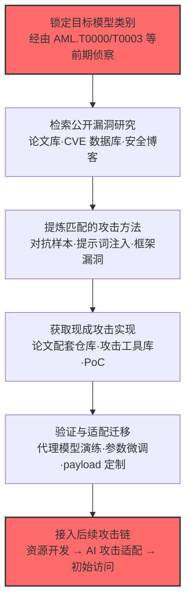

# 搜索公开 AI 漏洞分析 (AML.T0001)

## 一句话通俗理解

> 攻击者在撬你家的"AI 门锁"之前，先去公共图书馆和漏洞数据库翻一遍：有没有人已经研究过怎么撬这一类锁？论文里写了撬锁细节没有？甚至有没有现成的"撬锁工具包"可以直接下载？——**站在前人的肩膀上攻击，永远比从零开始便宜。**

## 难度等级

⭐⭐ **Demonstrated（已演示）**

官方成熟度评定为 Demonstrated——利用公开 AI 漏洞研究发动攻击已在公开研究与真实案例中得到演示（如针对反恶意软件 ML 模型的灰盒对抗攻击、利用已披露的提示词注入研究攻陷 MathGPT）。实施门槛本身很低：检索论文、浏览安全博客、下载开源攻击实现，全部使用公开渠道、不接触目标系统、不违反任何法律——这正是本技术最"友好"也最危险的地方。真正的门槛在于**信息筛选与攻击迁移**：从海量文献中找出与目标模型匹配的攻击方法，并把通用 PoC 适配到目标的具体版本与部署形态上，需要扎实的对抗机器学习功底。

## 技术描述

### 通俗解释

与"搜索开放技术数据库"（AML.T0000）一脉相承：当今学术界与安全社区对主流 AI 模型漏洞的研究非常丰富——每次顶会都有新的对抗样本论文，每次 LLM 更新都会涌现新的越狱技巧，每个流行框架都可能在 CVE 数据库里挂着历史漏洞。攻击者一旦通过前期侦察锁定了目标使用的模型（或模型类别），下一步自然是搜一遍"前人已经做过的功课"：哪些论文点名了这类模型的弱点？哪些 CVE 还没修？哪些 GitHub 仓库里躺着可以直接运行的攻击代码？

这就像开锁匠圈子公开讨论过"某品牌锁的第 3 代锁芯有结构缺陷"，并且有人把开锁工具的图纸都发到了网上——小偷只需要照着做。对攻击者而言，公开漏洞分析是**免费、合法、高质量**的攻击情报；对防御者而言，自己（或整个行业）公开发布的安全研究，同时也在武装潜在的对手。

### 技术原理

依据官方描述，攻击者在确定目标后，会尝试找出针对该类模型已有的公开研究工作，具体包括两类产出：

1. **攻击方法情报**——阅读学术论文、安全报告，掌握某类模型成功攻击的具体细节（攻击原理、触发条件、参数配置）；
2. **现成攻击实现**——定位这些攻击的公开代码实现，直接获取使用；必要时，攻击者也可以基于公开方法自行开发攻击（官方描述将其归纳为：获取对抗性 AI 攻击实现 AML.T0016.000，或自行开发对抗性 AI 攻击 AML.T0017.000）。

**攻击者检索的公开信息源全景：**

| 信息源类别 | 典型平台/载体 | 可获得的漏洞情报 |
|-----------|--------------|----------------|
| 学术文献 | arXiv 预印本、NeurIPS / ICLR / IEEE S&P / USENIX Security 等顶会 | 对抗样本构造方法、模型后门、数据投毒、成员推断、模型窃取的完整技术细节 |
| 漏洞与通告数据库 | CVE / NVD、GitHub Security Advisory、云厂商与框架安全公告 | AI 框架（PyTorch、TensorFlow 等）已知漏洞、模型仓库安全事件、补丁细节 |
| 安全博客与研究报告 | 安全厂商博客、红队披露文章、HackerNews / 安全社区 | 提示词注入手法、越狱 payload、LLM 应用攻击链的完整复盘 |
| 开源攻击实现 | GitHub 仓库、Papers with Code、攻击工具库 | 对抗样本生成库、越狱提示词集合、可直接运行的 PoC |

**攻击者检索式速查（按目标类型）：**

| 目标类型 | 典型检索式/关键词 | 期望命中 |
|---------|------------------|----------|
| 图像/恶意软件检测类模型 | `<架构名> adversarial examples evasion` | 对抗扰动构造方法与配套代码 |
| 开源 LLM 应用 | `<模型名> jailbreak prompt leak system prompt` | 有效越狱模板与注入 payload |
| AI 框架/推理服务 | `<框架名> CVE RCE <版本号>` NVD 过滤 | 未修复漏洞与公开 PoC |
| 自研但基于开源架构 | `<基础架构名> transferability fine-tuned` | 攻击迁移性证据（能否打过微调变体） |
| RAG / 智能体应用 | `indirect prompt injection RAG agent` | 间接注入手法与公开案例复盘 |

三点值得特别注意：

- **情报与武器一体**：与传统侦察"只收集信息"不同，本技术的产出可以直接是**可运行的攻击代码**——论文配套仓库让"知道漏洞"和"拥有武器"一步到位；
- **类级匹配即可用**：对抗样本具有**迁移性**（transferability），针对同一架构家族模型训练出的攻击，往往对目标自己微调过的版本依然有效——攻击者不需要找到目标精确模型的精确漏洞研究；
- **零接触、零痕迹**：整个检索过程不向目标系统发送任何数据包，与传统网络侦察中的主动扫描形成鲜明对比，防御侧几乎没有直接观测点。

**平台覆盖**：Enterprise（官方数据）。攻击者在传统企业环境中即可完成全部检索活动。

### 用途影响

- **大幅降低攻击成本**：将"从零研究模型弱点"压缩为"检索 + 复现 + 适配"，攻击周期从数月缩短到数天；
- **复现已知漏洞**：目标若未及时修补已披露的框架 CVE 或部署已知攻击的缓解措施，攻击者可直接利用公开 PoC 得手；
- **武装后续 AI 攻击**：检索产出直接 feeding 资源开发（获取/改造攻击实现）与 AI 攻击适配（将攻击迁移到目标模型），是整条 AI 攻击链的"军火库入口"；
- **放大信息泄露的后果**：组织（或其供应商、所用开源社区）公开发布的每一份技术细节，都会被本技术转化为可复用的攻击情报——发布越多，弹药越足；
- **降低新型攻击的使用门槛**：学术界的每一次新攻击披露（如新的越狱技术），都会经本技术快速"平民化"——原本需要顶级研究能力才能实现的攻击，以"论文 + 配套代码"的形式降低到普通攻击者可用水平。

## 攻击流程

> **值得警惕的场景**：组织安全团队出于行业声望发表论文、在会议上分享攻防实践——这些合法且值得鼓励的活动，同时也在精确地扩大本技术可检索的"弹药库"。防御的要义不是停止分享，而是**分享前先想清楚：这些内容能被用来打我们吗？**

### 典型攻击流程



**步骤详解：**

1. **锁定目标模型类别**
   - 通俗描述：先搞清楚"要撬的是哪一类锁"。
   - 技术细节：综合前期侦察成果（如 AML.T0000 搜索开放技术数据库、AML.T0003 搜索受害者网站），确认目标使用的模型架构（如 BERT 家族、Llama 家族）、AI 框架及版本、LLM 应用形态（聊天助手、RAG 系统、代码生成器）。

2. **检索公开漏洞研究**
   - 通俗描述：去图书馆和漏洞数据库翻前人的功课。
   - 技术细节：在 arXiv/Google Scholar 检索"模型架构 + attack/adversarial/jailbreak"类论文；在 CVE/NVD 按框架名与版本号过滤历史漏洞；跟踪安全厂商博客中的 LLM 应用攻击复盘；必要时用 Google Dorking 定位泄露的内部安全评估文档。

3. **提炼匹配的攻击方法**
   - 通俗描述：判断哪篇"撬锁教程"适用于自己这把锁。
   - 技术细节：评估论文攻击的威胁模型（白盒/灰盒/黑盒）与自身条件是否匹配；关注攻击的迁移性证据——能否从论文中的基准模型迁移到目标变体；对 LLM 目标则比对越狱手法所利用的对齐弱点是否仍然存在。

4. **获取现成攻击实现**
   - 通俗描述：直接下载"撬锁工具包"，而不是自己造。
   - 技术细节：克隆论文配套代码仓库；使用成熟对抗攻击库（如 TextAttack、Foolbox、Adversarial Robustness Toolbox）或 LLM 攻击工具（如 PyRIT）；收集公开的越狱提示词语料库——这一步在 ATLAS 中对应获取对抗性 AI 攻击实现（AML.T0016.000）。

5. **验证与适配迁移**
   - 通俗描述：在自家车库先演练一遍，再上门。
   - 技术细节：利用对抗样本的迁移性，在目标同架构的公开模型（或自训代理模型）上离线验证攻击有效性；调整扰动强度、提示词变体、payload 细节，为接入后续攻击链（自行开发对抗性 AI 攻击对应 AML.T0017.000）做好准备。

**常见攻击变体：**

- **变体一：越狱情报复用（针对 LLM）**——LLM 安全对齐的弱点一经公开披露（新越狱技巧、系统提示词泄露），会在数天内被整理成提示词集合公开传播；攻击者检索的实质是"对齐仍可被绕过"的现成证据，用于对目标 LLM 应用发起同样手法
- **变体二：框架 CVE 直接利用（针对 AI 基础设施）**——目标 AI 系统依赖的框架/推理引擎若存在未修复 CVE，攻击者下载公开 PoC 后走传统漏洞利用路径，此时本技术与 ATT&CK 漏洞利用技术形成衔接
- **变体三：迁移对抗样本（针对自研模型）**——目标"自研"模型多为开源架构 + 自有数据微调；攻击者检索该基础架构的对抗攻击研究，在公开基准模型上生成对抗样本，借助迁移性直接攻击目标变体——无需接触目标模型本体

**与后续战术的衔接：**

- **资源开发**：检索到的攻击实现被获取、改造并纳入攻击工具箱
- **AI 攻击适配**：将通用攻击适配到侦察确认的目标模型与数据管线
- **初始访问**：适配完成的攻击（框架漏洞利用、提示词注入）在真实入口上兑现

> 关键差异：传统 ATT&CK 侦察的产出是"信息"，而本技术的产出常常是"信息 + 武器"——检索的终点可能就是可运行的攻击代码，侦察与资源开发的边界在此变得模糊。

## 真实案例

> 以下 2 个案例全部源自 MITRE ATLAS 官方案例库（案例研究文档本库建设中，此处给出官方编号与外部链接）。

### 案例1：混淆反恶意软件神经网络（AML.CS0014）

- **时间**: 2019 年（Kaspersky 安全研究）
- **攻击者**: Kaspersky ML 研究团队（安全研究演示）
- **手法**: 云端 ML 恶意软件检测器通常在用户本机提取特征、再发送到安全厂商服务器推理。研究团队针对这一**灰盒场景**开展对抗攻击：在完全不接触模型内部（无白盒访问）的条件下，仅凭对特征工程的知识构造对抗样本，成功让 Kaspersky 自家的反恶意软件 ML 模型对大多数经对抗修改的恶意文件**漏报**。研究细节全文公开。
- **影响**: 该研究证明"特征知识就足以发动对抗攻击"——任何采用类似云端检测架构的厂商，其 ML 模型都可被照方抓药地攻击；公开的研究报告本身即成为攻击者的免费攻击手册。
- **参考链接**: [Kaspersky Securelist: How to confuse antimalware neural networks](https://securelist.com/how-to-confuse-antimalware-neural-networks-adversarial-attacks-and-protection/102949/)

### 案例2：通过提示词注入在 MathGPT 中实现代码执行（AML.CS0016）

- **时间**: 2022 年（安全研究披露）
- **攻击者**: 安全研究人员（漏洞研究披露）
- **手法**: 公开的 Streamlit 应用 [MathGPT](https://mathgpt.streamlit.app/) 使用 GPT-3 回答数学问题。研究已证明 LLM 直接做精确算术的表现不佳，但在被要求**生成可执行代码**来解题时表现更好——因此 MathGPT 让 GPT-3 将自然语言问题转换为 Python 代码并在本地执行。研究人员通过逆向提示词工程（reverse prompt engineering）分析应用提示词结构后构造提示词注入，诱导 GPT-3 生成并执行超出解题范围的任意代码，在该环境中达成了代码执行。攻击所依赖的 LLM 数学能力缺陷与代码执行模式，均有公开论文背书。
- **影响**: 演示了"公开研究 → 可复用攻击"的完整链路：对 LLM 弱点的学术研究（数学能力不足）+ 应用架构的公开信息，共同支撑了一次端到端的提示词注入攻击；同类"LLM 生成代码并执行"的应用均可参照复现。
- **参考链接**: [Measuring Mathematical Problem Solving With the MATH Dataset (arXiv:2103.03874)](https://arxiv.org/abs/2103.03874)、[Training Verifiers to Solve Math Word Problems (arXiv:2110.14168)](https://arxiv.org/abs/2110.14168)、[Reverse Prompt Engineering for Fun and (no) Profit](https://lspace.swyx.io/p/reverse-prompt-eng)

> 两个案例的共同点：**它们本身是合法公开的安全研究**——这正是本技术的精髓。攻击者不需要自己发现 0day，只需要会读论文、会跑 PoC。防御侧必须假设：所有已公开的攻击研究，都已被潜在对手纳入弹药库。

## 红队视角

> ⚠️ **免责声明**：以下内容仅用于合法授权的安全测试与教育目的。对未授权系统的测试是违法行为。

### 实战技巧

1. **用攻击者视角盘点自有组织的公开暴露面**
   红队最有价值的产出之一是"暴露面审计"：以本技术的检索流程为剧本，系统排查组织公开发布的论文、技术博客、招聘 JD、会议演讲、开源仓库中是否泄露了生产模型的架构、版本、防御机制细节——每一条可被检索到的技术信息，都应记入风险清单。

2. **构建组织的"已知攻击匹配表"**
   针对组织 AI 技术栈逐项检索公开漏洞研究并输出对照表：模型架构 → 已知对抗攻击及迁移性证据；框架及版本 → 未修复 CVE 与公开 PoC；LLM 应用形态 → 已披露的提示词注入/越狱手法。该表直接决定防御优先级。

3. **复现验证（仅限自有环境）**
   在隔离环境中复现 1-2 个与组织技术栈匹配的公开攻击（如对自托管开源模型跑一次迁移对抗样本、对自有测试 LLM 应用做一次已知越狱），验证组织现有防御（护栏、输入过滤）是否真的挡得住"照着论文做的攻击"——而非仅挡得住自造的测试用例。

4. **检索式构造（simulation of adversary workflow）**
   演练时刻意约束自己"只使用公开可得的攻击实现"，模拟低成本真实对手的行为上限，让评估结果更贴近威胁现实。

5. **为威胁建模提供"对手能力上限"输入**
   本技术界定了对手的能力天花板之一：**所有已公开的攻击研究都视为对手已掌握**。在为组织 AI 资产做威胁建模时，把公开攻击研究清单直接当作对手武器库清单使用，避免低估"只会用现成武器"的大多数攻击者。

### 常用工具

| 工具名称 | 用途 | 平台 |
|----------|------|------|
| Google Scholar / arXiv / Semantic Scholar | 学术漏洞研究检索 | 跨平台 |
| CVE / NVD / GitHub Advisory 数据库 | 框架与应用已知漏洞检索 | 跨平台 |
| Papers with Code | 论文配套攻击实现定位 | 跨平台 |
| TextAttack / Foolbox / Adversarial Robustness Toolbox | 对抗攻击复现与适配 | 跨平台 |
| PyRIT / PyRIT 类 LLM 攻击框架 | LLM 越狱与提示词注入自动化演练 | 跨平台 |
| GitHub Code Search | 定位泄露的提示词、配置与内部安全文档 | 跨平台 |
| Hugging Face 模型卡与安全公告 | 目标所用开源模型的安全披露追踪 | 跨平台 |

### 注意事项

- **检索本身合法，使用未必**：阅读论文、下载工具完全合法；将攻击指向未授权系统即越界——红队演练必须在授权范围内完成"检索→复现→验证"全链路
- **复现环境严格隔离**：对抗样本生成与 LLM 攻击演练均在自有隔离环境进行，使用无害标记载荷（如 DNS 信标）
- **报告重点写"暴露面"而非"武器"**：交付物是"哪些公开信息可被利用 + 防线是否有效"，而非攻击工具清单

## 蓝队视角

### 检测要点

1. **认清现实：本技术几乎不可直接检测**
   - 攻击者仅访问论文库、漏洞数据库、GitHub 等公共资源，与正常开发者、研究者的行为完全同质
   - 全程不接触目标系统，目标侧无任何网络痕迹与日志——被动侦察的检测盲区在本技术上是完全形态

2. **检测重心转向"暴露面自查"**
   - 信息源：组织公开渠道（官网、博客、论文、招聘、开源仓库、员工社交媒体）
   - 关注点：生产模型架构/版本、防御机制细节、数据管线描述、安全评估结论等可被本技术转化为攻击情报的内容
   - 责任归属：暴露面管理应纳入蓝队职能（而非仅市场/公关），定期审计并推动下线敏感能够被检索到的技术细节

3. **间接信号：关注"公开研究发布后"的攻击窗口**
   - 组织所用模型/框架的重大漏洞研究公开披露后，是攻击者密集"补作业"的窗口期
   - 将公开披露事件（CVE、越狱研究、供应链事件）纳入威胁情报源，触发对相关资产的加固与监控升级

### 监控建议

- 建立 **AI 资产-漏洞映射台账**：登记每个生产模型/框架的版本，订阅其对应的公开漏洞与对抗研究情报源，披露即评估影响
- 将"我们用的是公开架构 + 自有数据微调"类部署默认标记为**高暴露**——公开研究天然覆盖其攻击面
- 发布审查流程前置：技术内容公开发布前，由安全团队评估"该信息能否支撑针对性攻击"，将 AML.M0000 的原则流程化
- 参与负责任披露社区：确保自己永远是新漏洞研究的第一批知情者，而不是等攻击者先用
- 对"公开情报命中报告"中的高危研究建立内部通告机制：相关资产Owner收到通报后限期反馈加固状态，形成闭环

## 检测建议

### 网络层检测

**结论：不可检测。** 本技术不产生任何指向目标系统的网络流量。试图通过流量特征发现"有人在读论文"是徒劳的——这正是官方将其归入被动侦察的原因。

### 主机层检测

**结论：不可检测。** 攻击者的检索与 PoC 下载行为发生在其自有设备上，与正常安全研究活动无法区分，且不属于目标资产的监控范围。

### 应用层检测（思路转换：从"检测攻击"到"检测暴露"）

**检测方法：** 以攻击者的检索剧本为基准，自动化审计组织的公开暴露面。

- 定期执行"自我 OSINT"：用本技术列出的信息源类别（学术库、漏洞库、博客、代码仓库）检索组织名称与产品名，盘点可被利用的技术细节存量
- 对检索结果中的高危项（架构细节、未修复 CVE 对应版本、防御机制描述）建立台账并推动收敛
- 监控组织关联关键词的公开披露事件（新论文、新 CVE、新攻击工具发布），触发资产影响评估

**程序化检测思路（暴露面审计自动化）：**

```text
定期任务（建议每周）：
  1. 从 AI BOM / 资产台账读取框架名与版本号
  2. 调用 NVD / CVE API 匹配已知漏洞，比对补丁状态
  3. 调用 arXiv API 检索提及组织模型架构的最新对抗攻击论文
  4. 检索组织名 + 产品名的安全博客披露与会议演讲
  5. 输出"公开情报命中报告"，新增命中项分发给安全团队评估
```

这一思路将本技术的攻击流程**反向用于防御**，成本极低且可持续。

> 换个角度理解：既然攻击者用"搜索"武装自己，防御者就该用同样的"搜索"先照一遍镜子——**谁先搜到，谁占先机。**

## 缓解措施

### 优先级1：关键措施

**AML.M0000 限制公开技术信息发布（Limit Public Release of Information）**

限制公开发布组织产品或服务中 AI 技术栈的技术信息。对手可利用 AI 使用方式的技术知识开展定向瞄准并针对目标系统定制攻击；同时考虑限制组织信息的公开发布——包括物理位置、研究员姓名与部门结构——这些信息可被用来推断 AI 技术、模型架构或数据集等细节。

落地要点：

- **发布审查前置**：技术博客、论文、演讲材料、招聘 JD、开源代码发布前，经安全团队评估是否泄露可利用的架构与防御细节
- **最小化技术细节粒度**：对外描述 AI 能力时使用类别级表述（"基于开源 LLM 微调"），避免版本号、防御机制、数据管线细节
- **收敛人员维度的可推断信息**：研究员署名、团队结构、专利信息可拼出组织的技术路线图，发布策略应通盘考虑
- **生命周期阶段**：业务与数据理解（Business and Data Understanding）——本缓解属于策略类（Policy）措施，越早介入发布流程成本越低

### MITRE ATLAS 缓解措施映射

| 缓解措施ID | 缓解措施名称 | 优先级 | 类别 | 生命周期阶段 |
|------------|-------------|:------:|------|-------------|
| AML.M0000 | 限制公开技术信息发布 | 关键 | Policy | 业务与数据理解 |

> 说明：官方数据中本技术仅关联这一项缓解措施——这与技术特性一致：被动侦察无法在技术层面阻断，**唯一可控的是"对手能搜到什么"**。策略类缓解在此类技术上不是软措施，而是唯一的防线。

## 关联 ATT&CK 技术

**本技术在 MITRE ATLAS 官方数据中没有对应的 ATT&CK 技术映射**（attack-reference 为空）。以下为基于攻击逻辑的主题类比，供对照理解：

- [搜索开放技术数据库 (T1596)](../../enterprise/01-Reconnaissance/T1596-Search-Open-Technical-Databases.md) — 同属"检索公开数据库获取攻击情报"的侦察技术

**主题类比对照：**

| 维度 | T1596 搜索开放技术数据库 | AML.T0001 搜索公开 AI 漏洞分析 |
|------|------------------------|------------------------------|
| 检索对象 | DNS、WHOIS、证书透明度、代码仓库等通用技术数据库 | 对抗 ML 论文、AI 框架 CVE、提示词注入研究、开源攻击实现 |
| 产出形态 | 基础设施与身份情报（域名、IP、凭证泄露） | 攻击方法情报 + **可直接运行的攻击实现** |
| 后续用途 | 支撑传统入侵（钓鱼、基础设施伪装） | 支撑 AI 专属攻击（对抗样本、越狱、提示词注入） |
| 官方映射关系 | ATT&CK 官方技术 | 无官方映射（本行为在 ATT&CK 中未单独建模） |

> 另请注意与本技术同战术的姊妹技术：AML.T0000 搜索开放技术数据库——官方描述明确以它类比本技术。两者区别在于：AML.T0000 搜的是"目标组织的技术底细"（论文、博客中的架构信息），本技术搜的是"这类模型的漏洞功课"（怎么攻）；前者锁定"攻谁"，后者解决"怎么攻"。

## 动手实验

> ⚠️ **重要提示**：所有实验仅使用公开信息源与自有/隔离环境，禁止对未授权系统进行任何测试。

### 实验环境准备

| 环境组件 | 用途 | 获取方式 |
|----------|------|----------|
| 可访问互联网的工作机 | 公开信息检索 | — |
| 隔离 Python 环境 | 攻击实现复现（高级实验） | 本地虚拟化 |
| 一个自托管开源小模型 | 迁移攻击演练对象 | [huggingface.co](https://huggingface.co/) |

### 实验1（初级）：走一遍攻击者的检索剧本

**实验目标：** 体验"公开研究即攻击情报"（纯检索，无风险）。

**实验步骤：**
1. 选一个知名开源模型（如某公开 LLM 或图像分类模型）
2. 在 arXiv 检索"模型名 + adversarial / jailbreak / attack"，找出 3 篇攻击研究
3. 在 CVE/NVD 检索其依赖框架的历史漏洞
4. 用 Papers with Code / GitHub 检查这些论文是否有配套代码实现
5. 汇总：如果它是你的目标，你已经掌握了哪些"武器"？

**预期结果：** 直观感受本技术的信息可得性——通常 30 分钟内即可集齐方法论文与可运行实现。

### 实验2（中级）：给自己的组织做一次暴露面自查

**实验目标：** 将攻击剧本反转为防御动作（对应检测建议）。

**实验步骤：**
1. 列出组织（或一个虚构组织）公开的 AI 相关信息源：官网、博客、论文、招聘 JD
2. 按"架构/版本/防御细节/数据管线"四类标注泄露的技术信息
3. 对照实验1的检索结果，评估哪些公开攻击可匹配到组织技术栈
4. 输出一份一页纸的暴露面收敛建议

**预期结果：** 掌握 AML.M0000 缓解措施的落地评估方法。

### 实验3（高级）：复现一次"论文级攻击"（隔离环境）

**实验目标：** 验证公开攻击实现的迁移性。

**实验步骤：**
1. 在隔离环境部署一个开源图像分类模型
2. 使用 TextAttack 或 Foolbox 对其生成对抗样本，记录攻击成功率
3. 微调该模型（模拟"目标自有数据训练"），再次用原对抗样本测试，观察迁移性
4. 检查组织若部署同类防御（对抗训练/输入过滤），攻击成功率如何变化

**预期结果：** 用数据理解"类级匹配即可用"——为什么攻击者不需要你精确模型的漏洞研究。

## 术语解释

| 术语 | 英文原名 | 通俗解释 |
|------|----------|----------|
| 对抗样本 | Adversarial Example | 给输入加上人眼几乎不可见的扰动，让 AI 模型"看走眼"——熊猫图片加噪声后被识别成长臂猿 |
| 提示词注入 | Prompt Injection | 在给 LLM 的输入里夹带恶意指令，劫持模型按攻击者的意图行事 |
| 越狱 | Jailbreak | 绕过 LLM 的安全对齐限制，诱使其输出本应拒绝的内容 |
| 迁移性 | Transferability | 对抗攻击的通用性——在 A 模型上调制的攻击，往往对同家族的 B 模型也有效 |
| 灰盒攻击 | Gray-box Attack | 攻击者掌握部分信息（如特征工程）但不接触模型内部的攻击形态，Kaspersky 案例的攻击条件 |
| 白盒/黑盒 | White-box / Black-box | 白盒=完全掌握模型内部；黑盒=只能输入输出交互；掌握程度决定攻击难度 |
| CVE | Common Vulnerabilities and Exposures | 公开已知漏洞的统一编号库，AI 框架的漏洞也会收录于此 |
| 预印本 | Preprint | 未经同行评审先行公开的研究论文（如 arXiv），往往是最新攻击手法的第一发表地 |
| PoC | Proof of Concept | 概念验证代码——证明漏洞可利用的最小可运行实现 |
| 逆向提示词工程 | Reverse Prompt Engineering | 通过分析应用输出反推其系统提示词结构，为提示词注入铺路的手法 |
| 对抗性 AI 攻击实现 | Adversarial AI Attack Implementations | 现成的攻击代码/工具（AML.T0016.000），本技术的直接产出之一 |
| 代理模型 | Proxy Model | 攻击者用同架构公开模型自训的"高仿替身"，在离线环境反复演练攻击后再迁移到真实目标 |
| AI BOM | AI Bill of Materials | AI 物料清单——登记全部 AI 制品来源与版本，暴露面审计的数据基础 |
| OSINT | Open Source Intelligence | 开源情报——从公开渠道收集分析情报的方法论，本技术是其 AI 漏洞特化分支 |

## 参考资料

### 📚 官方文档

- [MITRE ATLAS - Search Open AI Vulnerability Analysis (AML.T0001)](https://atlas.mitre.org/techniques/AML.T0001/) - 官方技术页面
- [MITRE ATLAS 矩阵](https://atlas.mitre.org/matrices/ATLAS/)
- [MITRE ATLAS Data (GitHub)](https://github.com/mitre-atlas/atlas-data)
- [MITRE ATLAS 案例研究 AML.CS0014](https://atlas.mitre.org/studies/AML.CS0014/) - 混淆反恶意软件神经网络
- [MITRE ATLAS 案例研究 AML.CS0016](https://atlas.mitre.org/studies/AML.CS0016/) - MathGPT 提示词注入代码执行

### 📰 案例报告（真实攻击与安全研究）

- [Kaspersky: How to confuse antimalware neural networks](https://securelist.com/how-to-confuse-antimalware-neural-networks-adversarial-attacks-and-protection/102949/) - 灰盒对抗攻击反恶意软件 ML 模型的完整研究
- [Measuring Mathematical Problem Solving With the MATH Dataset (arXiv)](https://arxiv.org/abs/2103.03874) - LLM 数学能力缺陷研究（MathGPT 案例的攻击面依据）
- [Training Verifiers to Solve Math Word Problems (arXiv)](https://arxiv.org/abs/2110.14168) - 验证器训练研究（同案例引用）
- [Reverse Prompt Engineering for Fun and (no) Profit](https://lspace.swyx.io/p/reverse-prompt-eng) - 逆向提示词工程手法分析（同案例引用）

### 🔧 工具与资源

- [Google Scholar](https://scholar.google.com/) - 学术漏洞研究检索
- [NVD 国家漏洞数据库](https://nvd.nist.gov/) - AI 框架 CVE 检索
- [Papers with Code](https://paperswithcode.com/) - 论文配套攻击实现定位
- [TextAttack](https://github.com/QData/TextAttack) - NLP 对抗攻击框架（防御演练用）
- [Adversarial Robustness Toolbox (ART)](https://github.com/Trusted-AI/adversarial-robustness-toolbox) - IBM 开源对抗攻防工具箱
- [OWASP Top 10 for LLM Applications](https://owasp.org/www-project-top-10-for-large-language-model-applications/) - LLM 应用十大安全风险
- [NIST AI Risk Management Framework](https://www.nist.gov/itl/ai-risk-management-framework) - NIST AI 风险管理框架

### 🔗 关联阅读

- [T1596 搜索开放技术数据库](../../enterprise/01-Reconnaissance/T1596-Search-Open-Technical-Databases.md) - 主题类比的传统 ATT&CK 侦察技术，对照阅读
- [侦察战术 (AML.TA0002)](./README.md) - 本技术所属战术的概览页

---

> **版本**: ATLAS 2026.09 | **更新**: 2026-10-22 | **模板**: ATLAS 技术文档 v1.0
