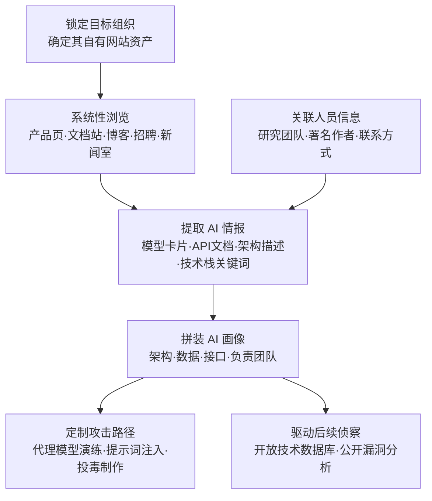

# 搜索受害者自有网站 (AML.T0003)

## 一句话通俗理解

> 攻击者不翻别人家的垃圾桶，专翻你自己挂在门口的"自我介绍"——官网上的模型卡片、API 文档、招聘启事、员工博客，你写得越详细，攻击者的侦察报告就越完整。

## 难度等级

⭐⭐ **Demonstrated（已演示）**

官方成熟度评定为 Demonstrated——该技术已在公开研究与真实攻击场景中被演示使用。实施门槛极低：浏览目标网站本身就是普通用户行为，不需要任何工具链或漏洞利用。真正的"难度"不在于获取，而在于**从海量公开内容中筛出与 AI 系统相关的有效情报**，并把零散的产品介绍、招聘信息、技术博客拼接成对目标 AI 技术栈的完整画像。由于浏览行为与正常访客无异，这一侦察动作几乎不可能在事中被察觉。

## 技术描述

### 通俗解释

想知道一家公司用不用 AI、怎么用 AI，最直接的办法不是黑进它的系统，而是**读它自己发布的内容**。

每家组织都在主动向外界"交代"自己的 AI 布局：产品页炫耀新上线的智能客服、技术博客复盘 RAG 系统的踩坑经历、招聘页急招"大模型微调工程师（PyTorch 方向）"、员工在个人主页挂出署名论文……这些内容单独看都是正常的市场行为与知识分享，但拼在一起，就是一份攻击者视角的**免费 AI 资产清单**：模型是什么架构、数据从哪来、接口开在哪、哪个团队负责哪块业务。

与传统 T1594（搜索受害者拥有的网站）相比，ATLAS 版本的特殊之处在于**关注点聚焦于 AI**：攻击者翻的还是同一个官网，但盯着找的是"这家组织的 AI 系统长什么样"。

### 技术原理

依据官方描述，攻击者搜索受害者自有网站，收集可在攻击定位阶段使用的情报。受害者自有网站可能包含其 AI 产品或服务的技术细节，以及部门/分部名称、物理位置、关键员工的姓名/角色/联系方式、业务运营与业务关系等信息。这些情报可帮助攻击者**量身定制攻击**（如对抗性 AI 攻击 AML.T0017.000 或人工修改 AML.T0043.003），也可能揭示进一步侦察的机会（如搜索开放技术数据库 AML.T0000、搜索公开 AI 漏洞分析 AML.T0001）。

对 AI 攻击者有高价值的典型信息源：

| 信息源 | 攻击者能拿到什么 | 支撑的后续攻击 |
|--------|----------------|--------------|
| 产品文档 / API 文档 | AI 功能清单、模型能力描述、接口参数与速率限制 | 定位暴露的 AI 服务、构造提示词注入 |
| 模型卡片 / AI 发布公告 | 模型架构、训练数据来源、能力边界与已知局限 | 量身定制对抗样本、越狱提示词 |
| 招聘启事 | 技术栈关键词（PyTorch/LangChain/vLLM）、团队职责划分、内部系统命名 | 推断 AI 基础设施与工具链 |
| 员工署名论文 / 技术博客 | 模型架构细节、数据管线、实验配置，甚至系统架构图 | 构建代理模型、投毒数据制作 |
| 客户案例 / 合作伙伴页面 | AI 系统的部署范围、上下游依赖 | 供应链攻击定位、信任关系利用 |
| 新闻室 / 高管发言 | AI 战略路线图、收购计划、关键人事变动 | 判断攻击时间窗口、锁定高价值目标 |

三点值得特别注意：

- **被动且完全合法**：所有信息都来自公开可访问的页面，攻击者不触碰任何未授权系统，不触发任何告警；
- **官方渠道自带可信度**：受害者自己发布的内容默认可信，攻击者据此构建的攻击画像准确度远高于第三方猜测；
- **AI 细节泄露是增量风险**：组织对"不要泄露服务器版本号"已有共识，但对"模型卡片里写训练数据来源"这类 AI 信息的泄露风险普遍缺乏敏感度。

**平台覆盖**：以 Enterprise 平台为主——攻击者在传统环境中即可执行本技术，目标是各类部署了 AI 能力的企业组织。

### 用途影响

- **攻击定制化**：掌握目标使用的具体模型与架构后，攻击者可以离线构建行为近似的代理模型反复演练，或针对已知架构直接复用现成的对抗攻击实现；
- **攻击面收敛**：从公开文档确认哪个 AI 服务暴露在公网、哪个 API 需要认证，避免攻击者盲目试探；
- **社会工程素材**：部门名称、员工角色与联系方式直接支撑高质量鱼叉式钓鱼与冒充攻击；
- **连锁侦察入口**：官网论文链接指向 arXiv、产品页链接指向模型仓库，一次浏览可引出整条公开情报链。

## 攻击流程

### 典型攻击流程



**步骤详解：**

1. **锁定目标自有网站资产**
   - 通俗描述：确定"要翻哪些家底"。
   - 技术细节：枚举目标组织的主站、子站、文档站、开发者门户、博客、招聘页与新闻室；注意区分**自有网站**（本技术）与第三方平台（社交媒体、应用商店归 AML.T0004 等其他技术覆盖）。

2. **系统性浏览公开页面**
   - 通俗描述：像做尽调一样读官网。
   - 技术细节：重点扫描产品页中的 AI 功能宣传、开发者文档中的 API 定义与速率限制、技术博客中的实现复盘、招聘启事中的技术栈关键词；网页源码注释、robots.txt、sitemap 等传统边角料同样适用。

3. **提取 AI 相关情报**
   - 通俗描述：把零散信息变成情报。
   - 技术细节：记录模型卡片中的架构与训练数据描述、API 文档暴露的端点与参数、博客中的系统架构图、论文中的实验配置；同步收集部门名称、物理位置与关键研究人员信息。

4. **拼装目标 AI 画像**
   - 通俗描述：拼图完成，目标 AI 系统全貌浮现。
   - 技术细节：交叉验证多来源信息，确认目标使用的模型架构（自研/开源微调）、数据来源、部署形态（云端/本地）、暴露接口与负责团队，输出结构化目标画像。

5. **转化为攻击行动**
   - 通俗描述：情报开始"变现"。
   - 技术细节：依据画像定制对抗性 AI 攻击或人工修改（如针对具体架构构造对抗样本、为提示词注入准备上下文素材），或转入进一步侦察——在开放技术数据库与公开漏洞分析中检索该架构的既有研究成果。

**与后续战术的衔接：**

- **AI 攻击适配（Reconnaissance → 攻击准备）**：依据画像将通用攻击方法适配到目标具体模型与数据管线
- **资源开发**：基于确认的架构构建代理 AI 模型、获取公开 AI 制品
- **初始访问**：利用确认的暴露 AI 服务与接口特征选择入侵入口
- **其他侦察技术**：官网内容引出的论文、模型仓库线索可无缝衔接 AML.T0000、AML.T0001

> 关键差异：传统 T1594 收集的是"目标公司长什么样"；AML.T0003 收集的是"目标的 AI 系统长什么样"——同一批页面，不同的提取目标，最终支撑的是完全不同的攻击类型（对抗样本、提示词注入、投毒）。

## 真实案例

> 以下 2 个案例全部源自 MITRE ATLAS 案例库（官方共关联 2 个案例研究）。

### 案例1：迷惑反病毒神经网络（AML.CS0014）

- **时间**: 公开研究（Kaspersky ML 研究团队）
- **攻击者**: Kaspersky 安全研究团队（授权研究演示）
- **手法**: 云端恶意软件检测已成为主流部署模式：特征在用户终端提取后，被送往安全厂商服务器做模型推理。Kaspersky 研究团队以自身反病毒 ML 模型为目标，在**没有任何白盒访问**的灰盒场景下发起对抗攻击——研究人员依靠目标公开发布的技术资料理解模型的特征空间，证明"仅凭特征知识"就足以构造对抗样本。最终，大多数经过对抗性修改的恶意软件文件成功规避了该 ML 模型的检测。
- **影响**: 证明了部署云端 ML 检测器的厂商，其公开发布的技术描述本身就可能成为攻击者的情报源；即使不接触模型本体，公开信息也足以支撑有效规避
- **参考链接**: [SecureList: How to confuse antimalware neural networks](https://securelist.com/how-to-confuse-antimalware-neural-networks-adversarial-attacks-and-protection/102949/)

### 案例2：Living Off AI——通过 Jira Service Management 的提示词注入（AML.CS0039）

- **时间**: 2025年（Cato Networks 威胁研究）
- **攻击者**: Cato CTRL 威胁研究团队（PoC 演示）
- **手法**: 研究人员演示了如何利用嵌入企业工作流的 AI 系统，以提升后的权限执行恶意动作：外部用户提交携带恶意指令的工单（如 Jira 支持票据），这些内容随后被内部用户或自动化系统中的 AI 智能体处理——智能体带着内部上下文与信任运行，可能解读并执行恶意指令，导致数据渗漏、权限提升或系统操纵。研究的前提侦察正是对 Atlassian 公开文档的研究：从受害者自有的产品文档中搞清楚 MCP 集成如何处理工单内容。
- **影响**: 揭示"Living Off AI"新型风险——合法 AI 智能体被外部输入劫持；产品文档中描述的 AI 工作流直接决定了攻击载荷的设计
- **参考链接**: [Cato Networks: Living Off AI - PoC Attack Targeting Atlassian's MCP](https://www.catonetworks.com/blog/cato-ctrl-poc-attack-targeting-atlassians-mcp/)

> **两个案例的共同模式**：攻击者/研究者都是先从目标（或目标生态）公开发布的技术资料中理解 AI 系统的输入与工作方式，再据此构造攻击——公开信息的详细程度，直接决定了攻击的起点高度。这正是本技术被归入侦察战术的原因：翻网站本身不造成任何伤害，却为后续伤害**定好了靶子**。防御启示也由此而来：评估公开内容的敏感度时，问的不是"这条信息有害吗"，而是"攻击者拿到它能把攻击准备推进多远"。

## 红队视角

> ⚠️ **免责声明**：以下内容仅用于合法授权的安全测试与教育目的。未经授权对他人系统进行测试是违法行为。

### 实战技巧

1. **自有组织的公开情报审计（推荐切入点）**
   用攻击者视角系统翻查自己组织的全部对外内容：产品页、文档站、招聘启事、技术博客、新闻稿、员工署名论文。问一个问题：把这些内容拼起来，能还原出我们 AI 技术栈的多少细节？

2. **AI 关键词驱动的定向检索**
   在目标站点与搜索引擎中组合使用 AI 相关关键词（模型、RAG、智能体、微调、推理、MCP、Copilot、GPT、LLM），配合 `site:` 限定，快速定位目标自有内容中的 AI 相关页面——比逐页翻阅效率高一个量级。

3. **招聘信息情报提取**
   招聘 JD 是最"诚实"的技术栈泄露源：一家公司招什么岗位、要求什么框架经验、写明什么内部系统名称，几乎就是其 AI 基础设施的直接供词。

4. **交叉验证与画像输出**
   将官网信息与论文库（arXiv）、职业社交网络等外部来源交叉验证，输出结构化目标 AI 画像：模型架构、数据来源、暴露接口、负责团队、关键人员。

5. **历史内容回溯**
   网页时光机（Wayback Machine）等互联网存档保留了目标站点的历史版本——即使组织已经删除了敏感的架构描述，旧版产品页、下线的博客文章仍可能被回溯翻出。审计自己组织的公开泄露面时，务必把历史快照纳入范围。

### 常用工具

| 工具名称 | 用途 | 平台 |
|----------|------|------|
| 浏览器（开发者工具） | 查看页面源码、注释、隐藏字段 | 全平台 |
| Google 高级搜索 | `site:`/`filetype:` 定向检索目标自有内容 | Web |
| Wappalyzer / BuiltWith | 识别网站与 AI 服务技术栈 | 浏览器扩展 |
| wget / curl | 站点镜像与内容抓取（注意速率） | 跨平台 |
| SpiderSuite 等爬虫 | 图形化站点爬取与链接结构分析 | 跨平台 |

### 注意事项

- **浏览公开内容本身合法**，但自动化爬取需遵守目标站点服务条款与速率限制，避免对目标造成干扰
- 红队报告中情报审计的价值在于**量化泄露面**（能还原多少技术栈），而非展示"我能找到"
- 涉及员工个人信息的收集需严格遵守当地个人信息保护法规，仅保留与评估相关的最小必要信息

## 蓝队视角

### 检测要点

1. **面对现实：被动侦察几乎不可检测**
   - 攻击者浏览公开页面的行为与正常访客无异，不产生安全告警
   - 检测重心应放在**事前的信息暴露治理**，而非事中的行为识别

2. **Web 日志中的爬虫行为识别（辅助）**
   - 日志来源：Web 服务器访问日志、CDN 日志、WAF 日志
   - 关注字段：User-Agent、请求频率、访问路径序列、来源 IP
   - 异常特征：短时间遍历大量深层页面、系统性下载文档站全部 PDF、忽略 robots.txt 的高频爬取、对 AI 产品页与文档站的异常密集访问

3. **信息暴露的持续监控**
   - 定期以"攻击者视角"复查对外内容，建立 AI 信息发布清单
   - 监控开发者文档、模型卡片、博客的发布流程，AI 技术细节发布前经安全评审

### 监控建议

- 建立**对外发布内容的 AI 敏感度分级**：架构细节、训练数据来源、内部系统命名列为高敏内容，发布需审批
- 对文档站与 API 文档实施**访问分析**：识别系统性全量抓取模式（区别于正常开发者的按需查阅）
- 将"自有网站 AI 情报泄露"纳入年度红队演练范围，量化泄露趋势
- **跨部门联动**：市场部（产品宣传）、HR（招聘 JD）、工程师（技术博客）是 AI 信息的三大发布出口，治理流程必须覆盖三者的发布审核环节，仅靠安全团队单点把关必然遗漏
- **定期复查而非一次审计**：组织内容发布是持续性行为，建议以季度为周期重跑泄露面盘点，将结果纳入安全度量指标（如"可还原技术栈条目数"的趋势曲线）

> 防御视角一句话：既然无法阻止攻击者"读"，就把"值得读的内容"控制到最少——这不是信息封锁，而是发布前的安全评审，就像代码发布前要过代码审查一样。

## 检测建议

### 网络层检测

**检测方法：** 识别针对文档站与 AI 产品页的异常爬取模式。

- 同一来源 IP 短时间内请求大量非首页深层路径（/docs/、/api/、/blog/）
- 对 robots.txt 中 Disallow 路径的主动探测
- 系统性下载文档站全部 PDF/附件的顺序化请求序列

### 主机层检测

**检测方法：** 本技术为被动侦察，主机侧无直接检测点。

- 检测重心转向信息暴露面管理：定期扫描自有站点中意外公开的敏感内容（配置文件、备份文件、内部系统引用）

### 应用层检测

**检测方法：** 利用 Web 应用的访问分析能力。

- 文档站与分析平台（如 Google Analytics）中识别非人类访问模式：会话时长趋近于零、页面访问深度异常、按目录顺序遍历
- 对高频访问 AI 相关文档的匿名会话建立画像，结合威胁情报库比对已知扫描器与爬虫特征

**程序化检测思路（低成本方案）：**

在 CDN 或 WAF 层配置一条简单规则：单 IP 在 10 分钟内访问 `/docs/*` 与 `/blog/*` 路径超过阈值（如 100 个不同 URL）即记录并标记——正常开发者按需查阅远低于该频率，站点镜像式爬取必然触发。标记结果不阻断（避免误伤搜索引擎），但进入周报复盘，用于发现针对性的情报收集行为。

### Sigma 规则思路示例

```yaml
title: 对文档站与AI产品页的镜像式爬取（侦察信息收集）
status: experimental
description: 检测短时间遍历大量深层文档页面的访问模式，
    可能为攻击者的站点级信息收集（AML.T0003）
logsource:
    category: webserver
    product: nginx
detection:
    selection:
        sc-status: 200
        path|startswith:
            - '/docs/'
            - '/api/'
            - '/blog/'
    filter_ua:
        ua|contains:
            - 'Googlebot'
            - 'bingbot'
            - 'Baiduspider'
    condition: selection and not filter_ua | count(path) by src_ip > 100
    timeframe: 10m
level: low
tags:
    - attack.t1594
    - atlas.aml_t0003
```

## 缓解措施

### 优先级1：关键措施

**AML.M0000 限制信息公开（Limit Public Release of Information）**

限制公开发布组织产品或服务中 AI 技术栈的技术信息。攻击者可利用 AI 使用方式的技术知识进行目标定位并量身定制攻击。此外，考虑限制发布组织信息——包括物理位置、研究人员姓名与部门结构——这些信息可能被用于推断 AI 技术、模型架构或数据集。

落地要点：

1. **建立 AI 信息发布评审流程**：模型卡片、技术博客、产品文档中涉及架构、训练数据、内部系统命名的细节发布前经安全团队评审
2. **最小化技术自曝**：产品宣传聚焦能力与价值，不披露实现细节（"基于自研大模型"足够，无需写明架构与数据来源）
3. **治理存量内容**：审计已发布的技术博客与论文，评估其中可被拼接利用的 AI 实现细节
4. **同步治理组织信息**：物理位置、研究员名单、部门结构等看似无害的信息，可能支撑对模型架构与数据集的推断，按需收敛

### MITRE ATLAS 缓解措施映射

| 缓解措施ID | 缓解措施名称 | 优先级 | 类别 | 生命周期阶段 |
|------------|-------------|:------:|------|-------------|
| AML.M0000 | 限制信息公开 | 关键 | Policy | 业务与数据理解 |

> 本技术官方仅关联一项缓解措施。原因在于：被动侦察无法在事中阻断，唯一的防线就是**让攻击者从公开渠道拿不到可用的情报**——信息公开治理是治本，其余手段（爬虫检测、WAF）只能提供有限的辅助可见性。

## 关联 ATT&CK 技术

- [搜索受害者拥有的网站 (T1594)](../../enterprise/01-Reconnaissance/T1594-Search-Victim-Owned-Websites.md) — 本技术在 ATT&CK Enterprise 中的对应技术，两者为同源关系

**ATLAS 版本 vs ATT&CK 原版：**

| 维度 | ATT&CK T1594 | ATLAS AML.T0003 |
|------|-------------|-----------------|
| 信息来源 | 受害者自有网站（通用） | 同样是自有网站，但聚焦 AI 相关内容 |
| 收集目标 | 员工联系方式、组织结构、技术栈、业务关系 | 上述信息 + **模型卡片、AI API 文档、AI 招聘需求、员工 AI 论文** |
| 情报用途 | 制作钓鱼、识别漏洞、规划物理渗透 | 支撑**对抗性 AI 攻击、人工修改、代理模型构建**等 AI 原生攻击 |
| 泄露敏感度 | 服务器版本号、员工邮箱等已有共识 | **AI 实现细节的泄露风险**普遍缺乏认知，治理成熟度低 |

一句话总结：T1594 回答"目标公司的门牌号和技术栈是什么"，AML.T0003 回答"**目标公司的 AI 系统用什么模型、吃什么数据、开什么接口**"——同一个官网，攻击者换了一副眼镜。

## 动手实验

> ⚠️ **重要提示**：实验仅针对**自己拥有或获得书面授权**的组织网站进行。未经授权对他人系统进行自动化爬取可能违反法律与服务条款。

### 实验环境准备

| 环境组件 | 用途 | 获取方式 |
|----------|------|----------|
| 自己组织的对外网站（或搭建演练站点） | 审计对象 | 自有资产 |
| 浏览器 + 开发者工具 | 页面与源码分析 | 系统内置 |
| Google 搜索（site: 语法） | 定向检索演练 | 公开服务 |
| Wappalyzer 浏览器扩展 | 技术栈识别 | 官方站点 |

### 实验1（初级）：自有网站 AI 情报自查

**实验目标：** 以攻击者视角盘点自己组织公开内容中的 AI 信息泄露。

**实验步骤：**
1. 用 `site:yourdomain.com` 组合 AI 关键词（模型、智能体、RAG、LLM、微调）检索自有内容
2. 逐页审阅产品页、文档站、招聘启事，记录每一处出现的 AI 实现细节
3. 查看页面源码，搜索 HTML 注释、隐藏字段中的内部系统名称
4. 将发现按"架构 / 数据 / 接口 / 人员"四类整理成泄露清单

**预期结果：** 得到一份自己组织的"攻击者 AI 画像"，多数组织第一次做都会被清单长度吓到。

### 实验2（中级）：招聘信息情报提取演练

**实验目标：** 理解招聘渠道的技术栈泄露强度。

**实验步骤：**
1. 选定一家公开发布 AI 招聘信息的组织（仅做阅读分析，不联系不投递）
2. 从 JD 中的岗位要求、技术栈关键词、团队介绍推断其 AI 基础设施组成
3. 将推断结果与其产品文档、技术博客交叉验证
4. 反思：自己组织的 JD 若被同样分析，会暴露什么？

**预期结果：** 掌握从招聘信息还原 AI 技术栈的方法，形成对本组织 JD 发布的检查习惯。

### 实验3（高级）：泄露面量化报告

**实验目标：** 输出可推动管理层行动的量化评估。

**实验步骤：**
1. 汇总实验1、2的发现，按可还原的攻击面分类：可定制对抗攻击的架构信息、可构造注入的接口信息、可社工的人员信息
2. 为每类信息标注"公开的必要性"（业务必需 / 可简化 / 可移除）
3. 对可简化/可移除项给出改写建议（保留营销价值、剥离实现细节）
4. 将报告提交内部安全评审，推动建立 AI 信息发布审批流程

**预期结果：** 一份从"发现泄露"到"治理闭环"的完整实践，直接对应缓解措施 AML.M0000 的落地。

## 术语解释

| 术语 | 英文原名 | 通俗解释 |
|------|----------|----------|
| 受害者自有网站 | Victim-Owned Websites | 目标组织自己拥有并运营的网站资产——官网、文档站、博客、招聘页，区别于第三方平台 |
| 模型卡片 | Model Card | 随模型发布的"说明书"，常写明架构、训练数据、能力与局限——对攻击者来说是浓缩的情报金矿 |
| 被动侦察 | Passive Reconnaissance | 不与目标系统产生超出正常访客的交互、不留下可检测痕迹的信息收集方式 |
| 灰盒攻击 | Gray-Box Attack | 介于黑盒（只看输入输出）与白盒（完全掌握内部结构）之间——攻击者掌握部分信息（如特征空间）即可构造攻击 |
| 对抗样本 | Adversarial Example | 对输入做人眼难辨的微小扰动，让 AI 模型给出错误判断的构造样本 |
| 代理模型 | Proxy Model | 攻击者基于公开情报训练的、行为近似目标模型的替身，用于离线演练攻击 |
| 人工修改 | Manual Modification | ATLAS 技术 AML.T0043.003，攻击者手工篡改 AI 系统制品（如模型或数据）实现恶意目的 |
| MCP | Model Context Protocol | 为 AI 智能体提供工具调用能力的标准协议，智能体生态的核心组件 |
| 情报拼接 | Intelligence Aggregation | 把多个单独无害的公开信息交叉组合，还原出敏感全貌的侦察手法 |
| OSINT | Open Source Intelligence | 开源情报——从公开渠道收集、分析信息以生成情报的过程 |
| Google Dorking | Google Dorking | 使用 site:、filetype: 等搜索运算符定向检索特定站点敏感内容的技术 |
| robots.txt | robots.txt | 网站根目录下声明"不希望被爬取路径"的文件——Disallowed 的路径反而向攻击者标注了宝贝位置 |
| 站点镜像 | Website Mirroring | 把目标网站整体下载到本地供离线分析的行为，是系统性信息收集的典型特征 |

## 参考资料

### 📚 官方文档

- [MITRE ATLAS - Search Victim-Owned Websites (AML.T0003)](https://atlas.mitre.org/techniques/AML.T0003/) - 官方技术页面
- [MITRE ATLAS - Limit Public Release of Information (AML.M0000)](https://atlas.mitre.org/mitigations/AML.M0000/) - 官方缓解措施页面
- [MITRE ATLAS 矩阵](https://atlas.mitre.org/matrices/ATLAS/)
- [MITRE ATLAS Data (GitHub)](https://github.com/mitre-atlas/atlas-data)

### 📰 案例报告（真实攻击与安全研究）

- [SecureList: How to confuse antimalware neural networks](https://securelist.com/how-to-confuse-antimalware-neural-networks-adversarial-attacks-and-protection/102949/) - 灰盒场景下对反病毒 ML 模型的对抗攻击（AML.CS0014）
- [Cato Networks: Living Off AI - PoC Attack Targeting Atlassian's MCP](https://www.catonetworks.com/blog/cato-ctrl-poc-attack-targeting-atlassians-mcp/) - 通过工单注入劫持 AI 智能体的 PoC（AML.CS0039）

### 🔧 工具与资源

- [Wappalyzer](https://www.wappalyzer.com/) - 网站技术栈识别
- [Google 高级搜索运算符](https://support.google.com/websearch/answer/2466433) - site:/filetype: 定向检索
- [OWASP Top 10 for LLM Applications](https://owasp.org/www-project-top-10-for-large-language-model-applications/) - LLM 应用十大安全风险
- [NIST AI Risk Management Framework](https://www.nist.gov/itl/ai-risk-management-framework) - NIST AI 风险管理框架

### 🔗 关联阅读

- [搜索受害者拥有的网站 (T1594)](../../enterprise/01-Reconnaissance/T1594-Search-Victim-Owned-Websites.md) - ATT&CK Enterprise 同源技术，对照阅读
- [侦察战术 (AML.TA0002)](./README.md) - 本技术所属战术的概览页
- [ATT&CK Enterprise 侦察战术 (TA0043)](../../enterprise/01-Reconnaissance/README.md) - 传统侦察战术全览

---

> **版本**: ATLAS 2026.09 | **更新**: 2026-10-22 | **模板**: ATLAS 技术文档 v1.0
