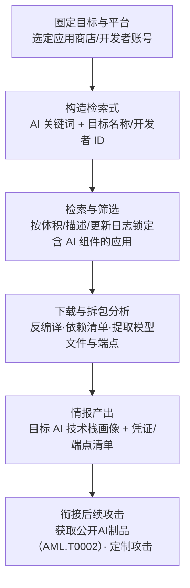

# 搜索应用仓库 (AML.T0004)

## 一句话通俗理解

> 攻击者把应用商店当成"展柜"来侦察——你的 App 一上架 Google Play、App Store 或 Microsoft Store，攻击者就能用关键词检索锁定你发布的含 AI 组件的应用，再通过拆包分析摸清里面嵌了什么模型、调用了哪个模型 API、SDK 是什么版本，甚至捡走你不小心打包进去的 API 密钥。

## 难度等级

⭐⭐ **Demonstrated（已演示）**

官方成熟度评定为 Demonstrated——该技术已在公开研究与真实攻击场景中被演示。实施门槛极低：应用商店是面向所有人的公开平台，搜索与下载行为完全合法且不留下可归属的痕迹；真正需要功力的是**从海量应用中筛出含 AI 组件的目标**并从二进制中提炼出可用的技术情报。研究表明（见真实案例），从应用商店批量收集含深度学习模型的移动应用并逐一定位其 AI 架构，已经是成熟可复现的研究方法。

## 技术描述

### 通俗解释

传统侦察中，攻击者翻你的官网、翻你的招聘启事；ATLAS 侦察中多了一条新路——**翻你的成品**。应用商店本质上是全球最大的"软件样品陈列馆"：任何人不花一分钱就能下载、安装、拆卸你发布的应用。对于把 AI 能力放进 App 的组织而言，这份"陈列"泄露的信息远超产品介绍页——应用包里可能躺着可以直接提取的模型文件、写死在代码里的模型 API 端点、AI SDK 的确切版本，甚至开发阶段遗留的密钥。

一句话：**官网告诉你"我们用了 AI"，应用仓库告诉攻击者"你的 AI 具体长什么样"**。

### 技术原理

依据官方描述，攻击者可能在针对目标期间搜索**开放应用仓库（open application repositories）**，典型平台包括：

- **Google Play**（Android 应用商店）
- **iOS App Store**（苹果应用商店）
- **macOS App Store**（苹果桌面应用商店）
- **Microsoft Store**（Windows 应用商店）

攻击者会**构造搜索查询**，专门寻找**包含 AI 能力组件的应用**。搜索与筛选的常见信号包括：

| 侦察维度 | 典型信号 | 情报价值 |
|---------|---------|---------|
| 商店元数据 | 应用描述/更新日志中的 AI 关键词、开发者账号下的应用清单 | 快速圈定目标的应用家族 |
| 安装包体积 | 数十 MB 以上、且无大型媒体资源的安装包 | 提示内嵌本地模型文件 |
| 依赖与 SDK 指纹 | TensorFlow Lite / Core ML / ONNX Runtime / OpenAI SDK 等运行时特征 | 确认 AI 技术栈与框架版本 |
| 模型端点 | 拆包后代码中的模型推理 API 地址、认证方式 | 定位云端攻击面 |
| 遗留凭证 | 硬编码的 API 密钥、第三方服务令牌 | 直接的后续攻击材料 |

官方描述明确指出：**该技术的下一步通常是"获取公开 AI 制品"（Acquire Public AI Artifacts，AML.T0002）**——攻击者从应用仓库锁定目标应用后，下载并提取其中的模型文件等 AI 制品，用于离线分析、构建代理模型或定制攻击。

在公开研究中，同一方法论还被推广到两类相邻的"应用仓库"（本库案例库中对应的案例研究同样归属于本技术）：

1. **暴露的容器镜像仓库**——通过服务索引平台与网络搜索发现错误配置的私有镜像仓库，其中往往打包了 AI 模型；
2. **互联网上公开的 LLM 集成应用**——通过特征指纹搜索发现基于已知 LLM 框架部署的公开应用。

**平台覆盖**：Enterprise——攻击者在传统环境中即可执行，不需要接触目标系统本身。

**与相近技术的分工**：

- **AML.T0095 搜索开放网站/域名**：面向搜索引擎与 OSINT 渠道的通用信息收集，其中子技术"代码仓库"（AML.T0095.000）针对 GitHub 等代码托管平台；
- **AML.T0004 搜索应用仓库**（本技术）：面向**应用商店中已发布的成品应用**，分析对象是编译后的二进制制品而非源码仓库；
- **AML.T0002 获取公开 AI 制品**：本技术的典型下游——把侦察发现"变现"为可离线分析的模型文件。

### 用途影响

- **绘制目标 AI 技术栈**：确认目标在生产环境使用了什么模型架构、框架版本与推理端点，为后续投毒、提示词注入、越狱攻击提供"靶标参数"；
- **提取模型制品**：从应用包中直接获得模型文件，支撑代理模型构建与离线攻击演练（衔接 AML.T0002）；
- **捡取凭证与端点**：硬编码密钥与模型 API 地址可直接转化为后续攻击的入场券；
- **几乎零风险**：全部操作基于公开渠道的下载与分析，不接触目标基础设施，不触发目标侧告警。

## 攻击流程

### 典型攻击流程



**步骤详解：**

1. **圈定目标与平台**
   - 通俗描述：决定去哪家"展柜"翻哪家公司的货。
   - 技术细节：确定目标组织及其开发主体（主账号与马甲账号），选择其发布应用的应用商店（Google Play / iOS App Store / macOS App Store / Microsoft Store）；必要时同时覆盖多平台发布版本。

2. **构造检索式**
   - 通俗描述：设计能"钓"出 AI 应用的搜索词。
   - 技术细节：围绕 AI 关键词（语音助手、人脸识别、智能相册、聊天机器人等）与目标品牌、开发者 ID 组合检索；关注更新日志中的 AI 功能迭代记录。

3. **检索与筛选**
   - 通俗描述：从结果里挑出真正内嵌 AI 组件的应用。
   - 技术细节：按安装包体积初筛（内嵌本地模型的应用普遍偏大）；交叉比对应用描述中的 AI 功能声明与权限声明（相机、麦克风、无障碍服务）；排除仅"蹭 AI 概念"的营销型应用。

4. **下载与拆包分析**
   - 通俗描述：把 App 拆开看内部构造。
   - 技术细节：下载 APK/IPA/安装包，反编译 Dalvik/Smali 或 Swift/ObjC 代码；扫描依赖清单与字符串，识别 TensorFlow Lite、Core ML、ONNX、OpenAI SDK 等运行时指纹；定位 `.tflite`/`.mlmodel`/`.onnx` 等模型文件、模型推理 API 端点，以及硬编码的密钥与令牌。

5. **情报产出与衔接后续攻击**
   - 通俗描述：把翻到的信息整理成"作案地图"。
   - 技术细节：产出目标 AI 技术栈画像（模型架构、框架版本、端点清单、认证方式）；典型下游是获取公开 AI 制品（AML.T0002）——提取应用内嵌模型用于离线分析与代理模型构建；发现硬编码密钥则直接转入凭证滥用攻击。

**与后续战术的衔接：**

- **资源开发**：提取的模型文件支撑代理模型构建与影子演练（衔接 AML.T0002）
- **AI 攻击适配**：技术栈画像决定对抗样本、投毒、越狱等攻击的具体参数
- **凭证访问**：拆包捡到的硬编码密钥可直接用于冒充合法客户端调用目标模型 API
- **初始访问**：暴露的模型端点 + 遗留凭证的组合是"开箱即用"的入口

> 关键特点：本技术全程为**被动侦察**——不向目标任何基础设施发送数据包，目标侧几乎不存在检测机会。防御重心必须前移到"发布前收敛暴露面"。

## 真实案例

> 以下 3 个案例全部源自 MITRE ATLAS 案例库（官方数据共关联 3 个案例研究）。

### 案例1：移动应用深度学习模型的后门攻击研究（AML.CS0013）

- **时间**: 2021年（研究发布）
- **攻击者**: Microsoft Research 研究人员（安全研究）
- **手法**: 研究人员演示了针对移动应用中深度学习模型的"神经载荷注入"（neural payload injection）后门攻击。他们从 **Google Play 收集了大量真实移动深度学习应用**开展实证研究，最终识别出 **54 个可被攻击的应用**——其中包括现金识别、家长控制、人脸认证与金融服务等安全关键类应用。
- **影响**: 证明应用商店中含 AI 组件的移动应用可被系统性检索、收集并逐一验证攻击面；安全关键应用中的本地模型成为直接攻击目标
- **参考链接**: [DeepPayload: Black-box Backdoor Attack on Deep Learning Models through Neural Payload Injection](https://arxiv.org/abs/2101.06896)

### 案例2：暴露容器镜像仓库中的 AI 模型武器化（AML.CS0028）

- **时间**: 2025年（研究发布）
- **攻击者**: Trend Micro 研究人员（安全研究）
- **手法**: 研究人员**使用服务索引平台与网络搜索工具**，识别出互联网上 **8,000 多个错误配置的私有容器镜像仓库**，其中约 70% 还存在允许写入的过度宽松访问控制。他们在这些开放仓库的私有容器镜像中发现了 **1,000 多个可免认证拉取（pull）的独立 AI 模型**。攻击者一旦下载、检视并篡改容器内容（包括敏感的模型文件），即可实施供应链式攻击。
- **影响**: 证明"搜索应用仓库"的方法论已从应用商店扩展到暴露的镜像仓库——打包进容器的 AI 模型成为可被批量检索的公开制品
- **参考链接**: [Silent Sabotage: Weaponizing AI Models in Exposed Containers (Trend Micro)](https://www.trendmicro.com/vinfo/br/security/news/cyber-attacks/silent-sabotage-weaponizing-ai-models-in-exposed-containers)

### 案例3：LLMSmith——LLM 集成应用中的 RCE 漏洞挖掘（AML.CS0052）

- **时间**: 2023年（研究发布）
- **攻击者**: 安全研究人员（学术研究）
- **手法**: 研究人员在 **11 个 LLM 框架**（LangChain、LlamaIndex、Pandas-ai、Langflow、Auto-GPT、MetaGPT 等）中发现了 **20 个远程代码执行（RCE）漏洞**。他们进一步**搜索发现了部署在公共互联网上、基于这些框架构建的实际应用**，并演示了利用提示词注入触发这些 RCE 漏洞的完整攻击链。
- **影响**: 证明基于 LLM 框架构建的公开应用可被网络搜索批量定位——攻击者"搜到即可尝试打"，应用仓库侦察与漏洞利用之间的距离被大幅拉近
- **参考链接**: [Demystifying RCE Vulnerabilities in LLM-Integrated Apps (arXiv)](https://arxiv.org/abs/2309.02926) | [LLMSmith 官网](https://sites.google.com/view/llmsmith)

## 红队视角

> ⚠️ **免责声明**：以下内容仅用于合法授权的安全测试与教育目的。对第三方应用的分析应遵守应用商店条款与当地法律；未经授权对他人系统进行测试是违法行为。

### 实战技巧

1. **应用资产盘点（面向委托客户）**
   以客户组织为主体，盘点其在各应用商店的全部发布应用（含历史版本与马甲账号），比对官网声明与实际发布物，找出"官网没提但已上架"的 AI 功能应用——这类应用往往是防御盲区。

2. **商店侧检索演练**
   用 AI 功能关键词 + 客户品牌组合检索，验证客户的应用能否被"一键钓出"；评估应用描述、更新日志与截图中泄露的 AI 技术细节（模型名称、供应商、功能边界）。

3. **拆包暴露面评估（仅限自有应用）**
   对客户自有应用执行拆包分析：运行密钥扫描（apkleaks/MobSF），检查是否内嵌 API 密钥、调试端点、模型 API 地址；评估内嵌模型文件是否可直接提取。在报告中量化暴露面，而非真的利用。

4. **镜像仓库暴露核查**
   用服务索引平台（Shodan/Censys）核查客户私有容器镜像仓库是否存在未认证暴露（对应案例2手法），核查结果作为"应用仓库暴露面"的延伸证据。

### 常用工具

| 工具名称 | 用途 | 平台 |
|----------|------|------|
| jadx / apktool | Android APK 反编译与资源提取 | 跨平台 |
| MobSF | 移动应用自动化静态/动态分析 | 跨平台 |
| apkleaks | APK 内硬编码密钥与端点扫描 | 跨平台 |
| strings + grep | 安装包字符串粗筛（模型/端点/密钥特征） | 跨平台 |
| Shodan / Censys | 暴露容器镜像仓库与 LLM 应用的索引检索 | Web |

### 注意事项

- **红线**：不利用发现的密钥与漏洞，不上传/篡改任何仓库内容；对第三方应用的分析以"商店页面元数据"为限，拆包分析仅限客户自有应用
- 应用商店分析全部走公开渠道，无需接触客户系统——这既是优点（无痕）也是报告难点：用截图与哈希固定证据
- 关注历史版本：旧版本应用可能包含已撤销但未轮换的密钥

## 蓝队视角

### 检测要点

1. **接受"侦察不可检测"的现实**
   - 本技术为纯被动侦察，攻击者在你视野之外完成全部工作
   - 检测策略必须从"发现侦察行为"转为"压缩可被侦察到的暴露面 + 监控暴露物的滥用"

2. **暴露面定期自查（由外向内）**
   - 用攻击者的方法审自己：定期用 AI 关键词 + 品牌名检索各应用商店，盘点全部发布物
   - 对每个已发布应用执行一次拆包审计：密钥、端点、模型文件三要素清点

3. **下游滥用监控（暴露物被用即告警）**
   - 日志来源：API 网关认证日志、应用商店后台统计、容器仓库拉取日志
   - 异常特征：已下架旧版本客户端的持续 API 调用、单一密钥的异常来源/频率、匿名身份对私有镜像仓库的拉取、下载统计中与目标市场不符的地区尖峰

### 监控建议

- 建立**发布物清单**：所有上架应用（含历史版本）及其内嵌组件（模型、SDK、密钥版本）登记造册，形成"应用侧 AI BOM"
- 内嵌密钥一律视为**半公开**：配额限制 + 定期轮换 + 按版本可撤销，并监测旧版本密钥的存活调用
- 私有容器镜像仓库强制认证 + 审计匿名访问尝试（案例2显示 70% 暴露仓库存在写权限滥用空间）
- 对基于 LLM 框架的对外服务做指纹自查：攻击者能搜到的特征（默认端点、错误页、框架版本头），自己要先行掌握

## 检测建议

### 网络层检测

**检测方法：** 本技术不触达目标网络，网络层无可检测信号；可检测的是其**下游滥用**。

- API 网关侧：来自已停止维护客户端版本、且携带内嵌密钥的认证请求（侦察→凭证捡取链路的落地信号）
- 镜像仓库侧：匿名/未授权身份对私有仓库的拉取与推送请求
- LLM 应用侧：针对已知 LLM 框架默认端点（如 `.well-known`、`/chain` 类路由）的探测与提示词注入尝试

### 主机层检测

**检测方法：** 覆盖制品分发与存储节点。

- 文件完整性监控覆盖构建产物目录，非构建窗口的制品读取/下载行为告警
- 构建服务器对应用商店分发通道的上传行为与发布记录比对，未登记的"多出来的版本"告警

### 应用层检测

**检测方法：** 利用应用商店与 API 网关自身的数据。

- 应用商店后台统计异常：与目标市场明显不符的地区性下载尖峰、短时间批量拉取历史版本
- API 网关侧"客户端版本 × 密钥版本 × 来源 ASN"三维交叉：如新版密钥 + 早已下架的客户端版本组合出现，高度疑似拆包复用
- 对提取型攻击（衔接 AML.T0002）：监测同一模型端点在异常时间窗口的离线批量推理请求

### Sigma 规则思路示例

```yaml
title: 已下架客户端版本携带内嵌密钥的认证请求（应用仓库侦察下游信号）
status: experimental
description: 检测早已停止维护的应用客户端版本仍在调用 API，
    可能为攻击者拆包提取内嵌密钥后的滥用（AML.T0004 下游链路）
logsource:
    category: application
    product: api_gateway
detection:
    selection_client:
        UserAgent|startswith: 'MyApp/1.'   # 已下架的 1.x 客户端
    filter_internal:
        SourceIP|startswith:
            - '10.'
            - '192.168.'
    condition: selection_client and not filter_internal
    timeframe: 1h
level: high
tags:
    - atlas.aml_t0004
```

## 缓解措施

### 优先级1：关键措施

**AML.M0000 限制信息公开发布（Limit Public Release of Information）**

限制公开组织中产品或服务所使用 AI 技术栈的技术细节。攻击者可利用 AI 使用方式的技术知识开展侦察并定制攻击。同时考虑限制组织信息公开范围——包括物理位置、研究员姓名与部门结构——因为这些信息可能被用来推断 AI 技术、模型架构或数据集等细节。落地要点：发布物（应用描述、更新日志、技术博客）中的 AI 细节遵循"最小披露"；上架应用在发布前完成一轮"攻击者视角拆包审计"，确保密钥、端点与模型文件的暴露均在可接受范围内。

### 优先级2：重要措施（本库补充，非 ATLAS 官方映射）

**发布前密钥扫描（Secrets Scanning 进 CI）**

在移动应用构建流水线中强制执行密钥扫描，阻止 API 密钥、令牌与证书随安装包出厂；对必须内嵌的密钥实施配额限制、版本化管理与短周期轮换，并默认其"半公开"属性。

**发布物最小化**

评估应用内嵌本地模型的必要性——内嵌即等于"分发即公开"；确需内嵌时，接受其可被提取的前提，评估模型被用于代理构建与离线攻击演练的边际风险。

### MITRE ATLAS 缓解措施映射

| 缓解措施ID | 缓解措施名称 | 优先级 | 类别 | 生命周期阶段 |
|------------|-------------|:------:|------|-------------|
| AML.M0000 | 限制信息公开发布 | 关键 | Policy | 业务与数据理解 |

> 优先级说明：本技术在 ATLAS 官方数据中仅关联 AML.M0000 一项缓解措施。其定位是"源头收敛"——少公开一分技术细节，攻击者就多摸一分瞎；发布物层面的密钥扫描与最小化是本库补充的落地抓手。

## 关联 ATT&CK 技术

本技术在 ATLAS 官方数据中**没有直接的 ATT&CK 映射条目**，但与以下传统侦察技术主题相关：

- [代码仓库 (T1593.003)](../../enterprise/01-Reconnaissance/T1593/T1593.003-Code-Repositories.md) — 同为"在公开托管平台上检索目标制品"的侦察手法，检索对象从代码仓库换成了应用商店

**代码仓库侦察 vs 应用仓库侦察：**

| 维度 | 代码仓库 (T1593.003) | 搜索应用仓库 (AML.T0004) |
|------|---------------------|------------------------|
| 检索平台 | GitHub / GitLab 等代码托管平台 | Google Play / App Store / Microsoft Store 等应用商店 |
| 分析对象 | 源码、配置文件、提交历史、.env 泄漏 | 编译后的安装包（APK/IPA）、依赖清单、内嵌模型与 SDK |
| 目标状态 | 目标"主动发布"的开源/泄露代码 | 目标**正式发布的成品应用**——必然存在且持续更新 |
| AI 特有产出 | — | 内嵌模型文件（衔接 AML.T0002）、模型 API 端点、AI SDK 指纹 |
| 典型下游 | 凭证利用、代码复用构建攻击 | 提取模型制品、构建代理模型、定制对抗攻击 |

一句话总结：T1593.003 翻的是"你的代码"，AML.T0004 翻的是"你的成品货架"——只要组织发布含 AI 组件的应用，这个展柜就永远开着，防御只能靠发布前的收敛与发布后的监控。

## 动手实验

> ⚠️ **重要提示**：所有实验必须在隔离环境与合法授权范围内进行。对第三方应用仅做商店页面层面的观察；拆包分析仅限自有应用或自建测试应用。

### 实验环境准备

| 环境组件 | 用途 | 获取方式 |
|----------|------|----------|
| 安装了浏览器的分析机 | 应用商店检索实验 | 现有办公环境 |
| Android 构建环境（Android Studio） | 构建自有测试应用 | 官方安装包 |
| MobSF / apkleaks / jadx | 自有应用拆包分析 | pip / 官方发布页 |
| 一个小型 `.tflite` 模型 | 模拟内嵌 AI 组件 | [TensorFlow Hub](https://tfhub.dev/) 或自训练 |

### 实验1（初级）：应用商店 AI 应用检索

**实验目标：** 体验攻击者视角的"构造检索式"（对应官方描述中的 craft search queries）。

**实验步骤：**
1. 打开 Google Play 网页版，分别用"人脸识别""智能相册""语音助手"等 AI 关键词检索
2. 选定一个知名企业开发者，浏览其名下全部应用，圈出含 AI 功能的应用
3. 记录每个应用的安装包体积、描述中的 AI 声明与权限申请，思考：哪些信号能让人不拆包就推断"内嵌了本地模型"？
4. 对比该企业官网的 AI 产品介绍页：应用商店比官网多泄露了什么？

**预期结果：** 理解"应用商店即展柜"——仅凭商店元数据即可完成首轮筛选。

### 实验2（中级）：自有应用的拆包暴露面评估

**实验目标：** 掌握拆包分析流程，看清攻击者能看到什么。

**实验步骤：**
1. 构建一个简单 Android 应用：内嵌小型 `.tflite` 模型 + 一个写死的假 API 密钥 + 一个模型推理端点字符串
2. 导出 APK，用 MobSF 完成一次静态分析，浏览报告中的字符串、权限与组件清单
3. 用 apkleaks 扫描 APK，确认假密钥是否被发现
4. 用 jadx 打开反编译代码，定位模型加载与端点调用位置
5. 思考：如果你的组织上架应用被这样拆开，三要素（密钥/端点/模型）各暴露了什么？

**预期结果：** 产出一份"攻击者视角暴露清单"，理解发布前审计的最小流程。

### 实验3（高级）：暴露面延伸——镜像仓库与 LLM 应用指纹

**实验目标：** 复现案例2/案例3的检索面，建立"应用仓库广义暴露"的认知。

**实验步骤：**
1. 在 Shodan 中检索常见容器镜像仓库的特征（如 `title:"Docker Registry"`），观察暴露数量规模，**仅观察索引元数据，不做任何拉取**
2. 在本地虚拟机中搭建一个私有镜像仓库，刻意不改默认配置，从另一台虚拟机验证其暴露性，再加固并复测
3. 在本地用 LangChain 部署一个最简 LLM 应用，用 curl 观察其默认路由与响应头，思考攻击者如何凭指纹批量定位这类应用（对照案例3）
4. 将三项发现整理为组织的"应用仓库暴露面基线"，纳入定期自查项

**预期结果：** 能向组织输出覆盖"应用商店 + 镜像仓库 + LLM 应用"三类暴露面的自查基线。

## 术语解释

| 术语 | 英文原名 | 通俗解释 |
|------|----------|----------|
| 应用仓库 | Application Repository | 托管已发布应用的公开平台——应用商店（Google Play、App Store、Microsoft Store）的统称，攻击者眼中的"软件样品陈列馆" |
| 拆包分析 | Reverse Engineering of App Packages | 把编译后的安装包（APK/IPA）还原为可读代码与资源，从中提取模型、端点与密钥的过程 |
| 依赖清单 | Dependency Manifest | 应用依赖的第三方库与 SDK 的清单文件，暴露目标的技术栈选型 |
| SDK 指纹 | SDK Fingerprinting | 通过运行时库的特征字符串与结构识别目标使用的 AI 框架及版本 |
| 模型文件 | Model File | 训练产出的模型本体（如 `.tflite`/`.mlmodel`/`.onnx`），内嵌进应用即可被提取（衔接 AML.T0002） |
| 硬编码密钥 | Hard-coded Key | 开发时直接写死在代码里的 API 密钥或令牌——随应用发布等于公开 |
| 神经载荷注入 | Neural Payload Injection | 针对移动应用内深度学习模型的后门攻击手法（案例1） |
| 容器镜像仓库 | Container Registry | 存放容器镜像的仓库服务，错误配置时其内的 AI 模型可被免认证拉取（案例2） |
| 服务索引平台 | Service Indexing Platform | 如 Shodan/Censys，持续扫描并索引互联网暴露服务的平台 |
| 获取公开 AI 制品 | Acquire Public AI Artifacts (AML.T0002) | 本技术的典型下游：下载、提取可公开获得的模型等 AI 制品用于离线分析 |

## 参考资料

### 📚 官方文档

- [MITRE ATLAS - Search Application Repositories (AML.T0004)](https://atlas.mitre.org/techniques/AML.T0004/) - 官方技术页面
- [MITRE ATLAS 矩阵](https://atlas.mitre.org/matrices/ATLAS/)
- [MITRE ATLAS Data (GitHub)](https://github.com/mitre-atlas/atlas-data)

### 📰 案例报告（真实攻击与安全研究）

- [DeepPayload: Black-box Backdoor Attack on Deep Learning Models through Neural Payload Injection](https://arxiv.org/abs/2101.06896) - 移动应用深度学习模型后门攻击实证研究（AML.CS0013）
- [Silent Sabotage: Weaponizing AI Models in Exposed Containers - Trend Micro](https://www.trendmicro.com/vinfo/br/security/news/cyber-attacks/silent-sabotage-weaponizing-ai-models-in-exposed-containers) - 暴露镜像仓库中 AI 模型武器化分析（AML.CS0028）
- [Exposed Container Registries: A Potential Vector for Supply-Chain Attacks - Trend Micro](https://www.trendmicro.com/vinfo/us/security/news/virtualization-and-cloud/exposed-container-registries-a-potential-vector-for-supply-chain-attacks) - 暴露容器仓库研究原文（AML.CS0028）
- [Demystifying RCE Vulnerabilities in LLM-Integrated Apps](https://arxiv.org/abs/2309.02926) - 11 个 LLM 框架 20 个 RCE 漏洞研究（AML.CS0052）
- [LLMSmith 官网](https://sites.google.com/view/llmsmith) - LLM 集成应用 RCE 研究项目页

### 🔧 工具与资源

- [MobSF](https://github.com/MobSF/Mobile-Security-Framework-MobSF) - 移动应用自动化安全分析框架
- [apkleaks](https://github.com/dwisiswant0/apkleaks) - APK 内 URI、端点与密钥扫描
- [jadx](https://github.com/skylot/jadx) - Dex 转 Java 反编译器
- [OWASP Mobile Application Security](https://mas.owasp.org/) - OWASP 移动应用安全验证标准
- [NIST AI Risk Management Framework](https://www.nist.gov/itl/ai-risk-management-framework) - NIST AI 风险管理框架

### 🔗 关联阅读

- [代码仓库 (T1593.003)](../../enterprise/01-Reconnaissance/T1593/T1593.003-Code-Repositories.md) - ATT&CK 中主题相关的侦察技术，与本技术对照阅读
- [侦察战术 (AML.TA0002)](./README.md) - 本技术所属战术的概览页

---

> **版本**: ATLAS 2026.09 | **更新**: 2026-10-22 | **模板**: ATLAS 技术文档 v1.0
