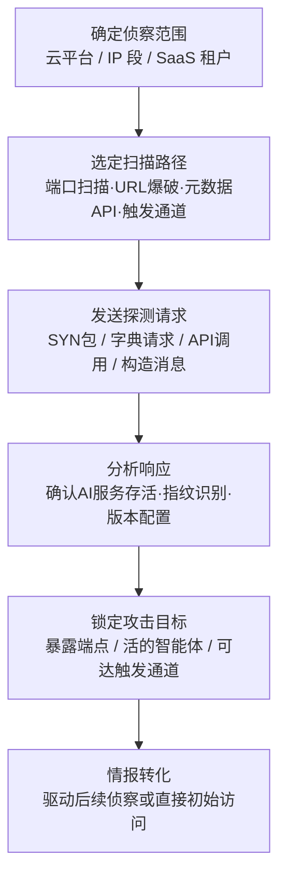

# 主动扫描 (AML.T0006)

## 一句话通俗理解

> 攻击者不再隔着望远镜远观，而是直接走到你家 AI 系统的门口挨个敲门——扫端口、猜 URL、调元数据接口、给智能体发测试邮件，哪扇门有回应、哪个入口没上锁，下一步就打哪里。

## 难度等级

⭐⭐⭐ **Realized（已实现）**

官方成熟度评定为 Realized——针对暴露 AI 服务的主动扫描已在真实攻击中大规模出现：ShadowRay 事件中暴露的 Ray 集群被持续利用至少七个月，GreyNoise 与 Zenity 的监测也证实威胁行为者正在互联网上系统性扫描暴露的 LLM 后端。技术门槛本身不高（nmap、masscan、FOFA 等工具开箱即用），真正需要注意的是其**目标特异性**：AI 系统往往部署在云环境与 SaaS 平台上，扫描对象从传统的 IP 段扩展到了平台命名空间、元数据 API 与智能体触发通道——攻击面从"哪个端口开着"变成了"哪家的 AI 服务能碰到"。

## 技术描述

### 通俗解释

被动侦察是在远处翻公开资料，主动扫描则是直接与目标系统交互：给可能的 AI 服务端口发探测包、按可预测的 URL 规则猜智能体地址、调用平台元数据接口拿租户信息、往潜在触发入口投递测试消息，然后根据响应判断——这台主机上跑的是不是 Ollama？这个 SaaS 租户里有没有活的智能体？这个邮箱背后是不是一个会自动处理邮件的 AI 客服？

信息更准，代价也更大：主动扫描会与目标系统产生**直接交互**，在日志中留下痕迹，这正是它与 AML.T0000、AML.T0095 等被动侦察技术的本质区别。但对于默认配置即暴露、几乎不设防的自托管 AI 服务来说，被扫到约等于被打——很多组织甚至不知道自己的 AI 资产已经暴露在公网上。

### 技术原理

依据官方描述，攻击者主动扫描可公开触达的 AI 系统与资源以选定攻击目标，识别配置错误或已知存在漏洞的版本。由于 AI 系统常部署于云环境，攻击者可以借助多种枚举方法高效发现 AI 系统并摸清其底层支撑平台。对于智能体与 SaaS 托管系统，受害者系统还包括智能体部署所在的**共享平台与提供商控制平面（provider control plane）**——这意味着扫描的对象不只是目标组织自己的资产，还包括整个平台。

攻击者可能探测目标系统收集信息与元数据，或对潜在受害者的网络与可达服务器进行开放端口扫描，以定位不同类型的已部署 AI 服务；也可能直接扫描目标资产，寻找公开可用的 AI 智能体或 SaaS 平台上可访问的智能体聊天界面（如 [Copilot Studio Hunter](https://github.com/mbrg/power-pwn/wiki/Modules:-Copilot-Studio-Hunter-%E2%80%90-Enum) 这类公开工具演示的手法）。

AI 服务之所以"好扫"，有三个结构性原因：

1. **端口与路径可预测**：自托管 AI 运行时监听广为人知的默认端口、暴露标准 API 路径（如 `/v1/models`、`/api/generate`），一探一个准；
2. **URL 命名空间可推导**：SaaS 平台按环境、租户、资源组或智能体名称构造 URL，默认部署配置让这些约定在不同受害者之间保持一致，学一次规则就能批量爆破；
3. **元数据接口疏于设防**：提供商控制平面与身份 API 可能返回租户、环境、部署信息 ID，其中不乏未授权即可访问的接口。

**平台覆盖**：Predictive AI（预测式 AI）/ Generative AI（生成式 AI）/ Agentic AI（智能体 AI）/ Enterprise（企业环境）四类平台全部适用。

**扫描路径 × 目标信息一览**：

| 扫描路径 | 探测对象 | 获得的信息 |
|---------|---------|-----------|
| 端口/服务扫描 | 自托管 AI 后端、模型推理端点 | 活跃主机、软件栈指纹、版本与配置 |
| URL 命名空间爆破 | SaaS 平台上的智能体与聊天界面 | 活的智能体地址、关联元数据 |
| 平台元数据 API | 提供商控制平面、身份服务 | 租户 ID、环境 ID、部署信息 |
| 触发通道投递 | 邮箱、Webhook、消息通道 | 智能体账号、可达的智能体攻击面 |

### 用途影响

- **攻击入口清单**：扫描产出的活跃 AI 服务、暴露端点与可触达智能体清单，直接决定后续初始访问（如 AML.T0132 暴露的 AI 服务）与 AI 模型访问的攻击路径；
- **驱动进一步侦察**：官方描述明确指出，主动扫描获得的目标可为其他侦察技术提供线索——搜索开放技术数据库（AML.T0000）、搜索开放网站/域名（AML.T0095）、搜索公开 AI 漏洞分析（AML.T0001）、收集 RAG 索引目标（AML.T0064）；
- **攻击适配依据**：识别出的平台、版本与配置信息让攻击者能挑选已知漏洞版本、定制载荷，或针对特定智能体调整提示词注入策略；
- **规模化与自动化**：互联网级的扫描（经 Shodan/FOFA/Censys 或自建扫描器）可以一次性圈定全网所有暴露的同类 AI 服务，让"撞库式"的机会攻击变成流水线作业。

## 子技术列表

**该技术共有 4 个子技术：**

| 子技术ID | 中文名称 | 说明 |
|----------|----------|------|
| [AML.T0006.000](AML.T0006/AML.T0006.000-Enumerate-Hosted-AI-Resources.md) | 枚举托管AI资源 | 直接探测智能体或 SaaS 平台，枚举特定受害者在平台上部署的资源。平台常将 AI 智能体挂在由环境、租户、资源组或智能体名称推导的可预测 URL 结构后，默认部署配置使这些约定跨受害者保持一致；攻击者从厂商文档、代码仓库与实际托管资源中学习命名规则后，对推导出的命名空间做模糊测试或暴力枚举，发现活跃的智能体、端点及关联元数据。官方成熟度为 Feasible（可行）。 |
| [AML.T0006.001](AML.T0006/AML.T0006.001-Query-Platform-Metadata-APIs.md) | 查询平台元数据API | 查询智能体 SaaS 托管平台上已文档化或未文档化的 API 以发现智能体目标。平台可能暴露返回租户、环境或部署信息 ID 的提供商控制平面/身份 API，其中包括配置错误或未授权用户也能访问的资源。已有攻击者滥用此类功能进行信息收集——AADInternals 的 OSINT 页面曾演示针对 Entra ID 的未文档化 API 侦察方法，一个未文档化的 Power Platform API 可用于获取环境 ID、进而扫描公开智能体（事后该接口已加上认证要求）。官方成熟度为 Feasible（可行）。 |
| [AML.T0006.002](AML.T0006/AML.T0006.002-Scan-for-Exposed-AI-Infrastructure.md) | 扫描暴露AI基础设施 | 扫描网络端口与服务，识别互联网上可达的 AI 后端、模型推理端点与智能体基础设施。自托管 AI 运行时通常监听可预测的知名端口、暴露标准 API 路径，攻击者据此高效定位候选主机并推断其上运行的平台；随后直接与候选主机交互，确认 AI 服务存活、指纹识别软件栈、确定版本与配置细节，用于挑选可利用目标并定制后续访问尝试。官方成熟度为 Feasible（可行）。 |
| [AML.T0006.003](AML.T0006/AML.T0006.003-Probe-AI-Agent-Trigger-Channels.md) | 探测AI智能体触发通道 | 向潜在的公开触发通道（邮箱地址、Webhook、消息通道）发送构造的输入，诱使对方产生能表明智能体活动被触发的响应。响应的性质与内容往往能暴露由智能体管理的账号，并揭出额外的智能体攻击面；被识别的触发通道可用于直接攻击该智能体。官方成熟度为 Demonstrated（已演示）。 |

> 注：4 个子技术文档尚未编写，上表 可直接点击子技术 ID 阅读。

## 攻击流程

### 典型攻击流程



**步骤详解：**

1. **确定侦察范围**
   - 通俗描述：决定去哪里"敲门"。
   - 技术细节：综合被动侦察（AML.T0000/T0095）结果圈定范围——目标使用的云平台与 IP 段、SaaS 平台上的租户命名空间、可能的智能体触发入口；互联网级机会主义扫描则直接面向全网 AI 典型端口。

2. **选定扫描路径并探测**
   - 通俗描述：选好敲门方式，开始挨家试探。
   - 技术细节：对自托管基础设施做端口与服务扫描（nmap/masscan 探测知名 AI 端口与标准 API 路径）；按平台 URL 命名约定爆破智能体命名空间；调用提供商控制平面或身份 API 获取租户/环境 ID（含未文档化接口）；向邮箱、Webhook、消息通道投递构造消息，等待智能体"回话"。

3. **分析响应、确认目标**
   - 通俗描述：从门缝的回应里判断屋里有什么。
   - 技术细节：根据 Banner、API 响应格式与错误信息指纹识别软件栈（Ollama、Ray、vLLM、Copilot Studio 等），确认 AI 服务存活与版本配置；对触发通道，分析响应内容确认智能体账号与可达攻击面；标记配置错误或已知漏洞版本。

4. **情报转化与攻击衔接**
   - 通俗描述：把踩点结果变成作战地图。
   - 技术细节：将活跃端点与智能体清单交给后续阶段——挑选可利用目标、定制载荷、对触发通道实施提示词注入；或驱动 AML.T0000/T0001/T0064 等进一步侦察，深挖目标 AI 技术栈。

**与后续战术的衔接：**

- **初始访问（Initial Access）**：扫描发现的暴露 AI 服务（AML.T0132）与未授权端点是现成的入侵入口——ShadowRay 即端口扫描直达初始访问的典型
- **AI 模型访问（ML Model Access）**：定位到的模型推理端点成为被直接调用的目标
- **执行（Execution）**：智能体触发通道既是侦察对象也是攻击通道——[LLM 提示词注入 (AML.T0051)](../06-Execution/AML.T0051-LLM-Prompt-Injection.md) 常以探测到的触发入口为跳板
- **进一步侦察**：确认的平台与版本信息驱动公开 AI 漏洞分析（AML.T0001）等技术，形成"扫描→查漏洞→再扫描"的循环

> 关键差异：传统主动扫描找的是"开放的端口"，ATLAS 主动扫描找的是"没锁的 AI 服务"。前者只需要 nmap，后者还要求攻击者理解 AI 平台的部署惯例与控制平面——这也是本技术四个子技术的分工所在。

## 真实案例

> 以下精选 4 个代表性案例（官方数据共关联 6 个案例研究），全部源自 MITRE ATLAS 案例库。

### 案例1：ShadowRay——劫持暴露的 Ray 集群（2023年，AML.T0006 / AML.T0006.002）

- **时间**: 2023年3月披露（遭利用至少七个月）
- **攻击者**: 未知名恶意行为者
- **手法**: Ray 是用于扩展生产 AI 工作流的开源 Python 框架，其 Job API 在设计上就允许任意远程执行，且**不提供认证机制**，默认配置还可能将集群暴露到互联网。攻击者扫描定位暴露的 Ray 集群后，利用 Job API 直接提交任务，劫持受害组织的算力并窃取有价值信息。Oligo 研究人员估计受陷机器总价值接近 10 亿美元；相关五个漏洞被报告给 Ray 的主要维护方 Anyscale。
- **影响**: 互联网上所有默认配置的 Ray 集群均暴露在"扫到即沦陷"的风险中，是首个被公开报告的针对 AI 工作负载的野外攻击活动
- **参考链接**: [Oligo: ShadowRay 分析报告](https://www.oligo.security/blog/shadowray-attack-ai-workloads-actively-exploited-in-the-wild)、[Anyscale CVE 更新说明](https://www.anyscale.com/blog/update-on-ray-cves-cve-2023-6019-cve-2023-6020-cve-2023-6021-cve-2023-48022-cve-2023-48023)

### 案例2：Copilot Studio 智能体工具数据渗漏（2025年，AML.T0006.003）

- **时间**: 2025年
- **攻击者**: Zenity 研究人员（安全演示）
- **手法**: Zenity 构建了一个仿麦肯锡客服场景的 Copilot Studio 智能体，该智能体监听一个客服邮箱。研究人员先通过探测确认邮箱这一**触发通道**背后的智能体行为，再向其投递针对 AI 客服智能体的提示词注入内容，最终演示了组织数据如何经智能体工具被完整渗出——从触发通道探测到数据渗漏形成完整攻击链。
- **影响**: 证明"给智能体邮箱发一封邮件"就足以完成侦察与攻击准备，触发通道成为 SaaS 智能体的标志性暴露面
- **参考链接**: [Zenity Labs: AgentFlayer 发现阶段](https://labs.zenity.io/p/a-copilot-studio-story-discovery-phase-in-ai-agents-f917)、[Zenity Labs: AgentFlayer 数据渗漏](https://labs.zenity.io/p/a-copilot-studio-story-2-when-aijacking-leads-to-full-data-exfiltration-bc4a)

### 案例3：日历邀请攻击 Gemini 助手（2025年，AML.T0006）

- **时间**: 2025年2月
- **攻击者**: SafeBreach 研究人员（安全演示）
- **手法**: 研究人员将恶意指令嵌入 Google 日历邀请、邮件与共享文件等生产力内容中，当这些内容被 Gemini 助手检索并纳入对话上下文时，指令得以影响模型行为，驱使 Gemini 调用受害者授权的工具与连接服务。日历邀请、共享文档这些"入口"本质上都是 Gemini 智能体的公开触发通道——探测哪些内容会被助手消费，正是攻击的前置侦察步骤。
- **影响**: 演示了生产力套件中"被检索内容"均可成为对 AI 助手的投毒入口
- **参考链接**: [SafeBreach: Invitation Is All You Need](https://www.safebreach.com/blog/invitation-is-all-you-need-hacking-gemini/)

### 案例4：DeepSeek 驱动的 Hermes 智能体执行自主扫描（2026年，AML.T0006）

- **时间**: 2026年5月（Unit 42 恢复的会话）
- **攻击者**: 中文语系威胁行为者（knaithe / KnYuan）
- **手法**: 该威胁行为者将 Hermes Agent 配置为以 DeepSeek 作为推理引擎，集成提供终端访问、Telegram 操控与红队技能系统，还接入了一个暴露 **FOFA 搜索、查询翻译与 Nuclei 扫描生成**能力的 MCP 服务器——即把互联网空间搜索引擎与漏洞扫描器做成了 AI 智能体的原生工具。Unit 42 恢复的会话显示，智能体在几乎无人工介入的情况下自主执行了包括扫描在内的攻击任务。
- **影响**: 主动扫描正被"智能体化"——扫描器成为 AI 攻击智能体的即插即用技能，侦察速度与规模不再受人类操作节奏限制
- **参考链接**: [Unit 42: 自主 AI 网络攻击活动分析](https://unit42.paloaltonetworks.com/autonomous-ai-cyber-attack-campaign/)

## 红队视角

> ⚠️ **免责声明**：以下内容仅用于合法授权的安全测试与教育目的。未经授权对他人系统进行扫描是违法行为。

### 实战技巧

1. **AI 资产暴露面盘点（面向自有资产）**
   用攻击者的眼光给自家组织做一次"互联网视角"体检：在 Shodan/FOFA/Censys 中检索组织域名与 IP 段，专查 AI 典型端口与服务特征（Ray 的 8265、Ollama 的 11434、Gradio 的 7860、各类 `/v1/models` 端点）；检查 SaaS 平台上是否有本组织成员发布的公开智能体与聊天界面。

2. **命名空间约定审计**
   在自有 SaaS 开发租户中梳理智能体的 URL 结构：环境、租户、资源组与智能体名如何映射到 URL？哪些资源默认对外？回答"如果攻击者学会了我们的命名规则，能爆破出什么"。

3. **触发通道画像**
   盘点组织内所有"邮件/Webhook/消息通道→智能体"的链路，确认每个通道：能否被外部触达、触发后的响应是否会暴露智能体身份、有无输入过滤与速率限制。

### 常用工具

| 工具名称 | 用途 | 平台 |
|----------|------|------|
| nmap / masscan | 端口与服务扫描、AI 端口指纹识别 | 跨平台 |
| FOFA / Shodan / Censys | 互联网空间搜索，离线定位暴露的 AI 服务 | Web |
| Nuclei | 面向已知 AI 服务漏洞的模板化验证 | 跨平台 |
| Copilot Studio Hunter | SaaS 平台公开智能体枚举（power-pwn 模块） | 跨平台 |
| ffuf / httpx | URL 命名空间爆破与批量端点探测 | 跨平台 |

### 注意事项

- **只扫授权资产**：对第三方系统与平台的扫描必须事先获得书面授权；SaaS 平台侧的枚举应限于自有租户或平台许可的安全研究计划
- 报告聚焦"暴露面是否收敛、扫描能否被检测"，用无害标记（如自定义 User-Agent）区分授权扫描流量
- 演示触发通道探测时使用明显无害的测试消息，避免干扰生产智能体的业务处理

## 蓝队视角

### 检测要点

1. **网络层扫描特征**
   - 日志来源：防火墙/IPS、Nginx/网关访问日志、云负载均衡日志
   - 关注字段：源 IP、目标端口、请求路径、响应状态码
   - 异常特征：单一来源对 AI 典型端口的批量 SYN 探测、大量 404/401 聚焦于 AI API 路径（`/v1/`、`/api/generate`）、对 `/v1/models` 等枚举端点的高频未授权请求、已知扫描器（nmap/masscan/FOFA/Zenity 监测节点）的流量特征

2. **平台审计日志**
   - 日志来源：SaaS 平台审计日志、控制平面 API 网关日志
   - 关注字段：调用者身份、API 端点、请求速率
   - 异常特征：未认证调用元数据/环境查询接口、单租户维度的异常枚举请求、新出现的批量查询环境 ID 的模式（参照 Power Platform 环境枚举手法）

3. **智能体触发通道**
   - 日志来源：邮件网关、Webhook 处理日志、智能体平台调用日志
   - 关注字段：发件人、触发来源、智能体响应行为
   - 异常特征：陌生发件人的探测性邮件触发智能体响应、Webhook 收到格式异常的构造消息、智能体对明显"试探性"输入产生了完整业务响应

### 监控建议

- 维护**互联网暴露 AI 资产清单**并定期与外部空间搜索引擎（Shodan/FOFA）比对——"自己先扫到自己"是主动扫描防御的第一原则
- 对 AI 端点启用**默认拒绝 + 速率限制**：未授权请求直接 403 并告警，而非返回详细错误信息帮助攻击者指纹识别
- 对智能体触发通道建立**来源信誉与行为基线**：谁在触发、触发频率、响应内容是否暴露智能体身份
- 参考案例4：对"机器速度"的自主扫描（AI 智能体集成 FOFA/Nuclei），需依赖自动化告警关联而非人工分析

## 检测建议

### 网络层检测

**检测方法：** 识别针对 AI 服务的扫描流量模式。

- 单一源 IP 短时间探测多个 AI 典型端口（8265/11434/7860/8080 等）
- 对 `/v1/models`、`/api/v1/chat/completions` 等标准 AI API 路径的批量探测
- 命中 nmap/masscan/ZGrab 等扫描器指纹或 FOFA/Shodan 爬虫特征的请求

### 主机层检测

**检测方法：** 监控自托管 AI 服务的可疑访问。

- AI 运行时进程（Ollama/Ray/vLLM 等）收到来自异常网段的连接
- 推理端点出现大量未授权 401/403 后仍然持续的请求（说明攻击者在坚持枚举）
- Web 服务日志中同一来源对智能体 URL 命名空间的高频 404（命名空间爆破特征）

### 应用层检测（AI 遥测）

**检测方法：** 利用平台审计能力发现枚举与探测。

- SaaS 平台审计日志中未认证元数据 API 调用、异常的环境/租户枚举查询
- 智能体邮箱/Webhook 收到探测性消息且产生了响应（触发通道确认信号）
- AI 蜜罐（AML.M0039）被触碰——这是置信度最高的侦察告警

**程序化检测思路（无需 EDR 侧改造）：**

在 AI 服务网关统一入口部署三项检查：请求速率 + 来源聚合分析（识别单源批量探测）、404 路径模式聚类（识别命名空间爆破）、未授权 API 调用即时告警。对智能体平台，把"陌生来源首次触发智能体"作为低阈值事件推送至 SIEM，与后续动作序列关联——单次触发可能是客户，触发后紧跟敏感工具调用则高度可疑。

### Sigma 规则思路示例

```yaml
title: AI 端点遭遇批量路径枚举（命名空间爆破/扫描）
status: experimental
description: 检测同一来源对 AI 相关 API 路径的高频 404 请求，
    可能为针对 AI 服务的 URL 命名空间爆破或端口扫描（AML.T0006）
logsource:
    category: webserver
    product: nginx
detection:
    selection:
        status: 404
        http_method: 'GET'
        url|contains:
            - '/v1/'
            - '/api/generate'
            - '/agents/'
            - '/chat/'
    filter_browser:
        http_user_agent|startswith: 'Mozilla/5.0'
    condition: selection and not filter_browser | count() by src_ip > 50
timeframe: 5m
level: medium
tags:
    - attack.t1595
    - atlas.aml_t0006
```

## 缓解措施

### 优先级1：关键措施

**AML.M0019 控制生产环境中 AI 模型与数据的访问（Control Access to AI Models and Data in Production）**

要求用户在访问生产模型前验证身份；对 API 端点强制认证，并监控生产模型查询以确保符合使用策略、防止模型滥用。落地要点：所有 AI 推理端点与智能体接口默认要求认证（无匿名路径）、未授权请求直接拒绝且不泄露版本细节、对模型查询建立基线监控。这是对"扫到即可用"型暴露最直接的对症药——ShadowRay 式悲剧的根因正是"无认证的 API 暴露在互联网"。

### 优先级2：重要措施

**AML.M0032 AI 智能体组件分段（Segmentation of AI Agent Components）**

围绕智能体工具、数据源、身份与执行环境定义可强制执行的安全边界：经认证的 API 统一访问入口、容器/虚拟机隔离代码执行、限制文件系统与网络访问、限制工具调用速率；每次运行使用干净基础镜像、不延续运行状态。共享基础设施时隔离每个智能体的身份、凭证、状态、存储、消息、工具与网络访问，阻断不期望的智能体间通信；最高风险工作负载置于网络隔离或物理隔离环境。对主动扫描而言，分段的意义在于**压缩可被扫到的面**——即使暴露面存在，攻击者能触达的也只是边界内的一小块。

### 优先级3：建议措施

**AML.M0039 AI 蜜罐（AI Honeypots）**

部署受监控的诱饵 AI 服务、智能体、凭证或资源——外观像真实资产，但不承担任何业务功能。由于合法用户与工作流没有理由接触它们，任何交互都是高置信度的未授权活动（侦察/发现）指标。将蜜罐与真实资源混布，攻击者映射可达资源时会一并触碰到诱饵；诱饵可捕获攻击者的探测、操纵与滥用手法，揭示其意图与 TTP；交互数据可汇聚为威胁情报源（来源、工具、提示词、技术）反哺检测规则，同时以"看似可信的假目标"消耗攻击者的精力。GreyNoise 与 Zenity 的实战数据均表明 AI 蜜罐能捕获海量侦察活动。

### MITRE ATLAS 缓解措施映射

| 缓解措施ID | 缓解措施名称 | 优先级 | 类别 | 生命周期阶段 |
|------------|-------------|:------:|------|-------------|
| AML.M0019 | 控制生产环境中 AI 模型与数据的访问 | 关键 | Policy | 部署 · 监控与维护 |
| AML.M0032 | AI 智能体组件分段 | 重要 | Technical - Cyber | 业务与数据理解 · 部署 |
| AML.M0039 | AI 蜜罐 | 建议 | Technical - AI / Technical - Cyber | 部署 · 监控与维护 |

> 优先级为本库基于缓解措施特性给出的落地建议：认证收敛解决"被扫到的门是否上锁"，分段解决"门后是什么都能摸到吗"，蜜罐解决"有人踩点时你能不能第一时间知道"。

## 关联 ATT&CK 技术

- [主动扫描 (T1595)](../../enterprise/01-Reconnaissance/T1595-Active-Scanning.md) — 经典网络主动扫描技术，与本技术为同源关系
- [扫描IP块 (T1595.001)](../../enterprise/01-Reconnaissance/T1595/T1595.001-Scanning-IP-Blocks.md) — 对 IP 范围的批量扫描，对应本技术中面向自托管基础设施的探测
- [漏洞扫描 (T1595.002)](../../enterprise/01-Reconnaissance/T1595/T1595.002-Vulnerability-Scanning.md) — 对已知漏洞的扫描验证，与本技术"识别已知漏洞版本"的目标呼应

**ATLAS 主动扫描 vs 传统主动扫描：**

| 维度 | 传统主动扫描 (T1595) | ATLAS 主动扫描 (AML.T0006) |
|------|---------------------|---------------------------|
| 扫描对象 | 开放端口、运行服务、网络拓扑 | AI 后端、推理端点、**SaaS 智能体、平台控制平面、触发通道** |
| 典型手法 | SYN 扫描、IP 块扫描、字典扫描 | 端口扫描 + **URL 命名空间爆破、元数据 API 查询、触发消息投递** |
| 目标系统边界 | 目标组织的网络资产 | 组织资产 + **共享平台与提供商控制平面**（SaaS 场景） |
| 关键脆弱点 | 未打补丁的服务、错误配置 | 无认证的 AI API、**可预测的智能体 URL、可响应的触发通道** |
| 检测重心 | 流量层扫描特征 | 流量特征 + **平台审计日志、智能体行为遥测** |

一句话总结：T1595 问的是"哪个端口开着"，AML.T0006 把问题扩展为"哪个 AI 服务能碰到"——从 IP 块到平台命名空间再到智能体邮箱，攻击者的"门"从网络层长到了应用与智能体层。

## 动手实验

> ⚠️ **重要提示**：所有实验必须在隔离的实验室环境或自有授权资产上进行，禁止对未授权系统或第三方平台进行扫描。

### 实验环境准备

| 环境组件 | 用途 | 获取方式 |
|----------|------|----------|
| 隔离 Linux 虚拟机（仅本地网络） | 部署实验 AI 服务 | 本地虚拟化平台 |
| Ollama 或 vLLM | 自托管 LLM 运行时 | 官方安装脚本 |
| nmap / httpx | 扫描与端点探测 | 系统包管理器 |
| 一个自有域名与 SaaS 开发租户 | 暴露面对照实验 | 自有资产 |

### 实验1（初级）：盘点自有资产的 AI 暴露面

**实验目标：** 建立"先于攻击者发现自己暴露面"的习惯。

**实验步骤：**
1. 在 Shodan/FOFA/Censys 中检索自有域名与公网 IP 段
2. 重点检查是否存在 AI 典型端口（8265/11434/7860）与 `/v1/models` 等端点
3. 在自有 SaaS 租户中检索本组织发布的智能体，确认哪些对外可见
4. 将发现整理为暴露面清单，逐项确认"这是否应该公开"

**预期结果：** 输出一份与外部视角一致的 AI 资产暴露清单。

### 实验2（中级）：复现 AI 服务指纹识别

**实验目标：** 理解"扫到即可识别"的原理与防御要点。

**实验步骤：**
1. 在隔离虚拟机中部署 Ollama，运行 `curl http://localhost:11434/api/tags` 观察默认端点的信息泄露
2. 从同一网段另一台机器用 nmap 扫描该虚拟机，观察端口与服务指纹
3. 对比：加上网关认证（如反向代理 Basic Auth）后重复扫描，观察可获取信息的变化
4. 思考：组织网关的未授权错误响应是否泄露了版本/平台细节？

**预期结果：** 掌握"默认暴露→指纹识别→认证收敛"的攻防对照。

### 实验3（高级）：触发通道探测与蜜罐告警演练

**实验目标：** 体验触发通道攻防与 AI 蜜罐的检测价值。

**实验步骤：**
1. 在自有 SaaS 开发租户中搭建一个测试智能体并绑定邮箱/Webhook 触发
2. 记录"陌生来源首次触发"在平台日志中留下的痕迹，评估其可检测性
3. 再搭建一个"假"智能体（不接任何真实数据），作为蜜罐观察：谁在触碰它、触发频率如何
4. 设计一条告警规则：蜜罐被触发即告警，验证告警链路闭环

**预期结果：** 产出触发通道监控基线与蜜罐告警的最小可用配置。

## 术语解释

| 术语 | 英文原名 | 通俗解释 |
|------|----------|----------|
| 主动扫描 | Active Scanning | 与目标系统直接交互的侦察——发探测包、调 API、投测试消息，信息准但会留痕 |
| 枚举 | Enumeration | 按某种规则逐个尝试并列出有效条目——如按命名规则猜出所有活的智能体地址 |
| 提供商控制平面 | Provider Control Plane | SaaS 平台的管理与调度层，掌握租户、环境、部署等信息——扫描它等于扫描所有租户的"户口本" |
| 元数据 API | Metadata API | 返回系统配置信息的接口，本该只对内，配置错误时人人可查 |
| 命名空间爆破 | Namespace Brute-forcing | 按平台 URL 命名规则批量猜测有效地址，类似"按门牌号规律挨家敲门" |
| 指纹识别 | Fingerprinting | 通过响应特征（Banner、错误格式、API 行为）判断目标软件与版本 |
| 触发通道 | Trigger Channel | 能唤起智能体执行的外部入口——邮箱、Webhook、消息通道，智能体世界的"门铃" |
| Webhook | Webhook | 以 URL 形式暴露的回调入口，收到请求即触发处理逻辑 |
| FOFA | FOFA | 网络空间搜索引擎，可检索全网暴露的服务与设备特征 |
| Nuclei | Nuclei | 基于模板的漏洞扫描器，可快速验证大量已知漏洞 |
| Copilot Studio Hunter | Copilot Studio Hunter | power-pwn 工具套件中枚举 Microsoft Copilot Studio 公开智能体的模块 |
| AI 蜜罐 | AI Honeypot | 伪装成真实 AI 服务的诱饵——没人有理由碰它，碰它的大概率是攻击者 |
| Ray | Ray | 流行的分布式 AI 计算框架，默认无认证的 Job API 曾酿成 ShadowRay 事件 |

## 参考资料

### 📚 官方文档

- [MITRE ATLAS - Active Scanning (AML.T0006)](https://atlas.mitre.org/techniques/AML.T0006/) - 官方技术页面
- [MITRE ATLAS 矩阵](https://atlas.mitre.org/matrices/ATLAS/)
- [MITRE ATLAS Data (GitHub)](https://github.com/mitre-atlas/atlas-data)

### 📰 案例报告（真实攻击与安全研究）

- [Oligo: ShadowRay 攻击活动分析](https://www.oligo.security/blog/shadowray-attack-ai-workloads-actively-exploited-in-the-wild) - 首个针对 AI 工作负载的野外攻击活动
- [Anyscale: Ray CVE 官方说明](https://www.anyscale.com/blog/update-on-ray-cves-cve-2023-6019-cve-2023-6020-cve-2023-6021-cve-2023-48022-cve-2023-48023) - ShadowRay 相关漏洞处置
- [Zenity Labs: AgentFlayer 系列研究](https://labs.zenity.io/p/a-copilot-studio-story-discovery-phase-in-ai-agents-f917) - Copilot Studio 智能体发现与数据渗漏全链路
- [SafeBreach: Hacking Gemini](https://www.safebreach.com/blog/invitation-is-all-you-need-hacking-gemini/) - 日历邀请攻击 Gemini 助手
- [Unit 42: 自主 AI 网络攻击活动](https://unit42.paloaltonetworks.com/autonomous-ai-cyber-attack-campaign/) - 集成 FOFA/Nuclei 的 Hermes 智能体
- [GreyNoise: Threat Actors Actively Targeting LLMs](https://www.greynoise.io/blog/threat-actors-actively-targeting-llms) - 威胁行为者系统性扫描 LLM 的实证
- [Zenity Labs: Scanning for AI](https://labs.zenity.io/post/scanning-for-ai-live-campaigns-mapping-the-internet-s-exposed-llm-backends) - 互联网暴露 LLM 后端的实时测绘

### 🔧 工具与资源

- [Copilot Studio Hunter (power-pwn)](https://github.com/mbrg/power-pwn/wiki/Modules:-Copilot-Studio-Hunter-%E2%80%90-Enum) - SaaS 智能体枚举工具（仅限授权测试）
- [nmap](https://nmap.org/) - 端口与服务扫描
- [Nuclei](https://github.com/projectdiscovery/nuclei) - 模板化漏洞扫描
- [OWASP Top 10 for LLM Applications](https://owasp.org/www-project-top-10-for-large-language-model-applications/) - LLM 应用十大安全风险
- [NIST AI Risk Management Framework](https://www.nist.gov/itl/ai-risk-management-framework) - NIST AI 风险管理框架

### 🔗 关联阅读

- [主动扫描 (T1595)](../../enterprise/01-Reconnaissance/T1595-Active-Scanning.md) - 传统网络主动扫描技术，与本技术对照阅读
- [侦察战术 (AML.TA0002)](./README.md) - 本技术所属战术的概览页
- [LLM 提示词注入 (AML.T0051)](../06-Execution/AML.T0051-LLM-Prompt-Injection.md) - 触发通道探测的常见下一站

---

> **版本**: ATLAS 2026.09 | **更新**: 2026-10-22 | **模板**: ATLAS 技术文档 v1.0
