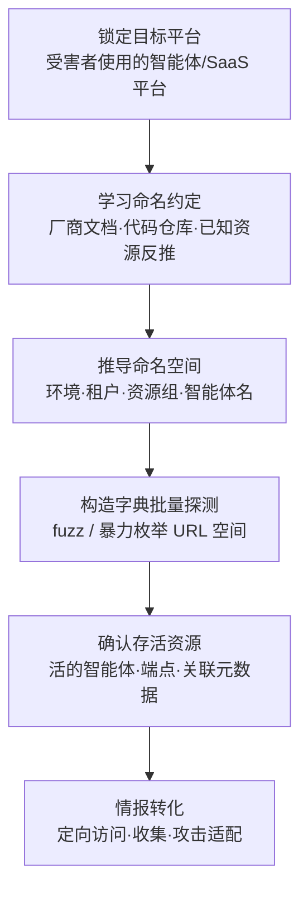

# 枚举托管AI资源 (AML.T0006.000)

> 属于 [主动扫描 (AML.T0006)](../AML.T0006-Active-Scanning.md)

## 一句话通俗理解

> SaaS 平台像一栋门牌编号规则统一的写字楼——每家租户的智能体办公室门牌都按"楼层（环境）-区域（租户）-房间号（资源组）"自动生成，攻击者只要从物业手册（厂商文档）和公开租约记录（代码仓库）里搞到编号规则，就能按规律挨个敲门，试出哪些房间真的有人办公、门牌后面挂着什么资源——全程不用撬一把锁。

## 难度等级

⭐ **Feasible（可行）**

官方成熟度评定为 Feasible——手法在概念验证与安全研究中已被演示（如 Copilot Studio 平台上的智能体发现研究），但尚无公开野外攻击活动直接命中本子技术。技术门槛不高：理解一个平台的 URL 命名规则、会使用字典爆破工具即可开展；真正的"难度"在于**命名约定情报的积累**——不同平台的 URL 结构各异，攻击者需要从厂商文档、公开代码仓库与实际托管资源中归纳出目标平台的命名规律，再把它转化为可批量尝试的字典。一旦规律到手，枚举本身可以完全自动化，甚至被编排进自主攻击智能体。

## 技术描述

### 通俗解释

父技术[主动扫描 (AML.T0006)](../AML.T0006-Active-Scanning.md)的四个子技术分工明确：.002 扫端口（网络层找自托管 AI 基础设施）、.001 查元数据 API（控制平面拿租户与环境 ID）、.003 探触发通道（给智能体发消息等回应），而本子技术 .000 干的是**应用层的"按门牌号找房间"**——在智能体或 SaaS 托管平台上，枚举特定受害组织到底部署了哪些 AI 资源。

关键在于一个结构性弱点：**平台为了规模化运维，用可预测的规则给资源编 URL**。环境名、租户 ID、资源组名、智能体名都会直接出现在地址里，而默认的开箱即用部署配置让这套命名约定在不同受害者之间保持一致——A 公司按默认向导部署的智能体，和 B 公司按默认向导部署的智能体，地址结构一模一样。攻击者学一次规则，就能对全平台的租户批量套用。

### 技术原理

依据官方描述，攻击者直接探测智能体或 SaaS 托管平台，枚举特定受害者在平台上部署的资源。技术要点拆解如下：

1. **可预测的 URL 结构**：平台常将 AI 智能体挂在由环境、租户、资源组或智能体名称等标识符推导的 URL 结构之后——这些标识符要么可从公开信息推得（公司名、产品名、员工命名习惯），要么遵循平台默认值（默认环境名、默认资源组）；

2. **默认配置放大一致性**：开箱即用的部署配置让命名约定跨受害者保持一致——受害者甲和受害者乙互不相识，他们的智能体地址却共享同一套生成规则；

3. **命名约定的学习渠道**：攻击者可以从三类公开来源学习规则——厂商文档（部署指南中的示例 URL）、代码仓库（开发者提交的配置文件与部署脚本中泄露的真实地址模式）、实际托管资源（已知资源的 URL 反推规则）；

4. **模糊测试与暴力枚举**：掌握规则后，攻击者对推导出的命名空间做 fuzz 或暴力枚举，从海量 404 中筛出少量 200——发现活跃的 AI 智能体、端点及关联元数据（智能体名称、能力描述、所属环境）。

**典型枚举对象**：

| 托管资源类型 | 命名空间线索 | 枚举产出 |
|-------------|-------------|---------|
| SaaS 平台上的智能体 | 环境名 / 租户 ID / 智能体名 | 活的智能体地址、聊天界面入口 |
| 模型推理端点 | 部署名 / 资源组 / 区域名 | 可直接调用的托管推理服务 |
| 微调作业与模型登记 | 项目名 / 工作区名 | 组织的模型资产清单 |
| AI 网关与管理控制台 | 网关域名 / 实例名 | 上游密钥与模型路由的聚合点 |

**与兄弟子技术的协作**：官方对 AML.T0006.001 的描述明确指出，攻击者通过未文档化 API（如曾暴露环境 ID 的 Power Platform 接口）获取的环境 ID，**随后可用于扫描公开智能体**——即 .001 的元数据产出正是 .000 命名空间爆破的输入。两者串联构成完整的"SaaS 智能体发现"链路。

**平台覆盖**：Predictive AI（预测式 AI）/ Generative AI（生成式 AI）/ Agentic AI（智能体 AI）/ Enterprise（企业环境）四类平台全部适用。

### 用途影响

- **产出定向攻击目标清单**：枚举发现的活跃智能体与端点，直接成为后续访问、收集或攻击适配的目标——官方描述明确此用途；
- **绘制组织的 AI 资产画像**：资源名称、分布与密度反映组织的 AI 部署形态（客服智能体、内部知识库、模型端点），为定制攻击提供依据；
- **低成本规模化**：命名规则学一次、全平台通用，字典爆破可完全自动化，也可被编排进自主攻击智能体执行；
- **与其他侦察技术互补**：枚举结果可与被动侦察（AML.T0000、AML.T0095）获得的组织信息交叉验证，提高目标画像精度。

## 攻击流程

### 典型攻击流程



**步骤详解：**

1. **锁定目标平台**
   - 通俗描述：确定去哪栋写字楼踩点。
   - 技术细节：通过被动侦察（AML.T0095 搜索开放网站/域名、AML.T0000 搜索技术数据库）确认受害者使用的 SaaS 平台（如 Microsoft Copilot Studio、各类智能体托管平台）；互联网级机会攻击者则直接选定整个平台作为枚举对象。

2. **学习命名约定**
   - 通俗描述：搞到物业的门牌编号手册。
   - 技术细节：从厂商部署文档中的示例 URL 归纳结构模板；在公开代码仓库（GitHub/GitLab）中检索平台相关配置文件，收集真实地址模式；必要时用已知资源（如公开分享的智能体链接）反推规则。兄弟子技术 AML.T0006.001 查询元数据 API 获得的租户/环境 ID 是命名空间的高价值输入。

3. **推导命名空间**
   - 通俗描述：把编号规则套到目标租户头上，列出所有可能的门牌号。
   - 技术细节：组合受害者标识（公司名、产品名、域名、员工命名习惯）与平台默认值（默认环境名、常见资源组名），生成候选 URL 集合；对智能体名部分，用行业常用词（support、assistant、helpdesk 等）与受害者业务词构建字典。

4. **构造字典批量探测**
   - 通俗描述：挨个敲门，听哪个房间有回音。
   - 技术细节：用 ffuf、httpx 等工具对候选 URL 空间做批量请求，按响应状态码（200/302 vs 404）与内容特征区分"有资源的门牌"与"空号"；控制请求速率以规避平台限流与检测。

5. **确认存活资源与元数据**
   - 通俗描述：记下每个有人办公的房间和门牌上的信息。
   - 技术细节：对命中的地址进一步访问，收集智能体名称、能力描述、所属环境、聊天界面入口等元数据；评估认证状态（匿名可聊还是有门禁）。

6. **情报转化为攻击行动**
   - 通俗描述：把房间清单交给行动队。
   - 技术细节：将目标清单交给后续阶段——对无认证智能体直接实施提示词注入（AML.T0051），对暴露端点尝试未授权调用，或结合公开 AI 漏洞分析（AML.T0001）挑选已知漏洞版本定制攻击。

**与后续战术的衔接：**

- **初始访问（Initial Access）**：枚举发现的无认证智能体聊天界面与暴露端点是现成入口
- **执行（Execution）**：可达的智能体触发通道可直接投递提示词注入载荷（AML.T0051）
- **AI 模型访问（ML Model Access）**：定位到的托管推理端点成为被直接调用的目标
- **进一步侦察**：确认的资源元数据可反哺命名空间推导，形成"枚举→修正字典→再枚举"的迭代循环

> 关键差异：传统端口扫描问的是"哪台主机的哪个端口开着"，本子技术问的是"哪个租户的哪个智能体活着"——攻击对象从网络层上升到了 SaaS 平台的应用命名空间层，字典不再是端口表，而是"环境-资源-智能体名"的组合空间。

## 真实案例

> 官方数据中尚无案例研究直接以 AML.T0006.000 为目标，以下选取以其父技术主动扫描（AML.T0006）为关联、且手法与本子技术高度相关的 2 个案例，均源自 MITRE ATLAS 案例库。

### 案例1：AgentFlayer——Copilot Studio 上的智能体发现研究（2025年，关联 AML.T0006.003）

- **时间**: 2025年
- **攻击者**: Zenity 研究人员（安全演示）
- **手法**: Zenity 在 Copilot Studio 平台上开展了完整的智能体发现（Discovery Phase）研究：从少量已知线索出发，系统性地推断与探测平台上可公开触达的智能体，确认其存在与行为特征，随后在后续研究中对发现的客服智能体实施提示词注入，演示了组织数据经智能体工具被完整渗出的全链路。发现阶段的核心正是"在托管平台上把活的智能体一个个找出来"——与本子技术的枚举目标一致。
- **影响**: 证明 SaaS 平台上的智能体可被系统性发现，"发现"与"攻击"之间的距离只差一次提示词注入
- **参考链接**: [Zenity Labs: AgentFlayer 发现阶段](https://labs.zenity.io/p/a-copilot-studio-story-discovery-phase-in-ai-agents-f917)、[Zenity Labs: AgentFlayer 数据渗漏](https://labs.zenity.io/p/a-copilot-studio-story-2-when-aijacking-leads-to-full-data-exfiltration-bc4a)

### 案例2：FOFA 检索接入自主攻击智能体——枚举被机器化（2026年，AML.T0006）

- **时间**: 2026年5月（Unit 42 披露）
- **攻击者**: 中文语系威胁行为者（knaithe / KnYuan）
- **手法**: 该行为者将 Hermes Agent 配置为以 DeepSeek 为推理引擎，接入暴露 FOFA 检索、查询翻译与 Nuclei 扫描生成能力的 MCP 服务器。在恢复的攻击会话中，智能体自主执行了"检索暴露的 Langflow/n8n 实例→定位目标→尝试利用"的完整链条——资源发现类侦察不再需要人工逐条执行，枚举速度与规模脱离人类操作节奏。
- **影响**: 托管资源枚举正在被"智能体化"——一旦字典与规则就位，机器可以 7×24 不知疲倦地敲门
- **参考链接**: [Unit 42: 自主 AI 网络攻击活动分析](https://unit42.paloaltonetworks.com/autonomous-ai-cyber-attack-campaign/)

## 红队视角

> ⚠️ **免责声明**：以下内容仅用于合法授权的安全测试与教育目的。未经授权对他人系统或第三方 SaaS 平台进行枚举是违法行为。

### 实战技巧

1. **命名空间约定审计（面向自有租户）**
   在客户的 SaaS 开发租户中梳理 AI 资源的 URL 结构：环境、租户、资源组与智能体名如何映射到地址？哪些环节用了默认值？哪些名称可从公司公开信息（产品名、项目代号、员工命名习惯）推导？回答"如果攻击者掌握了我们的命名规则，能爆破出什么"。

2. **授权范围内的字典爆破演练**
   仅在完全自有的开发租户上演练：部署若干带典型名称的测试智能体，构造"默认值 + 行业常用词 + 客户业务词"三段式字典，用 ffuf/httpx 对自有 URL 空间做批量探测，测量"多少次请求能命中多少资源"，以此量化命名空间的可猜测程度。

3. **平台公开暴露面核对**
   用平台自带的公开性检查（如 Copilot Studio 的智能体共享设置审计）与 [Copilot Studio Hunter](https://github.com/mbrg/power-pwn/wiki/Modules:-Copilot-Studio-Hunter-%E2%80%90-Enum) 类公开工具的方法论，核对客户租户中哪些智能体对租户外可见——注意工具使用需限定在授权的 Microsoft 365 租户内。

### 常用工具

| 工具名称 | 用途 | 平台 |
|----------|------|------|
| ffuf | URL 命名空间字典爆破，支持多参数 fuzz 与速率控制 | 跨平台 |
| httpx | 批量 URL 存活探测与状态码聚类 | 跨平台 |
| wordlists（SecLists 等） | 智能体名/资源名字典来源 | 跨平台 |
| Copilot Studio Hunter | Microsoft 365 授权租户内的公开智能体枚举 | 跨平台 |
| 平台厂商文档 | 命名约定情报的第一来源 | Web |

### 注意事项

- **平台红线**：对 SaaS 平台的枚举天然涉及第三方基础设施——未经平台许可的爆破可能违反服务条款甚至法律，一切演练限定在自有/授权租户与平台官方安全研究计划之内
- **速率控制**：即使授权范围内也要限流，避免影响平台其他租户、触发平台侧封禁混淆测试结果
- 报告聚焦"命名空间可预测程度、默认配置依赖度、公开暴露资源数"三个可量化指标

## 蓝队视角

### 检测要点

1. **网关与访问日志**
   - 日志来源：SaaS 平台网关、反向代理、WAF、负载均衡日志
   - 关注字段：源 IP、请求路径、响应状态码、User-Agent、请求速率
   - 异常特征：单一来源对智能体/环境路径的高频 404（命名空间爆破最直接的指纹）、按字典序或字母序排列的路径序列、对 `/agents/`、`/environments/` 等路径段的批量 HEAD/GET 探测

2. **平台审计日志**
   - 日志来源：SaaS 平台租户审计日志、资源管理平面日志
   - 关注字段：调用者身份、资源访问事件、异常失败访问
   - 异常特征：匿名/未授权身份对大量不存在资源的访问尝试、跨环境的顺序探测模式、新出现的陌生来源对智能体资源的首次访问

3. **蜜罐信号**
   - 日志来源：AI 蜜罐（诱饵智能体/诱饵端点）监控
   - 异常特征：诱饵资源被触碰——合法用户与工作流没有理由访问它，任何交互都是高置信度侦察信号

### 监控建议

- 建立**资源命名基线**：租户内全部 AI 资源的名称、URL、公开性登记造册，"台账外"的公开资源立即处置——防御者必须知道自己有哪些门牌是攻击者能猜到的
- 对智能体路径配置**异常 404 聚合告警**：单源 5 分钟内对智能体路径的 404 超过阈值即告警，这是字典爆破无法回避的痕迹
- 在命名空间中**预置诱饵名称**：部署若干命名高度可猜（如 support-bot、helpdesk-agent）但不承担业务的诱饵智能体，任何访问直接触发高优先级事件
- 关注"机器速度"：自主智能体执行的枚举没有人类的时间间隙，依赖速率阈值而非人工研判发现

## 检测建议

### 网络层检测

**检测方法：** 识别针对托管 AI 资源命名空间的字典爆破流量。

- 单一源 IP 短时间对智能体/环境/部署路径的大量 404 响应
- 请求路径呈现字典特征（按字母序、常用词序列、规则化组合模式）
- 非浏览器 User-Agent（ffuf/httpx 默认 UA 或空 UA）对资源路径的批量 HEAD/GET 请求

### 主机层检测

**检测方法：** 本子技术针对 SaaS 托管资源，传统主机层价值有限；对自建网关代理的托管入口，关注网关进程的访问日志异常——同源高频 404、路径模式聚类。

### 应用层检测（AI 遥测）

**检测方法：** 利用平台审计能力与蜜罐发现枚举行为。

- 平台审计日志中匿名身份对大量不存在资源的访问尝试（爆破失败痕迹）
- 诱饵智能体/诱饵端点（AML.M0039）收到任何访问——合法流量为零，直接告警
- 真实智能体资源收到非预期来源的首次访问，尤其当该资源名高度可猜测时

**程序化检测思路（无需 EDR 侧改造）：**

在 SaaS 网关统一入口部署三项检查：① 404 路径按源聚合，5 分钟超阈值告警；② 路径段模式聚类（识别 `/agents/*`、`/environments/*` 下的序贯探测）；③ 诱饵资源零流量预期告警。三项组合即可覆盖"字典爆破进行中"与"爆破命中后首次访问"两个关键窗口。

### Sigma 规则思路示例

```yaml
title: SaaS 智能体 URL 命名空间遭遇字典爆破（托管AI资源枚举）
status: experimental
description: 检测同一来源对智能体/环境/部署路径的高频 404 探测，
    可能为针对托管 AI 资源的命名空间枚举（AML.T0006.000）
logsource:
    category: webserver
    product: nginx
detection:
    selection:
        status: 404
        http_method: 'GET'
        url|contains:
            - '/agents/'
            - '/environments/'
            - '/deployments/'
            - '/chat/'
    filter_browser:
        http_user_agent|startswith: 'Mozilla/5.0'
    condition: selection and not filter_browser | count() by src_ip > 80
timeframe: 5m
level: medium
tags:
    - attack.t1595
    - attack.t1595.003
    - atlas.aml_t0006_000
```

## 缓解措施

### 优先级1：关键措施

**打破命名空间可预测性并默认私有（通用配置卫生，本子技术最直接的釜底抽薪）**

字典爆破的前提是"规则可学、名称可猜"。落地要点：① 部署 AI 资源时避免使用平台默认环境名与默认资源组名——默认值是攻击者字典里排最前的词条；② 智能体与端点命名不用公司名、产品名、业务常用词等可公开推导的标识，改用不可猜测的随机后缀；③ 资源默认私有，公开共享必须显式声明并经审批；④ 定期审计租户内资源的公开性设置。命名空间一旦不可预测，爆破的成本从"一份字典"膨胀到"整个组合空间"。

### 优先级2：重要措施

**AML.M0039 AI 蜜罐（AI Honeypots）——本子技术唯一直接映射的官方缓解措施**

部署受监控的诱饵 AI 智能体、服务或资源——名称刻意取得高度可猜（攻击者字典里的高频词），但不承担任何业务功能。合法用户与工作流没有理由接触它们，任何交互都是侦察活动的高置信度信号。蜜罐与真实资源混布时，按命名空间找目标的攻击者必然会先撞上"最好猜"的诱饵——官方缓解描述引用的观测证据（GreyNoise、Zenity）表明 AI 蜜罐已实际捕获大规模侦察活动。捕获的来源、字典与手法可反哺检测规则，虚假目标还能消耗攻击者的精力。

### MITRE ATLAS 缓解措施映射

| 缓解措施ID | 缓解措施名称 | 优先级 | 映射来源 | 生命周期阶段 |
|------------|-------------|:------:|----------|-------------|
| AML.M0039 | AI 蜜罐 | 重要 | **直接映射** | 部署 · 监控与维护 |
| AML.M0019 | 控制生产环境中 AI 模型与数据的访问 | 建议 | 继承自父技术 AML.T0006 | 部署 · 监控与维护 |
| AML.M0032 | AI 智能体组件分段 | 建议 | 继承自父技术 AML.T0006 | 业务与数据理解 · 部署 |

> 说明：ATLAS 官方对本子技术直接映射的缓解措施仅有 AML.M0039；AML.M0019（对端点强制认证——枚举命中也进不去）与 AML.M0032（分段——即使进入也只能触达边界内资源）继承自父技术，作为纵深防御第二、三道防线。

## 关联 ATT&CK 技术

> 本子技术官方未映射 ATT&CK 参考（attack_reference 为空），以下为基于手法相似性的主题关联，父技术 AML.T0006 官方映射为 [主动扫描 (T1595)](../../../enterprise/01-Reconnaissance/T1595-Active-Scanning.md)。

- [主动扫描 (T1595)](../../../enterprise/01-Reconnaissance/T1595-Active-Scanning.md) — 父技术映射的经典主动扫描技术，本子技术的同源根基
- [字典扫描 (T1595.003)](../../../enterprise/01-Reconnaissance/T1595/T1595.003-Wordlist-Scanning.md) — 与本子技术手法最相近：用字典对可预测目标空间做批量尝试
- [扫描IP块 (T1595.001)](../../../enterprise/01-Reconnaissance/T1595/T1595.001-Scanning-IP-Blocks.md) — 网络层的批量扫描对照：枚举对象是 IP 而非应用命名空间
- [漏洞扫描 (T1595.002)](../../../enterprise/01-Reconnaissance/T1595/T1595.002-Vulnerability-Scanning.md) — 枚举命中后的常见下一步：对发现的服务做漏洞验证

**传统 T1595.003 vs ATLAS AML.T0006.000：**

| 维度 | 传统 T1595.003 | ATLAS AML.T0006.000 |
|------|---------------|---------------------|
| 枚举空间 | 密码/用户名等认证字典 | **SaaS 平台的 URL 命名空间**（环境/租户/资源/智能体名） |
| 命中判据 | 认证成功响应 | 200/302 与内容特征（"这个门牌后有智能体"） |
| 规则来源 | 通用弱口令字典 | **厂商文档、代码仓库、平台默认配置** |
| 攻击对象 | 目标组织的认证入口 | **托管平台上特定受害者的 AI 资源** |
| 防御重心 | 口令策略与登录限流 | **命名不可预测化 + 资源默认私有 + 404 聚合告警** |

一句话总结：T1595.003 猜的是密码，AML.T0006.000 猜的是门牌号——AI 时代的字典爆破，字典里装的是一个组织的 AI 资产命名习惯。

## 动手实验

> ⚠️ **重要提示**：所有实验必须在自有的 SaaS 开发租户或隔离实验环境中进行，禁止对第三方租户或平台生产环境执行任何枚举。

### 实验环境准备

| 环境组件 | 用途 | 获取方式 |
|----------|------|----------|
| 一个自有 SaaS 开发租户（如 Copilot Studio 开发环境） | 部署测试智能体 | 厂商开发者计划 |
| ffuf / httpx | 命名空间字典爆破与存活探测 | 官方发布页 |
| SecLists 常用词表 | 智能体名字典素材 | GitHub |

### 实验1（初级）：命名空间约定观察

**实验目标：** 建立对"URL 结构可预测性"的直观认识。

**实验步骤：**
1. 在自有开发租户中按默认向导部署两个测试智能体，记录它们的完整 URL
2. 对比两个 URL：哪些部分是环境/租户标识？哪些部分是可自定义名称？哪些用了默认值？
3. 阅读厂商部署文档，找出文档示例 URL 与自己资源的结构对应关系
4. 在 GitHub 检索该平台的配置文件（公开仓库），观察真实项目中出现的地址模式

**预期结果：** 一份"平台命名规则笔记"——清楚写下攻击者能从公开渠道学到这条规则的每一步。

### 实验2（中级）：授权租户内的字典爆破

**实验目标：** 量化自有命名空间的可猜测程度。

**实验步骤：**
1. 在自有开发租户部署 3-5 个智能体：一个用默认名，一个用公司名，一个用业务常用词，一个用随机字符串
2. 构造"默认值 + 行业常用词（support/assistant/help）+ 公司名称变体"字典
3. 用 ffuf 对自有租户的 URL 空间爆破（严格限制目标为自有域名），记录每个智能体被命中所需的字典规模
4. 对比：随机命名的智能体为什么炸不出来？

**预期结果：** 一份量化报告——默认名 1 次命中、常用名词典内命中、随机名不可命中，直观理解缓解措施第一优先级的意义。

### 实验3（高级）：诱饵名称与检测闭环

**实验目标：** 体验 AI 蜜罐（AML.M0039）对命名空间爆破的检测价值。

**实验步骤：**
1. 在开发租户部署一个名为 support-bot 之类高度可猜名称的诱饵智能体（不接任何真实数据）
2. 在网关/平台日志侧配置两条告警：单源 404 聚合超阈值告警、诱饵资源任何访问即时告警
3. 重复实验2 的爆破，观察两条告警哪条先触发、哪条置信度更高
4. 复盘：攻击者的字典里"最好猜的词"是什么？诱饵命名如何利用这一点

**预期结果：** 一套"404 聚合 + 诱饵零流量预期"的双通道检测最小实现，对应缓解措施 AML.M0039 的落地雏形。

## 术语解释

| 术语 | 英文原名 | 通俗解释 |
|------|----------|----------|
| 托管 AI 资源 | Hosted AI Resources | 部署在 SaaS/云平台上、由平台代为托管运行的 AI 资源——智能体、推理端点、微调作业等 |
| 命名空间 | Namespace | 一类资源的名称集合空间——平台的 URL 命名空间就是"所有可能的资源地址"的总和 |
| 模糊测试 | Fuzzing | 用大量半随机输入探测目标以发现有效条目或异常行为——此处指批量尝试候选 URL |
| 暴力枚举 | Brute-force Enumeration | 穷举候选空间逐个验证——对 URL 空间即"按门牌号挨家敲门" |
| 租户 | Tenant | SaaS 平台上分配给一个组织的隔离空间——写字楼里属于一家公司的一层楼 |
| 环境 | Environment | 平台对资源集合的逻辑划分（开发/测试/生产），常出现在 URL 中 |
| 资源组 | Resource Group | 云平台上按组管理相关资源的容器，组名常直接进入资源 URL |
| 提供商控制平面 | Provider Control Plane | SaaS 平台的管理调度层，掌握租户与环境信息——元数据 API 查询的对象 |
| SaaS | Software as a Service | 软件即服务——厂商托管运行、客户开箱即用的云软件，本子技术的主要战场 |
| ffuf | Fuzz Faster U Fool | 主流的开源 Web 模糊测试工具，URL 命名空间爆破的常用选择 |
| Copilot Studio Hunter | Copilot Studio Hunter | power-pwn 工具套件中枚举 Microsoft Copilot Studio 公开智能体的模块（仅限授权租户） |
| SecLists | SecLists | 安全测试常用字典集合——爆破字典的主要来源之一 |
| AI 蜜罐 | AI Honeypot | 伪装成真实 AI 资源的诱饵——合法流量为零，任何交互都是恶意信号 |

## 参考资料

### 📚 官方文档

- [MITRE ATLAS - Enumerate Hosted AI Resources (AML.T0006.000)](https://atlas.mitre.org/techniques/AML.T0006/000/) - 官方技术页面
- [MITRE ATLAS 矩阵](https://atlas.mitre.org/matrices/ATLAS/)
- [MITRE ATLAS Data (GitHub)](https://github.com/mitre-atlas/atlas-data)

### 📰 案例报告（真实攻击与安全研究）

- [Zenity Labs: AgentFlayer 发现阶段](https://labs.zenity.io/p/a-copilot-studio-story-discovery-phase-in-ai-agents-f917) - 案例1：Copilot Studio 智能体发现研究
- [Zenity Labs: AgentFlayer 数据渗漏](https://labs.zenity.io/p/a-copilot-studio-story-2-when-aijacking-leads-to-full-data-exfiltration-bc4a) - 案例1：从发现到渗漏的完整链路
- [Unit 42: Chinese-Speaking Threat Actor Harnesses AI Models for Autonomous Cyberattacks](https://unit42.paloaltonetworks.com/autonomous-ai-cyber-attack-campaign/) - 案例2：资源发现被编排进自主攻击智能体
- [Zenity: Scanning for AI - Live Campaigns Mapping the Internet's Exposed LLM Backends](https://labs.zenity.io/post/scanning-for-ai-live-campaigns-mapping-the-internet-s-exposed-llm-backends) - 互联网暴露 LLM 后端的实时测绘
- [GreyNoise: Threat Actors Actively Targeting LLMs](https://www.greynoise.io/blog/threat-actors-actively-targeting-llms) - 威胁行为者针对 LLM 的侦察活动观测

### 🔧 工具与资源

- [ffuf](https://github.com/ffuf/ffuf) - Web 模糊测试与字典爆破工具（仅限授权测试）
- [httpx](https://github.com/projectdiscovery/httpx) - 批量 URL 存活探测
- [SecLists](https://github.com/danielmiessler/SecLists) - 安全测试字典集合
- [Copilot Studio Hunter (power-pwn)](https://github.com/mbrg/power-pwn/wiki/Modules:-Copilot-Studio-Hunter-%E2%80%90-Enum) - 授权租户内的公开智能体枚举工具
- [OWASP Top 10 for LLM Applications](https://owasp.org/www-project-top-10-for-large-language-model-applications/) - LLM 应用十大安全风险

### 🔗 关联阅读

- [主动扫描 (AML.T0006)](../AML.T0006-Active-Scanning.md) - 本技术的父技术，四大子技术分工全景
- [字典扫描 (T1595.003)](../../../enterprise/01-Reconnaissance/T1595/T1595.003-Wordlist-Scanning.md) - 与本子技术手法最相近的 ATT&CK 经典技术
- [侦察战术 (AML.TA0002)](../README.md) - 本技术所属战术的概览页

---

> **版本**: ATLAS 2026.09 | **更新**: 2026-10-22 | **模板**: ATLAS 技术文档 v1.0
