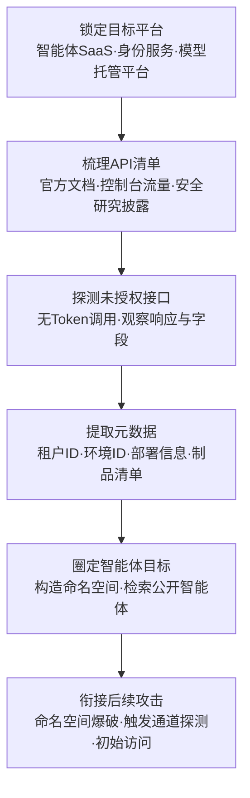

# 查询平台元数据API (AML.T0006.001)

> 属于 [主动扫描 (AML.T0006)](../AML.T0006-Active-Scanning.md)

## 一句话通俗理解

> 兄弟子技术还在挨家敲门试探（扫端口、猜 URL、发消息），本子技术直接去问物业："这栋楼有哪些租户？哪家在几层？门口挂没挂智能体的招牌？"——SaaS 平台的控制平面与身份 API 就是那本住户登记台账，本该只对内部开放，配置失误时任何人都能免费抄走一份完整名录。

## 难度等级

⭐ **Feasible（可行）**

官方成熟度评定为 Feasible——手法已被安全研究充分验证（AADInternals 的 OSINT 页面演示了针对 Entra ID 的未文档化 API 侦察、Zenity 演示了用未文档化 Power Platform API 枚举环境 ID），但公开渠道尚无以本子技术为直接映射的野外攻击案例。实施门槛极低：一个 HTTP 客户端加上对平台 API 的了解即可发起，且查询行为主要落在平台侧日志而非受害者自己的日志里。真正的"难度"在于**接口知识**——知道哪个控制平面/身份 API 返回租户与环境 ID、哪个端点漏配了认证，这决定了攻击者是拿到完整台账还是一串 401。值得注意的是，官方描述记录的滥用被识别后，厂商已为涉事接口补上强制认证——"研究披露→平台修补"的拉锯仍在持续，新的未授权元数据接口仍会随平台功能扩张不断出现。

## 技术描述

### 通俗解释

父技术 [主动扫描 (AML.T0006)](../AML.T0006-Active-Scanning.md) 的四个子技术代表四种"敲门"方式：AML.T0006.000 按命名规则爆破 URL、AML.T0006.002 扫端口找暴露服务、AML.T0006.003 给触发通道投递消息。本子技术走的是第四条路——**不敲受害者家的门，直接查平台的账**。

SaaS 与智能体托管平台为了支撑管理界面，都会提供一批元数据接口：控制平面 API 返回租户、环境、部署信息 ID；身份 API 返回组织与租户信息。这些接口有的写进了官方文档（已文档化），有的只存在于 Web 控制台的流量里（未文档化）；有的要求认证，有的因配置失误对匿名请求敞开。攻击者调用这些接口，就能在不接触受害者任何资产的情况下拿到"哪个租户在哪些环境部署了什么"的清单——拿到环境 ID 后，下一步就能直接检索该环境下的公开智能体。

### 技术原理

依据官方描述，攻击者查询智能体 SaaS 托管平台上已文档化或未文档化的 API 以发现智能体目标。SaaS 与智能体平台可能暴露提供商控制平面（provider control plane）或身份 API，返回租户、环境或部署信息 ID——其中包括配置错误的、或本不打算让未认证用户访问的资源。

已有攻击者滥用此类功能在 SaaS 平台上进行信息收集：AADInternals 的 OSINT 页面展示了一种针对 Entra ID 的未文档化 API 侦察方法（OSINT 在线工具形态）；一个未文档化的 Power Platform API 可用于获取环境 ID，进而扫描公开智能体。该滥用被识别后，涉事接口已加上认证要求。

**平台元数据暴露面一览：**

| 接口类型 | 典型代表 | 返回的元数据 | 攻击者眼中的价值 |
|---------|---------|------------|----------------|
| 提供商控制平面 API | Power Platform 环境查询接口等 | 租户 ID、环境 ID、部署信息 | 直接产出智能体定位的"坐标系" |
| 身份服务 API | Entra ID 相关接口 | 组织/租户信息、域名 | 确认目标租户存在性、关联资产 |
| 模型托管平台公开 API | HuggingFace Hub API | 组织的模型/数据集/应用清单、版本历史、标签、下载量 | 摸清目标 AI 技术栈与活跃制品 |
| 智能体目录/管理 API | 平台内置的智能体列表接口 | 环境内智能体名称、入口、发布状态 | 免爆破直接拿到智能体清单 |

**已文档化 vs 未文档化**：前者写进官方文档、供管理界面与集成调用——滥用它像"以读者身份翻图书馆"，调用合法但情报价值极高（如模型托管平台的组织制品枚举：模型清单、版本历史、标签、下载量、归属组织一次拿全）；后者未公开文档、但真实存在于控制台流量中——常因"没人知道所以没人设防"而缺失认证，是本子技术最锋利的一层（AADInternals 与 Power Platform 环境枚举均属此类）。

**查询的技术形态**：单次 GET 即可完成的枚举（分页遍历环境列表）、需要组合参数的检索（按租户过滤部署）、以及先取 ID 再二次查询的链式调用（环境 ID → 环境内智能体）。响应是结构化 JSON，整个流程可脚本化，也可被直接编排进自主攻击智能体。

**平台覆盖**：Predictive AI（预测式 AI）/ Generative AI（生成式 AI）/ Agentic AI（智能体 AI）/ Enterprise（企业环境）四类平台全部适用。

**在攻击链中的位置**：本子技术产出的租户 ID、环境 ID 与制品清单是后续步骤的"弹药"：

1. 衔接 AML.T0006.000——用环境/租户 ID 构造命名空间，爆破具体智能体 URL；
2. 衔接 AML.T0006.003——拿到智能体清单后定向探测邮箱、Webhook 等触发通道；
3. 衔接初始访问与提示词注入——公开智能体与暴露端点直接成为攻击入口。

### 用途影响

- **绕过受害者侧防御**：查询发生在平台侧，受害者组织的防火墙/IDS 看不到任何流量——痕迹只存在于平台审计日志中；
- **产出确定性目标清单**：环境 ID、租户 ID、智能体名称都是可直接使用的"坐标"，无需像 URL 爆破那样靠试错；
- **低成本高杠杆**：一次 API 调用的情报收益远高于逐个地址探测，且脚本可无限复用、批量执行；
- **支撑自动化**：结构化 JSON 响应使本技术天然适配自主攻击智能体（检索→筛选→攻击一气呵成）。

## 攻击流程

### 典型攻击流程



**步骤详解：**

1. **锁定目标平台**
   - 通俗描述：确定去哪个"物业"查台账。
   - 技术细节：结合被动侦察（AML.T0000 / AML.T0095）确认目标组织使用的 SaaS 平台——智能体托管平台、身份服务、模型托管平台；平台确定后，其控制平面与身份 API 即为查询对象。

2. **梳理 API 清单**
   - 通俗描述：搞清楚物业有哪几本台账、分别放在哪。
   - 技术细节：从官方文档找已文档化接口；从 Web 控制台的流量分析、客户端逆向、安全研究披露（如 AADInternals OSINT 页面）中挖未文档化接口；记录每个接口的参数与预期响应结构。

3. **探测未授权接口**
   - 通俗描述：挨本台账试"不给证件能不能查"。
   - 技术细节：以无认证请求逐个调用候选接口并观察响应——200 意味着台账敞开；401/403 的接口记录后待其他路径突破；同时留意错误响应中的信息泄露（如回显租户存在性）。

4. **提取元数据**
   - 通俗描述：把台账抄下来。
   - 技术细节：分页遍历租户/环境/部署列表，提取环境 ID、租户 ID、智能体名称与入口；对模型托管平台则枚举组织名下的模型、数据集与应用，及其版本历史、标签、下载量。

5. **圈定智能体目标**
   - 通俗描述：把抄来的名单变成攻击目标。
   - 技术细节：用环境 ID 构造平台命名空间检索公开智能体（衔接 AML.T0006.000）；或直接调用智能体目录接口拿到入口清单；交叉验证目标的业务归属，筛选高价值智能体。

6. **转化为攻击行动**
   - 通俗描述：拿着名录挨家下手。
   - 技术细节：对确认的智能体入口实施触发通道探测（AML.T0006.003）、LLM 提示词注入（AML.T0051）或直接初始访问（如 AML.T0049 利用面向公众的应用）；模型托管平台的制品清单则可支撑供应链投毒与代理模型构建的靶点选择。

**与后续战术的衔接：**

- **主动扫描族内衔接**：本子技术产出"坐标系"（环境/租户 ID），AML.T0006.000 负责"按坐标爆破"，AML.T0006.003 负责"按名录投递"——三者构成 SaaS 智能体侦察的完整工具箱
- **初始访问**：公开智能体与暴露端点直接成为入口
- **执行**：定位到的智能体触发入口是提示词注入（AML.T0051）的标准跳板

> 关键差异：兄弟子技术都在"猜"目标在哪（爆破 URL）或"试"目标是否活着（扫端口、发消息），本子技术直接"查"平台的官方登记——猜和试都有失败率，查台账拿到的是确定性情报。

## 真实案例

> 说明：官方 ATLAS 数据中暂无直接以 AML.T0006.001 为目标映射的案例研究。以下 2 个案例与本子技术手法最贴近——案例1 的发现阶段正是本子技术官方描述所引用手法的来源（官方将其映射至 AML.T0006.003），案例2 展示平台查询接口驱动的侦察正被智能体化（映射至父技术 AML.T0006）。

### 案例1：AgentFlayer——未文档化 API 扒出 Copilot Studio 智能体（2025年，AML.CS0037）

- **时间**: 2025年
- **攻击者**: Zenity 研究人员（安全演示）
- **手法**: Zenity 构建了仿麦肯锡客服场景的 Copilot Studio 智能体作为靶标。研究的第一阶段（发现阶段）正是本子技术的原型操作：利用未文档化的 Power Platform API 获取环境 ID，再据此扫描环境内的公开智能体，把"哪个租户、哪个环境、哪些智能体可触达"摸得一清二楚；第二阶段对定位到的客服智能体投递提示词注入，最终演示组织数据经智能体工具被完整渗出——从查台账到数据渗漏形成完整攻击链。
- **影响**: 完整演示了"查台账→找智能体→注入→渗漏"的攻击路径；官方描述记录的滥用被识别后，涉事接口已补上强制认证——本子技术正是对这一手法的规范化收录
- **参考链接**: [Zenity Labs: AgentFlayer 发现阶段](https://labs.zenity.io/p/a-copilot-studio-story-discovery-phase-in-ai-agents-f917)、[Zenity Labs: AgentFlayer 数据渗漏](https://labs.zenity.io/p/a-copilot-studio-story-2-when-aijacking-leads-to-full-data-exfiltration-bc4a)

### 案例2：FOFA 检索接入自主攻击智能体（2026年，AML.CS0070）

- **时间**: 2026年5月（Unit 42 恢复的会话）
- **攻击者**: 中文语系威胁行为者（knaithe / KnYuan）
- **手法**: 该行为者将 Hermes Agent 配置为以 DeepSeek 为推理引擎，集成终端访问、Telegram 遥控与红队技能系统，并接入暴露 FOFA 检索、查询翻译与 Nuclei 扫描生成能力的 MCP 服务器——"调用外部平台的查询接口做侦察"被直接编排为智能体的自动化攻击步骤。该案例检索的是空间测绘引擎而非 SaaS 控制平面 API，但其模式与本子技术同构：平台查询接口 + 结构化响应 + 脚本化调用 = 机器速度的目标枚举。
- **影响**: 平台 API 驱动的侦察正在被"智能体化"，元数据查询从人肉 curl 进化为攻击智能体的原生技能
- **参考链接**: [Unit 42: 自主 AI 网络攻击活动分析](https://unit42.paloaltonetworks.com/autonomous-ai-cyber-attack-campaign/)

## 红队视角

> ⚠️ **免责声明**：以下内容仅用于合法授权的安全测试与教育目的。未经授权对他人租户或第三方平台进行枚举是违法行为。

### 实战技巧

1. **平台台账盘点（面向自有授权租户）**
   以授权客户的 SaaS 平台为对象，梳理全部控制平面/身份 API：哪些已文档化、哪些藏在控制台流量里、哪些无需认证。产出按"接口 × 认证要求 × 返回信息"分类的台账清单，回答"攻击者查我们的物业登记能拿到什么"。

2. **控制台流量逆向**
   在自有开发租户中打开平台 Web 控制台（如 Power Platform 管理中心），用浏览器开发者工具记录控制台调用的全部 API——控制台能查到的，接口层面就能查到。这份"实际接口清单"往往比官方文档全得多，也是发现未文档化接口的标准方法。

3. **模型托管平台画像**
   用公开只读 API（如 HuggingFace Hub API）枚举授权目标组织的公开制品：模型、数据集、Spaces 应用及其版本历史、标签、下载量——评估公开制品是否泄露技术栈细节、是否存在会被供应链攻击盯上的高关注度制品。

4. **量化"台账暴露面"**
   红队交付物应量化：无需认证即可查询的接口数、可枚举出的环境/租户/智能体数、单次查询最大信息回报，并给出"补认证 + 最小化返回字段 + 租户侧收敛公开可见性"的整改建议。

### 常用工具

| 工具名称 | 用途 | 平台 |
|----------|------|------|
| curl / HTTPie | 直接调用元数据 API 观察响应 | 跨平台 |
| 浏览器开发者工具 | 捕获控制台流量，发现未文档化接口 | 跨平台 |
| Microsoft Graph Explorer | 探索与调试已文档化的微软平台 API | Web |
| AADInternals（OSINT 模块） | Entra ID 相关 OSINT 侦察工具集（注意使用授权） | PowerShell |
| HuggingFace Hub API | 模型托管平台公开制品元数据枚举 | Web / API |
| Copilot Studio Hunter（power-pwn） | Copilot Studio 公开智能体枚举（仅限授权测试） | 跨平台 |

### 注意事项

- **只查授权租户**：对第三方平台与他人租户的接口枚举须事先获得书面授权；公开只读 API（如模型托管平台的匿名端点）也应以合规研究目的使用，遵守平台服务条款
- 未文档化接口测试仅限自有租户或厂商漏洞赏金计划范围，发现的认证缺失应负责任披露
- 报告聚焦"台账是否对未认证请求敞开、平台审计日志能否看到查询行为"，不做实际利用

## 蓝队视角

### 检测要点

1. **平台审计日志**
   - 日志来源：SaaS 平台审计日志、控制平面 API 网关日志（这是本技术几乎唯一的留痕点）
   - 关注字段：调用者身份（尤其匿名/未认证）、API 端点、请求速率、返回的数据量
   - 异常特征：未认证请求命中本应需要登录的元数据端点、单来源高频分页遍历环境/租户列表、匿名调用返回 200（说明存在配置错误）

2. **身份服务遥测**
   - 日志来源：Entra ID（或其他 IdP）登录与 API 调用日志
   - 异常特征：异常来源的租户信息查询、OSINT 型接口调用模式（参照 AADInternals 类工具的已知行为特征）

3. **暴露面与蜜罐**
   - 数据来源：EASM 平台、AI 蜜罐遥测
   - 异常特征：诱饵环境/诱饵智能体被任何"按图索骥"式访问——合法用户与工作流没有理由触碰它们

### 监控建议

- 与平台厂商确认：环境/租户枚举类接口是否默认要求认证、审计日志是否记录未认证调用——案例1 之后 Power Platform 已补认证，但同类配置错误会随新功能再次出现
- 建立"台账最小化"基线：定期以未认证身份自查自家平台的公开可查询信息，比攻击者更早发现敞开的台账
- 部署 AI 蜜罐（AML.M0039）：诱饵环境与诱饵智能体混布在真实资源旁——按台账找目标的攻击者迟早会撞上来
- 对"机器速度"的批量元数据查询（案例2 的智能体化模式），依赖速率限制与自动化告警关联，而非人工分析

## 检测建议

### 网络层检测

**检测方法：** 识别针对平台元数据接口的异常调用模式（企业代理/网关可见的部分；纯平台侧流量依赖厂商日志）。

- 未携带认证凭证的请求命中元数据/环境枚举类路径（/environments、/tenants、/api/metadata 等）
- 单一来源对元数据接口的分页遍历特征（连续递增的 page/skip/continuation_token 参数）
- 高频 401/403 后仍持续更换参数重试（接口探测特征）

### 主机层检测

**检测方法：** 不适用——本技术不接触受害者主机。对自托管 AI 网关而言，可关注网关自身元数据端点（配置/路由信息接口）是否暴露并被匿名枚举。

### 应用层检测（AI 遥测）

**检测方法：** 利用平台审计与蜜罐捕获台账查询行为。

- SaaS 平台审计日志中未认证元数据 API 调用、匿名环境/租户枚举（对应案例1 手法）
- AI 蜜罐（AML.M0039）诱饵环境/诱饵智能体被访问——高置信度侦察信号
- 模型托管平台侧：组织公开制品的异常高频抓取（制品枚举的下游特征）

**程序化检测思路（无需 EDR 侧改造）：**

在 SaaS 平台可配置的范围内做三件事：① 对环境/租户枚举类 API 强制认证并记录未认证调用（哪怕最终 403，也说明有人在试）；② 对单来源的连续分页查询设置速率阈值告警；③ 在诱饵环境/诱饵智能体上配置零流量预期告警。三者组合即可覆盖"台账被查→目标被锁定→上门试探"的完整侦察窗口。

### Sigma 规则思路示例

```yaml
title: 平台元数据/环境枚举接口遭遇未认证批量调用
status: experimental
description: 检测未携带认证凭证的请求命中环境/租户/智能体枚举类 API，
    可能为针对智能体 SaaS 平台的元数据查询侦察（AML.T0006.001）
logsource:
    category: webserver
    product: nginx
detection:
    selection:
        http_method: 'GET'
        url|contains:
            - '/api/environments'
            - '/api/tenants'
            - '/providers/Microsoft.PowerPlatform/environments'
            - '/agents/'
    filter_browser:
        http_user_agent|startswith: 'Mozilla/5.0'
    condition: selection and not filter_browser | count() by src_ip > 30
    timeframe: 5m
level: medium
tags:
    - attack.t1595
    - atlas.aml_t0006_001
```

## 缓解措施

### 优先级1：关键措施

**收敛元数据接口的未授权访问（平台侧 + 租户侧通用卫生，本技术最直接的釜底抽薪）**

官方描述记录的滥用事件说明：这类接口"默认敞开、事后补认证"是主要风险模式。落地要点：① 平台侧——环境/租户枚举类接口默认要求认证，未认证请求直接 403 且不回显租户存在性；② 租户侧——在平台许可的设置中最小化组织信息的公开可见性（目录、环境列表、智能体发布状态）；③ 上线门禁——新环境/新智能体上线时检查"未认证视角能看到什么"。案例1 之后 Power Platform 补上强制认证，正是这一措施的现实版本。

### 优先级2：重要措施

**AML.M0039 AI 蜜罐（AI Honeypots）——本子技术唯一直接映射的官方缓解措施**

部署受监控的诱饵环境、诱饵智能体或诱饵制品——外观与真实资源一致，但不承担任何业务功能。按台账找目标的攻击者枚举环境/智能体时，会连同诱饵一起捞走；其对诱饵的任何访问都是高置信度的侦察信号。捕获的来源、工具与手法可汇聚为威胁情报反哺检测规则，虚假台账条目还能误导攻击者的目标选择、消耗其精力。GreyNoise 与 Zenity 的实战观测均表明 AI 蜜罐能捕获海量侦察活动。

### MITRE ATLAS 缓解措施映射

| 缓解措施ID | 缓解措施名称 | 优先级 | 映射来源 | 生命周期阶段 |
|------------|-------------|:------:|----------|-------------|
| AML.M0039 | AI 蜜罐 | 重要 | **直接映射** | 部署 · 监控与维护 |
| AML.M0019 | 控制生产环境中 AI 模型与数据的访问 | 建议 | 继承自父技术 AML.T0006 | 部署 · 监控与维护 |
| AML.M0032 | AI 智能体组件分段 | 建议 | 继承自父技术 AML.T0006 | 业务与数据理解 · 部署 |

> 说明：官方对本子技术直接映射的缓解措施仅有 AML.M0039；M0019/M0032 继承自父技术。三道防线的逻辑：认证收敛解决"台账对谁敞开"，租户侧最小化解决"台账里有多少你"，蜜罐解决"有人按台账找上门时能不能第一时间知道"。

## 关联 ATT&CK 技术

- [主动扫描 (T1595)](../../../enterprise/01-Reconnaissance/T1595-Active-Scanning.md) — 父技术的 ATT&CK 同源技术，本子技术的 API 查询同属"与目标系统直接交互"的侦察范畴
- [扫描IP块 (T1595.001)](../../../enterprise/01-Reconnaissance/T1595/T1595.001-Scanning-IP-Blocks.md) — 传统路径：批量探测网络地址；与本子技术的台账查询形成"猜 vs 查"的对照

**传统主动扫描 T1595 vs ATLAS AML.T0006.001：**

| 维度 | 传统主动扫描 (T1595) | ATLAS 查询平台元数据API (AML.T0006.001) |
|------|---------------------|----------------------------------------|
| 交互对象 | 目标组织的网络资产（IP、端口） | 共享平台的控制平面与身份 API |
| 获得的信息 | 开放端口、服务指纹 | 租户 ID、环境 ID、部署信息、智能体/制品清单 |
| 留痕位置 | 目标防火墙/IPS 日志 | 平台侧审计日志（受害者侧零流量） |
| 典型前置知识 | 扫描器与网络协议 | 平台 API 端点与参数（含未文档化接口） |
| 典型后果 | 确认可达的服务 | 确定性目标清单，直接衔接命名空间爆破与触发通道探测 |

一句话总结：T1595 是"挨家敲门听回音"，AML.T0006.001 是"直接抄物业的住户台账"——前者靠试错，后者靠查询，而后者的情报是确定性的。

## 动手实验

> ⚠️ **重要提示**：所有实验仅使用公开只读资源与自有/授权租户，不对任何第三方租户或平台发起未授权枚举。

### 实验环境准备

| 环境组件 | 用途 | 获取方式 |
|----------|------|----------|
| curl 或浏览器 | 调用公开元数据 API | 系统自带 |
| HuggingFace 免费账号 | 模型托管平台 API 实验 | 官网注册 |
| Microsoft 365 开发者租户 | 平台台账自查实验 | 官方开发者计划 |
| 浏览器开发者工具 | 控制台流量捕获 | 浏览器内置 |

### 实验1（初级）：体验"公开台账"的情报密度

**实验目标：** 用只读公开 API 理解平台元数据的情报价值。

**实验步骤：**
1. 选一个公开的模型托管平台（如 HuggingFace），用其官方公开 API 查询任一组织的公开制品清单
2. 观察返回字段：制品名称、类型、更新时间、标签、下载量——评估仅凭这些能还原出该组织的哪些 AI 技术栈细节
3. 思考：这些接口是平台合法提供的公开能力，"公开"与"滥用"的边界在哪里——答案在用途与后续行为

**预期结果：** 直观感受"一次 API 调用 = 一份组织 AI 资产画像"，理解本技术情报密度为何高。

### 实验2（中级）：自有租户的台账暴露自查

**实验目标：** 以攻击者视角盘点自有 SaaS 租户的元数据暴露面。

**实验步骤：**
1. 在自有 Microsoft 365 开发者租户中打开 Power Platform 管理中心，用开发者工具捕获控制台调用的 API
2. 整理捕获到的接口清单：哪些已文档化、哪些未文档化；在匿名会话中重放这些请求，观察认证拦截情况
3. 检查租户设置中组织信息的公开可见性（目录、环境列表），确认默认配置暴露了什么
4. 记录：一次未认证调用最多能拿到本租户的哪些信息

**预期结果：** 产出一份自有租户的"台账暴露面清单"与收敛建议，掌握控制台流量逆向方法。

### 实验3（高级）：蜜罐环境与未认证查询告警演练

**实验目标：** 构建"有人查台账→立刻知道"的最小检测能力。

**实验步骤：**
1. 在自有租户中创建一个不承担业务的诱饵环境/诱饵智能体（命名具备真实感）
2. 配置平台审计日志导出，编写规则：未认证或异常来源调用环境/智能体枚举接口即告警
3. 在授权前提下模拟攻击者视角：以匿名会话尝试枚举并访问诱饵条目，验证告警链路闭环
4. 评估：诱饵条目出现在枚举结果中的位置——它能否起到"污染攻击者目标清单"的作用

**预期结果：** 一套"未认证枚举告警 + 蜜罐触达告警"的最小可用配置，对应缓解措施 AML.M0039 的落地雏形。

## 术语解释

| 术语 | 英文原名 | 通俗解释 |
|------|----------|----------|
| 平台元数据 API | Platform Metadata API | 返回平台"住户登记信息"（租户、环境、部署、制品）的接口，本子技术的查询对象 |
| 提供商控制平面 | Provider Control Plane | SaaS 平台的管理与调度层——查询它等于抄所有租户的户口本 |
| 身份 API | Identity API | 身份服务（如 Entra ID）开放的组织/租户信息查询接口 |
| 租户 | Tenant | SaaS 平台上一个组织拥有的隔离空间，租户 ID 是定位组织的"门牌号" |
| 环境 ID | Environment ID | 平台内部标识一个部署环境的 ID，可被用于构造命名空间检索公开智能体 |
| 未文档化 API | Undocumented API | 没写进官方文档但真实存在的接口——常因"没人知道所以没人设防"而缺失认证 |
| AADInternals | AADInternals | 针对 Entra ID（原 Azure AD）的 PowerShell 侦察工具集，其 OSINT 页面演示过未文档化接口手法 |
| Entra ID | Microsoft Entra ID | 微软的云身份服务（原 Azure Active Directory） |
| Power Platform | Microsoft Power Platform | 微软的低代码应用与智能体托管平台（含 Copilot Studio） |
| 模型托管平台 | Model Hub | 托管模型/数据集/应用的共享平台（如 HuggingFace），公开 API 可枚举组织制品 |
| OSINT | Open Source Intelligence | 开源情报——从公开渠道收集目标信息的方法论 |
| AI 蜜罐 | AI Honeypot | 伪装成真实 AI 资产的诱饵——合法流量为零，任何交互都是恶意信号 |

## 参考资料

### 📚 官方文档

- [MITRE ATLAS - Query Platform Metadata APIs (AML.T0006.001)](https://atlas.mitre.org/techniques/AML.T0006/001/) - 官方技术页面
- [MITRE ATLAS 矩阵](https://atlas.mitre.org/matrices/ATLAS/)
- [MITRE ATLAS Data (GitHub)](https://github.com/mitre-atlas/atlas-data)

### 📰 案例报告（真实攻击与安全研究）

- [Zenity Labs: AgentFlayer 发现阶段](https://labs.zenity.io/p/a-copilot-studio-story-discovery-phase-in-ai-agents-f917) - 案例1：未文档化 API 枚举环境与公开智能体
- [Zenity Labs: AgentFlayer 数据渗漏](https://labs.zenity.io/p/a-copilot-studio-story-2-when-aijacking-leads-to-full-data-exfiltration-bc4a) - 案例1：从发现到渗漏的完整攻击链
- [Unit 42: 自主 AI 网络攻击活动](https://unit42.paloaltonetworks.com/autonomous-ai-cyber-attack-campaign/) - 案例2：平台查询接口被编排进攻击智能体
- [GreyNoise: Threat Actors Actively Targeting LLMs](https://www.greynoise.io/blog/threat-actors-actively-targeting-llms) - 威胁行为者针对 AI 服务的侦察观测
- [Zenity Labs: Scanning for AI](https://labs.zenity.io/post/scanning-for-ai-live-campaigns-mapping-the-internet-s-exposed-llm-backends) - 暴露 AI 后端的实时测绘与蜜罐观测

### 🔧 工具与资源

- [AADInternals OSINT 页面](https://aadinternals.com/osint/) - 官方描述引用的 Entra ID OSINT 侦察演示
- [HuggingFace Hub API 文档](https://huggingface.co/docs/hub/api) - 模型托管平台公开元数据 API（合法只读）
- [Microsoft Graph Explorer](https://developer.microsoft.com/graph/graph-explorer) - 已文档化平台 API 的探索工具
- [Copilot Studio Hunter (power-pwn)](https://github.com/mbrg/power-pwn/wiki/Modules:-Copilot-Studio-Hunter-%E2%80%90-Enum) - SaaS 智能体枚举工具（仅限授权测试）

### 🔗 关联阅读

- [主动扫描 (AML.T0006)](../AML.T0006-Active-Scanning.md) - 本技术的父技术，四种"敲门"方式全景
- [主动扫描 (T1595)](../../../enterprise/01-Reconnaissance/T1595-Active-Scanning.md) - ATT&CK 经典主动扫描技术，与本技术主题对应
- [侦察战术 (AML.TA0002)](../README.md) - 本技术所属战术的概览页

---

> **版本**: ATLAS 2026.09 | **更新**: 2026-10-22 | **模板**: ATLAS 技术文档 v1.0
