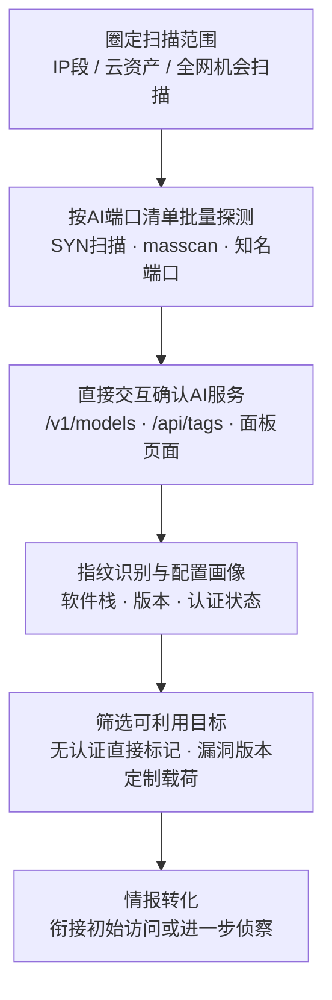

# 扫描暴露AI基础设施 (AML.T0006.002)

> 属于 [主动扫描 (AML.T0006)](../AML.T0006-Active-Scanning.md)

## 一句话通俗理解

> 与"翻相册"的 AML.T0000.003 不同，这次攻击者亲自上门扫楼——手里攥着一份全网通用的 AI 门牌清单（Ray 常住 8265、Ollama 常住 11434、Milvus 常住 19530……），对整栋写字楼挨户敲门听动静：哪个门后有 AI 应答、哪家的门压根没上锁，一一记入清单。敲门声会真实地留在你家的监控（防火墙日志）里——前提是有人去回看录像。

## 难度等级

⭐ **Feasible（可行）**

官方成熟度评定为 Feasible。技术门槛近乎为零：nmap/masscan 开箱即用，AI 服务的默认端口与标准 API 路径全部是公开的固定知识，一个下午就能对整个网段完成"AI 门牌"排查——这正是它危险的地方。扫描的下游后果已在父技术层面被充分证明：ShadowRay 事件中暴露的 Ray 集群被持续利用至少七个月（AML.CS0023），Zenity 与 GreyNoise 的互联网监测也证实针对暴露 LLM 后端的大规模扫描活动正在进行。一句话：扫描容易，防住难——真正的挑战不在攻击者的技术，而在防御方能否先于攻击者发现自己暴露了什么。

## 技术描述

### 通俗解释

父技术主动扫描（AML.T0006）有四条"敲门路径"：枚举托管 AI 资源（AML.T0006.000）打 SaaS 命名空间，查询平台元数据 API（AML.T0006.001）打提供商控制平面，探测智能体触发通道（AML.T0006.003）打应用层入口，而本子技术打的是最经典的**网络层**——直接扫描端口与服务，目标是**自托管（self-hosted）的 AI 基础设施**。

AI 服务在网络上是一群"作息规律、住址固定"的住户：Ray 的 Dashboard 常年守在 8265，Ollama 默认住 11434，Jupyter 在 8888、MLflow 在 5000、Milvus 在 19530……而且习惯在门口挂标准门牌——`/v1/models`、`/api/tags` 这类固定 API 路径。攻击者拿着这份公开的"门牌清单"扫过整个网段，发现端口开放再顺手敲两下门，从应答就能判断：这家住的是 Ollama 还是 Ray、上没上锁（有没有认证）、房子是什么年代盖的（什么版本）。

与"翻相册"的 AML.T0000.003（扫描数据库）相比：相册是历史照片，查询零交互零痕迹，但信息可能过时；本技术是实时上门，能确认服务**现在**是否存活、认证与版本状态如何，代价是每一次敲门都会在目标的防火墙与服务日志里留下记录。实战中两者常接力使用：先查相册缩小范围，再上门逐一验证。

### 技术原理

依据官方描述，攻击者扫描网络端口与服务，以识别部署在互联网上可达的 AI 后端、模型推理端点与智能体基础设施。**自托管 AI 运行时通常监听可预测的知名端口、暴露标准 API 路径**，攻击者据此高效定位候选主机并推断其上运行的平台。识别候选主机后，攻击者可直接与其交互：确认 AI 服务存活、对软件栈进行指纹识别、确定版本与配置细节。这些信息被用于**挑选可利用目标并定制后续访问尝试**。

攻击通常分两段展开：第一段求"广度"——对 IP 段或全网做面向 AI 端口清单的批量探测（masscan/nmap 的 SYN 扫描可在数分钟内覆盖整个网段）；第二段求"深度"——对候选主机发起应用层请求，访问标准 API 路径与面板页面，从响应特征完成指纹识别与配置画像。

**AI 基础设施典型暴露面一览**（端口均为默认配置）：

| 暴露面类型 | 典型服务（默认端口） | 攻击者眼中的价值 |
|-----------|---------------------|-----------------|
| 分布式 AI 计算框架 | Ray Dashboard（8265，Job API 无认证） | 任意代码执行、算力劫持——ShadowRay 事件主角 |
| 本地推理运行时 | Ollama（11434，/api/tags、/api/generate） | 免费算力盗用、已加载模型枚举 |
| 推理服务器 | vLLM（8000）、Triton、TorchServe（8080） | 未授权推理调用、模型服务篡改 |
| 模型演示界面 | Gradio（7860） | 直通模型的交互入口 |
| 数据科学环境 | Jupyter Notebook（8888） | 代码执行、训练数据访问 |
| ML 实验平台 | MLflow（5000） | 模型登记库、模型窃取 |
| 向量数据库 | Milvus（19530）、Qdrant（6333）、Weaviate（8080） | RAG 语料拖库——投毒与情报金矿 |

**在攻击链中的位置**：本技术的产出直接决定后续攻击的"入口选择"——无认证服务被直接标记为可立即利用的目标（衔接初始访问，如父技术文档点名的 AML.T0132 暴露的 AI 服务）；确认的平台与版本信息则驱动进一步的公开漏洞检索（AML.T0001 搜索公开 AI 漏洞分析），形成"扫描→查漏洞→定制攻击"的闭环。

**平台覆盖**：官方标注 Predictive AI / Generative AI / Agentic AI / Enterprise 四类平台全部适用——凡是自托管、公网可达的 AI 基础设施都在射程之内。

### 用途影响

- **实时目标清单**：产出"现在就能连"的活跃 AI 服务清单——IP:端口 × 平台指纹 × 版本 × 认证状态，比扫描数据库的历史条目更鲜活；
- **挑选与定制**：官方描述明确本技术的信息用于"挑选可利用目标并定制后续访问尝试"——无认证的直接用，已知漏洞版本的定制载荷；
- **攻击面画像**：暴露的推理服务、训练面板、向量库共同勾勒组织的 AI 部署形态与技术选型，反哺后续侦察与社会工程；
- **自动化就绪**：端口探测与指纹请求全部可脚本化，天然适合被编排进自主攻击智能体（见案例2）。

## 攻击流程

### 典型攻击流程



**步骤详解：**

1. **圈定扫描范围**
   - 通俗描述：决定这趟"扫楼"去哪栋楼。
   - 技术细节：定向攻击以目标组织的 IP 段、云上资产（ASN、负载均衡出口）为范围，输入常来自 AML.T0000.003 查到的历史暴露条目；机会主义攻击则直接面向全网，按 AI 端口清单撒网。

2. **按 AI 端口清单批量探测**
   - 通俗描述：拿着门牌清单挨户敲门。
   - 技术细节：用 masscan/nmap 对目标范围做 SYN 扫描，只筛 AI 典型端口（8265/11434/7860/8000/8080/5000/8888/19530/6333……）；SYN 扫描不完成三次握手，速度快、日志痕迹相对少。

3. **直接交互确认 AI 服务**
   - 通俗描述：听门后的应答声，确认这家住的是不是 AI。
   - 技术细节：对开放端口发起应用层请求——OpenAI 兼容端点请求 `/v1/models`，Ollama 请求 `/api/tags`，框架则请求 Dashboard 首页；依据响应格式与 JSON 结构确认 AI 服务存活。

4. **指纹识别与配置画像**
   - 通俗描述：从应答细节判断这家的牌子、户型、门锁型号。
   - 技术细节：依据 banner、响应头与错误信息格式指纹识别软件栈（Ray/Ollama/vLLM/MLflow……），确定版本号与认证状态，并比对已知漏洞（如 Ray 的 CVE-2023-48022 系列）。

5. **筛选可利用目标**
   - 通俗描述：把"没锁门的"和"锁有问题的"分开标记。
   - 技术细节：无认证服务标记为可直接利用；已知漏洞版本标记为可定制载荷；"扫到但防护完好"的条目留作进一步侦察对象。

6. **情报转化**
   - 通俗描述：把踩点结果变成作战地图。
   - 技术细节：目标清单交给初始访问阶段（无认证直连、漏洞利用），平台版本信息驱动 AML.T0001 检索公开漏洞分析与现成攻击实现，形成"扫描→查漏洞→再定制"的循环。

**与后续战术的衔接：**

- **初始访问**：无认证端点即"门本身没锁"的入口——ShadowRay 是端口扫描直达任意代码执行的典型
- **AI 模型访问**：定位到的推理端点与模型登记平台成为直接调用、窃取的目标
- **进一步侦察**：确认的平台与版本信息驱动 AML.T0001（搜索公开 AI 漏洞分析），反哺攻击定制

> 关键差异：本子技术与 T1595.001 的差别不在"敲门"这个动作，而在门牌清单——攻击者不是盲扫所有端口，而是带着 AI 时代的"住户名册"精准敲门；与 AML.T0000.003 的差别在"亲自到场"——相册可以翻，但相册不会告诉你这家今天的门锁换了没有。

## 真实案例

> 官方数据中共有 6 个案例研究挂靠父技术 AML.T0006；本节精选与本子技术（端口与服务扫描）最直接相关的 2 个案例，均源自 MITRE ATLAS 案例库。

### 案例1：ShadowRay——扫到即沦陷的 Ray 集群（2023年，AML.CS0023）

- **时间**: 2023年3月披露（遭利用至少七个月）
- **攻击者**: 未知名恶意行为者
- **手法**: Ray 是用于扩展生产 AI 工作流的开源 Python 框架，其 Job API 在设计上就允许任意远程执行，且**不提供认证机制**，默认配置还可能将集群暴露到互联网（Dashboard/Job 端口 8265）。攻击者扫描定位暴露的 Ray 集群后，直接经 Job API 提交任务，劫持受害组织的算力并窃取有价值信息。Oligo 研究人员估计受陷机器总价值接近 10 亿美元；五个相关漏洞被报告给 Ray 的主要维护方 Anyscale。
- **影响**: 首个被公开报告的针对 AI 工作负载的野外攻击活动——从"扫到"到"沦陷"之间没有任何认证屏障
- **参考链接**: [Oligo: ShadowRay 分析报告](https://www.oligo.security/blog/shadowray-attack-ai-workloads-actively-exploited-in-the-wild)、[Anyscale: Ray CVE 官方说明](https://www.anyscale.com/blog/update-on-ray-cves-cve-2023-6019-cve-2023-6020-cve-2023-6021-cve-2023-48022-cve-2023-48023)

### 案例2：把 FOFA 与 Nuclei 装进攻击智能体（2026年，AML.CS0070）

- **时间**: 2026年5月（Unit 42 恢复的会话）
- **攻击者**: 中文语系威胁行为者（knaithe / KnYuan）
- **手法**: 该行为者将 Hermes Agent 配置为以 DeepSeek 作为推理引擎，集成终端访问、Telegram 遥控与红队技能系统，并接入暴露 FOFA 检索、查询翻译与 **Nuclei 扫描生成**能力的 MCP 服务器——"定位暴露的 Langflow/n8n 实例、生成漏洞验证扫描"成为智能体可自主调用的技能，Unit 42 恢复的会话显示攻击几乎无需人工介入。
- **影响**: 端口与服务扫描被"智能体化"，侦察与攻击之间的时间间隔被压缩到分钟级
- **参考链接**: [Unit 42: 自主 AI 网络攻击活动分析](https://unit42.paloaltonetworks.com/autonomous-ai-cyber-attack-campaign/)

## 红队视角

> ⚠️ **免责声明**：以下内容仅用于合法授权的安全测试与教育目的。未经授权对他人系统进行扫描是违法行为。

### 实战技巧

1. **授权范围内的 AI 端口专项扫描**
   以授权客户的 IP 段/云资产为对象做两段式扫描：masscan 全段 SYN 快筛 AI 典型端口，nmap 服务识别确认细节。重点是带着"AI 门牌清单"去扫——通用端口扫描会淹没在噪音里，AI 端口清单直奔主题。

2. **标准路径确认与指纹采集**
   端口开放不等于 AI 服务。对候选主机逐一请求标准 API 路径（`/v1/models`、`/api/tags`、Dashboard 首页），记录响应特征与认证状态，产出"端口 → 平台 → 版本 → 认证"四列清单——这正是攻击者视角的目标清单格式。

3. **台账盲区比对**
   将扫描结果与客户资产台账比对："台账外"的 AI 服务是报告的重点发现。多数组织的资产台账里没有"AI 服务"这个分类，一个研发顺手部署的调试模型往往就是最大的暴露面。

### 常用工具

| 工具名称 | 用途 | 平台 |
|----------|------|------|
| nmap | 端口与服务扫描、AI 端口指纹识别 | 跨平台 |
| masscan | 高速 SYN 批量扫描，分钟级覆盖整个网段 | 跨平台 |
| httpx | 批量 HTTP 端点探测与标题抓取 | 跨平台 |
| Nuclei | 面向已知 AI 服务漏洞的模板化验证 | 跨平台 |
| ZGrab2 | 应用层深度 banner 抓取 | 跨平台 |

### 注意事项

- **只扫授权资产**：本子技术与目标产生直接交互、留下日志，必须事先获得书面授权——这是它与"翻相册"（AML.T0000.003）的本质区别
- 用自定义 User-Agent 或源 IP 标记区分授权扫描流量，方便客户侧日志回溯与噪音剔除
- 控制扫描节奏（SYN 扫描、限速），避免影响生产服务；报告聚焦"暴露面是否收敛、扫描能否被检测"

## 蓝队视角

### 检测要点

1. **网络层扫描特征**
   - 日志来源：防火墙/IPS、云负载均衡日志
   - 关注字段：源 IP、目标端口、连接状态、时间分布
   - 异常特征：单一来源短时间探测多个 AI 典型端口；半开连接（SYN 扫描）突发；同类探测以低速率长时间持续（慢扫描规避阈值）

2. **主机层异常连接**
   - 日志来源：AI 运行时服务日志、主机防火墙日志
   - 关注字段：连接来源网段、认证结果、请求路径
   - 异常特征：AI 运行时收到来自异常网段/异常 ASN 的连接；推理端点出现持续 401/403 仍不放弃的请求（攻击者在坚持枚举）

3. **应用层枚举行为**
   - 日志来源：反向代理/网关访问日志、平台审计日志
   - 关注字段：URL 路径、User-Agent、响应状态
   - 异常特征：`/v1/models`、`/api/tags` 等枚举端点的高频未授权访问；Dashboard 页面被公网 IP 直接访问

### 监控建议

- **攻击者视角自查**：定期对自己的 IP 段执行 AI 端口专项扫描，并与资产台账比对——"先于攻击者扫到自己"是第一原则
- **出口收敛**：AI 服务默认不出公网；必须暴露时走反向代理 + 强制认证 + IP 白名单 + 速率限制
- **错误响应最小化**：网关对未授权请求返回 403 时不携带版本/平台细节，不给攻击者送指纹
- **关注"回访"行为**：单次端口探测可能只是测绘爬虫；扫完之后的**定点深度探测**（模型枚举、面板访问）才是攻击前奏，应与首扫事件关联分析

## 检测建议

### 网络层检测

**检测方法：** 识别针对 AI 典型端口的批量探测模式。

- 单一源 IP 在短时间内探测多个 AI 典型端口（8265/11434/7860/8000/5000/8888/19530/6333）
- 半开连接突发或低速率长持续的同类探测（masscan/nmap/ZGrab 扫描器特征）
- 命中已知空间测绘爬虫（Shodan/FOFA/Censys）特征源对 AI 端口的访问

### 主机层检测

**检测方法：** 监控自托管 AI 服务的可疑访问。

- AI 运行时进程（Ollama/Ray/vLLM 等）收到来自异常网段的连接
- 推理端点大量 401/403 后仍然持续的请求（枚举坚持性）
- 服务日志中同一来源对多个标准 AI API 路径的顺序访问（`/v1/models` → `/api/tags` → 面板页面的典型指纹序列）

### 应用层检测（AI 遥测）

**检测方法：** 利用枚举请求特征与诱饵资产捕获侦察。

- 模型枚举请求（`/v1/models`、`/api/tags`）的未授权高频访问
- AI 蜜罐（AML.M0039）被触碰——零合法流量的资产收到任何请求都是高置信度侦察告警

**程序化检测思路（无需 EDR 侧改造）：**

在防火墙/网关日志聚合侧部署两条规则：① "单一外部源 × 10 分钟内命中 ≥4 个不同 AI 典型端口"即告警（批量探测特征）；② 对外诱饵 AI 服务配置"零流量预期"告警，任何访问直接推送高优先级事件。两条规则组合即可覆盖"广度扫描→定点验证"两个攻击阶段。

### Sigma 规则思路示例

```yaml
title: 单一来源批量探测 AI 典型端口（暴露 AI 基础设施扫描）
status: experimental
description: 检测同一外部源在短时间内探测多个 AI 典型端口，
    可能为针对暴露 AI 基础设施的端口扫描（AML.T0006.002 / T1595.001）
logsource:
    category: firewall
detection:
    selection:
        dst_port:
            - 8265
            - 11434
            - 7860
            - 8000
            - 8080
            - 5000
            - 8888
            - 19530
            - 6333
    filter_internal:
        src_ip|cidr:
            - '10.0.0.0/8'
            - '192.168.0.0/16'
    condition: selection and not filter_internal | count(dst_port) by src_ip >= 4
timeframe: 10m
level: medium
tags:
    - attack.t1595
    - attack.t1595.001
    - atlas.aml_t0006_002
```

## 缓解措施

### 优先级1：关键措施

**收敛 AI 端口暴露面（通用网络卫生，最直接的釜底抽薪）**

不暴露，就没有端口可扫。落地要点：AI 基础设施（推理端点、训练面板、向量数据库、计算框架 Dashboard）默认只监听内网；确需对外时经反向代理暴露并强制认证、IP 白名单与速率限制；上线流程中加入"是否可达公网、是否强制认证"检查项。ShadowRay 式悲剧的根因正是"无认证的 API 暴露在互联网"——收敛暴露面在源头上让本技术无的放矢。

### 优先级2：重要措施

**AML.M0039 AI 蜜罐（AI Honeypots）——本子技术唯一直接映射的官方缓解措施**

部署受监控的诱饵 AI 服务、智能体、凭证或资源——外观与真实资产无异，但不承担任何真实业务功能。合法用户与工作流没有理由接触它们，因此任何交互都是侦察活动的高置信度信号。官方缓解描述引用的观测证据（GreyNoise、Zenity）表明：AI 蜜罐已捕获针对暴露 LLM 后端的大规模扫描活动——攻击者按门牌清单扫楼时，混布在真实资产旁的诱饵必然被一并敲门。捕获的源信息、工具与手法可反哺全环境检测规则，虚假目标还能消耗攻击者的精力。

### 优先级3：建议措施

**AML.M0019 控制生产环境中 AI 模型与数据的访问（继承自父技术 AML.T0006）**

要求用户在访问生产模型前验证身份，对 API 端点强制认证，并监控生产模型查询以确保符合使用策略。即使端口暴露在公网，"门后上锁"仍能把"扫到即沦陷"降级为"扫到但进不去"——这是对无认证暴露最直接的对症药。

### MITRE ATLAS 缓解措施映射

| 缓解措施ID | 缓解措施名称 | 优先级 | 映射来源 | 生命周期阶段 |
|------------|-------------|:------:|----------|-------------|
| AML.M0039 | AI 蜜罐 | 重要 | **直接映射** | 部署 · 监控与维护 |
| AML.M0019 | 控制生产环境中 AI 模型与数据的访问 | 建议 | 继承自父技术 AML.T0006 | 部署 · 监控与维护 |
| AML.M0032 | AI 智能体组件分段 | 建议 | 继承自父技术 AML.T0006 | 业务与数据理解 · 部署 |

> 说明：官方对本子技术直接映射的缓解措施仅有 AML.M0039。三道防线的逻辑：收敛暴露面解决"门开不开"，强制认证解决"门后锁不锁"，蜜罐解决"有人挨家敲门时能不能第一时间知道"。

## 关联 ATT&CK 技术

- [主动扫描 (T1595)](../../../enterprise/01-Reconnaissance/T1595-Active-Scanning.md) — 官方 attack_reference 指向的同名经典技术（父技术层面）
- [扫描IP块 (T1595.001)](../../../enterprise/01-Reconnaissance/T1595/T1595.001-Scanning-IP-Blocks.md) — 对 IP 范围的批量端口扫描，对应本子技术的"批量探测"环节
- [漏洞扫描 (T1595.002)](../../../enterprise/01-Reconnaissance/T1595/T1595.002-Vulnerability-Scanning.md) — 对已知漏洞的扫描验证，对应本子技术"筛选可利用目标"环节

**传统 T1595.001/.002 vs ATLAS AML.T0006.002：**

| 维度 | 传统 T1595.001/.002 | ATLAS AML.T0006.002 |
|------|--------------------|--------------------|
| 扫描对象 | 任意开放端口与网络服务 | 聚焦 AI 基础设施：推理端点、训练面板、向量库、计算框架 |
| 前置知识 | 通用服务端口与漏洞库 | AI 服务默认端口清单与标准 API 路径（8265/11434/19530…） |
| 后续利用 | 通用漏洞利用与入侵 | 盗用算力、未授权推理、RAG 语料拖库、模型窃取 |
| 典型后果 | 常规服务沦陷 | ShadowRay：扫到无认证 Ray 集群即任意代码执行 |

一句话总结：T1595.001 问的是"这一片 IP 上哪些端口开着"，AML.T0006.002 在此之上多问一句"开着的端口里哪些是没锁门的 AI 服务"——敲门的手法是经典的，门后的算力、模型与数据才是 AI 时代的新战利品。

## 动手实验

> ⚠️ **重要提示**：所有实验必须在隔离的实验室环境（仅本地网络互通）中进行，禁止对未授权系统或第三方资产进行扫描。

### 实验环境准备

| 环境组件 | 用途 | 获取方式 |
|----------|------|----------|
| 隔离 Linux 虚拟机 ×2（仅本地网络互通） | 分别扮演"攻击机"与"受害机" | 本地虚拟化平台 |
| Docker + Ollama | 在受害机部署目标 AI 服务 | 官方安装脚本 |
| nmap / masscan / httpx | 扫描与端点探测 | 系统包管理器 |
| Nginx（可选） | 反向代理 + Basic Auth 对照实验 | 系统包管理器 |

### 实验1（初级）：扫出你的第一个 AI 端口

**实验目标：** 理解"默认配置 = 扫到即可用"。

**实验步骤：**
1. 在受害机部署 Ollama 并拉取一个小模型
2. 从攻击机执行 `nmap -sV -p 11434 <受害机IP>`，观察端口与服务识别结果
3. 执行 `curl http://<受害机IP>:11434/api/tags`，观察未认证即可获得的模型清单
4. 记录：从"知道 IP"到"确认 AI 服务与模型清单"，攻击者需要几步、在受害机留下多少日志

**预期结果：** 直观体验一次最小化的"端口扫描→服务确认→信息泄露"链路。

### 实验2（中级）：指纹识别与认证收敛对照

**实验目标：** 掌握"指纹识别→暴露面收敛"的攻防对照。

**实验步骤：**
1. 攻击机用 httpx 批量请求受害机多个端口的标准路径（`/`、`/v1/models`、`/api/tags`），记录每个端点的响应指纹
2. 在受害机前加 Nginx 反向代理 + Basic Auth，Ollama 改为仅监听 127.0.0.1
3. 重复步骤 1，观察攻击者视野的变化：端口关闭、401 响应、信息收敛
4. 检查 401 响应内容是否仍泄露版本/平台细节

**预期结果：** 理解认证收敛与错误响应最小化对攻击者指纹识别的抑制作用。

### 实验3（高级）：扫描检测与诱饵告警闭环

**实验目标：** 构建针对本子技术的最小检测闭环。

**实验步骤：**
1. 在受害机再启动一个"诱饵"服务（如另一端口上返回假 Ollama banner 的 HTTP 服务），正常业务不使用它
2. 编写日志检测规则：单一来源 IP 在 10 分钟内探测 ≥4 个 AI 典型端口即告警（对应本文 Sigma 思路）
3. 为诱饵服务配置"零流量预期"告警：任何访问直接推送高优先级
4. 从攻击机模拟慢速扫描（端口间隔数秒），验证两条告警是否触发、触发时延多少

**预期结果：** 一套"批量探测检测 + 诱饵零流量告警"的最小实现，对应缓解措施 AML.M0039 的落地雏形。

## 术语解释

| 术语 | 英文原名 | 通俗解释 |
|------|----------|----------|
| 端口扫描 | Port Scanning | 向目标主机的一批端口发探测包，探明哪些端口开放、跑着什么服务 |
| SYN 扫描 | SYN Scan | 只发 SYN 包、不完成三次握手的半开扫描，速度快、日志痕迹相对少 |
| masscan | masscan | 目前最快的异步端口扫描器，数分钟可扫完整个网段 |
| Banner | Service Banner | 服务在端口上自我宣告身份的信息——指纹识别的第一手材料 |
| 指纹识别 | Fingerprinting | 从响应特征（banner、错误格式、API 行为）推断目标软件与版本 |
| 自托管 | Self-hosted | 组织自己部署运维的 AI 服务（区别于 SaaS）——本子技术的主要目标 |
| Ray | Ray | 分布式 AI 计算框架，Dashboard/Job API 默认端口 8265，ShadowRay 事件主角 |
| Ollama | Ollama | 本地 LLM 运行时，默认端口 11434，/api/tags 未认证即可枚举模型 |
| vLLM | vLLM | 高性能 LLM 推理服务器，OpenAI 兼容端点默认 8000 |
| Jupyter | Jupyter Notebook | 交互式数据科学笔记本，默认端口 8888，暴露约等于交出代码执行 |
| MLflow | MLflow | ML 实验追踪与模型登记平台，默认端口 5000，存放模型与训练数据线索 |
| 向量数据库 | Vector Database | Milvus（19530）/ Qdrant（6333）/ Weaviate（8080），RAG 系统的记忆库 |
| Gradio | Gradio | 快速构建模型演示界面的框架，默认端口 7860，演示页直通模型 |
| 模型枚举 | Model Enumeration | 调用 /v1/models、/api/tags 等接口探明服务加载了哪些模型 |
| AI 蜜罐 | AI Honeypot | 伪装成真实 AI 服务的诱饵——合法流量为零，任何交互都是恶意信号 |

## 参考资料

### 📚 官方文档

- [MITRE ATLAS - Scan for Exposed AI Infrastructure (AML.T0006.002)](https://atlas.mitre.org/techniques/AML.T0006/002/) - 官方技术页面
- [MITRE ATLAS 矩阵](https://atlas.mitre.org/matrices/ATLAS/)
- [MITRE ATLAS Data (GitHub)](https://github.com/mitre-atlas/atlas-data)

### 📰 案例报告（真实攻击与安全研究）

- [Oligo: ShadowRay 攻击活动分析](https://www.oligo.security/blog/shadowray-attack-ai-workloads-actively-exploited-in-the-wild) - 案例1：首个针对 AI 工作负载的野外攻击活动
- [Anyscale: Ray CVE 官方说明](https://www.anyscale.com/blog/update-on-ray-cves-cve-2023-6019-cve-2023-6020-cve-2023-6021-cve-2023-48022-cve-2023-48023) - ShadowRay 相关漏洞处置
- [NVD: CVE-2023-48022](https://nvd.nist.gov/vuln/detail/CVE-2023-48022) - Ray Job API 任意代码执行漏洞
- [Unit 42: 自主 AI 网络攻击活动](https://unit42.paloaltonetworks.com/autonomous-ai-cyber-attack-campaign/) - 案例2：FOFA/Nuclei 被编排进攻击智能体
- [Zenity Labs: Scanning for AI](https://labs.zenity.io/post/scanning-for-ai-live-campaigns-mapping-the-internet-s-exposed-llm-backends) - 互联网暴露 LLM 后端的实时测绘
- [GreyNoise: Threat Actors Actively Targeting LLMs](https://www.greynoise.io/blog/threat-actors-actively-targeting-llms) - 威胁行为者扫描 LLM 的实证

### 🔧 工具与资源

- [nmap](https://nmap.org/) - 端口与服务扫描
- [masscan](https://github.com/robertdavidgraham/masscan) - 高速异步端口扫描器
- [httpx](https://github.com/projectdiscovery/httpx) - 批量 HTTP 端点探测
- [Nuclei](https://github.com/projectdiscovery/nuclei) - 模板化漏洞扫描（仅限授权测试）
- [Ray](https://github.com/ray-project/ray) / [Ollama](https://ollama.com/) - 实验环境组件

### 🔗 关联阅读

- [主动扫描 (AML.T0006)](../AML.T0006-Active-Scanning.md) - 本技术的父技术，四条"敲门路径"全景
- [扫描IP块 (T1595.001)](../../../enterprise/01-Reconnaissance/T1595/T1595.001-Scanning-IP-Blocks.md) - 对应"批量探测"环节的经典 ATT&CK 子技术
- [漏洞扫描 (T1595.002)](../../../enterprise/01-Reconnaissance/T1595/T1595.002-Vulnerability-Scanning.md) - 对应"筛选可利用目标"环节的经典 ATT&CK 子技术
- [侦察战术 (AML.TA0002)](../README.md) - 本技术所属战术的概览页

---

> **版本**: ATLAS 2026.09 | **更新**: 2026-10-22 | **模板**: ATLAS 技术文档 v1.0
