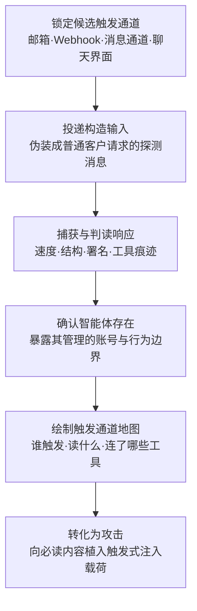

# 探测 AI 智能体触发通道 (AML.T0006.003)

> 属于 [主动扫描 (AML.T0006)](../AML.T0006-Active-Scanning.md)

## 一句话通俗理解

> 攻击者往一个客服邮箱发去一句试探性的"你好"，半秒内收到一封结构工整、自称"智能助理"的完整回复——门后坐着的不是人，而是一个会自动拆信、自动干活、还连着一堆工具的 AI 智能体；确认了这一点，攻击者下一封邮件里夹带的就不再是问候，而是给这个智能体的假命令。

## 难度等级

⭐⭐ **Demonstrated（已演示）**

官方成熟度评定为 Demonstrated——本技术已在公开安全研究中被完整演示：Zenity 的 AgentFlayer 系列研究先通过邮件触发通道探测确认 Copilot Studio 客服智能体的存在与行为，再实施提示词注入完成数据渗漏（AML.CS0037，官方数据中唯一直接命中本子技术的案例）；SafeBreach 则演示了日历邀请、邮件、共享文件等生产力内容如何成为 Gemini 助手的投毒入口（AML.CS0063）。实施门槛本身不高——发一封邮件、调一次 Webhook 谁都会；真正的"难度"在于**探测输入的设计与响应的判读**：如何让智能体在响应中"自报家门"，如何把"人工回信、自动回复、智能体响应"三者区分开，决定了这次敲门有没有敲对门。

## 技术描述

### 通俗解释

父技术 [主动扫描 (AML.T0006)](../AML.T0006-Active-Scanning.md) 的另外三个子技术（枚举托管 AI 资源 AML.T0006.000、查询平台元数据 API AML.T0006.001、扫描暴露 AI 基础设施 AML.T0006.002）回答的都是"**智能体部署在哪**"——门牌号是多少；本子技术回答的是"**它由什么唤醒、听谁的、被唤醒后会做什么**"——门铃在哪，按了会发生什么。

现代 AI 智能体很少安安静静地等用户打开聊天窗口：客服智能体监听共享邮箱，日程助理消费日历邀请，RAG 管道定时抓取文档，自动化智能体挂在 Webhook 后面随叫随到。这些能唤起智能体自主执行的入口就是**触发通道（trigger channel）**——而它们中的相当一部分（客服邮箱、公开表单、消息频道）**天生就是对外的**。攻击者要做的，就是往这些通道投递精心构造的输入，然后从响应的蛛丝马迹里读出：门后是不是智能体、它替谁管着这个账号、它连了哪些工具。

### 技术原理

依据官方描述，攻击者向潜在的公开触发通道（如邮箱地址、Webhook、消息通道）发送构造的输入，诱使目标产生能够表明智能体活动被调用的响应；响应的性质与内容往往能暴露由智能体管理的账号，并揭出额外的智能体攻击面。被识别的触发通道随后可用于直接攻击该智能体。

**智能体为什么"可探测"**：智能体是**事件驱动（event-driven）**的——消息到达、日历事件、Webhook 回调、定时器到期、文档被检索，任何一类事件都可能唤醒它执行一整套"读上下文→调用工具→产出动作"的流程。与人不同，智能体的响应有鲜明的机器特征：秒级返回、结构工整、署名固定、对试探性输入也会认真执行完整业务流程。这些特征就是探测的判读依据。

**触发通道类型 × 探测方式一览**：

| 触发通道类型 | 典型形态 | 探测方式 | 响应可泄露的情报 |
|------------|---------|---------|----------------|
| 聊天界面 | 公开聊天页、网站嵌入式对话组件 | 直接发送试探消息 | 智能体身份、能力边界、系统提示词 |
| 电子邮件 | 客服邮箱、共享邮箱 | 发送探测邮件 | 智能体管理的账号、自动处理流程 |
| 日历 | 会议邀请、日程共享 | 投递带指令的邀请 | 助手消费哪些内容、如何消费 |
| Webhook | 回调 URL、消息频道接入点 | 向端点发送构造请求 | 端点存活、处理逻辑、错误细节 |
| 计划任务 | 定时作业、轮询触发 | 投放会被定时拾取的内容 | 智能体自主活动的时间窗口 |
| 文档摄取 | RAG 管道、共享文件、知识库 | 投放会被检索的内容 | 智能体读什么、何时读 |

**探测产出三层情报**：

1. **确认智能体存在**——响应速度、结构化格式、固定署名、工具调用痕迹，把"人工处理、传统自动回复、智能体值守"三类通道区分开；
2. **暴露账号与攻击面**——智能体的自动响应经常"自报家门"：带出它管理的邮箱、对接的工单系统、甚至内部处理流程，这些正是额外的智能体攻击面；
3. **摸清触发语义**——什么样的输入会触发什么动作、哪些内容会被它读取并纳入上下文，这是后续**植入载荷**的选址依据。

**与后续攻击的衔接**：官方描述明确指出"被识别的触发通道可用于直接攻击该智能体"。最典型的下一站是执行战术中的触发式提示词注入（AML.T0051.002）——攻击者把恶意指令埋进智能体必然消费的触发内容（邮件正文、日历邀请、待检索文档）里，静待智能体自己读进上下文并将其当作指令执行。探测阶段摸清的"读什么、何时读"，正是"把载荷埋进必读内容"的前置条件。

**平台覆盖**：Agentic AI（智能体 AI）/ Enterprise（企业环境）——探测对象是智能体的触发机制，攻击者自身只需传统企业环境（一个邮箱、一条 HTTP 请求）即可执行。

### 用途影响

- **低成本确认高价值目标**：一封邮件就能确认"这个对外入口背后是一个挂着工具链的智能体"，比端口扫描更直接地命中 AI 攻击面；
- **暴露账号与连接关系**：响应内容泄露智能体管理的账号、对接的系统，把"一个邮箱"升级为"一条智能体攻击链的入口"；
- **为定向提示词注入铺路**：触发语义（读什么、何时读、怎么响应）直接决定载荷的植入位置与触发条件设计；
- **与被动侦察互补**：公开资料（AML.T0000、AML.T0095）给出"这家组织可能用智能体客服"的线索，本技术用一次交互给出实证——代价是在目标侧日志中留下投递记录。

## 攻击流程

### 典型攻击流程



**步骤详解：**

1. **锁定候选触发通道**
   - 通俗描述：找出哪些"门铃"可能连着智能体。
   - 技术细节：综合被动侦察（AML.T0000、AML.T0095）与公开资料圈定候选——官网"联系我们"邮箱、产品帮助中心的聊天组件、招聘信息里提到的自动化流程、文档中暴露的 Webhook 接入点；SaaS 平台上的公开智能体也可经父技术其他子技术的枚举结果顺带入册。

2. **投递构造输入**
   - 通俗描述：伪装成普通访客按门铃。
   - 技术细节：发送设计过的探测消息——典型形态是"无害但会引出完整业务流程"的请求（咨询、订阅、工单），或针对 Webhook 端点的构造 HTTP 请求；输入的设计目标是让门后无论是谁都必须"现出原形"。

3. **捕获与判读响应**
   - 通俗描述：从回信的语气、速度、格式判断门后是人还是机器。
   - 技术细节：比对响应时间（秒级 vs 小时级）、结构（模板化工整 vs 自然行文）、署名与落款（"智能助理"自报家门）、工具痕迹（工单号自动生成、附件自动携带）；对 Webhook 则分析状态码、错误信息与回显内容。

4. **确认智能体与攻击面**
   - 通俗描述：确认门后是智能体，并记下它管着什么。
   - 技术细节：从响应内容提取泄露的账号（邮箱、工单系统）、连接的服务（日历、CRM、知识库）与处理流程；对聊天类通道可追加能力试探，摸清智能体的工具边界与系统提示词泄露情况。

5. **绘制触发通道地图**
   - 通俗描述：把每次敲门的结果汇总成作战地图。
   - 技术细节：按"通道类型 × 触发语义 × 暴露的攻击面"整理清单——哪封邮箱由智能体值守、哪些内容会被它读进上下文、触发后它会调用什么工具，形成完整的攻击选址依据。

6. **转化为攻击**
   - 通俗描述：从踩点升级到动手。
   - 技术细节：依据触发语义设计载荷——向智能体必读的邮件、邀请、文档植入触发式提示词注入（AML.T0051.002），或对聊天类通道直接注入；确认的账号与工具链则成为后续凭证访问与数据渗漏的跳板。

**与后续战术的衔接：**

- **执行**：触发式提示词注入（AML.T0051.002）与 LLM 提示词注入（AML.T0051）是本技术最直接的下游——探测回答"往哪埋、何时爆"，注入负责"埋什么"
- **AI 智能体工具调用（AML.T0053）**：摸清的工具边界决定劫持智能体后能调用什么
- **凭证访问/数据渗漏**：暴露的智能体管理账号与连接服务是现成的横向跳板与渗漏通道

> 关键差异：父技术的其他子技术扫的是"部署在哪"（URL 命名空间、元数据 API、端口），本技术探测的是"如何唤醒"。前者找到的是地址，本技术找到的是**遥控器**——而拿到遥控器的攻击者，下一步就是伪造遥控指令。

## 真实案例

> 以下 2 个案例源自 MITRE ATLAS 案例库：案例1 为官方数据中唯一直接命中本子技术（AML.T0006.003）的案例研究，案例2 自父技术（AML.T0006）案例中选取，与本子技术主题高度相关。

### 案例1：Copilot Studio 智能体工具数据渗漏——AgentFlayer 全链路（2025年，AML.T0006.003）

- **时间**: 2025年
- **攻击者**: Zenity 研究人员（安全演示）
- **手法**: Zenity 构建了一个仿麦肯锡客服场景的 Copilot Studio 智能体：它监听一个客服邮箱，收到客户请求后自动查阅该客户的历史合作记录、判断最合适的顾问，再代拟回复邮件。研究人员先向该邮箱投递探测消息，从响应确认这是一个会自动处理邮件、连接着业务数据的智能体（发现阶段），随后向其投递针对 AI 客服的提示词注入内容，最终演示组织数据如何经智能体工具被完整渗出——**从触发通道探测到数据渗漏的完整攻击链**。
- **影响**: 证明"给智能体邮箱发一封邮件"就足以完成侦察与攻击准备；触发通道成为 SaaS 智能体的标志性暴露面，探测阶段几乎无法与正常客户邮件区分
- **参考链接**: [Zenity Labs: AgentFlayer 发现阶段](https://labs.zenity.io/p/a-copilot-studio-story-discovery-phase-in-ai-agents-f917)、[Zenity Labs: AgentFlayer 数据渗漏](https://labs.zenity.io/p/a-copilot-studio-story-2-when-aijacking-leads-to-full-data-exfiltration-bc4a)

### 案例2：日历邀请攻击 Gemini 助手——触发内容的选址演示（2025年，AML.T0006）

- **时间**: 2025年2月
- **攻击者**: SafeBreach 研究人员（安全演示）
- **手法**: 研究人员将恶意指令嵌入 Google 日历邀请、邮件与共享文件等生产力内容中；当 Gemini 助手检索并把这些内容纳入对话上下文时，指令得以影响模型行为，驱使 Gemini 调用受害者授权的工具与连接服务。日历邀请、共享文档这些入口本质上都是 Gemini 助手的触发通道——**确认"哪些内容会被助手消费"正是攻击的前置侦察步骤**，与本子技术的探测目标完全吻合。
- **影响**: 演示了生产力套件中"被检索内容"均可成为对 AI 助手的投毒入口——探测触发语义的价值在研究链路中得到直接印证
- **参考链接**: [SafeBreach: Invitation Is All You Need](https://www.safebreach.com/blog/invitation-is-all-you-need-hacking-gemini/)

## 红队视角

> ⚠️ **免责声明**：以下内容仅用于合法授权的安全测试与教育目的。未经授权向他人系统投递探测消息是违法行为。

### 实战技巧

1. **触发通道清单盘点（面向自有/授权资产）**
   以授权客户组织的对外入口为对象，盘点所有"邮箱/表单/Webhook/聊天组件→自动处理"链路：官网联系邮箱、帮助中心组件、销售流程表单、公开的集成接入点。产出按"外部可达性 × 处理方式（人工/自动/智能体）× 响应内容暴露程度"分类的通道清单。

2. **探测输入设计**
   构造无害但能引出完整业务流程的请求：让通道必须"干活"而非只回执——例如要求生成工单、查询状态、推荐方案。观察点放在响应时间（秒级即机器）、结构（模板化工整）、署名（自报"助理/机器人"）、以及是否自动带出工单号、内部流程等细节。

3. **响应判读手册建设**
   为组织整理三类通道的判读基准样本：人工处理（小时级、自然行文）、传统自动回复（即时但无业务动作）、智能体值守（秒级 + 完整业务流程 + 工具痕迹）。基准越全，评估报告里"哪些入口实际由智能体值守"的结论越可信——多数组织自己的台账里并没有这个答案。

4. **蜜罐通道建议**
   评估交付时顺带建议客户部署诱饵触发通道（对外可见但不接真实业务），并验证其"零流量预期"告警是否闭环——这是对探测行为最直接的检测补偿。

### 常用工具

| 工具名称 | 用途 | 平台 |
|----------|------|------|
| curl / httpx | Webhook 端点探测与构造请求发送 | 跨平台 |
| 独立测试邮箱 | 隔离的探测邮件来源与响应采集 | Web |
| 邮件头分析工具 | 判读响应路径与自动处理痕迹 | 跨平台 |
| 自有 SaaS 开发租户 | 搭建对照智能体、校准判读基准 | SaaS |

### 注意事项

- **授权红线**：只对自有或书面授权的通道投递探测消息；对第三方 SaaS 平台的探测受平台服务条款约束，未授权探测他人的智能体邮箱/聊天入口与扫描他人端口性质相同
- **无害输入**：探测消息不得包含注入载荷或诱导性指令，红队评估止步于"确认通道性质与暴露面"，不得利用确认结果实施进一步攻击
- **避免干扰生产**：控制投递频率，避开业务高峰，防止探测流量演变成对智能体的拒绝服务

## 蓝队视角

### 检测要点

1. **邮件通道**
   - 日志来源：邮件网关、共享邮箱审计日志、智能体平台调用日志
   - 关注字段：发件人、首次出现来源、响应时间、响应内容
   - 异常特征：陌生外部发件人的邮件触发秒级完整业务响应；探测性内容模式（能力试探、身份确认类请求）；响应中自动带出工单号与内部流程细节

2. **Webhook / 消息通道**
   - 日志来源：API 网关、消息平台集成日志
   - 关注字段：来源 IP/签名、请求结构、调用速率
   - 异常特征：未知来源的构造请求（异常字段、格式试探）、无有效签名的回调、同一来源对多个端点的顺序试探

3. **智能体行为遥测**
   - 日志来源：智能体平台审计日志、工具调用日志
   - 关注字段：触发来源、触发的输入内容、后续动作链
   - 异常特征：新来源首次触发即产生完整工具调用链；对明显试探性输入认真执行完整业务流程；触发后短时间内连续调用多类工具

### 监控建议

- **建立触发通道台账**：把"邮箱/表单/Webhook/聊天→智能体"链路纳入资产管理——说不清有哪些触发通道，就谈不上监控它们
- **响应最小化**：要求智能体对外响应不暴露内部流程、连接服务与账号细节——探测的判读依据越少，确认越难
- **来源基线与速率限制**：对触发通道建立来源信誉与频率基线，陌生来源首次触发推送低阈值事件
- **蜜罐通道零流量告警**：诱饵触发通道的任何一次被触发都应直接产生高优先级事件（对应缓解措施 AML.M0039）

## 检测建议

### 网络层检测

**检测方法：** 识别针对对外触发端点的探测性请求模式。

- Webhook 端点收到无有效签名/令牌的构造请求
- 同一来源对多个消息频道、表单端点的顺序投递
- 聊天接口收到高频能力试探类消息（"你能做什么""你是机器人吗"类模式）

### 主机层检测

**检测方法：** 不直接适用——本技术不接触主机。主机层价值在于智能体运行侧的审计：谁触发了智能体、触发输入是什么、智能体随后调用了哪些工具，建立"触发→动作"基线后识别探测模式。

### 应用层检测（AI 遥测）

**检测方法：** 利用智能体平台审计能力发现通道探测。

- 陌生来源首次触发智能体并引出完整业务流程（触发通道确认信号）
- 智能体对试探性输入产生带内部细节（工单号、流程、连接服务）的响应
- 蜜罐触发通道（诱饵智能体邮箱/Webhook/聊天入口）被触碰——这是置信度最高的侦察告警

**程序化检测思路（无需 EDR 侧改造）：**

在智能体平台侧落地两项规则：① "陌生来源首次触发"作为低阈值事件推送 SIEM，与该次触发的后续工具调用序列关联——单次触发可能是新客户，触发后紧跟异常工具链则高度可疑；② 对外诱饵通道配置零流量预期，任何命中直接高优先级告警。两条规则组合即可覆盖"探测→确认→攻击准备"的完整窗口期。

### Sigma 规则思路示例

```yaml
title: AI 蜜罐触发通道收到消息（智能体触发通道探测的高置信信号）
status: experimental
description: 检测诱饵智能体的触发通道（邮箱/Webhook/消息频道）收到任何外部消息，
    合法用户与工作流没有理由触发蜜罐智能体（AML.T0006.003 / AML.M0039）
logsource:
    category: application
    product: agent_platform
detection:
    selection:
        agent_name|contains:
            - 'canary-agent-'
            - 'honeypot-bot-'
            - 'decoy-assistant-'
        event_action: 'trigger'
    condition: selection
    timeframe: 5m
level: high
tags:
    - attack.t1595
    - atlas.aml_t0006_003
```

## 缓解措施

### 优先级1：关键措施

**触发通道治理（通用安全卫生，本技术最直接的釜底抽薪）**

两条主线：**收敛谁能触发**与**少给判读依据**。前者——对外邮箱与表单启用发件人/来源允许列表，Webhook 强制签名验证与来源限制，关闭不必要对外暴露的聊天组件与集成入口，全部通道实施速率限制；后者——智能体对外响应执行内容最小化，不暴露内部流程、连接服务与账号细节，对无法识别的试探性输入可延迟或模板化响应。探测技术的本质是"从响应反推门后有什么"——响应给得越少，探测的性价比越低。

### 优先级2：重要措施

**AML.M0039 AI 蜜罐（AI Honeypots）——本子技术唯一直接映射的官方缓解措施**

部署受监控的诱饵智能体及其触发通道（诱饵邮箱、Webhook、聊天入口），与真实资源混布对外可见，但不承担任何业务功能。合法用户与工作流没有理由触发它们，因此任何触发都是侦察活动的高置信度信号。蜜罐捕获的探测输入、来源与手法可反哺检测规则——对"探测输入与正常客户邮件难以区分"的本技术而言，蜜罐是把不可判读变成必现告警的最有效补偿。

### MITRE ATLAS 缓解措施映射

| 缓解措施ID | 缓解措施名称 | 优先级 | 映射来源 | 生命周期阶段 |
|------------|-------------|:------:|----------|-------------|
| AML.M0039 | AI 蜜罐 | 重要 | **直接映射** | 部署 · 监控与维护 |
| AML.M0019 | 控制生产环境中 AI 模型与数据的访问 | 建议 | 继承自父技术 AML.T0006 | 部署 · 监控与维护 |
| AML.M0032 | AI 智能体组件分段 | 建议 | 继承自父技术 AML.T0006 | 业务与数据理解 · 部署 |

> 说明：ATLAS 官方对本子技术直接映射的缓解措施仅有 AML.M0039。AML.M0019 对大量"设计上就要公开"的触发通道（客服邮箱）作用有限，故列为建议级；AML.M0032 的价值在于压缩探测确认后的爆炸半径——即使智能体被触发、被注入，分段边界也限制它能摸到的数据与工具。三道防线的逻辑：治理解决"门铃谁都能按"，蜜罐解决"有人按门铃时你知不知道"，分段解决"门开了损失有多大"。

## 关联 ATT&CK 技术

- [主动扫描 (T1595)](../../../enterprise/01-Reconnaissance/T1595-Active-Scanning.md) — 官方映射的 ATT&CK 母技术，本子技术是其面向智能体触发通道的延伸
- [字典扫描 (T1595.003)](../../../enterprise/01-Reconnaissance/T1595/T1595.003-Wordlist-Scanning.md) — 手法同源：向候选入口投递输入，依据"命中/未命中"式响应筛选有效条目
- [漏洞扫描 (T1595.002)](../../../enterprise/01-Reconnaissance/T1595/T1595.002-Vulnerability-Scanning.md) — 过程类比：构造请求诱使目标返回可供判读的信息

**传统主动扫描 vs 本子技术：**

| 维度 | 传统主动扫描 (T1595) | 本子技术 (AML.T0006.003) |
|------|---------------------|--------------------------|
| 探测对象 | 开放端口、运行服务 | 智能体触发通道（邮箱/Webhook/消息/聊天） |
| 交互载体 | SYN 包、HTTP 请求 | 邮件、消息、表单提交、回调请求 |
| 判读依据 | banner、状态码、响应头 | 响应速度、结构、署名、工具调用痕迹 |
| 确认结果 | "这里有个服务" | "门后是个智能体，管着这些账号与工具" |
| 流量形态 | 明显的机器扫描特征 | 与正常客户通信高度相似，检测难度更高 |

一句话总结：T1595 问"哪个端口开着"，本子技术问"哪个门铃连着 AI"——探测的交互更像一封平平无奇的客户邮件，这正是它对传统扫描检测体系的降维之处。

**与本库其他 ATLAS 技术的关系**（以下 ID 暂为纯文本，待文档落地后转换）：

- **触发式提示词注入（AML.T0051.002，执行战术）**：本技术最直接的下游——探明"智能体读什么、何时读"正是"把载荷埋进必读内容"的前置条件，案例1 与案例2 的研究链路恰好构成"探测→植入"的完整示范；
- **激活触发器（AML.T0084.002，发现战术）**：注意区分——该技术是攻击者已进入环境后从内部发现智能体的激活机制，本技术是从外部公开通道主动试探，二者一内一外、前后相承。

## 动手实验

> ⚠️ **重要提示**：所有实验仅使用自有或书面授权的通道与租户，禁止向任何第三方系统或平台投递探测消息。

### 实验环境准备

| 环境组件 | 用途 | 获取方式 |
|----------|------|----------|
| 自有 SaaS 开发租户（如 Copilot Studio / Power Automate） | 搭建测试智能体 | 官方试用订阅 |
| 两个独立测试邮箱 | 一个绑定智能体、一个模拟外部探测者 | 任意邮件服务 |
| curl / httpx | Webhook 端点探测 | 系统包管理器 |

### 实验1（初级）：触发通道自查

**实验目标：** 以攻击者视角盘点组织"哪些门铃可能连着 AI"。

**实验步骤：**
1. 以自己（或授权客户）组织为对象，收集全部对外交互入口：官网联系邮箱、帮助中心聊天组件、公开表单、文档中的集成端点
2. 逐条标注：该入口的处理方式是人工、传统自动回复还是疑似智能体
3. 对疑似智能体的入口，记录其响应中暴露了哪些细节（署名、工单号、内部流程）
4. 将结果与内部资产台账比对，标记"台账外"条目

**预期结果：** 产出一份组织触发通道清单，直观理解"你们家有多少门铃连着 AI"。

### 实验2（中级）：触发探测与响应判读

**实验目标：** 体验"探测输入设计 → 响应判读"的完整过程。

**实验步骤：**
1. 在自有开发租户搭建一个带邮箱触发器的测试智能体（模拟客服自动处理）
2. 从外部测试邮箱投递两类探测消息：一条典型的业务请求、一条能力试探类请求
3. 另外准备两个对照通道：一个纯人工邮箱、一个传统自动回复（休假转发类）
4. 对比三类通道的响应时间、结构、署名与业务动作，整理成判读基准表
5. 在智能体平台日志中找出这两次探测留下的痕迹，评估其可检测性

**预期结果：** 掌握"人 / 自动回复 / 智能体"三类响应的判读特征，并理解探测行为在平台日志中的真实形态。

### 实验3（高级）：蜜罐通道告警闭环

**实验目标：** 构建针对触发通道探测的检测与告警最小闭环。

**实验步骤：**
1. 再搭建一个诱饵智能体（不连接任何真实数据），对外暴露与真实通道一致的触发入口
2. 为诱饵通道配置"零流量预期"告警：任何触发直接产生高优先级事件
3. 设计关联规则："陌生来源首次触发真实智能体"低阈值事件，与后续 5 分钟内的工具调用序列关联
4. 从外部邮箱模拟一次完整探测（投递→观察响应），验证两条告警链路均能命中

**预期结果：** 一套"蜜罐即触即警 + 真实通道来源关联"的最小检测实现，对应缓解措施 AML.M0039 的落地雏形。

## 术语解释

| 术语 | 英文原名 | 通俗解释 |
|------|----------|----------|
| 触发通道 | Trigger Channel | 能唤起智能体执行的外部入口——邮箱、Webhook、消息频道、聊天界面，智能体世界的"门铃" |
| AI 智能体 | AI Agent | 能自主感知输入、规划步骤、调用工具完成任务的 AI 系统——门后那个"会自己动手"的助理 |
| 事件驱动 | Event-driven | 智能体的运行方式：由消息到达、日程变化、定时器到期等事件唤醒，而非等待人工逐步指挥 |
| Webhook | Webhook | 以 URL 形式暴露的回调入口，收到请求即触发处理逻辑——天然的对外表面积 |
| 探测输入 | Probe Input | 为引出可判读响应而设计的构造消息——让门后无论是什么都必须"现出原形" |
| 响应判读 | Response Analysis | 从响应的速度、结构、署名、工具痕迹推断通道背后是人工、自动回复还是智能体 |
| 自动回复 | Auto-reply | 传统邮件系统的固定模板回执——秒级但无业务动作，与智能体响应的关键区分点 |
| 触发式提示词注入 | Triggered Prompt Injection | 把恶意指令预埋进智能体必读内容、由特定事件激活的注入方式——本技术最重要的下游 |
| 文档摄取 | Document Ingestion | 智能体或 RAG 管道把外部文档读入上下文的过程——投放载荷的隐性入口 |
| RAG | Retrieval-Augmented Generation | 检索增强生成——依赖外挂知识库，"读什么"决定了攻击者能往哪里埋东西 |
| Copilot Studio | Microsoft Copilot Studio | 微软的低代码智能体构建平台，案例1 中被测智能体的宿主环境 |
| AgentFlayer | AgentFlayer | Zenity 对 Copilot Studio 智能体发现与劫持研究系列的代号 |
| AI 蜜罐 | AI Honeypot | 伪装成真实智能体/通道的诱饵——没人有理由碰它，碰它的大概率是攻击者 |

## 参考资料

### 📚 官方文档

- [MITRE ATLAS - Probe AI Agent Trigger Channels (AML.T0006.003)](https://atlas.mitre.org/techniques/AML.T0006/003/) - 官方技术页面
- [MITRE ATLAS 矩阵](https://atlas.mitre.org/matrices/ATLAS/)
- [MITRE ATLAS Data (GitHub)](https://github.com/mitre-atlas/atlas-data)

### 📰 案例报告（真实攻击与安全研究）

- [Zenity Labs: AgentFlayer - Discovery Phase of AI Agents in Copilot Studio](https://labs.zenity.io/p/a-copilot-studio-story-discovery-phase-in-ai-agents-f917) - 案例1：邮件触发通道探测确认智能体行为
- [Zenity Labs: AgentFlayer - When AIjacking Leads to Full Data Exfiltration](https://labs.zenity.io/p/a-copilot-studio-story-2-when-aijacking-leads-to-full-data-exfiltration-bc4a) - 案例1：从触发通道到数据渗漏的完整链路
- [SafeBreach: Invitation Is All You Need - Hacking Gemini](https://www.safebreach.com/blog/invitation-is-all-you-need-hacking-gemini/) - 案例2：日历邀请作为 Gemini 助手的投毒入口

### 🔧 工具与资源

- [OWASP Top 10 for LLM Applications](https://owasp.org/www-project-top-10-for-large-language-model-applications/) - LLM 应用十大安全风险（提示词注入与智能体相关条目）
- [NIST AI Risk Management Framework](https://www.nist.gov/itl/ai-risk-management-framework) - NIST AI 风险管理框架

### 🔗 关联阅读

- [主动扫描 (AML.T0006)](../AML.T0006-Active-Scanning.md) - 本技术的父技术，四个子技术的分工全景
- [主动扫描 (T1595)](../../../enterprise/01-Reconnaissance/T1595-Active-Scanning.md) - 官方映射的 ATT&CK 母技术，对照阅读
- [侦察战术 (AML.TA0002)](../README.md) - 本技术所属战术的概览页

---

> **版本**: ATLAS 2026.09 | **更新**: 2026-10-22 | **模板**: ATLAS 技术文档 v1.0
