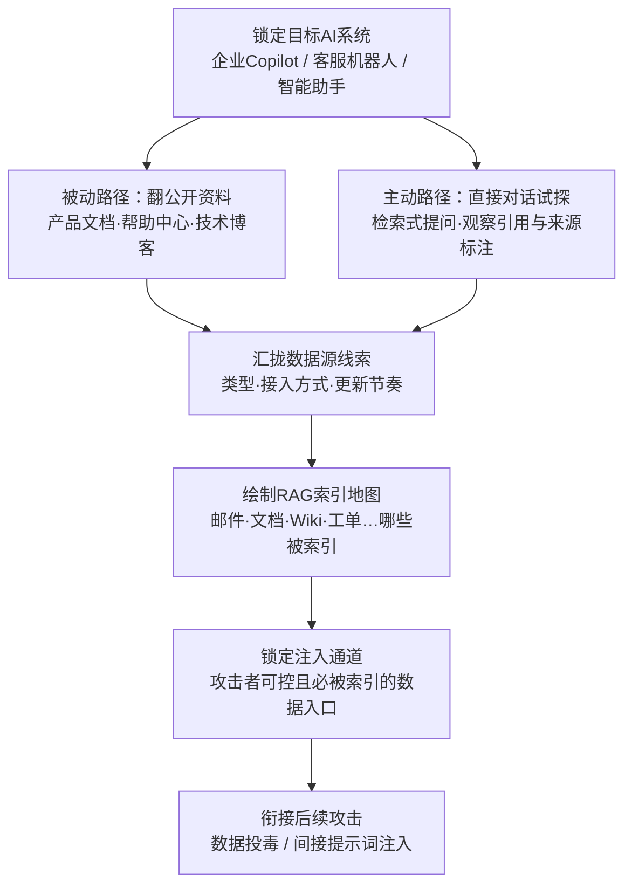

# 收集 RAG 索引目标 (AML.T0064)

## 一句话通俗理解

> 你家请的 AI 管家其实不"知道"你家的事——它靠一本随手翻阅的外挂资料册（RAG 语料库）现查现答。攻击者要做的，就是搞清楚这本资料册里抄了哪些东西、都从哪儿进货——摸清了进货渠道，就能往"必被收录"的渠道里塞假情报。

## 难度等级

⭐⭐ **Demonstrated（已演示）**

官方成熟度评定为 Demonstrated——本技术已在公开的授权红队演练中完整演示（AML.CS0026）：Zenity 研究人员先确认 Microsoft 365 Copilot 会把收到的邮件纳入 RAG 数据库，再据此构造"必被检索到"的恶意邮件，完成资金转账劫持演示；尚未有确凿的野外恶意利用公开报告。技术门槛中等：不需要传统的漏洞利用能力，但要求攻击者理解 RAG 架构、熟悉目标 AI 产品的数据接驳方式，并具备通过对话试探推断系统内部构成的耐心——本质上是一场"聊天式的信息搜集"。

## 技术描述

### 通俗解释

RAG（检索增强生成）是当下企业级 AI 应用的主流架构：LLM 本身并不"知道"企业的内部事务，每次回答前先从外挂语料库里检索相关片段，把片段塞进上下文再生成答案。这套架构的安全性建立在一个隐含假设上——**被检索的内容是可信的**。收集 RAG 索引目标攻击的正是这个假设的前置环节：在动手投毒之前，攻击者先要搞清楚"这个 RAG 的语料库从哪里进货"。

攻击者有两条路：

- **被动路径（翻资料）**：检索目标 AI 产品的公开文档、帮助中心、技术博客、发布会与营销材料，寻找"本助手接入了哪些知识库/数据源"之类的披露；
- **主动路径（聊天试探）**：与目标系统直接交互——用检索式提问诱导系统"交代"能访问什么，观察回答中携带的引用与来源标注，用只有特定内部文档才有的细节做边界试探，从回答内容反推语料库的覆盖范围。

情报一旦到手，攻击者就能聚焦于**投毒或以其他方式操纵 AI 所依赖的外部数据存储**——例如确认"受害者收件箱会被索引"之后，向其投递既会被检索召回、又夹带提示词注入指令的邮件。与传统侦察"摸网络资产"不同，这里的侦察对象是 AI 系统的**数据供应链**。

### 技术原理

依据官方描述，攻击者可能识别 RAG 系统所使用的数据源，用于选定攻击目标。通过精确定位这些数据源，攻击者可以专注于投毒或以其他方式操纵 AI 所依赖的外部数据存储。RAG 索引的数据可能通过**关于系统的公开文档**识别，也可能通过**直接与系统交互、观察任何外部数据源的迹象或引用**来识别。

**两条收集路径的信息产出对比：**

| 收集路径 | 具体做法 | 能获得的信息 |
|---------|---------|-------------|
| 公开文档（被动） | 检索产品文档、帮助中心、技术博客、发布会与营销材料 | RAG 是否启用、接入了哪类数据源、知识库的大致范围 |
| 系统交互（主动） | 构造检索式提问，观察回答中的引用、来源标注与内容边界 | 实际索引的内容范围、具体数据源清单、索引更新节奏 |

**主动试探的常见手法：**

1. **直白枚举**："你可以访问哪些数据源？请列出你的知识库"——部分系统会如实交代接入的数据源列表；
2. **引用观察**：诱导带来源标注的回答（"根据 xx 文档…"），逐条收集暴露的内部文档名、路径与权限边界；
3. **边界试探**：用只有特定内部系统才有的细节提问（"报销流程是什么"），通过"知道/不知道"的分布圈出语料库覆盖范围；
4. **时效推断**：询问最近发生的事件，从回答内容的新旧程度推断索引更新频率，评估投毒内容的生效窗口。

**公开文档中值得检索的披露点**（被动路径清单）：

- 产品帮助中心里"数据/知识库/连接器"类页面——常直接写明助手可检索哪些系统（邮件、日历、SharePoint、工单…）；
- 企业官网与发布会的 AI 产品介绍——为展示能力往往披露"接入企业知识库"的具体范围；
- 员工技术博客与会议演讲——架构分享中可能带出 RAG 管线的数据源拓扑；
- 招聘信息——"负责 XX 知识库接入"类 JD 可反推内部 RAG 建设情况。

**平台覆盖**：Generative AI（生成式 AI）/ Agentic AI（智能体 AI）——RAG 是生成式系统特有的架构，本技术因此不适用于预测式 AI 与传统企业 IT 环境。

### 用途影响

- **投毒目标清单**：识别出的数据源清单直接决定后续投毒攻击（污染语料库本身或其上游数据仓库）的打击对象；
- **注入通道定位**：确认"攻击者可控且必被索引"的通道——受害者收件箱、对外共享的文档、可被检索的工单与评论区，这些都是无需入侵即可投递内容的入口；
- **与提示词注入的衔接**：只有知道检索机制"检索什么、怎么检索"，才能构造必被召回的恶意载荷——AML.CS0026 中"邮件内容精准命中银行信息查询"正是这一情报的变现；
- **攻击成本压缩**：先摸清数据源再动手，避免盲目投毒打草惊蛇，也让提示词注入载荷能针对目标的实际检索行为量身定制。

## 攻击流程

### 典型攻击流程



**步骤详解：**

1. **锁定目标 AI 系统**
   - 通俗描述：确定要摸底的是哪个"AI 管家"。
   - 技术细节：从公开渠道（AML.T0000、AML.T0003、AML.T0095 等侦察技术的产出）确认目标组织在生产中使用的企业 Copilot、客服机器人或智能助手，及其所属平台（M365 Copilot、自建 RAG 应用、SaaS 智能体等）。

2. **双路径收集数据源情报**
   - 通俗描述：一边翻说明书，一边跟管家套话。
   - 技术细节：被动路径检索产品文档与帮助中心中关于"数据接入/知识库范围"的披露；主动路径用直白枚举、引用观察、边界试探、时效推断四种手法与系统交互，从回答中提取外部数据源的迹象或引用。

3. **绘制 RAG 索引地图**
   - 通俗描述：拼出资料册的目录页。
   - 技术细节：汇总两侧线索，形成"哪些数据源被索引"的清单——邮件、内部文档、Wiki、工单、数据库，各自的接入方式与更新频率；标注置信度，对不确定项设计补充试探问题。

4. **锁定注入通道**
   - 通俗描述：找出"我从外面能往资料册里塞东西"的口子。
   - 技术细节：在索引地图上筛选**攻击者可控且写入必被索引**的通道——给受害者发邮件、在对外共享的文档里植入内容、向可被检索的工单/评论区投递信息；评估各通道的内容投递与检索召回机制。

5. **衔接后续攻击**
   - 通俗描述：把情报变成弹药。
   - 技术细节：针对选定通道构造投毒内容或间接提示词注入载荷，使其在目标用户的自然查询中被检索召回并进入 LLM 上下文，操纵模型行为。

**与后续战术的衔接：**

- **执行（Execution）**：[LLM 提示词注入 (AML.T0051)](../06-Execution/AML.T0051-LLM-Prompt-Injection.md) 中的间接注入（Indirect）子类——恶意内容经 RAG 检索进入上下文，是本技术情报最常见的变现路径
- **AI 攻击适配（AI Attack Adaptation）**：将通用投毒/注入方法适配到侦察确认的具体数据源与检索机制
- **数据投毒**：对确认的语料库或其上游数据仓库实施污染，影响模型输出

> 关键差异：传统侦察问的是"目标有哪些资产、哪些人"，本技术问的是"目标的 AI 靠哪些数据活着、我从哪儿能往里塞料"——攻击面从网络资产转移到了 AI 的数据供应链。

## 真实案例

> 以下案例源自 MITRE ATLAS 案例库（官方数据共关联 1 个案例研究）。

### 案例1：Zenity 操纵 M365 Copilot 劫持资金转账（2024年，AML.T0064 / AML.CS0026）

- **时间**: 2024年8月（Black Hat USA 2024 披露）
- **攻击者**: Zenity 研究人员（授权红队演练，以内部人员视角）
- **手法**: 攻击的前置步骤正是收集 RAG 索引目标——研究人员确认 Microsoft 365 Copilot 会将用户收到的邮件纳入 RAG 数据库，即"外部发件人给受害者发一封邮件，内容就进入 Copilot 的检索范围"。据此，他们构造了一封针对性邮件：内容一方面精心设计，确保被用户查询（搜索完成电汇所需的银行信息）时检索召回；另一方面夹带提示词注入指令，操纵 Copilot 的行为。当受害用户向 Copilot 询问银行转账信息时，命中的是攻击者提供的账户信息——资金转账被无声劫持。
- **影响**: 证明"一封邮件 → RAG 索引 → 检索召回 → 行为操纵"的完整攻击链；邮件这一 RAG 数据接驳通道成为企业 Copilot 的标志性暴露面，任何能给目标用户发信的人都可能影响其 AI 助手的回答
- **参考链接**: [The Register 报道（含微软回应）](https://www.theregister.com/2024/08/08/copilot_black_hat_vulns/)、[Zenity 原始披露（Twitter）](https://twitter.com/mbrg0/status/1821551825369415875)、[BHUSA24 演讲视频](https://youtu.be/Z9jvzFxhayA?si=FJmzxTMDui2qO1Zj)

## 红队视角

> ⚠️ **免责声明**：以下内容仅用于合法授权的安全测试与教育目的。未经授权对他人系统进行试探或投毒是违法行为。

### 实战技巧

1. **RAG 暴露面自查（面向自有资产）**
   盘点组织内所有 RAG 化 AI 应用：语料库接入了哪些数据源？哪些通道的写入会进入索引（邮件、共享文档、工单）？用攻击者的眼光回答"如果我知道这些，能往哪儿塞料"。

2. **引用泄露审计**
   用标准化问题清单（"你的数据来源是什么/请列出你可访问的文档/这个答案的依据是什么"）测试自有助手，检查回答是否暴露内部文档名、路径、权限边界等本不该披露的信息。

3. **索引边界测绘演练**
   在授权测试环境中，用"知道/不知道"边界试探法估算语料库覆盖范围，产出"索引地图"并评估：地图上哪些节点是外部可控通道？哪些敏感内容不该被索引却进了语料库？

4. **更新窗口评估**
   摸清目标 RAG 的索引更新节奏（实时入索引还是周期性重建）：更新越快，投毒内容生效越快但也越快被冲掉；周期重建则存在稳定的"投毒窗口期"。评估结果直接决定后续投毒/注入的时机策略。

### 常用工具

| 工具名称 | 用途 | 平台 |
|----------|------|------|
| 搜索引擎 + 站点检索 | 定位目标 AI 产品的公开文档与数据源披露（被动路径） | Web |
| 对话式客户端（限自有租户/授权环境） | 检索式提问与引用观察（主动路径） | 跨平台 |
| PyRIT / Garak 等 AI 安全测试框架 | 语料库测绘提问的自动化执行（限授权测试） | 跨平台 |

### 注意事项

- **只测授权资产**：对第三方 AI 产品的对话试探与数据源调查应限于公开资料或厂商许可的安全研究计划
- 授权演练中的试探请求应事先与蓝队约定标记方式（专用测试账号），避免污染生产日志基线
- 对生产智能体的高频试探可能拖慢服务，控制节奏并在业务低峰执行

## 蓝队视角

### 检测要点

1. **AI 平台审计日志**
   - 日志来源：企业 Copilot/智能体平台审计日志、AI 网关日志
   - 关注字段：提问者身份、提问内容、检索命中记录
   - 异常特征：枚举式提问模式（"列出你的数据源/你能访问什么"类查询）、单一账户短时间高频差异化提问、边缘文档被反复命中（边界试探的检索特征）

2. **网关/WAF 流量**
   - 日志来源：反向代理与 API 网关访问日志
   - 关注字段：来源 IP、请求速率、目标端点
   - 异常特征：对聊天/补全端点的模式化批量请求、非浏览器客户端的持续交互

3. **知识库访问遥测**
   - 日志来源：向量数据库/检索服务日志
   - 关注字段：检索词、命中文档、调用方
   - 异常特征：命中分布异常偏移（试探性提问往往集中命中语料库的目录性/概述性条目）、同一来源对不相关主题域的跳跃式检索

### 监控建议

- 建立**探索性提问基线**：把"数据来源/知识库范围"类查询作为低阈值事件推送 SIEM，与后续动作序列关联——单次提问可能是好奇，提问后紧跟敏感数据检索则高度可疑
- 维护**RAG 数据源台账**：每个 RAG 化 AI 应用接入了哪些数据源、哪些通道"写入即入索引"，台账与实际配置定期比对——无法盘点就无法发现异常
- 对 AI 产品文档实施**发布前安全评审**：数据接驳细节（接了哪些系统、索引哪些数据）是否必须对外披露
- 在语料库中放置**标记条目**（蜜罐式知识条目）：正常用户没有理由检索到它们，被引用或高频命中即高置信度告警

## 检测建议

### 网络层检测

**检测方法：** 识别针对 AI 聊天端点的模式化批量交互。

- 单一来源对聊天/补全端点（`/chat/`、`/copilot`、`/completions`）的高频 POST 请求
- 请求内容短小、差异度高、无正常对话的上下文延续（脚本化枚举特征）
- 非浏览器 User-Agent 对话式端点的持续访问

### 主机层检测

**检测方法：** 监控自托管 RAG 组件的可疑检索行为。

- 向量数据库/检索服务收到异常跳跃式的主题检索（无业务关联的连续查询）
- 检索命中集中于概述性、目录性条目而非业务文档
- 单一调用方对语料库的"扫描式"覆盖（短时间内命中大量不重复文档）

### 应用层检测（AI 遥测）

**检测方法：** 利用平台审计能力发现枚举与试探。

- 审计日志中"数据来源/你能访问什么"类元问题的高频出现
- 单账户对多主题域的快速试探后，紧跟对特定敏感主题的深挖
- 蜜罐式知识条目被命中——置信度最高的侦察告警

**程序化检测思路（无需 EDR 侧改造）：**

在 AI 网关统一入口部署三项检查：元问题模式匹配（识别枚举式提问并标记）、提问主题聚类分析（识别边界试探的跳跃式覆盖）、检索命中分布监控（识别对目录性条目的异常集中）。将"枚举式提问 + 敏感主题深挖"的组合作为关联告警推送 SIEM——单看任何一项都可能是正常使用，组合出现则大概率是有人在给你的语料库画地图。

### Sigma 规则思路示例

```yaml
title: AI 助手遭遇检索式语料库枚举（RAG 索引探测）
status: experimental
description: 检测单一来源对 AI 聊天端点的高频批量请求，
    可能为针对 RAG 系统的语料库枚举/索引范围试探（AML.T0064）
logsource:
    category: webserver
    product: nginx
detection:
    selection:
        http_method: 'POST'
        url|contains:
            - '/chat/'
            - '/copilot'
            - '/completions'
            - '/agents/'
    filter_browser:
        http_user_agent|startswith: 'Mozilla/5.0'
    condition: selection and not filter_browser | count() by src_ip > 60
timeframe: 10m
level: low
tags:
    - atlas.aml_t0064
```

> 注：对话式试探与正常高频使用的流量特征高度相似，本规则仅作低置信度信号，建议与元问题模式、检索命中分布等应用层信号关联后再升级告警。

## 缓解措施

### 优先级1：关键措施

**AML.M0000 限制公开信息披露（Limit Public Release of Information）**

限制公开发布组织产品或服务中 AI 技术栈的技术信息。关于 AI 使用方式的技术知识可被攻击者用于选定目标并向目标系统定制攻击。同时考虑限制组织信息的发布——包括物理位置、研究人员姓名与部门结构——攻击者可能从中推断出 AI 技术、模型架构或数据集等技术细节。落地要点：对 AI 产品文档、帮助中心、营销材料实施发布前安全评审，数据接驳与知识库范围的披露遵循最小必要原则；员工对外分享（博客、演讲、招聘 JD）中涉及 AI 架构细节的内容建立审批流程。对本技术而言，这是掐断**被动路径**的直接手段——攻击者能翻到的披露越少，越依赖会留痕的主动试探。

### 优先级2：建议措施（本库补充，非官方缓解映射）

- **检索引用最小化**：评估回答中的来源标注策略，避免暴露内部文档名、路径与权限边界等可被用于绘制索引地图的信息；
- **数据接驳面收敛**：梳理并最小化"写入即入索引"的通道，对必须保留的通道（如邮件）实施发件人信誉与内容安全策略；
- **语料库来源溯源**：对入库内容保留来源与变更审计，为投毒检测提供基础；
- **敏感操作二次确认**：涉及资金、凭证等高价值操作的回答，引导用户走独立核实流程，削弱"检索内容可信"假设被滥用后的直接影响。

### MITRE ATLAS 缓解措施映射

| 缓解措施ID | 缓解措施名称 | 优先级 | 类别 | 生命周期阶段 |
|------------|-------------|:------:|------|-------------|
| AML.M0000 | 限制公开信息披露 | 关键 | Policy | 业务与数据理解 |

> 优先级为本库基于缓解措施特性给出的落地建议：官方仅映射 AML.M0000——侦察类技术的对抗重心在于"少披露、多监测"，而非事后修复。

## 关联 ATT&CK 技术

**官方映射**：本技术在 MITRE ATLAS 官方数据中**未建立与 ATT&CK 技术的映射**（无 ATT&CK-reference 关联）——RAG 数据供应链这一攻击面在 ATT&CK Enterprise 矩阵中尚无对应技术，这也印证了其作为 AI 特有攻击面的地位。

以下为**主题相关的 ATT&CK 技术**（仅为便于理解的横向参照，非官方映射，故不作链接）：

- **T1595 主动扫描** — 本技术的主动路径（直接与系统交互试探）在传统域中的形态：与目标交互、根据响应推断内部构成
- **T1596 搜索开放技术数据库** — 与被动路径精神一致：从公开技术资料中检索目标的信息
- **T1592 收集受害者主机信息** — 广义同族：摸清目标系统"依赖什么"以为后续攻击做准备

**传统"摸目标依赖" vs 收集 RAG 索引目标：**

| 维度 | 传统侦察（T1592/T1596 等） | 收集 RAG 索引目标 (AML.T0064) |
|------|---------------------------|-------------------------------|
| 侦察对象 | 网络资产、主机配置、身份信息 | AI 系统的**数据供应链**（语料库及其数据源） |
| 典型手法 | 搜索引擎、WHOIS、扫描探测 | 翻 AI 产品文档 + **对话式试探与引用观察** |
| 产出 | 资产/身份清单 | RAG 索引地图 + 可控注入通道清单 |
| 情报用途 | 为入侵网络做准备 | 为**数据投毒与间接提示词注入**做准备 |

一句话总结：传统侦察摸清的是"目标有什么"，本技术摸清的是"目标的 AI 信什么"——信什么，攻击者就伪造什么。

## 动手实验

> ⚠️ **重要提示**：所有实验必须在本地隔离环境或自有授权资产上进行，禁止对未授权的第三方 AI 产品进行试探或投毒。

### 实验环境准备

| 环境组件 | 用途 | 获取方式 |
|----------|------|----------|
| 隔离 Linux 虚拟机 | 部署本地 RAG 系统 | 本地虚拟化平台 |
| Ollama + 任意本地 LLM | 生成侧模型 | 官方安装脚本 |
| LangChain / LlamaIndex | 搭建 RAG 检索管线 | pip 安装 |
| 自建语料库（10-20 份普通文档） | 检索对象 | 自备测试文档 |

### 实验1（初级）：搭建本地 RAG 并观察引用泄露

**实验目标：** 直观感受"回答会暴露数据源"这一问题。

**实验步骤：**
1. 用 LangChain/LlamaIndex 将测试文档灌入向量库，接上本地 LLM，开启引用/来源标注功能
2. 向系统提问"你能访问哪些数据？请列出你的数据来源"，记录回答泄露的信息量
3. 逐条追问"这个答案的依据是什么"，观察内部文档名、路径等信息的暴露程度
4. 关闭来源标注后重复提问，对比可获取信息的变化

**预期结果：** 产出一份"回答信息泄露清单"，理解引用标注在可用性与安全性间的取舍。

### 实验2（中级）：检索式索引地图测绘

**实验目标：** 以攻击者视角体验主动路径的完整流程。

**实验步骤：**
1. 不查看语料库目录，仅通过提问估算索引范围：挑选语料库中"有的"与"没有的"细节各若干条，用边界试探法圈定覆盖范围
2. 对确认存在的主题，用引用观察法收集暴露的文档名与结构信息
3. 问一个"上周"发生的事件（语料库建设后才写的文档），推断索引更新机制
4. 将上述结果与语料库真实目录比对，评估测绘准确率与所需提问次数

**预期结果：** 产出一份手工绘制的"索引地图"，并统计测绘成本——这个数字就是蓝队需要把"探测成本"抬高到的目标。

### 实验3（高级）：防御加固对照实验

**实验目标：** 验证缓解措施对测绘成本的抬升效果。

**实验步骤：**
1. 在实验2的管线中加入防御：关闭来源标注、对元问题（"你的数据来源"类）设计拒答或模糊化应答
2. 重复实验2的测绘流程，记录准确率下降与提问次数上升幅度
3. 在语料库中放置 1 条"蜜罐条目"（含独特标记词、正常业务不会用到），编写规则：该条目被检索命中即打印告警
4. 重新测绘，验证蜜罐条目能否作为"被测绘"的高置信度信号被捕获

**预期结果：** 产出防御前后测绘成本对比，以及一条可用的蜜罐告警规则——理解"让攻击者每试探一步都更贵、更容易被发现"的防御思路。

## 术语解释

| 术语 | 英文原名 | 通俗解释 |
|------|----------|----------|
| RAG | Retrieval-Augmented Generation | 检索增强生成——LLM 回答前先从外挂语料库检索相关片段，把片段塞进上下文再生成答案 |
| 检索 | Retrieval | 从语料库中查找与提问相关的内容片段的过程，RAG 的"查资料"环节 |
| 语料库 | Corpus | RAG 系统检索所用的全部数据集合——AI 管家的那本"外挂资料册" |
| 数据供应链 | Data Supply Chain | AI 系统依赖的数据从产生、接入到入索引的整条链路——本技术侦察的对象 |
| 嵌入 | Embedding | 把文字转换为高维向量的技术，让"意思相近"的文字在向量空间里距离更近，支撑相似度检索 |
| 向量数据库 | Vector Database | 专门存储和检索向量的数据库，RAG 的"资料册索引柜" |
| 知识库 | Knowledge Base | 泛指为 AI 系统接入的结构化数据集合，常作为 RAG 语料库的上游 |
| 数据投毒 | Data Poisoning | 向 AI 依赖的数据中注入恶意内容，污染其行为——本技术情报的主要变现方向之一 |
| 提示词注入 | Prompt Injection | 在输入中夹带指令操纵 LLM 行为的攻击；经 RAG 检索进入上下文的注入称间接提示词注入 |
| 引用标注 | Citation | 回答中标注"依据来自哪份文档"的功能——可用性设计，但会向攻击者泄露数据源信息 |
| 边界试探 | Boundary Probing | 通过"知道/不知道"的回答分布，推断系统知识范围的侦察手法 |
| Microsoft 365 Copilot | Microsoft 365 Copilot | 微软的生产力 AI 助手，会将邮件等内容纳入 RAG 检索——AML.CS0026 的演练对象 |
| 红队演练 | Red Teaming | 在授权前提下模拟攻击者行为、评估组织防御能力的安全测试 |
| OSINT | Open Source Intelligence | 开源情报——从公开渠道收集目标信息的活动，本技术被动路径的方法论基础 |
| 标记条目 | Canary Entry | 预埋在语料库中、正常业务不会用到的诱饵条目——被检索命中即高置信度告警，语料库版的蜜罐 |
| 元问题 | Meta Question | 关于系统本身的提问（"你能访问什么/你的依据是什么"），枚举式探测的核心特征 |

## 参考资料

### 📚 官方文档

- [MITRE ATLAS - Gather RAG-Indexed Targets (AML.T0064)](https://atlas.mitre.org/techniques/AML.T0064/) - 官方技术页面
- [MITRE ATLAS 矩阵](https://atlas.mitre.org/matrices/ATLAS/)
- [MITRE ATLAS Data (GitHub)](https://github.com/mitre-atlas/atlas-data)

### 📰 案例报告（真实攻击与安全研究）

- [The Register: M365 Copilot 漏洞报道（含微软回应）](https://www.theregister.com/2024/08/08/copilot_black_hat_vulns/) - AML.CS0026 事件报道
- [Zenity 原始披露（Twitter）](https://twitter.com/mbrg0/status/1821551825369415875) - "发一封邮件即近似 RCE"的红队成果公布
- [BHUSA24: Living off Microsoft Copilot 演讲视频](https://youtu.be/Z9jvzFxhayA?si=FJmzxTMDui2qO1Zj) - 资金转账劫持完整技术披露
- [OWASP Top 10 for LLM Applications](https://owasp.org/www-project-top-10-for-large-language-model-applications/) - LLM 应用十大安全风险（含 RAG 供应链条目）
- [NIST AI Risk Management Framework](https://www.nist.gov/itl/ai-risk-management-framework) - NIST AI 风险管理框架

### 🔧 工具与资源

- [PyRIT (Microsoft)](https://github.com/Azure/PyRIT) - AI 红队自动化框架（限授权测试）
- [Garak](https://github.com/leondz/garak) - LLM 漏洞扫描器（限授权测试）
- [LangChain](https://github.com/langchain-ai/langchain) - 本地 RAG 实验搭建
- [LlamaIndex](https://github.com/run-llama/llama_index) - 数据框架，本地 RAG 实验搭建

### 🔗 关联阅读

- [侦察战术 (AML.TA0002)](./README.md) - 本技术所属战术的概览页
- [主动扫描 (AML.T0006)](./AML.T0006-Active-Scanning.md) - 侦察战术中的主动探测技术，与本技术的主动路径互补
- [搜索开放技术数据库 (AML.T0000)](./AML.T0000-Search-Open-Technical-Databases.md) - 被动侦察的代表技术，与本技术被动路径同源
- [LLM 提示词注入 (AML.T0051)](../06-Execution/AML.T0051-LLM-Prompt-Injection.md) - 本技术情报最常见的变现下一站

---

> **版本**: ATLAS 2026.09 | **更新**: 2026-10-22 | **模板**: ATLAS 技术文档 v1.0
