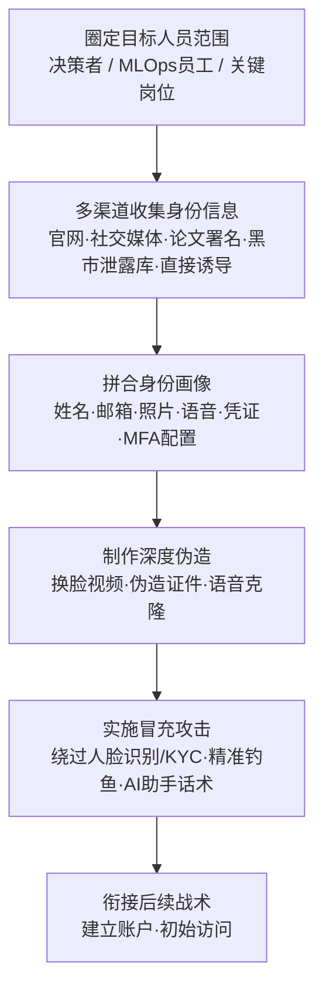

# 收集受害者身份信息 (AML.T0087)

## 一句话通俗理解

> 攻击者在动手前先收集目标组织"人"的情报——员工叫什么、邮箱是什么、照片长什么样、用了什么认证方式，甚至从黑市买到泄露的凭证；这些原料在 AI 时代可以做成以假乱真的深度伪造，替攻击者"刷脸"进门。

## 难度等级

⭐⭐⭐ **Realized（已实现）**

官方成熟度评定为 Realized——利用收集到的身份信息实施深度伪造冒充，已从概念验证走向规模化犯罪实践：两名攻击者利用人脸识别冒充手法骗取地方税务系统权限、欺诈获利约 7700 万美元（AML.CS0004）；iProov 红队演示了换脸图像注入可同时绕过被动与主动活体检测（AML.CS0033）；ProKYC 这类"过 KYC 即服务"的深度伪造工具已在地下市场明码标价出售（AML.CS0034）。信息收集本身门槛不高（社交媒体、论文署名、泄露数据库都是现成来源），真正的跃升来自生成式 AI：一张公开照片、一段会议视频，就足以产出能骗过人脸识别系统的伪造素材。

## 技术描述

### 通俗解释

传统意义上的"收集身份信息"是小偷打听房主姓名、电话和生活规律，好伪装成熟人骗开大门。ATLAS 视角下这件事变得更危险：攻击者收集的不再只是姓名、邮箱、职位，还包括**照片、声纹、人脸等生物特征信息与凭证、MFA 配置等敏感细节**——这些原料喂给生成式 AI，就能做出会点头、会眨眼、能通过活体检测的深度伪造视频。

对 AI 系统而言，这形成了双向威胁：一方面，人脸识别、语音验证这类 **AI 认证系统本身成为被攻击目标**——攻击者用收集到的生物特征信息伪造"活人"骗过模型；另一方面，掌握员工身份画像后，攻击者可以针对**个性化 AI 助手与智能体**定制社工话术和提示词，让"认识这位员工"的 AI 助手放下戒心。

### 技术原理

依据官方描述，攻击者可能收集可用于后续瞄准的受害者身份信息，涵盖两类：

- **个人数据**：员工姓名、电子邮箱地址、照片等；
- **敏感细节**：凭证、多因素认证（MFA）配置等。

收集渠道包括：直接诱导套取（direct elicitation）、[搜索受害者网站 (AML.T0003)](./AML.T0003-Search-Victim-Owned-Websites.md)、以及黑市上的泄露信息。在 AI 组织的侦察语境下，高价值目标还包括：AI 论文的员工署名（定位算法负责人）、LinkedIn 与 AI 社区中的技术档案（锁定 MLOps 与平台工程人员）、会议演讲视频（语音与人脸素材）。

收集到的身份数据有两个官方明确指出的转化方向：

1. **制作深度伪造（Create Deepfakes）**：以令人信服的方式冒充受害者本人；
2. **冒充身份的后续利用**：以被冒充身份**建立账户**（AML.T0021，官方未编写文档，暂为纯文本），或实施更具说服力的**钓鱼攻击**（AML.T0052，官方未编写文档，暂为纯文本）。

**平台覆盖**：Enterprise（企业环境）——攻击者在传统环境中即可执行，但其产出直接服务于对 AI 认证系统与 AI 助手的攻击。

**信息类型 × 收集渠道 × 攻击用途一览**：

| 信息类型 | 典型收集渠道 | 转化的攻击能力 |
|---------|-------------|---------------|
| 姓名 / 职位 / 邮箱 | 官网团队页、LinkedIn、论文署名 | 精准鱼叉钓鱼、AI 助手定向话术 |
| 照片 / 视频 / 语音 | 社交媒体、会议演讲录像 | 换脸视频、语音克隆（深度伪造原料） |
| 凭证 / MFA 配置 | 黑市泄露库、信息窃取木马数据 | 直接登录、绕过弱 MFA |
| 生物特征行为数据 | 公开演讲、访谈 | 绕过活体检测的注入攻击 |

### 用途影响

- **深度伪造冒充**：身份信息是深度伪造的原料。人脸照片与视频训练出的换脸模型可攻击人脸识别认证（见三个真实案例）；语音克隆可冒充高管下达指令；
- **AI 认证系统失守**：人脸识别 / KYC（了解你的客户）验证本是 AI 防御身份欺诈的利器，攻击者却用收集来的身份信息反向攻击它——AI 认证从盾牌变成了靶子；
- **社会工程精度跃升**：完整的员工画像让鱼叉钓鱼从"群发"进化到"一对一编剧"；对接入个人数据的 AI 助手，攻击者甚至可以伪造"熟人上下文"诱导其执行越权操作（可衔接 [LLM 提示词注入 (AML.T0051)](../06-Execution/AML.T0051-LLM-Prompt-Injection.md)）；
- **合成身份欺诈**：拼合真实碎片（真姓名 + 假人脸 + 泄露凭证）制造"似真非真"的合成身份，在金融场景开户、贷款、洗钱。

## 攻击流程

### 典型攻击流程



**步骤详解：**

1. **圈定目标人员范围**
   - 通俗描述：确定"冒充谁最划算"。
   - 技术细节：结合[搜索开放技术数据库 (AML.T0000)](./AML.T0000-Search-Open-Technical-Databases.md)与社交媒体侦察的结果，筛选高价值人员——有审批权限的管理者、掌握基础设施的 MLOps 工程师、或其人脸/语音已通过生物特征认证绑定关键账户的员工。

2. **多渠道收集身份信息**
   - 通俗描述：能翻的公开资料都翻一遍，能买的黑市数据也买一份。
   - 技术细节：官网团队页与新闻稿提取姓名职位；LinkedIn / AI 社区档案补充技术背景与社交关系；会议演讲视频提供高清人脸与语音样本；黑市泄露库（信息窃取木马流出数据）提供凭证与 MFA 配置情报；必要时直接诱导套取（伪装猎头、问卷、技术交流）。

3. **拼合身份画像**
   - 通俗描述：把散落各处的碎片拼成一张完整的"人物卡"。
   - 技术细节：交叉验证多源信息——邮箱格式推导（Hunter.io 类工具）、泄露凭证与在职状态比对、照片与视频的时间线整理，形成结构化档案：这个人是谁、管什么、长什么样、声音如何、用什么认证方式。

4. **制作深度伪造与实施冒充**
   - 通俗描述：用 AI 把"人物卡"变成一个能说话、能刷脸的"替身"。
   - 技术细节：用换脸模型生成通过活体检测的伪造视频（配合虚拟摄像头注入）；用语音克隆冒充高管电话指示转账；用伪造证件配合深度伪造自拍通过 KYC；或直接用泄露凭证登录未启用防钓鱼 MFA 的账户。

5. **衔接后续战术**
   - 通俗描述：替身进门之后，正式的入侵才开始。
   - 技术细节：以被冒充身份建立账户（AML.T0021）获取立足点；用高可信度钓鱼（AML.T0052）分发载荷；对个性化 AI 助手投递含"熟人上下文"的提示词注入。

**与后续战术的衔接：**

- **初始访问（Initial Access）**：绕过人脸识别 / KYC 即直接进入目标系统——AML.CS0004 中攻击者借此进入地方税务系统
- **资源开发（Resource Development）**：以冒充身份批量注册金融账户，构建攻击基础设施
- **执行（Execution）**：对 AI 助手与智能体的定向话术常以提示词注入收尾

> 关键差异：传统 T1589 收集身份信息是为了"骗人"，ATLAS 视角下还多了一层"骗 AI"——用人脸骗过认证模型、用熟人上下文骗过智能体。攻击面从"人心"延伸到了"模型"。

## 真实案例

> 以下 3 个案例全部源自 MITRE ATLAS 案例库（官方数据共关联 3 个案例研究）。

### 案例1：摄像头劫持攻击人脸识别系统（AML.CS0004）

- **时间**: 2018 年启动，2020 年前后被披露
- **攻击者**: 两名中国籍欺诈人员
- **手法**: 攻击者利用摄像头劫持手法，绕过传统的活体人脸识别认证模型，获取特权系统访问权限并冒充受害者身份。二人借此进入地方政府税务系统，注册空壳公司并向"客户"开具发票，先后骗取约 **7700 万美元**。
- **影响**: 证明人脸识别认证可被针对性绕过，生物特征认证一旦失守，背后的特权系统即整体暴露
- **参考链接**: [WSJ: Faces are the next target for fraudsters](https://www.wsj.com/articles/faces-are-the-next-target-for-fraudsters-11625662828)、[ATLAS 案例页 AML.CS0004](https://atlas.mitre.org/studies/AML.CS0004/)

### 案例2：实时深度伪造图像注入绕过移动端 KYC 验证（AML.CS0033）

- **时间**: 2024 年
- **攻击者**: iProov 红队（安全演示）
- **手法**: 人脸生物特征认证广泛用于移动应用的用户注册、认证与 KYC 合规验证。iProov 红队演示了一种**换脸图像注入攻击**：不向摄像头"扮演"伪装者，而是把伪造的人脸视频直接注入视频流，可同时绕过活体人脸识别模型与移动设备上的被动、主动[活体检测](https://en.wikipedia.org/wiki/Liveness_test)。
- **影响**: 攻击者可借此获取受害者特权系统访问权限，或在银行、加密货币交易所创建假身份账户——图像注入使"活体检测"不再等于"真人在场"
- **参考链接**: [ATLAS 案例页 AML.CS0033](https://atlas.mitre.org/studies/AML.CS0033/)

### 案例3：ProKYC——用于账户欺诈的深度伪造工具（AML.CS0034）

- **时间**: 2025 年
- **攻击者**: 使用 ProKYC 工具的网络犯罪分子（Cato CTRL 安全研究人员披露）
- **手法**: Cato CTRL 研究人员发现名为 ProKYC 的深度伪造工具正在向网络罪犯出售，用于绕过加密货币交易所等金融服务应用的 KYC 验证。该工具可**生成伪造身份证件与深度伪造自拍视频**——KYC 验证中最关键的两项生物特征数据，帮助罪犯击败人脸识别与活体检测、批量开设欺诈账户。
- **影响**: 深度伪造冒充已"服务化"——收集身份信息 + 现成工具 = 无需 AI 专业知识即可实施合成身份欺诈
- **参考链接**: [Cato CTRL: ProKYC 深度伪造工具分析](https://www.catonetworks.com/blog/prokyc-selling-deepfake-tool-for-account-fraud-attacks/)、[AIID Incident 819](https://incidentdatabase.ai/cite/819/)、[IDScan: ProKYC 合成身份欺诈分析](https://idscan.net/blog/prokyc-synthetic-identity-fraud/)

## 红队视角

> ⚠️ **免责声明**：以下内容仅用于合法授权的安全测试与教育目的。未经授权收集或使用他人身份信息、对他人系统进行测试是违法行为。

### 实战技巧

1. **组织身份暴露面盘点（面向自有资产）**
   以攻击者视角审计本组织的公开身份信息：官网团队页暴露了多少姓名 + 职位 + 照片？高管演讲视频的人脸与语音清晰度如何？员工在 LinkedIn / AI 社区 / 论文署名中可被关联出多少信息？产出"身份暴露清单"并逐项评估可被深度伪造利用的程度。

2. **生物特征认证红队测试**
   在自有人脸识别 / KYC 系统上做注入攻击演练：用虚拟摄像头替换真实摄像头输入，投递换脸视频，检验活体检测（被动 / 主动）的鲁棒性；测试系统能否区分"摄像头前的活人"与"注入的视频流"。

3. **AI 助手社工演练**
   针对接入员工数据的内部 AI 助手，测试"伪造熟人上下文"的说服力：仅凭公开可得的身份信息（姓名、职位、近期项目），能否诱导助手透露内部信息或执行超出权限的操作。

### 常用工具

| 工具名称 | 用途 | 平台 |
|----------|------|------|
| theHarvester | 聚合收集邮箱、姓名等公开身份信息 | Linux |
| Hunter.io / Phonebook.cz | 企业邮箱格式发现与批量验证 | Web |
| Have I Been Pwned（企业版） | 监控自有域名凭证泄露 | Web |
| Maltego | 多源身份信息图形化关联分析 | 跨平台 |
| OBS Virtual Camera | 授权测试中模拟摄像头注入 | 跨平台 |

### 注意事项

- **只测自有资产**：生物特征认证的红队测试必须限定在自有系统与书面授权范围内；他人的面部/语音数据属于个人敏感信息，采集与使用受法律严格约束
- 演练报告聚焦"活体检测能否识别注入攻击""公开身份信息够不够做一次可信冒充"，给出收敛建议而非攻击配方
- 深度伪造演示素材必须使用授权对象（团队成员书面同意）并在测试后销毁

## 蓝队视角

### 检测要点

1. **凭证与泄露监控**
   - 日志来源：凭证泄露监控服务、暗网监测、身份保护平台
   - 关注字段：域名、邮箱、泄露事件源
   - 异常特征：本组织域名下邮箱出现在新泄露库、员工凭证在黑市流通、MFA 配置信息（如手机号）被批量兜售

2. **生物特征认证平台遥测**
   - 日志来源：人脸识别 / KYC 平台认证日志、设备指纹
   - 关注字段：设备 ID、摄像头与会话特征、验证失败/成功序列
   - 异常特征：同一设备先后通过多个不同身份的验证（合成身份批量注册）、多次活体检测失败后突然成功、视频流缺少真实摄像头应有的传感器噪声（注入攻击特征）、虚拟摄像头驱动进程出现在 KYC 会话期间

3. **账户创建异常**
   - 日志来源：IAM / 业务系统注册日志
   - 关注字段：注册来源、资料完整度、行为序列
   - 异常特征：新账户资料"过于完整"（一次性填全所有字段，非自然人行为）、短时间内的相似资料批量注册、注册后立即发起高权限操作

### 监控建议

- 订阅**凭证泄露监控服务**，在员工凭证出现在泄露库时强制轮换——收集到的凭证是最容易被"变现"的身份信息
- 对人脸识别 / KYC 系统启用**注入攻击检测**：校验摄像头设备链路（是否为虚拟设备）、检测视频流的传感器级伪影
- 建立**身份冒充应急流程**：一旦确认员工身份被深度伪造冒充，能快速通知下游系统吊销基于该身份的认证与会话
- 对"机器速度"的批量合成身份注册，依赖设备指纹与行为序列的自动化关联告警，人工审核节奏跟不上

## 检测建议

### 网络层检测

**检测方法：** 收集行为本身多为合法公开操作，难以直接检测；重点监控"验证行为"的流量特征。

- 邮箱服务遭遇 SMTP VRFY / RCPT TO 用户名枚举（探测哪些邮箱真实存在）
- 单一来源对认证接口的密码喷洒模式（拿到泄露凭证后的验证行为）
- KYC / 人脸认证接口来自数据中心 IP 或已知代理的高频请求

### 主机层检测

**检测方法：** 监控认证会话中的注入工具痕迹。

- KYC 会话期间出现虚拟摄像头进程（obs64.exe 启动虚拟摄像头、e2eSoft VCam 等）
- 浏览器被远程调试协议附加（自动化注入的常见前置）
- 移动端检测到屏幕投射 / 摄像头替换类应用在验证时活跃

### 应用层检测（认证平台遥测）

**检测方法：** 利用活体检测与设备指纹的联合分析发现冒充。

- 活体检测失败 N 次后成功的会话（注入素材调参重试特征）
- 同一设备 / 同一指纹关联多个自然人身份
- 通过验证的"人脸"与该身份历史照片的相似度分布异常（合成人脸往往落在"过拟合"的高相似区间）

### Sigma 规则思路示例

```yaml
title: KYC 会话期间出现虚拟摄像头进程（深度伪造注入特征）
status: experimental
description: 检测人脸验证会话期间启动虚拟摄像头或视频注入工具，
    可能为利用收集身份信息实施的深度伪造冒充（AML.T0087）
logsource:
    category: process_creation
    product: windows
detection:
    selection_process:
        Image|endswith:
            - '\obs64.exe'
            - '\vcam.exe'
        CommandLine|contains: 'virtualcam'
    selection_browser:
        Image|endswith:
            - '\chrome.exe'
            - '\msedge.exe'
    condition: selection_process and selection_browser | count() by Computer > 2
    timeframe: 10m
level: high
tags:
    - attack.t1589
    - atlas.aml_t0087
```

> 检测哲学：收集身份信息本身几乎不可检测（翻 LinkedIn、看演讲视频都是合法行为），可检测的是**信息被使用的瞬间**——注入攻击的工具痕迹、活体检测的失败模式、批量注册的行为序列。把检测资源压在"冒充实施"环节。

## 缓解措施

> **说明**：MITRE ATLAS 官方数据**未为本技术映射任何缓解措施**。以下为本库基于企业侧同源技术 T1589 的缓解映射与 AI 场景特性给出的落地建议。

### 优先级1：关键措施

**强化身份验证，使其对深度伪造免疫**

对关键系统与账户：全面部署**防钓鱼 MFA**（FIDO2 / WebAuthn 硬件密钥，人脸 / 短信验证码均可被伪造绕过）；对人脸识别 / KYC 系统，升级至具备**注入攻击检测**能力的活体检测方案（校验摄像头设备链路真实性、检测虚拟摄像头与视频注入），不要假设"活体检测通过 = 真人在场"。

### 优先级2：重要措施

**最小化公开身份信息暴露**

审计并收敛组织层面的身份暴露面：官网团队页控制姓名 + 照片 + 职位的组合暴露量；对高管与关键岗位人员评估演讲视频的人脸 / 语音清晰度风险；制定员工社交媒体与论文署名的信息发布指引；不公开详细的组织架构图与内部邮箱格式。

### 优先级3：建议措施

**泄露监控与深度伪造演练**

订阅企业级凭证泄露监控（如 HIBP 企业版），泄露即强制改密；将"深度伪造冒充高管"纳入社工演练科目（语音克隆指示转账），让财务 / 审批岗位建立"带外核实"习惯——敏感指令必须通过第二信道确认。

### MITRE ATT&CK 缓解措施映射（企业侧 T1589 同源参考）

| 缓解措施ID | 缓解措施名称 | 适用性 | 说明 |
|------------|-------------|--------|------|
| M1032 | 多因素认证 | 适用 | 防钓鱼 MFA 可阻断凭证泄露后的冒充登录；人脸/短信因素需评估深度伪造风险 |
| M1017 | 用户训练 | 适用 | 培训员工识别深度伪造话术、带外核实敏感指令 |
| M1018 | 用户账户管理 | 适用 | 定期审计账户与认证方式配置（MFA 类型、生物特征绑定） |
| M1026 | 特权账户管理 | 适用 | 限制特权账户数量，收敛"值得被冒充"的高价值目标面 |

## 关联 ATT&CK 技术

- [收集受害者身份信息 (T1589)](../../enterprise/01-Reconnaissance/T1589-Gather-Victim-Identity-Information.md) — 经典企业侧身份信息收集技术，与本技术为同源关系
- [凭证收集 (T1589.001)](../../enterprise/01-Reconnaissance/T1589/T1589.001-Credentials.md) — 从暗网与泄露库收集登录凭据，本技术"敏感细节"维度对应
- [电子邮件地址收集 (T1589.002)](../../enterprise/01-Reconnaissance/T1589/T1589.002-Email-Addresses.md) — 邮箱地址收集，钓鱼攻击的直接前置
- [员工姓名收集 (T1589.003)](../../enterprise/01-Reconnaissance/T1589/T1589.003-Employee-Names.md) — 姓名 / 职位收集，社工画像的基础素材

**ATLAS 收集受害者身份信息 vs 传统 T1589：**

| 维度 | 传统 T1589 | ATLAS AML.T0087 |
|------|-----------|-----------------|
| 收集对象 | 姓名、邮箱、职位、凭证 | 上述全部 + **照片、语音、人脸等生物特征素材与 MFA 配置** |
| 关键转化 | 定制鱼叉钓鱼、凭证填充 | **深度伪造冒充、绕过人脸识别 / KYC、AI 助手定向话术** |
| 攻击的目标 | 人（社会工程学） | 人 + **AI 认证模型与个性化 AI 助手** |
| 典型衔接 | 凭证访问、初始访问 | 建立账户（AML.T0021）、ATLAS 钓鱼（AML.T0052）、初始访问 |
| 检测重心 | 凭证泄露监控、邮箱枚举 | 上述 + **活体检测遥测、注入攻击特征、合成身份行为序列** |

一句话总结：T1589 收集身份信息是为了"骗人开门"，AML.T0087 还要"骗 AI 开门"——同一份员工画像，既用来写钓鱼邮件，也用来训练能通过活体检测的换脸模型。

## 动手实验

> ⚠️ **重要提示**：所有实验必须在隔离环境或自有授权资产上进行。禁止收集或使用真实他人的生物特征信息；深度伪造素材必须使用书面授权的自愿参与者，并在实验后销毁。

### 实验环境准备

| 环境组件 | 用途 | 获取方式 |
|----------|------|----------|
| 隔离测试虚拟机 | 运行测试用认证应用 | 本地虚拟化平台 |
| 自有域名 + 测试邮箱若干 | 模拟组织身份暴露面 | 自有资产 |
| 开源人脸识别 / 活体检测 demo | 认证攻击面测试对象 | 开源项目（如开源 KYC demo） |
| OBS Studio（虚拟摄像头） | 授权环境注入测试 | 官方网站 |
| Have I Been Pwned 企业版试用 | 泄露监控体验 | 自有资产 |

### 实验1（初级）：盘点自有组织的身份暴露面

**实验目标：** 建立攻击者视角的身份信息暴露清单。

**实验步骤：**
1. 用 theHarvester 对自有测试域名做信息收集（`theHarvester -d yourdomain.com -b all`）
2. 检索官网、LinkedIn 公开页、论文库中自有组织人员的姓名 + 职位 + 照片组合暴露量
3. 用 Hunter.io 推导自有域名邮箱格式，评估"猜出任意员工邮箱"的难度
4. 将发现整理为暴露清单，标注每项可被深度伪造利用的程度（高 / 中 / 低）

**预期结果：** 输出一份与外部攻击者视角一致的身份暴露清单及收敛建议。

### 实验2（中级）：凭证泄露监控演练

**实验目标：** 理解"黑市泄露"渠道的防御侧抓手。

**实验步骤：**
1. 在 HIBP 中查询自有测试域名关联的泄露记录
2. 为组织订阅域名级泄露监控（试用版即可）
3. 模拟响应流程：发现员工邮箱泄露后，从检测到强制改密的完整链路走一遍
4. 记录每个环节耗时，评估自动化必要性

**预期结果：** 产出凭证泄露响应 runbook 草稿。

### 实验3（高级）：活体检测注入攻击红队演练

**实验目标：** 在自有认证系统上验证"活体检测通过 ≠ 真人在场"。

**实验步骤：**
1. 在隔离虚拟机中部署开源人脸识别 + 活体检测 demo，用**自愿参与者（书面授权）**的照片训练一个测试换脸模型，或直接使用参与者预录视频
2. 正常流程通过一次验证，记录日志基线
3. 启用 OBS 虚拟摄像头，将预录 / 伪造视频注入摄像头输入，观察活体检测表现
4. 检查认证平台日志能否区分两次会话（设备指纹、会话特征）；若不能，即为检测改进点

**预期结果：** 掌握"公开素材 → 深度伪造 → 注入攻击"的攻防对照，产出认证平台检测加固清单。实验素材测试后立即销毁。

## 术语解释

| 术语 | 英文原名 | 通俗解释 |
|------|----------|----------|
| 开源情报 | OSINT | 从公开渠道收集的情报——社交媒体、论文、演讲视频，人人可查 |
| 深度伪造 | Deepfake | 用深度学习生成 / 篡改人脸、语音的合成媒体，能以假乱真地"扮演"真人 |
| 了解你的客户 | KYC (Know Your Customer) | 金融场景的身份验证流程，通常包含证件核验 + 人脸活体检测 |
| 活体检测 | Liveness Detection | 判断摄像头前是"活人"而非照片 / 视频回放的技术，被动看图像特征，主动要求动作配合 |
| 注入攻击 | Injection Attack | 不对着摄像头表演，而是把伪造视频直接塞进视频流，绕过物理摄像头 |
| 虚拟摄像头 | Virtual Camera | 软件模拟的摄像头设备，把任意视频文件伪装成实时摄像头画面 |
| 生物特征认证 | Biometric Authentication | 用人脸、指纹、声纹等生理特征验证身份——特征不可"改密"，泄露即永久失效 |
| 合成身份欺诈 | Synthetic Identity Fraud | 拼合真实与虚构信息造出"不存在的真人"开账户、骗贷款 |
| 凭证 | Credential | 用户名密码等登录凭据，身份信息中最直接可"变现"的部分 |
| 防钓鱼 MFA | Phishing-resistant MFA | FIDO2 / WebAuthn 等无法被钓鱼页截获的强认证方式 |
| 信息窃取木马 | InfoStealer | 专偷浏览器保存的密码、Cookie 的恶意软件，其窃取数据最终流入黑市泄露库 |
| 带外核实 | Out-of-band Verification | 通过第二信道（如当面、另一部电话）确认敏感指令真实性，防语音克隆冒充 |
| 鱼叉式钓鱼 | Spear Phishing | 利用收集到的身份信息定制的一对一钓鱼，可信度远高于群发垃圾邮件 |

## 参考资料

### 📚 官方文档

- [MITRE ATLAS - Gather Victim Identity Information (AML.T0087)](https://atlas.mitre.org/techniques/AML.T0087/) - 官方技术页面
- [MITRE ATLAS 案例研究 AML.CS0004](https://atlas.mitre.org/studies/AML.CS0004/) - 摄像头劫持攻击人脸识别系统
- [MITRE ATLAS 案例研究 AML.CS0033](https://atlas.mitre.org/studies/AML.CS0033/) - 深度伪造图像注入绕过 KYC
- [MITRE ATLAS 案例研究 AML.CS0034](https://atlas.mitre.org/studies/AML.CS0034/) - ProKYC 深度伪造工具
- [MITRE ATLAS 矩阵](https://atlas.mitre.org/matrices/ATLAS/)
- [MITRE ATLAS Data (GitHub)](https://github.com/mitre-atlas/atlas-data)

### 📰 案例报告（真实攻击与安全研究）

- [WSJ: Faces are the next target for fraudsters](https://www.wsj.com/articles/faces-are-the-next-target-for-fraudsters-11625662828) - 7700 万美元人脸识别冒充欺诈案（AML.CS0004）
- [Cato CTRL: ProKYC 深度伪造工具分析](https://www.catonetworks.com/blog/prokyc-selling-deepfake-tool-for-account-fraud-attacks/) - 地下市场"过 KYC 即服务"（AML.CS0034）
- [AIID Incident 819: ProKYC](https://incidentdatabase.ai/cite/819/) - AI 事件数据库收录
- [IDScan: ProKYC 合成身份欺诈分析](https://idscan.net/blog/prokyc-synthetic-identity-fraud/) - 合成身份欺诈即服务
- [Liveness test (Wikipedia)](https://en.wikipedia.org/wiki/Liveness_test) - 活体检测概念（AML.CS0033 引用）

### 🔧 工具与资源

- [Have I Been Pwned](https://haveibeenpwned.com/) - 凭证泄露查询与域名监控
- [theHarvester](https://github.com/laramies/theHarvester) - 开源情报收集工具（仅限授权测试）
- [Hunter.io](https://hunter.io/) - 企业邮箱发现与验证平台
- [NIST AI Risk Management Framework](https://www.nist.gov/itl/ai-risk-management-framework) - NIST AI 风险管理框架
- [OWASP Top 10 for LLM Applications](https://owasp.org/www-project-top-10-for-large-language-model-applications/) - LLM 应用十大安全风险

### 🔗 关联阅读

- [收集受害者身份信息 (T1589)](../../enterprise/01-Reconnaissance/T1589-Gather-Victim-Identity-Information.md) - 企业侧同源技术，对照阅读
- [侦察战术 (AML.TA0002)](./README.md) - 本技术所属战术的概览页
- [搜索受害者网站 (AML.T0003)](./AML.T0003-Search-Victim-Owned-Websites.md) - 身份信息收集的主要渠道之一
- [主动扫描 (AML.T0006)](./AML.T0006-Active-Scanning.md) - 同战术的主动侦察技术
- [LLM 提示词注入 (AML.T0051)](../06-Execution/AML.T0051-LLM-Prompt-Injection.md) - 身份画像针对性社工的常见下一站

---

> **版本**: ATLAS 2026.09 | **更新**: 2026-10-22 | **模板**: ATLAS 技术文档 v1.0
