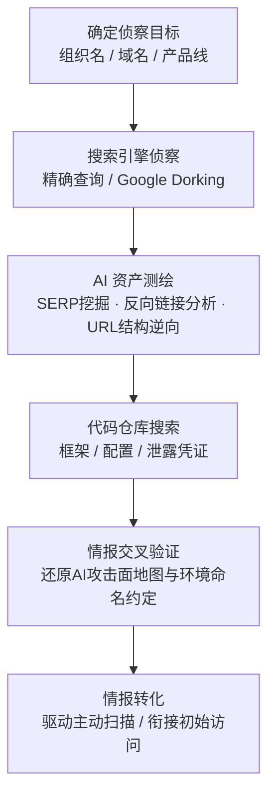

# 搜索开放网站/域名 (AML.T0095)

## 一句话通俗理解

> 攻击者像商业间谍一样翻遍互联网上的公开角落——社交媒体、新闻网站、搜索引擎、代码仓库——专门收集你家 AI 系统的蛛丝马迹：用了什么模型、智能体挂在哪个域名、哪个入口能被公网碰到，情报越全，下一步下手越准。

## 难度等级

⭐⭐⭐ **Realized（已实现）**

官方成熟度评定为 Realized——攻击者利用公开网站与搜索引擎定位受害者 AI 资产的手法已在真实攻击与安全研究中被反复证实：Zenity 与 GreyNoise 的监测显示，威胁行为者正通过搜索引擎结果页与反向链接分析系统性测绘互联网上暴露的智能体接口。技术门槛本身不高（一部浏览器加一套高级搜索语法即可开工），真正的威胁在于其**目标特异性**：与传统"人肉搜索"不同，本技术聚焦的是 AI 资产——智能体界面常以 iFrame 形式嵌入网页、遵循可预测的命名规则，攻击者通过分析不同搜索引擎索引的 URL 结构，往往能反推出组织内部的**环境 ID 与命名约定**，为后续定向模糊测试与枚举（AML.T0006.000）大幅缩小搜索范围。

## 技术描述

### 通俗解释

你的组织在互联网上留下的公开痕迹远比想象中多：官网新闻稿里提到新上线的智能客服、招聘启事里写着"熟悉 LangChain/Langflow"、员工在技术社区提问公司 RAG 系统的报错、开发者把带 API 密钥的配置文件推到了公开仓库。这些东西散落在各种第三方网站上，单独看都无害，但攻击者会用搜索引擎把它们拼接起来，还原出你家 AI 系统的完整地图。

这是纯**被动侦察**：攻击者只读取公开信息，不与你的系统发生任何直接交互，不触发任何告警——你几乎不可能知道有人在查你。而 [主动扫描 (AML.T0006)](./AML.T0006-Active-Scanning.md) 要敲门试探，本技术只在外面看门牌。

### 技术原理

依据官方描述，攻击者搜索公开网站与域名，收集可用于攻击定位的受害者与 AI 目标信息。受害者攻击面信息可能存在于多种在线站点——社交媒体、新闻网站或受害者自有域名。攻击者可通过搜索引擎精确查询，识别受害者使用的软件平台或服务，进而衔接面向公众应用的漏洞利用（AML.T0049）或经由面向公众应用的提示词渗透（AML.T0093）。

**OSINT 式 AI 资产测绘**是本技术在 AI 时代的核心演化方向：

1. **搜索引擎结果页（SERP）挖掘**：用精确搜索查询定位目标组织部署的智能体界面——这些界面经常通过 iFrame 嵌入网页，且遵循可预测的命名约定；
2. **反向链接（backlink）分析**：追踪哪些站点引用了目标的 AI 服务入口，顺藤摸瓜发现未公开宣传的智能体部署；
3. **URL 结构逆向工程**：对比不同搜索引擎索引的 URL 结构，反推出目标内部的**环境 ID 与组织专属命名约定**。

这套情报收集显著压缩了后续由"枚举托管 AI 资源（AML.T0006.000）"执行的定向模糊测试或枚举的搜索空间——被动侦察划定范围，主动扫描精确打击。

**与相邻技术的分工：**

| 技术 | 情报源 | 焦点 |
|------|--------|------|
| 本技术 (AML.T0095) | 第三方公开网站：搜索引擎、社交媒体、新闻站、代码仓库 | 定位目标的 AI 资产、智能体接口、命名约定 |
| [搜索开放技术数据库 (AML.T0000)](./AML.T0000-Search-Open-Technical-Databases.md) | 论文库、预印本、技术博客、扫描数据库 | 挖掘 AI 技术路线与研究底细 |
| [搜索受害者网站 (AML.T0003)](./AML.T0003-Search-Victim-Owned-Websites.md) | 受害者自有网站 | 直接浏览目标官网提取信息 |

**平台覆盖**：Enterprise（企业环境）——攻击者在传统环境中即可执行，无需接触 AI 平台本身。

### 用途影响

- **AI 攻击面地图**：搜索引擎挖掘产出的智能体界面地址、环境 ID 与命名约定清单，直接决定后续攻击路径——是走提示词注入、凭证滥用，还是对暴露接口直接下手；
- **衔接初始访问**：官方描述明确指出本技术之后常跟随面向公众应用的漏洞利用（AML.T0049）或提示词渗透（AML.T0093）；
- **驱动主动侦察**：反推出的命名约定与环境 ID 为 AML.T0006.000 的命名空间爆破提供了"密码本"，让主动扫描从大海捞针变成按图索骥；
- **供应链攻击情报**：目标使用的公开 AI 工具、框架与模型信息（经代码仓库搜索获得）可被用于策划模型命名空间复用等供应链攻击；
- **零痕迹**：全部情报来自公开渠道的读取操作，受害者侧无任何交互日志，是被攻击者最安全的情报收集窗口。

## 子技术列表

**该技术共有 1 个子技术：**

| 子技术ID | 中文名称 | 说明 |
|----------|----------|------|
| [AML.T0095.000](AML.T0095/AML.T0095.000-Code-Repositories.md) | 代码仓库 | 在 GitHub、GitLab、SourceForge、BitBucket 等公开代码仓库中搜索与受害者 AI 系统相关的代码与制品。受害者可能将 AI 系统相关代码存放在第三方仓库；攻击者也搜索受害者**正在使用但并非自有**的常见 AI 工具、框架、模型或智能体系统的仓库。可获得的情报包括：常用的 AI 框架、库、模型、数据集、智能体及智能体工具，以及员工姓名；更敏感的还包括意外泄露的凭证或 API 密钥（如"来自 AI 智能体配置的凭证"AML.T0083）。这些信息可揭示进一步侦察（如收集 RAG 索引目标 AML.T0064）、资源开发（如获取公开 AI 制品 AML.T0002）、发现（如发现 AI 智能体配置 AML.T0084）与初始访问（如有效账户 AML.T0012 或钓鱼 AML.T0052）的机会。官方成熟度为 Realized（已实现）。 |

> 注：子技术文档尚未编写，上表 可直接点击子技术 ID 阅读。

## 攻击流程

### 典型攻击流程



**步骤详解：**

1. **确定侦察目标**
   - 通俗描述：确定要摸底的组织——名字、域名、产品线。
   - 技术细节：从受害者自有域名、新闻稿、招聘启事切入，圈定与 AI 相关的关键词集合（产品名、平台名、技术栈关键词）。

2. **搜索引擎侦察**
   - 通俗描述：用"高级搜索技巧"翻遍全网与目标相关的公开页面。
   - 技术细节：构造精确搜索查询识别目标使用的软件平台或服务；检索社交媒体、新闻站点、AI 社区讨论中泄露的 AI 部署细节。

3. **AI 资产测绘**
   - 通俗描述：把散落各处的智能体入口拼到一张地图上。
   - 技术细节：挖掘搜索引擎结果页定位通过 iFrame 嵌入的智能体界面；分析反向链接发现关联部署；对比不同搜索引擎索引的 URL 结构，逆向推导环境 ID 与组织命名约定。

4. **代码仓库搜索**
   - 通俗描述：去 GitHub 上翻目标的代码，找配置文件和密钥。
   - 技术细节：在公开仓库中检索目标组织的 AI 框架依赖、智能体工具链、模型加载配置；重点关注意外提交的 API 密钥与智能体配置中的凭证。

5. **情报交叉验证与转化**
   - 通俗描述：多来源信息互相印证，输出作战地图。
   - 技术细节：将搜索引擎与代码仓库情报交叉验证，还原目标的 AI 攻击面全貌；产出移交后续阶段——命名约定交给主动扫描（AML.T0006）做精确枚举，暴露入口与凭证交给初始访问阶段直接利用。

**与后续战术的衔接：**

- **初始访问（Initial Access）**：官方描述明确衔接面向公众应用的漏洞利用（AML.T0049）与提示词渗透（AML.T0093）——测绘发现的智能体界面就是现成的攻击入口
- **进一步侦察**：反推出的环境 ID 与命名约定直接喂给[主动扫描 (AML.T0006)](./AML.T0006-Active-Scanning.md) 的命名空间爆破，形成"被动测绘→主动枚举"的侦察闭环
- **资源开发**：代码仓库中发现的公开 AI 制品线索可衔接获取公开 AI 制品（AML.T0002）类活动
- **[LLM 提示词注入 (AML.T0051)](../06-Execution/AML.T0051-LLM-Prompt-Injection.md)**：定位到的可触达智能体是间接提示词注入的典型投放目标

> 关键差异：传统 T1593 搜的是"员工邮箱、组织架构、泄露凭证"，AML.T0095 的核心增量是**AI 资产测绘**——智能体界面在哪、命名约定是什么、环境 ID 能否反推。前者帮攻击者"进门"，后者帮攻击者"找到那扇 AI 的门"。

## 真实案例

> 以下精选 4 个代表性案例（官方数据共关联 6 个案例研究），全部源自 MITRE ATLAS 案例库。

### 案例1：Living Off AI——经 Jira 服务管理的提示词注入（2026年，AML.T0095）

- **时间**: 2026年
- **攻击者**: Cato Networks 研究人员（安全演示）
- **手法**: Cato CTRL 威胁研究团队演示了如何利用嵌入企业工作流的 AI 系统执行越权操作：外部用户提交的恶意工单等输入，会被内部用户或自动化系统背后的 AI 智能体处理。这些智能体以内部上下文与信任运行，可能将恶意指令解释并执行，导致数据渗漏、权限提升或系统操纵。攻击的前置条件正是通过公开渠道发现目标在 Jira 服务管理中嵌入了 AI 智能体——此类"哪家企业把 AI 塞进了工单系统"的情报恰恰来自公开网站搜索。
- **影响**: 证明嵌入企业工作流的 AI 智能体可被外部构造输入劫持，"Living Off AI"成为新版"离地攻击"
- **参考链接**: [Cato CTRL: 针对 Atlassian MCP 的 PoC 攻击](https://www.catonetworks.com/blog/cato-ctrl-poc-attack-targeting-atlassians-mcp/)

### 案例2：AI in the Middle——Web AI 服务被用作 C2 中继（2026年，AML.T0095）

- **时间**: 2026年
- **攻击者**: Check Point 研究人员（安全演示）
- **手法**: 恶意软件滥用具备匿名浏览与 URL 抓取能力的 Web AI 助手作为隐蔽命令与控制信道：PoC 使用 Grok 与 Microsoft Copilot 等公开 AI Web 界面，让 AI 服务抓取攻击者控制的 URL、在外发请求中转发受害者数据、再通过正常的 AI 助手响应回传攻击者指令。由于植入体与受信任的 AI 服务域名走普通 HTTPS 流量，活动极难被识别。发现"哪些公开 AI 服务支持匿名浏览与 URL 抓取"本身就是一次针对开放网站的侦察筛选。
- **影响**: 公开 AI Web 服务沦为免费 C2 基础设施，信任域名成了恶意流量的护身符
- **参考链接**: [Check Point: AI in the Middle](https://research.checkpoint.com/2026/ai-in-the-middle-turning-web-based-ai-services-into-c2-proxies-the-future-of-ai-driven-attacks/)

### 案例3：模型命名空间复用供应链攻击（2026年，AML.T0095）

- **时间**: 2026年
- **攻击者**: Unit 42 研究人员（安全演示）
- **手法**: 攻击者回收 Hugging Face 上一个已删除的作者命名空间，并以相同的历史 Author/ModelName 标识发布恶意模型。应用与模型目录中保留的**未固定（unpinned）引用**会解析并部署攻击者控制的替换品，而非原本受信任的制品。攻击同样适用于所有权转移的模型。实施前提是攻击者通过公开搜索定位到"已删除但仍被引用"的命名空间——这正是对模型托管平台这一开放网站的情报挖掘。
- **影响**: 任何未固定模型引用的应用都可能静默拉取恶意模型，模型名信任机制被彻底武器化
- **参考链接**: [Unit 42: Model Namespace Reuse](https://unit42.paloaltonetworks.com/model-namespace-reuse/)

### 案例4：Claude Code GitHub Action 凭证暴露（2026年，AML.T0095.000）

- **时间**: 2026年6月
- **攻击者**: Microsoft Defender 安全研究团队（安全演示）
- **手法**: 研究人员分析了 Anthropic Claude Code GitHub Action 的**公开代码仓库**与混淆的 Claude Agent SDK，理解智能体工具如何执行、GitHub 事件如何向智能体供给内容，随后构造包含提示词注入的 GitHub 内容（issue 正文、PR 描述、评论），诱使 CI/CD 流水线中的智能体在处理时暴露工作流密钥。整个研究起点就是在代码仓库中搜索并审计目标使用的 AI 智能体框架——攻击者用同样的手法即可发现哪些组织在 CI/CD 中部署了可被注入的 AI Action。
- **影响**: 证明含提示词注入的普通 GitHub 内容即可让 CI/CD 智能体吐出密钥，代码仓库成为 AI 攻击面的目录索引
- **参考链接**: [Microsoft: Securing CI/CD in an agentic world](https://www.microsoft.com/en-us/security/blog/2026/06/05/securing-ci-cd-in-agentic-world-claude-code-github-action-case/)

## 红队视角

> ⚠️ **免责声明**：以下内容仅用于合法授权的安全测试与教育目的。对他人系统进行未经授权的信息收集可能违反法律与平台条款。

### 实战技巧

1. **AI 资产暴露面盘点（面向自有资产）**
   用攻击者的搜索习惯给自家组织做"公开视角"体检：在主流搜索引擎检索组织名 + AI 关键词（chatbot、assistant、copilot、agent），专查 iFrame 嵌入的智能体界面；在 GitHub/GitLab 检索 `org:yourcompany` 的仓库中是否残留 API 密钥、智能体配置、模型加载脚本。

2. **命名约定泄露审计**
   检查组织对外可达的智能体 URL 是否暴露内部环境 ID、租户 ID 或资源组命名规律；回答"攻击者分析我们的 URL 结构能反推出什么"。对照厂商文档确认哪些命名规则是平台默认（攻击者已知）、哪些是组织自定义（需要额外泄露才会被知道）。

3. **供应链引用固定检查**
   盘点组织应用对 Hugging Face 等平台模型的引用方式：是否全部使用固定版本摘要而非可变命名空间？命名空间被回收时部署链路会发生什么？

### 常用工具

| 工具名称 | 用途 | 平台 |
|----------|------|------|
| Google / Bing 高级搜索 | SERP 挖掘、Google Dorking 定位 AI 界面 | Web |
| GitHub / GitLab 代码搜索 | 检索目标组织的配置、凭证、AI 框架依赖 | Web |
| theHarvester / Recon-ng | OSINT 聚合式信息收集 | 跨平台 |
| GitGuardian / TruffleHog | 公开仓库凭证泄露监控（防御自查用） | 跨平台 |
| Hugging Face 搜索 | 模型命名空间与组织 AI 制品盘点 | Web |

### 注意事项

- **只查自有或授权资产**：对第三方平台的批量抓取可能违反平台服务条款；红队报告中聚焦"我们暴露了什么"，而非"别人能拿到什么"
- 公开信息收集不产生目标侧日志，红队价值在于**复现攻击者视角的情报拼图能力**，让组织看到散落信息聚合后的风险
- 发现真实泄露的凭证应立即走报告通道，不在报告中粘贴完整密钥

## 蓝队视角

### 检测要点

1. **被动侦察本身几乎不可检测**
   - 攻击者只读取公开网页与仓库，不与目标系统交互，目标侧无日志
   - 可检测的间接信号：搜索引擎爬虫对组织 AI 子域名的异常收录（site: 查询自查）、第三方平台（GitHub/Hugging Face）上组织相关制品的异常 fork/关注

2. **泄露监控（把"公开"当传感器）**
   - 日志来源：代码仓库审计日志、Secret Scanning 告警、模型托管平台通知
   - 关注字段：提交者、涉及文件类型、密钥类型
   - 异常特征：组织仓库新增疑似密钥提交、公开渠道出现组织内部环境 ID 或智能体 URL

3. **蜜罐信号（AI 蜜罐被"看见"）**
   - 日志来源：AI 蜜罐（AML.M0039）访问日志
   - 异常特征：蜜罐智能体 URL 被外部精确请求（说明攻击者已通过公开渠道完成测绘）、对蜜罐命名空间的枚举尝试

### 监控建议

- 建立**组织 AI 资产公开暴露清单**并定期自查：搜索引擎能搜到哪些智能体界面、代码仓库里躺着什么配置——"攻击者能搜到的，蓝队必须先搜到"
- 启用 GitHub Secret Scanning 与推送保护，部署 GitGuardian/TruffleHog 类工具持续监控公开渠道的凭证泄露
- 对外发布的新闻稿、招聘启事、技术博客建立**AI 信息发布审核**：不披露具体模型架构、内部命名约定与部署细节
- 监控组织在 Hugging Face 等平台的命名空间状态：已删除/已转移的命名空间是否仍被内部引用

## 检测建议

### 网络层检测

**检测方法：** 本技术为被动侦察，网络层无可直接检测的目标交互流量；监控的是**后续衔接行为**。

- 针对组织 AI 子域名的异常 DNS 查询聚集（可能来自测绘后的验证访问）
- 对智能体界面 URL 的高频未授权访问（测绘后转入主动验证的信号，衔接 [主动扫描 (AML.T0006)](./AML.T0006-Active-Scanning.md) 的检测体系）

### 主机层检测

**检测方法：** 无直接信号——攻击者不接触目标主机。

- 关注代码仓库侧：组织仓库的异常克隆者、fork 后快速删除的账号、对含配置文件仓库的异常访问（平台审计日志）

### 应用层检测（AI 遥测）

**检测方法：** 利用平台审计与外部监控能力发现情报收集的前兆与后果。

- AI 服务网关发现按"测绘特征"构造的请求：URL 中含正确环境 ID 但路径试探性变化（测绘已完成、爆破进行中）
- AI 蜜罐（AML.M0039）收到精确命中的请求——这是"公开渠道信息已被攻击者拼图"的最高置信告警
- 模型托管平台上组织命名空间的异常监控与抢注行为

**程序化检测思路（无需 EDR 侧改造）：**

把"公开渠道"变成传感器：订阅搜索引擎对组织 AI 域名的收录变更（新收录页面即新暴露面）；接驳 Secret Scanning 告警到 SIEM，与代码仓库审计日志关联——同一密钥"泄露提交时间→异常使用时间"的间隔就是暴露窗口时长；对智能体网关，把"首次出现的陌生 Referer"作为低阈值事件，与后续请求序列关联分析。

### Sigma 规则思路示例

```yaml
title: AI 智能体端点遭遇精确命名空间探测（公开测绘后验证）
status: experimental
description: 检测携带正确环境/租户 ID 但路径呈试探变化的请求，
    可能为经开放网站测绘（AML.T0095）后的命名空间验证枚举
logsource:
    category: webserver
    product: nginx
detection:
    selection:
        http_method: 'GET'
        url|re: '/(agents|copilot|assistant|chat)/[a-z0-9-]+'
        status:
            - 404
            - 401
    filter_legitimate:
        http_referer|contains: 'https://partner-trusted.example.com'
    condition: selection and not filter_legitimate | count() by src_ip > 20
timeframe: 10m
level: low
tags:
    - attack.t1593
    - atlas.aml_t0095
```

## 缓解措施

### 优先级1：关键措施

**AML.M0000 限制信息公开发布（Limit Public Release of Information）**

限制公开发布组织产品或服务中 AI 技术栈的技术信息。AI 使用方式的技术知识可被攻击者用于攻击定位与定制。同时考虑限制组织信息公开——包括物理位置、研究员姓名与部门结构——这些信息可被用于推断 AI 技术、模型架构或数据集等细节。落地要点：新闻稿与产品页不披露具体模型架构、内部环境命名约定；招聘启事与技术博客经 AI 信息发布审核；对外代码仓库强制 Secret Scanning 与配置文件审查。这是对本技术最直接的对症药——**攻击者能拼出什么地图，取决于你公开了什么碎片**。

### 优先级2：重要措施

**AML.M0039 AI 蜜罐（AI Honeypots）**

部署受监控的诱饵 AI 服务、智能体、凭证或资源——外观像真实资产，但不承担任何业务功能。合法用户与工作流没有理由接触它们，任何交互都是高置信度的未授权活动指标。将蜜罐与真实资源混布，攻击者经公开测绘映射可达资源时会一并触碰到诱饵——**蜜罐被精确请求，说明测绘情报已经泄露**。诱饵可捕获攻击者的探测、操纵与滥用手法，交互数据可汇聚为威胁情报源（来源、工具、提示词、技术）反哺检测规则。GreyNoise 与 Zenity 的实战数据均表明 AI 蜜罐能捕获海量侦察活动。

### MITRE ATLAS 缓解措施映射

| 缓解措施ID | 缓解措施名称 | 优先级 | 类别 | 生命周期阶段 |
|------------|-------------|:------:|------|-------------|
| AML.M0000 | 限制信息公开发布 | 关键 | Policy | 业务与数据理解 |
| AML.M0039 | AI 蜜罐 | 重要 | Technical - AI / Technical - Cyber | 部署 · 监控与维护 |

> 优先级为本库基于缓解措施特性给出的落地建议：信息发布收敛解决"地图碎片是否外流"，蜜罐解决"测绘完成后你能否第一时间知道"。

## 关联 ATT&CK 技术

- [搜索开放网站/域名 (T1593)](../../enterprise/01-Reconnaissance/T1593-Search-Open-Websites-Domains.md) — 经典网络侦察技术，与本技术为同源关系
- [代码仓库 (T1593.003)](../../enterprise/01-Reconnaissance/T1593/T1593.003-Code-Repositories.md) — 从公开代码仓库搜索受害者信息，对应子技术 AML.T0095.000

**ATLAS 搜索开放网站 vs 传统搜索开放网站：**

| 维度 | 传统 (T1593) | ATLAS (AML.T0095) |
|------|--------------|-------------------|
| 搜索目标 | 员工信息、组织架构、泄露凭证、技术栈 | **AI 资产**：智能体界面、模型引用、AI 框架依赖、命名约定 |
| 典型产出 | 邮箱清单、钓鱼素材、可利用漏洞线索 | **AI 攻击面地图**：智能体 URL、环境 ID、泄露的 API 密钥 |
| 独有手法 | Google Dorking、社交媒体 OSINT | **SERP 挖掘 + 反向链接分析 + URL 结构逆向工程** |
| 后续衔接 | 钓鱼、漏洞利用 | **提示词渗透（AML.T0093）、智能体命名空间爆破（AML.T0006.000）、模型供应链攻击** |
| 子技术构成 | 3 个（社交媒体/搜索引擎/代码仓库） | 1 个（代码仓库——AI 场景下情报密度最高的源） |

一句话总结：T1593 帮攻击者"认识你的组织"，AML.T0095 帮攻击者"找到你的 AI"——从翻员工 LinkedIn 到逆向智能体 URL 命名约定，公开信息里长出了全新的 AI 攻击面。

## 动手实验

> ⚠️ **重要提示**：所有实验仅限自有组织资产或公开授权测试范围，禁止对第三方系统进行未授权信息收集。

### 实验环境准备

| 环境组件 | 用途 | 获取方式 |
|----------|------|----------|
| 自有组织域名与公开仓库 | 暴露面自查对象 | 自有资产 |
| 浏览器 + 搜索引擎高级语法 | SERP 挖掘练习 | 公开服务 |
| GitHub 代码搜索 | 仓库泄露自查 | 公开服务 |
| 一个自有 Hugging Face 账号与测试模型 | 命名空间实验 | 自有资产 |

### 实验1（初级）：自查组织的 AI 公开足迹

**实验目标：** 建立"攻击者搜我能搜到什么"的视角。

**实验步骤：**
1. 在搜索引擎检索组织名/域名 + chatbot、assistant、copilot、agent 等 AI 关键词
2. 检查结果中是否存在 iFrame 嵌入的智能体界面、暴露的环境 ID 或命名规律
3. 在 GitHub 检索 `org:yourcompany`，重点查看配置文件、模型加载脚本、密钥残留
4. 将发现整理为公开足迹清单，逐项确认"这是否应该公开"

**预期结果：** 输出一份与攻击者视角一致的 AI 资产公开暴露清单。

### 实验2（中级）：URL 命名约定逆向演练

**实验目标：** 理解"URL 结构即情报"的原理与防御要点。

**实验步骤：**
1. 在自有 SaaS 开发租户中部署测试智能体，记录其完整 URL 结构
2. 仅凭该 URL 与厂商公开文档，推导同租户其他智能体的可能地址并验证
3. 对比：更换自定义命名后，推导难度如何变化？
4. 思考：组织对外发布页面的 iFrame 嵌入代码向搜索引擎泄露了哪些结构信息？

**预期结果：** 掌握"命名约定泄露→命名空间可推导"的攻防对照。

### 实验3（高级）：蜜罐测绘告警演练

**实验目标：** 体验 AI 蜜罐对"测绘后验证"行为的检测价值。

**实验步骤：**
1. 部署一个"假"智能体（不接任何真实数据），以可预测命名放入蜜罐域名
2. 将一个指向蜜罐 URL 的链接埋入自有测试页面，观察搜索引擎收录过程
3. 设计告警规则：蜜罐 URL 被任何非自有来源请求即告警
4. 模拟攻击链：搜索发现蜜罐→发起请求，验证告警链路闭环与响应时效

**预期结果：** 产出"公开测绘→蜜罐触警"的最小可用检测配置。

## 术语解释

| 术语 | 英文原名 | 通俗解释 |
|------|----------|----------|
| 开放网站搜索 | Search Open Websites/Domains | 在第三方公开网站（搜索引擎、社交媒体、代码仓库）上收集目标信息，不碰目标系统本身 |
| OSINT | Open Source Intelligence | 开源情报——从公开渠道合法或半合法地拼凑情报图谱的方法论 |
| SERP 挖掘 | SERP Mining | 分析搜索引擎结果页，定位目标的智能体界面与部署痕迹 |
| 反向链接分析 | Backlink Analysis | 追查"谁链接了目标"，顺藤摸瓜发现未公开的服务入口 |
| URL 结构逆向工程 | URL Structure Reverse Engineering | 从 URL 的组成规律反推内部环境 ID 与命名约定，类似"看门牌号规律猜房间布局" |
| 环境 ID | Environment ID | SaaS 平台为每个部署环境分配的标识符，泄露后可用于精确枚举资源 |
| 命名空间 | Namespace | 平台上标识资源归属的命名空间（如 Hugging Face 的作者名），被回收后可被恶意复用 |
| 未固定引用 | Unpinned Reference | 依赖清单中指向可变命名空间（而非固定版本摘要）的引用，供应链攻击的入口 |
| 提示词渗透 | Prompt Infiltration | 经面向公众应用的输入通道向 AI 系统注入恶意指令（AML.T0093） |
| iFrame 嵌入 | iFrame Embedding | 把智能体聊天界面以框架形式嵌入普通网页，搜索引擎可索引到其 URL |
| Secret Scanning | Secret Scanning | 代码托管平台自动识别提交内容中疑似密钥并告警的防御功能 |
| AI 蜜罐 | AI Honeypot | 伪装成真实 AI 服务的诱饵——没人有理由碰它，碰它的大概率是攻击者 |

## 参考资料

### 📚 官方文档

- [MITRE ATLAS - Search Open Websites/Domains (AML.T0095)](https://atlas.mitre.org/techniques/AML.T0095/) - 官方技术页面
- [MITRE ATLAS 矩阵](https://atlas.mitre.org/matrices/ATLAS/)
- [MITRE ATLAS Data (GitHub)](https://github.com/mitre-atlas/atlas-data)

### 📰 案例报告（真实攻击与安全研究）

- [Cato CTRL: Living Off AI——针对 Atlassian MCP 的 PoC](https://www.catonetworks.com/blog/cato-ctrl-poc-attack-targeting-atlassians-mcp/) - 嵌入企业工作流的 AI 智能体被外部输入劫持
- [Check Point: AI in the Middle](https://research.checkpoint.com/2026/ai-in-the-middle-turning-web-based-ai-services-into-c2-proxies-the-future-of-ai-driven-attacks/) - 公开 Web AI 服务被用作 C2 中继
- [Unit 42: Model Namespace Reuse](https://unit42.paloaltonetworks.com/model-namespace-reuse/) - 模型命名空间复用供应链攻击
- [Microsoft: Claude Code GitHub Action 凭证暴露案例](https://www.microsoft.com/en-us/security/blog/2026/06/05/securing-ci-cd-in-agentic-world-claude-code-github-action-case/) - 公开仓库审计驱动的 CI/CD 智能体攻击研究
- [GreyNoise: Threat Actors Actively Targeting LLMs](https://www.greynoise.io/blog/threat-actors-actively-targeting-llms) - 威胁行为者系统性侦察 LLM 的实证
- [Zenity Labs: Scanning for AI](https://labs.zenity.io/post/scanning-for-ai-live-campaigns-mapping-the-internet-s-exposed-llm-backends) - 互联网暴露 LLM 后端的实时测绘

### 🔧 工具与资源

- [theHarvester](https://github.com/laramies/theHarvester) - OSINT 聚合式信息收集（仅限授权测试）
- [GitGuardian](https://www.gitguardian.com/) - 公开渠道凭证泄露监控
- [TruffleHog](https://github.com/trufflesecurity/trufflehog) - 代码仓库密钥扫描
- [OWASP Top 10 for LLM Applications](https://owasp.org/www-project-top-10-for-large-language-model-applications/) - LLM 应用十大安全风险
- [NIST AI Risk Management Framework](https://www.nist.gov/itl/ai-risk-management-framework) - NIST AI 风险管理框架

### 🔗 关联阅读

- [搜索开放网站/域名 (T1593)](../../enterprise/01-Reconnaissance/T1593-Search-Open-Websites-Domains.md) - 传统网络侦察技术，与本技术对照阅读
- [侦察战术 (AML.TA0002)](./README.md) - 本技术所属战术的概览页
- [主动扫描 (AML.T0006)](./AML.T0006-Active-Scanning.md) - 本技术测绘情报的主要下一站
- [搜索应用仓库 (AML.T0004)](./AML.T0004-Search-Application-Repositories.md) - 应用商店侧的相邻侦察技术

---

> **版本**: ATLAS 2026.09 | **更新**: 2026-10-22 | **模板**: ATLAS 技术文档 v1.0
