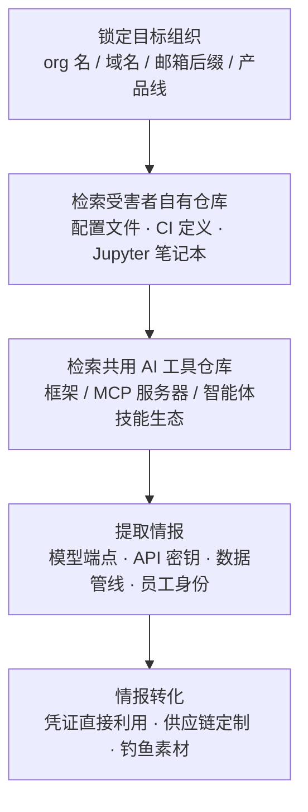

# 代码仓库 (AML.T0095.000)

> 属于 [搜索开放网站/域名 (AML.T0095)](../AML.T0095-Search-Open-Websites-Domains.md)

## 一句话通俗理解

> 攻击者像翻垃圾桶的商业间谍一样泡在 GitHub、GitLab 上——你家开发者随手提交的配置文件、Jupyter 笔记本、CI 定义里，藏着模型端点、API 密钥和整条 AI 管线的底细。翻代码仓库不用破门，但捡到的往往是钥匙。

## 难度等级

⭐⭐⭐ **Realized（已实现）**

官方成熟度评定为 Realized——从公开代码仓库搜索受害者 AI 系统情报的手法已在真实攻击与安全研究中被反复证实：Microsoft Defender 研究团队正是通过审计 Claude Code GitHub Action 的公开仓库与混淆 SDK，还原了 CI/CD 智能体的完整攻击面；Unit 42 追踪的威胁行为者同样依赖公开仓库中检索到的智能体框架与技能生态完成武器化准备。技术门槛极低——一个免费账号加平台自带的代码搜索语法即可开工，不产生任何目标侧告警；真正的威胁在于**情报密度**：代码仓库是唯一同时暴露"用了什么（框架/模型/数据集）、连到哪里（端点/命名约定）、钥匙在哪（泄露凭证）"的公开情报源，一次命中即可同时喂饱侦察、资源开发与初始访问三个阶段。

## 技术描述

### 通俗解释

如果说父技术 [搜索开放网站/域名 (AML.T0095)](../AML.T0095-Search-Open-Websites-Domains.md) 是在全网公开角落里翻找 AI 资产的蛛丝马迹，本子技术聚焦其中情报密度最高的一个角落：**代码托管平台**。开发者是最"勤快"的信息泄露者——为了赶工，他们会把带真实端点的配置文件、带 API 密钥的调用脚本、记录完整实验流程的 Jupyter 笔记本一键推上 GitHub；而这些提交会永久留在历史记录里，哪怕删掉文件，历史提交照样查得到。

攻击者检索的对象有两类：一是**受害者自有仓库**——组织或员工公开发布的代码；二是**受害者"使用但非自有"的 AI 工具仓库**——LangChain、MCP 服务器、智能体框架这类开源项目。第二类同样致命：知道你家智能体用的是什么框架、哪个版本，就等于知道了该翻哪份漏洞研究、该投毒哪条供应链。

### 技术原理

依据官方描述，攻击者搜索公开代码仓库，收集可用于攻击定位的受害者或受害者系统信息。受害者可能将 AI 系统相关代码或制品存放在 GitHub、GitLab、SourceForge、BitBucket 等第三方网站仓库中；攻击者也会搜索受害者**正在使用但并非自有**的常见 AI 工具、框架、模型或智能体系统的仓库。

**可获得的情报类型**（依据官方描述）：

| 情报类别 | 具体内容 | 攻击价值 |
|---------|---------|---------|
| 技术栈轮廓 | 常用 AI 框架、库、模型、数据集 | 定制攻击路径，锁定供应链投毒目标 |
| 智能体生态 | 智能体及智能体工具（MCP 服务器、插件、技能） | 定位提示词注入与工具投毒入口 |
| 人员身份 | 提交记录中的员工姓名、邮箱 | 钓鱼素材、社会工程学突破口 |
| 敏感泄露 | 意外提交的凭证或 API 密钥（如"来自 AI 智能体配置的凭证"AML.T0083） | 直接衔接初始访问的"免费钥匙" |

**官方指出的四条情报出口：**

1. **进一步侦察**：仓库中发现的 RAG 管线线索可衔接"收集 RAG 索引目标（AML.T0064）"，摸清外挂知识库；
2. **资源开发**：目标使用的公开 AI 制品线索可衔接"获取公开 AI 制品（AML.T0002）"，为投毒或代理模型构建备料；
3. **发现**：智能体配置线索可衔接"发现 AI 智能体配置（AML.T0084）"的后续内部枚举；
4. **初始访问**：泄露凭证直接衔接"有效账户（AML.T0012）"；员工姓名与邮箱则为"网络钓鱼（AML.T0052）"提供精准弹药。

**与其他侦察技术的分工：**

- 与父技术的关系：父技术覆盖搜索引擎、社交媒体、新闻站点等全部公开渠道，本子技术专攻代码托管平台这一垂直场景；
- 与"搜索应用仓库（AML.T0004）"的边界：后者搜应用商店里**发布的成品应用**，本技术搜代码托管平台上**暴露的源代码与配置**。

**平台覆盖**：Enterprise（企业环境）——攻击者仅需浏览器与代码搜索语法即可执行，无需接触任何 AI 平台。

### 用途影响

- **免费钥匙**：意外提交的 API 密钥与智能体配置凭证是最直接的产出，命中即可跳过漏洞利用直接进入初始访问；
- **供应链瞄准镜**：依赖清单（requirements.txt、package.json、模型引用）完整暴露目标使用的 AI 框架与模型，为供应链攻击（投毒包、抢注、命名空间复用）提供精确制导；
- **攻击面目录**：CI/CD 工作流定义暴露"哪家组织在流水线里跑 AI 智能体"——Claude Code Action 案例证明这正是可被提示词注入的入口清单；
- **不可撤回的历史**：删除文件不删除历史提交，泄露情报的"保质期"以仓库存续时间为限；
- **零交互痕迹**：全部操作发生在第三方平台侧，受害者系统无任何日志。

## 攻击流程

### 典型攻击流程



**步骤详解：**

1. **锁定目标组织**
   - 通俗描述：确定要翻谁的代码。
   - 技术细节：收集目标组织在代码托管平台的标识——组织名、企业域名邮箱后缀、员工个人账号；从官网、招聘启事、技术博客中提取 AI 相关产品线名称，构造检索关键词集合。

2. **检索受害者自有仓库**
   - 通俗描述：在目标组织的公开仓库里翻配置和密钥。
   - 技术细节：使用平台代码搜索语法（如 `org:targetorg`）检索配置文件、CI/CD 工作流定义、模型加载脚本与 Jupyter 笔记本；重点关注意外提交的 API 密钥、智能体配置中的凭证（AML.T0083）以及历史提交中已"删除"但仍在的敏感内容。

3. **检索共用 AI 工具仓库**
   - 通俗描述：摸清目标"用什么牌子的 AI 工具"，翻这些工具的官方与社区仓库。
   - 技术细节：从目标的依赖清单确认其使用的 AI 框架、MCP 服务器与智能体技能生态；研究这些"使用但非自有"工具的已知漏洞、注入面与可投毒环节——OpenClaw 与 Claude Code Action 案例均始于对这类公开仓库的审计。

4. **提取情报**
   - 通俗描述：把翻到的碎片拼成地图。
   - 技术细节：汇总技术栈轮廓（框架/模型/数据集）、智能体生态、模型端点与命名约定、员工身份四类情报；交叉验证不同仓库间的引用关系，还原目标 AI 系统的完整拓扑。

5. **情报转化**
   - 通俗描述：地图变现——按情报类型分发到对应攻击阶段。
   - 技术细节：泄露凭证交给"有效账户（AML.T0012）"直接登录；框架与模型情报交给供应链攻击定制载荷；员工身份交给"网络钓鱼（AML.T0052）"；RAG 与智能体配置线索喂给后续侦察与发现阶段。

**与后续战术的衔接：**

- **初始访问**：泄露的 API 密钥与凭证是最直接的入口；官方描述明确点名有效账户（AML.T0012）与钓鱼（AML.T0052）两条路径
- **资源开发**：目标使用的公开 AI 制品线索衔接获取公开 AI 制品（AML.T0002）——为投毒副本、代理模型构建备料
- **发现**：智能体配置线索为入驻后的内部枚举（发现 AI 智能体配置 AML.T0084）预设了"要找什么"的清单
- **进一步侦察**：RAG 管线细节衔接收集 RAG 索引目标（AML.T0064），锁定投毒的数据源入口

> 关键差异：传统 T1593.003 在代码仓库里找的是通用软件栈与凭证；AML.T0095.000 的核心增量是 **AI 制品情报**——模型引用、智能体工具链、训练管线、提示词模板。传统搜索帮攻击者"找到系统的门"，本技术帮攻击者"拿到 AI 系统的钥匙串"。

## 真实案例

> 以下 3 个案例全部直接命中本子技术（官方数据中共 3 个案例研究以 AML.T0095.000 为目标），均源自 MITRE ATLAS 案例库。

### 案例1：Claude Code GitHub Action 凭证暴露——公开仓库审计驱动的攻击研究（2026年，AML.T0095.000）

- **时间**: 2026年6月
- **攻击者**: Microsoft Defender 安全研究团队（安全演示）
- **手法**: 研究人员系统分析了 Anthropic Claude Code GitHub Action 的**公开代码仓库**与混淆的 Claude Agent SDK，理解智能体工具如何执行、GitHub 事件（issue 正文、PR 描述、评论）如何向智能体供给内容；随后构造包含提示词注入的普通 GitHub 内容，诱使 CI/CD 流水线中的智能体在处理时暴露工作流密钥。研究起点正是对公开仓库的搜索与审计——攻击者用同样的手法即可批量发现"哪些组织在 CI/CD 中部署了可被注入的 AI Action"。
- **影响**: 证明含提示词注入的普通 GitHub 内容即可让流水线智能体吐出密钥；代码仓库同时扮演了攻击情报源与攻击投放面双重角色
- **参考链接**: [Microsoft: Securing CI/CD in an agentic world](https://www.microsoft.com/en-us/security/blog/2026/06/05/securing-ci-cd-in-agentic-world-claude-code-github-action-case/)

### 案例2：OpenClaw 提示词注入劫持——共用智能体仓库的武器化（2026年，AML.T0095.000）

- **时间**: 2026年
- **攻击者**: HiddenLayer 研究人员（安全演示）
- **手法**: 研究人员演示了一个网页如何通过间接提示词注入，使开源智能体 OpenClaw 静默执行恶意脚本；脚本将持久化恶意指令植入后续系统提示词，攻击者据此可不断下达新命令，把 OpenClaw 变成命令与控制（C2）智能体。攻击的可行性研究建立在对 OpenClaw 公开仓库与智能体生命周期代码的分析之上——"受害者使用但非自有"的智能体系统仓库正是攻击者搜索的重点对象。
- **影响**: 单次间接提示词注入即可劫持智能体控制体系，诱导未授权的工具调用与任意执行
- **参考链接**: [HiddenLayer: Exploring the Security Risks of AI Assistants like OpenClaw](https://www.hiddenlayer.com/research/exploring-the-security-risks-of-ai-assistants-like-openclaw)

### 案例3：Hermes 智能体滥用——公开技能生态变成攻击工具箱（2026年，AML.T0095.000）

- **时间**: 2026年5月
- **攻击者**: 中文语系威胁行为者（knaithe / KnYuan）
- **手法**: 该威胁行为者将 Hermes Agent 配置为以 DeepSeek 作为推理引擎，并集成暴露 FOFA 搜索、查询翻译与 Nuclei 扫描生成能力的 MCP 服务器，配合 Telegram 操作员控制与包含自带及自建红队技能的技能系统，对 Langflow 与 n8n 实施自主攻击尝试。Unit 42 恢复的完整会话显示智能体可在极少人工输入下自主推进攻击——而这些智能体框架、技能与 MCP 服务器恰恰都源自公开代码仓库的检索与组装。
- **影响**: 公开仓库中的智能体框架与技能生态可被直接组装成自主攻击平台，攻击门槛从"会写代码"降到"会装插件"
- **参考链接**: [Unit 42: Chinese-Speaking Threat Actor Harnesses AI Models for Autonomous Cyberattacks](https://unit42.paloaltonetworks.com/autonomous-ai-cyber-attack-campaign/)

## 红队视角

> ⚠️ **免责声明**：以下内容仅用于合法授权的安全测试与教育目的。对他人系统进行未经授权的信息收集可能违反法律与平台条款。

### 实战技巧

1. **组织仓库泄露自查（面向自有资产）**
   用攻击者的检索习惯给自家组织做"公开视角"体检：在 GitHub/GitLab 用 `org:yourcompany` 检索配置文件、`.env` 残留、模型加载脚本、CI 定义与 Jupyter 笔记本；重点翻**历史提交**——"文件已删除"不等于"泄露已回收"。

2. **AI 技术栈画像审计**
   盘点组织公开仓库依赖清单中暴露的 AI 框架、模型引用与智能体工具链，回答三个问题：攻击者能确定我们用什么吗？这些组件当前有无已知漏洞？供应链投毒会从哪个依赖切入？

3. **凭证泄露应急演练**
   在自有测试仓库中植入已作废的假密钥，验证 Secret Scanning 告警是否及时触发、推送保护是否拦截、撤换流程是否闭环——衡量的是"从泄露到回收"的暴露窗口时长。

### 常用工具

| 工具名称 | 用途 | 平台 |
|----------|------|------|
| GitHub / GitLab 代码搜索 | org: 语法检索自有仓库配置与密钥残留 | Web |
| TruffleHog / GitGuardian | 历史提交密钥扫描与公开渠道泄露监控 | 跨平台 |
| gitleaks | 仓库提交历史凭证审计 | 跨平台 |
| GitHub Secret Scanning + 推送保护 | 平台原生密钥泄露防线（防御自查用） | Web |
| gau / wayback 类归档工具 | 已删除仓库与页面的残留快照核查 | Web |

### 注意事项

- **只查自有或授权资产**：对第三方仓库的批量抓取可能违反平台服务条款；红队报告聚焦"我们暴露了什么"，而非"别人能拿到什么"
- 发现真实泄露的凭证应立即走报告通道并推动撤换，不在报告中粘贴完整密钥
- 公开信息收集不产生目标侧日志，红队价值在于让组织看到"散落提交聚合后的完整画像"

## 蓝队视角

### 检测要点

1. **被动侦察本身几乎不可检测**
   - 攻击者只读取第三方平台上的公开内容，组织内部系统无任何日志
   - 可监测的间接信号：组织仓库被新注册账号异常 fork/关注、对含配置文件仓库的异常克隆（平台审计日志）

2. **泄露监控（把"公开仓库"当传感器）**
   - 日志来源：代码托管平台审计日志、Secret Scanning 告警、泄露监控服务通知
   - 关注字段：触发告警的密钥类型、提交者、所在仓库、暴露时长
   - 异常特征：公开仓库新增疑似密钥提交、历史提交中出现仍有效的旧密钥、Jupyter 笔记本内嵌端点与凭证

3. **蜜罐信号（AI 蜜罐被"看见"）**
   - 日志来源：AI 蜜罐（AML.M0039）访问日志
   - 异常特征：蜜罐智能体 URL 或诱饵凭证被外部精确使用——说明攻击者已通过代码仓库等公开渠道完成情报拼图

### 监控建议

- 建立**组织公开仓库暴露清单**并定期自查："攻击者能在我们仓库里搜到的，蓝队必须先搜到"
- 强制启用 GitHub Secret Scanning 与推送保护，部署 TruffleHog/GitGuardian 类工具覆盖历史提交与组织外泄露
- 对外开源的 AI 相关代码建立**发布前审查**：剥离真实端点、内部命名约定与模型引用
- 监控组织 CI/CD 中 AI Action 的使用清单，对照厂商安全通告评估注入面
- 将"从密钥泄露告警到完成撤换"的时长作为可量化指标纳入运营考核

## 检测建议

### 网络层检测

**检测方法：** 本技术为被动侦察，网络层无可直接检测的目标交互流量；监控的是**泄露凭证被使用的后续行为**。

- 泄露的 API 密钥在异常来源 IP、异常地理区域的首次调用（凭证泄露窗口期的终点信号）
- 模型推理端点遭遇携带有效密钥但行为模式异常的调用（脚本化批量调用、非常规时间调用）

### 主机层检测

**检测方法：** 无直接信号——攻击者不接触目标主机。

- 关注开发终端侧：凭证文件异常读取后伴随的外连（与本技术无直接关联，但常是泄露链条的一环）

### 应用层检测（AI 遥测）

**检测方法：** 利用代码托管平台审计能力与 AI 服务网关遥测发现情报收集的前兆与后果。

- Secret Scanning 告警接到 SIEM 后，与该密钥的使用日志做时间关联："泄露提交时间→首次异常使用时间"的间隔即暴露窗口
- AI 服务网关发现按"画像特征"构造的请求：调用参数与组织技术栈高度吻合但来源异常
- AI 蜜罐（AML.M0039）的诱饵凭证或智能体 URL 被精确命中——公开渠道信息已被拼图的最高置信告警

**程序化检测思路（无需 EDR 侧改造）：**

把"公开仓库"变成传感器：订阅平台的 Secret Scanning 与推送保护 Webhook，告警实时入 SIEM 并自动触发密钥撤换工单；用 TruffleHog 定期全量回扫组织全部公开仓库（含历史提交），与上次扫描结果做差分——新增命中即暴露面增量；对推理端点网关，将"新来源 IP + 有效密钥 + 高频调用"作为组合低阈值事件，与泄露告警时间轴关联分析。

### Sigma 规则思路示例

```yaml
title: 组织公开代码仓库出现疑似密钥泄露提交
status: experimental
description: 检测组织公开仓库触发 Secret Scanning 告警的新提交，
    可能为含 API 密钥/智能体配置凭证的泄露（AML.T0095.000 侦察情报源）
logsource:
    category: application
    product: github
    service: audit_log
detection:
    selection:
        action:
            - 'secret_scanning_alert.create'
            - 'secret_scanning_alert.reopen'
    filter_test:
        repo|endswith:
            - '/secret-scanning-test'   # 已知测试密钥仓库白名单
    condition: selection and not filter_test
level: high
tags:
    - attack.t1593
    - attack.t1593.003
    - atlas.aml_t0095_000
```

## 缓解措施

### 优先级1：关键措施

**AML.M0000 限制信息公开发布（Limit Public Release of Information，继承自父技术 AML.T0095）**

限制公开发布组织产品或服务中 AI 技术栈的技术信息——AI 使用方式的技术知识可被攻击者用于攻击定位与定制。落实到代码仓库场景：对外开源的 AI 相关代码发布前强制审查，剥离真实端点、内部命名约定、模型与数据集引用；员工个人公开仓库纳入组织泄露监控范围；历史提交定期回扫。这是最直接的对症药——**攻击者能在仓库里翻到什么，取决于你推上去过什么**。

### 优先级2：重要措施

**AML.M0039 AI 蜜罐（AI Honeypots）——本子技术唯一直接映射的官方缓解措施**

部署受监控的诱饵 AI 服务、智能体、凭证或资源——外观像真实资产，但不承担任何业务功能。合法用户与工作流没有理由接触它们，任何交互都是高置信度的未授权活动指标。落到本技术场景：在公开渠道埋设诱饵凭证与诱饵仓库（含看似真实的假配置与假端点），攻击者经代码仓库检索拼图时会一并捞走诱饵——**诱饵凭证被使用，即证明仓库泄露情报已落入敌手**。交互数据可汇聚为威胁情报源反哺检测规则。GreyNoise 与 Zenity 的实战数据均表明 AI 蜜罐能捕获海量侦察活动。

### MITRE ATLAS 缓解措施映射

| 缓解措施ID | 缓解措施名称 | 优先级 | 映射来源 | 生命周期阶段 |
|------------|-------------|:------:|----------|-------------|
| AML.M0000 | 限制信息公开发布 | 关键 | 继承自父技术 AML.T0095 | 业务与数据理解 |
| AML.M0039 | AI 蜜罐 | 重要 | **直接映射** | 部署 · 监控与维护 |

> 说明：ATLAS 官方对本子技术直接映射的缓解措施仅有 AML.M0039；AML.M0000 为父技术缓解措施，对代码仓库场景同样关键，此处按落地优先级排列。两道防线的逻辑：发布收敛解决"仓库里有没有钥匙"，蜜罐解决"钥匙被捡走后你能否第一时间知道"。

## 关联 ATT&CK 技术

- [搜索开放网站/域名 (T1593)](../../../enterprise/01-Reconnaissance/T1593-Search-Open-Websites-Domains.md) — 父技术的同源经典技术
- [代码仓库 (T1593.003)](../../../enterprise/01-Reconnaissance/T1593/T1593.003-Code-Repositories.md) — 与本技术直接对应的 Enterprise 子技术，同源关系

**传统代码仓库搜索 vs ATLAS 代码仓库搜索：**

| 维度 | 传统 (T1593.003) | ATLAS (AML.T0095.000) |
|------|------------------|----------------------|
| 检索目标 | 源代码、配置文件、基础设施即代码、泄露凭证 | 同左，外加 **AI 制品**：模型引用、数据集、智能体工具链、训练管线、提示词模板 |
| 高价值命中 | SSH 私钥、云凭证、数据库连接串 | **AI 智能体配置中的凭证（AML.T0083）**、模型端点、API 密钥、RAG 管线细节 |
| "使用但非自有"搜索 | 针对目标使用的通用软件找已知漏洞 | 针对目标使用的 **AI 框架/模型/智能体系统**找注入面与投毒环节 |
| 后续衔接 | 漏洞利用、钓鱼、有效账户 | 同左，外加资源开发（获取公开 AI 制品 AML.T0002）、RAG 投毒侦察（AML.T0064）、智能体配置发现（AML.T0084） |

一句话总结：T1593.003 帮攻击者"翻到你的代码"，AML.T0095.000 帮攻击者"读懂你的 AI"——同一批仓库里，多了模型引用、智能体工具链与整条数据管线这些 AI 时代的新情报层。

## 动手实验

> ⚠️ **重要提示**：所有实验仅限自有组织资产或公开授权测试范围，禁止对第三方系统进行未授权信息收集。

### 实验环境准备

| 环境组件 | 用途 | 获取方式 |
|----------|------|----------|
| 自有组织 GitHub/GitLab 账号与公开仓库 | 暴露面自查对象 | 自有资产 |
| 一个专用测试仓库（含历史提交） | 泄露与扫描练习 | 自建 |
| TruffleHog / gitleaks | 提交历史凭证扫描 | 开源安装 |
| 已作废的假密钥若干 | 演练用"泄露物" | 自制 |

### 实验1（初级）：自查组织的 AI 代码足迹

**实验目标：** 建立"攻击者搜我的仓库能搜到什么"的视角。

**实验步骤：**
1. 在 GitHub 代码搜索中用 `org:yourcompany` 组合检索 `.env`、`config.yaml`、`*.ipynb`、`requirements.txt`
2. 逐项检查命中内容：有无真实端点、API 密钥、模型与数据集引用、内部命名约定
3. 随机抽取 3 个公开仓库，翻其历史提交，确认"已删除"的敏感文件是否仍在历史中可见
4. 将发现整理为公开足迹清单，逐项确认"这是否应该公开"

**预期结果：** 输出一份与攻击者视角一致的 AI 代码暴露清单。

### 实验2（中级）：历史泄露扫描与暴露窗口测量

**实验目标：** 掌握仓库凭证审计与泄露响应时效的量化方法。

**实验步骤：**
1. 在测试仓库的多次历史提交中分别埋入不同类型的假密钥（API key、token、连接串）
2. 用 TruffleHog 全量扫描该仓库，验证各假密钥能否被检出、在第几次提交引入
3. 删除文件后再扫一次，体会"删除文件不清除历史"
4. 设计指标：从"泄露提交"到"扫描告警"再到"密钥作废"的时长

**预期结果：** 产出组织仓库凭证审计流程与暴露窗口度量基线。

### 实验3（高级）：诱饵仓库告警演练

**实验目标：** 体验"把公开仓库变成传感器"的蜜罐思路（对应 AML.M0039）。

**实验步骤：**
1. 建一个"看似真实"的诱饵仓库：假配置文件内嵌已作废的诱饵密钥与蜜罐端点
2. 将诱饵密钥接入告警：任何调用即触发通知（可借助密钥前置网关或专用 canary 服务）
3. 模拟攻击链：检索发现诱饵→使用密钥调用，验证告警链路闭环
4. 思考：诱饵仓库应埋在何处才最可能被攻击者的 org: 检索命中？

**预期结果：** 产出"仓库泄露→诱饵触警"的最小可用检测配置。

## 术语解释

| 术语 | 英文原名 | 通俗解释 |
|------|----------|----------|
| 代码仓库 | Code Repository | 存放源代码的托管空间（GitHub/GitLab 等），本子技术的搜索对象 |
| 公开仓库 | Public Repository | 任何人都可查看的代码仓库——组织与员工发布的代码默认全员可见 |
| 历史提交 | Commit History | 仓库的全部修改记录，删除文件不删除历史——泄露情报的"永久存档" |
| 组织仓库检索 | org: 搜索 | 代码平台搜索语法，限定在目标组织的全部仓库内检索文件内容 |
| Jupyter 笔记本 | Jupyter Notebook | 交互式实验记录文件，常内嵌数据、端点与凭证，是泄露重灾区 |
| CI/CD 工作流 | CI/CD Workflow | 代码仓库中的自动化流水线定义，暴露"谁在流水线里跑 AI 智能体" |
| AI 制品 | AI Artifact | 模型、数据集、智能体工具等 AI 开发产物，代码仓库泄露情报的核心增量 |
| 智能体配置 | AI Agent Configuration | 智能体的工具清单、凭证与参数配置——AML.T0083 的凭证来源 |
| Secret Scanning | Secret Scanning | 代码托管平台自动识别提交内容中疑似密钥并告警的防御功能 |
| 推送保护 | Push Protection | 在可疑密钥被推上仓库前拦截提交的平台防御功能 |
| 蜜罐凭证 | Canary Credential | 主动埋放的诱饵密钥，被使用即证明泄露情报已被攻击者获取 |
| 暴露窗口 | Exposure Window | 从凭证泄露到完成作废的时间差，衡量泄露响应速度的核心指标 |

## 参考资料

### 📚 官方文档

- [MITRE ATLAS - Code Repositories (AML.T0095.000)](https://atlas.mitre.org/techniques/AML.T0095/000/) - 官方技术页面
- [MITRE ATLAS 矩阵](https://atlas.mitre.org/matrices/ATLAS/)
- [MITRE ATLAS Data (GitHub)](https://github.com/mitre-atlas/atlas-data)
- [GitHub Secret Scanning 文档](https://docs.github.com/zh/code-security/secret-scanning) - 平台原生密钥泄露防护

### 📰 案例报告（真实攻击与安全研究）

- [Microsoft: Securing CI/CD in an agentic world - Claude Code GitHub Action case](https://www.microsoft.com/en-us/security/blog/2026/06/05/securing-ci-cd-in-agentic-world-claude-code-github-action-case/) - 公开仓库审计驱动的 CI/CD 智能体攻击研究
- [HiddenLayer: Exploring the Security Risks of AI Assistants like OpenClaw](https://www.hiddenlayer.com/research/exploring-the-security-risks-of-ai-assistants-like-openclaw) - 开源智能体仓库的提示词注入劫持演示
- [Unit 42: Chinese-Speaking Threat Actor Harnesses AI Models for Autonomous Cyberattacks](https://unit42.paloaltonetworks.com/autonomous-ai-cyber-attack-campaign/) - 公开智能体技能生态被组装为自主攻击平台
- [GreyNoise: Threat Actors Actively Targeting LLMs](https://www.greynoise.io/blog/threat-actors-actively-targeting-llms) - 威胁行为者系统性侦察 LLM 的实证
- [Zenity Labs: Scanning for AI](https://labs.zenity.io/post/scanning-for-ai-live-campaigns-mapping-the-internet-s-exposed-llm-backends) - 互联网暴露 LLM 后端的实时测绘

### 🔧 工具与资源

- [TruffleHog](https://github.com/trufflesecurity/trufflehog) - 代码仓库凭证扫描
- [gitleaks](https://github.com/gitleaks/gitleaks) - 提交历史密钥审计
- [GitGuardian](https://www.gitguardian.com/) - 公开渠道凭证泄露监控
- [OWASP Top 10 for LLM Applications](https://owasp.org/www-project-top-10-for-large-language-model-applications/) - LLM 应用十大安全风险
- [NIST AI Risk Management Framework](https://www.nist.gov/itl/ai-risk-management-framework) - NIST AI 风险管理框架

### 🔗 关联阅读

- [搜索开放网站/域名 (AML.T0095)](../AML.T0095-Search-Open-Websites-Domains.md) - 本技术的父技术，全部公开渠道侦察全景
- [搜索开放网站/域名 (T1593)](../../../enterprise/01-Reconnaissance/T1593-Search-Open-Websites-Domains.md) - 父技术的同源经典技术
- [代码仓库 (T1593.003)](../../../enterprise/01-Reconnaissance/T1593/T1593.003-Code-Repositories.md) - 与本技术直接对应的 Enterprise 子技术
- [侦察战术 (AML.TA0002)](../README.md) - 本技术所属战术的概览页

---

> **版本**: ATLAS 2026.09 | **更新**: 2026-10-22 | **模板**: ATLAS 技术文档 v1.0
