# 侦察 (AML.TA0002)

## 一句话理解

> **攻击者在动手前先摸清你的 AI 底细——用了什么模型、数据从哪来、接口开在哪，了解得越透，下手越准。**

## 战术概述

侦察是 ATLAS 攻击链的**第一步**：攻击者围绕目标组织的 AI 系统展开信息收集，为后续攻击行动制定计划。与传统 ATT&CK 侦察不同，ATLAS 侦察的焦点不是普通的网络资产，而是目标的 **AI 能力与研究活动**——包括组织在生产中使用了哪些模型架构、外挂了哪些数据源、部署了哪些 AI 服务与智能体接口。

**通俗解释：**
传统侦察像小偷踩点小区；ATLAS 侦察更像商业间谍摸底一家 AI 公司——翻遍员工发表的论文、官网的产品介绍、应用商店里的 App，搞清楚对方的模型是自研还是开源微调、RAG 系统挂了哪些知识库、哪个聊天机器人入口暴露在公网上。情报越完整，后续的投毒、提示词注入、越狱攻击就越有针对性。

**在攻击中的作用：**
侦察位于 MITRE ATLAS 攻击链的**最前端**，是所有后续 AI 攻击行动的基础。收集到的信息可以直接支撑其他阶段：定位并获取目标正在使用的 AI 制品（模型、数据集）、针对目标依赖的 AI 能力选择攻击面、**根据目标使用的具体模型量身定制攻击**（如构建代理 AI 模型进行影子演练），或驱动进一步的侦察行动。被动侦察几乎不留下可检测的痕迹，是攻击者最安全的信息收集窗口。

**包含的技术类型：**
- **被动侦察**：不直接接触目标系统，从论文库、预印本、技术博客、官网、应用商店等公开渠道收集情报（AML.T0000、AML.T0001、AML.T0003、AML.T0004、AML.T0095）
- **主动侦察**：直接与目标系统交互，扫描暴露的 AI 服务、枚举托管资源、查询平台元数据（AML.T0006）
- **AI 特有目标侦察**：针对 RAG 数据源、AI 智能体触发通道等 AI 系统独有攻击面（AML.T0064）
- **AI 增强侦察**：使用自主 AI 智能体递归式执行侦察任务（AML.T0116）

**值得警惕的典型场景：**
组织常将**开源模型架构配合专有数据训练**后投入生产。攻击者一旦通过侦察掌握了底层的模型架构，就可以训练出行为高度近似的**代理 AI 模型**，在离线环境中反复演练和优化攻击（如对抗样本、越狱提示词），再迁移到真实目标上实施——这正是侦察情报转化为攻击能力的关键路径。

**与 ATT&CK 传统侦察的差异：**

| 维度 | ATT&CK 侦察 (TA0043) | ATLAS 侦察 (AML.TA0002) |
|------|---------------------|------------------------|
| 侦察对象 | 网络、主机、人员、组织信息 | AI 模型、数据管线、AI 服务与智能体接口 |
| 典型情报源 | DNS/WHOIS、社交媒体、闭源情报市场 | 论文/预印本、应用商店、模型托管平台、RAG 数据源 |
| 独有技术 | 钓鱼获取信息、搜索闭源资料 | 搜索公开AI漏洞分析、收集RAG索引目标、自主侦察 |
| 情报用途 | 为入侵网络、获取凭证做准备 | 为投毒、提示词注入、代理模型构建等 AI 攻击做准备 |

## 战术在攻击链中的位置

### 攻击链全景图

```mermaid
graph LR
    A["01 侦察<br/>AML.TA0002"] --> B["02 资源开发"]
    B --> C["03 AI攻击适配"]
    C --> D["04 初始访问"]
    D --> E["05 AI模型访问"]
    E --> F["06 执行"]
    F --> G["07 持久化"]
    G --> H["08 权限提升"]
    H --> I["09 防御规避"]
    I --> J["10 凭证访问"]
    J --> K["11 发现"]
    K --> L["12 横向移动"]
    L --> M["13 收集"]
    M --> N["14 命令与控制"]
    N --> O["15 数据渗漏"]
    O --> P["16 影响"]

    style A fill:#ff6b6b,stroke:#333,stroke-width:2px
```

> 注：实际攻击中部分战术可并行或跳过，上图展示典型线性推进关系。

### 当前战术的角色

侦察是 ATLAS 攻击链的起点，发生在任何实际入侵之前。攻击者在这个阶段尽可能多地收集目标 AI 系统的信息，产出通常直接决定后续攻击路径：是走模型供应链投毒、提示词注入，还是对暴露的推理接口直接下手。

### 前置战术

- **无**：侦察是整个攻击链的起点，没有前置战术要求。

### 后续战术

- **资源开发**：根据侦察结果获取公开 AI 制品、构建代理 AI 模型、准备攻击基础设施
- **AI 攻击适配**：将通用攻击方法适配到侦察确认的目标模型与数据管线
- **初始访问**：利用侦察发现的暴露接口、钓鱼素材（如深度伪造所需的身份信息）进入目标环境

## 技术索引表

> 本战术的技术文档尚未编写，以下技术 ID 与名称暂为纯文本，待文档落地后转换为链接。

| 技术ID | 中文名称 | 难度 | 子技术数 | 一句话理解 | 关联ATT&CK | 文档状态 |
|--------|---------|:----:|:-------:|-----------|-----------|:-------:|
| AML.T0000 | 搜索开放技术数据库 | ⭐⭐⭐ | 4 | 从论文、预印本、技术博客中挖出目标组织的AI架构与研究底细 | [T1596](../../enterprise/01-Reconnaissance/T1596-Search-Open-Technical-Databases.md) | ⏳ 计划中 |
| AML.T0001 | 搜索公开AI漏洞分析 | ⭐⭐ | 0 | 搜罗目标模型已有的漏洞研究和现成攻击实现，站在前人肩膀上攻击 | — | ⏳ 计划中 |
| AML.T0003 | 搜索受害者网站 | ⭐⭐ | 0 | 浏览目标官网，摸清其AI产品细节与关键人员信息 | [T1594](../../enterprise/01-Reconnaissance/T1594-Search-Victim-Owned-Websites.md) | ⏳ 计划中 |
| AML.T0004 | 搜索应用仓库 | ⭐⭐ | 0 | 在应用商店中搜索目标发布的含AI组件的应用 | — | ⏳ 计划中 |
| AML.T0006 | 主动扫描 | ⭐⭐⭐ | 4 | 主动探测暴露在外的AI服务、开放端口与平台元数据 | [T1595](../../enterprise/01-Reconnaissance/T1595-Active-Scanning.md) | ⏳ 计划中 |
| AML.T0064 | 收集RAG索引目标 | ⭐⭐ | 0 | 摸清RAG系统外挂了哪些数据源，为后续投毒做准备 | — | ⏳ 计划中 |
| AML.T0087 | 收集受害者身份信息 | ⭐⭐⭐ | 0 | 收集员工姓名、邮箱、凭证等信息，用于深度伪造和钓鱼 | [T1589](../../enterprise/01-Reconnaissance/T1589-Gather-Victim-Identity-Information.md) | ⏳ 计划中 |
| AML.T0095 | 搜索开放网站/域名 | ⭐⭐⭐ | 1 | 用搜索引擎和OSINT手法定位目标的AI资产与智能体接口 | [T1593](../../enterprise/01-Reconnaissance/T1593-Search-Open-Websites-Domains.md) | ⏳ 计划中 |
| AML.T0116 | 自主侦察 | ⭐⭐⭐ | 0 | 放出AI智能体自主踩点，递归式侦察无需人类逐步指挥 | — | ⏳ 计划中 |

**平台覆盖说明**（依据官方数据）：

- AML.T0006（主动扫描）、AML.T0116（自主侦察）覆盖全部四类平台：Predictive AI / Generative AI / Agentic AI / Enterprise
- AML.T0064（收集RAG索引目标）仅适用于 Generative AI 与 Agentic AI——RAG 是生成式系统特有的架构
- 其余技术以 Enterprise 平台为主，攻击者在传统环境中即可执行

## 子技术索引

| 子技术ID | 中文名称 | 难度 | 一句话理解 | 文档状态 |
|---------|---------|:----:|-----------|:-------:|
| AML.T0000.000 | 期刊与会议论文集 | ⭐⭐⭐ | 翻目标员工发表的学术论文，推断其AI技术路线 | ⏳ 计划中 |
| AML.T0000.001 | 预印本仓库 | ⭐⭐⭐ | 在arXiv等预印本平台搜索目标组织的最新AI研究 | ⏳ 计划中 |
| AML.T0000.002 | 技术博客 | ⭐⭐⭐ | 读目标公司的技术博客，了解其AI系统实现细节 | ⏳ 计划中 |
| AML.T0000.003 | 扫描数据库 | ⭐⭐⭐ | 用Shodan、Censys等平台识别可公开访问的AI服务 | ⏳ 计划中 |
| AML.T0006.000 | 枚举托管AI资源 | ⭐⭐⭐ | 枚举云平台上托管的模型、端点等AI资源 | ⏳ 计划中 |
| AML.T0006.001 | 查询平台元数据API | ⭐⭐⭐ | 调用云平台元数据接口获取AI服务的配置信息 | ⏳ 计划中 |
| AML.T0006.002 | 扫描暴露AI基础设施 | ⭐⭐⭐ | 扫描发现错误配置或暴露在外的AI基础设施 | ⏳ 计划中 |
| AML.T0006.003 | 探测AI智能体触发通道 | ⭐⭐⭐ | 探测AI智能体的邮件、Webhook等触发入口 | ⏳ 计划中 |
| AML.T0095.000 | 代码仓库 | ⭐⭐⭐ | 从GitHub等代码仓库搜索目标泄露的AI系统细节与凭证 | ⏳ 计划中 |

> 注：子技术难度继承其父技术的官方 maturity 等级。

## 统计信息

- **技术总数**：9 个
- **子技术总数**：9 个
- **难度分布**：⭐⭐⭐（Realized）5 个 / ⭐⭐（Demonstrated）4 个 / ⭐（Feasible）0 个
- **已完成文档**：0 个
- **待编写文档**：18 个（9 主技术 + 9 子技术）

## 推荐阅读顺序

### 入门阶段：建立"AI 资产也是攻击面"的意识

> 适合刚接触 AI 安全的学习者，从纯被动的信息收集技术入手。

**前置知识：** 了解基本的 OSINT 概念，会使用搜索引擎

**推荐阅读：**

1. **AML.T0000 搜索开放技术数据库** - 理解论文、预印本、技术博客如何泄露组织的 AI 架构细节
2. **AML.T0003 搜索受害者网站** - 学习从目标官网提取 AI 产品与人员信息
3. **AML.T0095 搜索开放网站/域名** - 掌握用搜索引擎与 OSINT 定位目标的 AI 资产

**学习建议：**
- 对比自己方式：你的组织公开发布的论文/博客里有没有可被利用的架构细节？
- 被动侦察无需实验环境，重点培养"公开即情报"的敏感度

### 进阶阶段：主动探测与 AI 特有目标

> 适合有一定渗透测试基础的学习者，接触与目标系统直接交互的技术。

**前置知识：** 了解端口扫描、云平台基础概念

**推荐阅读：**

1. **AML.T0006 主动扫描** - 学习针对 AI 服务的枚举、元数据查询与暴露面扫描
2. **AML.T0004 搜索应用仓库** - 了解移动应用中的 AI 组件如何被攻击者锁定
3. **AML.T0064 收集RAG索引目标** - 理解 RAG 数据源为何成为投毒攻击的前置情报

**学习建议：**
- 在授权测试环境中练习云元数据 API 的访问控制检查
- 关注 Copilot Studio Hunter 等公开工具演示的 SaaS 智能体枚举手法

### 高级阶段：AI 驱动的攻击前置

> 适合深入理解 AI 时代攻防对抗的学习者。

**前置知识：** 了解社会工程学、AI 智能体工作原理

**推荐阅读：**

1. **AML.T0087 收集受害者身份信息** - 理解身份信息如何被用于深度伪造与精准钓鱼
2. **AML.T0116 自主侦察** - 了解自主 AI 智能体如何以递归方式执行侦察，改变攻击效率格局

**学习建议：**
- 结合本库 ATLAS 案例研究（case-studies）中的真实事件理解技术的实际运用
- 思考防御侧如何检测"机器速度"的侦察行为

## 参考资料

### 官方文档

- [MITRE ATLAS 侦察战术 (AML.TA0002)](https://atlas.mitre.org/tactics/AML.TA0002/)
- [MITRE ATLAS 矩阵](https://atlas.mitre.org/matrices/ATLAS/)
- [MITRE ATLAS Data (GitHub)](https://github.com/mitre-atlas/atlas-data)

### 关联阅读

- [ATT&CK Enterprise 侦察战术 (TA0043)](../../enterprise/01-Reconnaissance/README.md) - 传统网络侦察战术的完整中文文档，与本战术对照阅读
- [T1682 查询公开AI服务](../../enterprise/01-Reconnaissance/T1682-Query-Public-AI-Services.md) - ATT&CK 中与 AI 相关的侦察技术

### 学习资源

- [OWASP Top 10 for LLM Applications](https://owasp.org/www-project-top-10-for-large-language-model-applications/) - LLM 应用十大安全风险清单
- [NIST AI Risk Management Framework](https://www.nist.gov/itl/ai-risk-management-framework) - NIST AI 风险管理框架

## 速查卡

- **常用技术**：AML.T0000（搜索技术数据库）、AML.T0095（开放网站搜索）、AML.T0006（主动扫描）——被动侦察优先，主动扫描放最后
- **关键检测信号**：针对 AI 端点的扫描探测、异常云平台元数据 API 查询、智能体接口枚举请求、对模型 API 的异常批量探测
- **攻击者常用手法**：arXiv/论文库检索、Google Dorking、Shodan/Censys、应用商店检索、SaaS 智能体枚举工具、自主 AI 智能体
- **防御要点**：收敛暴露的 AI 端点与智能体入口、限制元数据 API 访问、监控 RAG 数据源与知识库变更、最小化公开渠道中的系统实现细节
- **蓝队关注点**：被动侦察几乎不可检测，重点在主动扫描的流量特征与云审计日志；对"机器速度"的自主侦察，传统人工分析节奏难以匹配，需依赖自动化告警关联
- **案例研究**：本库 `case-studies/` 命名空间（建设中）收录了运用本战术技术的真实 AI 安全事件，可对照阅读

---

> **版本**: ATLAS 2026.09 | **更新**: 2026-10-22 | **模板**: ATLAS 战术README v1.0
