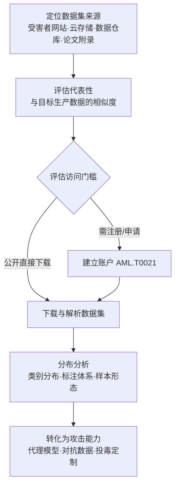

# 数据集 (AML.T0002.000)

> 属于 [获取公开 AI 制品 (AML.T0002)](../AML.T0002-Acquire-Public-AI-Artifacts.md)

## 一句话通俗理解

> 模型是大脑，数据集是喂养大脑的口粮——攻击者把你公开的数据集搬回家，就知道你的 AI"吃什么长大"、见过什么世面：不用碰你的系统，照着配一份"口粮"就能训出一个高仿大脑当靶子练手，还能专门设计你的模型最容易看走眼的样本。

## 难度等级

⭐⭐ **Demonstrated（已演示）**

官方成熟度评定为 Demonstrated——该技术已在多个真实安全研究中得到演示：Palo Alto Networks 团队凭相似公开数据集训练代理模型绕过恶意流量检测（AML.CS0000）、Brown University 用公开数据集赶在官方发布前复现 GPT-2（AML.CS0007）、研究团队审查 Web 规模数据集的 URL 构成并演示 split-view 投毒（AML.CS0025），都是直接见证。实施门槛本身很低：多数公开数据集下载即得；真正的"难度"在**判断代表性**——官方描述强调，受害者组织自己使用的数据集、或能代表其数据分布的公开数据集才有价值，这一步判断决定了后续代理模型与定制攻击的成败。部分数据集需要注册账户（AML.T0021）才能访问；托管在受害者自有基础设施上的数据集会让受害者看到"谁下载了什么"——这是防御方难得的可见性窗口。

## 技术描述

### 通俗解释

如果说父技术 [获取公开 AI 制品 (AML.T0002)](../AML.T0002-Acquire-Public-AI-Artifacts.md) 是把目标晒出来的"AI 底牌"统统搬回家，本子技术搬的是其中**最接地气的一类**：数据集。模型权重告诉你"大脑长什么样"，数据集告诉你"这个大脑吃过什么"——任务类型、数据形态、标注规则、类别分布，全写在数据里。

对攻击者而言，拿到目标的数据集等于同时回答三个问题：

| 问题 | 数据集给出的答案 | 攻击价值 |
|------|----------------|---------|
| AI 在做什么任务？ | 样本形态与标注体系（恶意 URL 检测？人脸识别？翻译？） | 锁定攻击面与绕过目标 |
| 数据长什么样？ | 类别分布、特征维度、模态（文本/图像/流量） | 定制"长得像自己人"的攻击样本 |
| 与生产数据多接近？ | 受害者自有数据集 = 生产数据的镜像；代表性公开数据集 = 高仿 | 决定代理模型演练的有效性 |

关键区别在于：**读论文只知道方法，拿数据集才有原料**。论文写"我们在恶意 URL 数据集上训练了 URLNet"，攻击者照做时还得自己找数据；而组织直接公开的数据集把最后一块拼图也递了过来——这正是本子技术归属资源开发（而非侦察）的原因：它不只是"看"，而是把数据**弄到手**，变成攻击的原料库。

### 技术原理

依据官方描述，攻击者收集公开数据集用于其攻击行动。受害者组织使用的数据集，或能代表其数据使用方式的公开数据集，对攻击者最有价值。数据集可存放于云存储或受害者自有网站；部分数据集要求攻击者先建立账户（AML.T0021）才能访问。获取的数据集帮助攻击者推进行动、暂存攻击并向受害者组织定制攻击。利用路径可归纳为四条：

1. **推断任务与数据分布**：统计类别平衡、特征空间、标注规则，还原目标 AI 系统的"任务画像"——后续对抗数据（AML.T0043）的构造从猜测变成照抄；
2. **训练代理模型**：代表性数据集 + 公开架构即可训出行为近似的高仿模型（配合兄弟子技术模型 AML.T0002.001 获取的权重文件效果更佳），离线迭代对抗样本与越狱提示词（参见 AML.T0005 思路）；
3. **定制投毒样本**：掌握目标数据分布后，投毒样本可以"混入人群"——与正常分布的偏差越小，越难被数据卫生检查剔除（与发布投毒数据集 AML.T0115.000 形成"获取—发布"镜像分工）；
4. **补齐复刻能力**：当目标扣留训练数据或模型时，公开数据集可作为替代原料——GPT-2 复制事件中，开源 ML 制品（含公开数据集）正是拼出"被扣留模型"的关键材料。

**与兄弟子技术的分工：**

| 子技术 | 获取对象 | 直接用途 | 与本子技术的互补 |
|--------|---------|---------|----------------|
| 数据集（本技术） | 训练/测试数据与标注 | 推断分布、训练代理、定制投毒 | 数据集补齐模型复刻的"原料" |
| 模型 (AML.T0002.001) | 架构配置与权重文件 | 直接演练对抗样本 | 权重 + 数据集 = 完整替身 |
| AI 智能体配置 (AML.T0002.002) | 提示词、工具配置、凭证 | 摸清能力边界、收割凭证 | 独立攻击面，不依赖训练 |

**平台覆盖**：Predictive AI（预测式 AI）/ Generative AI（生成式 AI）/ Agentic AI（智能体 AI）三类平台全部适用——任何以数据训练为基础的 AI 系统都在覆盖范围内。

### 用途影响

- **还原任务画像**：数据集直接暴露目标 AI 的任务类型、数据模态与标注规则，让攻击从"盲打"变成"按图索骥"；
- **支撑代理模型攻击**：代表性数据集让高仿替身的训练成本从"自建数据"骤降为"下载后微调"；
- **提升投毒隐蔽性**：贴近真实分布的投毒样本更难被统计检测发现；
- **获取路径几乎无痕**：第三方公共平台的数据集下载不产生任何目标侧日志；仅受害者自托管的下载行为可见；
- **波及数据合规**：若数据集含个人信息，攻击者的获取与滥用会叠加隐私风险。

## 攻击流程

### 典型攻击流程



**步骤详解：**

1. **定位数据集来源**
   - 通俗描述：找到目标把"口粮"囤在哪了。
   - 技术细节：经由搜索受害者自有网站（AML.T0003）与搜索开放技术数据库（AML.T0000）定位数据集入口——官网下载页、云存储桶、模型托管平台的数据集页、论文附带的数据链接；同时盘点 Kaggle、政府开放数据等平台中以组织名义发布的数据集。

2. **评估代表性**
   - 通俗描述：挑"最像目标家粮食"的那几份。
   - 技术细节：受害者自有数据集优先级最高（生产数据的镜像）；其次是与目标业务数据近似的公开数据集——比对模态、领域、时间跨度与标注体系，评估其能否支撑有效的代理模型演练。

3. **评估访问门槛并建立账户**
   - 通俗描述：免费的直接拿，要登记的先办"读者证"。
   - 技术细节：多数公开数据集匿名可下；要求注册（提交邮箱/姓名）、AWS 密钥或书面申请的数据集，攻击者先通过建立账户（AML.T0021）准备身份，注册信息还可能被反向用于社工。

4. **下载与解析数据集**
   - 通俗描述：搬回家，逐袋验货。
   - 技术细节：下载后做结构化解析——样本格式（CSV/JSON/图像/序列）、体积与条目数、随附的数据卡片（来源、构成、许可）；在隔离环境中解压与检查，防范数据集夹带恶意文件。

5. **转化为攻击能力**
   - 通俗描述：把口粮变成武器。
   - 技术细节：统计类别分布与特征空间，构造贴近分布的对抗数据（AML.T0043）；配合公开架构训练代理模型离线演练（AML.T0005 思路）；为投毒攻击计算"不触发分布告警"的注入比例与样本形态。

**与后续战术的衔接：**

- **前置·侦察**：搜索开放技术数据库（AML.T0000）与搜索受害者网站（AML.T0003）产出的"组织数据资产地图"正是本技术的输入
- **同战术·资源开发**：建立账户（AML.T0021）解决受限数据集的访问门槛；与发布投毒 AI 制品（AML.T0115）构成镜像——一个"拿数据"，一个"发数据"
- **后续·AI 攻击适配**：代理模型（AML.T0005）与对抗数据（AML.T0043）在此环节把数据集加工成攻击载荷

> 关键差异：传统资源开发囤的是通用弹药，本子技术囤的是**目标生产数据的镜像或高仿**——攻击者用你自己晒出的口粮，喂出一个专门用来打你的替身。

## 真实案例

> 以下 3 个案例均被官方数据直接标注本子技术 AML.T0002.000（官方共 6 个案例标注本子技术：AML.CS0000、AML.CS0005、AML.CS0007、AML.CS0012、AML.CS0014、AML.CS0025），源自 MITRE ATLAS 案例库。

### 案例1：凭相似公开数据集训练代理模型绕过恶意流量检测（AML.CS0000，AML.T0002.000）

- **时间**: 2018年前后
- **攻击者**: Palo Alto Networks Security AI 研究团队（安全验证研究）
- **手法**: 团队测试一个检测恶意软件 C&C HTTP 流量的深度学习模型。依据 Le 等人公开发表的 URLNet 论文（arXiv:1802.03162），获取相似数据集训练出一个与生产模型性能相当的复现模型，随后对复现模型迭代构造对抗样本——生成、查询、调整，循环往复直到成功绕过检测。
- **影响**: 完整演示"公开数据集 → 代理模型 → 对抗绕过"链路——攻击者全程未接触生产模型，"代表性数据集"的价值被直接验证
- **参考链接**: [URLNet 论文 (arXiv:1802.03162)](https://arxiv.org/abs/1802.03162)

### 案例2：GPT-2 复制——公开数据集拼出"被扣留的模型"（AML.CS0007，AML.T0002.000 / AML.T0002.001）

- **时间**: 2019年8月
- **攻击者**: Brown University 研究人员
- **手法**: OpenAI 担心 GPT-2 被滥用于冒充他人、生成假新闻与垃圾内容，采取分级发布策略：先放出较小模型与技术描述，扣留完整权重。Brown University 团队仅凭已发布的信息与开源 ML 制品——包括可替代训练数据的公开数据集——在官方放出完整模型之前成功复现出 GPT-2。
- **影响**: 证明"扣模型、放描述"的谨慎策略挡不住复现——公开数据集就是被扣留训练数据的平替原料，具备技术与算力的恶意行为者可赶在防御社区准备就绪前复制危险能力
- **参考链接**: [Wired 报道](https://www.wired.com/story/dangerous-ai-open-source/)、[OpenGPT-2 复现博文](https://blog.usejournal.com/opengpt-2-we-replicated-gpt-2-because-you-can-too-45e34e6d36dc)

### 案例3：Web 规模数据集 split-view 投毒——数据集本身也是攻击面（AML.CS0025，AML.T0002.000）

- **时间**: 2024年6月
- **攻击者**: Google DeepMind、ETH Zurich、NVIDIA、Robust Intelligence 与 Google 的联合研究团队
- **手法**: 许多大规模数据集以"URL 清单"形式分发——数据集本体是一堆指向外部资源的链接。研究团队审查 10 个流行 Web 规模数据集的 URL 构成（本子技术的获取动作），发现其中大量域名已过期且可购买：攻击者买下这些域名，即可在受害者**训练时拉取数据**的瞬间替换内容——采集时看到的是正常数据，训练时拿到的已是投毒数据（split-view 双重视角攻击，与发布投毒数据集 AML.T0115.000 形成呼应）。
- **影响**: 数据集的"双重身份"被揭示——既是本子技术的获取对象，也是投毒攻击的载体；"下载公开数据集"这个再正常不过的动作，本身可能就是被投毒的入口
- **参考链接**: [Poisoning Web-Scale Training Datasets is Practical (arXiv:2302.10149)](https://arxiv.org/pdf/2302.10149)

## 红队视角

> ⚠️ **免责声明**：以下内容仅用于合法授权的安全测试与教育目的。对第三方平台的访问须遵守其服务条款与速率限制，对目标组织的测试须有书面授权。

### 实战技巧

1. **数据集足迹盘点**
   以授权目标组织为对象，枚举其在模型托管平台的数据集页（版本历史、下载量、数据卡片）、官网下载入口、论文附带的数据链接与 Kaggle 等平台的名义发布物。产出"数据集—生产关联度"矩阵：生产同款、代表性、实验废料三级标注。

2. **代表性量化评估**
   对候选公开数据集与目标业务数据做分布比对（类别比例、特征维度、时间跨度、模态一致性），给出"代理模型有效性"预估——这是交付报告的核心价值：告诉客户哪些公开数据集能被用来演练打它的攻击。

3. **访问门槛验证**
   验证"需登记下载"的数据集门槛是否形同虚设：一次性邮箱能否注册、申请是否有身份核验、注册-下载间隔是否可缩短为零。这是与建立账户（AML.T0021）衔接的实战结合点。

4. **数据卡片情报提炼**
   数据卡片（来源、构成、许可、采集方式）是"不用下载就能拿到的情报"——先读卡片再决定是否下载，最小化在受害者自托管服务上留下的访问痕迹。

### 常用工具

| 工具名称 | 用途 | 平台 |
|----------|------|------|
| Hugging Face Hub（站点 + API） | 枚举组织名下数据集、版本与下载量 | 跨平台 |
| Kaggle（站点 + API） | 检索竞赛与公开数据集 | 跨平台 |
| Google Dataset Search | 按组织/主题发现散落各处的数据集 | 跨平台 |
| Papers with Code（Datasets 页） | 论文 ↔ 数据集关联检索 | 跨平台 |
| pandas / datasets 库 | 数据集分布统计与样本检查 | Python |

### 注意事项

- **授权边界**：对目标组织数据集的获取与分析仅限授权评估范围；第三方平台遵守服务条款，禁止批量爬取与转售
- **隔离解析**：数据集压缩包可能夹带恶意文件（案例3 从反面证明数据集即载体），一律在隔离虚拟机中解压检查
- **报告口径**：重点输出"哪些公开数据集可支撑针对客户的代理模型攻击与投毒定制"，为数据发布治理提供依据，而非演示攻击本身

## 蓝队视角

### 检测要点

1. **自托管数据集的访问监控（唯一可见窗口）**
   - 日志来源：官网下载服务、自有数据服务器、对象存储访问日志
   - 关注字段：访问者 IP/UA、注册账户信息、下载对象与体量
   - 异常特征：新注册账户随即批量下载、单一来源顺序遍历数据集目录、对历史版本数据的异常回溯请求

2. **公开平台不可见性（接受现实）**
   - 第三方平台的数据集下载不产生目标侧日志，与正常研究者行为无法区分
   - 结论：重心必须前移到**发布治理**（该不该公开）与**仿冒监控**（有没有人借组织名义发数据集）

3. **下游行为检测（攻击者用数据时露出的马脚）**
   - 日志来源：AI 服务遥测、API 网关、EDR
   - 异常特征：对生产 AI 端点"一发命中"的定向对抗输入（代理模型上预演过的攻击缺少试错过程）、单一来源规律性批量调用（代理模型校准特征）

### 监控建议

- **建立数据集公开台账**：登记组织已公开发布的全部数据集及其包含的分布信息，新发布前评估"这份数据能帮对手训出多像的替身"（对应缓解措施 AML.M0001）
- **自托管数据保留注册门槛 + 审计**：即便公开数据集也保留"谁在何时下载了什么"——官方描述确认这是受害者可见性所在
- **监控组织名义的新数据集**：用自动化看门狗盯住公共平台上冒用组织名义或与内部项目代号一致的数据集命名

## 检测建议

### 网络层检测

**检测方法：** 监控数据集下载与枚举流量的异常模式。

- 出口侧：非数据科学岗位主机对数据集存储域名（模型托管平台、Kaggle）的批量大体积下载
- 入口侧（自托管数据集）：单一 IP 对数据集目录的顺序遍历、新注册账户短时间拉取全部对象
- 云存储侧：对象存储的 ListObjects/GetObject 请求量激增，尤其是针对历史版本对象

### 主机层检测

**检测方法：** 监控开发终端上的数据集获取与外带行为。

- 命令行工具（`huggingface-cli download`、`kaggle datasets download`、脚本化下载器）在非工作时间的批量拉取
- 大体积数据集落盘后随即被压缩或上传外部网盘的"收集+外带"组合行为

### 应用层检测（AI 遥测）

**检测方法：** 利用托管平台审计能力与注册流程风控。

- 模型托管平台的组织审计日志：异常下载量、异常 API token 的全量枚举调用
- 注册流程风控：一次性邮箱、异常 UA 的批量注册（"先建号再搬运"路径）
- 自托管服务的账户基线：注册即下载、下载量远超同类账户的异常画像

**程序化检测思路（无需 EDR 侧改造）：**

在自托管数据集服务前置一层访问日志分析：按"账户/IP"维度统计单位时间内的目录枚举数与下载体量，超过同类账户基线即告警——正常研究者按需下载单个数据集，搜刮者按目录全量拉取，两者的访问形状差异显著。配合注册接口风控（邮箱域名信誉、注册-下载间隔），即可低成本覆盖本子技术最主要的两条获取路径。

### Sigma 规则思路示例

```yaml
title: 数据集存储桶遭新注册账户批量枚举与下载（公开数据集搜刮）
status: experimental
description: 检测新注册账户在短时间内对数据集存储桶执行高频
    列举与大体积对象下载，可能为公开数据集的批量获取
    （AML.T0002.000）
logsource:
    category: cloud_audit
    product: aws
    service: s3
detection:
    selection_listing:
        eventName:
            - ListBuckets
            - ListObjects
    selection_download:
        eventName: GetObject
    filter_internal:
        source_ip|cidr:
            - '10.0.0.0/8'
            - '172.16.0.0/12'
            - '192.168.0.0/16'
    condition: 1 of selection_* and not filter_internal
    timeframe: 10m
level: medium
tags:
    - attack.t1588
    - atlas.aml_t0002_000
```

> 说明：思路示例聚焦"新账户 + 列举 + 下载"的访问形状；生产化需按账户注册时长与同类账户基线增加聚合阈值（如注册 24 小时内 GetObject 超过 N 个大对象）。

## 缓解措施

### 优先级1：关键措施

**AML.M0001 限制模型制品发布（Limit Model Artifact Release）**

限制公开生产环境所用的（或能代表生产环境的）数据、算法、模型架构与模型检查点等技术项目细节——本子技术的官方直接映射缓解措施。数据集场景落地要点：区分"论文样例数据"与"生产级数据集"两级发布口径——论文可以给小规模演示子集，生产同款训练/测试数据不随附公开；确需开放的代表性数据集，先做脱敏、抽样、降采样处理，再评估残余部分还能支撑多逼真的代理模型演练。

### 优先级2：重要措施

**AML.M0000 限制公开技术信息发布（Limit Public Release of Information）**

限制对外发布组织 AI 技术栈的技术信息——继承自父技术 AML.T0002 的缓解映射。数据集场景的落地要点：数据集不单独评估，与论文、技术博客、组织信息**联动评审**——单看一份脱敏数据集无害，叠加技术描述与研究员信息即可拼出生产系统画像；同时限制可推断训练数据构成的组织公开信息（数据来源合作方、采集渠道描述）。

### MITRE ATLAS 缓解措施映射

| 缓解措施ID | 缓解措施名称 | 优先级 | 映射来源 | 生命周期阶段 |
|------------|-------------|:------:|----------|-------------|
| AML.M0001 | 限制模型制品发布 | 关键 | 官方直接映射 AML.T0002.000 | 业务与数据理解 · 部署 |
| AML.M0000 | 限制公开技术信息发布 | 重要 | 继承自父技术 AML.T0002 | 业务与数据理解 |

> 双层逻辑：M0001 管"数据集本身发不发、发多大"（收缩原料面，治本），M0000 管"围绕数据集的上下文信息发不发"（防止拼图式画像）。消费侧可参照 AML.M0014（验证 AI 制品，官方仅映射至模型子技术 AML.T0002.001）的思路，对组织下载的公开数据集做哈希登记——防范案例3 那类"下载瞬间被调包"的供给端篡改。

## 关联 ATT&CK 技术

官方数据中本子技术的 attack_reference 为空——获取公开数据集是 ATLAS 独有的技术：传统 ATT&CK 中不存在"数据集"这一攻击对象类别。以下为同一攻击逻辑在传统矩阵中的主题类比：

- [搜索受害者网站 (T1594)](../../../enterprise/01-Reconnaissance/T1594-Search-Victim-Owned-Websites.md) — 官方描述点名数据集常"存放于受害者自有网站"——翻目标官网找数据集入口正是 T1594 的 AI 延伸
- [获取能力 (T1588)](../../../enterprise/02-Resource-Development/T1588-Obtain-Capabilities.md) — 同属资源开发战术的"获取"逻辑：T1588 获取通用能力（漏洞利用、工具），本子技术获取**针对目标的原料**
- [建立账户 (T1585)](../../../enterprise/02-Resource-Development/T1585-Establish-Accounts.md) — 对应官方描述"部分数据集需要建立账户才能访问"的环节（AML.T0021）

**传统获取 vs 获取公开数据集：**

| 维度 | 获取能力 (T1588) | 获取公开数据集 (AML.T0002.000) |
|------|-----------------|------------------------------|
| 获取对象 | 漏洞利用、工具、证书等通用能力 | 目标组织的训练/测试数据或代表性公开数据集 |
| 定制程度 | 通用弹药，需自行适配目标 | 天然针对目标——数据分布即生产数据的镜像或高仿 |
| 主要用途 | 武装攻击工具链 | 推断分布、训练代理模型、定制投毒 |
| 独有风险 | — | 分布泄露让对抗样本与投毒样本"一次成型" |

一句话总结：T1588 是"去黑市买通用武器"，AML.T0002.000 是"把目标自己晒出来的口粮搬回家，喂出一个专门打它的替身"。

## 动手实验

> ⚠️ **重要提示**：所有实验仅使用公开资源，对象限定为自有组织或已获授权的组织；下载的数据集一律在隔离虚拟机中解压与检查。

### 实验环境准备

| 环境组件 | 用途 | 获取方式 |
|----------|------|----------|
| 浏览器 + 互联网 | 数据集检索与盘点 | — |
| Python 3.10+ + pandas | 分布统计分析 | 官方安装包 |
| 隔离 Linux 虚拟机 | 数据集解压与检查 | 本地虚拟化平台 |
| 一个模型托管平台账号 | 数据集枚举与下载 API | 平台注册 |

### 实验1（初级）：盘点自有组织的数据集足迹

**实验目标：** 以攻击者视角盘点自己（或授权客户）组织的数据集暴露面（对应 AML.M0001 的评估输入）。

**实验步骤：**
1. 检索模型托管平台组织页面的全部数据集，登记版本、体量、下载要求
2. 检查官网下载入口与已发表论文附带的数据链接
3. 逐项标注：是否生产同款、暴露了什么分布信息、下载是否需要登记
4. 换位思考：若你是攻击者，清单里哪份数据集训出的替身最危险？

**预期结果：** 产出一份带"生产关联度"标注的数据集暴露面清单。

### 实验2（中级）：公开数据集代表性分析

**实验目标：** 掌握"评估数据集能否充当攻击原料"的分析方法（对应案例1 思路）。

**实验步骤：**
1. 下载一个与安全检测相关的公开分类数据集（如恶意 URL/域名类）
2. 用 pandas 统计类别分布、特征维度、标注体系与样本形态
3. 评估：若目标是某安全厂商的检测模型，这份数据的代表性如何？能训出多近的代理？
4. 阅读其数据卡片，提炼"不下载也能获得"的情报量

**预期结果：** 能仅凭数据集本体与卡片，还原出目标任务画像并给出代表性评级。

### 实验3（高级）：复现"公开数据集 → 代理模型 → 对抗绕过"链路

**实验目标：** 亲测"代表性数据集 = 代理模型攻击的原料"（对应案例1 的完整链路）。

**实验步骤：**
1. 参照 URLNet 思路，用公开恶意 URL 数据集在隔离环境训练一个小型分类器
2. 验证模型性能进入合理区间后，对样本做字符级扰动生成对抗变体
3. 迭代扰动直到模型误分类，记录成功所需的扰动幅度
4. 对照思考：若这是目标生产模型的影子，攻击者刚完成一次零接触的离线彩排

**预期结果：** 直观理解数据集代表性带来的攻击距离，为组织的数据发布评审提供量化依据。

## 术语解释

| 术语 | 英文原名 | 通俗解释 |
|------|----------|----------|
| 数据集 | Dataset | 喂给模型学习的样本集合——AI 的"教材与考卷"，本子技术的核心获取对象 |
| 代表性数据集 | Representative Dataset | 分布与目标生产数据近似的公开数据集——代理模型攻击的核心原料 |
| 数据分布 | Data Distribution | 数据在类别、特征、模态上的统计形态——攻击者定制样本的"参照系" |
| 标注体系 | Label Schema | 数据集的类别定义与打标规则——直接暴露目标 AI 的任务画像 |
| 数据卡片 | Dataset Card | 数据集随附的说明文档（来源、构成、许可）——不下载就能拿到的情报 |
| 代理模型 | Proxy Model | 攻击者用代表性数据集训练的"高仿模型"，用于离线演练攻击而不惊动目标 |
| 对抗数据 | Adversarial Data | 经精心扰动、专门让模型出错的输入，可从代理模型迁移至真实目标 |
| 模仿攻击 | Imitation Attack | 用公开端点与数据训练出功能近似的复刻模型，实现对黑盒系统的功能性窃取 |
| Split-View 投毒 | Split-View Poisoning | 利用"采集时"与"训练时"看到不同数据的窗口差异实施的数据投毒（案例3） |
| Web 规模数据集 | Web-scale Dataset | 以 URL 清单形式分发的超大规模数据集——split-view 攻击的载体 |
| 建立账户 | Establish Accounts | 注册服务账号以跨越"需登记"的数据集访问门槛（AML.T0021） |
| 分级发布 | Tiered Release | 像 OpenAI 对 GPT-2 那样先放小模型、扣留完整权重的发布策略 |

## 参考资料

### 📚 官方文档

- [MITRE ATLAS - Datasets (AML.T0002.000)](https://atlas.mitre.org/techniques/AML.T0002/000/) - 官方技术页面
- [MITRE ATLAS 矩阵](https://atlas.mitre.org/matrices/ATLAS/)
- [MITRE ATLAS Data (GitHub)](https://github.com/mitre-atlas/atlas-data)

### 📰 案例报告（真实攻击与安全研究）

- [URLNet 论文 (arXiv:1802.03162)](https://arxiv.org/abs/1802.03162) - 案例1：相似公开数据集训练代理模型的原始论文
- [Wired: OpenAI Said Its Code Was Risky. Two Grads Re-Created It Anyway](https://www.wired.com/story/dangerous-ai-open-source/) - 案例2：GPT-2 复制事件报道
- [OpenGPT-2 复现博文](https://blog.usejournal.com/opengpt-2-we-replicated-gpt-2-because-you-can-too-45e34e6d36dc) - 案例2：公开制品复现过程的第一手记录
- [Poisoning Web-Scale Training Datasets is Practical (arXiv:2302.10149)](https://arxiv.org/pdf/2302.10149) - 案例3：split-view 数据集投毒研究

### 🔧 工具与资源

- [Hugging Face Datasets 文档](https://huggingface.co/docs/datasets/index) - 模型托管平台的数据集枚举与下载接口
- [Kaggle](https://www.kaggle.com/) - 公开与竞赛数据集集散地
- [Google Dataset Search](https://datasetsearch.research.google.com/) - 按组织/主题发现散落数据集的专用检索
- [Papers with Code - Datasets](https://paperswithcode.com/datasets) - 论文与数据集的关联检索

### 🔗 关联阅读

- [获取公开 AI 制品 (AML.T0002)](../AML.T0002-Acquire-Public-AI-Artifacts.md) - 本技术的父技术，三类 AI 制品全景
- [发布投毒 AI 制品 (AML.T0115)](../AML.T0115-Publish-Poisoned-AI-Artifacts.md) - 镜像对照：本子技术"获取"数据集，AML.T0115.000"发布"投毒数据集
- [获取能力 (T1588)](../../../enterprise/02-Resource-Development/T1588-Obtain-Capabilities.md) - 传统资源开发中同属"获取"逻辑的技术
- [资源开发战术 (AML.TA0003)](../README.md) - 本技术所属战术的概览页

---

> **版本**: ATLAS 2026.09 | **更新**: 2026-10-22 | **模板**: ATLAS 技术文档 v1.0
