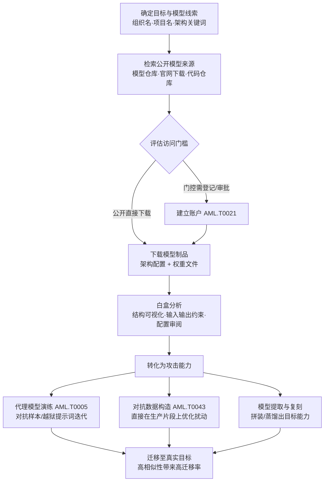

# 模型 (AML.T0002.001)

> 属于 [获取公开 AI 制品 (AML.T0002)](../AML.T0002-Acquire-Public-AI-Artifacts.md)

## 一句话通俗理解

> 数据集泄露的是"你喂了什么料"，模型泄露的是"练出来的大脑本体"——组织把预训练模型挂上公共仓库，等于一行下载命令就把多年训练成果拱手送人。攻击者把你家大脑搬回家，在自家电脑上打一万遍，练出的招数再拿去打你的生产系统，全程不惊动你一次。

## 难度等级

⭐⭐ **Demonstrated（已演示）**

官方成熟度评定为 Demonstrated——该技术已在多个真实安全研究中演示：布朗大学研究人员凭公开模型制品复刻出 OpenAI 扣留的完整 GPT-2（AML.CS0007）；UC Berkeley 用公开端点与公开制品构建接近生产水准的复刻翻译系统，并让对抗样本成功迁移到真实服务（AML.CS0005）；微软研究院从移动应用中获取部署模型并演示后门攻击（AML.CS0013）。实施门槛极低：主流模型仓库免费开放、标准格式工具链齐全，"获取"动作与正常开发者下载模型完全无法区分。真正的难度不在下载本身，而在**判断获取的模型与目标生产环境的关联度**——官方描述强调，攻击者最想要的是目标组织使用的、或能代表其生产环境的模型。注：父技术 AML.T0002 官方评定为 Realized（⭐⭐⭐），本子技术按官方数据为 Demonstrated（⭐⭐）。

## 技术描述

### 通俗解释

如果说父技术 [获取公开 AI 制品 (AML.T0002)](../AML.T0002-Acquire-Public-AI-Artifacts.md) 是搬空目标的"AI 公开仓库"，本子技术搬的是其中**最值钱的一格：模型本体**。组织出于开源声誉、学术复现或产品演示，把预训练模型连同架构配置一起挂上公共仓库——本意是展示，实际效果是把自己辛苦训练出的判断力完整交给了全世界。

对攻击者而言，拿到模型绝不只是拿到一个文件，而是同时得到三样东西：

| 拿到什么 | 意味着什么 |
|---------|-----------|
| 一个白盒 | 架构、权重、输入输出约束全部可见——攻击从"黑盒盲打"升级为"白盒透视" |
| 一座靶场 | 在自己家里对它无限次试探迭代，目标侧零交互、零日志 |
| 一张底版 | 可直接部署、微调改造，或拼装复刻出更大的能力 |

### 技术原理

依据官方描述，攻击者获取公开模型用于其攻击行动，重点关注两类对象：**目标组织使用的模型**，或**能代表其生产环境的模型**——后者包括模型架构（常见以 YAML 或 Python 配置文件形式发布），以及预训练模型（定义了架构并携带在数据集上训练所得的参数）。攻击者会在公开来源中检索这些常见的模型文件格式：

| 文件格式 | 扩展名 | 所属生态 | 攻击者眼中的价值 |
|---------|--------|---------|----------------|
| ONNX | `.onnx` | 跨框架交换标准 | 跨部署通吃，白盒分析友好 |
| HDF5 | `.h5` | Keras / TensorFlow | 结构与权重一体交付 |
| Pickle | `.pkl` | scikit-learn / 通用序列化 | 加载即可执行任意代码——既是分析对象也是风险源 |
| PyTorch | `.pth` | PyTorch | 权重与优化状态完整 |
| TensorFlow | `.pb` / `.tflite` | TF 服务端 / 移动端 | `.tflite` 常内嵌于移动 App，可逆向提取 |

官方描述点明的利用路径可归纳为四条：

1. **定位与获取**：经由侦察阶段产出的组织 AI 资产地图（搜索受害者网站 AML.T0003、搜索开放技术数据库 AML.T0000），在模型仓库、官网下载入口与代码仓库中锁定目标模型；部分模型需要注册登记甚至审批，攻击者先建立账户（AML.T0021）再行获取；
2. **白盒透视**：加载模型即可见完整架构、权重分布与输入输出约束，直接分析决策逻辑与脆弱点，无需向目标系统发送任何查询；
3. **定制攻击（tailor attacks to the victim model）**：官方明确指出获取的模型常被用于"定制针对受害者模型的攻击"——以原厂模型充当代理模型（AML.T0005）离线迭代对抗样本与越狱提示词；若制品包含生产模型的实际组成部分，则可直接在其上构造对抗数据（AML.T0043）；
4. **模型提取与复刻**：公开模型搭配公开数据即可拼装复刻出被扣留或未公开的能力（GPT-2 复现），或以公开端点蒸馏出功能近似的复刻模型（模仿攻击）——知识产权与能力同时失守。

**与兄弟子技术的分工**：数据集（AML.T0002.000）泄露"喂了什么料"，智能体配置（AML.T0002.002）泄露"大脑外挂了哪些手脚"，模型（AML.T0002.001）直接交出"大脑本体"。数据集加模型配合使用，攻击者甚至能完整复现目标的训练管线。

**平台覆盖**：Predictive AI（预测式 AI）/ Generative AI（生成式 AI）/ Agentic AI（智能体 AI）三类平台全部适用——模型是所有 AI 平台的公共组件，只要在公开渠道发布即成靶。

### 用途影响

- **黑盒变白盒**：模型架构与权重直接暴露决策逻辑，攻击者省去大量查询与猜测，攻击准备从"试错"变成"照图施工"；
- **原厂靶场**：获取的模型即目标同款或高仿替身，对抗样本与越狱提示词可在离线环境无限次迭代，且天然具备向生产模型迁移的相似性；
- **直取生产片段**：若制品含生产模型组成部分，攻击者可绕过黑盒限制直接构造对抗数据；
- **能力与知识产权失窃**：公开制品可拼装复刻被扣留的模型能力，或复刻商业服务功能，构成"功能性窃取"；
- **全程合法外观**：下载公开模型与正常开发行为无异，第三方平台上受害者几乎无法感知谁获取了什么。

## 攻击流程

### 典型攻击流程



**步骤详解：**

1. **确定目标与模型线索**
   - 通俗描述：弄清楚要搬谁家的大脑，从哪儿搬。
   - 技术细节：以侦察阶段（AML.T0000 / AML.T0003）产出的组织 AI 资产地图为输入，锁定目标组织名、项目代号、论文中披露的架构名称；同时收集目标公开服务的行为特征（API 响应、置信度分布），供后续"关联度验证"使用。

2. **检索公开模型来源**
   - 通俗描述：找到模型挂在哪个货架。
   - 技术细节：遍历模型托管平台的组织页面（模型清单、版本历史、下载量、门控状态）、官网下载入口与代码仓库；对目标未直接发布的架构，检索同名或同构的代表性开源模型。

3. **评估访问门槛并获取**
   - 通俗描述：免费直接拿，要登记的先办"读者证"。
   - 技术细节：多数模型可匿名下载；门控模型（需注册、提交用途说明或审批）通过建立账户（AML.T0021）跨越门槛；下载范围覆盖架构配置（YAML/Python）与权重文件（`.onnx`/`.h5`/`.pkl`/`.pth`/`.pb`/`.tflite`），并保留版本历史以便比对。

4. **白盒分析**
   - 通俗描述：搬回家，拆开看。
   - 技术细节：用可视化工具查看架构与输入输出约束，审阅随模型发布的配置文件与 tokenizer 信息，还原任务类型与部署形态；与目标线上服务的行为特征比对，判定该模型是"生产同款""高仿代表"还是"无关废料"——这一判定直接决定攻击演练的有效性。

5. **转化为攻击能力并迁移**
   - 通俗描述：把大脑变成武器，再拿去打真身。
   - 技术细节：以其为代理模型（AML.T0005）离线迭代对抗样本或越狱提示词；含生产模型片段时直接构造对抗数据（AML.T0043）；或将其拼装、蒸馏为复刻能力（模型提取）。由于架构相同或相近，练出的攻击对生产模型具有天然迁移性。

**与后续战术的衔接：**

- **前置·侦察**：搜索开放技术数据库（AML.T0000）与搜索受害者网站（AML.T0003）产出的模型线索是本技术的直接输入
- **同战术·资源开发**：门控模型获取依赖建立账户（AML.T0021）；获取能力（AML.T0016）的攻击工具库负责把模型"加工"成武器
- **后续·AI 攻击适配**：代理模型（AML.T0005）与对抗数据（AML.T0043）在此环节完成"原料→弹药"的转化
- **后续·初始访问**：复刻模型与收割的凭证配合，可支撑对目标系统的进一步入侵

> 关键差异：拿到数据集只能"猜"模型的行为，拿到模型本体则是"原厂实弹"——攻击者的靶场从复刻品升级为目标同款，练出的每一招都天生带着迁移性。

## 真实案例

> 以下 3 个案例在官方数据中均直接关联本子技术 AML.T0002.001，源自 MITRE ATLAS 案例库。

### 案例1：GPT-2 复现——公开模型制品拼出被扣留的完整能力（AML.CS0007）

- **时间**: 2019年8月
- **攻击者**: 布朗大学研究人员
- **手法**: OpenAI 担心 GPT-2 被滥用于冒充他人、生成假新闻，采取分级发布策略：只放出较小的模型与技术描述，扣留完整训练权重。布朗大学团队仅凭 OpenAI 已公开的模型制品与开源 ML 制品（公开模型组件与数据集），在官方放出完整模型之前成功复制出同等能力。
- **影响**: 证明"扣住权重、放出部分制品"的策略挡不住复现——具备足够技术与算力的恶意行为者，可以赶在防御社区准备好之前，用公开制品拼出被扣留的强大模型
- **参考链接**: [Wired 报道](https://www.wired.com/story/dangerous-ai-open-source/)、[OpenGPT-2 复现过程博客](https://blog.usejournal.com/opengpt-2-we-replicated-gpt-2-because-you-can-too-45e34e6d36dc)

### 案例2：机器翻译服务模仿攻击——公开制品复刻生产系统并迁移对抗样本（AML.CS0005）

- **时间**: 2020年4月
- **攻击者**: UC Berkeley AI 研究团队
- **手法**: Google 翻译、Bing 翻译、Systran 等服务提供公开界面与 API。研究团队利用这些公开端点配合公开制品，构建出接近生产水准的复刻模型（模仿攻击）；随后在复刻模型上构造对抗样本，并成功迁移到真实生产服务——在 Google 翻译与 Systran 网站上造成定向词语替换、输出粗俗内容、整句丢失等效果。
- **影响**: 完整演示"获取公开制品 → 搭建复刻模型 → 离线演练 → 迁移打真身"的攻击链，证明黑盒系统的功能可被窃取、复刻模型是对抗样本的理想演练场
- **参考链接**: [论文 (arXiv:2004.15015)](https://arxiv.org/abs/2004.15015)、[项目页面](https://www.ericswallace.com/imitation)

### 案例3：移动应用深度学习模型后门——从应用商店获取部署模型实施定向攻击（AML.CS0013）

- **时间**: 2021年1月
- **攻击者**: 微软研究院等机构研究人员
- **手法**: 深度学习模型已成为移动应用的关键组件。研究人员从 Google Play 收集真实应用并获取其中部署的模型，演示了通过"神经载荷注入"（Neural Payload Injection）对深度学习模型植入后门的攻击——在含现金识别、家长控制、人脸认证与金融服务的应用中，识别出 54 个可被攻击的目标。
- **影响**: 证明随应用分发的模型本身就是可被获取与定向攻击的对象——攻击者拿到的是"受害者实际部署的模型"，其后门攻击天然针对生产环境
- **参考链接**: [DeepPayload 论文 (arXiv:2101.06896)](https://arxiv.org/abs/2101.06896)

## 红队视角

> ⚠️ **免责声明**：以下内容仅用于合法授权的安全测试与教育目的。公开不等于可以随意滥用——对第三方平台与仓库的访问须遵守其服务条款，对目标组织的测试须有书面授权。

### 实战技巧

1. **组织模型足迹盘点**
   以授权目标组织为对象，枚举其在模型托管平台的组织页面：模型清单、版本历史、下载量、门控状态与发布格式；检索官网下载入口与代码仓库中的架构配置文件（YAML/Python）。产出"模型—生产关联度"矩阵：生产同款、代表性模型、实验废料三级标注。

2. **模型关联度验证**
   获取候选模型后，将其行为特征（输出分布、置信度、典型输入的响应）与目标公开服务比对，判定能否充当该服务的"演练替身"——这决定后续对抗样本演练对生产环境的参考价值，是交付报告的核心结论。

3. **白盒分析流水线**
   用 Netron 查看架构与输入输出约束，审阅随模型发布的配置与 tokenizer，还原任务类型与部署形态；对 Pickle 系格式一律先做静态扫描再考虑加载，全程在隔离虚拟机中执行。

4. **代理模型演练**
   在确认关联度的模型上迭代对抗样本或越狱提示词，记录攻击成功率与扰动幅度；对照案例2，评估练出的攻击对目标线上服务的可迁移性——红队报告中以"可利用性评估"口径呈现，不必对第三方系统实际发起攻击。

### 常用工具

| 工具名称 | 用途 | 平台 |
|----------|------|------|
| 模型托管平台组织页 / API | 枚举组织名下模型、版本与门控状态 | 跨平台 |
| huggingface-cli / Git | 模型下载与仓库克隆 | 跨平台 |
| Netron | 多格式模型结构可视化 | 跨平台 |
| picklescan / modelscan | 序列化模型文件的载荷静态扫描 | 跨平台 |
| GitHub 代码搜索 | 检索目标架构配置文件与模型泄露 | 跨平台 |

### 注意事项

- **授权边界**：对目标组织制品的分析仅限授权评估范围；对第三方公共平台遵守服务条款与速率限制，禁止批量爬取
- **隔离加载**：Pickle 等序列化格式在加载时可执行任意代码，下载的模型文件一律在隔离虚拟机中分析，禁止在生产环境直接加载
- **报告口径**：重点输出"组织公开发布的模型暴露了什么、与生产关联多深、能充当多好的攻击替身"，为发布治理提供依据，而非演示攻击本身

## 蓝队视角

### 检测要点

1. **接受现实：第三方平台上的获取不可检测**
   - 模型托管在第三方公共平台时，任何人下载都不产生受害者侧日志，与正常开发者行为无法区分
   - 结论：检测重心必须放在**自托管渠道的访问监控**与**下游利用行为的捕获**

2. **自托管模型服务监控**
   - 日志来源：官网下载服务、自有制品服务器、模型仓库访问日志
   - 关注字段：访问者 IP/UA、注册账户信息、下载对象与体量
   - 异常特征：新注册账户随即批量下载权重文件、单一来源按目录顺序遍历全部模型、非工作时间的脚本化拉取

3. **下游行为检测（攻击者用模型时露出的马脚）**
   - 日志来源：生产 AI 服务遥测、Web/API 访问日志
   - 异常特征：对生产 AI 端点"一发命中"式的定向对抗输入（缺少盲打试错过程）、置信度分布突发漂移——获取原厂模型的攻击者练过的招，拿到战场上往往直接见效
   - 详见检测建议

### 监控建议

- 建立**公开模型台账**：登记组织已公开发布的全部模型及格式，每次发布前评估"该模型与生产同款还是代表生产"——生产同款权重列最高敏感级（对应缓解措施 AML.M0001）
- 对外发布的模型附**加密校验和**：让下游用户能验证文件未被"调包"（对应缓解措施 AML.M0014）
- 自托管模型服务启用**注册门槛 + 访问审计**：保留"谁在什么时候下载了什么"的日志——官方描述确认这是受害者可见性的所在
- 用**自动化看门狗**监控公共平台上组织名义的新模型与相似命名，纳入品牌保护类告警

## 检测建议

### 网络层检测

**检测方法：** 监控模型文件的下载流量形状。

- 出口侧：非数据科学岗位主机对模型仓库域名的批量大文件下载（模型权重通常数十 MB 至数 GB，流量特征显著）
- 入口侧（自托管制品）：单一 IP 对模型目录的顺序遍历、新注册账户短时间内拉取全部权重文件
- 云存储侧：对象存储的 ListObjects/GetObject 请求量激增，且针对大体积对象

### 主机层检测

**检测方法：** 监控开发终端上的模型获取与外带行为。

- 命令行工具（`huggingface-cli`、`git clone`、脚本化下载器）在非数据科学主机上的批量模型拉取
- 模型权重文件（`.onnx`/`.pth`/`.h5`/`.pkl`）落盘后随即被压缩或上传外部网盘的"收集+外带"组合行为
- 对抗样本生成类 Python 库的异常安装与调用记录

### 应用层检测（AI 遥测）

**检测方法：** 监控生产 AI 服务的输入分布与置信度异常。

- 输入样本置信度分布的突发漂移（在获取的原厂模型上优化过的对抗样本，迁移到生产模型时"直接命中"的典型信号）
- 同一来源短时间提交大量语义相近但字符级/像素级微调的输入（对抗样本迭代特征）
- 缺少试错过程的定向攻击输入——原厂模型演练过的攻击者不需要盲打

**程序化检测思路（无需 EDR 侧改造）：**

在自托管制品服务与生产 AI 端点各加一个定时任务：① 按"账户/IP"维度统计模型文件的下载次数与体量，超过基线即告警（正常研究者按需下载单个模型，搜刮者按组织全量搬运，访问形状差异显著）；② 对生产 AI 端点的输入做置信度漂移检测，滑动窗口内均值骤降即触发调查。两端配合，覆盖"模型被搬走 → 攻击落地"的完整窗口。

### Sigma 规则思路示例

```yaml
title: 非数据科学主机批量下载模型权重文件（公开模型获取行为）
status: experimental
description: 检测非数据科学角色的主机通过命令行工具批量拉取模型权重
    （.onnx/.pth/.h5/.pkl/.tflite），可能为针对本组织公开模型的
    搜刮与搬运（AML.T0002.001）
logsource:
    category: process_creation
    product: windows
detection:
    selection_cli:
        CommandLine|contains:
            - 'huggingface-cli'
            - 'git clone'
    selection_model_ext:
        CommandLine|contains:
            - '.onnx'
            - '.pth'
            - '.h5'
            - '.pkl'
            - '.tflite'
    filter_datascience:
        Image|startswith: 'C:\DS\tools'
    condition: all of selection_* and not filter_datascience
level: low
tags:
    - attack.t1588
    - atlas.aml_t0002_001
```

> 说明：下载公开模型本身是合法行为，单条告警价值有限；本规则的定位是"角色错位"信号——非数据科学主机出现模型搬运，供与压缩外传、对抗样本工具安装等行为做关联分析时加权。

## 缓解措施

> 本子技术在官方数据中直接映射两项缓解措施（AML.M0001 / AML.M0014），父技术映射的 AML.M0000 可作发布治理参照。

### 优先级1：关键措施

**AML.M0001 限制模型制品发布（Limit Model Artifact Release）**

限制公开生产环境所用的、或能代表生产环境的数据、算法、模型架构与模型检查点等技术项目细节。落地要点：模型发布前过安全评审，逐项回答"该模型与生产环境的关联度"；生产同款权重与检查点不随附公开；确需开放的代表性制品，评估其能否被直接当作攻击演练的替身。对本子技术而言这是治本之策——**发布面收敛一分，攻击者的原厂靶场就少一座**。

### 优先级2：重要措施

**AML.M0014 验证 AI 制品（Verify AI Artifacts）**

对所有 AI 制品校验加密校验和，确认文件未被攻击者篡改。该措施在发布侧与消费侧双向成立：发布方随模型公布校验和，下游用户即可发现被"照牌"或"调包"的制品；组织内部获取公开模型时执行哈希登记，确保"演练分析的对象确实是目标发布的原版"——否则代理模型演练会建立在被误导的基础上。

### MITRE ATLAS 缓解措施映射

| 缓解措施ID | 缓解措施名称 | 优先级 | 映射来源 | 类别 | 生命周期阶段 |
|------------|-------------|:------:|----------|------|-------------|
| AML.M0001 | 限制模型制品发布 | 关键 | 本子技术直接映射 | Policy | 业务与数据理解 · 部署 |
| AML.M0014 | 验证 AI 制品 | 重要 | 本子技术直接映射 | Technical - Cyber | 业务与数据理解 · 数据准备 · AI 模型工程 |
| AML.M0000 | 限制公开技术信息发布 | 参考 | 继承自主技术 AML.T0002 | Policy | 业务与数据理解 |

> 双向逻辑：M0001 解决"该不该把大脑挂上网"（源头治理，治本），M0014 解决"挂上网和搬回家的还是不是同一个大脑"（完整性保障，治标）。

## 关联 ATT&CK 技术

官方数据中本子技术**没有 attack_reference 映射**——"获取与目标关联的公开模型"在传统 ATT&CK 中没有对应的对象类别。以下为同一攻击逻辑在传统矩阵中的主题类比：

- [获取能力 (T1588)](../../../enterprise/02-Resource-Development/T1588-Obtain-Capabilities.md) — 同属资源开发战术的"获取"逻辑：下载/购买现成能力用于攻击。区别在于 T1588 获取的是通用能力（漏洞利用、工具），本子技术获取的是**与目标生产环境关联的模型本体**
- [搜索开放技术数据库 (T1596)](../../../enterprise/01-Reconnaissance/T1596-Search-Open-Technical-Databases.md) — 模型仓库正是"开放技术数据库"在 AI 时代的延伸：按组织名检索即可定位目标发布的模型制品
- [建立账户 (T1585)](../../../enterprise/02-Resource-Development/T1585-Establish-Accounts.md) — 对应门控模型的获取门槛：需注册登记或审批的模型，攻击者需先建立账户（AML.T0021）再行下载

**传统获取 vs 获取公开模型：**

| 维度 | 获取能力 (T1588) | 获取公开模型 (AML.T0002.001) |
|------|-----------------|---------------------------|
| 获取对象 | 漏洞利用、工具、证书等通用能力 | 目标组织发布/关联的模型架构与权重 |
| 定制程度 | 通用弹药，需自行适配目标 | **天然针对目标**——即生产模型本体或其代表 |
| 分析深度 | 拿来即用，黑盒使用 | 白盒透视 + 离线无限次演练 |
| 主要用途 | 武装攻击工具链 | 代理模型、对抗样本、模型提取与复刻 |

一句话总结：T1588 是"去黑市买通用武器"，AML.T0002.001 是"把目标自己晒出来的大脑搬回家"——不仅免费，还天生就是为打目标而准备的。

## 动手实验

> ⚠️ **重要提示**：所有实验以**自有组织或公开教学资源**为对象，遵守平台服务条款；下载的模型文件一律在隔离虚拟机中分析，禁止在宿主机直接加载执行。

### 实验环境准备

| 环境组件 | 用途 | 获取方式 |
|----------|------|----------|
| 隔离 Linux 虚拟机 | 模型下载与分析（防序列化载荷） | 本地虚拟化平台 |
| Python 3.10+ | 运行分析脚本 | 官方安装包 |
| Netron | 模型架构可视化 | pip / 官方 release |
| picklescan | 序列化载荷静态扫描 | pip |

### 实验1（初级）：盘点自有组织的公开模型暴露面

**实验目标：** 以攻击者视角盘点自己（或授权客户）组织的模型发布足迹（对应 AML.M0001 评估输入）。

**实验步骤：**
1. 用模型托管平台的组织页面/API，枚举自有组织名下全部模型
2. 逐项标注：发布格式（`.onnx`/`.pth`/`.pkl`…）、是否含权重文件、是否门控、版本历史
3. 为每个模型标注"生产关联度"：生产同款 / 代表性模型 / 实验废料
4. 换位思考：若你是攻击者，哪个模型是搭建"演练替身"的最佳原料？为什么？

**预期结果：** 产出一份带生产关联度标注的模型暴露面清单，多数组织会在"生产同款"一栏发现意外条目。

### 实验2（中级）：公开模型白盒分析

**实验目标：** 掌握获取模型后的基础分析流程，体会"一个文件泄露多少情报"。

**实验步骤：**
1. 下载一个小型公开模型（选 ONNX 或 PyTorch 格式），先用 picklescan 做载荷扫描
2. 用 Netron 查看架构、层结构与输入输出约束
3. 审阅随模型发布的配置文件与 tokenizer 信息，还原其任务类型与部署形态
4. 对照公开服务行为（如有）：仅凭制品本身，你能推断出哪些部署细节？

**预期结果：** 仅凭制品即能还原模型的任务、架构与部署线索——直观理解"模型本体=完整情报"。

### 实验3（高级）：代理模型演练与对抗样本迁移

**实验目标：** 亲测"获取模型 → 离线演练 → 迁移打真身"链路（对应案例2思路）。

**实验步骤：**
1. 下载两个架构相近的公开图像分类模型，一个充当"目标"，一个充当"代理"
2. 在代理模型上用 FGSM 等算法生成对抗样本，记录扰动幅度与攻击成功率
3. 将同一批对抗样本送入"目标"模型，统计迁移攻击成功率
4. 对照案例2：攻击者拿到的是目标同款或高仿模型时，这个迁移率意味着什么？

**预期结果：** 量化见证架构相似性带来的攻击迁移性，为组织的模型发布策略提供"能当多好的替身"的评估依据。

## 术语解释

| 术语 | 英文原名 | 通俗解释 |
|------|----------|----------|
| 模型权重 | Model Weights | 训练学到的参数，模型的"大脑切片"——权重到手，判断力到手 |
| 模型架构 | Model Architecture | 模型的"骨架图纸"——层结构与连接方式，常以 YAML/Python 配置发布 |
| 模型检查点 | Model Checkpoint | 训练过程中保存的完整权重快照，等于模型某一时刻的"全脑备份" |
| 预训练模型 | Pre-trained Model | 在公开数据上训练好、可直接部署或微调的模型——本子技术的核心对象 |
| 门控模型 | Gated Model | 需注册、提交用途说明或审批后才能下载的模型——挡不住有耐心办证的攻击者 |
| 代理模型 | Proxy Model | 攻击者用来离线演练攻击的"替身模型"，原厂模型是最完美的替身 |
| 对抗样本 | Adversarial Example | 经精细扰动、旨在让模型出错的输入——在原厂模型上优化后迁移性极高 |
| 模型提取 | Model Extraction | 通过查询或公开制品复刻目标模型功能，实现"功能性窃取" |
| 模仿攻击 | Imitation Attack | 用公开端点与公开制品训练出行为近似的复刻模型 |
| Pickle 序列化 | Pickle Serialization | Python 对象序列化格式，加载时即可执行任意代码——双刃剑 |
| ONNX | Open Neural Network Exchange | 跨框架模型交换标准格式，攻击者分析的最爱 |
| 神经载荷注入 | Neural Payload Injection | 将恶意计算图直接编入模型的后门手法（案例3） |

## 参考资料

### 📚 官方文档

- [MITRE ATLAS - Models (AML.T0002.001)](https://atlas.mitre.org/techniques/AML.T0002/001/) - 官方技术页面
- [MITRE ATLAS 矩阵](https://atlas.mitre.org/matrices/ATLAS/)
- [MITRE ATLAS Data (GitHub)](https://github.com/mitre-atlas/atlas-data)

### 📰 案例报告（真实攻击与安全研究）

- [Wired: OpenAI Said Its Code Was Risky. Two Grads Re-Created It Anyway](https://www.wired.com/story/dangerous-ai-open-source/) - 案例1：GPT-2 公开制品复现事件报道
- [OpenGPT-2 复现过程博客](https://blog.usejournal.com/opengpt-2-we-replicated-gpt-2-because-you-can-too-45e34e6d36dc) - 案例1：复现过程的第一手记录
- [Imitation Attacks and Defenses for Black-box Machine Translation Systems (arXiv:2004.15015)](https://arxiv.org/abs/2004.15015) - 案例2：机器翻译模仿攻击论文
- [DeepPayload: Black-box Backdoor Attack on Deep Learning Models (arXiv:2101.06896)](https://arxiv.org/abs/2101.06896) - 案例3：移动应用模型后门研究

### 🔧 工具与资源

- [Hugging Face Hub 文档](https://huggingface.co/docs/hub/index) - 模型托管平台的组织资产枚举与安全机制
- [Netron](https://github.com/lutzroeder/netron) - 多格式模型结构可视化工具
- [picklescan](https://github.com/mmaitre314/picklescan) - Pickle 格式模型的静态载荷扫描
- [OWASP Top 10 for LLM Applications](https://owasp.org/www-project-top-10-for-large-language-model-applications/) - LLM 应用十大安全风险

### 🔗 关联阅读

- [获取公开 AI 制品 (AML.T0002)](../AML.T0002-Acquire-Public-AI-Artifacts.md) - 本技术的父技术，三类公开 AI 制品全景
- [获取能力 (T1588)](../../../enterprise/02-Resource-Development/T1588-Obtain-Capabilities.md) - 传统资源开发中同属"获取"逻辑的技术，对照阅读
- [资源开发战术 (AML.TA0003)](../README.md) - 本技术所属战术的概览页

---

> **版本**: ATLAS 2026.09 | **更新**: 2026-10-22 | **模板**: ATLAS 技术文档 v1.0
