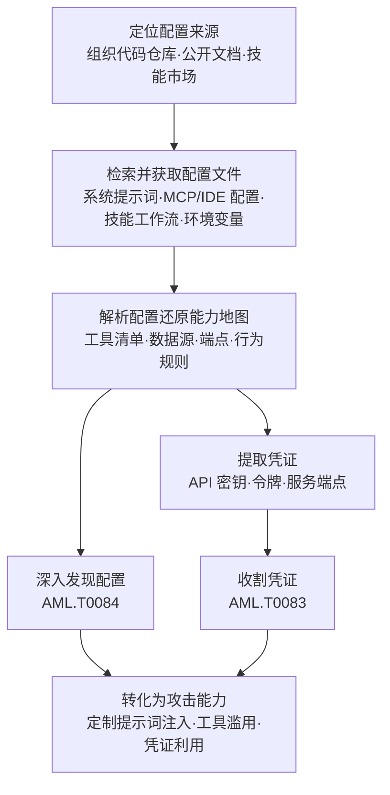

# AI 智能体配置 (AML.T0002.002)

> 属于 [获取公开 AI 制品 (AML.T0002)](../AML.T0002-Acquire-Public-AI-Artifacts.md)

## 一句话通俗理解

> 模型是智能体的"大脑"，配置文件则是它的"岗位说明书 + 钥匙串"——系统提示词写明它该干什么、MCP 配置登记它能开哪些门。组织把智能体配置随手提交进公开仓库，攻击者捡到的不只是情报，往往还有一把把真钥匙。

## 难度等级

⭐⭐ **Demonstrated（已演示）**

官方成熟度评定为 Demonstrated——官方将 OpenClaw 案例（AML.CS0051）关联至本子技术：HiddenLayer 研究人员正是掌握了智能体配置的运作方式（系统提示词结构与工具体系），才能把单次间接提示词注入升级为持久化的命令与控制植入体。实施门槛很低：配置文件就躺在公开代码仓库与文档站点里，组织名过滤 + 文件名检索一查即得，"攻击动作"与正常开发协作难以区分。本子技术是 AML.T0002 三兄弟中**唯一只适用于 Agentic AI 平台**的一个，也是**唯一直接以凭证为预期收获**的一个——配置文件天然混合了情报（能力边界、行为规则）与原料（API 密钥、服务端点），一份文件同时喂饱"踩点"和"进门"两件事。

## 技术描述

### 通俗解释

如果说数据集（AML.T0002.000）暴露了目标"喂了什么料"、模型（AML.T0002.001）暴露了"大脑长什么样"，本子技术搬走的是智能体的**操作手册与钥匙串**：智能体配置文件定义了它能调用哪些工具、连接哪些数据源、遵守哪些行为规则、拿着哪些服务的凭证。攻击者拿到这套配置，就等于拿到了一份现成的"攻击面说明书"——哪里有门、门后有什么、钥匙插在哪，一目了然。

更麻烦的是，这类文件在现代开发流程里**天然倾向于公开流动**：为了协作，配置进代码仓库；为了复用，技能包发布到市场；为了部署，环境配置随制品打包。每一次"顺手提交"，都在把智能体的能力边界与凭证指纹递到攻击者手里。

**四类目标配置一览（依据官方描述）：**

| 配置类别 | 典型形态 | 暴露的内容 | 攻击者眼中的价值 |
|---------|---------|-----------|----------------|
| 系统提示词 | 指令/规则文档 | 智能体角色、行为准则、内部逻辑 | 定制提示词注入与越狱的"题库" |
| 工具配置 | `mcp.json`、`claude_desktop_config.json`、`.claude/settings.json`、`.vscode/tasks.json` | 可用工具、外部服务集成、数据源 | 直达工具入口与数据源的"门牌簿" |
| 技能与工作流 | 指令 + 脚本 + 资源的打包件 | 能力定义、任务编排、执行逻辑 | 还原业务流程，寻找可滥用环节 |
| 环境与部署配置 | 环境变量、框架配置 | 运行时行为、服务端点、常含凭证 | 最常见的硬编码密钥藏身处 |

### 技术原理

依据官方描述，攻击者获取公开可访问的 AI 智能体配置文件，服务于三个直接目标：**理解智能体能力**、**未授权访问工具与数据源**、**识别凭证以支撑后续攻击**。配置文件的形态随平台与智能体框架而异，攻击者重点瞄准的目标包括：

1. **系统提示词**：包含智能体指令、行为准则与内部逻辑的文件——攻击者据此掌握智能体"被要求做什么、被禁止做什么"，为精确绕行规则定制注入内容；
2. **工具配置**：定义智能体可用工具的文件，包括 MCP（模型上下文协议）配置（如 `mcp.json`、`claude_desktop_config.json`）、IDE 配置（如 `.claude/settings.json`、`.vscode/tasks.json`），以及定义外部工具与数据源集成的各类框架配置——这份"工具清单"直接圈定了可滥用的攻击面；
3. **技能与工作流**：定义智能体能力、行为或工作流的文件，通常由指令、脚本与资源组合而成——相当于智能体的"业务流程图"；
4. **环境与部署配置**：控制智能体部署与运行时行为的文件，常见形态为环境变量或框架专属配置——凭证的高发地带。

**官方点名的两条后续链路：**

- 配置文件到手后，攻击者可执行**发现 AI 智能体配置**（AML.T0084），从已获取的配置中挖掘更多可用于行动的洞察；
- 亦可执行**从 AI 智能体配置收割凭证**（AML.T0083），把配置中的密钥与令牌变成直接可用的访问能力。

**与兄弟子技术的分工**：数据集（AML.T0002.000）是"料"、模型（AML.T0002.001）是"大脑"、智能体配置（AML.T0002.002）是"说明书与钥匙串"——三者常配合使用：用模型搭替身演练，用配置设计注入与滥用路径，用收割的凭证直取生产系统。与前两者覆盖三类平台不同，本子技术**仅适用于 Agentic AI 平台**——没有智能体，就没有这四类配置文件。

### 用途影响

- **能力边界透明化**：工具清单与数据源一览无余，攻击者据此圈定可滥用的工具入口与未授权访问目标；
- **提示词注入的"题库"**：系统提示词泄露了行为规则与内部逻辑，攻击者可以精确设计绕行规则、劫持指令流的注入内容；
- **凭证直接到手**：工具与环境配置中常夹带 API 密钥与令牌，获取配置可能直接等同于拿到目标外部服务的钥匙；
- **业务流程泄密**：技能与工作流暴露组织的自动化业务逻辑，为社工与定向攻击提供剧本；
- **全程零接触**：获取行为发生在公开渠道，目标边界防御完全无感。

## 攻击流程

### 典型攻击流程



**步骤详解：**

1. **定位配置来源**
   - 通俗描述：找到目标把"说明书"挂在哪了。
   - 技术细节：经由侦察阶段的成果（如搜索受害者网站 AML.T0003、搜索开放技术数据库 AML.T0000）锁定组织代码仓库、公开文档站点与已发布的智能体技能包；部分仓库需注册可见，攻击者先通过建立账户（AML.T0021）准备身份。

2. **检索并获取配置文件**
   - 通俗描述：按文件名把说明书和钥匙串翻出来。
   - 技术细节：在代码托管平台按组织名过滤，检索 `mcp.json`、`claude_desktop_config.json`、`.claude/settings.json`、`.vscode/tasks.json`、`.env` 及技能/提示词文档；注意**历史提交**——配置文件删除后仍留存于 git 历史，提交过即等于公开过。

3. **解析配置还原能力地图**
   - 通俗描述：把说明书读薄，画出攻击面地图。
   - 技术细节：从 MCP/工具配置提取工具清单、数据源与服务端点；从系统提示词提炼行为规则与内部逻辑；从技能与工作流还原执行能力——汇总为"工具-数据源-权限-规则"四维地图。

4. **提取凭证**
   - 通俗描述：把钥匙串上的钥匙一把把拔下来。
   - 技术细节：扫描工具与环境配置中的硬编码 API 密钥、令牌与端点信息，归档待用；此环节直接衔接从 AI 智能体配置收割凭证（AML.T0083）。

5. **深化与转化利用**
   - 通俗描述：把说明书和钥匙变成真武器。
   - 技术细节：执行发现 AI 智能体配置（AML.T0084）挖掘更多配置洞察；基于能力地图定制提示词注入与工具滥用路径；收割到的凭证直接用于对目标外部服务的未授权访问。

**与后续战术的衔接：**

- **前置·侦察**：组织 AI 资产地图（网站与技术数据库检索成果）是配置来源定位的输入
- **同战术·资源开发**：建立账户（AML.T0021）解决"需注册可见"仓库的访问门槛
- **后续·发现与凭证访问**：AML.T0084 与 AML.T0083 是官方点名的两条直接下游
- **后续·AI 攻击适配与初始访问**：能力地图支撑提示词注入与工具滥用设计；收割凭证可直达初始访问

> 关键差异：传统凭证猎取要等入侵后在受害者系统里翻文件，本子技术在动手之前就把"钥匙串 + 说明书"拿到了手——等真正进攻那天，攻击已经是照着图纸施工。

## 真实案例

> 以下 3 个案例围绕智能体配置与配置类制品的暴露与利用（其中案例1 直接命中本子技术 AML.T0002.002），全部源自 MITRE ATLAS 案例库。

### 案例1：OpenClaw 提示词注入 C2——智能体配置成为攻击面（AML.CS0051，AML.T0002.002）

- **时间**: 2026年2月3日
- **攻击者**: HiddenLayer 研究人员
- **手法**: 研究人员演示了一个网页如何通过间接提示词注入，让 OpenClaw 智能体静默执行恶意脚本；脚本随后把持久化的恶意指令植入后续系统提示词，攻击者得以持续下达命令，把 OpenClaw 变成命令与控制（C2）植入体。攻击成立的前提正是掌握智能体配置的运作方式——系统提示词的结构与工具体系决定了注入内容如何逃逸检查、指令如何固化进配置层。
- **影响**: 单次间接提示词注入即可让 LLM 智能体变成持久化、自动化的 C2 植入体；智能体配置从"部署细节"升级为"高价值攻击面"
- **参考链接**: [HiddenLayer 研究报告](https://www.hiddenlayer.com/research/exploring-the-security-risks-of-ai-assistants-like-openclaw)

### 案例2：Clearview AI 源码仓库配置失误——配置与凭证一锅端（AML.CS0006，AML.T0002）

- **时间**: 2020年4月16日
- **攻击者**: spiderSilk 安全研究人员
- **手法**: Clearview AI 的源码仓库虽有密码保护，却因配置失误允许任意用户注册账户——研究人员注册后直接进入私有仓库，拿到生产凭证、包含 7 万视频样本的云存储桶密钥与 Slack 令牌。仓库里的配置类文件（凭证、密钥、令牌）一次性全部暴露。
- **影响**: 演示了"配置文件集中存放凭证"的集中式风险——一处访问控制失误，智能体与应用的全部钥匙串同时外泄
- **参考链接**: [TechCrunch 报道](https://techcrunch.com/2020/04/16/clearview-source-code-lapse/)

### 案例3：投毒 GGUF 模板——配置层武器化的供应链样本（AML.CS0064，AML.T0002.001）

- **时间**: 2025年6月
- **攻击者**: Pillar Security 与 Fujitsu Research of Europe 研究人员
- **手法**: 研究者演示了推理时供应链后门：投毒的聊天模板（chat template）不改模型权重，却改变模型与智能体的行为——后门藏在可信的提示词构建逻辑里，按词法、语义或上下文触发时向模型上下文注入攻击者指令。GGUF 制品把量化权重、配置元数据与聊天模板逻辑打包为一体，攻击者篡改模板后重新分发即可。该攻击在 7 个家族 18 个模型、4 种推理引擎上得到验证，实现了操纵模型响应、重定向智能体工具调用、渗出敏感数据与植入恶意代码。
- **影响**: 证明配置层（提示词构建逻辑）本身足以成为武器——这也从反面说明，公开渠道流通的配置层内容为什么值得攻击者花力气获取与研究
- **参考链接**: [Pillar Security 博客](https://www.pillar.security/blog/llm-backdoors-at-the-inference-level-the-threat-of-poisoned-templates)、[论文 (arXiv:2602.04653)](https://arxiv.org/abs/2602.04653)

## 红队视角

> ⚠️ **免责声明**：以下内容仅用于合法授权的安全测试与教育目的。未经授权对他人系统进行测试是违法行为；对第三方平台的检索须遵守其服务条款。

### 实战技巧

1. **智能体配置暴露面盘点**
   以自有（或授权评估的）组织为对象，在代码托管平台按组织名检索 `mcp.json`、`claude_desktop_config.json`、`.claude/settings.json`、`.vscode/tasks.json`、`.env` 与技能/提示词文档；用 `git log --all -- <文件>` 检查历史提交——重点标记"已删除但仍留在历史里"的配置与凭证。

2. **能力地图还原**
   解析命中配置：从 MCP/工具配置提取工具清单、端点与权限范围；从系统提示词提炼行为规则；从技能与工作流还原业务流程。输出一张"工具-数据源-权限-规则"四维攻击面地图——这是交付报告的核心资产。

3. **凭证泄露盘点**
   用 gitleaks/trufflehog 对命中仓库做全历史扫描，列出泄露过的凭证及其**轮换状态**（是否已失效）。注意口径：报告凭证暴露事实与风险，禁止实际使用凭证访问任何服务。

4. **注入路径推演**
   对照案例1（OpenClaw）：基于能力地图推演提示词注入与工具滥用路径——哪些规则可被精确绕行、哪些工具入口可被未授权调用。纸面推演即可，落地为治理建议而非真实攻击。

### 常用工具

| 工具名称 | 用途 | 平台 |
|----------|------|------|
| GitHub / GitLab 代码搜索 | 按组织过滤检索配置文件名与关键词 | 跨平台 |
| git grep / ripgrep | 本地仓库与全历史的配置检索 | 跨平台 |
| gitleaks / trufflehog | 配置文件与提交历史中的凭证扫描 | 跨平台 |
| jq / yq | 解析 MCP 与框架配置（JSON/YAML） | 跨平台 |
| MCP Inspector | 理解 MCP 服务配置结构与工具面 | 跨平台 |

### 注意事项

- **授权边界**：检索与访问仅限自有或已授权组织；对第三方公共平台遵守服务条款与速率限制，禁止批量爬取
- **历史即暴露面**：配置文件提交过一次就算公开过，报告必须覆盖 git 历史而不只是当前分支
- **报告口径**：重点输出"配置暴露了什么能力与凭证、对应什么风险"，为配置治理提供依据，而非演示攻击本身

## 蓝队视角

### 检测要点

1. **发布侧：知道自家配置暴露了什么**
   - 数据来源：代码仓库配置清单、CI/CD 制品、技能市场发布记录
   - 关注对象：随仓库公开的系统提示词、MCP/IDE 配置、`.env` 类文件；历史提交中"删除"的配置与凭证
   - 异常特征：组织自己未盘点过的智能体配置出现在公开检索结果中——发布评审缺位的直接证据

2. **仓库侧：自托管服务的访问审计**
   - 日志来源：自托管 Git 服务与制品服务的访问/克隆日志、托管平台组织审计日志
   - 异常特征：新注册账户随即克隆配置密集的仓库、对历史提交的检索式访问、单一来源对组织仓库的顺序遍历

3. **下游：凭证滥用与行为遥测**
   - 日志来源：云服务与 SaaS 的审计日志、智能体服务遥测
   - 异常特征：配置中凭证对应的密钥从异常位置使用；针对系统提示词行为规则的定向探测（知道规则的人会精确绕行，缺少普通攻击的试错过程）；工具调用模式偏离基线
   - 详见检测建议

### 监控建议

- 建立**智能体配置台账**：登记全部随仓库/制品/技能市场公开的配置文件及其包含的工具、数据源与凭证指纹，作为暴露面评估基线（对应缓解措施 AML.M0000）
- 部署**持续泄露扫描**：pre-commit 钩子 + 定期全历史密钥扫描，配置文件与凭证入库前拦截、入库后发现
- 对智能体服务启用**行为基线告警**：工具调用分布与提示词合规检查的异常漂移，捕获基于配置情报的定制化滥用

## 检测建议

### 网络层检测

**检测方法：** 纯公开渠道的获取不产生目标侧流量，网络层重点覆盖自托管入口与下游利用。

- 入口侧（自托管仓库/制品服务）：单一来源对配置密集仓库的顺序克隆、新注册账户短时间全量拉取
- 下游侧：配置中凭证对应的外部服务出现异地认证、非常规来源的 API 调用
- 出口侧仅作辅助：批量拉取公开仓库配置与正常开发行为难以区分，不建议作为主检测面

### 主机层检测

**检测方法：** 覆盖配置从内部二次泄露的路径（内部人员或已失陷主机把配置搬向公开渠道）。

- 开发终端上智能体配置文件（`mcp.json`、`.claude/settings.json`、`.env`）被批量读取、压缩或上传外部网盘的组合行为
- 非开发类进程对 `.claude/`、`.vscode/`、MCP 配置目录的异常访问
- 禁止外发策略下，配置文件内容出现在出站流量中的数据防泄漏（DLP）告警

### 应用层检测（AI 遥测）

**检测方法：** 监控智能体服务的行为遥测，捕获基于配置情报的定制化利用。

- 针对系统提示词行为规则的"一发命中"式探测（缺少试错过程、直接测试规则边界）
- 工具调用模式异常：对低频工具的突增调用、非常规参数组合、未授权数据源的访问尝试
- MCP 服务端点的异常认证尝试与来源分布变化

**程序化检测思路（无需 EDR 侧改造）：**

把治理动作做在发布前与运行中两端：① 在 CI 流水线加一个配置检查任务——检测随仓库提交的 `mcp.json`、IDE 配置、`.env` 与提示词文档，命中即阻断并要求走配置发布评审；② 对智能体服务的工具调用日志做分布统计，单日调用分布偏离基线（如某工具调用量突增 10 倍）即触发人工复核。两端配合，用极低成本覆盖"配置泄露 → 定制滥用"的完整窗口。

### Sigma 规则思路示例

```yaml
title: 疑似智能体配置泄露凭证被外部使用（配置收割下游信号）
status: experimental
description: 检测智能体配置文件中常见的 API 密钥/令牌从组织
    网络之外被使用，可能为公开智能体配置中的凭证被收割利用
    （AML.T0002.002 / AML.M0000）
logsource:
    category: cloud_audit
    product: aws
detection:
    selection:
        eventName:
            - GetSecretValue
            - GetParameterValue
            - AssumeRole
    filter_corporate:
        source_ip|cidr:
            - '10.0.0.0/8'
            - '172.16.0.0/12'
            - '192.168.0.0/16'
    condition: selection and not filter_corporate
    timeframe: 5m
level: high
tags:
    - attack.t1552
    - atlas.aml_t0002_002
```

> 说明：思路示例聚焦"泄露凭证被异地使用"的下游信号；生产化需按密钥归属服务细化事件选择器，并联动配置台账（哪份配置里有哪个密钥）实现告警到处置的闭环。

## 缓解措施

> 本子技术在官方数据中无直接映射的缓解措施（官方 mitigations 为空），以下以继承自父技术 [获取公开 AI 制品 (AML.T0002)](../AML.T0002-Acquire-Public-AI-Artifacts.md) 的缓解映射为主，辅以本库面向智能体配置场景的落地建议。

### 优先级1：关键措施

**AML.M0000 限制公开技术信息发布（Limit Public Release of Information）**（继承自父技术 AML.T0002）

限制对外发布组织 AI 技术栈的技术信息——攻击者可利用这些情报实施目标锁定与攻击定制。智能体配置场景的落地要点：系统提示词与技能定义默认**不随仓库公开**；确需共享的 MCP/工具配置先脱敏（凭证抽离、端点最小化）；发布前走配置评审，评估"这份配置向对手暴露了哪些工具与数据源"；git 历史中的已删配置与凭证同样在暴露面，必要时做历史清理并轮换凭证。

### 优先级2：重要措施

**AML.M0001 限制模型制品发布（Limit Model Artifact Release）**（参照——官方挂载于兄弟子技术 AML.T0002.000 / AML.T0002.001）

限制公开生产环境所用的（或能代表生产环境的）数据、算法、模型架构与模型检查点等技术项目细节。其发布治理思路同样适用于智能体场景：区分"演示用配置"与"生产同款配置"两级口径——对外演示可以给示例配置，生产同款的系统提示词、工具集成与技能工作流不随附公开；发布到技能市场的制品按同口径评审。

### 本库落地建议：配置凭证治理

对配置中的凭证执行"零硬编码三件套"：**入库前**——pre-commit 钩子与 CI 密钥扫描拦截；**运行时**——凭证经环境变量或秘密管理服务注入，配置文件中只留占位符；**泄露后**——全历史扫描发现的凭证一律轮换并登记状态。配置情报（提示词、工具清单）会随凭证一起泄露，凭证轮换后仍需评估提示词与能力边界的暴露风险。

### MITRE ATLAS 缓解措施映射

| 缓解措施ID | 缓解措施名称 | 优先级 | 映射来源 | 生命周期阶段 |
|------------|-------------|:------:|----------|-------------|
| AML.M0000 | 限制公开技术信息发布 | 关键 | 继承自父技术 AML.T0002 | 业务与数据理解 |
| AML.M0001 | 限制模型制品发布 | 重要 | 参照（官方挂载于 AML.T0002.000/.001） | 业务与数据理解 · 部署 |

> 治本在 M0000：智能体配置的暴露面每收敛一分，攻击者能拿到的"说明书与钥匙串"就少一份；M0001 的分级发布思路与凭证治理三件套则把"确实要公开的部分"的风险压到可控。

## 关联 ATT&CK 技术

官方数据中本子技术 **attack_reference 为空**——ATLAS 未为其建立 ATT&CK 映射，"获取公开智能体配置"在传统矩阵中没有同款技术。以下为同一攻击逻辑在传统矩阵中的主题类比（类比链接经逐一验证）：

- [文件中的凭证 (T1552.001)](../../../enterprise/09-Credential-Access/T1552/T1552.001-Credentials-in-Files.md)（母技术 [不安全的凭证 (T1552)](../../../enterprise/09-Credential-Access/T1552-Unsecured-Credentials.md)）——最接近的传统类比：翻找配置文件搜凭证。区别在于 T1552.001 通常发生在入侵后的受害者系统内，AML.T0002.002 在公开渠道零接触完成
- [代码仓库 (T1593.003)](../../../enterprise/01-Reconnaissance/T1593/T1593.003-Code-Repositories.md)——配置文件的主要集散地：侦察阶段搜索开放网站/域名的子技术，攻击者用它定位组织公开仓库中的智能体配置
- [代码仓库 (T1213.003)](../../../enterprise/12-Collection/T1213/T1213.003-Code-Repositories.md)——收集战术的对应物：从信息库（含公开仓库）收集数据。T1593.003 负责侦察期"发现配置在哪"，T1213.003 对应"把数据从仓库取出来"

**传统凭证猎取 vs 获取公开 AI 智能体配置：**

| 维度 | 文件中的凭证 (T1552.001) | AI 智能体配置 (AML.T0002.002) |
|------|------------------------|------------------------------|
| 获取方式 | 入侵后在受害者系统内翻找文件 | 公开仓库/文档/技能市场直接获取，零接触 |
| 目标文件 | 通用配置、脚本、日志中的凭证 | 系统提示词、MCP/IDE 配置、技能工作流、部署配置 |
| 情报价值 | 凭证本身 | 能力地图 + 工具入口 + 行为规则 + 凭证四位一体 |
| 后续衔接 | 使用凭证横向移动 | 发现配置（AML.T0084）→ 收割凭证（AML.T0083）→ 定制提示词注入 |

一句话总结：T1552.001 是"破门之后在屋里翻钥匙"，AML.T0002.002 是"根本不用破门——钥匙和说明书就挂在公开仓库里"。

## 动手实验

> ⚠️ **重要提示**：所有实验仅使用自有或已授权的组织资源，不检索、不获取第三方组织的配置文件；对公开平台的检索遵守服务条款。

### 实验环境准备

| 环境组件 | 用途 | 获取方式 |
|----------|------|----------|
| 自有代码仓库（或新建演示仓库） | 盘点对象 | GitHub / GitLab |
| git + ripgrep（或 git grep） | 全历史配置检索 | 官方安装包 |
| gitleaks | 凭证泄露扫描 | 官方 release |
| jq / yq | MCP 与框架配置解析 | 包管理器 |

### 实验1（初级）：盘点自有组织的智能体配置暴露面

**实验目标：** 以攻击者视角盘点自己（或授权客户）组织的配置暴露面（对应 AML.M0000）。

**实验步骤：**
1. 在自有 GitHub/GitLab 按组织名检索：`mcp.json`、`claude_desktop_config.json`、`.claude/settings.json`、`.vscode/tasks.json`、`.env`、技能与提示词文档
2. 对命中仓库执行 `git log --all -- <配置文件>`，标记历史提交中已"删除"但仍可恢复的配置
3. 按四类配置分类登记：每份文件暴露了哪些工具、数据源、行为规则与凭证
4. 换位思考：若你是攻击者，哪三份文件最有价值？为什么？

**预期结果：** 产出一份带"暴露内容"标注的配置暴露面清单——多数组织会惊讶于 git 历史里躺着多少早已"删除"的密钥。

### 实验2（中级）：还原能力地图与凭证盘点

**实验目标：** 掌握配置文件到手后的分析流程（对应攻击流程第 3、4 步）。

**实验步骤：**
1. 用 jq/yq 解析命中的 MCP 配置：提取服务端点、工具清单与权限范围
2. 从系统提示词与技能文档提炼行为规则和内部逻辑，汇总为"工具-数据源-权限-规则"四维能力地图
3. 用 gitleaks 对命中仓库做全历史凭证扫描，列出泄露凭证及其轮换状态
4. 对照能力地图回答：哪些工具入口可被未授权调用？哪些数据源可能直接暴露？

**预期结果：** 一份完整的攻击面地图与待轮换凭证清单——这就是攻击者手里的"施工图"。

### 实验3（高级）：攻击路径推演与治理落地

**实验目标：** 体验"配置情报 → 定制攻击"的转化过程，并反哺防御（对应案例1思路）。

**实验步骤：**
1. 对照案例1（OpenClaw）：基于实验2的能力地图，纸面推演提示词注入与工具滥用路径——哪些行为规则可被精确绕行、注入指令能否固化进系统提示词
2. 逐条评估现有缓解：系统提示词是否必须公开、配置凭证是否硬编码、工具权限是否最小化
3. 起草组织《智能体配置发布规范》：脱敏模板、凭证注入方式、历史清理与轮换流程
4. 把推演结论转化为蓝队检测用例：为"配置搜集"与"凭证滥用"各设计一条告警规则

**预期结果：** 输出可执行的配置治理规范与配套检测用例，形成"攻方推演 → 防方加固"的闭环。

## 术语解释

| 术语 | 英文原名 | 通俗解释 |
|------|----------|----------|
| AI 智能体配置 | AI Agent Configuration | 定义智能体"能干什么、怎么干、接什么资源"的文件集合——本子技术的全部目标 |
| 系统提示词 | System Prompt | 定义智能体角色、行为规则与内部逻辑的指令文本，智能体的"操作手册" |
| MCP | Model Context Protocol | 模型上下文协议——智能体接入外部工具与数据源的开放协议 |
| MCP 配置 | MCP Config | 登记智能体可用 MCP 服务的配置文件（如 `mcp.json`），泄露即暴露工具入口与凭证 |
| 技能 | Skills | 定义智能体能力与工作流的打包件，常由指令、脚本与资源组合而成 |
| 工作流 | Workflow | 智能体执行多步骤任务的编排定义，暴露组织的业务流程逻辑 |
| 环境变量 | Environment Variable | 部署配置中常见的键值对，运行时注入参数与凭证——也是硬编码密钥的高发区 |
| 硬编码凭证 | Hard-coded Credential | 直接写死在配置文件里的密钥/令牌，文件公开即凭证泄露 |
| 提示词注入 | Prompt Injection | 通过恶意输入篡改智能体指令执行的行为——掌握系统提示词后可被精确绕行 |
| 能力地图 | Capability Map | 从配置文件还原出的"工具+数据源+权限+行为规则"全景，即智能体的攻击面清单 |

## 参考资料

### 📚 官方文档

- [MITRE ATLAS - AI Agent Configuration (AML.T0002.002)](https://atlas.mitre.org/techniques/AML.T0002/002/) - 官方技术页面
- [MITRE ATLAS 矩阵](https://atlas.mitre.org/matrices/ATLAS/)
- [MITRE ATLAS Data (GitHub)](https://github.com/mitre-atlas/atlas-data)

### 📰 案例报告（真实攻击与安全研究）

- [HiddenLayer: Exploring the Security Risks of AI Assistants like OpenClaw](https://www.hiddenlayer.com/research/exploring-the-security-risks-of-ai-assistants-like-openclaw) - 案例1：智能体配置沦为攻击面的原始研究
- [TechCrunch: Security lapse exposed Clearview AI source code](https://techcrunch.com/2020/04/16/clearview-source-code-lapse/) - 案例2：配置失误导致凭证集中外泄的事件全景
- [Pillar Security: LLM Backdoors at the Inference Level](https://www.pillar.security/blog/llm-backdoors-at-the-inference-level-the-threat-of-poisoned-templates) - 案例3：配置层（聊天模板）武器化的供应链研究
- [Inference-Time Backdoors via Chat Templates (arXiv:2602.04653)](https://arxiv.org/abs/2602.04653) - 投毒模板攻击的学术论文

### 🔧 工具与资源

- [Model Context Protocol 官方文档](https://modelcontextprotocol.io/) - MCP 协议与配置格式的一手资料
- [gitleaks](https://github.com/gitleaks/gitleaks) - 仓库与配置文件的凭证泄露扫描
- [trufflehog](https://github.com/trufflesecurity/trufflehog) - 全历史密钥扫描与验证
- [OWASP Top 10 for LLM Applications](https://owasp.org/www-project-top-10-for-large-language-model-applications/) - LLM 应用十大安全风险

### 🔗 关联阅读

- [获取公开 AI 制品 (AML.T0002)](../AML.T0002-Acquire-Public-AI-Artifacts.md) - 本技术的父技术，三类 AI 制品全景
- [资源开发战术 (AML.TA0003)](../README.md) - 本技术所属战术的概览页
- [文件中的凭证 (T1552.001)](../../../enterprise/09-Credential-Access/T1552/T1552.001-Credentials-in-Files.md) - 传统矩阵中"配置文件搜凭证"的类比技术
- [代码仓库 (T1593.003)](../../../enterprise/01-Reconnaissance/T1593/T1593.003-Code-Repositories.md) - 定位公开仓库配置的侦察类技术

---

> **版本**: ATLAS 2026.09 | **更新**: 2026-10-22 | **模板**: ATLAS 技术文档 v1.0
