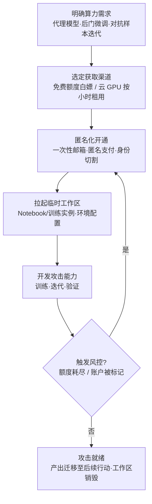

# AI 开发工作区 (AML.T0008.000)

> 属于 [获取基础设施 (AML.T0008)](../AML.T0008-Acquire-Infrastructure.md)

## 一句话通俗理解

> 开发 AI 攻击是"算力饥饿"的行当——训练代理模型、微调后门模型、迭代对抗样本都离不开 GPU。攻击者买不起（也不敢用自己的卡）就租：匿名白嫖 Google Colab 的免费算力，或用一次性账户在 AWS/Azure/GCP 按小时租 GPU，开一间即开即毁的"攻击实验室"；一间被风控盯上，再开一间就是。

## 难度等级

⭐⭐ **Demonstrated（已演示）**

官方成熟度评定为 Demonstrated——该技术已在真实研究中得到演示：Brown University 团队仅凭 OpenAI 公开的技术描述与开源 ML 制品，就在官方完整模型发布前成功复现了 GPT-2（AML.CS0007），ATLAS 官方将其算力获取行为直接映射至本子技术——证明"公开方法 + 租来的算力"足以复制前沿模型能力。实施门槛的构成很特殊：**获取本身几乎零难度**——免费平台注册即送 GPU 额度，云平台信用卡按小时计费；真正的难度在**匿名与规避**——如何让账户、支付与真实身份"物理切割"，以及如何用多个工作区分散训练任务，避免被平台风控按"单账户异常用量"画像命中。对防御者而言还有另一半战场：组织被盗的云凭证随时可能被"借"去当免费攻击工作区。

## 技术描述

### 通俗解释

传统攻击者租 VPS 是为了"藏"——把钓鱼页、C2 通道藏在正规云厂商的 IP 段里；攻击 AI 系统的人租工作区是为了"造"——GPU 是兵工厂的车床，代理模型、后门模型、对抗样本都要在车床上加工出来。一台 8 卡 GPU 实例的日租金以百美元计，训练一个像样的攻击模型动辄数百 GPU 小时；自购设备又贵又留痕（收货地址、设备序列号都是溯源锚点），租用则把账单、设备指纹、物理关联全部转嫁给一个用完即弃的账户。

更"友好"的是免费入口：Colab 这类平台注册即送免费 GPU/TPU 额度，对"小模型上迭代对抗样本"这类轻量任务已经够用——攻击开发的启动成本，可以低到一个一次性邮箱。

### 技术原理

依据官方描述，开发与暂存 AI 攻击往往需要昂贵的计算资源，攻击者可能需要一块或多块 GPU 来开发攻击；官方并明确指出其获取途径与规避手法。技术要点拆解如下：

1. **昂贵算力是 AI 攻击的前置门槛**：训练代理模型（复现目标能力的高仿模型）、微调植入后门的模型、批量迭代对抗样本、量产攻击素材——每一项都是 GPU 密集型工作，算力决定了攻击从"理论可行"到"实际可运行"的距离；
2. **免费资源的匿名使用**：官方描述点名 Google Colaboratory——攻击者可尝试**匿名**使用此类免费资源；免费额度虽有限，但足以支撑轻量攻击开发，且零成本、零账单痕迹；
3. **云资源按需租用**：AWS、Azure、Google Cloud 是"高效立起临时资源"的途径——按小时计费、API 即可开通，继承父技术"快速开通、修改与关闭"的特性，用完即焚、追查时灰烬都不剩；
4. **多工作区规避检测**：官方描述明确指出"可使用多个工作区以规避检测"——把一次大任务拆到多个账户、多个平台，每个工作区的用量都停留在"正常人"基线内，平台风控难以凭单账户画像命中。

**与兄弟子技术的分工**：父技术 [获取基础设施 (AML.T0008)](../AML.T0008-Acquire-Infrastructure.md) 的六个子技术各司其职——

| 子技术 | 获取的东西 | 与本子技术的分工 |
|--------|-----------|----------------|
| **AML.T0008.000（本技术）** | 算力（GPU/TPU 工作区） | 租"工厂"——自己炼模型、造样本 |
| AML.T0008.001 消费级硬件 | 实体设备 | 买"现货"——完全自控但算力有限，适合摄像头劫持等物理攻击 |
| AML.T0008.002 域名 | 域名 | 买"门牌"——数据集投毒与钓鱼的埋伏点 |
| AML.T0008.004 无服务器 | 函数运行环境 | 租"信箱"——承载 C2/渗漏脚本，不求算力求隐蔽 |
| AML.T0008.005 AI 服务代理 | 模型 API 额度 | 买"外援"——不自己炼模型，直接批发别人的模型调用 |

一句话：**.000 是六个子技术中唯一"生产攻击"的基础设施，其余都是"承载攻击"的阵地**。

**平台覆盖**：Enterprise——攻击者在传统云环境即可完成资源获取与攻击开发，产出的攻击能力再指向各类 AI 系统。

### 用途影响

- **攻击能力工厂**：没有算力就没有代理模型，没有代理模型就没有离线攻击演练——工作区是整条 AI 攻击链的军工厂；
- **成本与风险转嫁**：账单、设备指纹、物理溯源锚点全部落在一次性账户上，与攻击者本人"物理切割"；
- **即开即毁的弹性**：按小时计费 + API 开通，阵地被封即弃、即刻重开，平台风控永远在追上一个账户；
- **规模化与规避兼得**：任务可拆分到多工作区并行——既扩产能，又让每个账户的用量都"看起来正常"；
- **组织侧的镜像威胁**：被盗的组织云凭证同样会被"借"为免费工作区（LLM Jacking 式滥用）——防御者面对的不只是"别人的兵工厂"，还有"自家的电表被人偷接"。

## 攻击流程

### 典型攻击流程



**步骤详解：**

1. **明确算力需求**
   - 通俗描述：先算清楚要开多大的工厂。
   - 技术细节：依据侦察情报与攻击计划倒推——目标模型多大、代理模型需要什么参数量、对抗样本迭代需要多少轮查询；轻量任务（小模型对抗迭代）走免费额度即可，重度训练（复现大模型）走按小时计费的云 GPU。

2. **选定获取渠道**
   - 通俗描述：免费的白嫖，付费的比价。
   - 技术细节：Colab/Kaggle 免费层零成本但限额限时；AWS/Azure/GCP 按小时计费、API 即可开通；去中心化 GPU 市场（vast.ai、RunPod 等）对身份与支付的要求比公有云更宽松。

3. **匿名化开通**
   - 通俗描述：不留收货地址，也不留信用卡。
   - 技术细节：一次性邮箱注册、匿名或虚拟支付方式、出口 IP 与真实身份切割——确保工作区账户与攻击者本人不产生任何物理关联，这是父技术"难以物理溯源"特性在算力场景的落地。

4. **拉起工作区并开发攻击**
   - 通俗描述：开工——车床转起来，武器造出来。
   - 技术细节：配置 Notebook 或训练实例环境，训练代理模型、微调后门模型或批量生成对抗样本；官方描述强调工作区支撑的是"开发与暂存"两类活动——既是车间也是半成品仓库。

5. **规避检测与轮换**
   - 通俗描述：把大活拆成小活，一间厂房干一点。
   - 技术细节：将大任务拆分到多个工作区，使单账户用量保持在正常用户基线内；额度耗尽或触发风控即弃用账户，回到第 3 步重新开工——"多个工作区规避检测"是官方描述明示的手法。

6. **攻击就绪与销毁**
   - 通俗描述：武器出厂，工厂炸掉。
   - 技术细节：训练好的模型与对抗样本迁移至后续行动阵地（投毒制品发布、代理模型演练、攻击载荷托管），工作区随即销毁——账单与日志一并湮灭。

**与后续战术的衔接：**

- **开发能力（AML.T0017）**：工作区里"造"出来的正是开发能力的产物——对抗样本、投毒数据集、越狱提示词都在这里迭代成型
- **AI 攻击适配**：租用算力训练的代理模型，供离线反复演练针对目标真实模型的攻击
- **暂存能力（AML.T0079）**：工作区的产出（投毒制品、恶意配置）最终要部署到模型仓库等阵地静候受害者
- **影响/执行类战术**：批量生成的攻击素材（钓鱼内容、恶意命令）直接输入下游行动

> 关键差异：传统 T1583 租 VPS 是"藏攻击"，AML.T0008.000 租 GPU 是"造攻击"——基础设施第一次成了武器的生产线，算力账单就是攻击者的军费预算表。

## 真实案例

> 以下 3 个案例中，案例1 在 ATLAS 官方数据中直接命中本子技术 AML.T0008.000；案例2、3 官方映射至父技术 AML.T0008，作为"开发平台/基础设施被用于攻击开发"的关联案例如实标注呈现。

### 案例1：GPT-2 模型复现——租来的算力复刻前沿能力（AML.CS0007，AML.T0008.000）

- **时间**: 2019年8月
- **攻击者**: Brown University 研究人员（安全验证研究）
- **手法**: OpenAI 以滥用风险为由对 GPT-2 采取分级发布：放出弱化版模型与技术描述，扣留完整权重。Brown 团队仅凭已公开的技术描述与开源 ML 制品，租用云端算力完成训练，在官方放出完整模型之前成功复现了同等能力。ATLAS 官方将此案例的算力获取行为映射至本子技术。
- **影响**: 证明"公开方法 + 租用算力"足以复刻前沿模型——若换成恶意行为者，可以在 AI 安全社区准备好之前抢先滥用；最谨慎的"扣权重、放论文"策略也挡不住有算力的复现者
- **参考链接**: [Wired: OpenAI Said Its Code Was Risky. Two Grads Re-Created It Anyway](https://www.wired.com/story/dangerous-ai-open-source/)、[OpenGPT-2 复现博文](https://blog.usejournal.com/opengpt-2-we-replicated-gpt-2-because-you-can-too-45e34e6d36dc)

### 案例2：Storm-2139 自建越狱工具链——攻击工具的开发流水线（AML.CS0057，父技术 AML.T0008）

- **时间**: 2024–2025年（2025年1月微软披露起诉）
- **攻击者**: Storm-2139 网络犯罪团伙
- **手法**: 团伙从公开渠道收集泄露的客户凭证访问生成式 AI 服务账户，并**开发、修改、运营**绕过 Azure OpenAI 安全护栏的工具与服务——工具从开发、改造到分发给最终用户的整条流水线，都需要持续的基础设施与算力支撑。ATLAS 官方将该案例映射至父技术 AML.T0008。
- **影响**: 形成"创作者开发工具—提供商改造供应—用户生成有害内容"的完整犯罪供应链，产出未经同意的名人亲密影像等有害内容；微软对其提起民事诉讼
- **参考链接**: [Microsoft: Taking legal action to protect the public from abusive AI-generated content](https://blogs.microsoft.com/on-the-issues/2025/01/10/taking-legal-action-to-protect-the-public-from-abusive-ai-generated-content/)

### 案例3：Google Bard 对话渗漏——免费开发平台被匿名征用（AML.CS0029，父技术 AML.T0008）

- **时间**: 2023年11月
- **攻击者**: Embrace the Red 研究团队（安全验证研究）
- **手法**: 通过间接提示词注入让 Bard 渲染带用户对话数据的图片 URL，回连渗漏脚本托管在 Google Apps Script 上——免费的云开发平台被匿名征用为攻击基础设施（在本库子技术划分下，Apps Script 的形态更贴近 AML.T0008.004 无服务器，但"免费开发平台匿名滥用"的逻辑与本子技术同源）。ATLAS 官方将该案例映射至父技术 AML.T0008。
- **影响**: 请求因来自 Google 自有域名而绕过内容安全策略（CSP）；演示了零成本征用正规平台当阵地的可行性（Google 已修复）
- **参考链接**: [Embrace the Red: Hacking Google Bard](https://embracethered.com/blog/posts/2023/google-bard-data-exfiltration/)

## 红队视角

> ⚠️ **免责声明**：以下内容仅用于合法授权的安全测试与教育目的。未经授权租用资源开发攻击工具或对他人系统进行测试是违法行为。

### 实战技巧

1. **组织算力滥用面评估**
   盘点组织云租户与各 AI 开发平台上的账户暴露面：无人认领的 GPU 实例、休眠的 Notebook 服务、游离的免费额度账户、绑定组织邮箱的第三方平台账号——回答"内部人员或失陷凭证能'白嫖'组织多少算力"。

2. **GPU 滥用检测链路验证**
   在自有租户以"正常流程之外"的方式开通一个 GPU/Notebook 实例（例如直接 API 调用而非 IaC 流水线），验证审计日志是否完整采集、告警是否触发、响应处置是否闭环——大多数组织会在这一步发现链路断点。

3. **攻击成本建模**
   依据组织公开的模型信息（架构、参数量、数据规模，来自论文与公开制品）估算攻击者训练"够用的代理模型"所需的 GPU 小时与费用，输出组织的**攻击成本评估表**——把"我们会不会被复现"翻译成"攻击者花 X 美元、Y 天就能复现"，为发布治理提供量化依据。

### 常用工具

| 工具名称 | 用途 | 平台 |
|----------|------|------|
| Google Colab / Kaggle Notebooks | 免费 GPU/TPU 额度（评估暴露面与攻击成本用） | Web |
| AWS / Azure / GCP 按需 GPU | 按小时计费的实例与托管训练（检测基线实验用） | 云平台 |
| vast.ai / RunPod | 去中心化 GPU 租赁市场（了解宽松准入的攻击者视角） | Web |
| CloudTrail / Azure Activity Log | 云审计日志（防御侧验证主战场） | 云平台 |

### 注意事项

- **授权范围内租用**：评估中的一切云资源以组织名义开通并打标签标记用途，绝不测试平台风控的匿名绕过手法——那是攻击者的行为，红队报告聚焦组织自身的资源治理
- **成本敏感**：GPU 实验按小时烧钱，实验设计先估算费用上限，用完立即销毁
- 交付物聚焦三件事：算力暴露面清单、检测链路是否闭环、攻击成本评估表——而非证明攻击可行性

## 蓝队视角

### 检测要点

1. **接受现实：攻击者自己的租户看不见**
   - 攻击者在 Colab 或自租云账户上的开发行为发生在受害者视野之外，组织侧无法直接检测
   - 结论：本技术的检测重心在两条侧信道——**组织凭证被盗用**（自家算力被"借"）与**组织作为平台方时的风控遥测**（多数组织不适用）

2. **云审计日志（自家算力被盗用的主战场）**
   - 日志来源：CloudTrail、Azure Activity Log、GCP Audit Logs
   - 关注对象：GPU 实例/Notebook/训练任务的创建与启动事件、发起的 IAM 身份、来源 IP
   - 异常特征：从未用过 GPU 的身份突然开通 GPU 资源、管理面 API 来自异常地域或非常规客户端、绕过 IaC/CI 流水线的直接开通、孤儿资源长开不关

3. **用量与成本遥测**
   - 日志来源：云成本管理平台、预算告警、免费额度用量报表
   - 异常特征：单账户 GPU 小时激增、预算告警连续触发、组织邮箱绑定的第三方 AI 平台额度异常消耗

### 监控建议

- **GPU 资产台账强制化**：所有 GPU/Notebook 资源必须携带 owner 与项目标签，无标签资源限期回收——让每一小时算力都可归属、可追查
- **预算硬上限 + 超限即告警**：为开发与研究租户设置支出上限，超出基线即触发人工复核——算力滥用最迟也会在账单上露馅
- **凭证治理常态化**：云密钥按环境隔离与轮换、闲置服务账户禁用——防止组织账户沦为他人的免费工作区（Sysdig 披露的 LLM Jacking 场景是同一逻辑的近亲）
- **定期清理孤儿资源**：休眠 Notebook、遗忘的训练实例既是成本漏洞也是滥用温床，纳入周期性巡检

## 检测建议

### 网络层检测

**检测方法：** 本技术的主要活动在攻击者侧，网络层仅能覆盖"组织资源被盗用"的侧信道。

- 企业资产对云管理面 API（EC2/SageMaker/Vertex 等）的非常规调用——正常开发走 IaC 与 CI 通道，直接 API 调用即为偏离
- 组织出口向免费 AI 开发平台（colab.research.google.com、kaggle.com 等）的大量数据上传——数据外传叠加外部算力滥用信号，提示有人把组织数据搬到外面的"工作区"

### 主机层检测

**检测方法：** 部分适用——本技术不接触目标主机，主机层的价值在于捕获其前置铺垫：凭证窃取向云管理 API 的外联（恶意进程读取密钥文件后调用云 SDK）、失陷终端上的异常云 CLI 活动。

### 应用层检测（云审计与 AI 遥测）

**检测方法：** 云审计日志是本技术防御侧的核心数据源。

- GPU 实例、Notebook 环境、训练任务的创建/启动事件偏离身份历史基线（"这个身份过去 90 天从未开过 GPU，今天开了"）
- 训练任务引用的镜像、数据源超出该项目正常范围
- 免费额度与试用账户在企业域名下的异常注册与消耗

**程序化检测思路（无需 EDR 侧改造）：**

在云审计侧按 IAM 身份维度建立"GPU 类操作基线"：对 RunInstances（GPU 机型）、CreateNotebookInstance、CreateTrainingJob 等事件做 90 天滑动窗口统计，任何身份首次出现 GPU 类开通行为即告警并联动身份复核；同时配置预算硬告警兜底——即便检测规则漏掉，账单异常也会在最迟一个计费周期内暴露。

### Sigma 规则思路示例

```yaml
title: 云租户内偏离基线的 GPU/Notebook 资源开通（算力滥用信号）
status: experimental
description: 检测云审计日志中 GPU 实例、Notebook 与训练任务的异常开通行为，
    可能为失陷凭证被用于租用算力开发攻击（AML.T0008.000，
    关联 LLM Jacking 式凭证滥用场景）
logsource:
    category: cloud_audit
    product: aws
detection:
    selection_event:
        eventName:
            - 'RunInstances'
            - 'CreateNotebookInstance'
            - 'StartNotebookInstance'
            - 'CreateTrainingJob'
    selection_gpu:
        requestParameters.instanceType|contains:
            - 'g4dn'
            - 'g5.'
            - 'p3.'
            - 'p4d'
            - 'p5.'
    filter_baseline:
        userArn|endswith:
            - '/ci-pipeline'
            - '/ml-platform-service'
    condition: selection_event and selection_gpu and not filter_baseline
    timeframe: 1h
level: high
tags:
    - attack.t1583
    - attack.t1078
    - atlas.aml_t0008_000
```

## 缓解措施

> **官方数据说明**：在 MITRE ATLAS 官方数据（2026.09）中，本子技术与父技术 [获取基础设施 (AML.T0008)](../AML.T0008-Acquire-Infrastructure.md) 均未映射任何缓解措施（mitigations 字段为空）——攻击发生在受害者视野之外，官方框架暂无直接对策条目。攻击者租用外部算力本身无法防御；**可防御的是组织自身的算力与凭证不被"借用"**。以下为本库基于技术特性整理的防御建议，非官方映射。

### 优先级1：关键建议 —— 阻断"组织账户变免费工作区"

**云凭证治理与最小权限**：GPU 开通类 API 权限（EC2 RunInstances、SageMaker 全系、Vertex AI 训练等）按角色收紧到确有需要的团队；云密钥按环境隔离、定期轮换，闲置服务账户一律禁用——Sysdig 披露的 LLM Jacking 场景证明，被盗云凭证最先被变现的用途里就包括"免费"算力与模型服务。

### 优先级2：重要建议 —— 让每一小时算力可归属、可追查

**GPU 资产台账与预算告警**：强制 owner/项目标签，无标签资源限期回收；为各租户设置支出硬上限与超限告警；周期性清理休眠 Notebook 与孤儿训练实例——滥用行为最迟会在台账与账单上露馅。

### 优先级3：建议措施 —— 收紧组织数据流向外部工作区

**免费平台使用治理**：对组织资产访问免费 AI 开发平台（Colab/Kaggle 等）的流量建立可见性，配套数据外传防护策略；对员工使用外部工作区处理组织数据建立明确政策——防止组织数据先一步搬进攻击者也能白嫖的平台。

### 落地优先级一览（本库建议）

| 防御方向 | 建议优先级 | 说明 |
|----------|:---------:|------|
| 云凭证治理与最小权限 | 关键 | 阻断组织凭证被"借"为免费攻击工作区 |
| GPU 资产台账与预算告警 | 重要 | 任何算力消耗可归属、可追查、可封顶 |
| 免费平台使用治理 | 建议 | 控制组织数据流向外部开发环境 |

> 说明：对攻击者在外部平台租用算力的行为，组织侧无缓解可言——现实策略是"管好自己的钥匙与账单"，并把检测重心放在凭证滥用与用量异常上（见检测建议章节）。

## 关联 ATT&CK 技术

> 本子技术在 ATLAS 官方数据中无直接 ATT&CK 映射（attack_reference 为空）；父技术 AML.T0008 官方映射至 T1583。以下条目中 T1583 为父技术的官方映射，其余为按资源形态选取的主题类比（非官方映射，经本库路径验证）。

- [获取基础设施 (T1583)](../../../enterprise/02-Resource-Development/T1583-Acquire-Infrastructure.md) — 父技术的官方 ATT&CK 映射，同源技术
- [虚拟专用服务器 (T1583.003)](../../../enterprise/02-Resource-Development/T1583/T1583.003-Virtual-Private-Server.md) — 主题类比：按小时租用、即开即毁的云资源形态一脉相承
- [服务器 (T1583.004)](../../../enterprise/02-Resource-Development/T1583/T1583.004-Server.md) — 主题类比：租用服务器与租用 GPU 算力的自然衔接点

**传统租用 VPS/服务器 vs ATLAS AI 开发工作区：**

| 维度 | 传统 T1583.003/.004 租用 | ATLAS AML.T0008.000 |
|------|------------------------|---------------------|
| 租用目的 | 承载 C2、钓鱼页、载荷暂存——**藏攻击** | 训练代理模型、迭代对抗样本——**造攻击** |
| 资源形态 | 通用虚拟机/物理服务器 | GPU/TPU 密集型实例、托管 Notebook 环境 |
| 成本量级 | 低（普通 VPS 数美元/月） | 高（GPU 实例按小时计费，训练动辄数百 GPU 小时） |
| 风控对抗 | IP 信誉、滥用投诉处理 | 免费额度限额、账户用量画像——催生"多工作区"分散手法 |
| 产出物 | 攻击的载体（页面、脚本、通道） | **攻击武器本身**（模型、对抗样本、数据集） |

一句话总结：T1583 租的是"藏身之处"，AML.T0008.000 租的是"兵工厂"——当基础设施的产出从"攻击的载体"变成"攻击本身"，算力账单就成了攻击者的军费预算表。

## 动手实验

> ⚠️ **重要提示**：所有实验在自有账户与自有租户上进行，不涉及对任何第三方系统或平台的测试；云资源以组织/个人名义开通、预估费用上限、用完立即销毁。

### 实验环境准备

| 环境组件 | 用途 | 获取方式 |
|----------|------|----------|
| Google Colab 免费账户 | 免费额度体验与暴露面评估 | 浏览器 |
| 自有云账号（AWS/Azure/GCP 任一） | 审计日志与检测基线实验 | 个人/组织租户 |
| Python 3.10+ | 训练脚本与日志分析 | 官方安装包 |
| 一个公开小模型与数据集 | 代理模型成本测算 | Hugging Face 等平台 |

### 实验1（初级）：组织算力暴露面盘点

**实验目标：** 以攻击者视角盘点组织在 AI 开发平台上的"可白嫖面"。

**实验步骤：**
1. 清点组织邮箱在各 AI 开发平台（Colab/Kaggle/云租户）注册的账户与剩余免费额度
2. 在云租户中检索无 owner 标签的 GPU 实例、休眠 Notebook、遗留训练任务
3. 对每一项评估：凭证泄露后攻击者能"借"走多少算力、多久会被发现
4. 输出"算力暴露面清单"并按风险排序

**预期结果：** 多数组织会找到至少一个无人认领的 Notebook 或免费额度账户——以及一页从未有人看过的用量报表。

### 实验2（中级）：GPU 开通审计基线

**实验目标：** 验证"组织账户被用于租用算力"时的检测可见性。

**实验步骤：**
1. 在自有租户用 CLI 直接开通一个最低配 GPU/Notebook 实例（刻意绕过 IaC 流水线）
2. 在审计日志（CloudTrail/Activity Log）中定位对应的事件序列与字段（身份、来源 IP、实例类型）
3. 按本文 Sigma 思路编写检测规则，验证步骤 1 的行为可被命中
4. 销毁实例，估算"若无人处置，该实例会烧多少钱、多久触发预算告警"

**预期结果：** 产出一条经过实测验证的算力滥用检测规则，并摸清从开通到告警的时延。

### 实验3（高级）：攻击成本评估表

**实验目标：** 亲测"公开方法 + 租用算力"距离复现组织能力有多近（对应案例1思路）。

**实验步骤：**
1. 选取与组织公开模型近似的小型开源模型与公开数据集
2. 在免费额度或低成本租用 GPU 上实测训练一个"够用的代理模型"所需的时间与费用
3. 按 GPU 市场价折算攻击者成本，输出组织的"攻击成本评估表"（X 美元 / Y GPU 小时 / Z 天）
4. 对照案例1：若这是组织扣住权重只放论文的前沿模型，攻击者的复现窗口有多长

**预期结果：** 把"我们的模型会不会被复现"从模糊担忧变成量化结论，为论文与制品的发布评审提供依据。

## 术语解释

| 术语 | 英文原名 | 通俗解释 |
|------|----------|----------|
| AI 开发工作区 | AI Development Workspace | 供开发 AI 的云端环境——Notebook、训练实例与配套额度，本子技术的全部内容 |
| GPU 算力 | GPU Compute | 训练与迭代模型所用的计算资源——AI 攻击开发的"机床" |
| Google Colaboratory | Google Colaboratory | Google 的免费云端 Notebook 环境，附赠免费 GPU/TPU 额度——官方描述点名的匿名滥用对象 |
| Notebook 实例 | Notebook Instance | 云上托管的交互式开发环境（如 SageMaker Notebook）——最常见的"工作区"形态 |
| 免费额度 | Free Tier | 平台赠予的免费算力配额——零成本启动攻击开发的入口 |
| 代理模型 | Proxy Model | 攻击者复现的"高仿模型"，用于离线演练攻击而不惊动目标 |
| 后门模型 | Backdoored Model | 植入隐藏触发条件（特定输入→特定输出）的模型，投毒攻击的产物 |
| 对抗样本 | Adversarial Example | 经精细扰动、旨在欺骗 AI 模型的输入——在工作区中批量迭代优化 |
| 多工作区 | Multiple Workspaces | 把任务分散到多个账户/平台以规避检测——官方描述明示的风控对抗手法 |
| 即开即毁 | Ephemeral Provisioning | 按需开通、用完销毁的资源使用方式——继承父技术的快速供给特性 |
| 去中心化 GPU 市场 | Decentralized GPU Marketplace | 个人出租闲置 GPU 的市场（vast.ai、RunPod 等），准入比公有云宽松 |
| 云审计日志 | Cloud Audit Log | 云平台记录管理操作（开通/启停实例等）的日志——防御侧的主战场 |
| LLM Jacking | LLM Jacking | 偷取云凭证免费"白嫖"大模型服务——被盗凭证同样可能被用来开攻击工作区 |

## 参考资料

### 📚 官方文档

- [MITRE ATLAS - AI Development Workspaces (AML.T0008.000)](https://atlas.mitre.org/techniques/AML.T0008/000/) - 官方技术页面
- [MITRE ATLAS 矩阵](https://atlas.mitre.org/matrices/ATLAS/)
- [MITRE ATLAS Data (GitHub)](https://github.com/mitre-atlas/atlas-data)

### 📰 案例报告（真实攻击与安全研究）

- [Wired: OpenAI Said Its Code Was Risky. Two Grads Re-Created It Anyway](https://www.wired.com/story/dangerous-ai-open-source/) - 案例1：租用算力复现 GPT-2（AML.CS0007）
- [OpenGPT-2 复现博文](https://blog.usejournal.com/opengpt-2-we-replicated-gpt-2-because-you-can-too-45e34e6d36dc) - 复现过程的第一手记录
- [Microsoft: Taking legal action to protect the public from abusive AI-generated content](https://blogs.microsoft.com/on-the-issues/2025/01/10/taking-legal-action-to-protect-the-public-from-abusive-ai-generated-content/) - 案例2：Storm-2139 越狱工具链（AML.CS0057）
- [Embrace the Red: Hacking Google Bard](https://embracethered.com/blog/posts/2023/google-bard-data-exfiltration/) - 案例3：免费开发平台被征用为渗漏阵地（AML.CS0029）
- [Sysdig: LLMjacking](https://sysdig.com/blog/llmjacking-stolen-cloud-credentials-used-in-new-ai-attack/) - 被盗云凭证滥用场景（与组织凭证变"免费工作区"同源）

### 🔧 工具与资源

- [Google Colab](https://colab.research.google.com/) - 免费 GPU/TPU Notebook 环境（官方描述点名）
- [Kaggle Notebooks](https://www.kaggle.com/code) - 每周免费 GPU/TPU 额度
- [vast.ai](https://vast.ai/) / [RunPod](https://www.runpod.io/) - 去中心化 GPU 租赁市场
- [OWASP Top 10 for LLM Applications](https://owasp.org/www-project-top-10-for-large-language-model-applications/) - LLM 应用十大安全风险

### 🔗 关联阅读

- [获取基础设施 (AML.T0008)](../AML.T0008-Acquire-Infrastructure.md) - 本技术的父技术，六类攻击基础设施全景
- [开发能力 (AML.T0017)](../AML.T0017-Develop-Capabilities.md) - 工作区里"造"的正是开发能力的产物
- [暂存能力 (AML.T0079)](../AML.T0079-Stage-Capabilities.md) - 工作区产出的投毒制品部署待命的下游衔接
- [获取基础设施 (T1583)](../../../enterprise/02-Resource-Development/T1583-Acquire-Infrastructure.md) - 传统基础设施获取技术，与本技术对照阅读
- [资源开发战术 (AML.TA0003)](../README.md) - 本技术所属战术的概览页

---

> **版本**: ATLAS 2026.09 | **更新**: 2026-10-22 | **模板**: ATLAS 技术文档 v1.0
