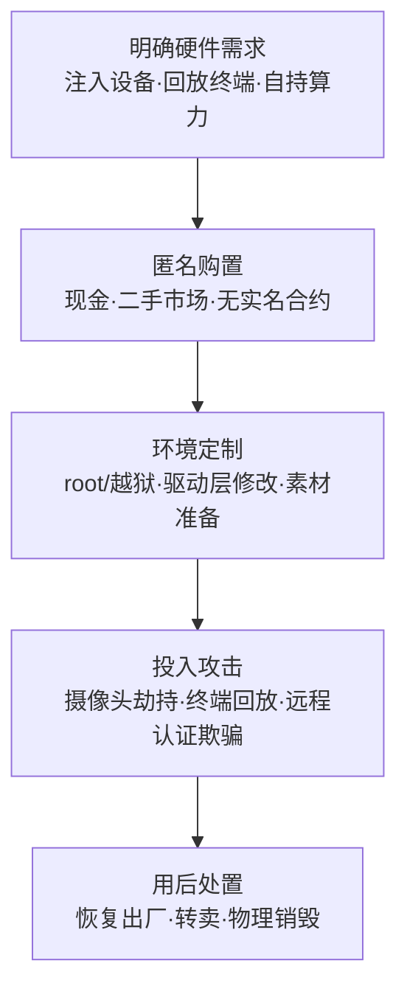

# 消费级硬件 (AML.T0008.001)

> 属于 [获取基础设施 (AML.T0008)](../AML.T0008-Acquire-Infrastructure.md)

## 一句话通俗理解

> 租云服务器像租房——房东（云厂商）留着钥匙、装着监控、记着账单；买消费级硬件像用现金全款买下无名小屋——手机、摄像头、树莓派，环境完全自己说了算，没有账单，事后也查不到买家。攻击者要骗过 AI 系统的"眼睛"，同样讲究置办这种查无此人的"自持物业"。

## 难度等级

⭐⭐⭐ **Realized（已实现）**

官方成熟度评定为 Realized——本子技术已在真实攻击中落地：两名骗徒用摄像头劫持设备向人脸识别系统注入冒用身份的人脸图像，接入上海市政府税务系统，累计骗取 7700 万美元（AML.CS0004）。获取环节的门槛近乎为零：几百元的二手手机、摄像头在任何电商平台与二手市场都能购得，购置行为本身完全合法，与正常消费无从区分。真正的"难度"全在用途侧——把通用设备改造成攻击工具（注入视频流、制作回放素材、绕过活体检测），而 CS0004 证明这道坎在真实欺诈中早已被跨过。与兄弟子技术 AML.T0008.000（AI 开发工作区）对比更凸显其价值：租用云算力会留下账单、账户链与调用日志，自持硬件连这些线索都不存在。

## 技术描述

### 通俗解释

父技术 [获取基础设施 (AML.T0008)](../AML.T0008-Acquire-Infrastructure.md) 的采购清单里，大部分是"线上资产"——租 GPU、买域名、开云函数；本子技术补上的是**实体货架**：智能手机、摄像头、单板计算机、可穿戴设备这些人人买得起的消费电子产品。

对攻击 AI 系统的人而言，这类设备有双重价值：

1. **AI 系统"感官"的物理入口**：人脸识别、目标检测、语音识别的第一站都是传感器（摄像头、麦克风）——消费级硬件正是从物理世界欺骗这些感官的载体；
2. **无人监控的离线实验室**：设备上跑什么、改什么、连过谁，没有云厂商遥测、没有审计日志、没有账单关联——官方描述称之为对环境的"完全控制"。

### 技术原理

依据官方描述：攻击者可能购置消费级硬件来实施攻击；自持硬件使攻击者对环境拥有完全控制权，且此类设备可能难以溯源。技术要点拆解：

1. **完全控制**：root/越狱、定制固件、驱动层修改均在攻击者权限之内——在摄像头劫持攻击中，可以把真实摄像头输入替换为预录的冒用身份视频，绕过"活体"检测所依赖的物理信号；
2. **难以溯源**：现金购置、二手转卖、无合约无实名——设备序列号不与任何身份绑定，用后可恢复出厂、转卖甚至物理销毁，切断设备与攻击的关联；
3. **物理域传感器欺骗**：AI 系统的输入端是物理世界的传感器，消费级硬件让攻击者能在"物理世界 → 数字模型"的链路上动手脚——注入图像（摄像头劫持）、回放素材（照片/屏幕）、本地生成（人脸替换应用）。

**设备类型 × 在 AI 攻击中的典型角色：**

| 设备类型 | 典型获取渠道 | 在 AI 攻击中的角色 |
|----------|-------------|-------------------|
| 智能手机 | 电商平台、二手市场 | 运行人脸替换/回放应用的攻击终端；远程 KYC 视频认证欺骗 |
| USB/网络摄像头 | 电商、二手市场 | 摄像头劫持：向人脸识别管线注入伪造图像流（AML.CS0004 手法） |
| 单板计算机（树莓派等） | 电商 | 贴近物理入口的"攻击盒"：自动化回放、可编程注入、长期蹲守 |
| 可穿戴/IoT 设备 | 电商 | 传感器欺骗与身份冒充的道具载体（常与物理对抗措施配合） |
| 消费级 GPU 主机 | 电商、DIY 攒机 | 自持算力：本地训练代理模型、生成深度伪造素材，规避云端日志（自持版 AI 开发工作区） |

**与兄弟子技术的分工**：AML.T0008.000（AI 开发工作区）租用的是云端算力——快但留痕（账单、日志、账户链）；本子技术买断的是实体设备——慢一点、弱一点，但**零账单、零遥测、零实名**。AML.T0008.003（物理对抗措施）获取的是"弹药与戏服"——对抗贴纸、T 恤、伪装物；本子技术购置的是"发射平台"——承载与执行攻击的手机、摄像头与攻击盒。两者在物理域攻击中配合使用：硬件是枪，对抗道具是子弹（参见 MITRE AI 红队的人脸识别规避演练 AML.CS0012）。

**平台覆盖**：Enterprise——购置行为发生在传统商业渠道，攻击对象面向企业环境中的 AI 系统（人脸识别门禁、视频分析、远程认证）。

### 用途影响

- **物理域认证绕过**：摄像头劫持、照片/屏幕回放直接打击人脸识别的"活体"信任前提——物理世界与数字模型之间的信任链被硬件级伪造（衔接初始访问）；
- **不可归因的攻击终端**：现金购置的设备不与身份关联，攻击者可反复使用而不留基础设施指纹；
- **离线攻击准备**：自持硬件上训练代理模型、生成深度伪造素材，全程不出现在任何云端日志中；
- **传感器欺骗的通用载体**：凡是"AI 看世界"的地方——门禁、考勤、支付、远程 KYC——消费级硬件都是最便宜的欺骗工具。

## 攻击流程

### 典型攻击流程



**步骤详解：**

1. **明确硬件需求**
   - 通俗描述：按攻击计划列采购清单。
   - 技术细节：依据侦察结果倒推设备选型——目标是人脸识别终端（需要摄像头注入设备）、远程 KYC 认证（需要手机与人脸替换工具）、还是离线攻击准备（需要自持 GPU 算力）。

2. **匿名购置**
   - 通俗描述：现金下单，不留收货人。
   - 技术细节：现金或匿名支付渠道购置，优先二手市场（交易记录更难追索）；避免设备序列号与实名账户、收货地址产生关联。

3. **环境定制与素材准备**
   - 通俗描述：把买的设备改成"武器"。
   - 技术细节：root/越狱取得完全控制；在驱动层准备视频流替换能力；采集或生成注入素材——冒用身份的照片/视频可能来自社交网络爬取或深度伪造生成。

4. **投入攻击**
   - 通俗描述：举到摄像头前面，或接进识别链路。
   - 技术细节：摄像头劫持注入伪造图像流、在识别终端前回放素材、以攻击终端完成远程视频认证；自持算力则用于离线准备对抗样本与伪造素材。

5. **用后处置**
   - 通俗描述：毁尸灭迹。
   - 技术细节：恢复出厂设置、二手转卖或物理销毁，切断设备与攻击行为的物理关联——官方描述"难以溯源"的最后一环。

**与后续战术的衔接：**

- **物理对抗措施（AML.T0008.003）**：对抗贴纸、伪装物与硬件平台配合出击——硬件承载攻击，道具欺骗模型
- **初始访问**：绕过人脸识别即拿到账户与物理入口（AML.CS0004 中攻击者直接进入税务系统）
- **执行与影响**：进入系统后延续传统攻击链（AML.CS0004 中注册空壳公司、虚构发票实施系统性欺诈）

> 关键差异：云基础设施的隐身术是"混进正常流量"，消费级硬件的隐身术是"根本不上网"——攻击准备阶段，受害者侧全部遥测一无所获。

## 真实案例

> 直接以本子技术 AML.T0008.001 为标签的官方案例现有 1 例（案例1）；案例2 以兄弟子技术 AML.T0008.003 为标签，作为物理域攻击链的关联案例列出。均源自 MITRE ATLAS 案例库。

### 案例1：摄像头劫持攻击人脸识别税务系统（2018–2020年，AML.CS0004，直接命中本子技术）

- **时间**: 2018 年启动骗局，2020 年披露
- **攻击者**: 两名中国籍人员
- **手法**: 通过摄像头劫持攻击绕过"活体"人脸识别认证——向系统注入冒用身份的人脸图像，接入上海市政府税务系统。注入所用的摄像头等设备正是消费级硬件：廉价、易得、难以溯源。随后注册空壳公司、虚构客户发票，累计骗取 7700 万美元。
- **影响**: 几百块的硬件撬开上亿资金的大门——消费级硬件对"活体"认证的信任前提构成根本性挑战
- **参考链接**: [WSJ: Faces are the next target for fraudsters](https://www.wsj.com/articles/faces-are-the-next-target-for-fraudsters-11625662828)

### 案例2：MITRE AI 红队物理域规避人脸识别（2020年，AML.CS0012，关联兄弟子技术 AML.T0008.003）

- **时间**: 2020年
- **攻击者**: MITRE AI 红队（授权演练）
- **手法**: 对商业人脸识别服务实施物理域规避攻击，目标是诱导定向误分类。行动将传统 ATT&CK 技术（寻找有效账户、经 API 执行代码）与对抗性 ML 攻击交织推进——消费级设备与物理对抗措施（对抗图案等道具）共同构成攻击的物理装备库。
- **影响**: 演示了完整攻击链中"硬件平台 + 对抗道具"的组合运用：红队既走账号级入口，也走物理域通道
- **参考链接**: [MITRE ATLAS 案例研究 AML.CS0012](https://atlas.mitre.org/studies/AML.CS0012)

## 红队视角

> ⚠️ **免责声明**：以下内容仅用于合法授权的安全测试与教育目的。未经授权对他人系统或身份进行测试是违法行为。

### 实战技巧

1. **物理入口韧性评估（双授权）**
   在场地与法律双重授权下，对自有/客户的人脸识别终端测试照片、屏幕回放、深度伪造视频的绕过效果，评估活体检测（平面判断、3D 结构、红外）的实际水位——对应案例1 的攻击路径。

2. **摄像头注入路径验证**
   在授权环境中测试驱动层视频流替换的可行性（如虚拟视频设备），确认认证终端能否感知"输入源被劫持"——对应 AML.CS0004 的注入手法。

3. **远程 KYC 欺骗面评估**
   检查远程视频认证流程是否叠加设备指纹、环境一致性校验（光照、传感器噪声、网络环境），还是单独依赖人脸因子——找出"一部手机骗全场"的窗口。

4. **红队设备 OPSec 审计**
   红队自有设备以组织名义购置并打显著标记，演练后彻底销毁数据——把"攻击者用后即毁"的思路反过来变成自己的合规流程。

### 常用工具

| 工具名称 | 用途 | 平台 |
|----------|------|------|
| 智能手机（回放/人脸替换应用） | 照片与视频回放、实时人脸替换演示 | Android / iOS |
| 树莓派 + USB 摄像头 | 可编程注入与自动化回放平台 | Linux |
| OpenCV | 搭建自有测试用人脸识别与活体检测 demo | 跨平台 |
| v4l2loopback | Linux 虚拟视频设备，模拟摄像头输入替换 | Linux |

### 注意事项

- **物理域测试双授权**：涉及摄像头、门禁与出入口系统的测试，必须同时获得场地授权与法律确认
- **仅测试自有系统**：绝不接触他人身份信息与真实认证系统；测试素材使用自有或自愿授权拍摄内容
- 报告聚焦"活体检测水位、终端防篡改、认证流程韧性"，不必演示资金层面的欺诈后果

## 蓝队视角

### 检测要点

1. **认证终端遥测（最直接的信号）**
   - 日志来源：人脸识别终端的质量分析、认证日志
   - 异常特征：图像质量异常（屏幕摩尔纹、反光、色温异常）、活体分数持续低分的聚集尝试、同一身份短时间多次认证

2. **终端物理完整性**
   - 日志来源：终端资产管理系统、EDR
   - 异常特征：摄像头固件/线缆/供电的非授权变更（摄像头劫持的物理植入特征）、认证终端上陌生 USB 设备接入

3. **远程认证环境校验**
   - 日志来源：远程 KYC 平台日志
   - 异常特征：同一设备指纹关联多个身份、多台设备传感器噪声指纹雷同、网络环境与申报地不符

### 监控建议

- 高价值物理入口保留人工复核通道，活体检测策略随攻击演进持续升级
- 认证终端纳入资产台账，固件与硬件变更一律走变更管理流程
- 远程 KYC 叠加设备指纹与环境一致性校验，不单独依赖人脸单一因子

## 检测建议

### 网络层检测

**检测方法：** 自持硬件在准备阶段不联网，网络层价值集中在攻击落地时。

- 远程 KYC 场景中，同一设备指纹/传感器噪声指纹在多个账户的认证请求中复现
- 认证终端发起的异常外连（被劫持终端回传采集数据的通道）

### 主机层检测

**检测方法：** 监控认证终端的物理与系统完整性。

- 认证终端上陌生 USB 设备接入、摄像头设备枚举变化
- 摄像头固件、线缆、供电的非授权变更
- 终端进入调试模式/开发者模式的异常事件

### 应用层检测（AI 遥测）

**检测方法：** 在人脸识别管线内建攻击信号分析。

- 活体检测分数的持续低分尝试聚集（照片/屏幕回放试错的典型画像）
- 图像采集异常：摩尔纹、镜面反光、帧率不自然（回放与注入的残留特征）
- 同一采集设备的图像质量模式突变（视频流被替换的分界线）

**程序化检测思路（无需 EDR 侧改造）：**

两条低成本管线：其一，在人脸识别服务端为每次认证记录"活体分 + 图像质量特征"，滑动窗口内低分尝试聚集即告警（捕获回放类攻击的试错过程）；其二，把认证终端资产指纹（摄像头型号、固件版本）纳入服务端校验，指纹变化即触发工单（捕获硬件篡改与劫持）。

### Sigma 规则思路示例

```yaml
title: 人脸识别终端遭遇回放/注入攻击特征（消费级硬件欺骗信号）
status: experimental
description: 检测人脸识别认证中活体分数持续低分的聚集尝试，或图像质量
    分析出现摩尔纹/反光等回放残留特征，可能为消费级硬件实施的
    摄像头劫持或照片/屏幕回放攻击（AML.T0008.001 / AML.CS0004 场景）
logsource:
    category: application
    product: face_recognition_terminal
detection:
    selection:
        event_type: 'authentication_attempt'
    low_liveness:
        liveness_score|lt: 0.4
    replay_artifact:
        quality_flag|contains:
            - 'moire_pattern'
            - 'screen_glare'
            - 'unnatural_framerate'
    condition: selection and 1 of [low_liveness, replay_artifact]
    aggregation:
        - count() > 5
        - timeframe: 10m
level: high
tags:
    - attack.t1583
    - attack.t1200
    - atlas.aml_t0008_001
```

## 缓解措施

> **官方数据说明**：在 MITRE ATLAS 官方数据（2026.09）中，本子技术与父技术 [获取基础设施 (AML.T0008)](../AML.T0008-Acquire-Infrastructure.md) 均未映射任何缓解措施（mitigations 字段为空）——购置行为发生在受害者视野之外的合法商业渠道，官方框架暂无直接对策条目。以下为本库基于技术特性与关联案例整理的防御建议，**非官方映射**（与父文档缓解章节"物理入口韧性与防篡改"方向一致）。

### 优先级1：关键建议 —— 升级活体检测与多模态校验

人脸识别等物理认证入口升级活体检测（3D 结构光、红外、微表情挑战），叠加多模态校验（人脸 + 声音 + 行为）；高价值场景（支付、政务、税务）保留人工复核通道——对抗摄像头劫持与回放攻击的缓解核心是抬高"单点欺骗"的成本。

### 优先级2：重要建议 —— 终端资产台账与物理防篡改

认证终端纳入资产台账与变更管理：固件签名与版本校验、线缆/供电物理巡检、陌生 USB 设备接入告警——摄像头劫持需要在物理或驱动层动手脚，防篡改直接抬高实施门槛。

### 优先级3：建议措施 —— 远程认证叠加设备指纹

远程 KYC 与视频认证流程叠加设备指纹、传感器噪声指纹与环境一致性校验（网络、光照、时区）——消费级硬件可以伪造人脸，但难以同时伪造全部环境信号。

### 落地优先级一览（本库建议）

| 防御方向 | 针对的攻击手法 | 建议优先级 |
|----------|---------------|:---------:|
| 活体检测升级 + 多模态校验 | 摄像头劫持、照片/屏幕回放 | 关键 |
| 终端资产台账与物理防篡改 | 摄像头物理植入、驱动劫持 | 重要 |
| 远程认证设备指纹 | 攻击终端冒充正常用户 | 建议 |

> 说明：购置行为本身无法阻断——现金买手机不违反任何规则。防御的现实抓手在**认证端**：让"骗过摄像头"不足以通过认证。

## 关联 ATT&CK 技术

> 本子技术在 ATLAS 官方数据中无 attack_reference 直接映射；父技术 AML.T0008 官方映射至 T1583，本子技术继承该映射语境。以下按官方映射与主题类比分别列出（主题类比链接已经本库验证）。

- [获取基础设施 (T1583)](../../../enterprise/02-Resource-Development/T1583-Acquire-Infrastructure.md) — 父技术的官方映射，本子技术是其在"实体设备"维度的延伸
- [服务器 (T1583.004)](../../../enterprise/02-Resource-Development/T1583/T1583.004-Server.md) — 主题类比：买服务器与买消费级设备同属"自持硬件"，本子技术把购置对象换成手机与摄像头
- [硬件添加 (T1200)](../../../enterprise/03-Initial-Access/T1200-Hardware-Additions.md) — 主题类比：T1200 把恶意硬件植入目标环境获取访问，本技术购置自有硬件从外部发起攻击——一个向内、一个向外，互为镜像

**传统硬件类技术 vs ATLAS 消费级硬件：**

| 维度 | 传统 T1583 / T1200 | ATLAS AML.T0008.001 |
|------|--------------------|---------------------|
| 硬件角色 | 承载 C2、植入目标的跳板 | **欺骗 AI 传感器的物理工具**：注入、回放、伪造输入 |
| 攻击对象 | 传统网络与主机 | AI 系统的输入端（人脸识别、视频分析、远程认证） |
| 信任前提 | 绕过网络/软件控制 | 直接打击"活体检测"的物理信任链 |
| 典型案例 | 恶意 USB、植入式设备 | 摄像头劫持骗过人脸识别（AML.CS0004） |

一句话总结：T1200 把硬件塞进你的机房，AML.T0008.001 把硬件举在你的摄像头前——攻击者的硬件从"进入目标环境"进化为"欺骗目标 AI 的感官"。

## 动手实验

> ⚠️ **重要提示**：所有实验仅在自有设备与自建测试系统上进行，不接触任何第三方人脸识别系统；不得使用他人身份信息或对真实认证系统进行测试。

### 实验环境准备

| 环境组件 | 用途 | 获取方式 |
|----------|------|----------|
| 自有智能手机 | 回放素材播放与拍摄终端 | 现有设备 |
| OpenCV（Python） | 搭建测试用人脸识别 demo | pip 安装，开源 |
| 测试用照片/视频素材 | 回放攻击材料（自有拍摄） | 自行拍摄 |
| 可选：树莓派 + USB 摄像头 | 可编程注入平台 | 电商购置 |

### 实验1（初级）：体验照片/屏幕回放对"活体"的挑战

**实验目标：** 在自建系统上直观理解回放攻击与活体检测的对抗。

**实验步骤：**
1. 用 OpenCV 人脸识别 demo（或手机自带的面容解锁）搭建测试环境
2. 分别用打印照片、另一部手机播放的视频尝试通过识别
3. 记录每次尝试的识别结果与置信度变化
4. 思考：案例1 的攻击者为什么选择"注入"而不是"举着照片"？（提示：活体检测依赖哪些物理信号）

**预期结果：** 理解"活体检测检测的是什么"——平面/回放被拦截的地方，正是注入攻击绕过的地方。

### 实验2（中级）：搭建摄像头注入实验环境

**实验目标：** 在自有环境复现"摄像头劫持"的注入原理。

**实验步骤：**
1. 树莓派（或旧笔记本）接入 USB 摄像头，作为待劫持的输入源
2. 用 v4l2loopback 建立虚拟视频设备，把预录视频伪装成摄像头实时输入
3. 让自建人脸识别 demo 读取虚拟设备，观察识别结果
4. 思考：认证终端与服务端如何感知"输入源被替换"？（对照检测建议的终端资产指纹）

**预期结果：** 理解注入攻击发生在"物理世界 → 数字模型"链路的哪一环。

### 实验3（高级）：活体检测水位评估

**实验目标：** 以防御者视角量化自建系统的抗欺骗能力。

**实验步骤：**
1. 部署一个开源活体检测方案（如 miniVision Silent-Face-Anti-Spoof）
2. 用实验1、实验2 的攻击素材系统测试：照片、屏幕回放、注入视频
3. 统计各攻击类型的拦截率与误杀率，找出最薄弱的输入通道
4. 依据本文 Sigma 思路，为"低活体分尝试聚集"写一条检测规则并在测试流量上验证

**预期结果：** 产出一份"攻击面 - 拦截率 - 检测规则"的攻防对照记录。

## 术语解释

| 术语 | 英文原名 | 通俗解释 |
|------|----------|----------|
| 消费级硬件 | Consumer Hardware | 人人买得起的量产电子设备——手机、摄像头、树莓派；现金购置、难以溯源 |
| 摄像头劫持 | Camera Hijack | 在摄像头链路上动手脚，让人脸识别系统"看到"的不是现场而是预录的伪造图像 |
| 活体检测 | Liveness Detection | 判断摄像头前是"真人"还是照片/屏幕/注入信号的防伪机制 |
| 传感器欺骗 | Sensor Spoofing | 伪造 AI 系统输入端（摄像头、麦克风）采集到的物理信号 |
| 深度伪造 | Deepfake | 用 AI 生成或替换人脸/声音的合成媒体技术 |
| 人脸替换 | Face Swap | 把一张脸"贴"到另一段视频/图像上的技术——远程认证欺骗的常用素材生成手段 |
| 单板计算机 | Single-Board Computer | 信用卡大小的完整计算机（如树莓派）——廉价的可编程攻击盒 |
| Root/越狱 | Rooting / Jailbreak | 取得设备最高控制权——在自持硬件上完全合法且随意 |
| 设备指纹 | Device Fingerprinting | 通过软硬件特征识别设备身份的技术——远程认证防欺骗的关键手段 |
| 物理对抗措施 | Physical Countermeasures | 对抗贴纸、T 恤、伪装物等干扰 AI 的实物——与本技术的硬件平台配合使用 |
| 硬件添加 | Hardware Additions | 向目标环境植入硬件的 ATT&CK 技术（T1200）——本技术"由外攻击"的镜像 |
| 摩尔纹 | Moiré Pattern | 屏幕翻拍图像上的干涉条纹——回放攻击的典型残留特征 |

## 参考资料

### 📚 官方文档

- [MITRE ATLAS - Consumer Hardware (AML.T0008.001)](https://atlas.mitre.org/techniques/AML.T0008/001/) - 官方技术页面
- [MITRE ATLAS - Acquire Infrastructure (AML.T0008)](https://atlas.mitre.org/techniques/AML.T0008/) - 父技术页面
- [MITRE ATLAS 矩阵](https://atlas.mitre.org/matrices/ATLAS/)
- [MITRE ATLAS Data (GitHub)](https://github.com/mitre-atlas/atlas-data)

### 📰 案例报告（真实攻击与安全研究）

- [WSJ: Faces are the next target for fraudsters](https://www.wsj.com/articles/faces-are-the-next-target-for-fraudsters-11625662828) - 摄像头劫持骗过人脸识别、骗取 7700 万美元（AML.CS0004）
- [MITRE ATLAS: Face Identification System Evasion (AML.CS0012)](https://atlas.mitre.org/studies/AML.CS0012) - MITRE AI 红队物理域规避演练

### 🔧 工具与资源

- [OpenCV](https://opencv.org/) - 开源计算机视觉库，搭建自有人脸识别测试环境
- [Silent-Face-Anti-Spoof (GitHub)](https://github.com/minivision-ai/Silent-Face-Anti-Spoofing) - 轻量级开源活体检测方案
- [v4l2loopback (GitHub)](https://github.com/umlaeute/v4l2loopback) - Linux 虚拟视频设备内核模块，注入实验用
- [NIST SP 800-63 Digital Identity Guidelines](https://pages.nist.gov/800-63-3/) - 数字身份与生物特征认证的官方指南

### 🔗 关联阅读

- [获取基础设施 (AML.T0008)](../AML.T0008-Acquire-Infrastructure.md) - 本技术的父技术，六类攻击基础设施全景
- [资源开发战术 (AML.TA0003)](../README.md) - 本技术所属战术的概览页
- [获取基础设施 (T1583)](../../../enterprise/02-Resource-Development/T1583-Acquire-Infrastructure.md) - 传统基础设施获取技术，与本技术对照阅读
- [硬件添加 (T1200)](../../../enterprise/03-Initial-Access/T1200-Hardware-Additions.md) - 向目标环境植入硬件的镜像技术

---

> **版本**: ATLAS 2026.09 | **更新**: 2026-10-22 | **模板**: ATLAS 技术文档 v1.0
