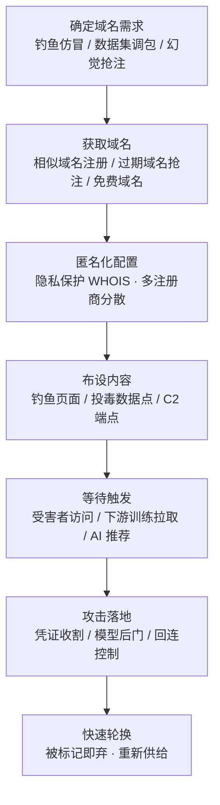

# 域名 (AML.T0008.002)

> 属于 [获取基础设施 (AML.T0008)](../AML.T0008-Acquire-Infrastructure.md)

## 一句话通俗理解

> 域名是互联网的"门牌号"，一年十几块钱就能买一个——传统攻击者买张"高仿门牌"骗你进假店；AI 时代的攻击者更鸡贼：你训练模型用的数据集里引用着成千上万个 URL，其中不少门牌的原主人早已停止续费，攻击者把这些"鬼屋地皮"整块买下，在原址盖起一模一样的假房子——你训练时照着旧地址取数据，取回来的已经是投毒样本。

## 难度等级

⭐⭐ **Demonstrated（已演示）**

官方成熟度评定为 Demonstrated——注册域名的门槛几乎为零：几分钟流程、一年通常不到一杯咖啡的钱，部分免费域名服务甚至零成本。传统相似域名钓鱼已沿用二十年；AI 领域的独特玩法——抢注数据集 URL 清单中的过期域名实施 split-view 调包——已由 Google DeepMind、ETH Zurich、NVIDIA 等机构组成的联合研究团队在 10 个流行 Web 级数据集上完整验证：可购买域名的比例足以成功实施投毒（AML.CS0025）。买到域名不难，难在"用好"：数据集工程、投毒样本构造与避查的注册信息管理决定了攻击上限，故评 ⭐⭐ 而非 ⭐⭐⭐。

## 技术描述

### 通俗解释

如果说父技术 [获取基础设施 (AML.T0008)](../AML.T0008-Acquire-Infrastructure.md) 是置办攻击用的全部"产业"，本子技术专管其中最廉价、最灵活的一件——**域名**。它是人类可读的网络地址，可以购买，某些情况下（免费域名服务、子域名分发）甚至可以白拿。

攻击者拿域名干两类事：

| 用途类型 | 打法 | 通俗类比 |
|---------|------|---------|
| 传统用途 | 相似域名钓鱼、仿冒正规 AI 服务、托管恶意内容与 C2 回连 | 伪造高仿门牌，骗你走进假店 |
| **AI 特色用途** | 抢注大型数据集 URL 清单中**已过期**的域名，把数据点调包成投毒样本 | 买下数据集引用的"鬼屋地皮"，在原址盖假房子 |

与同战术的发布幻觉实体（AML.T0060）存在明确分工与联动：AML.T0060 抢注的是"**AI 编造出来**的名字"（LLM 幻觉的域名、包名），赌受害者照抄 AI 答案；本子技术抢注的是"**真实存在但已过期**的名字"，赌数据集引用不会随域名易主而失效。两者弹药来源不同，落点都是域名注册商，防御手段（新注册域名监控、品牌相似度告警）直接通用。

### 技术原理

依据官方描述，攻击者可获取用于定向攻击的域名。域名是代表一个或多个 IP 地址的人类可读名称，可购买获得，某些情况下可免费获取。攻击者对已获取域名的用途与 ATT&CK 传统技术一致（见 [域名 (T1583.001)](../../../enterprise/02-Resource-Development/T1583/T1583.001-Domains.md)）；ATLAS 为其赋予了 AI 领域的独特攻击路径：

1. **传统路径（继承自 T1583.001）**：注册与目标品牌编辑距离极近的相似域名（typosquatting/homograph）、注册曾属他人的到期域名——用于钓鱼页面、伪装正规 AI 服务入口、托管恶意载荷与 C2 回连；
2. **数据集调包路径（AI 特色，官方描述明载）**：大型 AI 数据集常以"指向单个数据点的 URL 清单"形式分发。攻击者可获取这些数据集中**已包含的过期域名**，将单个数据点替换为投毒示例——这正是 split-view 攻击的核心机制，与发布投毒 AI 制品：数据集（AML.T0115.000）直接衔接：本子技术负责"买地"，AML.T0115.000 负责"盖房"（构造投毒数据并等待下游训练）；
3. **幻觉联动路径**：与发布幻觉实体（AML.T0060）配合——LLM 幻觉出的"官方文档域名"被批量注册后，域名同时承担钓鱼托管与"AI 推荐信任背书"双重职能。

split-view 之所以成立，根源在于**数据集的信任有效期 = 其引用域名的生命周期**：数据集发布时（采集视图）URL 指向的内容，与数月数年后模型训练时（训练视图）同一 URL 返回的内容，可能完全不同——中间隔着域名过期、易主、重建的整个窗口期。

**平台覆盖**：Enterprise——域名注册与配置发生在传统 IT 环境，攻击用途直指 AI 数据供应链。

### 用途影响

- **污染训练数据**：一条过期域名的成本极低，却能让 Web 级数据集的对应数据点整体"变节"——训练侧投毒的性价比之王；
- **钓鱼与仿冒**：相似域名承载仿冒正规 AI 服务的登录页、下载页，凭"像真的"收割凭证；
- **C2 与载荷托管**：域名是攻击基础设施的门面——快速轮换、即弃即换，归因成本被摊薄到注册费级别；
- **信任背书放大**：与 AML.T0060 联动时，域名自带"AI 官方推荐"光环，钓鱼成功率远高于裸投；
- **受害者侧零感知**：全部获取与配置动作发生在注册商与 DNS 层，目标侧无任何日志痕迹。

## 攻击流程

### 典型攻击流程



**步骤详解：**

1. **确定域名需求**
   - 通俗描述：先想清楚买地皮是为了开假店、埋地雷还是等 AI 送客。
   - 技术细节：依据攻击计划倒推——钓鱼仿冒需要与目标品牌近似的名字；数据集调包需要从目标数据集的 URL 清单中筛出**已过期且可购买**的域名（对照 whois/RDAP 注册状态）；幻觉联动则从 LLM 幻觉测绘（AML.T0062 思路）结果中挑跨模型复现率高的"编造域名"。

2. **获取域名**
   - 通俗描述：下单买门牌。
   - 技术细节：相似域名走常规注册商；过期域名通过域名竞拍/过期抢注服务获取，部分后缀存在免费注册渠道；一次行动常批量注册数十个域名形成"轮换池"。

3. **匿名化配置**
   - 通俗描述：收货地址留空的互联网版本。
   - 技术细节：启用 WHOIS 隐私保护、使用匿名支付与割裂的注册身份、跨多家注册商分散购置，确保域名信息不与攻击者真实身份产生物理关联。

4. **布设内容**
   - 通俗描述：在买来的地皮上盖房子。
   - 技术细节：钓鱼场景布设高仿登录页；split-view 场景在原 URL 路径放置与原始数据格式一致、内容被投毒的样本（衔接 AML.T0115.000 的投毒构造）；C2 场景挂载回连端点或重定向服务。

5. **等待触发**
   - 通俗描述：静等猎物照旧地址上门。
   - 技术细节：数据集调包无需任何主动投递——下游训练团队按 URL 清单重新拉取数据时自动"取货"；钓鱼与幻觉域名等待用户点击；C2 域名等待植入体回连。

6. **攻击落地与轮换**
   - 通俗描述：收网，打一枪换一个地方。
   - 技术细节：凭证收割、模型后门成型或回连建立后，被标记封禁的域名立即弃用，从轮换池补位——域名供给的边际成本几乎为零。

**与后续战术的衔接：**

- **暂存能力（AML.T0079）**：抢注的域名是现成弹药库——投毒数据点、钓鱼页面在原 URL 上静候触发
- **发布投毒 AI 制品（AML.T0115.000）**：本子技术"买地"，投毒制品"盖房"——split-view 调包是两者的完整接力
- **初始访问**：钓鱼域名、仿冒 AI 服务入口是迈入目标环境的门
- **命令与控制**：域名承担 C2 门面，配合无服务器（AML.T0008.004）等功能设施组成回连通道

> 关键差异：传统 T1583.001 的域名是"骗人的门牌"，AML.T0008.002 多了一层"**调包的仓库**"——攻击者不等你上错门，而是等你照着旧账本（URL 清单）进货时，把货换成毒的。

## 真实案例

> 以下 3 个案例的官方技术标注中均直接包含 AML.T0008.002，全部源自 MITRE ATLAS 案例库。

### 案例1：Web 级数据集投毒——Split-View 攻击（AML.CS0025）

- **时间**: 2024年6月
- **攻击者**: Google DeepMind、ETH Zurich、NVIDIA、Robust Intelligence 与 Google 的联合研究团队（安全研究）
- **手法**: 许多大规模数据集以"指向单个数据点的 URL 清单"形式分发。研究团队指出其结构性漏洞：数据集最初收集时抓取的内容与训练时抓取的内容可能不同。团队识别出曾在数据集中出现、现已过期可售的域名并验证购买可行性——对 10 个流行 Web 级数据集的测量表明，可购买域名的比例足以成功实施投毒攻击。
- **影响**: 用实证宣告"数据集的信任有效期取决于其引用域名的生命周期"——花小钱买过期域名就能污染主流训练数据
- **参考链接**: [Poisoning Web-Scale Training Datasets is Practical (arXiv)](https://arxiv.org/abs/2302.10149)

### 案例2：投毒 ClawdBot 技能——域名作为回连接收阵地（AML.CS0049）

- **时间**: 2026年1月
- **攻击者**: 安全研究员 Jamieson O'Reilly（授权演示）
- **手法**: 在 ClawdHub 技能仓库发布含提示词注入的投毒技能，诱导 ClawdBot 执行 shell 命令并回连到研究者控制的服务器域名。8 小时内 16 名用户下载执行了该投毒技能——攻击者侧的域名基础设施在整条链路中承担指令接收与验证职能。
- **影响**: 演示了域名在智能体供应链攻击中的"接收端"角色：没有这块阵地，投毒技能的回连验证就无从谈起
- **参考链接**: [研究者披露推文 (X/Twitter)](https://x.com/theonejvo/status/2015892980851474595)

### 案例3：AI in the Middle——攻击者域名充当 C2 中继（AML.CS0061）

- **时间**: 2026年2月
- **攻击者**: Check Point Research（安全研究）
- **手法**: 恶意软件滥用 Grok、Microsoft Copilot 等具备匿名浏览与 URL 抓取能力的 Web AI 助手作为隐蔽 C2 通道：植入体让 AI 服务抓取**攻击者控制的 URL**，经普通 AI 助手响应带回攻击者下发的命令。回连流量因混入可信 AI 服务域名而难以被聚焦可疑基础设施的防御发现。
- **影响**: 攻击者域名与可信 AI 服务域名组成"接力信道"——基础设施监控必须同时覆盖两端
- **参考链接**: [Check Point: AI in the Middle](https://research.checkpoint.com/2026/ai-in-the-middle-turning-web-based-ai-services-into-c2-proxies-the-future-of-ai-driven-attacks/)

## 红队视角

> ⚠️ **免责声明**：以下内容仅用于合法授权的安全测试与教育目的。未经授权注册仿冒域名或对他人系统进行测试是违法行为。

### 实战技巧

1. **组织引用域名到期台账**
   盘点组织对外发布的数据集、文档、代码仓库中引用的全部外部 URL，批量查询 WHOIS/RDAP 注册状态，输出"引用域名 → 归属 → 到期时间"台账——回答"攻击者今天能抢注我们引用的哪些域名、明天呢"。

2. **相似域名与幻觉域名双清单**
   用 dnstwist 生成组织域名的拼写变体清单核验注册状态；同时对组织常用 LLM 做小规模幻觉普查（冷门领域提问），收集 AI 编造的"官方域名"——两份清单合并为组织域名暴露面报告，直接交给蓝队布防。

3. **URL 清单式数据集审计**
   对组织训练管线消费的每一个 URL 清单式数据集，抽样数百条记录解析域名存活状态，统计"已失效/可购买"比例并对照 CS0025 的研究结论量化 split-view 风险。

4. **回连阵地韧性验证**
   在授权范围内验证组织对"新注册域名 + 新签发证书"外连的检测覆盖率——攻击者的 C2 域名从注册到上线往往不到一天，检测窗口同样只有一天。

### 常用工具

| 工具名称 | 用途 | 平台 |
|----------|------|------|
| whois / RDAP | 域名注册状态与到期时间查询 | 跨平台 |
| dnstwist | 拼写变体域名生成与抢注检测 | 跨平台 |
| crt.sh | 证书透明度日志，发现相似域名的新签发证书 | Web |
| urlscan.io | 域名历史解析与页面快照检索 | Web |
| Certificate360 / 品牌保护服务 | 相似域名批量持续监控 | 商业服务 |

### 注意事项

- **以组织名义注册**：评估中确需注册的域名一律组织名义 + 显著标记（WHOIS 备注），绝不匿名购置
- **不真实投放投毒内容**：split-view 演示止步于"证明可购买"，不向任何公开数据集对应的 URL 放置投毒样本
- 交付物聚焦"组织引用域名暴露面 + 检测覆盖率"，而非证明攻击可行性

## 蓝队视角

### 检测要点

1. **引用域名注册状态监控（split-view 前哨）**
   - 数据来源：组织训练管线消费的 URL 清单、WHOIS/RDAP 定期轮询、域名到期提醒源
   - 异常特征：引用域名临近到期未续费、已完成易主（注册人/注册商变更）、解析 IP 与历史记录突变——三者都是"调包窗口正在打开"的信号

2. **相似域名与证书监控**
   - 数据来源：证书透明度（CT）日志、dnstwist 变体清单、新注册域名（NRD）情报源
   - 异常特征：与组织域名编辑距离极近的新注册域、向其新签发的 TLS 证书、品牌变体域名上线 AI 服务特征（LLM Web 前端、API 网关）

3. **下游训练数据检测**
   - 数据来源：训练数据加载日志、数据质量抽检
   - 异常特征：同一 URL 在不同时间拉取的内容哈希变化、样本分布与数据集卡片描述的突发漂移——split-view 调包落地时最接近受害者的可见信号

### 监控建议

- 建立**数据集 URL 卫生**制度：发布与消费 URL 清单式数据集时，双向审计引用域名存活与归属，长期监控注册状态变化——别让攻击者先一步买走你引用的域名
- 对组织自有及高混淆度变体域名做**长周期注册 + 自动续费 + 相似域名监控**，压缩抢注窗口
- 训练管线引入**内容指纹固化**：首次消费数据集时记录各数据点哈希，重取时校验——"账本"对不上即告警

## 检测建议

### 网络层检测

**检测方法：** 识别对可疑域名的解析与访问模式。

- 企业资产（尤其训练集群）访问**新注册域名**（域龄极短）且该域名出现在已知数据集 URL 清单中——split-view 回调的直接特征
- DNS 解析记录显示长期稳定的域名突然更换解析目标（A/AAAA 记录突变）
- 对相似域名/证书透明度新签发域名的入站钓鱼访问

### 主机层检测

**检测方法：** 监控数据加载与回连行为。

- 训练任务进程对非 HTTPS/证书异常域名的数据下载（数据拉取被降级或指向新证书域名）
- 非浏览器进程对无历史记录域名的 TLS 连接（C2 域名轮换特征，参见父技术 Sigma 思路）

### 应用层检测（AI 遥测）

**检测方法：** 在数据管线与 AI 网关侧布防。

- 训练数据加载器记录每批次样本的内容哈希/来源域名，与首次消费基线比对，漂移即阻断并转人工
- LLM 网关对输出中的 URL 做域名信誉核验（域龄、注册人、证书状态），新注册域名附"未验证"警示（覆盖幻觉域名联动路径）

**程序化检测思路（无需 EDR 侧改造）：**

一条定时任务管线：解析组织消费的全部 URL 清单式数据集 → 提取唯一域名 → 批量查询 RDAP 注册状态与到期时间 → 输出三类告警：① 已易主且内容指纹变化；② 30 天内到期；③ 引用域名解析目标突变。用极低成本覆盖 split-view 的完整潜伏窗口。

### Sigma 规则思路示例

```yaml
title: 训练/数据管线节点访问数据集清单中的新注册域名
status: experimental
description: 检测企业资产（训练集群、数据工程节点）访问已知数据集
    URL 清单内的域名且该域名注册时间极短，可能为过期域名
    被抢注后的 split-view 调包回取（AML.T0008.002 / AML.T0115.000）
logsource:
    category: proxy
detection:
    selection_dataset_domain:
        url|contains:
            - '.dataset-cdn.example-corp.net'   # 占位：替换为组织数据集清单域名
    filter_trusted:
        domain_age|gte: 365
    condition: selection_dataset_domain and not filter_trusted
    timeframe: 24h
falsepositives:
    - 数据集官方迁移 CDN 或更换域名（需人工核对公告）
level: high
tags:
    - attack.t1583.001
    - atlas.aml_t0008_002
```

> 说明：Sigma 只能捕捉"访问"表象；真正的阻断点在数据管线的**内容指纹校验**与注册状态的**前置监控**——域名被买走的瞬间就该告警，而不是数据被取走之后。

## 缓解措施

> **官方数据说明**：在 MITRE ATLAS 官方数据（2026.09）中，本子技术 AML.T0008.002 及其父技术 [获取基础设施 (AML.T0008)](../AML.T0008-Acquire-Infrastructure.md) **均未映射任何缓解措施**（mitigations 字段为空）——域名获取发生在受害者视野之外，官方框架暂无直接对策条目。以下为本库基于技术特性整理的防御建议，**非官方映射**。

### 优先级1：关键建议 —— 数据集 URL 卫生

**引用域名双向审计**：发布 URL 清单式数据集前审计引用域名的存活与归属；消费外部数据集时建立引用域名台账并监控注册状态变化——引用域名一旦过期易主，数据集即面临 split-view 调包风险（案例1）；训练管线叠加**内容指纹固化**（首取哈希、重取校验），把"账本"锁死。

### 优先级2：重要建议 —— 自有域名守护

**长周期注册 + 相似域名监控**：对组织自有、产品线及高混淆度变体域名做多年期注册与自动续费；订阅证书透明度日志与新注册域名情报，对品牌变体域名的证书签发、AI 服务特征上线即时告警——压缩钓鱼仿冒与幻觉域名（AML.T0060 联动）的抢注窗口。

### 主题相关的既有缓解措施（官方未映射至本技术）

| 缓解措施ID | 缓解措施名称 | 相关性说明 |
|------------|-------------|-----------|
| AML.M0007 | 净化训练数据 | 对进入训练的数据做清洗与校验，是 split-view 调包落地后的最后一道数据侧防线（官方映射于投毒制品类技术） |
| AML.M0016 | 漏洞扫描 | 对数据管线拉取的内容执行恶意检测，覆盖"调包后的投毒样本"检测面 |

> 说明：以上为本库编辑建议。域名获取发生在目标视野之外，**前置监控比事后缓解更现实**——本子技术的最佳防御窗口在"引用域名易主"与"数据重取"两个时间点。

## 关联 ATT&CK 技术

- [域名 (T1583.001)](../../../enterprise/02-Resource-Development/T1583/T1583.001-Domains.md) — 本子技术在 ATLAS 官方数据中的 ATT&CK 参考映射（attack_reference 直接指向 T1583.001）
- [获取基础设施 (T1583)](../../../enterprise/02-Resource-Development/T1583-Acquire-Infrastructure.md) — 父技术的官方 ATT&CK 映射，域名获取的母技术全景

**传统 T1583.001 vs ATLAS AML.T0008.002：**

| 维度 | 传统域名 (T1583.001) | ATLAS 域名 (AML.T0008.002) |
|------|---------------------|---------------------------|
| 获取方式 | 购买/免费注册、相似域名、到期域名抢注 | 同左（完全继承） |
| 传统用途 | 钓鱼、仿冒、C2、恶意内容托管 | 同左 |
| **AI 特色用途** | — | **抢注数据集 URL 清单中的过期域名，调包数据点（split-view）** |
| 联动技术 | T1566 钓鱼、T1071 应用层协议 | + AML.T0115.000 投毒数据集、AML.T0060 幻觉域名抢注 |
| 防御抓手 | 新注册域拦截、品牌监控、威胁情报 | + **数据集 URL 卫生、引用域名注册状态监控、训练内容指纹固化** |

一句话总结：T1583.001 买门牌骗人上门，AML.T0008.002 还买"旧账本上的地址"——等你照账进货时，货已是毒的。

## 动手实验

> ⚠️ **重要提示**：所有实验仅使用公开数据与自有资产；对任何真实域名只做**只读查询**（WHOIS/RDAP/CT 日志），**严禁购买数据集引用的过期域名或放置投毒内容**。

### 实验环境准备

| 环境组件 | 用途 | 获取方式 |
|----------|------|----------|
| 一台联网分析机 | 域名与数据集审计 | 现有工作站 |
| Python 3.10+ | 批量 WHOIS/RDAP 查询脚本 | 官方安装包 |
| 公开 URL 清单式数据集样本 | split-view 风险审计对象 | Hugging Face 等平台 |
| 本地 DNS/hosts 模拟环境 | split-view 无害复现 | 虚拟机或容器 |

### 实验1（初级）：盘点自己组织的引用域名台账

**实验目标：** 以攻击者视角盘点组织引用域名暴露面。

**实验步骤：**
1. 收集组织对外发布的数据集、文档、README 中引用的外部 URL，提取唯一域名清单
2. 批量查询 RDAP/WHOIS：注册人、注册商、到期时间
3. 按风险分级输出台账：已过期可购（红）、90 天内到期（黄）、正常（绿）
4. 思考：红色域名的原 URL 上，攻击者能放什么？谁会来取？

**预期结果：** 一份"引用域名 → 归属 → 到期"台账，多数组织会惊讶于红色条目的数量。

### 实验2（中级）：量化一个公开数据集的 split-view 风险

**实验目标：** 复现 CS0025 研究方法论，量化真实攻击面。

**实验步骤：**
1. 选取一个以 URL 清单分发的公开数据集，抽样 500–1000 条记录
2. 批量解析域名存活状态（DNS 解析 + HTTP 探测），统计"已失效/可购买"比例
3. 对照研究结论（CS0025：10 个 Web 级数据集均可实施投毒）比较你的样本
4. 计算：若攻击者买下其中 1% 的域名并在原 URL 放置投毒数据，组织的训练管线能否察觉？

**预期结果：** 量化理解"数据集信任有效期 = 引用域名生命周期"。

### 实验3（高级）：本地无害复现 split-view 调包

**实验目标：** 在封闭环境内完整演示"采集视图 ≠ 训练视图"。

**实验步骤：**
1. 构建微型 URL 清单"数据集"（10 条记录，指向本地模拟域名），完成首次"采集"并记录每条内容的哈希
2. 模拟"域名易主"：修改本地 DNS/hosts，将其中 2 个域名指向新服务，放置**无害但内容不同**的样本（如打上明显标记的图片）
3. 按 URL 清单"重新拉取"模拟训练时视图，比对哈希——观察调包成功且无任何告警
4. 为数据加载器补上"哈希校验"逻辑，重放步骤 3——验证防线生效
5. 对照案例1：真实世界里，这道防线必须建在数据管线里，而不是事后

**预期结果：** 产出一套"split-view 演示 + 内容指纹防线"的攻防对照记录。

## 术语解释

| 术语 | 英文原名 | 通俗解释 |
|------|----------|----------|
| 域名 | Domain Name | 互联网的"门牌号"——人类可读、代表一个或多个 IP 地址，可购买或免费获取 |
| 过期域名 | Expired Domain | 原持有人未续费的域名，重新进入市场可被任何人购买——split-view 的关键原料 |
| 域名抢注 | Domain Squatting | 抢先注册他人可能需要的域名——传统赌人手滑，AI 时代赌数据集失修 |
| Typosquatting | Typosquatting | 注册"打错字"的相似域名等人误入——传统抢注的主流形态 |
| Split-View 攻击 | Split-View Poisoning | 利用"采集时"与"训练时"看到的内容可能不同，买下数据集引用的过期域名调包数据 |
| URL 清单式数据集 | URL-Listed Dataset | 以 URL 列表分发数据点（而非打包下载）的数据集——Web 级数据集的常见形态 |
| 数据集卡片 | Dataset Card | 数据集附带的说明文档（构成、来源、许可）——比对内容漂移的基准之一 |
| WHOIS / RDAP | WHOIS / RDAP | 查询域名注册人、注册商、到期时间等信息的协议——域名审计的基础接口 |
| 证书透明度 | Certificate Transparency (CT) | 公开记录所有 TLS 证书签发的日志系统——发现相似域名上线的哨站 |
| 新注册域名 | Newly Registered Domain (NRD) | 刚注册的域名——钓鱼、C2 与幻觉域名抢注的典型特征 |
| 内容指纹 | Content Fingerprint / Hash | 数据内容的哈希摘要——"同一 URL 两次取货是否被调包"的判据 |
| 幻觉实体 | Hallucinated Entity | LLM 编造的域名、包名等可被抢注的实体——本技术与 AML.T0060 的联动入口 |

## 参考资料

### 📚 官方文档

- [MITRE ATLAS - Domains (AML.T0008.002)](https://atlas.mitre.org/techniques/AML.T0008/002/) - 官方技术页面
- [MITRE ATLAS 矩阵](https://atlas.mitre.org/matrices/ATLAS/)
- [MITRE ATLAS Data (GitHub)](https://github.com/mitre-atlas/atlas-data)

### 📰 案例报告（真实攻击与安全研究）

- [Poisoning Web-Scale Training Datasets is Practical (arXiv 2302.10149)](https://arxiv.org/abs/2302.10149) - Split-view 数据集投毒研究（AML.CS0025）
- [研究者披露投毒 ClawdBot 技能的推文](https://x.com/theonejvo/status/2015892980851474595) - ClawdHub 技能投毒与回连域名阵地（AML.CS0049）
- [Check Point: AI in the Middle](https://research.checkpoint.com/2026/ai-in-the-middle-turning-web-based-ai-services-into-c2-proxies-the-future-of-ai-driven-attacks/) - 攻击者 URL 充当 C2 中继（AML.CS0061）

### 🔧 工具与资源

- [crt.sh](https://crt.sh/) - 证书透明度日志查询
- [dnstwist (GitHub)](https://github.com/elceef/dnstwist) - 域名变体生成与抢注检测
- [RDAP.org](https://rdap.org/) - 聚合式域名注册数据查询接口
- [urlscan.io](https://urlscan.io/) - 域名历史解析与页面快照
- [OWASP Top 10 for LLM Applications](https://owasp.org/www-project-top-10-for-large-language-model-applications/) - LLM 应用十大安全风险

### 🔗 关联阅读

- [获取基础设施 (AML.T0008)](../AML.T0008-Acquire-Infrastructure.md) - 本技术的父技术，六类攻击基础设施全景
- [域名 (T1583.001)](../../../enterprise/02-Resource-Development/T1583/T1583.001-Domains.md) - 官方映射的传统域名获取技术，与本技术对照阅读
- [资源开发战术 (AML.TA0003)](../README.md) - 本技术所属战术的概览页

---

> **版本**: ATLAS 2026.09 | **更新**: 2026-10-22 | **模板**: ATLAS 技术文档 v1.0
