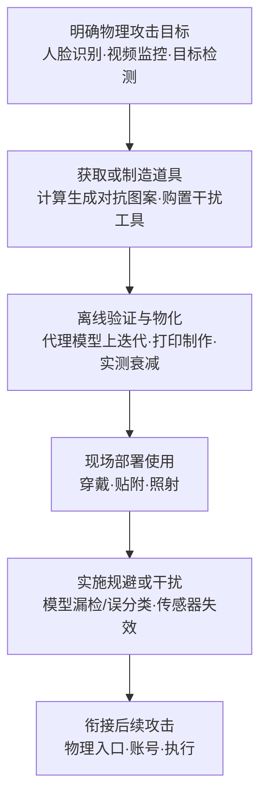

# 物理对抗措施 (AML.T0008.003)

> 属于 [获取基础设施 (AML.T0008)](../AML.T0008-Acquire-Infrastructure.md)

## 一句话通俗理解

> 网络攻击者买服务器、抢域名，攻击 AI 系统的人还要置办"戏服和道具"——一件印满对抗图案的 T 恤能让监控"看不见你"，一支激光笔能让摄像头"看不清路"。本技术讲的正是这些实物的置办：获取或制造干扰 AI 模型与传感器的物理道具，本身就是资源开发的一环——打印店与五金店就能完成采购，全程发生在受害者视野之外。

## 难度等级

⭐⭐ **Demonstrated（已演示）**

官方成熟度评定为 Demonstrated——MITRE AI 红队 2020 年对一套商业人脸识别服务实施物理域规避攻击，成功诱导定向误分类（AML.CS0012），证明这类道具已在完整攻击链中真实可用。本子技术的难度呈两极分化：**"拿到道具"很容易**——激光笔、灯泡在商店随手可购，对抗贴纸打印店就能印，购置行为完全合法且与日常消费无从区分；**"造出有效图案"有门槛**——对抗图案需要计算生成：攻击者通常要在代理模型上迭代优化扰动（往往需要算力支持，衔接兄弟子技术 AML.T0008.000 的 AI 开发工作区），再克服打印色差、拍摄距离与视角造成的"数字有效 → 物理有效"衰减。与 AML.T0008.001（消费级硬件）的对比更凸显分工：硬件买来即用，道具的"弹药"——对抗图案本身——必须先被设计制造出来。

## 技术描述

### 通俗解释

父技术 [获取基础设施 (AML.T0008)](../AML.T0008-Acquire-Infrastructure.md) 的采购清单大多是"线上资产"——租 GPU、买域名、开云函数；本子技术补上的是最"摸得着"的一格：**攻击基础设施第一次有了可穿戴、可手持的实体形态**。

先澄清一个易混淆点：名字里的"对抗措施"不是防御者的防护手段，而是**攻击者用来对抗 AI 防御的实物道具**。依据官方描述，道具按打击对象分为两类：

1. **骗模型的道具**（干扰或削弱模型）：印刷在贴纸或 T 恤上的对抗图案、伪装物、诱饵——改变模型"看到"的像素，让视觉模型漏检目标或产生误分类；
2. **晃瞎传感器的工具**（干扰或削弱采集数据的传感器）：激光笔、灯泡等——不骗模型，直接让摄像头"看不清"，数据在进入模型之前就已失真。

这类道具的独特价值在于打击位置：模型与传感器都活在物理世界里，而物理世界的输入端恰是多数 AI 防御的盲区——线上攻击有 WAF、有日志、有风控，镜头前的物理世界主要靠模型自身的鲁棒性硬扛。

还要注意本技术的战术定位：资源开发战术记录的是"**获取或制造**"这些道具的动作；至于"使用"道具实施规避，发生在攻击链的后续阶段。道具在攻击链最前端就已备妥，受害者侧零感知。

### 技术原理

依据官方描述：攻击者可能获取或制造物理对抗措施，以辅助或支持其攻击。这些组件可用于干扰或削弱模型（如印刷在贴纸或 T 恤上的对抗图案、伪装物或诱饵），也可用于干扰或削弱采集数据的传感器（如激光笔、灯泡或其他工具）。技术要点拆解：

1. **获取或制造（acquire or manufacture）**：两条来路——直接购置现成工具（激光笔、灯泡等通用商品），或定制化制造（在代理模型上计算生成对抗图案，再打印成贴纸、印制成可穿戴物、定制伪装物）；
2. **干扰或削弱模型**：对抗图案向视觉模型的输入端注入扰动，让目标"隐身"于检测之外或被诱导至错误类别；伪装物与诱饵通过物理外观改变目标的特征呈现，使模型偏离其训练分布；
3. **干扰或削弱传感器**：激光笔、灯泡等工具直接作用于采集数据的传感器——让摄像头过曝、失焦或成像条件剧变，数据在进入模型之前就已失真；
4. **辅助或支持攻击（aid or support their attack）**：官方措辞表明道具是攻击的组成部分而非全部——AML.CS0012 中，物理域规避与寻找有效账户、经 API 执行代码等传统 ATT&CK 技术交织推进，组合成完整攻击链。

**道具类型 × 打击对象 × 作用方式：**

| 道具类型 | 打击对象 | 作用方式 |
|----------|---------|---------|
| 对抗贴纸 | 视觉模型 | 印刷的对抗图案向模型注入扰动，使目标被漏检或误分类 |
| 对抗 T 恤 | 视觉模型（人脸识别 / 行人检测） | 可穿戴的对抗图案，随人体移动持续干扰模型判断 |
| 伪装物 / 诱饵 | 视觉模型 | 物理伪装改变目标特征呈现，令模型偏离训练分布 |
| 激光笔 | 传感器（摄像头） | 强光致传感器过曝或失效，采集数据失真 |
| 灯泡 / 其他光源 | 传感器 | 照明条件攻击：改变成像环境使检测失效 |

**与兄弟子技术的分工**：AML.T0008.001（消费级硬件）购置的是"发射平台"——承载与执行攻击的手机、摄像头与攻击盒；本子技术获取或制造的是"弹药与戏服"——对抗贴纸、T 恤、伪装物与干扰工具本身。硬件是枪，对抗道具是子弹（参见 MITRE AI 红队的人脸识别规避演练 AML.CS0012）。此外，对抗图案的设计迭代往往消耗算力，与 AML.T0008.000（AI 开发工作区）天然衔接——工厂造弹药，枪膛装弹药。

**平台覆盖**：Enterprise——道具的获取与制造发生在传统商业渠道与攻击者自有环境，攻击对象面向企业环境中的视觉 AI 系统（人脸识别门禁、视频监控分析、车载视觉等）。

### 用途影响

- **物理域规避**：让依赖摄像头的 AI 系统（门禁、监控、检测）对真实目标"失明"或"看错"——物理入口的信任链被道具级欺骗；
- **攻击准备的不可见性**：道具的购置与制造发生在受害者视野之外，且与正常消费行为（买激光笔、印贴纸）无从区分；
- **与攻击链深度耦合**：道具与硬件平台、传统攻击手法组合成完整攻击链（AML.CS0012），单点防御难以覆盖；
- **攻防成本不对称**：攻击者更新图案的成本接近"重新打印一张"，防御者提升模型鲁棒性却要重训重评——资源开发战术里性价比最高的火力升级路径。

## 攻击流程

### 典型攻击流程



**步骤详解：**

1. **明确物理攻击目标**
   - 通俗描述：先看清要骗的是哪双"眼睛"。
   - 技术细节：依据侦察结果确定目标系统类型——人脸识别门禁（对抗图案、伪装物）、周界视频分析（可穿戴对抗图案）、依赖成像质量的检测管线（激光笔、灯泡类传感器干扰）——由此倒推道具清单。

2. **获取或制造道具**
   - 通俗描述：能买的买，买不到的造。
   - 技术细节：现成工具（激光笔、灯泡）直接购置，与日常消费无从区分；对抗图案则需先在代理模型上迭代优化扰动，再将数字图案物化为贴纸、印花或定制可穿戴物——设计环节常消耗算力（衔接 AML.T0008.000 的工作区与 AML.T0017 开发能力）。

3. **离线验证与物化**
   - 通俗描述：先在自家靶子上练熟。
   - 技术细节：图案在代理模型上验证有效后，还要克服"数字 → 物理"的衰减——打印色差、分辨率、拍摄距离与视角都会削弱扰动效果，需打印样品实测并回代调整（衔接 AI 攻击适配阶段）。

4. **现场部署使用**
   - 通俗描述：穿上戏服，走到镜头前。
   - 技术细节：可穿戴物直接穿着、贴纸贴附于目标物或随身物品、光源类工具对准传感器施加干扰；道具与 AML.T0008.001 的硬件平台（攻击终端、注入设备）配合出击。

5. **衔接后续攻击**
   - 通俗描述：骗过 AI，接着走传统攻击链。
   - 技术细节：AML.CS0012 中，物理域规避与寻找有效账户、经 API 执行代码等传统 ATT&CK 技术交织推进——道具打开的"盲区"成为攻击者的行动通道。

**与后续战术的衔接：**

- **开发能力（AML.T0017）**：对抗图案的设计、迭代与物化就是典型的能力开发——本技术获取的正是其物理产出
- **AI 攻击适配**：图案在代理模型上优化、经物化衰减校准后迁移至真实目标
- **初始访问**：物理域规避成功即获得物理入口或冒充身份（如 AML.CS0004 中进入税务系统的路径）
- **防御规避**：对监控与检测系统的干扰让攻击行动本身"不可见"

> 关键差异：传统 T1583 的基础设施是"给攻击当窝点"——服务器、域名藏在远端；物理对抗措施是"穿在身上、拿在手里的攻击资源"——获取道具属于资源开发，使用道具实施规避才进入攻击本体。一件 T 恤与一台 C2 服务器同属攻击基础设施，这是 ATLAS 对"基础设施"概念最具实体感的扩展。

## 真实案例

> 直接以本子技术 AML.T0008.003 为标签的官方案例现有 1 例（案例1）；案例2 以兄弟子技术 AML.T0008.001 为标签，作为物理域攻击链的对照案例列出。均源自 MITRE ATLAS 案例库。

### 案例1：MITRE AI 红队物理域规避人脸识别（2020年，AML.CS0012，直接命中本子技术）

- **时间**: 2020年
- **攻击者**: MITRE AI 红队（授权演练）
- **手法**: 对一套商业人脸识别服务实施物理域规避攻击，目标是诱导定向误分类。行动将寻找有效账户、经 API 执行代码等传统 ATT&CK 技术与对抗性 ML 攻击交织推进——物理对抗措施（对抗图案等道具）是贯穿行动的装备库，与数字手法组合成完整攻击链。
- **影响**: 官方以本子技术标注的标杆案例——证明对抗道具能在真实商业人脸识别服务上实现定向误分类，且与传统攻击手法无缝衔接
- **参考链接**: [MITRE ATLAS 案例研究 AML.CS0012](https://atlas.mitre.org/studies/AML.CS0012)

### 案例2：摄像头劫持攻击人脸识别税务系统（2018–2020年，AML.CS0004，关联兄弟子技术 AML.T0008.001）

- **时间**: 2018 年启动骗局，2020 年披露
- **攻击者**: 两名中国籍人员
- **手法**: 通过摄像头劫持攻击绕过"活体"人脸识别认证——向系统注入冒用身份的人脸图像，接入上海市政府税务系统，累计骗取 7700 万美元。与案例1 对照可见物理域攻击的两条路线：本例在**链路上**动手脚（硬件注入伪造图像，AML.T0008.001 的平台路线）；案例1 在**镜头前的物理世界**动手脚（道具欺骗模型，本子技术路线）。
- **影响**: 物理域攻击的真实危害标尺——两条路线殊途同归，都通向"冒充身份通过认证"，防御必须同时覆盖
- **参考链接**: [WSJ: Faces are the next target for fraudsters](https://www.wsj.com/articles/faces-are-the-next-target-for-fraudsters-11625662828)

## 红队视角

> ⚠️ **免责声明**：以下内容仅用于合法授权的安全测试与教育目的。未经授权对他人系统或身份进行测试是违法行为。

### 实战技巧

1. **视觉系统物理入口韧性评估（双授权）**
   在场地与法律双重授权下，对自有/客户的人脸识别与视频分析系统测试打印贴纸、屏幕显示图案、异常光照的绕过效果，评估模型对物理域扰动的鲁棒性水位——对应案例1 的攻击路径。

2. **对抗图案有效性验证**
   在自有视觉模型上生成对抗图案并打印，实测转印色差、拍摄距离与视角对有效性的衰减，输出"图案有效半径"等量化指标——回答"我们的检测系统离被一张贴纸欺骗有多远"。

3. **传感器干扰面评估**
   在授权环境下测试自有监控系统在强光、频闪等异常光照下的失效模式（过曝、丢帧、检测率骤降），标记"看不见"的风险窗口与告警缺口。

4. **多模态校验覆盖度盘点**
   清点物理入口的认证因子构成：仅视觉单因子的入口是道具攻击的高危面，应叠加活体检测、多模态校验与人工复核。

### 常用工具

| 工具名称 | 用途 | 平台 |
|----------|------|------|
| Adversarial Robustness Toolbox (ART) | 对抗扰动生成与鲁棒性评估 | Python |
| Foolbox | 对抗攻击算法库，图案生成与验证 | Python |
| OpenCV + 摄像头 | 搭建自有视觉检测测试管线 | 跨平台 |
| 高保真打印服务 | 对抗图案物化（贴纸、转印） | 线下 |

### 注意事项

- **物理域测试双授权**：涉及摄像头、门禁与监控系统的物理测试，必须同时获得场地授权与法律确认
- **道具测试仅限自有系统**：在公共场所穿戴对抗图案接近他人监控系统可能构成违法，绝不越界
- 报告聚焦"模型鲁棒性水位、传感器告警覆盖、多模态校验韧性"，不必演示完整攻击效果

## 蓝队视角

### 检测要点

1. **视觉管线输出遥测（最直接的信号）**
   - 日志来源：视觉检测/识别系统的输出指标、认证日志
   - 异常特征：特定区域或时段检出率骤降、同一目标反复漏检、误分类模式突变（对抗图案生效的典型画像）、低置信度尝试聚集

2. **图像质量分析（传感器受扰信号）**
   - 日志来源：摄像头画面质量指标
   - 异常特征：持续性过曝、规律性频闪、突发镜面眩光——激光笔/灯泡类干扰工具的画面残留特征；画面局部出现贴附物遮挡

3. **现场与终端物理完整性**
   - 日志来源：终端资产管理、现场巡检
   - 异常特征：摄像头视野内的异常物品与贴附物、非授权的光源布置变更、终端固件与线缆的非授权变更（联动兄弟子技术 AML.T0008.001 的硬件篡改面）

### 监控建议

- 为视觉系统输出建立**基线与漂移告警**：检出率、置信度分布按区域/时段基线化，骤变即触发工单——道具攻击的"生效瞬间"由此暴露
- 摄像头画面质量指标（过曝占比、闪烁频率、遮挡面积）纳入实时监控——传感器受扰的先行信号
- 高价值物理入口保留人工复核通道，活体检测与多模态校验策略随攻击演进持续升级
- 对抗鲁棒性纳入模型上线门禁：上线前完成物理域扰动测试（贴纸、光照），不达标不发布

## 检测建议

### 网络层检测

**检测方法：** 道具的制造与使用基本不联网，网络层信号集中在准备阶段与下游利用。

- 对抗图案设计阶段的算力痕迹仅对组织内部威胁有意义——内鬼"借用"组织 GPU 工作区批量迭代图案的迹象（衔接 AML.T0008.000 的云用量遥测）
- 道具生效后攻击者的后续动作（账号登录、API 调用）回归传统检测视野

### 主机层检测

**检测方法：** 监控视觉终端与边缘设备的物理及系统完整性。

- 认证终端上陌生 USB 设备接入、摄像头设备枚举变化
- 摄像头固件、线缆、供电的非授权变更（与兄弟子技术 AML.T0008.001 的硬件篡改共用信号面）
- 终端进入调试/开发者模式的异常事件

### 应用层检测（AI 遥测）

**检测方法：** 在视觉模型管线内建攻击信号分析——本技术的核心检测层。

- 检出率与置信度分布的突发漂移（对抗图案使目标"隐身"的画像）
- 误分类聚集：同一目标被系统性判至错误类别（定向误分类，案例1 的攻击目标）
- 图像质量异常：持续性过曝、频闪、眩光（激光笔/灯泡的传感器受扰特征）

**程序化检测思路（无需 EDR 侧改造）：**

两条低成本管线：其一，对视觉系统输出做滑动窗口统计，检出率或置信度均值相对基线骤降即告警（捕获对抗图案生效瞬间）；其二，对摄像头画面做质量指标监控，过曝占比、闪烁频率越限即标记（捕获传感器受扰）——分别覆盖官方描述的两类道具（干扰模型 / 干扰传感器）。

### Sigma 规则思路示例

```yaml
title: 视觉检测系统遭遇物理对抗措施信号（检出率骤降或传感器受扰）
status: experimental
description: 检测视觉分析系统在特定时段检出率骤降、误分类聚集，
    或摄像头画面出现持续性过曝/频闪等受扰特征，可能为对抗
    图案/伪装物（干扰模型）或激光笔/灯泡（干扰传感器）攻击
    （AML.T0008.003 / AML.CS0012 场景）
logsource:
    category: application
    product: video_analytics_pipeline
detection:
    selection:
        event_type: 'detection_metrics'
    model_disrupt:
        detection_rate_delta|lt: -0.5
    sensor_disrupt:
        quality_flag|contains:
            - 'persistent_overexposure'
            - 'flicker_pattern'
            - 'sudden_lens_glare'
    condition: selection and 1 of [model_disrupt, sensor_disrupt]
    aggregation:
        - count() > 3
        - timeframe: 10m
level: high
tags:
    - attack.t1583
    - atlas.aml_t0008_003
```

规则说明：两个分支对应官方描述的两类道具——`model_disrupt` 捕获干扰模型类（对抗贴纸/T 恤、伪装物、诱饵生效后的输出异常），`sensor_disrupt` 捕获干扰传感器类（激光笔、灯泡造成的画面受扰）；阈值应按区域与时段基线化，避免黄昏、逆光等正常光照变化误报。

## 缓解措施

> **官方数据说明**：在 MITRE ATLAS 官方数据（2026.09）中，本子技术与父技术 [获取基础设施 (AML.T0008)](../AML.T0008-Acquire-Infrastructure.md) 均未映射任何缓解措施（mitigations 字段为空）——道具的获取与制造发生在受害者视野之外的合法渠道，官方框架暂无直接对策条目。以下为本库基于技术特性与关联案例整理的防御建议，**非官方映射**（与父文档缓解章节"物理入口韧性与防篡改"方向一致）。

### 优先级1：关键建议 —— 对抗鲁棒性评估与对抗训练

视觉模型上线前将物理域扰动纳入鲁棒性门禁：用对抗贴纸、可穿戴图案、异常光照样本做对抗测试，不达标不发布；有条件的组织引入对抗训练，提高模型对物理域扰动的容忍度——抬高"造出有效图案"的门槛，直接打击道具的"弹药"环节。

### 优先级2：重要建议 —— 多模态校验与人工复核

物理认证入口叠加活体检测、多模态校验（人脸 + 声音 + 行为）与高价值场景人工复核——对抗图案能骗过视觉单因子，难以同时骗过全部模态（与兄弟子技术 AML.T0008.001 的缓解方向共通：提高"单点欺骗"的成本）。

### 优先级3：建议措施 —— 传感器健康与画面质量监控

对摄像头实施画面质量实时监控（过曝、频闪、遮挡告警）与终端物理防篡改管理（固件签名、线缆巡检）——让"晃瞎传感器"的尝试在发生当下就被发现。

### 落地优先级一览（本库建议）

| 防御方向 | 针对的攻击手法 | 建议优先级 |
|----------|---------------|:---------:|
| 对抗鲁棒性评估与对抗训练 | 对抗贴纸/T 恤、伪装物（干扰模型） | 关键 |
| 多模态校验与人工复核 | 定向误分类规避物理入口 | 重要 |
| 传感器健康与画面质量监控 | 激光笔/灯泡（干扰传感器） | 建议 |

> 说明：道具的购置行为无法阻断——买激光笔、印贴纸不违反任何规则。防御的现实抓手在**模型与认证端**：让道具即便派上用场，也骗不过、藏不住。

## 关联 ATT&CK 技术

> 本子技术在 ATLAS 官方数据中无 attack_reference 直接映射；父技术 AML.T0008 官方映射至 T1583，本子技术继承该映射语境。以下按官方映射与主题类比分别列出（主题类比链接已经本库验证）。

- [获取基础设施 (T1583)](../../../enterprise/02-Resource-Development/T1583-Acquire-Infrastructure.md) — 父技术的官方映射，本子技术是其在"实物道具"维度的延伸
- [硬件添加 (T1200)](../../../enterprise/03-Initial-Access/T1200-Hardware-Additions.md) — 主题类比：T1200 把硬件植入目标环境，本技术把道具带到目标镜头前——物理实体进入攻击视野的两种路径
- [伪装 (T1036)](../../../enterprise/07-Stealth/T1036-Masquerading.md) — 主题类比：T1036 在数字域"伪装成合法对象"，本子技术的伪装物与诱饵是其在物理域的对应物

**传统获取基础设施 vs ATLAS 物理对抗措施：**

| 维度 | 传统 T1583 | ATLAS AML.T0008.003 |
|------|-----------|---------------------|
| 获取对象 | 域名、服务器、Web 服务等线上资源 | 对抗贴纸/T 恤、伪装物、诱饵、激光笔、灯泡等**实物** |
| 制造环节 | 基本无需制造，租/买即用 | 对抗图案需**计算生成后物化**（打印、印制、定制） |
| 攻击对象 | 承载 C2、钓鱼、载荷暂存 | AI 模型与传感器的**物理输入端** |
| 防御抓手 | 威胁情报、域名监控、新注册域拦截 | 对抗鲁棒性、多模态校验、传感器健康监控 |

一句话总结：T1583 回答"攻击者从哪弄服务器和域名"，AML.T0008.003 回答"攻击者从哪弄隐身衣和致盲弹"——基础设施的概念从机房延伸到了镜头前的物理世界。

## 动手实验

> ⚠️ **重要提示**：所有实验仅在自有设备与自建视觉系统上进行，不接触任何第三方人脸识别与监控系统；对抗图案的穿戴测试仅限自有测试环境。

### 实验环境准备

| 环境组件 | 用途 | 获取方式 |
|----------|------|----------|
| 一台带摄像头的分析机 | 自建视觉检测管线 | 现有设备 |
| Python 3.10+ + OpenCV/YOLO | 搭建测试用目标检测 demo | pip 安装，开源 |
| Adversarial Robustness Toolbox (ART) | 对抗扰动生成与鲁棒性评估 | pip 安装，开源 |
| 贴纸打印纸 / 文印服务 | 对抗图案物化 | 电商 / 线下 |

### 实验1（初级）：数字对抗样本的威力与局限

**实验目标：** 在自建分类器上直观理解对抗扰动的"有效但脆弱"。

**实验步骤：**
1. 用 OpenCV 与预训练模型搭建一个简单图像分类或目标检测 demo
2. 用 ART 生成对抗扰动并叠加到测试图片，记录置信度变化
3. 对扰动图做"缩小打印再翻拍"模拟：降分辨率、压缩、加噪声，观察有效性逐步衰减
4. 思考：数字扰动要经历哪些衰减，才能变成"物理有效"的贴纸？

**预期结果：** 理解对抗图案设计的核心矛盾——扰动幅度、隐蔽性与物理鲁棒性的三角权衡。

### 实验2（中级）：对抗图案物化与衰减测量

**实验目标：** 亲测"数字有效 → 物理有效"的衰减曲线。

**实验步骤：**
1. 用 ART 在自建检测模型的代理模型上优化一个贴纸尺寸的对抗图案
2. 高保真打印成贴纸，粘贴在测试目标物上
3. 用摄像头在 0.5m / 1m / 2m 三个距离与不同角度下拍摄，记录检测置信度
4. 绘制"距离-角度-有效性"曲线，找出图案的有效半径与失效边界

**预期结果：** 量化理解物化衰减（色差、分辨率、视角）——这正是攻击者需要离线迭代补偿的环节。

### 实验3（高级）：攻防对照——规避演练与漂移告警同场验证

**实验目标：** 复刻案例1 的攻防两面：规避攻击与检测能力同场对照。

**实验步骤：**
1. 部署自建目标检测系统，按区域与时段建立检出率、置信度基线
2. 依次投放"攻击载荷"：对抗贴纸、异常光照（强光手电模拟灯泡干扰）
3. 记录两类道具各自造成的输出异常：检出率骤降（干扰模型）与画面过曝（干扰传感器）
4. 依据本文 Sigma 思路实现"检出率漂移 + 画面质量"双通道告警，回放步骤 2 的数据验证告警命中率
5. 评估：若攻击者更换图案重新打印，哪些告警仍然有效？检测应覆盖"输出行为模式"而非"单一图案"

**预期结果：** 产出一份"道具攻击面 - 输出异常画像 - 告警覆盖"的攻防对照记录。

## 术语解释

| 术语 | 英文原名 | 通俗解释 |
|------|----------|----------|
| 物理对抗措施 | Physical Countermeasures | 攻击者获取或制造的实物道具——对抗贴纸、T 恤、伪装物、诱饵、激光笔、灯泡 |
| 对抗样本 | Adversarial Example | 经精细扰动、旨在欺骗 AI 模型的输入——对抗图案是其物理形态 |
| 对抗图案 | Adversarial Patch | 专门设计来让视觉模型误判的打印图案——贴纸、T 恤上的"隐身符" |
| 对抗性 T 恤 | Adversarial T-Shirt | 印有对抗图案的可穿戴物，穿上后可能让识别系统"看不见你" |
| 伪装物 | Disguise | 改变目标物理外观的道具，使目标特征偏离模型的训练分布 |
| 诱饵 | Decoy | 引导模型判断偏离真实目标的实物道具 |
| 传感器 | Sensor | AI 系统"看世界"的输入端（摄像头、麦克风）——道具打击的两大对象之一 |
| 误分类 | Misclassification | 模型把目标认成错误类别——案例1 攻击的定向目标 |
| 对抗训练 | Adversarial Training | 训练时混入对抗样本以提升模型鲁棒性的防御技术 |
| 物化 | Physical Realization | 对抗扰动从数字像素变成印刷实物的过程——色差与分辨率是主要衰减源 |
| 过曝 | Overexposure | 摄像头被强光压制后的画面失效——激光笔/灯泡干扰传感器的画面残留特征 |
| 代理模型 | Proxy Model | 攻击者复现的"高仿模型"，对抗图案在其上离线迭代优化 |

## 参考资料

### 📚 官方文档

- [MITRE ATLAS - Physical Countermeasures (AML.T0008.003)](https://atlas.mitre.org/techniques/AML.T0008/003/) - 官方技术页面
- [MITRE ATLAS - Acquire Infrastructure (AML.T0008)](https://atlas.mitre.org/techniques/AML.T0008/) - 父技术页面
- [MITRE ATLAS 矩阵](https://atlas.mitre.org/matrices/ATLAS/)
- [MITRE ATLAS Data (GitHub)](https://github.com/mitre-atlas/atlas-data)

### 📰 案例报告（真实攻击与安全研究）

- [MITRE ATLAS: Face Identification System Evasion (AML.CS0012)](https://atlas.mitre.org/studies/AML.CS0012) - MITRE AI 红队物理域规避演练（直接命中本子技术）
- [WSJ: Faces are the next target for fraudsters](https://www.wsj.com/articles/faces-are-the-next-target-for-fraudsters-11625662828) - 摄像头劫持骗过人脸识别、骗取 7700 万美元（AML.CS0004，物理域对照案例）

### 🔧 工具与资源

- [Adversarial Robustness Toolbox (GitHub)](https://github.com/Trusted-AI/adversarial-robustness-toolbox) - 对抗扰动生成与鲁棒性评估工具箱
- [Foolbox (GitHub)](https://github.com/bethgelab/foolbox) - 对抗攻击算法库
- [OpenCV](https://opencv.org/) - 开源计算机视觉库，搭建自有测试管线
- [NIST AI Risk Management Framework](https://www.nist.gov/itl/ai-risk-management-framework) - NIST AI 风险管理框架

### 🔗 关联阅读

- [获取基础设施 (AML.T0008)](../AML.T0008-Acquire-Infrastructure.md) - 本技术的父技术，六类攻击基础设施全景
- [资源开发战术 (AML.TA0003)](../README.md) - 本技术所属战术的概览页
- [开发能力 (AML.T0017)](../AML.T0017-Develop-Capabilities.md) - 对抗图案的设计与制造正是"能力开发"的物理产出
- [获取基础设施 (T1583)](../../../enterprise/02-Resource-Development/T1583-Acquire-Infrastructure.md) - 传统基础设施获取技术，与本技术对照阅读
- [硬件添加 (T1200)](../../../enterprise/03-Initial-Access/T1200-Hardware-Additions.md) - 物理实体进入攻击视野的镜像技术

---

> **版本**: ATLAS 2026.09 | **更新**: 2026-10-22 | **模板**: ATLAS 技术文档 v1.0
