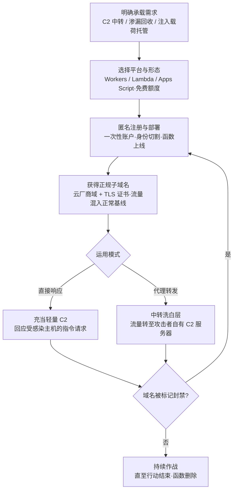

# 无服务器 (AML.T0008.004)

> 属于 [获取基础设施 (AML.T0008)](../AML.T0008-Acquire-Infrastructure.md)

## 一句话通俗理解

> 攻击者自建的 C2 服务器躲在陌生 IP 段里，防火墙一眼认出生面孔；无服务器函数挂在 Cloudflare、AWS、Google 的正规子域名下，回连流量混在全网亿万次正常云调用里——防御设备看到的是"用户在访问大厂"，看不到的是"大厂的函数在替攻击者传话、收货、递刀"。

## 难度等级

⭐ **Feasible（可行）**

官方成熟度评定为 Feasible——手法本身在传统攻击域早已成熟（ATT&CK 已将其收录为正式子技术 T1583.007），但在 ATLAS 案例库中尚无直接标注本子技术 ID 的案例：机制上最典型的 Google Bard 对话渗漏事件（AML.CS0029）在官方数据中映射至父技术 AML.T0008。难度构成极不均衡：**部署门槛趋近于零**——免费额度注册即得、几行代码上线、自动获得云厂商正规子域名与 TLS 证书；真正的难度全在**运营纪律**——函数行为要经得起平台滥用审核、调用模式要像正常业务、账户链要与真实身份完成切割。这不是"会不会做"的问题，而是"做久了会不会露馅"的问题。

## 技术描述

### 通俗解释

传统攻击者藏 C2 的套路是租 VPS 再套 CDN，但 IP 信誉、证书指纹总有办法被威胁情报画像。无服务器（Serverless）把这门手艺推到极致：不租机器、不装系统，只部署一段函数，平台自动分配一个 `*.workers.dev`、`script.google.com` 之类的正规子域名。攻击者的回连流量从此"出生即洗白"——它确实发自知名云厂商的基础设施，任何基于域名信誉的防御都会放行。

对攻击 AI 系统的人，这种"有正规户口的传令兵"有三个独特用途：承接提示词注入的数据外传（AI 前端替攻击者发起请求，内容安全策略拦不住自己信任的域名）、为针对 AI 智能体的恶意载荷提供托管点、在受感染主机与真正的 C2 之间充当一层难以封禁的中转。

与兄弟子技术的分工：.000 租 GPU 是"造攻击"，本子技术租函数是"运攻击"——前者吃算力，后者只吃域名信任。

### 技术原理

依据官方描述，攻击者可购买并配置无服务器云基础设施——Cloudflare Workers、AWS Lambda、Google Apps Script——用于定向攻击行动；利用无服务器设施可使行动中用到的基础设施更难归因至攻击者本人。技术要点拆解如下：

1. **两种运用模式**：官方描述明确给出——无服务器运行环境既可以直接响应受感染主机，也可以把流量代理转发至攻击者自有的命令与控制（C2）服务器。前者是"轻量级 C2 本体"，后者是"前置洗白层"；
2. **流量混入正常基线**：这些函数产生的流量看起来来自常见云厂商的子域，与访问这些厂商的普通流量难以区分——企业每天都在访问云厂商，谁会怀疑其中的恶意回连；
3. **绕过内容安全策略（CSP）**：官方描述点名 CSP 场景——CSP 用来阻止页面从任意位置检索内容，而 serverless 域名往往在白名单内或属于平台自有域，借它中转即可让恶意请求"合法"发出；
4. **归因困难**：注册账户与真实身份切割、平台侧日志在受害者管辖范围之外，且函数可随时删除重部署——继承父技术"快速开通、修改与关闭"的特性。

**与兄弟子技术的分工**：父技术 [获取基础设施 (AML.T0008)](../AML.T0008-Acquire-Infrastructure.md) 的六个子技术各司其职——

| 子技术 | 获取的东西 | 与本子技术的分工 |
|--------|-----------|----------------|
| AML.T0008.000 AI 开发工作区 | 算力（GPU 工作区） | 租"工厂"——训练代理模型、造攻击 |
| AML.T0008.001 消费级硬件 | 实体设备 | 买"现货"——完全自控的物理攻击装备 |
| AML.T0008.002 域名 | 域名 | 买"门牌"——数据集投毒与钓鱼的埋伏点 |
| **AML.T0008.004（本技术）** | 函数运行环境 | 租"信箱 + 传令兵"——承载回连与中转，不求算力求信任 |
| AML.T0008.005 AI 服务代理 | 模型 API 额度 | 买"外援"——直接批发别人的模型调用 |

一句话：**.000 与 .005 解决"能力与额度"，.002 解决"门牌"，本子技术解决"流量可信度"**——把恶意通信伪装成对知名云厂商的正常访问。

**平台覆盖**：Enterprise——攻击者在传统云环境即可完成注册与部署，承载的攻击行动直指各类 AI 系统与普通 IT 资产。

### 用途影响

- **回连通道洗白**：C2 与渗漏回连全部套上云厂商子域的外衣，基于域名信誉与 IP 信誉的防御体系集体失明；
- **击穿 AI 前端信任链**：CSP 信任云厂商域名，AI 服务又替攻击者发起请求——提示词注入窃取的数据可以经 serverless 函数"合规"出境（AML.CS0029 的核心机制）；
- **C2 中转与快速轮换**：单个函数域名被标记，换个账户重新部署只要几分钟——封禁速度永远追不上重供给速度；
- **载荷与注入内容托管**：提示词注入载荷、投毒制品的下载点可挂在这种正规域名下，衔接暂存能力（AML.T0079）的"弹药库"职能；
- **归因切割**：账户链、支付链、平台日志三层隔离，受害者侧几乎无从追查函数背后的操作者。

## 攻击流程

### 典型攻击流程



### 步骤详解

1. **明确承载需求**
   - 通俗描述：先想清楚要这个"信箱"干什么。
   - 技术细节：依据攻击计划倒推形态——只需回收渗漏数据选 URL 参数编码类轻量函数；要下发指令则需请求解析与响应逻辑；要绕 CSP 则优先选择目标 CSP 白名单内已有的平台域（如 Google 系前端对 script.google.com 的信任）。

2. **选择平台与形态**
   - 通俗描述：货比三家，专挑"户口最硬"的。
   - 技术细节：官方点名 Cloudflare Workers、AWS Lambda、Google Apps Script 三类；选型核心是目标环境的信任度——受害者前端 CSP 允许哪些域、企业代理对哪些云厂商域默认放行。

3. **匿名注册与部署**
   - 通俗描述：用完就扔的账户，上线一段小函数。
   - 技术细节：一次性邮箱注册、匿名支付、出口 IP 与真实身份切割；函数代码保持极简并伪装成正常 Web 钩子或 API 服务，规避平台滥用审核。

4. **获得正规子域名并混流**
   - 通俗描述：函数一上线，"户口"自动到手。
   - 技术细节：平台自动分配云厂商子域与 TLS 证书——回连流量在防御设备眼里就是对 Cloudflare/AWS/Google 的普通 HTTPS 访问，与正常业务流量在域名信誉层面完全同质。

5. **双模运用与持续轮换**
   - 通俗描述：既当传令兵，也当二传手；被识破就换人。
   - 技术细节：直接响应受感染主机的指令请求，或把流量代理转发至自有 C2 服务器（官方描述的两种模式）；单个函数域名被标记封禁即弃，回到第 3 步几分钟内重供给。

### 与后续战术的衔接

- **暂存能力（AML.T0079）**：提示词注入载荷、投毒制品先"存"在正规域名的函数后端，静候受害者访问
- **命令与控制（C2）**：serverless 函数本身就是难以封禁的 C2 前置层——真正的 C2 藏在函数转发的第二跳
- **数据渗漏**：AI 前端外传的对话数据、会话凭证以 URL 参数或请求体形式汇入函数——渗漏通道披着可信域名外衣
- **初始访问 / 提示词注入落地**：托管的注入内容等待 AI 智能体抓取，把"阵地"变成攻击的起爆点

> 关键差异：传统 T1583.007 把无服务器当"更便宜、更隐蔽的跳板"；ATLAS 语境下它的杀伤力来自 **AI 前端的信任链**——浏览器与 CSP 信任云厂商域名，AI 服务又替攻击者发起请求，函数只要"有正规户口"就完成了全部伪装。

## 真实案例

> 以下 3 个案例在 ATLAS 官方数据中均未直接标注本子技术 ID：案例1 的攻击机制（Apps Script 承载渗漏脚本 + 绕过 CSP）精确命中本子技术，官方将其映射至父技术 AML.T0008；案例2、3 从 C2 中转与渗漏承接角度提供关联视角，官方映射如实标注。

### 案例1：Google Bard 对话渗漏——Apps Script 当渗漏信箱（AML.CS0029，官方映射父技术 AML.T0008）

- **时间**: 2023年11月
- **攻击者**: Embrace the Red 研究团队（安全验证研究）
- **手法**: 通过间接提示词注入（经分享的 Google Doc 投送）让 Bard 以 markdown 图片形式回应用户，图片 URL 中秘密编码了用户对话内容；Bard 渲染图片即自动向攻击者控制的脚本发起请求，对话数据随之出境。该脚本托管在 Google Apps Script 上——请求来自 Google 自有域名，未被内容安全策略（CSP）拦截。
- **影响**: 完整演示"serverless 正规域名 + CSP 白名单信任"的渗漏链路；Google 已修复该漏洞，但 CSP 与图片渲染机制仍在，机制级风险依旧
- **参考链接**: [Embrace the Red: Hacking Google Bard - From Prompt Injection to Data Exfiltration](https://embracethered.com/blog/posts/2023/google-bard-data-exfiltration/)

### 案例2：AI in the Middle——可信 AI 服务域当 C2 中继（AML.CS0061，官方映射 AML.T0008.002 等，非本子技术）

- **时间**: 2026年2月
- **攻击者**: Check Point Research（安全验证研究）
- **手法**: 恶意软件滥用具备匿名浏览与 URL 抓取能力的 Web AI 助手（Grok、Microsoft Copilot）作为隐蔽 C2 通道——诱使 AI 服务抓取攻击者控制的 URL、在出站请求中外传受害数据、再经正常的 AI 应答回传指令。植入体与可信 AI 服务域之间的普通 HTTPS 流量完全混入企业正常 AI 使用，无 API 密钥可吊销、无账户可冻结。
- **影响**: 与 serverless 中转同构的逻辑——把 C2 藏进"可信域名的正常流量"；证明以基础设施声誉为核心的防御对这类通道集体失效
- **参考链接**: [Check Point Research: AI in the Middle](https://research.checkpoint.com/2026/ai-in-the-middle-turning-web-based-ai-services-into-c2-proxies-the-future-of-ai-driven-attacks/)

### 案例3：Lenovo 聊天机器人 XSS——提示词注入的承接端点（AML.CS0060，官方映射含父技术 AML.T0008）

- **时间**: 2025年8月
- **攻击者**: Cybernews 研究团队（安全验证研究）
- **手法**: 以看似无害的产品咨询向 Lenovo AI 聊天机器人"Lena"注入指令，诱导其输出恶意 HTML 并存入聊天记录；人工客服按正常流程打开聊天记录时，被污染内容在客服浏览器中渲染，向攻击者控制的服务器外传会话 cookie。攻击者侧承接端点是这类提示词注入攻击的必备基础设施。
- **影响**: 若承接端点改用 serverless 函数承载（如案例1 的 Apps Script 形态），即自动获得云厂商域名信任与 CSP 绕过优势——本案例展示了"必须有承接端点"的共性需求
- **参考链接**: [Cybernews: Critical flaw plagues Lenovo AI chatbot](https://cybernews.com/security/lenovo-chatbot-lena-plagued-by-critical-vulnerabilities/)

## 红队视角

> ⚠️ **免责声明**：以下内容仅用于合法授权的安全测试与教育目的。未经授权部署恶意基础设施或对他人系统进行测试是违法行为。

### 实战技巧

1. **组织 CSP 与资源加载链审计**
   抓取组织 Web 与 AI 前端的 CSP 头，逐项标注白名单中的云厂商脚本托管域（script.google.com、workers.dev、各类函数 URL 域）——回答"攻击者若在这些域上部署函数，我们的 CSP 是否形同虚设"；同时盘点 AI 前端可渲染的外链资源类型（图片、脚本、iframe）。

2. **回连行为检测验证**
   在授权环境下用脚本解释器（PowerShell 等）访问自有测试函数，采集行为在 EDR、代理日志中的落点，验证"进程 × 目标域"组合告警是否闭环——多数组织会在这一步发现代理日志根本不记录进程维度。

3. **出口流量基线对照**
   统计组织对各 serverless 托管域的正常业务访问量与进程分布，评估混流检测的信噪比——若正常业务本身就大量访问这些域，单一域名封禁只会误伤自己。

### 常用工具

| 工具名称 | 用途 | 平台 |
|----------|------|------|
| Cloudflare Workers | 免费额度边缘函数（官方点名平台，部署测试函数用） | Web |
| AWS Lambda | 事件驱动函数平台（官方点名平台） | 云平台 |
| Google Apps Script | Google 生态脚本平台（官方点名，案例1 实战载体） | Web |
| 浏览器 DevTools | CSP 指令与资源加载链分析 | 跨平台 |
| curl / HTTPie | 回连行为模拟与特征采集 | 跨平台 |

### 注意事项

- **授权范围内部署**：评估中的一切函数以组织名义部署，内容限定为返回固定标记文本的无害响应，绝不测试平台滥用审核的绕过手法
- **不碰第三方 CSP**：CSP 验证只在自有测试页面进行，不对他人的 AI 服务做注入测试
- 交付物聚焦三件事：CSP 白名单风险清单、回连检测链路是否闭环、出口流量基线报告——而非证明攻击可行性

## 蓝队视角

### 检测要点

1. **进程维度的托管域访问画像**
   - 日志来源：代理日志、EDR 网络遥测、DNS 解析日志
   - 关注字段：发起进程、目标域名、请求路径与 URL 参数长度
   - 异常特征：脚本解释器与系统工具进程（非浏览器）访问 serverless 托管域；办公软件进程意外发起 AI 服务域请求

2. **AI 前端资源加载链监控**
   - 日志来源：浏览器遥测、CASB、Web 网关
   - 关注对象：AI 前端渲染的外链图片/脚本域名、CSP 违规报告（CSP Report）
   - 异常特征：AI 前端加载白名单内脚本域的异常请求、URL 查询串中出现长段编码数据（案例1 的渗漏特征）

3. **新函数域与证书监控**
   - 日志来源：证书透明度（CT）日志、DNS 情报
   - 异常特征：workers.dev 等平台域下新签发证书的子域首次出现在组织出口流量中，且访问进程单一、请求模式规律

### 监控建议

- 建立**serverless 托管域清单**（workers.dev、pages.dev、run.app、cloudfunctions.net、azurewebsites.net、script.google.com 等）并对组织出口流量做进程级基线
- 对 URL 参数外传做 **DLP 检查**：查询串中的 Base64/十六进制长块是案例1 式渗漏的直接证据
- AI 前端**可渲染资源域最小化**：外链图片默认禁用或经代理渲染，CSP 白名单收紧到具体路径
- 检测规则覆盖"**行为模式**"而非"单一域名"——攻击者重部署的成本以分钟计

## 检测建议

### 网络层检测

**检测方法：** 识别与 serverless 托管域的可疑连接模式。

- 非浏览器进程（脚本解释器、系统工具）对 serverless 托管域的 TLS 连接——正常业务不该由 powershell 访问云函数
- 对平台域下**新出现子域**的首次访问（域龄极短、证书刚签发）
- 请求 URL 查询串中携带异常长编码参数的出站请求（渗漏数据嵌入图片 URL 的特征）

### 主机层检测

**检测方法：** 监控异常进程的回连行为。

- 脚本解释器与系统工具进程发起的、目标为云厂商函数域的 HTTPS 请求（含用户代理与正常客户端不符）
- 文档/表格软件进程意外发起到 AI 服务与脚本托管域的请求（提示词注入驱动的数据外传常用第三方服务中转）
- 受感染主机周期性、低流量的规律性回连（轻量级 C2 直接响应模式）

### 应用层检测（AI 遥测）

**检测方法：** 利用 AI 前端与网关的遥测发现滥用。

- AI 前端渲染的外链资源域名审计：markdown 图片/链接指向的可疑域清单化，新增即评审
- LLM 输出内容中携带 URL 且域名属于脚本托管平台的高频模式（间接提示词注入的典型产物）
- CSP 违规报告的集中分析：被拦截的加载尝试本身即是侦察信号

**程序化检测思路（无需 EDR 侧改造）：**

两条低成本管线：其一，代理日志按"进程 × 目标域"组合聚类，对"脚本解释器/办公进程 × serverless 托管域"组合直接告警，并用托管域清单自动维护匹配表；其二，对出站 URL 查询串做长度与编码特征扫描（Base64 长块、连续十六进制），命中即联动 DLP 取样分析——分别覆盖"通道行为"与"渗漏内容"两个层面。

### Sigma 规则思路示例

```yaml
title: 脚本解释器外连无服务器托管域（serverless C2/渗漏中转）
status: experimental
description: 检测脚本解释器与系统工具进程向无服务器/脚本托管域发起外连，
    可能为滥用无服务器基础设施的回连或 C2 中转（AML.T0008.004）
logsource:
    category: network_connection
    product: windows
detection:
    selection_process:
        Image|endswith:
            - '\powershell.exe'
            - '\cmd.exe'
            - '\wscript.exe'
            - '\cscript.exe'
            - '\mshta.exe'
    selection_domain:
        DestinationHostname|endswith:
            - '.workers.dev'
            - '.pages.dev'
            - '.run.app'
            - '.cloudfunctions.net'
            - '.azurewebsites.net'
            - 'script.google.com'
    condition: selection_process and selection_domain
    timeframe: 5m
level: medium
tags:
    - attack.t1583
    - atlas.aml_t0008_004
```

> 说明：域名清单是起点而非终点——攻击者换平台重部署的成本以分钟计，规则应叠加"进程异常"与"URL 参数特征"两个维度提升韧性。

## 缓解措施

> **官方数据说明**：在 MITRE ATLAS 官方数据（2026.09）中，本子技术与父技术 [获取基础设施 (AML.T0008)](../AML.T0008-Acquire-Infrastructure.md) 均未映射任何缓解措施（mitigations 字段为空）——基础设施获取发生在受害者视野之外，官方框架暂无直接对策条目。以下为本库基于技术特性与关联案例整理的防御建议，**非官方映射**。

### 优先级1：关键建议 —— 收紧 AI 前端的信任链

**CSP 治理与资源加载最小化**：AI 前端默认拒绝渲染任意外链资源，白名单收紧到具体路径而非整个平台域；外链图片默认禁用或经服务端代理渲染；持续审计 CSP 白名单中的云厂商脚本托管域——案例1 的渗漏链路正是靠"Apps Script 域在白名单内"贯通的，堵住这一层等于釜底抽薪。

### 优先级2：重要建议 —— 让回连行为无处遁形

**出口流量进程级基线**：对 serverless 托管域的访问按进程维度建立基线，脚本解释器与办公软件进程的外连即告警；配套 URL 参数长度与编码特征的 DLP 检查，覆盖"通道"与"内容"两面。

### 优先级3：建议措施 —— 管好组织自有函数资产

**自有 serverless 治理**：组织自行部署的函数资源纳入台账与 owner 标签管理，防止失陷凭证把组织租户变成攻击者的"免费正规域名"——镜像案例1 的风险在自己院内重演。

### 落地优先级一览（本库建议）

| 防御方向 | 建议优先级 | 说明 |
|----------|:---------:|------|
| CSP 治理与资源加载最小化 | 关键 | 直接阻断"正规域名 + CSP 信任"渗漏链路 |
| 出口流量进程级基线 | 重要 | 捕获脚本解释器与办公进程的可疑回连 |
| 自有函数资产治理 | 建议 | 防止组织租户沦为攻击基础设施 |

> 说明：攻击者在外部平台的函数部署本身无法阻止——现实策略是**管好自己前端的信任链与自己院内的函数资产**，并把检测重心放在回连行为模式上（见检测建议章节）。

## 关联 ATT&CK 技术

> 本子技术的官方 attack_reference **非空**：直接映射 [无服务器 (T1583.007)](../../../enterprise/02-Resource-Development/T1583/T1583.007-Serverless.md)。以下其余条目为按攻击形态选取的主题类比（非官方映射，经本库路径验证）。

- [无服务器 (T1583.007)](../../../enterprise/02-Resource-Development/T1583/T1583.007-Serverless.md) — 官方 attack_reference 直接映射，同源技术
- [获取基础设施 (T1583)](../../../enterprise/02-Resource-Development/T1583-Acquire-Infrastructure.md) — 父技术的官方映射
- [无服务器执行 (T1648)](../../../enterprise/04-Execution/T1648-Serverless-Execution.md) — 主题衔接：资源开发阶段购置的函数进入执行阶段的运用
- [Web 服务 (T1102)](../../../enterprise/13-Command-and-Control/T1102-Web-Service.md) — 主题类比：借公共服务域承载 C2 流量
- [隐藏基础设施 (T1665)](../../../enterprise/13-Command-and-Control/T1665-Hide-Infrastructure.md) — 主题类比：把基础设施藏进可信云域
- [通过 Web 服务渗漏 (T1567)](../../../enterprise/14-Exfiltration/T1567-Exfiltration-Over-Web-Service.md) — 衔接：渗漏数据经可信 Web 服务出境

**传统无服务器获取 vs ATLAS 无服务器获取：**

| 维度 | 传统 T1583.007 | ATLAS AML.T0008.004 |
|------|---------------|---------------------|
| 核心动机 | 即开即毁的廉价攻击基础设施 | 同左 + **击穿 AI 前端信任链** |
| 绕过目标 | IP 信誉、域名黑名单 | + **内容安全策略（CSP）**——官方描述点名 |
| 承载内容 | 钓鱼页、载荷暂存、C2 中转 | + 提示词注入载荷托管、AI 对话数据渗漏承接 |
| 典型受害者信号 | 异常子域访问、规律性回连 | + AI 前端渲染外链资源、URL 参数携带编码数据 |

一句话总结：T1583.007 回答"攻击者怎么租到洗白的跳板"，AML.T0008.004 在此之上多答了一件事——当受害者是 AI 前端时，云厂商域名不只是"洗白"，更是**被 CSP 主动放行的通行证**。

## 动手实验

> ⚠️ **重要提示**：所有实验在自有账户、自有租户与自有测试页面上进行，不涉及对任何第三方系统或平台的测试；函数以组织/个人名义部署且仅返回固定标记文本。

### 实验环境准备

| 环境组件 | 用途 | 获取方式 |
|----------|------|----------|
| 自有云账号（含免费额度） | 部署演示用无服务器函数 | Cloudflare / AWS / GCP |
| 一台联网测试机 | 模拟回连与采集流量特征 | 现有工作站 |
| 本地静态页面 + CSP 配置 | CSP 绕过机制验证 | 任意静态服务器 |
| Python 3.10+ 或 PowerShell | 回连脚本与日志分析 | 官方安装包 |

### 实验1（初级）：部署无害函数，观察"正规户口"

**实验目标：** 理解 serverless 基础设施的域名信任优势。

**实验步骤：**
1. 在自有账号部署一个仅返回固定标记文本的函数（如 Cloudflare Workers 免费额度）
2. 记录其域名归属、TLS 证书签发方，与自建 VPS 的自签/低价证书对比
3. 从测试机分别访问该函数与一个自有 VPS，对比两者在代理日志中的信誉标签差异
4. 思考：为什么基于域名信誉的防御对前者天然放行？

**预期结果：** 直观理解"出生即洗白"——同一份恶意逻辑，托管位置决定了防御设备的初始判断。

### 实验2（中级）：复现 CSP 信任逻辑

**实验目标：** 验证案例1 的机制核心——白名单内域名的加载不受拦截。

**实验步骤：**
1. 搭建本地测试页面，配置一条 CSP：仅允许加载自有函数域的脚本
2. 分别尝试从白名单内域与任意外部域加载内容，记录拦截行为差异
3. 把"自有函数域"理解为案例1 中的 Apps Script 域，推演 AI 前端的同等链路
4. 思考：CSP 白名单里每一条平台域，是否都是攻击者可免费入驻的"免检通道"？

**预期结果：** 产出一份自有前端 CSP 白名单的"免检通道"清单，理解 CSP 与生俱来的信任转移问题。

### 实验3（高级）：回连特征采集与检测规则验证

**实验目标：** 验证 serverless 通道的可检测性与其韧性边界。

**实验步骤：**
1. 从测试机用 PowerShell 访问实验1 的函数，采集进程、目标域、URL 特征在 EDR/代理日志中的落点
2. 按本文 Sigma 思路编写检测规则，验证步骤 1 的行为可被命中；若无进程维度日志，记录检测链路断点
3. 删除函数并重新部署，实测"重供给"耗时——封禁单一域名的威慑力有多大自然量化
4. 评估：检测规则覆盖"进程 × 域"与"URL 参数特征"两个维度后，攻击者的规避成本上升了多少

**预期结果：** 产出一套"serverless 通道特征 + 实测验证的检测规则 + 重供给成本数据"的攻防对照笔记。

## 术语解释

| 术语 | 英文原名 | 通俗解释 |
|------|----------|----------|
| 无服务器 | Serverless | 云厂商托管的函数运行环境——不用管服务器，代码上线即得正规域名，本子技术全部内容 |
| FaaS | Function as a Service | 函数即服务——无服务器的产品形态，按调用计费，常有免费额度 |
| Cloudflare Workers | Cloudflare Workers | Cloudflare 的边缘函数平台，官方点名的滥用对象之一 |
| AWS Lambda | AWS Lambda | AWS 的事件驱动函数平台，官方点名的滥用对象之一 |
| Google Apps Script | Google Apps Script | Google 生态的脚本平台，案例1 中承载渗漏脚本的实战载体 |
| 内容安全策略 | Content Security Policy (CSP) | 浏览器限制页面可加载资源的机制——白名单内的云厂商域成为攻击者的免检通道 |
| 命令与控制 | Command and Control (C2) | 攻击者遥控受害主机的通道——serverless 函数是其难以封禁的前置层 |
| 混流 | Traffic Blending | 恶意流量混入正常流量基线——serverless 流量与正常云访问在域名层面同质 |
| 归因 | Attribution | 把攻击追查到具体行为者的过程——账户切割与平台日志隔离是本子技术的规避目标 |
| 提示词注入 | Prompt Injection | 在模型输入中夹带恶意指令的攻击——其数据外传环节常借 serverless 函数承接 |
| 免费额度 | Free Tier | 平台赠予的免费调用量——零成本获得正规域名的攻击入口 |
| 间接提示词注入 | Indirect Prompt Injection | 注入内容藏在模型检索的文档/网页里，受害者无意触发——案例1、3 的投送方式 |

## 参考资料

### 📚 官方文档

- [MITRE ATLAS - Serverless (AML.T0008.004)](https://atlas.mitre.org/techniques/AML.T0008/004/) - 官方技术页面
- [MITRE ATLAS 矩阵](https://atlas.mitre.org/matrices/ATLAS/)
- [MITRE ATLAS Data (GitHub)](https://github.com/mitre-atlas/atlas-data)
- [MITRE ATT&CK - Serverless (T1583.007)](https://attack.mitre.org/techniques/T1583/007/) - 官方映射的同源企业版技术

### 📰 案例报告（真实攻击与安全研究）

- [Embrace the Red: Hacking Google Bard - From Prompt Injection to Data Exfiltration](https://embracethered.com/blog/posts/2023/google-bard-data-exfiltration/) - 案例1：Apps Script 承载渗漏脚本并绕过 CSP（AML.CS0029）
- [Check Point Research: AI in the Middle](https://research.checkpoint.com/2026/ai-in-the-middle-turning-web-based-ai-services-into-c2-proxies-the-future-of-ai-driven-attacks/) - 案例2：可信 AI 服务域作为 C2 中继（AML.CS0061）
- [Cybernews: Critical flaw plagues Lenovo AI chatbot](https://cybernews.com/security/lenovo-chatbot-lena-plagued-by-critical-vulnerabilities/) - 案例3：提示词注入 XSS 的攻击者侧承接端点（AML.CS0060）

### 🔧 工具与资源

- [Cloudflare Workers](https://workers.cloudflare.com/) - 边缘函数平台（官方点名，免费额度）
- [AWS Lambda](https://aws.amazon.com/lambda/) - 事件驱动函数平台（官方点名）
- [Google Apps Script](https://developers.google.com/apps-script) - Google 生态脚本平台（官方点名）
- [MDN: Content Security Policy](https://developer.mozilla.org/zh-CN/docs/Web/HTTP/CSP) - CSP 机制权威文档

### 🔗 关联阅读

- [获取基础设施 (AML.T0008)](../AML.T0008-Acquire-Infrastructure.md) - 本技术的父技术，六类攻击基础设施全景
- [无服务器 (T1583.007)](../../../enterprise/02-Resource-Development/T1583/T1583.007-Serverless.md) - 官方映射的企业版同源技术，对照阅读
- [暂存能力 (AML.T0079)](../AML.T0079-Stage-Capabilities.md) - 函数托管的载荷与注入内容的下游衔接
- [获取基础设施 (T1583)](../../../enterprise/02-Resource-Development/T1583-Acquire-Infrastructure.md) - 传统基础设施获取技术全景
- [资源开发战术 (AML.TA0003)](../README.md) - 本技术所属战术的概览页

---

> **版本**: ATLAS 2026.09 | **更新**: 2026-10-22 | **模板**: ATLAS 技术文档 v1.0
