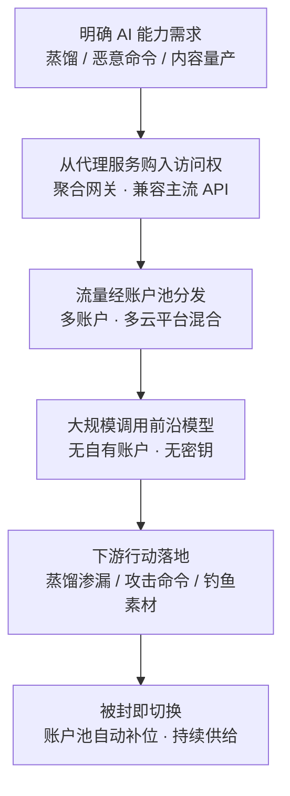

# AI 服务代理 (AML.T0008.005)

> 属于 [获取基础设施 (AML.T0008)](../AML.T0008-Acquire-Infrastructure.md)

## 一句话通俗理解

> 前沿大模型的 API 是"会员制专柜"——要实名注册、按量付费、还有地域与频次限制；AI 服务代理就是专柜旁边的"代购黄牛"：从成千上万个账户（很多是 LLM Jacking 偷来的）批量囤货，再把访问权零散转售。攻击者从黄牛手里拿货，不需要自己的账户和密钥，恶意调用混在几十个账户、多家云平台的正常流量里——专柜想拉黑你，都不知道该拉黑谁。

## 难度等级

⭐⭐⭐ **Realized（已实现）**

官方成熟度评定为 Realized——本子技术已在真实攻击中大规模运用，而且是整条 AI 攻击链上"性价比"最高的能力获取方式之一。难度构成分析：**动手门槛极低**——攻击者无需注册账户、无需绑定支付方式、无需自备 GPU，向代理服务付费即得前沿模型 API 的访问权，而代理服务的"货源"源源不断：恶意行为者通过 LLM Jacking 攻击窃取受害者账户，再把这些访问权放到自己的代理服务里转售（Sysdig 披露，AML.CS0030）。**真正构成"难度"的在供给端**——运营代理服务需要稳定的账户池、多云平台调度与流量分发能力；Anthropic 披露的蒸馏活动动用约 24,000 个账户、1,600 万次查询（AML.CS0056），展示了这类基础设施的工业级规模。对单个攻击者而言，难度已被代理服务"批发摊薄"到接近于零——这正是它被评为 Realized 的原因。

## 技术描述

### 通俗解释

如果说父技术 [获取基础设施 (AML.T0008)](../AML.T0008-Acquire-Infrastructure.md) 是置办攻击用的全部"产业"，本子技术专管其中最特殊的一件——**前沿模型 API 的访问权本身**。AI 开发工作区（AML.T0008.000）买的是"厨房"（GPU 算力），自己开火做饭；本子技术买的是"外卖"——直接订别人的模型能力，还让外卖平台替你匿名。

传统黄牛倒卖演唱会门票，AI 服务代理倒卖的是**前沿模型的调用额度**：

| 角度 | 说明 | 通俗类比 |
|------|------|---------|
| 倒卖对象 | 前沿模型 API 的访问权（账户、密钥、额度） | 演唱会门票 |
| 货源 | 自购账户 + LLM Jacking 盗取的受害者账户 | 黄牛囤票 + 偷票 |
| 分发方式 | 商业代理服务把流量分散到不同账户、不同云平台 | 多个入口同时放票 |
| 购买者得到什么 | 无需自有账户/密钥即可大规模调用前沿模型 | 无需实名看演出 |
| 防御者的困境 | 恶意流量混杂在大量正常流量中，难以检测和封禁 | 黄牛票混进真票流 |

与两个"近亲"子技术的本质区别：AI 开发工作区（AML.T0008.000）是**自建自营**——租 GPU 自己跑模型，成本高但完全可控；无服务器（AML.T0008.004）是**租用计算执行环境**——藏的是代码运行时与流量出口；本子技术是**转售访问权**——攻击者根本不碰计算资源，只"买通"通向他人模型的管道，归因链条断在代理服务这一层。

### 技术原理

依据官方描述，攻击者可能利用转售 AI 服务（如前沿模型 API）访问权的商业代理服务。技术要点拆解如下：

1. **转售访问权的商业代理**：这类服务的形态是"聚合网关"——对外提供一个兼容主流模型 API 的统一入口，对内把客户流量分发到自有的账户池。攻击者按量付费即可获得前沿模型能力，全程不触碰官方注册、支付与身份验证环节；
2. **流量混杂击败封禁**：官方描述明确指出，商业 AI 服务代理把来自不同账户与各种云平台的流量混合分发——这种流量组合让恶意活动**难以检测也难以封禁**（Anthropic）：封一个账户，流量自动切到池中下一个；封整个 IP 段，正常客户流量一同受伤；
3. **LLM Jacking 供货**：恶意行为者实施 LLM Jacking 攻击窃取受害者账户访问权，再在自己的代理服务中转售（Sysdig）——受害组织不仅数据面临暴露，还为攻击者的"客户"支付推理账单；
4. **支撑大规模下游行动**：官方描述将本子技术与三类下游直接关联——经 AI 推理 API 渗漏（AML.T0024，蒸馏路径）、生成恶意命令（AML.T0102，攻击性网络行动）、经社会工程 LLM 炮制鱼叉钓鱼（AML.T0052.000，内容量产）。

**平台覆盖**：Enterprise——代理购置与调用发生在传统 IT/云环境，消费的是托管在云平台上的前沿模型服务。

### 用途影响

- **归因断链**：攻击者不持有任何可追溯到自己身份的账户与密钥——模型服务商看到的调用者，是代理池里成百上千个互不相关的账户；
- **击穿速率与地域管控**：单一账户的速率限制、区域封锁在账户池面前失效——1600 万次查询可以摊到 2.4 万个账户上（AML.CS0056）；
- **规模化引擎**：把"一次 API 调用"放大为工业级量产——蒸馏（AML.T0024）、恶意命令生成（AML.T0102）、钓鱼内容炮制（AML.T0052.000）都以此为基础负荷；
- **受害者双重买单**：LLM Jacking 的受害组织既暴露数据，又替盗用者支付推理费用——被盗额度经代理市场层层转售，追缴无从下手；
- **降低攻击准入**：前沿模型的安全护栏、实名审核、拒付风控全部作用于代理运营者，终端恶意用户绕开了这一切。

## 攻击流程

### 典型攻击流程



**步骤详解：**

1. **明确 AI 能力需求**
   - 通俗描述：先想清楚要"代购"什么。
   - 技术细节：依据攻击计划倒推模型需求——蒸馏需要高吞吐的对话与推理 API；生成恶意命令需要具备代码与工具调用能力的前沿模型；钓鱼内容量产需要低成本文本生成。选定目标模型后确认代理服务是否支持其 API。

2. **从代理服务购入访问权**
   - 通俗描述：找黄牛下单，不用自己的身份。
   - 技术细节：挑选提供目标模型 API 兼容入口的商业代理服务，按量或按套餐付费；全程不接触模型官方的注册、实名与支付环节——供给端可能混有 LLM Jacking 盗取的受害者账户额度（Sysdig）。

3. **流量经账户池分发**
   - 通俗描述：票从几十个入口混着放出去。
   - 技术细节：代理服务把客户流量分散到不同账户与各种云平台（官方描述）——单一账户的调用模式永远"正常"，恶意活动的特征被摊薄在聚合流量中，模型服务商侧难以检测与封禁。

4. **大规模调用前沿模型**
   - 通俗描述：敞开用，账单和黑锅都有人背。
   - 技术细节：经统一网关对前沿模型发起高频调用——蒸馏式渗漏（AML.T0024）系统性覆盖知识面；攻击性网络行动的恶意命令生成（AML.T0102）；社会工程 LLM 的钓鱼素材量产（AML.T0052.000）。

5. **被封即切换**
   - 通俗描述：打一枪，账户池自动补位。
   - 技术细节：池中个别账户被服务商封禁时，代理自动切换到其他账户与云平台——攻击者无感知；Anthropic 披露的蒸馏活动正是依靠大规模账户池维持了 1,600 万次查询的持续输出（AML.CS0056）。

**与后续战术的衔接：**

- **经 ML 模型访问渗漏（AML.T0024）**：代理提供的高吞吐访问权是蒸馏式渗漏的"运力底座"——没有账户池，1600 万次查询无从谈起
- **生成恶意命令（AML.T0102）**：攻击性网络行动的命令与载荷素材在前沿模型上量产，代理隐藏了真正的调用者
- **经社会工程 LLM 的鱼叉钓鱼（AML.T0052.000）**：钓鱼文案的规模化炮制以代理的低成本调用为前提
- **初始访问**：量产的钓鱼内容（配合域名等基础设施）最终转化为进入目标环境的门

> 关键差异：传统代理技术（如 T1090）藏的是"流量路径"——防御者盯住代理出口就能拦截；AI 服务代理藏的是"消费身份"——攻击者从头到尾不持有任何账户，模型服务商封禁的永远是代理池里的替身。

## 真实案例

> 以下 3 个案例源自 MITRE ATLAS 案例库，案例1 的官方技术标注中直接包含 AML.T0008.005；案例2 被本子技术官方描述直接引用；案例3 展示了这类非法访问生态的另一条供给路径。

### 案例1：针对 Anthropic Claude 的模型蒸馏活动（AML.CS0056）

- **时间**: 2026年2月披露
- **攻击者**: DeepSeek、Moonshot AI、MiniMax
- **手法**: Anthropic 披露三家 AI 实验室通过合计约 24,000 个账户、1,600 万次查询，以模型蒸馏方式在 Claude 的输出上训练自家模型，试图复制其智能体推理、代码生成、工具使用与计算机使用能力。官方描述指出，这类经代理性质基础设施协调的大规模活动正是利用多账户流量混合来规避检测与封禁，进而削弱模型服务商的出口管制。
- **影响**: 蒸馏出的模型缺乏前沿模型的安全护栏，可能被恶意行为者用于生化武器研发、虚假信息、攻击性网络行动与大规模监控——数千万次查询的"运力"由账户池式基础设施买单
- **参考链接**: [Anthropic: Detecting and preventing distillation attacks](https://www.anthropic.com/news/detecting-and-preventing-distillation-attacks)

### 案例2：LLM Jacking——被盗凭证流入代理服务（AML.CS0030）

- **时间**: 2024年披露
- **攻击者**: 恶意行为者（Sysdig 分析披露）
- **手法**: 恶意行为者实施 LLM Jacking 攻击——使用从受害者处窃取的云凭证接入托管大模型服务，再把窃取的账户访问权放入自己的代理服务中转售牟利。受害企业的云账单随盗用调用持续增长，而真正的消费者隐匿在代理背后。本子技术官方描述明确引用该案例作为代理服务的"供货渠道"。
- **影响**: 首次系统披露"偷凭证 → 接管 AI 服务访问 → 转售牟利"的完整黑产链路；受害者组织同时承受数据暴露与费用盗刷双重损失
- **参考链接**: [Sysdig: LLMjacking - Stolen Cloud Credentials Used in New AI Attack](https://sysdig.com/blog/llmjacking-stolen-cloud-credentials-used-in-new-ai-attack/)、[MITRE ATLAS 案例研究 AML.CS0030](https://atlas.mitre.org/studies/AML.CS0030)

### 案例3：Storm-2139 越狱工具与非法访问供给生态（AML.CS0057）

- **时间**: 2024年12月起，2025年多次披露
- **攻击者**: Storm-2139
- **手法**: Microsoft 披露该组织从公开渠道抓取暴露的客户凭证，用于访问生成式 AI 服务账户；随后开发并运营绕过 Azure OpenAI 安全护栏的工具与服务，修改服务能力后向终端用户提供，生成包括未经同意的名人亲密图像在内的有害内容。其生态分为开发者（制作非法工具）、供应者（改造并分发工具与访问）、使用者（生成违禁内容）三层——与代理转售同属"非法 AI 访问再分发"生态。
- **影响**: 展示了账户盗用与越狱工具结合后形成的分级黑产：上游窃取访问，中游改造转售，下游量产有害内容；Microsoft 对其提起民事诉讼
- **参考链接**: [Microsoft: Taking legal action to protect the public from abusive AI-generated content](https://blogs.microsoft.com/on-the-issues/2025/01/10/taking-legal-action-to-protect-the-public-from-abusive-ai-generated-content/)

## 红队视角

> ⚠️ **免责声明**：以下内容仅用于合法授权的安全测试与教育目的。使用被盗凭证或从非法渠道获取 AI 服务访问权是违法行为。

### 实战技巧

1. **AI 凭证暴露面盘点**
   审计组织内部代码仓库、配置文件、CI/CD 变量与协作文档中明文存在的云/AI 服务凭证（对应 LLM Jacking 的窃取起点）——回答"攻击者能从我们的公开与半公开渠道捡到几把 AI 服务的钥匙"。

2. **蜜罐凭证检测链路验证**
   在组织环境中放置不接真实资源的蜜罐式 API 密钥，验证从"密钥泄露 → 异常调用 → 告警 → 吊销"的闭环时长——对照 Sysdig 披露的"被盗凭证数小时内即被工具化"的攻击节奏，量化己方响应窗口。

3. **异常用量画像演练**
   以组织 LLM 网关日志为样本，按账户/密钥维度建立 token 消耗与调用模式基线，检验"蒸馏特征"（系统性覆盖知识面的相似提示词洪峰）与"盗用特征"（异地 IP、异构客户端指纹）两类信号能否被现有告警捕获。

4. **聚合网关流量识别评估**
   检查组织出口流量对第三方 AI 聚合/中转域名的可见性：员工或失陷主机绕过官方 API、改用转售网关调用模型时，DLP 与 AI 治理策略是否全部失效——这是本子技术在"受害者侧"最直接的暴露面。

### 常用工具

| 工具名称 | 用途 | 平台 |
|----------|------|------|
| 云审计日志（CloudTrail 等） | 追踪 AI 服务凭证的调用来源与用量 | 云平台 |
| LLM 网关 / AI 治理平台 | 集中代理组织模型调用，建立用量基线 | 商业/开源 |
| 蜜罐凭证（canary token） | 检测凭证泄露后的被盗用链路 | 跨平台 |
| Git 凭证扫描（gitleaks 等） | 发现仓库中暴露的 API 密钥 | 跨平台 |
| 云配置审计（ScoutSuite 等） | 核查 AI 服务权限与密钥管理配置 | 跨平台 |

### 注意事项

- **绝不使用非法渠道**：评估中的"代理滥用"推演一律基于日志复盘与蜜罐验证，绝不真实购买转售额度或触碰被盗凭证
- **凭证类测试先获授权**：放置蜜罐密钥、审计生产凭证均需书面授权，避免误伤真实集成
- 报告聚焦"组织的凭证暴露面、用量告警闭环与影子 AI 网关可见性"，而非证明攻击可行性

## 蓝队视角

### 检测要点

1. **AI 服务用量遥测（受害者侧最可见的信号）**
   - 日志来源：云审计日志（CloudTrail 等）、LLM 网关与模型 API 用量报表
   - 关注字段：账户/密钥维度的调用量、token 消耗、来源 IP、User-Agent 与客户端指纹
   - 异常特征：单凭证多地域/多 IP 段使用、异构客户端指纹突现、token 消耗速率突破基线（LLM Jacking 与蒸馏共用此特征）

2. **提示词模式分析（Anthropic 的蒸馏检测维度）**
   - 日志来源：模型服务商提供的使用分析、自建网关的提示词日志
   - 异常特征：大量结构相似、系统性覆盖知识域的查询洪峰——正常用户不会按学科清单"刷完"一个模型

3. **影子 AI 网关可见性**
   - 日志来源：出口代理、DNS 解析日志、SWG 策略日志
   - 异常特征：企业资产访问非官方的 AI 聚合/中转域名；绕过官方 API 端点的模型调用流量——治理与 DLP 策略在此全部旁路

### 监控建议

- 对组织全部 AI 服务凭证建立**用量基线与偏离告警**，异常消耗即时联动密钥轮换——被盗凭证流入代理市场后的第一小时是止损黄金窗口
- 收敛凭证暴露面：仓库凭证扫描常态化，密钥按环境隔离、定期轮换，杜绝长期有效的"万能钥匙"
- 在 SWG/出口侧维护**第三方 AI 服务域名清单**（官方 API 与已知聚合网关分列），让"谁在用官方、谁在用黄牛"变成可审计的问题
- 高价值模型账户启用**多因素认证与异常登录检测**——LLM Jacking 的起点几乎总是一把裸凭证

## 检测建议

### 网络层检测

**检测方法：** 识别绕过官方 API 的模型调用与异常出口模式。

- 企业资产对已知 AI 聚合/转售网关域名的访问（影子 AI 与数据外传通道）
- 训练/推理集群对模型 API 端点的调用量突破该账户历史基线数个量级（蒸馏式渗漏的网络侧投影）
- 单一出口 IP 短时间内使用多个不同账户凭证轮换调用（账户池分发的可见特征）

### 主机层检测

**检测方法：** 监控凭证与配置的异常使用。

- 密钥文件、环境变量被非预期进程读取后伴随外发流量（凭证被收集工具化）
- 开发机上出现未登记的模型 SDK 配置指向第三方网关端点（影子代理客户端）
- 云凭证在异常地理位置的 API 调用（LLM Jacking 的经典画像）

### 应用层检测（AI 遥测）

**检测方法：** 在模型服务与网关侧发现滥用。

- 账户/密钥维度的 token 速率、模型组合、失败模式偏离基线——蒸馏与凭证盗用共用此信号
- 提示词洪峰：短时间大量结构相似、覆盖知识域的系统性查询（Anthropic 披露的蒸馏检测维度）
- 同一凭证的客户端指纹（SDK 版本、User-Agent、TLS 指纹）突变——凭证已被共享给代理池的迹象

**程序化检测思路（无需 EDR 侧改造）：**

两条低成本管线：其一，在 LLM 网关按密钥维度建 token 消耗与调用频次基线，滑动窗口偏离即告警并联动密钥轮换——覆盖 LLM Jacking 盗用；其二，对网关提示词做嵌入聚类，监测"系统性覆盖知识面"的查询簇增长——覆盖蒸馏式渗漏。两条管线分别对应本子技术"供货"与"消费"两端，均无需终端侧改造。

### Sigma 规则思路示例

```yaml
title: 单一凭证多地域异常调用 AI 服务 API（LLM Jacking / 账户池分发特征）
status: experimental
description: 检测同一云凭证在短时间窗口内从多个异地 IP 段调用
     AI 推理服务 API，可能为凭证被盗后经代理服务账户池分发
     使用（AML.T0008.005 / LLM Jacking，AML.CS0030）
logsource:
    category: cloud_api
    service: bedrock          # 占位：替换为组织使用的模型服务审计源
detection:
    selection_ai_action:
        eventName:
            - 'InvokeModel'
            - 'InvokeModelWithResponseStream'
            - 'Converse'
    aggregation:
        - count(src_ip) > 3
        - groupby: access_key_id
        - timeframe: 15m
    filter_known_proxy:
        src_ip|cidr:
            - '10.0.0.0/8'    # 占位：组织合法出口网段
    condition: selection_ai_action and aggregation and not filter_known_proxy
falsepositives:
    - 员工出差/VPN 出口切换导致的合法多地登录（需结合客户端指纹复核）
level: high
tags:
    - attack.t1078
    - atlas.aml_t0008_005
```

> 说明：Sigma 只能捕捉"凭证被池化使用"的表象；真正的阻断点在**凭证生命周期治理**（轮换、最小权限、MFA）与模型服务商侧的用量异常检测——账户池的规模优势，必须靠供给侧的命中率治理来抵消。

## 缓解措施

> **官方数据说明**：在 MITRE ATLAS 官方数据（2026.09）中，本子技术 AML.T0008.005 及其父技术 [获取基础设施 (AML.T0008)](../AML.T0008-Acquire-Infrastructure.md) **均未映射任何缓解措施**（mitigations 字段为空）——攻击者从受害者视野之外的灰色市场获取访问权，官方框架暂无直接对策条目。以下为本库基于技术特性与关联案例整理的防御建议，**非官方映射**。

### 优先级1：关键建议 —— AI 凭证生命周期治理

**堵住 LLM Jacking 的供货源头**：AI 服务凭证按环境隔离、最小权限配置、定期轮换并杜绝长期有效密钥；高价值模型账户强制多因素认证。Sysdig 披露的攻击链起点无一例外是暴露的云凭证——凭证治理是切断代理市场供给的第一道闸门。

### 优先级2：重要建议 —— 用量基线与异常告警

**让盗用与蒸馏现形**：在 LLM 网关与云审计侧按账户/密钥维度建立 token 消耗与调用模式基线，偏离即告警并联动密钥轮换；模型服务商侧的提示词模式分析（Anthropic 的蒸馏检测维度）应纳入组织的供应商评估要求——受害者侧无法检测代理流量，但用量异常永远记账到受害者头上。

### 优先级3：建议措施 —— 影子 AI 网关治理

**收敛非官方调用通道**：维护组织出口对 AI 服务域名的分级清单（官方 API / 已知聚合网关），在 SWG 侧策略化管控；对绕过治理通道使用第三方代理调用模型的行为建立审计与问责流程——数据经未知网关中转时，DLP、脱敏与合规策略全部旁路。

### 落地优先级一览（本库建议）

| 防御方向 | 防护对象 | 建议优先级 | 说明 |
|----------|---------|:---------:|------|
| AI 凭证生命周期治理 | 供货端（被盗账户） | 关键 | 切断 LLM Jacking 供给链的源头 |
| 用量基线与异常告警 | 消费端（盗用与蒸馏） | 重要 | 受害者侧唯一可靠可见信号 |
| 影子 AI 网关治理 | 组织内部旁路调用 | 建议 | 防止组织自身成为代理流量出口 |

> 说明：以上为本库编辑建议。本子技术的攻击动作发生在模型服务商与灰色市场之间，**受害者侧能做的是"不被变成货源"与"早发现被盗"**——真正的封禁杠杆在模型服务商的账户治理与用量检测侧。

## 关联 ATT&CK 技术

> 本子技术在 ATLAS 官方数据中的 attack_reference 字段为**空**——AI 服务代理是 ATLAS 针对 AI 时代新出现的"访问权转售黑产"独立设立的技术，传统 ATT&CK 无直接对应条目。以下为按技术谱系整理的关联映射（经本库逐一核验存在）。

- [获取基础设施 (T1583)](../../../enterprise/02-Resource-Development/T1583-Acquire-Infrastructure.md) — 父技术的官方 ATT&CK 映射，本子技术所属的"采购清单"母技术
- [代理 (T1090)](../../../enterprise/13-Command-and-Control/T1090-Proxy.md) — 传统代理技术，同样通过中间层隐藏真实来源——但 T1090 藏流量路径，本子技术藏消费身份
- [不安全的凭证 (T1552)](../../../enterprise/09-Credential-Access/T1552-Unsecured-Credentials.md) — LLM Jacking 的凭证获取起点：暴露在仓库与配置中的密钥被收集后流入代理市场

**传统代理 (T1090) vs ATLAS AI 服务代理 (AML.T0008.005)：**

| 维度 | 传统代理 (T1090) | ATLAS AI 服务代理 (AML.T0008.005) |
|------|-----------------|-----------------------------------|
| 位于战术 | 命令与控制 | 资源开发 |
| 代理对象 | 网络流量（C2 回连、渗漏） | **前沿模型 API 的访问权本身** |
| 获取方式 | 自建代理节点或入侵代理服务器 | **从商业转售服务购入，货源含被盗账户** |
| 隐藏目标 | 流量来源与 C2 位置 | 攻击者的消费身份与调用规模 |
| 混流手段 | 代理链、加密隧道 | **多账户 + 多云平台的流量分发** |
| 防御抓手 | 代理出口情报、流量分析 | **凭证治理、用量基线、服务商侧检测** |

一句话总结：T1090 让防御者"找不到攻击者的服务器"，AML.T0008.005 让模型服务商"找不到攻击者的账户"——被代理的对象从流量升级成了身份与额度。

## 动手实验

> ⚠️ **重要提示**：所有实验仅在自有账户与组织资产上进行，不购买、不接触任何转售额度或被盗凭证；一切"滥用推演"止步于日志复盘。

### 实验环境准备

| 环境组件 | 用途 | 获取方式 |
|----------|------|----------|
| 自有云账号（含 AI 服务） | 产生可分析的审计日志 | AWS / Azure / GCP |
| 一台联网分析机 | 日志分析与基线建模 | 现有工作站 |
| Python 3.10+ | 用量统计与提示词聚类脚本 | 官方安装包 |
| 组织 LLM 网关日志样本 | 异常检测演练数据 | 自建网关或服务商导出 |

### 实验1（初级）：盘点组织 AI 凭证暴露面

**实验目标：** 以攻击者视角盘点"能被 LLM Jacking 捡走的钥匙"（对应供货端）。

**实验步骤：**
1. 对组织代码仓库、CI/CD 变量、协作文档执行凭证扫描（gitleaks 等），汇总明文 AI/云密钥清单
2. 核对每把密钥的权限范围、创建时间与最后轮换日期
3. 按风险分级：公开可读（红）、长期未轮换（黄）、隔离且短期（绿）
4. 思考：每把红/黄密钥被盗后，攻击者能经代理市场转售什么？

**预期结果：** 一份"凭证 → 权限 → 轮换状态"台账，多数组织会惊讶于红色条目的数量。

### 实验2（中级）：构建用量基线与盗用告警

**实验目标：** 亲测"被盗凭证现形"的检测链路（对应案例2）。

**实验步骤：**
1. 从自有 LLM 网关或云审计日志导出近 30 天的模型调用记录
2. 按密钥维度统计 token 消耗、调用频次、来源 IP 与客户端指纹，拟合基线区间
3. 模拟"盗用"：用测试密钥从新 IP 段、新客户端发起一轮超基线调用
4. 验证告警能否在 15 分钟内触发并联动密钥吊销；记录闭环时长
5. 对照案例2：Sysdig 披露的攻击节奏下，这个闭环时长够不够？

**预期结果：** 一条可运行的"用量基线 → 异常告警 → 密钥轮换"流水线与闭环时长报告。

### 实验3（高级）：蒸馏信号检测推演

**实验目标：** 理解"消费端"检测为何必须依赖提示词模式分析（对应案例1）。

**实验步骤：**
1. 用自有测试账户对自建网关发起一轮"系统性覆盖知识面"的批量查询（模拟蒸馏采样的提示词分布），控制总量在免费额度内
2. 对网关提示词日志做嵌入聚类，观察这批查询是否形成区别于日常使用的致密簇
3. 对比纯用量视角：若单账户调用量被刻意压在基线内（模拟账户池摊薄），用量告警是否失效？
4. 综合评估：受害者侧（网关）与服务商侧（跨账户关联）各能看到什么、各漏掉什么
5. 对照案例1：2.4 万账户 × 1,600 万次查询的规模下，哪一侧的检测杠杆更大？

**预期结果：** 一份"蒸馏信号在用量与语义两个维度的可见性"攻防对照笔记。

## 术语解释

| 术语 | 英文原名 | 通俗解释 |
|------|----------|----------|
| AI 服务代理 | AI Service Proxy | 转售前沿模型 API 访问权的商业服务——把不同账户、不同云平台的流量混在一起分发 |
| 前沿模型 | Frontier Model | 代表当前能力上限的大模型——攻击者蒸馏与滥用的首选目标 |
| LLM Jacking | LLM Jacking | 窃取云凭证免费盗用大模型服务的攻击——被盗额度常被转入代理市场转售（AML.CS0030） |
| 账户池 | Account Pool | 代理服务背后成百上千个可轮换的账户——被封一个补一个，摊薄单账户风险 |
| 聚合网关 | Aggregator Gateway | 统一兼容多家模型 API 的转发入口——影子调用的典型形态 |
| 模型蒸馏 | Model Distillation | 用目标模型的输出训练自己的模型——无需窃取权重即可"复制"能力（AML.T0024） |
| 速率限制 | Rate Limit | 服务商对单账户调用频次的上限——账户池的存在让该限制形同虚设 |
| 影子 AI | Shadow AI | 员工绕过官方通道使用的外部 AI 服务——组织治理与 DLP 的盲区 |
| 蜜罐凭证 | Honeypot Credential / Canary Token | 专为被发现而放置的假密钥——验证凭证泄露检测链路的探针 |
| 客户端指纹 | Client Fingerprinting | SDK 版本、User-Agent、TLS 特征等调用者画像——识别凭证被池化共享的依据 |
| Token 消耗 | Token Consumption | 模型调用的计量单位——用量基线告警的核心指标 |
| 出口管制 | Export Controls | 模型服务商对能力外流的限制措施——官方描述指出蒸馏活动意在绕开（AML.CS0056） |

## 参考资料

### 📚 官方文档

- [MITRE ATLAS - AI Service Proxies (AML.T0008.005)](https://atlas.mitre.org/techniques/AML.T0008/005/) - 官方技术页面
- [MITRE ATLAS 矩阵](https://atlas.mitre.org/matrices/ATLAS/)
- [MITRE ATLAS 案例研究库](https://atlas.mitre.org/studies/)
- [MITRE ATLAS Data (GitHub)](https://github.com/mitre-atlas/atlas-data)

### 📰 案例报告（真实攻击与安全研究）

- [Anthropic: Detecting and preventing distillation attacks](https://www.anthropic.com/news/detecting-and-preventing-distillation-attacks) - 针对 Claude 的蒸馏活动与检测维度披露（AML.CS0056）
- [Sysdig: LLMjacking - Stolen Cloud Credentials Used in New AI Attack](https://sysdig.com/blog/llmjacking-stolen-cloud-credentials-used-in-new-ai-attack/) - 被盗凭证驱动的 LLM 攻击分析（AML.CS0030）
- [Microsoft: Taking legal action to protect the public from abusive AI-generated content](https://blogs.microsoft.com/on-the-issues/2025/01/10/taking-legal-action-to-protect-the-public-from-abusive-ai-generated-content/) - Storm-2139 非法 AI 访问生态诉讼披露（AML.CS0057）

### 🔧 工具与资源

- [gitleaks (GitHub)](https://github.com/gitleaks/gitleaks) - 代码仓库凭证扫描
- [OWASP Top 10 for LLM Applications](https://owasp.org/www-project-top-10-for-large-language-model-applications/) - LLM 应用十大安全风险
- [NIST AI Risk Management Framework](https://www.nist.gov/itl/ai-risk-management-framework) - NIST AI 风险管理框架
- [云审计日志最佳实践（AWS CloudTrail 文档）](https://docs.aws.amazon.com/awscloudtrail/latest/userguide/cloudtrail-user-guide.html) - AI 服务用量审计的日志基础

### 🔗 关联阅读

- [获取基础设施 (AML.T0008)](../AML.T0008-Acquire-Infrastructure.md) - 本技术的父技术，六类攻击基础设施全景
- [资源开发战术 (AML.TA0003)](../README.md) - 本技术所属战术的概览页
- [代理 (T1090)](../../../enterprise/13-Command-and-Control/T1090-Proxy.md) - 传统代理技术，与本技术的"代理"概念对照

---

> **版本**: ATLAS 2026.09 | **更新**: 2026-10-22 | **模板**: ATLAS 技术文档 v1.0
