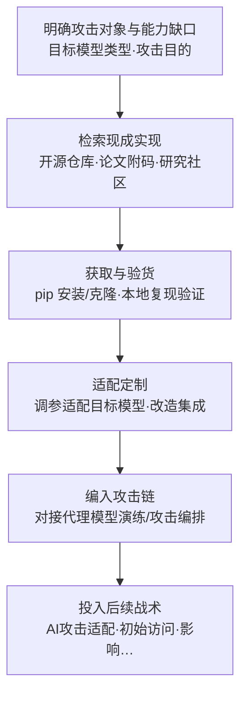

# 对抗性 AI 攻击实现 (AML.T0016.000)

> 属于 [获取能力 (AML.T0016)](../AML.T0016-Obtain-Capabilities.md)

## 一句话通俗理解

> 攻击 AI 不需要从零造武器——研究界为了"可复现性"把攻击代码连同论文一起开源，等于把造好的枪挂在墙上任人取用。CleverHans、Adversarial Robustness Toolbox、FoolBox 这些本为给模型做体检而生的"医疗设备"，落到攻击者手里就是手术刀：一行 pip 命令，武器到账。

## 难度等级

⭐⭐⭐ **Realized（已实现）**

官方成熟度评定为 Realized——与父技术 [获取能力 (AML.T0016)](../AML.T0016-Obtain-Capabilities.md) 及其全部兄弟子技术同为此等级，说明"获取现成 AI 攻击实现"已在真实攻击行动中被反复验证。获取动作本身几乎零门槛：研究库在开源仓库公开维护、一行命令安装即用，"下载"与正常研发行为完全无法区分。真正的门槛不在"拿到"，而在"用对"——判断哪个库适配目标的模型类型（图像/文本/表格）、调参生成有效的对抗样本、把攻击结果解读成可用的攻击情报，这需要对目标 AI 技术栈的理解。换句话说：弹药免费，瞄准仍需专业。

## 技术描述

### 通俗解释

如果说父技术 [获取能力 (AML.T0016)](../AML.T0016-Obtain-Capabilities.md) 是攻击者逛"军火市场"，本子技术就是其中**AI 原生弹药**的货架——专门为攻击 AI 系统而造、拿来即用的现成攻击实现。它与兄弟子技术的分工：软件工具（AML.T0016.001）搬的是改改就能用的通用工具，工具本身未必是 AI；生成式 AI（AML.T0016.002）搬的是"模型即弹药"；而本子技术搬的是**打 AI 的武器本身**——对抗样本生成器、模型提取工具、投毒验证框架这些开箱即用的攻击代码。

理解本子技术的钥匙是一组对偶关系：与 [开发能力 (AML.T0017)](../AML.T0017-Develop-Capabilities.md) 的"现货 vs 自研"。AML.T0017 是攻击者自己动手——自研投毒数据集、自己构造对抗扰动、让 AI 智能体自主开发漏洞利用；本子技术则是"不造枪，借枪"——研究界已经把最锋利的攻击实现公开了，何必自己造？科学界的可复现性传统，客观上成了攻击者的免费军火库。

### 技术原理

依据官方描述，对手可能检索现有的 AI 攻击**开源实现**——研究社区为可复现性与推动后续研究，经常公开其代码；以研究为目的设计的库（如 CleverHans、Adversarial Robustness Toolbox、FoolBox）可被对手直接武器化；官方同时明确指出，对手还会获取并使用**并非为对抗性 AI 攻击设计**的工具投入攻击。据此可归纳三条获取路径：

| 获取路径 | 典型对象 | 为什么"现成" |
|---------|---------|-------------|
| 研究库武器化 | CleverHans / Adversarial Robustness Toolbox / FoolBox 等对抗鲁棒性研究库 | 研究界为可复现性开源维护，pip 一行安装，攻击算法与超参齐备 |
| 论文随附攻击代码 | 对抗样本、模型提取、数据投毒等研究的官方实现 | 论文 + 代码 + 预置参数三件套，克隆仓库即可复现 |
| 移花接木的通用工具 | 并非为对抗攻击设计的软件 | 官方描述明确：只要"顺手"，攻击者拿来就用 |

这些现货武器覆盖攻击 AI 的主流能力面：**对抗样本生成**（逃避攻击，让模型在推理阶段误判）、**模型提取**（复刻目标模型能力）、**投毒验证**（验证后门样本有效性）等。对生成式 AI 与智能体目标，公开流传的越狱提示词集合与自动化红队工具同样构成"现成攻击实现"——与 LLM 越狱（AML.T0054）、提示词注入类技术天然衔接；当进攻性工具以模型或服务形态商业化交付（如公开售卖的深伪工具），则与生成式 AI（AML.T0016.002）的边界趋于模糊——攻击者常常"武器与弹药一起搬"。

**平台覆盖**：Predictive AI（预测式 AI）/ Generative AI（生成式 AI）/ Agentic AI（智能体 AI）——不同于父技术与多个兄弟子技术含 Enterprise，本子技术获取的对象是专门攻击 AI 系统的实现，天然只面向 AI 目标。

### 用途影响

- **攻击门槛归零**：技术平庸的团伙也能发动专业级 AI 攻击——攻击算法、实现代码与调参经验全部现成
- **攻击周期压缩**："检索—安装—验证"替代"研发—调试—试错"，攻击准备从数月缩短到数天
- **与目标情报叠加增效**：结合侦察与公开 AI 制品获取所得的模型架构、权重信息，现货武器可直接定制出高命中率的攻击
- **防御观测盲区**：获取与演练全部发生在攻击者自己的环境里，防御者无法观测"谁下载了什么"——只能靠加固自身模型与监控下游战术间接应对

## 攻击流程

### 典型攻击流程



**步骤详解：**

1. **明确攻击对象与能力缺口**
   - 通俗描述：先想清楚打谁、想让他错成什么样，再决定借哪把枪。
   - 技术细节：由侦察阶段掌握的目标 AI 技术栈反推能力缺口——目标是图像分类模型就找对抗样本库，是 LLM 服务就收集越狱与提示词攻击实现，是训练管线就找投毒工具。官方描述强调的正是"搜索"：需求先于获取。

2. **检索现成实现**
   - 通俗描述：到公开的"军火橱窗"里挑货。
   - 技术细节：在开源仓库检索 CleverHans、ART、FoolBox 等研究库与论文官方实现；跟踪安全会议的攻击论文及其随附代码；同时留意"并非为对抗攻击设计"但可移花接木的通用工具。

3. **获取与验货**
   - 通俗描述：把枪领回家，先打几发试试。
   - 技术细节：pip 安装或克隆仓库，在自有环境中用公开数据集复现攻击效果——对抗样本能否拉低测试准确率、提取的复刻模型性能是否达标、扰动幅度是否满足隐蔽性要求。

4. **适配定制**
   - 通俗描述：改枪——把通用武器调成专打目标的形状。
   - 技术细节：结合侦察所得的目标模型情报（架构、输入约束、置信度特征）调整攻击参数；父技术官方描述明确指出，对手可能修改或定制所获能力以辅助攻击特定的 AI 系统。

5. **编入攻击链并投入后续战术**
   - 通俗描述：弹药上膛，进入作战序列。
   - 技术细节：将攻击实现接入攻击编排——在代理模型上离线迭代对抗样本、把投毒工具接到数据准备流水线、把越狱实现编入对目标 LLM 的自动化探测循环。

**与后续战术的衔接：**

- **AI 攻击适配**：对抗样本库 + 获取的模型制品 = 离线演练的标准组合，产出针对目标系统的对抗数据
- **初始访问**：摄像头劫持等现成攻击套件直接用于绕过目标的人脸识别认证（见案例1）
- **防御削弱 / 影响**：逃避类攻击直接服务于绕过目标的 AI 检测与分类系统

> 关键差异：与传统"从地下市场买木马"不同，这些武器**合法、免费、明面流通**——单看获取行为完全正当，威胁全在使用与改造。防御者无法在"获取"环节设卡，只能加固模型自身鲁棒性、收敛可供演练的制品情报。

## 真实案例

> 以下 3 个案例在官方数据中均直接关联本子技术 AML.T0016.000，源自 MITRE ATLAS 案例库。

### 案例1：摄像头劫持骗过人脸识别——现成套件骗走 7700 万美元（AML.CS0004）

- **时间**: 2018年起，2020年披露
- **攻击者**: 两名个人犯罪者
- **手法**: 犯罪者利用摄像头劫持攻击绕过上海税务系统的人脸识别认证模型（对抗性 AI 攻击实现与软件工具 AML.T0016.001 的组合使用），冒充受害者身份进入系统；随后注册空壳公司、虚开税务发票，持续两年骗取约 7700 万美元。
- **影响**: 现成攻击能力 + 身份冒充的直接变现，证明 AI 攻击套件已进入普通犯罪者的工具箱
- **参考链接**: [华尔街日报报道](https://www.wsj.com/articles/faces-are-the-next-target-for-fraudsters-11625662828)

### 案例2：VirusTotal 投毒——变形工具的"拿来主义"（AML.CS0002）

- **时间**: 2020年
- **攻击者**: 未知
- **手法**: McAfee 高级威胁研究团队注意到某勒索软件家族的报告量异常增多。调查发现，有人使用现成的变形代码操纵工具 metame 对原始样本批量生成"变异体"（代码相似度 74%-98%、编译时间全部相同），并在短时间内通过公开病毒共享平台集中提交——以零研发成本操纵平台的家族聚合与检测声量。
- **影响**: 现成工具 + 平台特性 = 生态操纵；检测系统依赖的聚合数据可被低成本污染
- **参考链接**: [MITRE ATLAS 案例库 AML.CS0002](https://atlas.mitre.org/studies/AML.CS0002/)

### 案例3：Hugging Face 组织混淆——公开研究把模型变成武器（AML.CS0027）

- **时间**: 2023年8月
- **攻击者**: 安全研究员 threlfall_hax（红队演示）
- **手法**: 研究者在 Hugging Face 创建与真实组织同名的假组织账户，诱使该组织员工申请加入并上传模型；随后演示可将恶意软件嵌入 AI 模型文件（模型武器化），模型被下载执行后即获得进入受害组织环境的立足点，进而可窃取知识产权或投毒其他模型——攻击方法来自公开的红队研究。
- **影响**: 公开研究演示的攻击实现 + 模型供应链的信任机制 = 可复用的攻击范式
- **参考链接**: [研究者博客](https://5stars217.github.io/2023-08-08-red-teaming-with-ml-models/#unexpected-benefits---organization-confusion)

## 红队视角

> ⚠️ **免责声明**：以下内容仅用于合法授权的安全测试与教育目的。未经授权对他人系统或第三方服务进行测试是违法行为。

### 实战技巧

1. **按目标技术栈选弹药**
   授权评估开始前先盘点目标 AI 资产类型：图像/表格类模型用 ART 的对抗样本模块，LLM 服务用越狱与提示词注入评估实现，训练管线关注投毒验证工具。选型本身就是评估发现——"攻破这台系统需要多容易获得的武器"直接反映风险等级。

2. **量化"现货可用性"**
   交付报告应区分两档风险："公开武器即可攻破"与"需要定制开发才能攻破"。前者意味着任何技术水平的对手都能威胁目标，是修复优先级的直接依据。

3. **代理模型迁移演练**
   在与目标同款或高仿的公开模型上迭代对抗样本，记录攻击成功率与扰动幅度的量化数据——用迁移率说话，而不是用"模型可能不安全"的定性判断。

4. **复现公开攻击研究**
   跟踪顶会攻击论文及其随附代码，在隔离环境验证对目标同类模型的适用性，评估目标暴露面随新研究发布的变化。

### 常用工具

| 工具名称 | 用途 | 平台 |
|----------|------|------|
| Adversarial Robustness Toolbox (ART) | 对抗样本生成、攻击与防御评估 | 跨平台 |
| CleverHans | 对抗样本经典研究库 | 跨平台 |
| FoolBox | 对抗攻击基准库 | 跨平台 |
| 论文官方实现（开源仓库检索） | 定向复现最新攻击方法 | 跨平台 |

### 注意事项

- **合法获取、受限使用**：研究库全部公开合法，红队授权约束的对象是"用"——一切武器化验证仅限合同范围内的目标
- **验货即风险**：下载的"攻击工具"本身可能被投毒或植入后门——从官方渠道获取并校验完整性，在隔离环境运行
- **交付口径**：不向客户交付可直接武器化的制品，交付的是风险发现与加固建议

## 蓝队视角

### 检测要点

1. **影子武器库监控（组织内部）**
   - 日志来源：终端 EDR 进程与命令行遥测、包管理器日志、软件资产清单
   - 关注字段：pip/conda 安装记录、已知对抗攻击库名单
   - 异常特征：非安全、非研究岗位终端批量安装对抗攻击库（art、cleverhans、foolbox）且无对应业务项目

2. **下游战术回溯（事件响应视角）**
   - 日志来源：入侵调查中的工具指纹、载荷特征、外连目的
   - 关注字段：攻击载荷与公开研究实现的相似度、扰动生成算法特征
   - 异常特征：攻击中使用的实现与公开研究代码高度吻合——可反推对手能力水平（用现货的对手与用定制武器的对手，后续风险截然不同）

3. **AI 服务侧信号**
   - 日志来源：生产 AI 服务遥测、输入分布监控
   - 异常特征：置信度分布突发漂移、同源大批量细微扰动输入——现货武器"开火"的典型信号
   - 详见检测建议

### 监控建议

- 把"对抗攻击库安装"纳入终端基线，非白名单岗位出现即告警（安全团队自用需登记豁免）
- 事件响应流程加入"工具指纹比对"：识别攻击者使用的是公开现货还是定制武器，据此评估对手能力与后续风险
- 防御方主动拥抱同一批库：用 ART 等定期对自有模型做对抗性评估，把攻击者的武器变成自己的体检设备——先于攻击者发现可被打穿的点

## 检测建议

### 网络层检测

**检测方法：** 监控与攻击能力获取相关的异常流量。

- 非研发角色终端批量访问对抗攻击研究库的代码仓库
- 对已知攻击工具仓库的脚本化克隆（git clone 高频拉取）
- 出口侧出现论文代码仓库集合的批量下载行为

> 注：以上均为低置信度信号——公开仓库的正常研究与学习流量巨大，单条信号无行动价值，仅供与主机层信号关联加权。

### 主机层检测

**检测方法：** 监控对抗攻击库的安装与落地。

- `pip install adversarial-robustness-toolbox`、`cleverhans`、`foolbox` 等命令行在非数据科学、非安全岗位终端出现
- GPU 工作站出现长时间满载的对抗样本批量生成任务且无对应项目登记
- 已知攻击工具的文件哈希落地（与软件资产清单比对）

### 应用层检测（AI 遥测）

**检测方法：** 监控生产 AI 服务的输入分布与置信度异常。

- 输入样本置信度分布的突发漂移（对抗样本迁移到生产模型的典型落地信号）
- 同一来源短时间提交大量语义相近但细微扰动的输入（现货库批量生成的特征）
- 检测/分类引擎的命中率异常波动（VirusTotal 投毒类生态操纵的余波）

**程序化检测思路（无需 EDR 侧改造）：**

在终端管理平台与 AI 服务网关各推一条基线规则：(1) 命令行出现 `pip install` 匹配对抗攻击库名单（art、cleverhans、foolbox 等）且主机不在安全/研究白名单，即生成工单；(2) 对生产 AI 端点做置信度漂移检测，滑动窗口内均值骤降即告警。两条规则分别覆盖"武器落地"与"武器开火"两个窗口，成本极低。

### Sigma 规则思路示例

```yaml
title: 非研究终端安装对抗攻击研究库（获取对抗性 AI 攻击实现）
status: experimental
description: 检测非数据科学/安全岗位终端通过 pip 安装对抗样本研究库
    （adversarial-robustness-toolbox / cleverhans / foolbox），
    可能为影子武器库筹备或攻击前准备行为（AML.T0016.000）
logsource:
    category: process_creation
    product: windows
detection:
    selection_pip:
        CommandLine|contains:
            - 'pip install'
            - 'pip3 install'
    selection_libs:
        CommandLine|contains:
            - 'adversarial-robustness-toolbox'
            - 'cleverhans'
            - 'foolbox'
    condition: all of selection_*
level: low
tags:
    - attack.t1588
    - atlas.aml_t0016_000
```

> 说明：安装公开研究库本身是合法行为，单条告警价值有限；本规则的定位是"角色错位"信号——非研究岗位终端获取攻击库，供与 GPU 异常占用、对抗输入提交等行为关联分析时加权。

## 缓解措施

> 本子技术在官方数据中无直接映射的缓解措施，以下继承自父技术 [获取能力 (AML.T0016)](../AML.T0016-Obtain-Capabilities.md)——AML.M0001 在官方数据中的适用范围覆盖 AML.T0016 主技术。

### 优先级1：关键措施

**AML.M0001 限制模型制品发布（Limit Model Artifact Release）**

限制公开发布生产环境使用（或能代表生产环境）的技术细节：数据、算法、模型架构与模型检查点。对本子技术而言，现货武器的命中率取决于攻击者对目标模型的了解——公开发布的架构与检查点越少，攻击者拿现成攻击库打你时需要的额外定制成本越高。落地要点：公开制品发布前评审、生产模型与演示模型严格隔离、发布清单纳入 AI BOM 管理。

### 优先级2：重要措施（组织内治理）

**对抗性评估常态化**

CleverHans、ART、FoolBox 同时是防御者的标准体检设备：定期在模型离线副本上运行对抗样本评估，量化鲁棒性基线——攻击者能用现货武器打穿的点，先于攻击者发现。该措施非 ATLAS 官方缓解条目，为本库基于研究库"攻防同源"特性的落地建议。

### MITRE ATLAS 缓解措施映射

| 缓解措施ID | 缓解措施名称 | 优先级 | 映射来源 | 类别 | 生命周期阶段 |
|------------|-------------|:------:|----------|------|-------------|
| AML.M0001 | 限制模型制品发布 | 关键 | 继承自父技术 AML.T0016 | Policy | 业务与数据理解 · 部署 |
| — | 对抗性评估常态化 | 重要 | 本库落地建议 | Technical - AI | AI 模型工程 · 评估 · 部署 |

> 缓解逻辑：获取行为发生在视野之外、无法阻断——能做的是抬高"现货武器"对己方的命中率成本（少发布可演练的制品），并先于攻击者发现可被打穿的点（主动对抗性评估）。

## 关联 ATT&CK 技术

官方数据中本子技术**没有 attack_reference 映射**——"获取 AI 攻击的现成实现"在传统 ATT&CK 中没有对应的对象类别。以下为同一攻击逻辑在传统矩阵中的主题类比：

- [获取能力 (T1588)](../../../enterprise/02-Resource-Development/T1588-Obtain-Capabilities.md) — 父技术 AML.T0016 的直接映射来源，"获取现成能力"的同源逻辑
- [工具 (T1588.002)](../../../enterprise/02-Resource-Development/T1588/T1588.002-Tool.md) — 攻击实现本质上也是"工具"，主题最接近的传统子技术
- [人工智能 (T1588.007)](../../../enterprise/02-Resource-Development/T1588/T1588.007-Artificial-Intelligence.md) — ATT&CK v20 新增的 AI 能力获取子技术，与 ATLAS 本战术各子技术相互呼应
- [开发能力 (T1587)](../../../enterprise/02-Resource-Development/T1587-Develop-Capabilities.md) — 镜像对照：与其获取现成实现，不如自研（对应 AML.T0017）

**传统获取工具 vs 获取对抗性 AI 攻击实现：**

| 维度 | 工具 (T1588.002) | 对抗性 AI 攻击实现 (AML.T0016.000) |
|------|-----------------|-----------------------------------|
| 获取对象 | 通用黑客工具（扫描、破解、C2） | 专为攻击 AI 系统设计的攻击实现 |
| 来源属性 | 地下市场、论坛、公开工具 | 完全合法的开源仓库与论文附码 |
| 适配成本 | 拿来即用或小改 | 需要目标模型情报（架构/权重）才能发挥精度 |
| 防御观测 | 渠道侧情报可覆盖（暗网、论坛监控） | 渠道侧失效——公开下载与正常研发无法区分 |

一句话总结：T1588.002 是"去市场买刀"，AML.T0016.000 是"从图书馆免费借枪"——武器在明面上合法流通，威胁全在使用那一刻。

## 动手实验

> ⚠️ **重要提示**：所有实验在隔离的实验室环境中进行，仅使用自有环境与公开研究库。实验目的是理解攻击原理以加固自有模型，不对任何第三方系统发起攻击。

### 实验环境准备

| 环境组件 | 用途 | 获取方式 |
|----------|------|----------|
| 隔离虚拟机 | 实验环境 | 本地虚拟化平台 |
| Python 3.10+ | 运行对抗攻击库 | 官方安装包 |
| PyTorch + torchvision | 模型与数据集（MNIST/CIFAR） | pip 安装 |
| Adversarial Robustness Toolbox / FoolBox | 对抗样本生成与攻击基准 | pip 安装 |

### 实验1（初级）：体验"研究库武器化"零门槛

**实验目标：** 理解 AML.T0016.000 的核心现实——公开研究库如何被直接用于攻击。

**实验步骤：**
1. `pip install adversarial-robustness-toolbox torch torchvision`
2. 训练（或加载）一个 MNIST 小模型，记录其在测试集上的准确率
3. 用 ART 的 FGSM 方法生成对抗样本，重新评估模型准确率
4. 记录：从安装到"攻破"自己的模型，总共花了多少分钟？

**预期结果：** 直观体会官方描述中"研究库可被武器化"的含义——全部代码公开合法，威胁只在用途。

### 实验2（中级）：对抗样本跨模型迁移实验

**实验目标：** 理解攻击者"现货武器 + 代理模型"的标准打法。

**实验步骤：**
1. 准备两个架构相近的公开图像分类模型，一个充当"目标"、一个充当"代理"
2. 用 FoolBox 或 CleverHans 在代理模型上生成对抗样本，记录攻击成功率与扰动幅度
3. 将同一批样本送入"目标"模型，统计迁移攻击成功率
4. 思考：迁移率由什么决定？当攻击者拿到目标同款模型（AML.T0002.001）时，这个数字意味着什么？

**预期结果：** 量化理解"现货武器 + 公开架构情报"的组合威力，以及模型情报对攻击精度的放大作用。

### 实验3（高级）：给自己组织的模型做"现货可用性"评估

**实验目标：** 以攻击者视角评估自有（或授权）模型面对公开武器的暴露面。

**实验步骤：**
1. 选定组织内一个自有模型，复现其离线副本
2. 仅使用公开研究库（ART 攻击模块清单）逐一测试：逃避攻击、模型提取、投毒验证
3. 按"公开武器即可攻破 / 需要定制才能攻破"两档输出评估报告
4. 对照缓解措施：哪些发现对应"限制模型制品发布"，哪些对应"对抗性评估常态化"？

**预期结果：** 产出红队口径的"现货可用性"评估——攻击者拿公开武器打你，第一发命中的概率是多少。

## 术语解释

| 术语 | 英文原名 | 通俗解释 |
|------|----------|----------|
| 对抗性 AI 攻击实现 | Adversarial AI Attack Implementations | 现成的 AI 攻击代码实现——研究界公开、攻击者拿来即用的"现货武器" |
| 研究库武器化 | Weaponizing Research Libraries | 把为鲁棒性研究而生的开源库直接用于攻击——本子技术最核心的获取路径 |
| 对抗样本 | Adversarial Example | 经精细扰动、旨在让模型出错的输入——研究库最主流的产出 |
| 逃避攻击 | Evasion Attack | 推理阶段的对抗攻击：不改动模型，只构造让模型误判的输入 |
| 数据投毒 | Data Poisoning | 在训练数据中掺入恶意样本，给模型植入弱点或后门 |
| 模型提取 | Model Extraction | 通过大量查询复刻目标模型的功能，窃取其能力 |
| 提示词注入 | Prompt Injection | 向 LLM 输入中夹带恶意指令，劫持模型行为 |
| 越狱 | LLM Jailbreak | 用构造的提示词绕过模型安全限制，让它输出本应拒绝的内容 |
| 可复现性 | Reproducibility | 研究公开全部细节使他人能重建结果——科学美德，也是攻击者的礼物 |
| AI 制品 | AI Artifacts | 模型、数据集、配置等可流通的 AI 资产——攻击的原料与对象 |
| 供应链 | Supply Chain | 制品与工具从发布到部署的流转链条——公开研究实现经由它进入攻击者工具箱 |
| 代理模型 | Proxy Model | 攻击者用来离线演练攻击的"替身模型"，与现货攻击库构成标准组合 |

## 参考资料

### 📚 官方文档

- [MITRE ATLAS - Adversarial AI Attack Implementations (AML.T0016.000)](https://atlas.mitre.org/techniques/AML.T0016/000/) - 官方技术页面
- [MITRE ATLAS 矩阵](https://atlas.mitre.org/matrices/ATLAS/)
- [MITRE ATLAS Data (GitHub)](https://github.com/mitre-atlas/atlas-data)

### 📰 案例报告（真实攻击与安全研究）

- [WSJ: Faces are the next target for fraudsters](https://www.wsj.com/articles/faces-are-the-next-target-for-fraudsters-11625662828) - 案例1：人脸识别摄像头劫持欺诈报道（AML.CS0004）
- [MITRE ATLAS 案例库 AML.CS0002](https://atlas.mitre.org/studies/AML.CS0002/) - 案例2：VirusTotal 投毒事件
- [Model Confusion: Weaponizing ML Models for Red Teams](https://5stars217.github.io/2023-08-08-red-teaming-with-ml-models/#unexpected-benefits---organization-confusion) - 案例3：Hugging Face 组织混淆研究（AML.CS0027）

### 🔧 工具与资源

- [Adversarial Robustness Toolbox (ART)](https://github.com/Trusted-AI/adversarial-robustness-toolbox) - IBM 开源的对抗鲁棒性研究库
- [CleverHans](https://github.com/cleverhans-lab/cleverhans) - 对抗样本经典研究库
- [FoolBox](https://github.com/bethgelab/foolbox) - 对抗攻击基准库
- [OWASP Top 10 for LLM Applications](https://owasp.org/www-project-top-10-for-large-language-model-applications/) - LLM 应用十大安全风险

### 🔗 关联阅读

- [获取能力 (AML.T0016)](../AML.T0016-Obtain-Capabilities.md) - 本技术的父技术，五类获取能力全景
- [开发能力 (AML.T0017)](../AML.T0017-Develop-Capabilities.md) - 本技术的镜像技术："自研"对照"现货"
- [获取能力 (T1588)](../../../enterprise/02-Resource-Development/T1588-Obtain-Capabilities.md) - 传统资源开发的获取逻辑，对照阅读
- [资源开发战术 (AML.TA0003)](../README.md) - 本技术所属战术的概览页

---

> **版本**: ATLAS 2026.09 | **更新**: 2026-10-22 | **模板**: ATLAS 技术文档 v1.0
