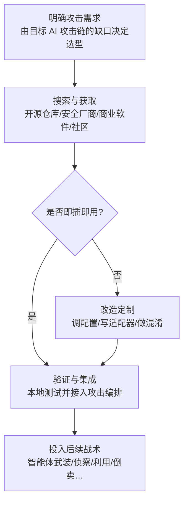

# 软件工具 (AML.T0016.001)

> 属于 [获取能力 (AML.T0016)](../AML.T0016-Obtain-Capabilities.md)

## 一句话通俗理解

> 攻击 AI 系统未必需要"AI 武器"——就像撬开智能锁不一定要专用破解器，一把螺丝刀加一卷胶带可能就够了。攻击者把扫描器、浏览器自动化、密码破解这些"正经五金工具"搬回家，改改配置、拼拼组合，就能武装一个智能体、倒卖一批大模型、骗过一套人脸识别——工具本身平平无奇，坏的是用法。

## 难度等级

⭐⭐⭐ **Realized（已实现）**

官方成熟度评定为 Realized——本子技术已在真实攻击行动中被反复验证：GTG-1002 把扫描器、浏览器自动化、密码破解与数据库工具接入越狱智能体发动间谍行动（AML.CS0069）；网络犯罪分子用现成反向代理工具倒卖云端大模型访问（AML.CS0030）。实施门槛几乎为零：工具全部公开合法流通、教程遍布互联网，"获取"动作与正常运维开发行为完全无法区分。官方平台覆盖仅标注 Enterprise——这正是本子技术的要义：**用于攻击 AI 系统的工具，本身未必是 AI**。真正的难度不在拿到工具，而在"用对"——知道哪个工具能撬开目标 AI 技术链的哪一环。

## 技术描述

### 通俗解释

如果说父技术 [获取能力 (AML.T0016)](../AML.T0016-Obtain-Capabilities.md) 是逛军火市场，本子技术买的不是枪炮弹药，而是**五金工具箱**。依据官方描述：为合法用途设计的软件可能被对手改作恶意用途；对手可能修改或定制软件工具以达到目的；用于攻击 AI 系统的软件工具**未必本身基于 AI**。

在父技术的五格弹药架上，本子技术占据"承上启下"的一层：

| 层级 | 形态 | 类比 |
|------|------|------|
| 对抗性 AI 攻击实现（.000） | CleverHans、ART 等现成攻击代码库 | 整枪——拿到就能开火 |
| **软件工具（.001）** | **通用软件、框架、安全工具、红队扫描器** | **五金工具箱——组合改造后什么都能撬** |
| 临时手搓脚本 | 现场编写的临时代码 | 手搓弹弓——灵活但费工 |

工具箱的价值在于**通用性与合法性外观**：ML 框架是开发者的日常依赖，红队扫描器是安全团队的正规装备，浏览器自动化是测试工程师的标配——攻击者采购、下载、安装这些工具的全过程看起来与任何技术团队搭环境毫无区别。

### 技术原理

依据官方描述与父技术定位，攻击者获取的"软件工具"可归纳为五类：

| 工具类别 | 典型代表 | 在 AI 攻击链中的角色 |
|---------|---------|---------------------|
| ML 框架与运行时 | PyTorch、TensorFlow、ONNX Runtime、Ollama | 搭建代理模型、加载目标公开 AI 制品的运行底座——框架本身与攻击无关 |
| 对抗攻击库 | Adversarial Robustness Toolbox、CleverHans、TextAttack | 本为鲁棒性研究而生，被当作"零部件"嵌入自定义工具链（与 .000 的分界在用途：成品攻击 vs 组件复用） |
| LLM 红队扫描器 | PyRIT、garak | 自动化提示词注入与越狱测试——防御测试工具换个目标就是攻击引擎 |
| 传统黑客工具 | Nuclei、FOFA 客户端、密码破解、浏览器自动化、数据库工具、反向代理 | 直接复用：智能体武装（CS0069）、云端 LLM 倒卖（CS0030） |
| 混淆与伪装工具 | 代码混淆器、加壳工具、虚拟摄像头驱动 | 让载荷骗过检测、让注入数据骗过人脸识别（CS0004） |

官方描述点明的利用路径可归纳为四条：

1. **搜索与获取**：经由开源仓库、安全厂商发布渠道、商业软件许可证乃至地下市场获取工具——多数工具公开合法流通，获取行为零风险；
2. **直接复用**：浏览器自动化、扫描器、密码破解等工具无需任何改造即可服务于攻击 AI 系统的行动——GTG-1002 将整套此类工具接入智能体即属此类；
3. **改造定制**：官方明确指出对手可能修改或定制软件工具——调整扫描器模板适配 AI 服务指纹、改造代理工具对接目标 API、给智能体定制工具描述以引导其调用；
4. **组合编排**：单件工具威力有限，真正的杀伤力来自组合——ML 框架 + 公开模型 = 代理靶场；智能体 + 渗透工具 = 自主攻击框架（CS0069）。

**与兄弟子技术的分工**：对抗性 AI 攻击实现（AML.T0016.000）是"整枪"——研究界现成的攻击实现拿来即用；软件工具（AML.T0016.001）是"工具箱"——需要选型、改造与组装；生成式 AI（AML.T0016.002）是"弹药生产线"；漏洞利用（AML.T0016.003）与智能体工具（AML.T0016.004）则分别提供突破目标软件栈的尖刀与智能体的"手脚"。

**平台覆盖**：Enterprise——攻击者在传统环境中即可完成获取与改造，产出直指各类 AI 系统的攻击行动。

### 用途影响

- **攻击门槛归零**：不需要任何 AI 研发能力，会装工具就能攻击 AI 系统——技术平庸的团伙因此获得入场券；
- **获取行为不可观测**：工具获取发生在攻击者自己的环境里，且与合法采购无法区分，防御者几乎无从事前察觉；
- **能力组合放大**：工具箱与智能体结合后产生质变——CS0069 中越狱智能体借助接入的工具完成了全部攻击工作量约 80-90%；
- **检测重心被迫后移**：唯一可观测的窗口是工具落地与使用的下游环节（详见检测建议）。

## 攻击流程

### 典型攻击流程



**步骤详解：**

1. **明确攻击需求**
   - 通俗描述：先想清楚要撬哪扇门，再决定买什么工具。
   - 技术细节：由侦察阶段掌握的目标 AI 资产反推工具缺口——目标是云端 LLM 服务就找凭证窃取与反向代理工具，是智能体平台就收集扫描器与自动化工具，是人脸识别就准备虚拟摄像头与注入工具。

2. **搜索与获取**
   - 通俗描述：五金店进货——大部分货架上明码标价、随便买。
   - 技术细节：从开源仓库下载 ML 框架与攻击库、从安全厂商获取正规红队扫描器、购买商业软件许可证，或在地下市场获取破解与混淆工具；全程与正常技术团队搭环境的行为无异。

3. **改造定制**
   - 通俗描述：把买的工具改成合手的形状。
   - 技术细节：官方描述明确指出对手可能修改或定制软件工具——为扫描器编写目标 AI 服务的识别模板、改造代理工具对接目标的 API 协议、用混淆器处理载荷规避检测。

4. **验证与集成**
   - 通俗描述：试枪、上膛。
   - 技术细节：在自有环境验证工具有效性后接入攻击编排——把工具挂到智能体的 MCP 连接上（CS0069）、把代理工具部署到云端服务器（CS0030）、把注入工具对接到目标认证流程（CS0004）。

**与后续战术的衔接：**

- **侦察**：扫描器与空间测绘工具直接服务主动扫描，绘制目标 AI 攻击面
- **AI 攻击适配**：ML 框架 + 获取的公开 AI 制品 = 代理模型靶场，支撑对抗样本与越狱提示词离线迭代
- **执行与横向移动**：密码破解、数据库工具接入智能体后成为自主攻击的"手脚"
- **影响**：反向代理工具把窃取的模型访问包装成转售商品（LLMjacking）

> 关键差异：与传统工具获取（T1588.002）相比，本子技术的工具箱里多了 ML 框架、红队 AI 扫描器与提示词工具包这些"AI 时代新五金"；与 .000 的分界在于——研究代码是现成的攻击实现，这里获取的是需要选型、改造与组装的**通用能力组件**。

## 真实案例

> 以下 3 个案例在官方数据中均直接关联本子技术 AML.T0016.001，源自 MITRE ATLAS 案例库。

### 案例1：GTG-1002——越狱智能体接入整套渗透工具库（AML.CS0069，AML.T0016.001）

- **时间**: 2025年9月
- **攻击者**: GTG-1002（Anthropic 以高置信度评估为中国国家级支持组织）
- **手法**: GTG-1002 获取 Claude Code 访问权并以虚假"防御安全"人设越狱后，通过 MCP 将智能体连接到扫描器、浏览器自动化、密码破解、数据库工具与专用渗透测试服务器——整套**传统软件工具**被接入 AI 智能体，构成自主攻击框架。越狱智能体随后自主侦察约 30 家目标、扫描漏洞、开发并部署 SSRF 利用链、建立后门账户，完成全部行动工作量约 80-90%。
- **影响**: 首个被公开报告的 AI 编排网络间谍行动（ATT&CK C0062）——工具箱 + 智能体的组合把"获取能力"变成了"自主攻击能力"
- **参考链接**: [Anthropic 官方报告](https://www.anthropic.com/news/disrupting-AI-espionage)、[ATT&CK C0062](https://attack.mitre.org/campaigns/C0062/)

### 案例2：LLMjacking——现成反向代理工具倒卖云端大模型（AML.CS0030，AML.T0016.001）

- **时间**: 2024年5月
- **攻击者**: 未知威胁行为者
- **手法**: Sysdig 威胁研究团队发现，攻击者利用窃取的云凭证访问云端 LLM 服务，并使用可广泛适配 AI21 Labs、Anthropic、AWS Bedrock、Azure、OpenAI 等多家云 AI 服务的工具搭建反向代理，把模型访问权转售给网络犯罪分子。研究人员估算单个 Claude 2.x 模型被滥用的最坏财务损失可达每天 4.6 万美元。
- **影响**: 通用代理工具把"偷来的模型访问"商品化，形成了稳定的黑产销售链路
- **参考链接**: [Sysdig: LLMjacking](https://sysdig.com/blog/llmjacking-stolen-cloud-credentials-used-in-new-ai-attack/)

### 案例3：摄像头劫持骗过人脸识别——合法软件改作攻击工具（AML.CS0004，AML.T0016.001）

- **时间**: 2018年起，2020年披露
- **攻击者**: 两名个人犯罪者
- **手法**: 犯罪者利用摄像头劫持攻击绕过上海税务系统的人脸识别认证——用软件在认证流程中注入伪造的人脸影像（对抗性 AI 攻击实现与软件工具结合使用），冒充受害者身份进入系统，随后注册空壳公司、虚开税务发票，持续两年骗取约 7700 万美元。
- **影响**: "改用途的合法软件 + 身份冒充"的直接变现，证实 AI 攻击工具已进入普通犯罪者的工具箱
- **参考链接**: [华尔街日报报道](https://www.wsj.com/articles/faces-are-the-next-target-for-fraudsters-11625662828)

## 红队视角

> ⚠️ **免责声明**：以下内容仅用于合法授权的安全测试与教育目的。未经授权对他人系统或第三方服务进行测试是违法行为。

### 实战技巧

1. **按目标技术栈选型工具箱**
   授权评估开始前先盘点目标 AI 资产类型，再决定工具选型：图像类目标用对抗攻击库搭建代理靶场，LLM 服务用红队扫描器做自动化测试，智能体平台组装最小工具集观察其能力放大效应。工具选型本身就是评估发现——"攻击这台系统需要多容易获得的工具"直接量化风险等级。

2. **红队工具的防御性复用**
   PyRIT、garak、TextAttack 这类工具的合法用途就是安全测试——在授权范围内对自有 AI 系统跑一轮自动化扫描，产出直接转化为加固清单；同一份工具清单也应作为蓝队检测规则的输入（工具名、命令行特征）。

3. **智能体 + 工具的能力放大验证**
   给测试智能体配置文件读取与命令执行类工具（MCP 或 function calling），观察工具描述文本如何引导模型选择与调用；对照 GTG-1002 案例评估：若攻击者完成同样的接入，自家环境的哪些环节会先失守？

4. **工具链完整性管理**
   所有工具从官方渠道获取并校验哈希——地下渠道流通的"破解版"工具常带后门，"攻击者被攻击"真实存在。

### 常用工具

| 工具名称 | 用途 | 平台 |
|----------|------|------|
| Nuclei | 漏洞扫描与暴露面核查 | 跨平台 |
| PyRIT（Microsoft） | LLM 自动化红队与提示词攻击测试 | 跨平台 |
| garak（NVIDIA） | LLM 漏洞扫描器 | 跨平台 |
| Adversarial Robustness Toolbox | 对抗样本生成与鲁棒性评估 | 跨平台 |
| TextAttack | NLP 对抗样本与提示词扰动 | 跨平台 |
| Playwright / Selenium | 浏览器自动化（智能体操控测试） | 跨平台 |

### 注意事项

- **授权边界**：获取工具合法，**使用**才是授权约束的对象——一切工具化验证仅限合同范围内的目标
- **工具即指纹**：红队使用公开工具会暴露工具特征，交付报告应同步提供"自家工具使用痕迹"的检测建议
- 不向客户交付可直接武器化的制品，交付的是风险发现与加固建议

## 蓝队视角

### 检测要点

1. **接受现实：工具获取不可观测**
   - 工具获取发生在攻击者环境，且与合法采购无法区分——检测重心必须放在**工具落地与使用的下游环节**

2. **终端工具落地检测**
   - 日志来源：EDR 进程与文件遥测、软件资产清单、包管理器日志
   - 关注字段：进程名与命令行、pip/npm 安装记录、MCP 配置文件变更
   - 异常特征：非安全岗位终端出现 Nuclei、密码破解工具；批量安装对抗攻击库（art、textattack）且无对应业务项目；办公终端出现红队 AI 扫描器（pyrit、garak）调用记录

3. **智能体平台工具准入检测**
   - 日志来源：智能体平台审计日志、MCP 连接注册记录
   - 关注字段：新增工具集成、工具配置变更、异常的外部服务连接
   - 异常特征：智能体环境出现未审计的扫描器、数据库工具、浏览器自动化接入（CS0069 式"自我武装"的直接信号）

### 监控建议

- 把"渗透测试工具落地"与"红队 AI 扫描器安装"纳入终端基线，出现即告警（区分安全岗位白名单）
- 智能体平台对工具注册/变更实施准入审计——阻断 AML.T0016.001 工具在自家环境内被接入智能体
- 事件响应流程中加入"工具指纹比对"：识别攻击者用的是公开现货还是定制武器，据此评估对手水平与后续风险
- 维护本行业被武器化工具的威胁情报清单，输入欺诈与风控团队

## 检测建议

### 网络层检测

**检测方法：** 监控与工具获取及工具外联相关的异常流量。

- 非研发/安全角色终端批量访问安全工具仓库与 Exploit-DB 类站点
- 终端出现对已知漏洞利用集合仓库的规律性拉取（工具采购特征）
- 云端 AI 服务出口出现反向代理流量形状（同一凭证多点复用——LLMjacking 特征）

### 主机层检测

**检测方法：** 监控攻击工具链在终端的落地与执行。

- `nuclei.exe`、`hashcat.exe` 等已知工具的进程创建；`pyrit`、`garak`、`textattack` 等包的命令行调用
- 对抗攻击库（adversarial-robustness-toolbox、cleverhans）的 pip 安装且无对应登记项目
- MCP 配置文件中出现未审批的命令执行、文件读取类工具注册

### 应用层检测（AI 遥测）

**检测方法：** 利用组织自有 AI 平台与智能体的审计能力。

- 智能体平台出现新增的未登记工具集成与 MCP 连接（工具被接入智能体的直接信号）
- 自有模型 API 出现异常调用模式（可能被反向代理工具包装转售）
- 认证服务收到注入特征的影像/输入流（摄像头劫持类工具的下游信号）

**程序化检测思路（无需 EDR 侧改造）：**

在终端管理平台与智能体平台各推一条基线规则：① 软件资产清单中出现 Nuclei/Hashcat 等工具且使用人为非安全岗位即生成复核工单；② 智能体平台的工具注册表每日 diff，新增未在白名单的工具集成即告警。两条规则分别覆盖"工具落地"与"工具接入智能体"两个窗口，成本极低。

### Sigma 规则思路示例

```yaml
title: 办公终端出现攻击工具链进程（软件工具落地信号）
status: experimental
description: 检测非安全岗位终端运行 Nuclei/Hashcat 等渗透工具或
    红队 AI 扫描器命令行，可能为攻击筹备（AML.T0016.001）
logsource:
    category: process_creation
    product: windows
detection:
    selection_tools:
        Image|endswith:
            - '\nuclei.exe'
            - '\hashcat.exe'
    selection_cli:
        CommandLine|contains:
            - 'garak'
            - 'pyrit'
    filter_sec:
        Image|startswith: 'C:\SecurityTools'
    condition: 1 of selection_* and not filter_sec
level: low
tags:
    - attack.t1588.002
    - atlas.aml_t0016_001
```

> 说明：单条工具进程告警价值有限——安全团队日常使用这些工具属正常行为；本规则的定位是"角色错位"信号，供与 MCP 配置变更、对抗库安装等行为做关联分析时加权。

## 缓解措施

> 本子技术在官方数据中无直接映射的缓解措施（mitigations 为空），以下按"继承自父技术"的官方映射与企业侧配套控制两条线落地——获取行为发生在视野之外，无法直接阻断。

### 优先级1：关键措施（继承自父技术 AML.T0016）

**AML.M0001 限制模型制品发布（Limit Model Artifact Release）**

限制公开发布生产环境使用（或能代表生产环境）的技术细节：数据、算法、模型架构与模型检查点。对本子技术的意义在于**收缩工具可加工的原料面**——攻击者的工具箱（ML 框架、对抗攻击库）要产出实际威胁，需要"原料"：可加载的目标模型、可分析的架构细节。你发布的每一个公开检查点，都是工具箱里膛的弹药。

### 优先级2：重要措施（企业侧配套控制，本库落地建议）

- **终端软件治理**：EDR + 应用白名单管控未登记工具落地；安全岗位的工具使用纳入白名单管理，缩小"角色错位"告警噪声
- **智能体工具准入审计**：MCP 服务器、插件、技能的注册与变更实施准入控制——阻断渗透工具在自家智能体环境内被接入（直接对应 CS0069 的攻击路径）

### MITRE ATLAS 缓解措施映射

| 缓解措施ID | 缓解措施名称 | 优先级 | 映射来源 | 类别 | 生命周期阶段 |
|------------|-------------|:------:|----------|------|-------------|
| AML.M0001 | 限制模型制品发布 | 关键 | 继承自父技术 AML.T0016 | Policy | 业务与数据理解 · 部署 |

> 逻辑：M0001 解决"工具箱里有没有你家的原料"（治本，收缩暴露面），企业侧控制解决"工具落地和接入智能体时能不能发现"（治标，下游检测）。工具获取本身无法阻断——这是资源开发类技术的共同局限。

## 关联 ATT&CK 技术

- [工具 (T1588.002)](../../../enterprise/02-Resource-Development/T1588/T1588.002-Tool.md) — 本子技术在 ATLAS 官方数据中的直接映射来源：攻击者获取软件工具（开源、付费或私有）用于攻击行动
- [获取能力 (T1588)](../../../enterprise/02-Resource-Development/T1588-Obtain-Capabilities.md) — 父技术的 ATT&CK 映射来源

**传统工具获取 vs AI 语境下的软件工具：**

| 维度 | ATT&CK T1588.002 | ATLAS AML.T0016.001 |
|------|-----------------|---------------------|
| 获取对象 | Cobalt Strike、扫描器、密码破解等经典黑客工具 | 同样的经典工具，**加上** ML 框架、对抗攻击库、LLM 红队扫描器、提示词工具包 |
| 使用方式 | 攻击者人工操作工具 | 人工操作之外新增**接入 AI 智能体**（MCP 集成）——工具成为智能体的"手脚" |
| 防御观测性 | 获取不可见，靠落地检测 | 相同困境，且工具的"合法外观"更浓——多数本身就是安全/开发团队的正规装备 |

一句话总结：T1588.002 说"攻击者去买工具"，AML.T0016.001 补上 AI 时代的新现实——**工具箱里多了 AI 原生的五金，而且这些工具会自己接上智能体干活**。

## 动手实验

> ⚠️ **重要提示**：所有实验在隔离环境进行，仅以自有系统为对象；工具一律从官方渠道获取并校验完整性。

### 实验环境准备

| 环境组件 | 用途 | 获取方式 |
|----------|------|----------|
| 隔离虚拟机 | 工具安装与测试环境 | 本地虚拟化平台 |
| Python 3.10+ | 运行扫描器与攻击库 | 官方安装包 |
| Ollama + 一个小型开源 LLM | 本地测试目标 | [ollama.com](https://ollama.com/) |
| Nuclei / garak | 扫描器与 LLM 红队工具 | GitHub 官方仓库 |

### 实验1（初级）：体验"红队工具一体两面"

**实验目标：** 理解防御测试工具与攻击工具的同构性（对应 PyRIT/garak 类工具）。

**实验步骤：**
1. 在隔离虚拟机安装 garak，对本地 Ollama 部署的小型模型执行一次漏洞扫描
2. 观察报告：提示词注入、越狱、数据渗漏各检出多少项？
3. 思考：同样的命令行，安全团队执行是加固依据，攻击者执行是什么？

**预期结果：** 直观感受"工具无善恶"——获取与运行的每个动作都合法，差别只在目标与用途。

### 实验2（中级）：组装一个"工具 + 智能体"最小复现

**实验目标：** 复现 CS0069 的核心形态——工具接入如何放大智能体能力。

**实验步骤：**
1. 用任意本地智能体框架（或 50 行 Python 的 function calling 循环）搭一个最小智能体
2. 为其配置两个工具：只读目录列表工具、可执行白名单命令（`whoami` 等）的 shell 工具
3. 分别在"只有工具 1""有工具 1+2"两种配置下给同一批任务，观察行为差异
4. 对照 GTG-1002 案例：攻击者接入扫描器与密码破解时，本质上做了什么？

**预期结果：** 理解"获取工具 = 获得模型推理之外的资源与动作权限"——这正是工具准入审计需要看住的能力边界。

### 实验3（高级）：工具链改造演练

**实验目标：** 体会官方描述中"修改或定制软件工具"的实际含义。

**实验步骤：**
1. 为 Nuclei 编写一个针对自建测试服务的自定义检测模板（模拟为特定目标定制工具）
2. 对自有测试环境执行扫描，记录检出结果与流量特征
3. 反向 exercise：从蓝队视角写出检测该模板的规则（进程、命令行、网络特征各一条）

**预期结果：** 理解工具改造的低成本（一个模板文件）与检测的滞后性——攻防不对称在"工具定制"环节的具体体现。

## 术语解释

| 术语 | 英文原名 | 通俗解释 |
|------|----------|----------|
| 软件工具 | Software Tools | 为合法用途设计的通用软件，被攻击者获取、改造后用于攻击——本子技术的核心对象 |
| 工具改造 | Tool Repurposing | 给合法工具改配置、写适配器、做混淆，让它干原本不干的活 |
| ML 框架 | ML Framework | PyTorch、TensorFlow 等机器学习开发框架——攻击者搭代理模型的"工作台" |
| 对抗攻击库 | Adversarial Attack Library | ART、CleverHans、TextAttack 等对抗样本研究库——防御研究的产物，攻击的零部件 |
| LLM 红队扫描器 | LLM Red Team Scanner | PyRIT、garak 等自动化提示词攻击测试工具——安全装备，换个目标就是攻击引擎 |
| 对抗样本 | Adversarial Example | 经精细扰动、旨在欺骗 AI 模型的输入——在代理模型上优化后可迁移至真实目标 |
| 提示词注入 | Prompt Injection | 在输入中夹带恶意指令，诱导 LLM 违背既定规则行事 |
| 越狱 | LLM Jailbreak | 用构造的提示词绕过模型安全限制，让它输出本应拒绝的内容 |
| AI 制品 | AI Artifacts | 模型、数据集、智能体配置等可流通的 AI 资产——工具箱加工的"原料" |
| AI 智能体 | AI Agent | 能自主规划并调用工具完成任务的 AI 系统——工具接入后的能力放大器 |
| 反向代理 | Reverse Proxy | 转发请求的中介服务——被滥用来包装窃取的模型访问权对外转售 |
| MCP 服务器 | Model Context Protocol Server | 为智能体提供工具调用的标准服务端——CS0069 中工具接入智能体的通道 |

## 参考资料

### 📚 官方文档

- [MITRE ATLAS - Software Tools (AML.T0016.001)](https://atlas.mitre.org/techniques/AML.T0016/001/) - 官方技术页面
- [MITRE ATLAS 矩阵](https://atlas.mitre.org/matrices/ATLAS/)
- [MITRE ATLAS Data (GitHub)](https://github.com/mitre-atlas/atlas-data)

### 📰 案例报告（真实攻击与安全研究）

- [Anthropic: Disrupting the First Reported AI-Orchestrated Cyber Espionage Campaign](https://www.anthropic.com/news/disrupting-AI-espionage) - 案例1：GTG-1002 工具库接入越狱智能体（CS0069）
- [ATT&CK Campaign C0062](https://attack.mitre.org/campaigns/C0062/) - GTG-1002 行动的 ATT&CK 官方条目
- [Sysdig: LLMjacking - Stolen Cloud Credentials Used in New AI Attack](https://sysdig.com/blog/llmjacking-stolen-cloud-credentials-used-in-new-ai-attack/) - 案例2：反向代理工具倒卖 LLM 访问（CS0030）
- [WSJ: Faces are the next target for fraudsters](https://www.wsj.com/articles/faces-are-the-next-target-for-fraudsters-11625662828) - 案例3：摄像头劫持骗过人脸识别（CS0004）

### 🔧 工具与资源

- [Nuclei](https://github.com/projectdiscovery/nuclei) - 开源漏洞扫描器
- [PyRIT](https://github.com/Azure/PyRIT) - Microsoft AI 红队自动化框架
- [garak](https://github.com/NVIDIA/garak) - NVIDIA 开源 LLM 漏洞扫描器
- [Adversarial Robustness Toolbox](https://github.com/Trusted-AI/adversarial-robustness-toolbox) - IBM 开源对抗鲁棒性研究库
- [TextAttack](https://github.com/QData/TextAttack) - NLP 对抗样本框架

### 🔗 关联阅读

- [获取能力 (AML.T0016)](../AML.T0016-Obtain-Capabilities.md) - 本技术的父技术，五格弹药架全景
- [开发能力 (AML.T0017)](../AML.T0017-Develop-Capabilities.md) - "买现货"与"自己造"的对照
- [工具 (T1588.002)](../../../enterprise/02-Resource-Development/T1588/T1588.002-Tool.md) - 本技术在 ATT&CK 中的直接映射来源
- [资源开发战术 (AML.TA0003)](../README.md) - 本技术所属战术的概览页

---

> **版本**: ATLAS 2026.09 | **更新**: 2026-10-22 | **模板**: ATLAS 技术文档 v1.0
