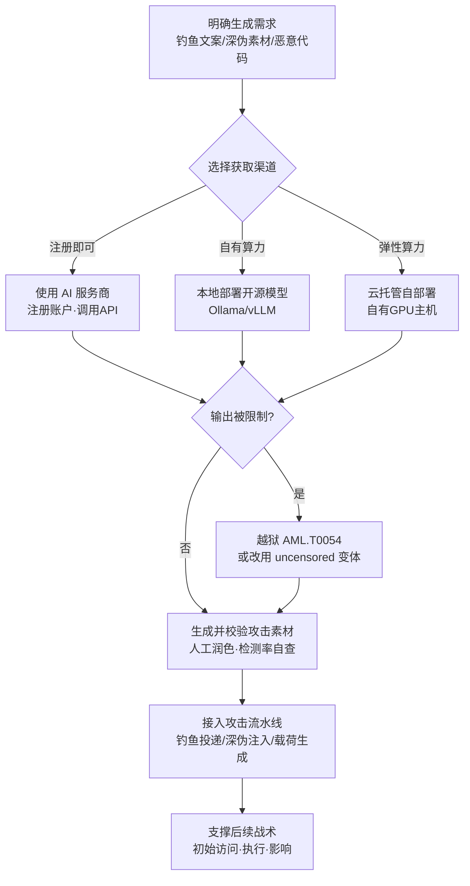

# 生成式 AI (AML.T0016.002)

> 属于 [获取能力 (AML.T0016)](../AML.T0016-Obtain-Capabilities.md)

## 一句话通俗理解

> 传统军火商得自己炼钢造枪；AI 时代的攻击者只需订阅一个对话窗口——写钓鱼邮件、伪造老板的声音、编一段免杀脚本，把需求说出来就有人代劳。生成式 AI 就是一台"随叫随到的造假工厂"：可以租云端的，可以搬回自己电脑上开私人工厂，还能专门买一台"拆掉了道德刹车"的版本。

## 难度等级

⭐⭐⭐ **Realized（已实现）**

官方成熟度评定为 Realized——本子技术已在真实犯罪活动中被反复验证，不只是研究演示。获取门槛低到近乎不存在：主流聊天机器人注册即用，开源模型在 Ollama、vLLM 上一行命令本地起服，Hugging Face 等平台直接托管；把模型"去对齐"成 uncensored 变体的微调方法与权重也公开可得。真正需要投入的是**绕过限制**：要么用越狱（AML.T0054）绕过服务商的输出限制，要么直接获取/自行微调 uncensored 模型，再或者干脆违反模型开发者的服务条款——这三条路都不难走，只是各自承担不同的成本与风险。官方关联的真实案例（ProKYC 深伪工具即服务、iProov 活体绕过、Hermes Agent 用 DeepSeek 驱动自主攻击）证明这条获取路径已经商品化、工业化。

## 技术描述

### 通俗解释

如果把父技术 [获取能力 (AML.T0016)](../AML.T0016-Obtain-Capabilities.md) 比作"逛军火市场买现货"，本子技术买的是一种**会自己生产弹药的机器**：攻击者不买某一件武器，而是买下"什么都能造"的能力。

官方描述把用途列得很直白：用生成式 AI 生成恶意软件、生成深度伪造（AML.T0088）、生成恶意命令（AML.T0102）、做检索内容构造（AML.T0066）、生成钓鱼内容（AML.T0052）。同一台机器，换个提示词就从"写文案"切换到"写后门"，防御者看到的成品千差万别，源头却是同一个模型。

获取形态分三种，成本与隐蔽性依次递增：

| 获取形态 | 通俗说法 | 特点 |
|---------|---------|------|
| 使用 AI 服务商 | 去公共工厂下单 | 注册即用、能力最强；有日志、有内容过滤、受服务条款约束 |
| 云托管自部署 | 租厂房开私人工厂 | 可控、可换模型、无第三方审计；仍需处理算力与联网痕迹 |
| 本地部署开源模型 | 把机床搬回家 | 完全离线、零外呼、无限次重试；需要自有算力，模型质量取决于选型 |

### 技术原理

依据官方描述，攻击者获取生成式模型或工具（如大语言模型）用于攻击行动的多个环节。具体路径有四条：

1. **获取开源模型并本地服务**：下载开源权重，用 Ollama、vLLM 等框架在本机或自有服务器上起服。整条链路不出网，不产生第三方服务商日志，提示词与产出物完全在攻击者掌控中。
2. **云托管自部署**：把开源或可下载的模型部署在自有云主机上，拿可控性同时保留弹性算力；相比公共聊天服务，少了服务商侧的内容审查与审计。
3. **直接使用 AI 服务商**：通过 Hugging Face 等平台或商业 API 取用模型能力，省去算力投入，代价是留下账户与调用记录。
4. **越狱与去对齐**：公共服务的输出被护栏限制，攻击者需要越狱（AML.T0054）绕过限制，或者干脆违约使用——官方明确指出攻击者可能"违反模型开发商的服务条款"。

**无审查（uncensored）模型**是本子技术的关键现象。官方列出了三条形成路径：

| 路径 | 说明 |
|------|------|
| 使用现成的 uncensored 模型 | 社区已发布设计上不带护栏与内容过滤的变体 |
| 微调移除对齐 | 用自己的数据微调，剥掉 RLHF 等对齐训练留下的行为约束 |
| 针对性操纵绕过拒绝 | 利用"拒绝行为由单一方向介导"这类机理（见参考资料 arXiv:2406.11717），定向修改权重以绕过拒答 |

官方还点出两个值得警惕的细分：存在为**攻防安全**构建的 uncensored 模型（如 WhiteRabbitNeo），本意是给红蓝队使用，但同样可被攻击者滥用；也有**公开宣传恶意用途**的模型（如 WormGPT 系列），等于把犯罪工具做成了产品。Cisco Talos 的研究则从犯罪团伙侧证实了这种滥用已成常态。

**与 AML.T0017（开发能力）的分界**：这是理解本子技术定位的核心。AML.T0017 是**自己造**——研发对抗样本算法、投毒数据集、漏洞利用；本子技术是**获取现成的生产能力**——模型是别人训练好的，攻击者只是拿到使用权（或把它改成自己想要的样子）。换句话说，AML.T0017 造枪，AML.T0016.002 买一台能批量生产枪的机床。混合形态也很常见：攻击者获取 uncensored 基座后做少量微调（严格说是开发），但主体能力仍来自获取。

**平台覆盖**：官方标注为 Enterprise（企业 IT）——因为被武器化的对象是攻击者自己的环境，不是目标的 AI 系统。本子技术不针对预测式 AI、生成式 AI 或智能体 AI 这些目标平台，而是描述攻击者如何在企业 IT 环境中取得并运行生成式能力。

### 用途影响

- **攻击成本断崖式下降、社工规模化**：一封精心本地化、无语法错误的钓鱼邮件，成本从"请专业写手"降到"按一下回车"且可无限量生成；官方将"生成钓鱼内容（AML.T0052）"与"检索内容构造（AML.T0066）"列为核心用途——攻击者可按目标画像批量产出多语种、多口吻、多场景的诱饵
- **身份伪造工业化**：深伪（AML.T0088）让"冒充某人"变成可采购的服务，ProKYC 案例证明 KYC 绕过已经明码标价
- **恶意代码与命令辅助**：官方明确列出"生成恶意软件"与"生成恶意命令"——模型可辅助混淆载荷、解释报错、改写检测特征
- **自主行动的推理引擎**：Hermes Agent 案例中，DeepSeek 不是用来写文案，而是充当自主攻击智能体的决策大脑——生成式 AI 从"工具"升级为"操作者"

## 攻击流程

### 典型攻击流程



**步骤详解：**

1. **明确生成需求**
   - 通俗描述：先想清楚要让工厂生产什么。
   - 技术细节：由目标决定产出类型——针对高管的目标式钓鱼需要研究其写作风格，KYC 欺诈需要人脸素材，免杀尝试需要代码改写。需求越具体，提示词工程与选型越精确。

2. **选择获取渠道**
   - 通俗描述：公共工厂、租厂房，还是搬机床回家。
   - 技术细节：权衡三件事——能力上限、可审计性、成本。公共服务能力最强但有日志与内容过滤；本地部署零外呼但要求算力；云托管折中。官方点名的三个渠道分别是 AI 服务商（含 Hugging Face）、云托管、本地框架（Ollama/vLLM）。

3. **突破输出限制**
   - 通俗描述：如果工厂不肯接这单，就换一家或拆掉它的规矩。
   - 技术细节：三条路——越狱（AML.T0054）用构造提示词绕过护栏；获取或自建 uncensored 变体（微调去对齐、操纵拒绝方向）；违约使用（官方明确提到攻击者可能违反服务条款）。越狱成本最低但稳定性差；uncensored 模型稳定但需要更多技术投入。

4. **生成并校验攻击素材**
   - 通俗描述：按下按钮出货，但工厂出的货得自己验一遍。
   - 技术细节：官方列举的产出一一对应后续战术——钓鱼内容（AML.T0052）、深伪（AML.T0088）、恶意命令（AML.T0102）、检索内容构造（AML.T0066）、恶意软件代码。模型输出普遍存在幻觉与格式瑕疵，攻击者需人工核对事实、修正代码可执行性、调整语气可信度，必要时用已知的检测规则做"检测率自查"。这一步是从"玩具"到"武器"的关键。

5. **接入攻击流水线**
   - 通俗描述：把流水线接到发射架上。
   - 技术细节：生成的素材进入投递通道（邮件网关、社交平台、水坑站点）、深伪注入工具链（虚拟摄像头/注入层）、载荷生成器。Hermes Agent 案例展示了更彻底的形态：模型直接充当智能体的推理核心，边生成边决策边行动。

**与后续战术的衔接：**

- **同战术·资源开发**：获取的生成式 AI 与 [开发能力 (AML.T0017)](../AML.T0017-Develop-Capabilities.md) 的成果叠加——用模型生成对抗样本代码、投毒数据集的伪装文档；与 AML.T0016.004（AI 智能体工具）组合时，模型成为智能体的"大脑"，生成的钓鱼文案与深伪素材在暂存阶段（AML.T0079）部署到钓鱼站点与假账号
- **初始访问**：钓鱼（AML.T0052 类技术）与深伪社工直接打开进入渠道；iProov 案例中深伪图像注入直接绕过 KYC 完成注册
- **执行**：生成的恶意脚本与命令进入目标环境执行；模型还可辅助变形载荷规避检测
- **影响**：深伪用于勒索（伪造不雅素材）、CEO 欺诈（语音克隆指挥转账）

> 关键差异：获取一个漏洞利用只能打一处系统，获取一台生成式 AI 可以反复产出无限种素材——它是**能力本身的能力**。这也解释了为何它被归在"获取能力"而不是"生成内容"（企业版 T1683）：重心在**取得生产能力**这个动作，而非某个具体产出物。

## 真实案例

> 以下 3 个案例在官方数据中均直接关联本子技术 AML.T0016.002，源自 MITRE ATLAS 案例库。

### 案例1：ProKYC——深伪工具即服务，KYC 绕过明码标价（2024年10月，AML.CS0034）

- **时间**: 2024年10月
- **攻击者**: ProKYC（网络犯罪团伙，工具即服务）
- **手法**: Cato CTRL 研究人员发现 ProKYC 是一套出售给网络犯罪分子的深伪工具，专门用于绕过加密货币交易所等金融服务应用的 KYC 核验。该工具能生成假身份证件与深伪自拍视频——这两项正是 KYC 核验所依赖的关键生物特征数据，从而帮助买家击败人脸识别与活体检测，批量开立欺诈账户。
- **影响**: 把"获取生成式 AI 能力"做成了订阅制商品——攻击者无需任何模型知识，付费即获得成熟的深伪生产能力；攻击门槛被拉到零，规模化欺诈开户成为流水线业务
- **参考链接**: [Cato CTRL 威胁研究](https://www.catonetworks.com/blog/prokyc-selling-deepfake-tool-for-account-fraud-attacks/)、[AI 事件数据库 Incidents 819](https://incidentdatabase.ai/cite/819/)、[ATLAS 案例页 AML.CS0034](https://atlas.mitre.org/studies/AML.CS0034/)

### 案例2：实时深伪图像注入绕过移动端 KYC 活体验证（2024年10月，AML.CS0033）

- **时间**: 2024年10月
- **攻击者**: iProov 红队
- **手法**: 人脸生物认证被广泛用于移动应用的身份核验与 KYC 合规。研究团队演示了一种人脸替换的图像注入攻击，成功绕过了移动设备上的实时人脸识别，以及被动与主动两类活体检测。通过这类攻击，对手可以访问受害者的特权系统，或创建虚假身份在银行、加密货币应用中开立欺诈账户。
- **影响**: 证明生成式 AI 产出的人脸素材已足以击穿"活体检测"这道防线——生物认证不再等同于"本人到场"；同一攻击路径同时支撑账户接管与身份造假两种目标
- **参考链接**: [ATLAS 案例页 AML.CS0033](https://atlas.mitre.org/studies/AML.CS0033/)、[活体检测概念](https://en.wikipedia.org/wiki/Liveness_test)

### 案例3：DeepSeek 驱动的 Hermes Agent——生成式 AI 充当自主攻击大脑（2026年5月，AML.CS0070）

- **时间**: 2026年5月
- **攻击者**: 中文威胁行为者（别名 knaithe / KnYuan）
- **手法**: 攻击者把开源 Hermes Agent 配置为以 DeepSeek 作为推理引擎，Hermes 提供终端访问、Telegram 操作控制与红队技能系统，并接入暴露 FOFA 搜索与 Nuclei 扫描生成能力的 MCP 服务器。Unit 42 恢复的 2026 年 5 月 7 日会话显示：操作者通过 Telegram 下发一次初始任务后便再无输入，智能体自主搜索目标、获取公开漏洞利用、运行扫描、评估结果并修正策略——先尝试 Langflow 的 CVE-2026-33017，发现目标不满足前提后放弃，比较 10 个产品族后转投 n8n，获取 CVE-2026-21858 与 CVE-2025-68613 利用链并通过 FOFA 探测候选系统。各次自主利用尝试均未获得访问，但其工作区因误将家目录（`/home/worker`）暴露为 HTTP 文件服务而被完整还原，包含 AI 工具配置、API 密钥、漏洞利用脚本、目标清单与自主利用会话日志。
- **影响**: 生成式 AI 的用途从"内容生产"跃升为"决策与编排"——攻击者只需一行指令，模型即可承担目标选择、工具调用与策略调整；同时该案例也说明获取生成式 AI 能力会留下大量可被取证的痕迹（配置、密钥、会话日志）
- **参考链接**: [Unit 42 分析报告](https://unit42.paloaltonetworks.com/autonomous-ai-cyber-attack-campaign/)、[ATLAS 案例页 AML.CS0070](https://atlas.mitre.org/studies/AML.CS0070/)

## 红队视角

> ⚠️ **免责声明**：以下内容仅用于合法授权的安全测试与教育目的。使用生成式 AI 辅助授权测试须遵守模型服务条款与许可协议；未经授权对他人系统发起测试是违法行为。

### 实战技巧

1. **优先本地部署，隔离数据边界**
   在授权测试中用 Ollama/vLLM 本地部署开源模型生成社工文案、载荷变形建议与日志分析摘要。数据不出网本身就消除了"把客户敏感信息喂给第三方 AI"的合规风险，同时向客户直观演示内部数据外流的路径——这往往比任何报告都更有说服力。

2. **用模型能力反推攻击者能力**
   评估时应回答一个关键问题："这台生成式 AI 能替攻击者省掉多少功夫？"具体做法是把任务拆解成"模型独立完成 / 模型辅助完成 / 必须人工"三档，逐项标注。某类钓鱼文案若模型一次生成即可直接投递，风险等级与"需专业写手耗时两天"完全不同；评估人脸/语音核验类系统时，同样标注"对手需何种质量的生成素材即可绕过"——对照 iProov 与 ProKYC 案例，明确区分"需要专业团队"与"花几百美元买工具"两档风险。

3. **把越狱演示做成业务影响证据**
   在自有或授权环境中演示公共模型被越狱后能产出何种素材（不实际投递），记录所需提示词轮次与成功率。结论按"若无护栏会发生什么"呈现，用于推动客户在自建 AI 服务中部署护栏（AML.M0020）与对齐（AML.M0022）。

### 常用工具

| 工具名称 | 用途 | 平台 |
|----------|------|------|
| Ollama | 开源 LLM 本地一键部署与服务 | 跨平台 |
| vLLM | 高吞吐开源模型推理服务 | Linux |
| Hugging Face Hub | 开源模型与数据集获取、模型检索 | 跨平台 |
| Garak / PyRIT | LLM 越狱与红队测试框架 | 跨平台 |

### 注意事项

- **服务条款即边界**：公共 AI 服务的使用受其条款约束；"违约使用"正是官方描述中攻击者的手段，红队不得效仿——测试越狱行为应在自建部署的开源模型上进行
- **uncensored 模型的合规风险**：部署去对齐模型可能违反其基础模型许可证与当地法规，评估报告中应作为独立合规发现标注
- **不生成、不传播真实攻击素材**：深伪与钓鱼内容仅限用合成对象（如虚构人物、自有域名）演示，避免触及真实个人与组织的名誉与隐私；模型幻觉的代价是"载荷不执行"或"文案被一眼识破"，交付物中的任何模型生成内容都应经人工复核

## 蓝队视角

### 检测要点

1. **影子 AI 使用监控（组织内部）**
   - 日志来源：终端 EDR 进程与文件遥测、网络出口流量、DNS 日志、代理日志
   - 关注字段：进程名与命令行、模型权重文件落盘、外部 AI 服务域名访问、大体积出网上传
   - 异常特征：非研发岗位终端出现 Ollama/vLLM 等运行时进程；GGUF/safetensors 等权重文件写入用户目录；访问已知的 uncensored 模型分发渠道；员工向外部 AI 粘贴大量内部文本（数据外泄风险，同时也是"影子 AI"证据）

2. **自建 AI 服务的滥用迹象**
   - 日志来源：内部 AI 网关、模型服务访问日志
   - 异常特征：单账户短时间内产生数百条同结构提示词（批量生成钓鱼文案的典型形态）；大量请求触达护栏并持续变换措辞（越狱尝试）；调用方 IP 或凭证来自异常位置（凭证被盗用模型算力）

3. **下游产出物的溯源检测**
   - 日志来源：邮件网关、钓鱼告警、终端载荷
   - 异常特征：同一批次钓鱼邮件结构高度一致但细节各异（批量生成特征）；深伪视频在注入层出现异常帧时序或元数据（图像注入型绕过）；恶意脚本带有典型的 LLM 生成注释与命名风格

### 监控建议

- 把"本地 LLM 运行时"与"uncensored 模型分发渠道访问"纳入终端基线与出口告警——影子 AI 既是合规问题，也是攻击者在内网取得生成能力的直接路径
- 对内部 AI 网关实施**按账户的生成量画像**：正常业务用量平稳，批量造假呈爆发式尖峰
- 建立**深伪检测能力**：面向人脸核验与语音核验的业务流程，部署活体检测增强与频域/时序异常检测；单靠"像不像"已不足
- 事件响应流程中加入"AI 生成物溯源"步骤（判断对手是买现成能力还是自研），并关注暴露在公网的 AI 智能体工作区——Hermes Agent 案例中，正是把家目录误开为 HTTP 服务导致整个攻击基础设施暴露；对手的失误就是你的情报机会

## 检测建议

### 网络层检测

**检测方法：** 监控生成式 AI 能力的获取与使用痕迹。

- 终端向模型仓库（Hugging Face 等）发起大体积权重下载，且下载者角色与业务不符
- 访问已知的 uncensored 模型分发站点或社区论坛
- 内部主机持续访问公共 AI 服务的 API 端点，且传输内容体量远超正常业务（批量生成）

### 主机层检测

**检测方法：** 监控本地模型运行与权重落地。

- `ollama`、`vllm`、`llama-server` 等进程创建，或 Ollama 默认端口 11434 在非研发主机上监听
- 模型权重文件（`.gguf`、`.safetensors`、`.bin`）写入用户目录、临时目录或非项目路径
- 量化转换、微调相关工具链（如 `llama.cpp` 转换脚本、LoRA 训练脚本）在办公终端运行

### 应用层检测（AI 遥测）

**检测方法：** 利用自有 AI 平台与业务系统的审计能力。

- 自有生成式 AI 服务的护栏拦截率按账户聚合，出现持续高拦截账户即纳入越狱排查；同一账户的提示词在语义上高度相似但措辞频繁变化（越狱提示词的典型演进轨迹）
- 业务系统（如客服、招聘、风控）收到的用户提交内容呈现批量生成特征，提示上游可能在校验"模型产出能否骗过流程"
- 人脸核验与语音核验服务新增"图像注入检测""合成语音检测"的告警通道，作为深伪能力获取的下游信号

**程序化检测思路（无需 EDR 侧改造）：**

在终端管理平台上以基线方式推送三条规则即可覆盖绝大多数落地形态：① 进程清单出现 `ollama.exe`/`vllm` 即生成"影子 AI"工单；② 文件系统出现 `.gguf`/`.safetensors` 且体积超过 1GB 时上报路径与所属用户；③ 出口流量中指向模型仓库域名的下载量按主机做日粒度排行，异常主机人工复核。三条规则的维护成本极低，且与 AML.T0016 父技术共用同一条检测基线。

### Sigma 规则思路示例

```yaml
title: 非研发主机启动本地大模型推理服务（获取生成式 AI 能力）
status: experimental
description: 检测非研发角色主机上启动 Ollama/vLLM 等本地大模型推理服务，
    可能为私自获取未授权 AI 能力（影子 AI）或攻击筹备（AML.T0016.002）
logsource:
    category: process_creation
    product: windows
detection:
    selection_ollama:
        Image|endswith: '\ollama.exe'
        CommandLine|contains: 'serve'
    selection_vllm:
        CommandLine|contains: 'vllm serve'
    filter_dev:
        User|startswith: 'svc-ai-'
    condition: 1 of selection_* and not filter_dev
level: low
tags:
    - attack.t1588
    - atlas.aml_t0016_002
```

> 说明：本地运行开源模型本身完全合法，单条告警价值有限；本规则定位为"角色错位"信号，与权重文件落地、模型仓库大体积下载、护栏高拦截率等事件关联后加权，用于识别组织内部的影子 AI 与攻击者在内网取得生成能力的路径。

## 缓解措施

> 本子技术在官方数据中直接映射三项缓解措施（AML.M0001 / AML.M0020 / AML.M0022）。需要清醒认识：这三项都**无法阻断攻击者在自己的环境里获取能力**——它们分别作用于"不要让你的发布物成为弹药基座""你的模型被滥用时少产出伤害""从训练层面抬高去对齐成本"。

### 优先级1：关键措施

**AML.M0001 限制模型工件发布（Limit Model Artifact Release）**

限制公开发布生产环境使用（或能代表生产环境）的技术细节：数据、算法、模型架构与模型检查点。对本子技术而言，这是"切断原料供应"：攻击者要造 uncensored 变体，需要可微调的基座；要训练专用犯罪模型，需要高质量的领域数据与检查点。组织每一次无节制地公开检查点与数据集，都在为下游的犯罪模型提供原材料。落地要点：公开制品发布前评审、生产模型与演示模型严格隔离、发布清单纳入 AI BOM 管理。

### 优先级2：重要措施

**AML.M0020 生成式 AI 护栏（Generative AI Guardrails）**

在用户、工具与生成式 AI 模型之间部署安全控制，在提示词、检索上下文、模型输出与智能体动作被接受、执行或呈现之前进行评估。护栏可阻断、修改或路由恶意代码、恶意指令、敏感数据与不安全的工具请求，可通过规则式控制或 AI 类手段实现，覆盖输入处理、提示词构造、检索、工具执行、输出审查与部署后监控各阶段。对本子技术，护栏是**组织内可控的那一半防线**：自有 AI 服务被越狱或被盗用时，护栏能挡住"生成恶意代码""批量编造钓鱼文案"这类请求，把影子 AI 从"高效武器"降级为"低效尝试"。

### 优先级3：建议措施

**AML.M0022 生成式 AI 模型对齐（Generative AI Model Alignment）**

通过训练或微调引导生成式模型输出符合人类价值观、安全策略与法律要求的内容（RLHF、SFT、DPO、Constitutional AI 等）。对智能体系统，对齐还包括让模型决策忠于组织与用户目标、动作不越出任务边界。对齐 + 护栏组合抬高武器化成本：攻击者必须越狱、违约或自行制造 uncensored 变体，而不是随手可用——每一层额外成本都在筛掉一部分低能力对手。

### MITRE ATLAS 缓解措施映射

| 缓解措施ID | 缓解措施名称 | 优先级 | 类别 | 适用范围 | 生命周期阶段 |
|------------|-------------|:------:|------|---------|-------------|
| AML.M0001 | 限制模型工件发布 | 关键 | Policy | AML.T0016（主技术）、AML.T0016.002 | 业务与数据理解 · 部署 |
| AML.M0020 | 生成式 AI 护栏 | 重要 | Technical - AI | AML.T0016.002 | AI 模型工程 · 评估 · 部署 · 监控维护 |
| AML.M0022 | 生成式 AI 模型对齐 | 建议 | Technical - AI | AML.T0016.002 | AI 模型工程 · 评估 · 部署 |

> 三类措施的互补逻辑：M0001 从发布侧减少"可被改造的原料"，M0022 从训练侧提高"被改造成 uncensored 变体"的成本，M0020 从运行侧限制"即使被获取也被滥用"的产出能力。真正的残余风险在组织外部——攻击者自行部署、自行微调的部分，防御者只能靠下游战术（钓鱼、深伪、恶意命令）的检测来兜底。

## 关联 ATT&CK 技术

官方数据中本子技术**没有 attack_reference 映射**（`attack_reference` 为 null）——"获取生成式 AI 作为攻击能力"在传统 ATT&CK 中没有对应的对象类别。以下为同一攻击逻辑在传统矩阵中的对照：

- [获取能力 (T1588)](../../../enterprise/02-Resource-Development/T1588-Obtain-Capabilities.md) — 本子技术的父级映射来源，同属资源开发的"获取现成能力"逻辑
- [人工智能 (T1588.007)](../../../enterprise/02-Resource-Development/T1588/T1588.007-Artificial-Intelligence.md) — ATT&CK v20 新增的 AI 能力获取子技术，与本子技术形成跨矩阵呼应：ATT&CK 用一条技术涵盖"获取 AI"，ATLAS 进一步细化为"生成式 AI"这一具体能力形态
- [生成内容 (T1683)](../../../enterprise/02-Resource-Development/T1683-Generate-Content.md) — 企业版对"用 AI 生成攻击内容"的描述，与本子技术在产出环节衔接：T1683 描述"生成什么"，AML.T0016.002 描述"生成能力从哪来"
- [建立账户 (T1585)](../../../enterprise/02-Resource-Development/T1585-Establish-Accounts.md) — 对应公共服务的使用门槛：注册账户、获取 API 密钥（ATLAS 侧对应 AML.T0021）

**获取 vs 开发：本子技术的定位**

| 维度 | 获取生成式 AI（AML.T0016.002） | 开发能力（AML.T0017） |
|------|-------------------------------|----------------------|
| 对象 | 现成的模型与服务（含 UI/API/框架） | 自行研发的攻击方法与制品 |
| 投入 | 注册即用 / 一次下载；成本主要是绕过限制 | 算法、数据、算力与迭代周期 |
| 定制程度 | 低到中（选择性越狱、轻量微调） | 高（针对目标量身打造） |
| 可追溯性 | 服务条款与账户可成为溯源线索 | 完全自建，溯源自给自足 |
| 典型场景 | 钓鱼文案、深伪素材、恶意脚本、智能体推理引擎 | 对抗样本、投毒数据集、自主漏洞利用 |

一句话总结：T1588 与 AML.T0016 说的是"买武器"，AML.T0016.002 说的是"买一座能自己生产武器的工厂"——而且是街头随处可买、还带免费试用期的那种。

## 动手实验

> ⚠️ **重要提示**：所有实验必须在隔离的实验室环境中进行，仅使用自有环境与公开的防御研究工具。uncensored 模型相关实验只做行为对比观察，不生成、不传播任何攻击内容。

### 实验环境准备

| 环境组件 | 用途 | 获取方式 |
|----------|------|----------|
| 隔离虚拟机（可访问外网下载、与内网隔离） | 实验环境 | 本地虚拟化平台 |
| Ollama | 本地模型部署与服务 | [ollama.com](https://ollama.com/) |
| 一个官方对齐的小型开源模型 | 基线观察对象 | Ollama 模型库 |
| Python 3.10+ | 编写调用与统计脚本 | 官方安装包 |
| Garak 或 PyRIT | 提示词鲁棒性测试框架 | pip |

### 实验1（初级）：体验"三种获取渠道"的成本差异

**实验目标：** 理解 AML.T0016.002 的三种获取形态及其可观测性差异。

**实验步骤：**
1. 用本机浏览器访问一个公共 AI 服务（可用免费额度），向它提出一个边界问题，记录它是否拒绝、拒绝话术是什么
2. 安装 Ollama，拉取一个小型开源模型，本地起服，用同样的边界问题提问，记录结果
3. 在本地抓包（如 Wireshark 或代理工具）分别观察两次调用的出网情况：公共服务的请求发往哪里？本地模型是否产生任何外呼？

**预期结果：** 亲测"哪种方式最快、哪种最隐蔽、哪种最留痕"——直观看到"本地部署 = 零外呼"这一核心优势，理解攻击者为何偏好自建；同时认识到公共服务的账户与调用日志正是溯源抓手。

### 实验2（中级）：观察护栏与提示词边界

**实验目标：** 理解"输出限制"以及越狱/uncensored 变体存在的原因。

**实验步骤：**
1. 对一个对齐良好的模型准备 10 个渐进式提示词（从完全无害到明显越界），记录每个提示词的响应与拦截情况
2. 用 Garak 或 PyRIT 的提示词注入探测模块跑一遍同一模型，统计攻击成功率
3. 阅读官方参考资料中的"拒绝行为由单一方向介导"论文摘要，理解去对齐的技术机理
4. 讨论：如果攻击者已完成去对齐，组织内部哪些业务（客服、招聘、内容审核、人脸核验）会最先被"高质量造假"击穿？

**预期结果：** 建立"护栏并非不可绕过、但并非免费"的成本直觉——这决定了 AML.M0020/AML.M0022 的实际防御价值。

### 实验3（高级）：搭建最小 AI 网关并实施产出审计

**实验目标：** 从防御侧实践 AML.M0020——如何为一个组织自建的生成式 AI 服务提供可观测量。

**实验步骤：**
1. 在本地起一个轻量 OpenAI 兼容网关（如 LiteLLM），前置 ollama 作为后端
2. 为网关加三条计数逻辑：按账户统计调用次数、统计提示词长度分布、对命中敏感关键词的请求计数（模拟护栏即可）
3. 用脚本模拟两种使用模式：(a) 正常业务，日均数十条多样化请求；(b) 批量生成，短时间内数百条同结构请求
4. 对比两种模式的统计特征并设计告警阈值；对照 Hermes Agent 案例思考：如果攻击者的智能体接入的是你的内部 AI 网关，哪些日志字段能暴露它？

**预期结果：** 得到一份可直接落地的"AI 服务用量基线"——这是检测影子 AI 与内部滥用最经济的手段。

## 术语解释

| 术语 | 英文原名 | 通俗解释 |
|------|----------|----------|
| 生成式 AI | Generative AI | 能产出文本、图像、音频、视频、代码等内容的大模型，本子技术的核心对象 |
| 大语言模型 | Large Language Model (LLM) | 以文本为主要输入输出的生成式模型——攻击者的"万能写手兼编码助手" |
| AI 制品 | AI Artifact | 模型、数据集、配置等 AI 相关产物——本子技术获取的就是这类制品的使用权 |
| uncensored 模型 | Uncensored Model | 被移除对齐与内容过滤的模型变体，攻击者眼中的"无刹车工厂" |
| 模型对齐 | Model Alignment | 通过训练让模型输出符合人类价值观与安全策略——去对齐要拆掉的正是它 |
| 越狱 | LLM Jailbreak | 用构造的提示词绕过模型的安全限制，让它输出本应拒绝的内容 |
| 提示词注入 | Prompt Injection | 把恶意指令混入输入或外部内容，劫持模型按攻击者意图行事 |
| 护栏 | Guardrails | 部署在用户、工具与模型之间的安全控制层，拦截恶意输入输出与危险动作 |
| 深度伪造 | Deepfake | 用 AI 生成的人脸、语音或视频素材，用于身份冒充与欺诈 |
| 网络钓鱼 | Phishing | 用欺骗性邮件/消息诱骗目标泄露信息或执行动作——生成式 AI 最直接的滥用出口 |
| 对抗样本 | Adversarial Example | 经精细扰动、旨在让模型出错的输入——与本子技术相邻的另一种 AI 攻击能力 |
| AI 智能体 | AI Agent | 以大模型为决策核心、能调用工具自主行动的软件实体 |

## 参考资料

### 📚 官方文档

- [MITRE ATLAS - Generative AI (AML.T0016.002)](https://atlas.mitre.org/techniques/AML.T0016/002/) - 官方技术页面
- [MITRE ATLAS 矩阵](https://atlas.mitre.org/matrices/ATLAS/)
- [MITRE ATLAS Data (GitHub)](https://github.com/mitre-atlas/atlas-data)

### 📰 案例报告（真实攻击与安全研究）

- [Cato CTRL: ProKYC - Deepfake Tool for Account Fraud Attacks](https://www.catonetworks.com/blog/prokyc-selling-deepfake-tool-for-account-fraud-attacks/) - 案例1：深伪工具即服务（AML.CS0034）
- [AI 事件数据库 Incidents 819](https://incidentdatabase.ai/cite/819/) - 案例1：ProKYC 相关事件记录
- [ATLAS 案例页 AML.CS0033](https://atlas.mitre.org/studies/AML.CS0033/) - 案例2：实时深伪图像注入绕过移动端 KYC
- [Unit 42: Chinese-Speaking Threat Actor Harnesses AI Models for Autonomous Cyberattacks](https://unit42.paloaltonetworks.com/autonomous-ai-cyber-attack-campaign/) - 案例3：DeepSeek 驱动的 Hermes Agent 自主攻击（AML.CS0070）

### 🔬 生成式 AI 滥用研究

- [Cisco Talos: Cybercriminal abuse of large language models](https://blog.talosintelligence.com/cybercriminal-abuse-of-large-language-models/) - 犯罪团伙滥用 LLM 的系统性分析
- [Eric Hartford: Uncensored Models](https://erichartford.com/uncensored-models) - 移除模型对齐的经典方法论述
- [arXiv: Refusal in Language Models Is Mediated by a Single Direction](https://arxiv.org/abs/2406.11717/) - 拒绝行为由单一方向介导——去对齐的理论基础
- [TAICO: WhiteRabbitNeo](https://taico.ca/posts/whiterabbitneo/) - 为攻防安全构建的开源 uncensored 模型
- [GBHackers: WormGPT Enhanced with Grok and Mixtral](https://gbhackers.com/wormgpt-enhanced-with-grok-and-mixtral/) - 公开宣传恶意用途的犯罪 LLM

### 🔧 工具与资源

- [Ollama](https://ollama.com/) - 开源模型本地一键部署与服务框架
- [vLLM](https://docs.vllm.ai/en/latest/) - 高吞吐开源模型推理引擎
- [Hugging Face Hub](https://huggingface.co/docs/hub/index) - 模型与数据集的托管与获取平台
- [Garak](https://github.com/NVIDIA/garak) - LLM 漏洞扫描与红队框架
- [OWASP Top 10 for LLM Applications](https://owasp.org/www-project-top-10-for-large-language-model-applications/) - LLM 应用十大安全风险

### 🔗 关联阅读

- [获取能力 (AML.T0016)](../AML.T0016-Obtain-Capabilities.md) - 本子技术的父技术，五类可获取能力全景
- [开发能力 (AML.T0017)](../AML.T0017-Develop-Capabilities.md) - "自研 vs 获取"的另一极，对照阅读以理解本子技术定位
- [资源开发战术 (AML.TA0003)](../README.md) - 本技术所属战术的概览页
- [获取能力 (T1588)](../../../enterprise/02-Resource-Development/T1588-Obtain-Capabilities.md) - 本子技术的 ATT&CK 父级映射来源，对照阅读

---

> **版本**: ATLAS 2026.09 | **更新**: 2026-10-22 | **模板**: ATLAS 技术文档 v1.0
