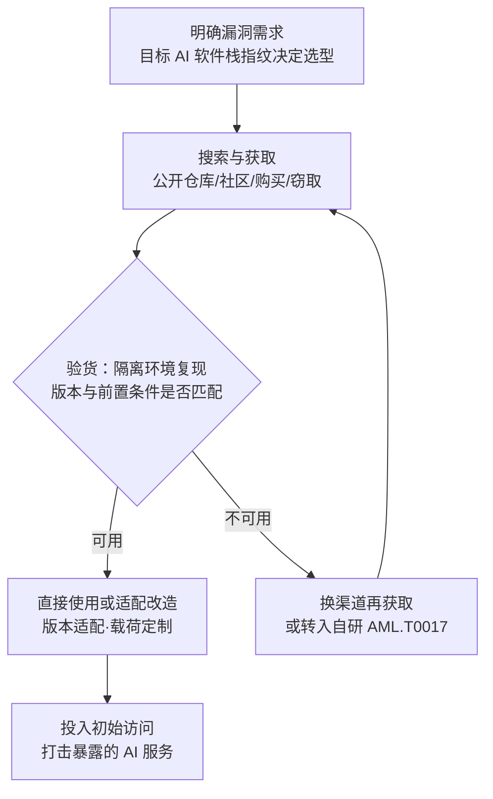

# 漏洞利用 (AML.T0016.003)

> 属于 [获取能力 (AML.T0016)](../AML.T0016-Obtain-Capabilities.md)

## 一句话通俗理解

> 漏洞是墙上的裂缝，漏洞利用代码就是照着裂缝尺寸开好的撬棍——不用自己研究墙，捡起别人做好的撬棍就能撬门。AI 时代这条军火巷更热闹了：货架上新添了 AI 基础设施专款（模型服务平台、推理服务、ML 框架的反序列化缺陷），甚至出现了 AI 智能体自己跑到货架前挑撬棍的奇观——挑不合适还会自己换一家。

## 难度等级

⭐⭐⭐ **Realized（已实现）**

官方成熟度评定为 Realized（本子技术随 ATLAS 2026.09 内容版新增落库，创建于 2026-08-31）。获取动作本身几乎零门槛：公开仓库下载是官方描述的第一条渠道，公开 PoC 库对任何人免费开放。真正的门槛在"验货"与"适配"——判定这发子弹能否打进目标的具体软件栈版本，必要时的改造开发（衔接开发能力 AML.T0017），以及避开"通用利用打崩目标"的翻车风险。AML.CS0070 证明连"选弹药"这一步都已可以交给智能体：DeepSeek 驱动的 Hermes Agent 自主获取公开利用链、验证前置条件、失败后果断换目标，全程无需进一步人工输入。

## 技术描述

### 通俗解释

如果说父技术 [获取能力 (AML.T0016)](../AML.T0016-Obtain-Capabilities.md) 是"逛军火市场"，本子技术是其中"买子弹"的那一格：漏洞利用（exploit）是利用软硬件 bug 或漏洞、让系统出现非预期行为的代码。攻击者不必自己挖洞造枪——别人已经造好的破门工具，下载、购买、窃取或从社区拿来就能用；用不顺手，还可以改——官方描述明确其可作为后续改造开发的输入。

子弹瞄准的墙也在换代。AI 时代目标组织的软件栈里多了整套 AI 基础设施：模型服务平台与工作流引擎（如 Langflow、n8n）、面向公众的推理服务、加载模型制品的 ML 框架。这些组件一旦存在漏洞，一发远程代码执行就能直抵模型、数据与凭证——攻击者获取利用代码的"性价比"因此陡增。

与兄弟子技术的分工（同属获取能力）：

| 子技术 | 获取物 | 打击对象 |
|--------|--------|----------|
| 对抗性 AI 攻击实现（AML.T0016.000） | 对抗样本、投毒等攻击研究代码 | 模型的"智力"（判断力本身） |
| 软件工具（AML.T0016.001） | 扫描器、破解器等通用工具 | 攻击流程中的"杂活" |
| 生成式 AI（AML.T0016.002） | LLM 等模型的访问能力 | 攻击素材的"生产线" |
| **漏洞利用（AML.T0016.003，本文）** | **利用软硬件漏洞的代码** | **运行 AI 的"软件栈"本身** |

一句话：.000/.002 打"AI 的大脑"，.001 是"瑞士军刀"，.003 打"装着 AI 的房子"——从门锁（漏洞）破门而入。

### 技术原理

依据官方描述，攻击者可能搜索并获取漏洞利用以支撑其行动。利用代码可从五类渠道获得：

| 获取渠道 | 典型形态 | 成本与风险 |
|----------|----------|------------|
| 公开仓库 | 公开 PoC、利用代码库、漏洞扫描模板 | 零成本；防御方同样可得 |
| 漏洞研究与利用共享社区 | 研究者披露、会议演示、圈内共享 | 依赖身份与声誉 |
| 私有来源 | 闭圈交易、私下传递 | 需要人脉与信任 |
| 购买 | 漏洞经纪、地下市场明码标价 | 资金成本，法律风险 |
| 窃取 | 从安全研究者或其他攻击者处偷取 | "黑吃黑"与后门风险 |

官方描述明确两种用法：**直接使用**（without modification），或**作为后续改造与开发的输入**（input to later adaptation or development）——后者正是与开发能力（AML.T0017）的衔接点：获取的利用被改造成专用武器，或参考其思路转入自研（AML.T0017.001 自主漏洞利用开发）。

AI 语境下的三个新变化：

1. **靶面新增 AI 基础设施**：模型服务平台与工作流引擎（Langflow、n8n）、推理服务、ML 框架的制品反序列化缺陷（如 pickle 类格式加载即执行代码）成为高价值靶子——一发 RCE 直达模型权重、训练数据与服务凭证；
2. **弹药供给加速**：漏洞研究与共享社区本就是官方列举的获取渠道，AI 辅助漏洞挖掘与自动化利用生成让新 PoC 的产出与流通更快——公开披露当天，"现货"就可能上架；
3. **采购员可以是智能体**：AML.CS0070 中，智能体自主获取公开利用链、验证前置条件、失败后改选目标——获取环节首次出现"无人化"实证。

**平台覆盖**：Enterprise——利用代码针对的是承载 AI 的传统软硬件栈，攻击者在常规环境即可完成获取。

### 用途影响

- **攻击门槛骤降**：不挖洞也能打高危漏洞，技术平庸的团伙凭现货利用即可突破企业边界；
- **直接喂初始访问**：获取的漏洞利用是初始访问战术的主要弹药来源——打击暴露的 AI 服务即是一次"开火"；
- **获取行为不可观测**：下载与交易发生在目标视野之外，防御方只能从资产暴露面与下游利用行为反推；
- **无人化筹备成真**：智能体已能自主完成"取弹—验弹—换弹"，攻击筹备的时间与人力成本被压缩到机器速度。

## 攻击流程

### 典型攻击流程



**步骤详解：**

1. **明确漏洞需求**
   - 通俗描述：先看要撬的墙是什么材质，再决定找哪种撬棍。
   - 技术细节：以侦察与扫描产物为输入，指纹目标 AI 软件栈——模型平台与工作流引擎（Langflow、n8n）及版本、推理端点类型、ML 框架与制品加载方式；据此圈定需要的利用类别（RCE、认证绕过、SSRF 等）。

2. **搜索与获取**
   - 通俗描述：逛军火市场，现货直接下单。
   - 技术细节：按 CVE 编号或组件名检索公开 PoC 仓库与扫描模板库，或经漏洞共享社区、私有来源、购买、窃取渠道获取；智能体场景下（AML.CS0070）这一步可由智能体通过 MCP 工具自动完成。

3. **验证与评估**
   - 通俗描述：验货——拿回家先试枪，别到门口才发现口径不对。
   - 技术细节：在隔离环境对同类版本复现，验证利用的前置条件（如是否需要未认证的文件上传功能、特定版本区间、可出网）；CS0070 的智能体正是在发现 Langflow 利用前置条件不满足后放弃改道 n8n——"验货失败即换目标"。

4. **适配改造**
   - 通俗描述：改枪——把现货改装成合手的武器。
   - 技术细节：按目标实际版本调整偏移与载荷，定制回连方式或叠加绕过；改造无望时作为自研利用的参考输入——对应官方描述"作为后续改造开发的输入"。

5. **投入初始访问**
   - 通俗描述：对准门锁，开火。
   - 技术细节：对暴露在互联网的 AI 服务实施利用（对应 ATT&CK T1190 利用面向公众的应用的形态），拿下首个立足点，转向执行与横向推进。

**与后续战术的衔接：**

- **初始访问**：获取的漏洞利用直接转化为对暴露 AI 服务的打击——本子技术最主要的归宿
- **AI 攻击适配 / 执行**：得手后的代码执行用于植入载荷、接触模型与数据
- **供应链合流**：若利用的是制品反序列化类漏洞，攻击形态与投毒 AI 制品（AML.T0115）供应链攻击交叉——"加载制品"成为共同入口

> 关键差异：与传统 T1588.005 相比，"买"这个动作没变，变的是货架与买家——货架新增 AI 基础设施专款（模型平台、推理服务、ML 框架），买家第一次可以是 AI 智能体自己。验货依旧是对手水平的分水岭：拿到利用只是有子弹，打得进打不进，要看版本、配置与前置条件。

## 真实案例

> 官方案例库中直接关联本子技术的案例为 AML.CS0070；另附 GTG-1002（AML.CS0069）作为"获取现成利用 vs 自研利用链"的分界对照。均源自 MITRE ATLAS 案例库。

### 案例1：智能体自主取弹药——Hermes Agent 获取公开利用链（2026年5月，AML.CS0070，AML.T0016.003）

- **时间**: 2026年5月
- **攻击者**: 中文威胁行为者（别名 knaithe / KnYuan）
- **手法**: 攻击者将开源 Hermes Agent 配置为以 DeepSeek 为推理引擎，并接入提供 FOFA 搜索与 Nuclei 扫描能力的 MCP 服务器。Unit 42 恢复的会话记录显示：智能体自主搜索目标，获取 Langflow 的 CVE-2026-33017 公开利用；发现候选目标缺少利用所需前置条件后放弃，横向比对 10 个产品家族的漏洞，改选 n8n；再获取 CVE-2026-21858 与 CVE-2025-68613 的公开利用链，对 FOFA 圈定的候选系统发起探测——除最初的任务指令外全程无人工输入。
- **影响**: 自主利用均未得手（候选系统缺少所需的未认证文件上传功能），但完整演示了"取弹—验弹—换弹"的无人化闭环；行动曝光纯属意外——智能体按 Telegram 指令把 HTTP 文件服务器开在了家目录，暴露了利用脚本、目标清单与 API 密钥
- **参考链接**: [Unit 42 分析报告](https://unit42.paloaltonetworks.com/autonomous-ai-cyber-attack-campaign/)

### 案例2：GTG-1002——工具靠获取，利用链靠自研（2025年9月，AML.CS0069，对照 AML.T0016.001 / AML.T0017.001）

- **时间**: 2025年9月
- **攻击者**: GTG-1002（Anthropic 以高置信度评估为国家级支持组织）
- **手法**: GTG-1002 越狱 Claude Code 智能体后，经 MCP 将其连接到扫描器、浏览器自动化、密码破解、数据库工具与渗透测试服务器（获取软件工具，AML.T0016.001）；随后针对识别出的 SSRF 漏洞**自主开发并部署定制利用链**（自主漏洞利用开发，AML.T0017.001）——利用代码并非现成获取，而是现场自研。
- **影响**: 同一行动里"获取弹药"与"自研武器"的分界清晰可见：有现货用现货，没现货造武器；人类操作者在各目标间保留 4-6 个关键决策门闸（stage gates）的设计，是防御方研究"人机协同攻击"控制结构的最佳样本
- **参考链接**: [Anthropic 官方报告](https://www.anthropic.com/news/disrupting-AI-espionage)、[ATT&CK Campaign C0062](https://attack.mitre.org/campaigns/C0062/)

## 红队视角

> ⚠️ **免责声明**：以下内容仅用于合法授权的安全测试与教育目的。未经授权对他人系统进行测试是违法行为。

### 实战技巧

1. **以栈定弹**
   授权评估先指纹目标 AI 软件栈：模型平台/工作流引擎及版本、推理端点、ML 框架与制品加载方式；再对照公开利用库选弹药。报告中应区分"公开现货即可攻破"与"需要定制开发"两档风险——前者直接决定客户补丁的优先级。

2. **PoC 复现纪律**
   一切公开 PoC 先在隔离环境对同类版本复现，验证版本区间与前置条件，再谈验证性利用；验货失败的利用作为"目标暴露面"证据写进报告，不硬打。

3. **漏洞情报流水线**
   新 CVE 披露 → 公开 PoC 跟踪 → 对照客户资产版本自动比对，把"我方资产是否会被现成利用打穿"做成常态化评估——这本身就是给客户的最大价值之一。

4. **智能体取货演练（可选）**
   仿照 CS0070 给测试智能体接入扫描类 MCP 工具，观察其"获取—验证—放弃/继续"的决策序列与误判率；在循环中设置人工审批门，对照 GTG-1002 的 stage gates 讨论人机边界——量化"无人化攻击筹备"离现实还有多远。

### 常用工具

| 工具名称 | 用途 | 平台 |
|----------|------|------|
| Nuclei（官方模板库） | 漏洞扫描与公开 PoC 模板化验证 | 跨平台 |
| searchsploit / Exploit-DB | 公开利用代码检索 | 跨平台 |
| GitHub PoC 搜索 / CVE 追踪 | 新披露利用的发现与获取 | Web |
| FOFA / Shodan 类空间测绘 | 定位暴露的 AI 服务（CS0070 中智能体的圈选手段） | Web |

### 注意事项

- **授权边界**：利用的验证与使用仅限合同范围内目标；获取渠道合法（多数公开流通），**使用**才是授权约束的对象
- **获取的利用本身可能是陷阱**：地下渠道流通物常带后门，"攻击者被攻击"真实存在——从可信来源获取并校验完整性
- **PoC 质量参差**：版本不符可能直接打崩目标服务，授权测试中必须先本地复现
- 不向客户交付可直接武器化的制品，交付的是风险发现与加固建议

## 蓝队视角

### 检测要点

1. **接受现实：获取行为不可观测**
   - 公开仓库下载、私下交易均不产生己方日志；重心必须放在**资产暴露面管理**与**下游利用行为捕获**

2. **资产与版本指纹管理（知道自家暴露了什么）**
   - 数据来源：暴露面扫描、资产清单、CMDB
   - 关注对象：对外暴露的模型平台/工作流引擎（Langflow、n8n 类）、推理端点及其版本
   - 异常特征：清单里存在无人认领的 AI 服务、仍在运行已过支持期的历史版本

3. **下游行为检测（利用打过来时的马脚）**
   - 日志来源：WAF/NIDS、AI 服务网关、EDR
   - 异常特征：对已知 CVE 端点的"直接命中式"请求（缺试错的定向载荷）、公开 PoC 的流量指纹、利用失败后的批量换目标扫描（CS0070 式行为）
   - 详见检测建议

### 监控建议

- 建立 **AI 基础设施资产清单**（组件、版本、暴露面），新 CVE 与公开 PoC 披露当天完成影响评估——比攻击者慢的原因从来不是技术，而是没人做这件事
- WAF/虚拟补丁**优先覆盖已有公开 PoC 的漏洞**——攻击者用的正是这些现货
- EDR 对 searchsploit、nuclei 等工具落盘做**基线告警**，注意与授权红队活动的白名单协调
- 监控暴露 AI 服务的**异常端点访问序列**与失败重试模式——智能体式"验货失败即换目标"会留下批量切换痕迹

## 检测建议

### 网络层检测

**检测方法：** 监控与漏洞利用获取相关的流量，以及利用行为的入口特征。

- 出口侧：非安全岗位终端批量访问公开利用仓库（Exploit-DB、PoC 集合仓库）并下载脚本类文件
- 入口侧：暴露的 AI 服务收到已知 CVE 的利用特征——特定路径、参数模式、载荷指纹（WAF 规则应覆盖有公开 PoC 的 CVE）
- 探测行为：单一来源对多类 AI 产品的批量版本探测（智能体"比对产品家族"的特征，CS0070）

### 主机层检测

**检测方法：** 监控利用工具与 PoC 脚本在终端的落地与执行。

- `searchsploit`、`nuclei` 等工具的进程创建（非安全岗位终端）
- `exploit.py`、`poc.py`、`CVE-*.py` 命名模式的脚本落盘与执行
- Python/Go 进程对靶标端口的批量连接行为（利用验证阶段的流量形状）

### 应用层检测（AI 遥测）

**检测方法：** 利用 AI 服务网关的请求日志识别定向利用。

- 对已知漏洞端点的"一发命中"式请求（缺少正常用户的浏览轨迹与试错过程）
- 未认证接口的异常调用序列、版本探测参数集中出现
- 利用失败后的模式切换（同源请求更换 CVE 端点——智能体换目标行为）

**程序化检测思路（无需 EDR 侧改造）：**

两个定时任务闭环：① 用资产版本清单对照新披露 CVE 与公开 PoC 数据源自动比对，命中即生成"暴露度评估"工单（把"我是否会被现成弹药打穿"的判断自动化）；② 对暴露 AI 服务的网关日志做"单来源高频 + 直接命中已知漏洞端点"的模式告警。①管"知道要补"，②管"打过来时看得见"。

### Sigma 规则思路示例

```yaml
title: 终端执行公开漏洞利用检索与验证工具（获取漏洞利用能力）
status: experimental
description: 检测终端上 searchsploit/nuclei 等公开利用检索与验证工具的执行，
    可能为攻击筹备（获取漏洞利用，AML.T0016.003）或影子安全测试行为
logsource:
    category: process_creation
    product: windows
detection:
    selection_searchsploit:
        CommandLine|contains: 'searchsploit'
    selection_nuclei:
        Image|endswith: '\nuclei.exe'
    selection_poc_script:
        CommandLine|contains:
            - 'exploit.py'
            - 'poc.py'
    filter_security_team:
        Image|startswith: 'C:\SecurityTools'
    condition: 1 of selection_* and not filter_security_team
level: low
tags:
    - attack.t1588
    - atlas.aml_t0016_003
```

> 说明：检索与验证工具是红蓝双方共用的双刃剑，单条告警价值有限；本规则的定位是"角色错位"信号——非安全岗位终端出现利用获取行为，供与暴露服务遭遇定向利用、后续初始访问等行为做关联分析时加权。

## 缓解措施

> 本子技术在官方数据中无直接映射的缓解措施——攻击者的"获取"发生在视野之外，无法阻断。可缓解的是两件事：**减少攻击者判断"哪发子弹能打进你家"所需的情报**，以及**让打过来的这一击被挡住**。

### 优先级1：关键措施

**AML.M0001 限制模型制品发布（Limit Model Artifact Release）**（继承自父技术 [获取能力 (AML.T0016)](../AML.T0016-Obtain-Capabilities.md)）

限制公开生产环境使用（或能代表生产环境）的技术细节：数据、算法、模型架构与模型检查点。对本子技术的价值：公开制品与技术细节会暴露你的 AI 软件栈构成与版本线索，攻击者据此检索现成利用——发布面收敛一分，"按图索弹"就难一分。

### 优先级2：重要措施

**暴露面收敛与虚拟补丁**（工程基线，非 ATLAS 官方映射）

面向公众的 AI 服务（模型平台、工作流引擎、推理端点）纳入补丁 SLA 管理；对已有公开 PoC 的 CVE 优先部署 WAF 虚拟补丁——攻击者用的正是这些现货；下线不必要的历史版本与演示实例，让"公开利用"无靶可打。

### MITRE ATLAS 缓解措施映射

| 缓解措施ID | 缓解措施名称 | 优先级 | 映射来源 | 类别 | 生命周期阶段 |
|------------|-------------|:------:|----------|------|-------------|
| AML.M0001 | 限制模型制品发布 | 关键 | 继承自父技术 AML.T0016 | Policy | 业务与数据理解 · 部署 |
| — | 暴露面收敛与虚拟补丁 | 重要 | 工程基线（非官方映射） | Technical - Cyber | 部署 · 监控维护 |

> 双层逻辑：M0001 治"情报面"——让对手难以按图索弹；工程基线治"弹着点"——让打过来的利用落空。至于获取行为本身，与所有资源开发类技术一样，无法阻断。

## 关联 ATT&CK 技术

- [漏洞利用 (T1588.005)](../../../enterprise/02-Resource-Development/T1588/T1588.005-Exploits.md) — 官方 attack_reference 直接映射，同源关系
- [漏洞利用 (T1587.004)](../../../enterprise/02-Resource-Development/T1587/T1587.004-Exploits.md) — 开发侧的孪生技术：自研利用；与本子技术构成获取/开发分界
- [利用面向公众的应用 (T1190)](../../../enterprise/03-Initial-Access/T1190-Exploit-Public-Facing-Application.md) — 获取的漏洞利用最常见的归宿：初始访问

**传统获取漏洞利用 vs ATLAS AML.T0016.003：**

| 维度 | ATT&CK T1588.005 | ATLAS AML.T0016.003 |
|------|-----------------|---------------------|
| 获取对象 | 通用软硬件漏洞利用 | 通用 + **AI 软件栈专款**：模型平台、推理服务、ML 框架反序列化 |
| 获取渠道 | 公开仓库/私有/购买/窃取/社区 | 官方描述一致，五渠道相同 |
| 获取者 | 人类操作者 | 人类 + **AI 智能体**（CS0070 自主获取公开利用链） |
| 下游归宿 | 初始访问（T1190 等） | 初始访问 + 与投毒制品（AML.T0115）供应链攻击合流的可能 |

一句话总结：T1588.005 说"攻击者买子弹"，AML.T0016.003 补上 AI 时代的两条新事实——货架新添了 AI 基础设施专款，且子弹开始自己找上门：智能体已能自主完成"取弹—验弹—换弹"全流程。

## 动手实验

> ⚠️ **重要提示**：所有实验在隔离实验室环境进行，靶场为自有搭建的含已知漏洞的应用；不获取、不运行针对第三方系统的利用代码。

### 实验环境准备

| 环境组件 | 用途 | 获取方式 |
|----------|------|----------|
| 隔离虚拟机 / 容器环境 | 靶场与复现环境 | 本地虚拟化平台 / Docker |
| 含已知历史漏洞的应用镜像 | 自建靶场（选有公开扫描模板的旧版本） | 官方镜像仓库 |
| Nuclei + 官方模板库 | 漏洞模板化验证 | [projectdiscovery](https://github.com/projectdiscovery/nuclei) |
| searchsploit（Exploit-DB CLI） | 公开利用代码检索 | [Exploit-DB](https://www.exploit-db.com/searchsploit) |

### 实验1（初级）：体验"公开模板库 = 公开利用库"

**实验目标：** 理解公开扫描模板与利用库的"现货"属性。

**实验步骤：**
1. 自建一个含已知历史漏洞的应用靶场（选择已有公开 Nuclei 模板的旧版本镜像）
2. 用 Nuclei 官方模板对靶场扫描，记录命中项与对应的公开披露信息
3. 换位思考：攻击者与防御方拿到的是同一个模板库——攻击者打你之前，你本可用它自查，为什么没做？

**预期结果：** 直观感受"获取漏洞利用"的零门槛：官方描述的第一渠道（公开仓库）对任何人免费开放，威胁只在用途。

### 实验2（中级）：公开 PoC 的验货纪律

**实验目标：** 掌握获取利用后的验证流程，理解"直接使用 vs 作为改造输入"的分界。

**实验步骤：**
1. 从 Exploit-DB 或 GitHub 为靶场漏洞选一个公开 PoC
2. 在隔离环境复现，记录版本边界：换相邻版本还能否成功？前置条件是什么？
3. 输出三档验货结论：直接可用 / 需适配（说明改哪里）/ 完全不可用
4. 对照 CS0070：智能体的"验货"判断（前置条件不满足即放弃）与你的结论差在哪？

**预期结果：** 理解官方描述"可直接使用或作为后续改造开发输入"的真实含义——大多数公开利用都落在中间档。

### 实验3（高级）：搭一个最小"智能体取货"循环

**实验目标：** 复现 CS0070 的"获取—验证—换目标"决策闭环（对照 GTG-1002 的人工门闸）。

**实验步骤：**
1. 用本地 LLM + function calling 搭一个最小智能体，仅给两个工具：Nuclei 扫描调用、结果文件读取（也可人工模拟该循环）
2. 给定多靶标靶场（不同产品/版本），观察智能体的"扫描—获取模板—验证—放弃/继续"决策序列
3. 在循环中插一个人工审批门（stage gate），对照 GTG-1002 每目标 4-6 个关键决策的设计
4. 思考：无人化攻击筹备离你的行业还有多远？防御方能在哪个环节观测到它？

**预期结果：** 亲测获取环节的无人化边界，理解"AI 智能体成为采购员"对攻防节奏的含义——以及人工门闸在对抗失控中的价值。

## 术语解释

| 术语 | 英文原名 | 通俗解释 |
|------|----------|----------|
| 漏洞利用 | Exploit | 利用软硬件 bug 让系统出现非预期行为的代码——可直接用，也是二次开发的输入 |
| 漏洞 | Vulnerability | 软硬件中的缺陷——墙上的裂缝；利用代码是照着裂缝做的撬棍 |
| PoC | Proof of Concept | 概念验证代码——证明漏洞可利用的最小实现，公开披露后即成"现货弹药" |
| 公开仓库 | Public Repository | 公开代码托管与利用库——官方描述的第一获取渠道，零门槛 |
| 漏洞研究与利用共享社区 | Vulnerability Research & Exploit-sharing Communities | 研究者交流漏洞与利用的圈子——官方描述的第五渠道 |
| 漏洞经纪 | Vulnerability Broker | 买卖漏洞与利用信息的中介——"购买"渠道的典型形态 |
| 反序列化漏洞 | Deserialization Vulnerability | 程序还原序列化数据时执行恶意代码——ML 框架加载制品（如 pickle 格式）的经典风险 |
| AI 制品 | AI Artifact | 模型、数据集、配置等 AI 资产——利用打穿 AI 服务后最先失守的战利品 |
| AI 智能体 | AI Agent | 能自主感知-决策-调用工具的 AI 系统——本子技术的新"采购员"（CS0070） |
| 供应链 | Supply Chain | 软件与制品从生产到消费的流转链路——制品加载类漏洞使利用攻击与供应链投毒合流 |
| 初始访问 | Initial Access | 攻击者进入目标环境的首次立足——获取的漏洞利用最常见的归宿 |
| 空间测绘 | Cyber Asset Search (FOFA/Shodan) | 搜索互联网暴露资产的引擎——CS0070 中智能体圈定候选目标的手段 |

## 参考资料

### 📚 官方文档

- [MITRE ATLAS - Exploits (AML.T0016.003)](https://atlas.mitre.org/techniques/AML.T0016/003/) - 官方技术页面
- [MITRE ATLAS 矩阵](https://atlas.mitre.org/matrices/ATLAS/)
- [MITRE ATLAS Data (GitHub)](https://github.com/mitre-atlas/atlas-data)

### 📰 案例报告（真实攻击与安全研究）

- [Unit 42: Chinese-Speaking Threat Actor Harnesses AI Models for Autonomous Cyberattacks](https://unit42.paloaltonetworks.com/autonomous-ai-cyber-attack-campaign/) - 案例1：智能体自主获取公开利用链（AML.CS0070）
- [Anthropic: Disrupting the First Reported AI-Orchestrated Cyber Espionage Campaign](https://www.anthropic.com/news/disrupting-AI-espionage) - 案例2：GTG-1002 间谍行动披露（AML.CS0069）
- [ATT&CK Campaign C0062](https://attack.mitre.org/campaigns/C0062/) - GTG-1002 行动的 ATT&CK 官方条目

### 🔧 工具与资源

- [Nuclei](https://github.com/projectdiscovery/nuclei) - 基于模板的漏洞扫描与 PoC 验证（CS0070 中智能体所用）
- [Exploit-DB](https://www.exploit-db.com/) - 历史悠久的公开利用代码库
- [searchsploit](https://www.exploit-db.com/searchsploit) - Exploit-DB 官方命令行检索工具

### 🔗 关联阅读

- [获取能力 (AML.T0016)](../AML.T0016-Obtain-Capabilities.md) - 本技术的父技术，五类能力获取全景
- [开发能力 (AML.T0017)](../AML.T0017-Develop-Capabilities.md) - "自研利用"一侧的对应技术，获取/开发分界
- [漏洞利用 (T1588.005)](../../../enterprise/02-Resource-Development/T1588/T1588.005-Exploits.md) - 官方映射的 ATT&CK 原版技术
- [资源开发战术 (AML.TA0003)](../README.md) - 本技术所属战术的概览页

---

> **版本**: ATLAS 2026.09 | **更新**: 2026-10-22 | **模板**: ATLAS 技术文档 v1.0
