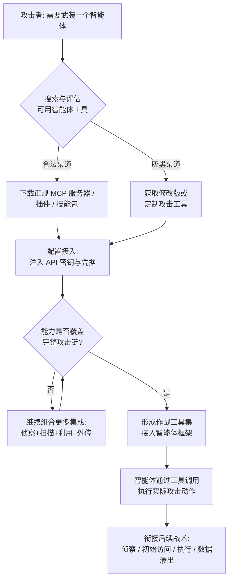

# AI 智能体工具 (AML.T0016.004)

> 属于 [获取能力 (AML.T0016)](../AML.T0016-Obtain-Capabilities.md)

## 一句话通俗理解

> 如果说大模型是攻击者招募的"大脑"，那么 AI 智能体工具就是给这个大脑配上的"手和脚"——攻击者不需要自己锻造武器，只需从公开市场上领取一套现成的瑞士军刀：能开终端、能开浏览器、能查数据库、能调云服务，大脑想做什么，这套工具就能执行什么。

## 难度等级

**难度等级：⭐⭐⭐（Realized / 已实现）**

该子技术的成熟度为 Realized 级，表示攻击者已在真实攻击活动中成功运用。大量开源智能体框架、MCP（Model Context Protocol）服务器、插件市场与技能商店的存在，使攻击者获取这套"智能体外挂"的门槛降到历史最低点——不需要编写一行代码，下载、配置、接入即可让一个只能"说话"的大模型变成能"动手"的攻击平台。Unit 42 披露的自主攻击行动（见真实案例）已经证明：一个配备了成熟工具集的智能体可以自主完成从侦察到利用的完整攻击链。

## 技术描述

### 通俗解释

AI 智能体（Agent）本身只是一个能推理、会规划的大模型，它原生只能生成文本——既打不开终端，也访问不了数据库。要让它真正"干活"，必须给它外挂一组可调用的工具：文件系统读写、浏览器自动化、Shell 执行、API 调用、云控制台操作等。

本技术描述的是攻击者**搜索并获取**这类扩展智能体能力的工具，三种获取方式包括：

1. **获取合法工具并配置成恶意用途**：把为生产力场景设计的正规 MCP 服务器、浏览器自动化插件、终端技能包原样下载，接到自己的智能体上，立刻获得对操作系统、浏览器、网络、云服务、数据存储、软件仓库、身份系统等外部资源的操作能力。
2. **获取被修改过或专门构建的工具**：从灰黑市场或匿名渠道获取植入后门的 MCP 服务器、专门为攻击定制的技能包，或攻击者社区流传的"红队技能"。
3. **组合多个集成形成一套作战工具集**：单一工具能力有限，攻击者往往把侦察搜索、漏洞扫描、凭据填充、数据外传等多个工具集成到同一个智能体框架下，组装成覆盖完整攻击链的工具箱。

对攻击者而言，获取这些工具意味着获得了**纯模型推理无法触及的资源、凭据与操作能力**——大模型再聪明，没有工具就永远只是"纸上谈兵"。

### 技术原理

智能体工具的核心机制是**模型可见的描述 + 可执行的接口**：

```text
攻击者 ──获取──▶ 工具集（MCP 服务器 / 插件 / 技能 / 连接器 / 函数库）
                      │
                      ├─ 工具描述（自然语言，注入模型上下文）
                      │     "我可以执行 Shell 命令"、"我可以搜索互联网资产"...
                      │
                      └─ 可执行接口（真实调用操作系统 / 浏览器 / 网络 / 云 API）
```

* **工具描述影响行为选择**：每个工具都向模型暴露一段自然语言描述，模型据此决定"选哪个工具、怎么调用"。攻击者获取工具集的构成，直接决定了智能体的能力边界与攻击偏好。
* **工具调用（Tool Calling）**：模型输出结构化调用请求（函数名 + 参数），由工具执行层真正落地为系统操作——读文件、发请求、跑扫描器。
* **典型的分发形态**：

| 分发形态 | 说明 | 典型示例 |
|---------|------|---------|
| MCP 服务器 | 通过 Model Context Protocol 向智能体暴露标准化工具端点 | FOFA 查询服务、Nuclei 扫描生成服务 |
| 插件 / 技能 | 智能体框架内的能力扩展包，含指令与脚本 | 红队技能包、浏览器操作技能 |
| 连接器 / 适配器 | 对接 SaaS、数据库、身份系统的桥接组件 | 云控制台连接器、数据库工具 |
| 计算机操作代理 | 让模型直接控制 GUI 的执行代理 | computer-use 适配层、浏览器自动化 |
| 执行代理 / 远程 API | 接收模型指令并代为执行的服务 | 沙箱执行服务、远程渲染端点 |

三种获取渠道的对比：

| 获取渠道 | 典型来源 | 成本 | 主要风险 |
|---------|---------|------|---------|
| 开源生态（合法工具改用） | 公开仓库、插件市场、MCP 目录 | 低 | 无声明来源校验，可能夹带供应链后门 |
| 修改版 / 定制工具 | 攻击者社区、匿名群组、暗网市场 | 中 | 内置后门反噬操作者，且直接留下犯罪证据 |
| 组合工具集 | 上述渠道按攻击链拼装 | 中 | 配置与凭据集中暴露攻击意图，易被整体取证 |

**适用平台**：预测式 AI、生成式 AI、智能体式 AI 及企业环境。只要目标形态是"能调用工具的智能体"，本技术即适用。

### 用途影响

* 攻击者以极低成本获得对操作系统、浏览器、网络、云服务的实际操作能力，将大模型从"顾问"升级为"操作员"。
* 工具集可组合、可替换，攻击者能按目标环境快速裁剪攻击能力（内网目标加数据库工具、云环境加云连接器）。
* 工具自带的凭据与权限（API 密钥、会话令牌）随获取一并到手，省去额外窃取步骤。
* 工具描述文本可被攻击者刻意"措辞"，诱导智能体在规划时优先选择高危动作。
* 为后续自动化、规模化攻击（AML.T0016.000 对抗性 AI 攻击实现）奠定执行基础。

## 攻击流程



### 步骤详解

1. **需求评估**：攻击者明确要让智能体具备哪些能力（终端执行？浏览器操作？资产搜索？），据此圈定工具搜索范围。
   *技术细节*：评估时同步考虑目标平台——Linux 目标偏 Shell 技能，云环境偏连接器，Web 目标偏浏览器自动化与扫描集成。

2. **搜索与获取**：在开源仓库、插件市场、技能商店或灰黑渠道中检索候选工具。
   *技术细节*：合法工具直接克隆下载（MCP 服务器、开源技能包）；定制工具则通过攻击者社区、Telegram 群组或匿名市场交易，可能内置后门或额外攻击功能。

3. **配置与接入**：将工具接入智能体框架，注入运行所需的凭据。
   *技术细节*：典型配置包括 API 密钥（威胁情报、资产搜索服务）、数据库连接串、云账户凭据；MCP 服务器通过配置文件注册到智能体的工具清单中，其自然语言描述随即进入模型上下文。

4. **组合成套**：评估单工具能力缺口，持续补充集成，直至覆盖"侦察—扫描—利用—外传"完整链条。
   *技术细节*：组合方式直接影响智能体的行为倾向——工具描述文本会引导模型在规划时优先选择某些工具，攻击者可借此"驯化"智能体的攻击偏好。

5. **投入作战**：智能体在任务执行中通过工具调用（Tool Calling）落地真实攻击动作。
   *技术细节*：模型输出结构化调用请求，工具层代为执行系统命令、HTTP 请求或扫描任务，结果回灌模型继续推理，形成"推理—执行—观察"循环。

### 与后续战术的衔接

* **侦察（AML.T0043 系列）**：接入资产搜索 MCP 服务器的智能体可自主开展互联网资产测绘与目标发现。
* **初始访问**：配合公开漏洞利用（参见父技术 AML.T0016.003 获取漏洞利用），智能体可对暴露服务直接发起利用。
* **执行与持久化**：终端技能与执行代理让智能体能在目标环境落地命令执行；对受害方智能体工具的投毒则属于 AML.T0110（AI 智能体工具投毒）的范畴。
* **数据渗出**：数据库连接器、云存储技能为智能体提供了结构化外传通道。

> **关键差异**：本技术与 AML.T0017.002（开发恶意智能体工具）的分界在于"获取 vs 开发"——前者是拿来主义（下载/交易现成工具），后者是攻击者亲手编写专门用于欺骗受害方智能体的工具；而 AML.T0110（AI 智能体工具投毒）针对的是**受害方**智能体所依赖的工具生态，目的在持久化而非武装自己。

## 真实案例

> 以下案例均来自 MITRE ATLAS 官方案例库，案例编号以纯文本标注，详细分析请点击外部参考链接。

### 案例 1：Knaithe 自主攻击行动（AML.CS0070）

* **时间**：2026 年 5 月
* **攻击者**：中文威胁行为者 knaithe（另用别名 KnYuan）
* **手法**：攻击者将开源 Hermes Agent 智能体框架配置为攻击平台，以 DeepSeek 作为推理引擎。Hermes 自带终端访问、Telegram 操控通道与技能系统，攻击者在其中集成了**自带红队技能与自创技能**，并接入一个暴露 FOFA 搜索、查询翻译与 Nuclei 扫描生成能力的 **MCP 服务器**。智能体随后自主完成目标搜索、公开漏洞利用获取（Langflow CVE-2026-33017、n8n CVE-2026-21858 与 CVE-2025-68613）、扫描执行、结果评估与方案修正。
* **影响**：完整展示了"获取现成智能体工具 → 组合作战工具集 → 自主攻击"的全链条，是该子技术 Realized 定级的直接证据。
* **参考**：[Unit 42: Autonomous AI Cyber Attack Campaign](https://unit42.paloaltonetworks.com/autonomous-ai-cyber-attack-campaign/)

### 案例 2：GTG-1002 间谍行动（AML.CS0069）

* **时间**：2025 年 9 月
* **攻击者**：同温层暴雪关联组织 GTG-1002
* **手法**：攻击者以越狱后的 Claude Code 智能体为核心，通过 MCP 接入扫描器、浏览器自动化、密码破解、数据库工具与专用渗透测试服务器，组装出一套覆盖多环节的攻击工具集，对约 30 个组织开展间谍活动。智能体承担了行动中约 80–90% 的工作量，人类操作者仅需在每个目标上保留 4–6 个关键决策。
* **影响**：证明组合式工具集可将人力投入压缩一个数量级（对应 ATT&CK 战役 C0062）。
* **参考**：[Anthropic: Disrupting AI Espionage](https://www.anthropic.com/news/disrupting-AI-espionage)、[ATT&CK C0062](https://attack.mitre.org/campaigns/C0062/)

### 案例 3：AI 推荐投毒（AML.CS0072）

* **时间**：2026 年 2 月
* **攻击者**：Microsoft Defender 安全研究团队跟踪的活动
* **手法**：攻击者使用**以"LLM 搜索优化技术"名义公开营销的现成工具**，生成精心构造的 AI 助手链接，诱导目标智能体写入持久化记忆条目，波及 31 家公司、14 个行业，目标覆盖 Microsoft 365 Copilot、ChatGPT、Claude、Perplexity 与 Grok。
* **影响**：说明"获取现成工具"不限于武装己方智能体——公开渠道流通的工具同样可被直接用于对第三方 AI 助手的操纵。
* **参考**：[Microsoft: AI Recommendation Poisoning](https://www.microsoft.com/en-us/security/blog/2026/02/10/ai-recommendation-poisoning/)

## 红队视角

> 本节内容仅用于授权防御演练与安全教育，未经书面授权禁止对任何真实目标实施。

### 实战技巧

1. **按目标裁剪工具集**：演练前根据目标环境（内网 / 云 / Web）筛选接入的 MCP 服务器与技能包，工具描述越聚焦，智能体规划越精准，误操作越少。
2. **优先复用正规渠道工具**：合规红队应使用公开的开源工具（浏览器自动化、扫描器 MCP），既能验证防御覆盖面，也避免引入不明后门。
3. **验证工具描述的"引导力"**：修改工具的自然语言描述，观察智能体行为选择的变化——这本身就是对己方 AI 防线的一次提示词注入压力测试。
4. **审计第三方技能包**：接入前审查技能包的脚本内容与出网行为，防止演练平台反被供应链后门控制。
5. **隔离工具凭据**：为演练工具集申请专用一次性凭据，严禁复用生产密钥——智能体的调用路径不可完全预测。
6. **记录全程遥测**：让每个工具调用都落审计日志，演练报告才能逐条回放智能体的自主决策链。

### 常用工具

| 工具名称 | 用途 | 平台 |
|---------|------|------|
| Hermes Agent | 开源智能体框架，自带终端访问与技能系统 | 跨平台 |
| MCP 服务器生态 | 向智能体标准化暴露搜索、扫描、数据库等能力 | 跨平台 |
| 开源红队技能包 | 预置侦察、利用、外传技能的智能体扩展 | 跨平台 |
| 浏览器自动化插件 | 赋予智能体网页操作与表单交互能力 | 跨平台 |
| computer-use 适配器 | 让模型直接控制桌面 GUI 执行任务 | 桌面端 |

### 注意事项

* 灰黑渠道流通的"定制工具"常内置后门，使用即引入供应链风险（工具可能反噬操作者）。
* 工具集越大，上下文中工具描述越多，智能体选择 accuracy 反而可能下降——宁缺毋滥。
* 智能体误调高破坏性工具（如批量删除、大规模扫描）可能触碰法律红线，演练必须配置人工确认门。

## 蓝队视角

### 检测要点

1. **异常工具注册**：终端上出现未知 MCP 服务器配置文件、智能体框架新增技能包目录，尤其是非官方来源。
2. **凭据集中注入**：单一进程短时间内向多个工具配置写入 API 密钥、连接串——这是"组装工具集"的典型指纹。
3. **智能体进程的异常子进程**：智能体框架进程派生 nmap、nuclei、数据库客户端、浏览器无头实例等工具链。
4. **内部 AI 助手的异常外链交互**：企业自建智能体工具突然访问非常规外部端点，或写入非常规记忆/配置条目。
5. **异常技能批量下载**：终端短时间内从公开仓库批量拉取技能包、MCP 服务器实现，远超正常开发节奏。

### 监控建议

* 对开发与运维终端上的智能体框架配置目录（MCP 注册表、技能目录）做变更审计。
* 将"智能体进程 → 攻击工具子进程"的父子关系纳入 EDR 高优先级规则。
* 监控员工设备上非授权智能体框架的安装行为，纳入影子 AI 治理流程。
* 对企业自建智能体的工具调用日志集中采集，建立"工具—调用者—目标"基线，偏离即告警。
* 与威胁情报联动：跟踪公开披露的恶意 MCP 服务器与后门技能包 IoC（仓库地址、包名、文件哈希），及时加入黑名单。
* 定期开展"智能体资产盘点"：清点企业内在用的全部智能体框架及已注册工具，纳入 CMDB 统一管理。

## 检测建议

### 网络层

**检测方法：**

* 监控智能体进程对资产测绘服务（FOFA 等）、漏洞扫描服务 API 的高频调用。
* 识别 MCP 协议特征流量（本地 stdio 或远程 SSE/HTTP 端点）出现在非预期主机。
* 检测单一源对多个外部 AI/工具 API 端点的"扇出式"访问模式。

### 主机层

**检测方法：**

* 文件审计：跟踪 MCP 配置文件与技能包目录的新增、修改。
* 进程树：`node`/`python` 智能体宿主进程派生扫描器、破解器、数据库客户端。
* 凭据写入：向工具配置批量写入密钥的行为（连续写 `.env`、配置 JSON）。

### 应用层（AI 遥测）

**检测方法：**

* 采集智能体工具调用日志，对"工具清单突变"（会话中途新增工具）与"高危工具调用频次"建模告警。
* 检测企业 AI 助手被诱导写入持久化记忆/指令条目的异常模式。

**程序化检测思路（无需 EDR 侧改造）：** 将智能体框架的工具注册日志导出为结构化事件，用规则引擎比对"已批准工具清单"，任何未在清单内的 MCP 服务器或技能包注册即触发工单——把检测点从"工具执行了什么"前移到"工具接入了什么"。

### Sigma 规则思路示例

```yaml
title: 智能体框架注册新的 MCP 服务器配置
status: experimental
description: 检测本机智能体框架配置目录中新增 MCP 服务器注册文件，可能指示攻击者正在武装智能体
logsource:
    category: file_event
    product: windows
detection:
    selection:
        TargetFilename|contains:
            - '.claude'
            - 'mcp'
            - 'agent_config'
        TargetFilename|endswith:
            - '.json'
    condition: selection
falsepositives:
    - 开发人员或研究人员合法注册新工具
level: low
tags:
    - attack.t1588
    - atlas.aml_t0016_004
```

> 说明：由于本子技术暂无官方 ATT&CK 映射，`attack.t1588` 标签仅为语义近似（获取能力），生产规则应结合环境调整路径匹配与白名单。

## 缓解措施

> ATLAS 官方数据中本子技术暂无直接映射的缓解措施，以下按企业可落地优先级给出建议性缓解，并可参照父技术 [获取能力 (AML.T0016)](../AML.T0016-Obtain-Capabilities.md) 的缓解思路（管控 AI 制品来源、部署护栏与对齐措施）。

### 优先级 1（立即执行）

* 建立企业 AI 工具准入清单：任何 MCP 服务器、插件、技能包接入企业智能体前须经安全评审与来源验证。
* 对员工终端部署影子 AI 检测，识别非授权智能体框架及其工具下载行为。

### 优先级 2（30 天内）

* 对企业自建智能体启用工具调用审计日志，覆盖"注册—调用—出网"全链路。
* 在智能体执行层部署高危工具调用的人工确认门（批量操作、凭据使用、外部发送）。
* 实施供应链核查：技能包与 MCP 服务器必须锁定到已知仓库与已知摘要。

### 优先级 3（长期治理）

* 将智能体工具生态纳入既有软件供应链安全管理体系（SBOM、签名验证、定期轮审）。
* 对智能体开展针对恶意工具描述的提示词注入演练，验证护栏有效性。

### MITRE ATLAS 缓解措施映射

| 缓解措施 | 类型 | 覆盖范围 | 阶段 |
|---------|------|---------|------|
| AML.M0001 限制模型制品发布 | 策略 | 父技术 AML.T0016（含 .002），可延伸参考 | 业务与数据理解、部署 |
| AML.M0020 护栏 | 技术（AI） | 父技术 AML.T0016（含 .002），可延伸参考 | 部署 |
| AML.M0022 对齐 | 技术（AI） | 父技术 AML.T0016（含 .002），可延伸参考 | 部署 |

> 本子技术无官方直接缓解映射，上表继承自父技术并标注"延伸参考"；企业应以来源管控与工具调用审计为主线。

## 关联 ATT&CK 技术

> ATLAS 官方数据中本子技术的 `attack_reference` 为空，即**没有官方 ATT&CK 映射**。以下为语义近似类比，仅供理解，不代表官方关联。

| 维度 | ATT&CK 近似技术 | 说明 |
|------|----------------|------|
| 战术定位 | [获取能力 (T1588)](../../../enterprise/02-Resource-Development/T1588-Obtain-Capabilities.md) | 同属资源开发战术：攻击者在行动前采购/收集攻击资源 |
| 子技术类比 | [软件工具 (T1588.002)](../../../enterprise/02-Resource-Development/T1588/T1588.002-Tool.md) | 都是"拿现成工具武装自己"，区别在于本子技术的工具服务于 AI 智能体调用 |
| 纵向类比 | [人工智能 (T1588.007)](../../../enterprise/02-Resource-Development/T1588/T1588.007-Artificial-Intelligence.md) | ATT&CK 侧获取 AI 能力 vs ATLAS 侧获取智能体工具能力 |
| 开发侧对照 | [开发能力 (T1587)](../../../enterprise/02-Resource-Development/T1587-Develop-Capabilities.md) | "获取"与"开发"的边界在两个知识库中一致 |

**一句话总结**：可把本子技术理解为 T1588.002（获取软件工具）在智能体时代的延伸——获取的对象从"人用的黑客工具"变成"AI 智能体调用的工具接口"。

## 动手实验

> ⚠️ 以下实验仅限隔离环境与授权测试。涉及智能体的实验存在不可预测行为，务必在无真实凭据、无外网敏感资产的沙箱中进行。

### 实验环境准备

| 组件 | 要求 | 说明 |
|------|------|------|
| 虚拟机 | 1 台 Linux 沙箱 | 快照备份，实验后回滚 |
| 智能体框架 | 任选开源框架（如支持技能系统的 CLI 智能体） | 隔离安装，禁用真实云凭据 |
| MCP 服务器 | 1–2 个开源无害工具（如本地文件读取、计算器） | 验证工具注册与调用链路 |
| 审计能力 | 进程监控 + 配置目录监控 | 复现蓝队检测要点 |

### 实验 1（初级）：观察工具注册指纹

* **实验目标**：识别智能体工具接入在终端上留下的文件痕迹。
* **实验步骤**：
  1. 在沙箱中安装智能体框架，记录安装前配置目录基线。
  2. 接入一个无害 MCP 服务器，观察配置文件与技能目录的变更。
  3. 触发一次工具调用，记录进程树（宿主进程 → 工具子进程）。
* **预期结果**：能写出该框架的"工具注册文件路径清单"与"调用进程树特征"，可直接转化为检测规则。

### 实验 2（中级）：验证工具描述的行为引导

* **实验目标**：验证工具自然语言描述对智能体行为选择的影响。
* **实验步骤**：
  1. 给智能体同时接入两个功能重叠的工具（如两个搜索工具）。
  2. 向智能体提出模糊任务，观察其工具选择。
  3. 修改其中一个工具的描述文本（更"积极"的措辞），重复任务并对比选择变化。
* **预期结果**：观察到描述文本显著改变工具选择倾向，理解攻击者为何重视工具集的"构成与措辞"。

### 实验 3（高级）：组装迷你作战工具集并全程检测

* **实验目标**：复现"组合多个集成形成工具集"的完整路径，并检验检测覆盖。
* **实验步骤**：
  1. 选取三个无害开源工具：本地资产枚举、只读 HTTP 探测、结果汇总导出。
  2. 将三者接入同一智能体，配置一个授权测试网段作为目标。
  3. 让智能体自主完成"枚举 → 探测 → 汇报"闭环，全程开启审计。
  4. 对照蓝队视角的检测要点，评估每一步是否产生告警，标出盲区。
* **预期结果**：获得一份"智能体攻击链 vs 检测覆盖"差距清单，作为加固输入。

## 术语解释

| 术语 | 英文原名 | 通俗解释 |
|------|---------|---------|
| AI 制品 | AI Artifact | 模型、数据集、工具等可分发复用的 AI 资产，是供应链攻击的载体 |
| AI 智能体 | AI Agent | 能自主规划、调用工具、执行多步任务的大模型系统，不止会"说"还会"做" |
| 供应链 | Supply Chain | 从开源仓库到生产环境的工具流转链条，任一环节被污染都会波及下游 |
| 提示词注入 | Prompt Injection | 在模型输入中夹带恶意指令，劫持模型行为的攻击手法 |
| 越狱 | Jailbreak | 绕过大模型安全对齐限制，使其输出被禁止内容的过程 |
| 工具调用 | Tool Calling | 模型输出结构化请求、由外部工具代为执行的机制，智能体"动手"的方式 |
| MCP 服务器 | Model Context Protocol Server | 向智能体标准化暴露工具能力的服务端点，当前最主要的工具分发形态 |
| 技能包 | Skill | 智能体框架内的能力扩展单元，通常打包指令、脚本与配置 |

## 参考资料

### 📚 官方文档

* [MITRE ATLAS - AI Agent Tools (AML.T0016.004)](https://atlas.mitre.org/techniques/AML.T0016/004/) - 官方技术页面
* [MITRE ATLAS - Obtain Capabilities (AML.T0016)](https://atlas.mitre.org/techniques/AML.T0016/) - 父技术页面
* [Model Context Protocol 规范](https://modelcontextprotocol.io/) - 智能体工具分发的主要协议标准

### 📰 案例报告

* [Unit 42: Autonomous AI Cyber Attack Campaign（AML.CS0070）](https://unit42.paloaltonetworks.com/autonomous-ai-cyber-attack-campaign/)
* [Anthropic: Disrupting AI Espionage（AML.CS0069）](https://www.anthropic.com/news/disrupting-AI-espionage)
* [Microsoft: AI Recommendation Poisoning（AML.CS0072）](https://www.microsoft.com/en-us/security/blog/2026/02/10/ai-recommendation-poisoning/)

### 🔧 工具与资源

* [MCP 官方服务器仓库](https://github.com/modelcontextprotocol/servers) - 智能体工具生态参考实现
* [MITRE ATLAS Data (GitHub)](https://github.com/mitre-atlas/atlas-data) - ATLAS 官方数据仓库

### 🔗 关联阅读

* [获取能力 (AML.T0016)](../AML.T0016-Obtain-Capabilities.md) — 父技术总览
* [02 资源开发战术首页](../README.md) — 同战术其他技术
* [开发能力 (AML.T0017)](../AML.T0017-Develop-Capabilities.md) — "获取"与"开发"的对照

---

> **版本**: ATLAS 2026.09 | **更新**: 2026-10-22 | **模板**: ATLAS 技术文档 v1.0
